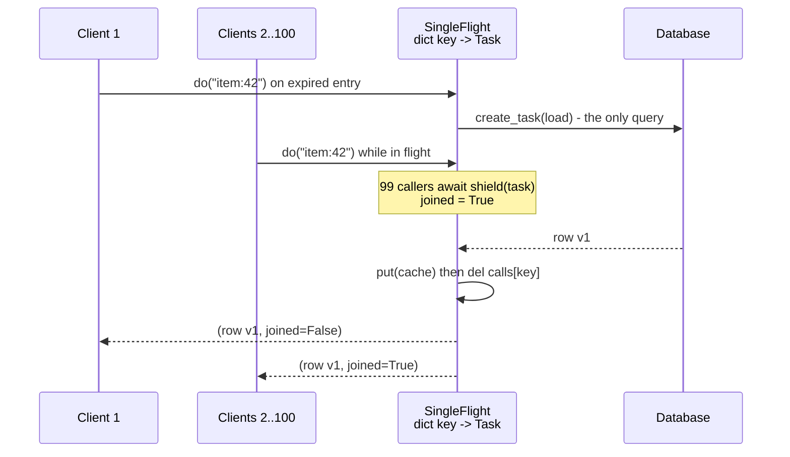

# Preventing Cache Stampedes: Request Coalescing (Singleflight), Lease Tokens, and XFetch Early Recomputation

> [!summary] Claim
> A cache stampede sends `request rate x recompute time` identical loads to the origin the instant a hot key expires, and the three defenses attack different terms: singleflight collapses concurrent misses in one process to one load, memcache-style leases collapse them across processes with a per-key token, and XFetch makes one request recompute before expiry with probability `exp(-gap / (delta * beta))`, which the lab measures cutting a 100-request stampede to about 2.7.

Part of [HTTP Caching and Conditional Requests](README.md) in [API Engineering](../README.md).

## TL;DR

Mechanism: when a hot entry expires, every request that arrives during the recompute window misses, so `N = rate x recompute_time` requests hit the database at once (Vattani et al. 2015, Section 1: 10 requests per second and a 3 second recompute give 30 recomputations).
Contract rule: a shared cache may "collapse requests" into a single forward request on a miss `(RFC 9111 Section 4)`, and it can report that with the `collapsed` parameter of `Cache-Status` `(RFC 9211 Section 2.6)`; inside your service, singleflight, leases, and XFetch are the same idea applied below HTTP.
The trap: an asyncio singleflight that awaits the shared task directly lets one cancelled client (a disconnect, a timeout) cancel the load for every other waiter; wrap it in `asyncio.shield`, keep a strong reference, and forget the key when the load finishes so a failure is not cached.
Portability fact: the lab passes on CPython 3.12.13, 3.13.18, 3.14.6, 3.14.10, 3.15.2, and free-threaded 3.14.6t and 3.15.0b3t, but a failed load that every caller abandoned is reported as `Task exception was never retrieved` at garbage collection on most of those and eagerly as `ConnectionError exception in shielded future` on 3.14.6 and 3.15.0b3 (python/cpython#134331 added that eager log, python/cpython#158590 removed it in 3.14.9 and 3.15.1), and `math.log(0.0)` changed its error text in 3.14.
When not to use it: if the value can be served stale, `stale-while-revalidate` `(RFC 5861 Section 3)` plus one background refresh is simpler, and if the key space is cold and uniform, a stampede cannot form and coalescing only adds a dictionary and a failure-sharing coupling.

## Mental model



The first caller to miss on `item:42` creates one task that runs the database load and records it in a dictionary keyed by cache key.
Every caller that misses while that task is in flight finds the task in the dictionary, increments a waiter count, and awaits `asyncio.shield(task)` instead of issuing its own query, so the database sees one query instead of 100.
The load writes the cache entry first and only then removes itself from the dictionary, so a request that arrives after completion reads the fresh entry, and a request that arrives after a failure starts a new load instead of receiving the cached exception.
The shield is what makes this safe under cancellation: a caller that times out or disconnects stops waiting, but the shared task keeps running for the others.

## How it works

### Why a stampede forms

Vattani, Chierichetti, and Lowenstein define the stampede size as the number of processes regenerating the item in `[Z, Z + 1)`, where `Z` is the first regeneration and time is measured in units of the recompute time (PVLDB 8(8), 2015, Definition 3).
With no early expiration every request in the first recompute window after expiry misses, which they call `(n, 0)`-effective: `n` regenerations and zero early-expiration gap (Definition 5 and the paragraph after it).
The load is self-amplifying: concurrent recomputations slow each other, which lengthens the window, which admits more requests into the stampede (Section 1, "cascading failure").

### Request collapsing at the HTTP layer

RFC 9111 permits a cache to reuse one stored or storable response for multiple requests and calls this collapsing: combining "multiple incoming requests into a single forward request upon a cache miss" `(RFC 9111 Section 4)`.
The same paragraph names the cost: if the cache cannot use the returned response for some or all of the collapsed requests, "it will need to forward the requests in order to satisfy them, potentially introducing additional latency".
Each reused response still carries its own `Age` header, because a cache that serves a stored response without validation "MUST generate an Age header field" `(RFC 9111 Section 4)`.
On the wire, a collapsed miss is visible only through `Cache-Status`, for example `Cache-Status: ExampleCache; fwd=uri-miss; collapsed` for a reused response and `collapsed=?0` when the cache had to make a new request `(RFC 9211 Section 2.6 and Section 3)`; [[Cache-Status-Header-for-Observability-RFC-9211]] covers the header itself.
nginx implements collapsing for new entries with `proxy_cache_lock on` (default `off`, since 1.1.12): only one request populates a new element and the others wait up to `proxy_cache_lock_timeout` (default `5s`), after which the request is passed upstream "however, the response will not be cached" (nginx `ngx_http_proxy_module` documentation, as of 2026-11).
`proxy_cache_lock_age` (default `5s`, since 1.7.8) lets one more request through if the populating request has not completed, which bounds the damage of a hung leader.
For expired entries rather than new ones, nginx relies on `proxy_cache_use_stale updating` and `proxy_cache_background_update` (since 1.11.10), the stale-serving route covered in [[Stale-While-Revalidate-and-Stale-If-Error-RFC-5861]].

### Singleflight inside one process

Go's `golang.org/x/sync/singleflight` is the reference design (golang/sync v0.24.0 singleflight/singleflight.go, `Group.Do`).
`Group` holds `mu sync.Mutex` and `m map[string]*call`; a duplicate caller increments `c.dups`, releases the lock, and blocks on `c.wg.Wait()`, while the first caller runs `doCall`.
In `doCall`'s deferred function the group deletes the key only `if g.m[key] == c`, so a `Forget` followed by a new call is not undone by the old call finishing (golang/sync v0.24.0 singleflight/singleflight.go, `Group.doCall` and `Group.Forget`).
`Do` returns `shared = c.dups > 0` to the leader and `true` to duplicates, and an error is returned to every waiter of that call but never stored past it.
The Python port in this lab keeps those three rules and adds what asyncio needs:

- One `asyncio.Task` per key in `self._calls`, which is also the strong reference the asyncio documentation requires, because "The event loop only keeps weak references to tasks" (Python 3 `asyncio-task` documentation, `asyncio.shield`).
- Callers await `asyncio.shield(task)`; per the documentation, if the awaiting coroutine is cancelled "the Task running in something() is not cancelled", although the caller still gets `CancelledError`.
- The task removes its own key in a `finally` block guarded by `self._calls.get(key) is asyncio.current_task()`, the identity check that mirrors Go's `g.m[key] == c`; `forget(key)` mirrors Go's `Forget`, and `test_old_call_finishing_after_forget_does_not_drop_the_new_call` fails when the identity check is removed.
- `TTLCache._load_and_store` writes the entry inside the flight, before the key is forgotten, so there is no instant at which the flight is gone but the cache is still stale.

The asyncio dictionary needs no lock because everything runs on one event loop thread and there is no `await` between the lookup and the insert in `SingleFlight.do`.
That also bounds its reach: each event loop, and therefore each worker process, has its own dictionary, so `W` workers can still send up to `W` concurrent loads for one key.

### Lease tokens across processes

Facebook's memcache leases solve the cross-process version (Nishtala et al., "Scaling Memcache at Facebook", NSDI 2013, Section 3.2.1).
On a miss, memcached hands the client "a 64-bit token bound to the specific key"; the client must present it when setting the value, and verification "can fail if memcached has invalidated the lease token due to receiving a delete request for that item", which prevents stale sets the way load-link/store-conditional does.
To stop thundering herds, each server returns a token "only once every 10 seconds per key", and other requests within that window get "a special notification telling the client to wait a short amount of time".
The paper reports, for a set of keys susceptible to thundering herds over one week, a peak database query rate of 17K/s without leases and 1.3K/s with them (Section 3.2.1).
When a key is deleted, its value moves to a structure where it can still be returned as stale data to clients that accept it (Section 3.2.1, "Stale values").
`LeaseCache` in the lab implements simplified versions of these four behaviors: `get` returns `Hit`, `LeaseGranted(token)`, or `RetryLater(stale)`; `set` succeeds only with the current token; `delete` drops the token and keeps the old value as stale; and a new token is issued only when `now - issued_at >= lease_interval`, which also recovers from a lease holder that crashed.
The simplifications: the lab keeps a stale value until the next successful `set` instead of flushing it after "a short time", and it returns stale data only with `RetryLater`, not alongside a granted token.

### XFetch: probabilistic early recomputation

XFetch recomputes before expiry so that, in the common case, one request refreshes the entry while everyone else still hits.
The paper's Figure 3 reads the value, its last recompute duration `delta`, and its `expiry`, and recomputes `if !value or Time() - delta * beta * log(rand()) >= expiry`, then stores `(value, delta)` with the new TTL (PVLDB 8(8), Figure 3).
`-log(rand())` is an `Exp(1)` sample, so `-delta * beta * log(rand())` is an exponential gap with mean `delta * beta` and the rule samples the gap distribution `Exp(1 / beta)` scaled by `delta` (Section 5).
A request that arrives `gap` seconds before expiry therefore recomputes with probability `P(u <= exp(-gap / (delta * beta))) = exp(-gap / (delta * beta))`, the exact identity the lab checks on a 10,000-point grid.
Theorem 7 states that `Exp(lambda)` is `((e^lambda - 1)(1/lambda + 1/e), (1/lambda) log n)`-effective; with `lambda = 1` (`beta = 1`), the expected stampede is about `e - 1/e ~ 2.35` processes and the early-expiration gap is about `ln n` recompute times.
Theorem 8 proves the exponential is optimal: any gap distribution independent of `n` whose early-expiration gap is at most `(1/lambda) log n` has expected stampede size at least `e^Omega(lambda)`, so no distribution keeps both the gap and the stampede constant (Section 3).
The uniform window `U(0, xi)` used by Perl CHI is no better than `(n / (2 xi), xi)`-effective (Theorem 6), so for a fixed stampede size the window grows linearly with `n`; the paper's example needs expirations as early as 50 minutes to get 10,000 processes per minute down to a stampede of 100 (Section 3).
Two implementation details from Section 5 matter in code: record `delta` at recompute time and store it as part of the cached value (and store `Time() + ttl` too if the cache server cannot return the expiry), and set `ttl <- ttl + (expiry - Time())` right before the write so early expirations do not accumulate.

## Numbers and limits

| Quantity | Value | Source |
|---|---|---|
| Naive stampede size | `rate x recompute_time`; 10 req/s x 3 s = 30 | Vattani et al. 2015, Section 1 |
| Lab: uncoalesced misses at expiry, 100 concurrent `GET`s | 100 database calls, 100 distinct versions | `test_uncoalesced_expiry_sends_every_concurrent_miss_to_the_database`, CPython 3.14.6, macOS 27.2 arm64 (Apple M3 Pro) |
| Lab: coalesced misses, same 100 `GET`s | 1 database call, 100 identical bodies | `test_singleflight_collapses_100_concurrent_misses_into_one_query`, same machine |
| XFetch `beta = 1`, theory | E[stampede] -> `(e - 1)(1 + 1/e) ~ 2.35`; E[gap] -> `ln n` | Vattani et al. 2015, Theorem 7 |
| Lab simulation, `n = 100` per recompute time, 300 cycles, seed `20261109`, `beta = 0` | mean stampede 100.00, mean gap 0.00 | verifier re-run: a fresh `random.Random(20261109)` per `beta`, 300 calls of `simulate_cycle(arrivals_per_delta=100, ttl_in_deltas=30.0, beta=beta, rand=lambda: unit_interval_open_at_zero(rng.random))` under `uv run --frozen python`, CPython 3.14.6, macOS 27.2 arm64 (Apple M3 Pro) |
| Same, `beta = 0.5` | mean stampede 7.19 (max 35), mean gap 2.23 recompute times; theorem 5.54 and 2.30 | same run |
| Same, `beta = 1.0` | mean stampede 2.67 (max 14), mean gap 5.29; theorem 2.35 and 4.61 | same run |
| Same, `beta = 2.0` | mean stampede 1.59 (max 5), mean gap 11.78; theorem 1.54 and 9.21 | same run |
| memcache lease token width and issue rate | 64-bit token, at most one per key per 10 s | Nishtala et al. 2013, Section 3.2.1 |
| memcache peak database query rate, herd-prone keys, one week | 17K/s without leases, 1.3K/s with leases | Nishtala et al. 2013, Section 3.2.1 |
| nginx `proxy_cache_lock_timeout`, `proxy_cache_lock_age` defaults | `5s`, `5s` | nginx `ngx_http_proxy_module` docs (as of 2026-11) |
| Facebook 2010 outage, cache-repair feedback loop | "hundreds of thousands of queries a second" against one database cluster | Facebook Engineering postmortem, 2010-09-23 |

The theorem values are asymptotic upper bounds (`1 + o(1)` factors), so at `n = 100` the measured stampede sizes sit 3% to 30% above them and the gaps sit 15% to 28% above them, except the `beta = 0.5` gap (2.23 against 2.30); the lab's test asserts `1.5 < mean_size < 3.5` and `3.0 < mean_gap < 6.0` for `beta = 1`, not equality.

## Portability

| Runtime, library, or layer | Behavior | Evidence |
|---|---|---|
| CPython 3.12.13 | 16 passed | lab run, `UV_PROJECT_ENVIRONMENT=<scratch venv> uv run --frozen --python 3.12 pytest ...`; 3.12.16 from the matrix pin is not installed here, so 3.12.13 ran instead |
| CPython 3.13.18 | 16 passed | lab run, `--python 3.13` |
| CPython 3.14.6 (workspace `.venv`) | 16 passed | lab run, `uv run --frozen pytest ...` |
| CPython 3.14.10 | 16 passed | lab run, `--python 3.14.10` |
| CPython 3.15.2 | 16 passed | lab run, `--python 3.15.2` |
| CPython 3.15.2t free-threaded | not run: no 3.15.2t interpreter is installed here; the nearest free-threaded builds, 3.15.0b3t and 3.14.6t with `sys._is_gil_enabled()` False, pass 16 of 16 | `uv sync` of the full workspace fails on free-threaded builds because `psycopg-binary==3.3.8` has no wheel for that ABI, so the verifier ran the test with `PYTHON_GIL=0` in a scratch venv holding only this lab's locked pins (`starlette==1.10.0`, `httpx==0.28.1`, `httpcore==1.0.9`, `anyio==4.16.0`, `pytest==9.2.0`, `pytest-asyncio==1.4.1.post1`, and their transitive pins) |
| Debian 13 Trixie (glibc 2.41) and Alpine 3.23 (musl), aarch64 containers | 16 passed on each, CPython 3.14.10 | verifier run with `docker run` of `ghcr.io/astral-sh/uv:python3.14-trixie-slim` and `ghcr.io/astral-sh/uv:python3.14-alpine` on the macOS 27.2 arm64 host: `uv sync --frozen` then `uv run --frozen pytest <this test> -q` (as of 2026-11) |
| Orphaned failed load (every caller cancelled, then the shared task raises) | reported to the loop exception handler on every version; `Task exception was never retrieved` at garbage collection on 3.12.13, 3.13.18, 3.14.10, 3.15.2, and eagerly `ConnectionError exception in shielded future` on 3.14.6, 3.14.6t, and 3.15.0b3t | `test_failure_of_a_load_every_caller_abandoned_is_reported_not_silent` on all seven builds plus a standalone probe; the eager path is `_log_on_exception` in `Lib/asyncio/tasks.py` `shield`, added by python/cpython#134331 (merged 2025-05-20) and removed by python/cpython#158590 for gh-156321 (merged 2026-10-02, backported as #158599 to 3.14 and #158598 to 3.15); the first tags containing the removal are `v3.14.9` and `v3.15.1` (GitHub compare API, as of 2026-11) |
| `math.log(0.0)` error text | `math domain error` on 3.12.13 and 3.13.18; `expected a positive input, got 0.0` on 3.14.6, 3.14.6t, 3.14.10, 3.15.2, 3.15.0b3t | `test_random_random_can_return_zero_which_log_rejects` plus a direct probe on each interpreter; the message was introduced by python/cpython#124299 (merged 2025-01-23, before 3.14.0) |
| `asyncio.shield` semantics | caller is cancelled, inner task is not | Python 3 `asyncio-task` docs; `test_cancelling_the_leader_caller_does_not_cancel_the_shared_load` |
| Starlette 1.10.0, httpx 0.28.1 `ASGITransport` | 100 concurrent in-process `GET`s share one event loop, so one `SingleFlight` sees all of them | lab; `(httpx 0.28.1 httpx/_transports/asgi.py, ASGITransport.handle_async_request)` runs `await self.app(scope, receive, send)` in the caller's task |
| Uvicorn 0.54.0, Hypercorn 0.18.0 multi-worker | workers are separate processes, so an in-process coalescer is per worker | `(uvicorn 0.54.0 uvicorn/_subprocess.py, get_subprocess)` returns `spawn.Process(...)` with `spawn = multiprocessing.get_context("spawn")`, called from `uvicorn/supervisors/multiprocess.py`; `(hypercorn 0.18.0 hypercorn/run.py, run)` calls `get_context("spawn")` when `workers` is nonzero |
| Granian 2.8.7 | `MPServer` starts worker processes; `MTServer` runs `WorkerThread` objects wrapping `threading.Thread`, each with its own event loop, so a module-level asyncio coalescer must be keyed per event loop | `(granian 2.8.7 granian/server/mp.py, WorkerProcess)` uses `multiprocessing.get_context(self._spawn_method).Process` with `_spawn_method = multiprocessing.get_start_method()`; `(granian 2.8.7 granian/server/mt.py, WorkerThread)` sets `self.inner = threading.Thread(...)` and its `wrap_target` passes `loops.get(loop_impl)` to each thread; not exercised by the lab |
| HTTP/1.1, HTTP/2, HTTP/3 | collapsing is a cache behavior defined independently of the transport | `(RFC 9111 Section 4)`; `(RFC 9211 Section 2.6)` |
| Go `singleflight` v0.24.0 | blocking `Do`, no context cancellation; `DoChan` lets a caller stop waiting while the call continues | golang/sync v0.24.0 `singleflight.go`, `Group.DoChan` |

## Worked example

The lab is [implementation](../labs/src/api_labs/f03_http_caching_and_conditional_requests/cache_stampede.py) and [test](../labs/tests/f03_http_caching_and_conditional_requests/test_cache_stampede_singleflight_coalescing_and_probabilistic_early_expiration.py).
It expires one key, fires 100 concurrent `GET /items/42` requests through `httpx.ASGITransport` into a Starlette app, holds the fake database behind an `asyncio.Event` until all 100 requests are waiting, and then counts database calls.
It also checks the lease protocol on a fake clock and checks XFetch both analytically (grid of `rand()` values) and by a seeded simulation.

Full byte-identical source of `cache_stampede.py`:

```python
"""Cache stampede defenses: asyncio singleflight, memcache-style leases, and XFetch."""

from __future__ import annotations

import asyncio
import itertools
import math
from dataclasses import dataclass
from typing import TYPE_CHECKING, Any

from starlette.applications import Starlette
from starlette.responses import JSONResponse
from starlette.routing import Route

if TYPE_CHECKING:
    from collections.abc import Callable, Coroutine, Hashable, Iterator

    from starlette.requests import Request


class SingleFlight[K: Hashable, V]:
    """Run at most one in-flight load per key; concurrent callers await the same task.

    Mirrors `golang.org/x/sync/singleflight` `Group.Do`, adapted to asyncio cancellation.
    """

    def __init__(self) -> None:
        self._calls: dict[K, asyncio.Task[V]] = {}
        self._waiters: dict[K, int] = {}

    def waiters(self, key: K) -> int:
        """Number of callers currently awaiting a load for `key` (old and new after `forget`)."""
        return self._waiters.get(key, 0)

    def in_flight(self, key: K) -> bool:
        return key in self._calls

    def forget(self, key: K) -> None:
        """Make the next `do(key)` start a new load even if one is in flight (Go's `Forget`)."""
        self._calls.pop(key, None)

    async def _run(self, key: K, fn: Callable[[], Coroutine[Any, Any, V]]) -> V:
        try:
            return await fn()
        finally:
            # Forget the call before its result is published, like Go's doCall defer,
            # so the next miss after completion starts a fresh load (no error caching).
            if self._calls.get(key) is asyncio.current_task():
                del self._calls[key]

    async def do(self, key: K, fn: Callable[[], Coroutine[Any, Any, V]]) -> tuple[V, bool]:
        """Return `(value, joined)`; `joined` is True when this caller reused another's load."""
        task = self._calls.get(key)
        joined = task is not None
        if task is None:
            task = asyncio.create_task(self._run(key, fn))
            self._calls[key] = task
        self._waiters[key] = self._waiters.get(key, 0) + 1
        try:
            # shield: cancelling one caller must not cancel the load the others share.
            value = await asyncio.shield(task)
        finally:
            remaining = self._waiters[key] - 1
            if remaining:
                self._waiters[key] = remaining
            else:
                del self._waiters[key]
        return value, joined


@dataclass(frozen=True, slots=True)
class _Entry[V]:
    value: V
    expires_at: float


class TTLCache[V]:
    """Read-through TTL cache; with `coalesce=True` misses for one key share one load."""

    def __init__(
        self,
        loader: Callable[[str], Coroutine[Any, Any, V]],
        *,
        ttl: float,
        clock: Callable[[], float],
        coalesce: bool,
    ) -> None:
        self._loader = loader
        self._ttl = ttl
        self._clock = clock
        self._coalesce = coalesce
        self._store: dict[str, _Entry[V]] = {}
        self.flight: SingleFlight[str, V] = SingleFlight()

    def put(self, key: str, value: V) -> None:
        self._store[key] = _Entry(value, self._clock() + self._ttl)

    async def _load_and_store(self, key: str) -> V:
        value = await self._loader(key)
        self.put(key, value)  # written before the flight is forgotten: no reload window
        return value

    async def get(self, key: str) -> V:
        entry = self._store.get(key)
        if entry is not None and self._clock() < entry.expires_at:
            return entry.value
        if not self._coalesce:
            return await self._load_and_store(key)
        value, _ = await self.flight.do(key, lambda: self._load_and_store(key))
        return value


def build_app(cache: TTLCache[dict[str, Any]]) -> Starlette:
    """A Starlette API whose `GET /items/{item_id}` reads through `cache`."""

    async def get_item(request: Request) -> JSONResponse:
        item_id: str = request.path_params["item_id"]
        return JSONResponse(await cache.get(f"item:{item_id}"))

    return Starlette(routes=[Route("/items/{item_id}", get_item, methods=["GET"])])


@dataclass(frozen=True, slots=True)
class Hit[V]:
    value: V


@dataclass(frozen=True, slots=True)
class LeaseGranted:
    token: int


@dataclass(frozen=True, slots=True)
class RetryLater[V]:
    stale: V | None


type LeaseResult[V] = Hit[V] | LeaseGranted | RetryLater[V]


@dataclass(frozen=True, slots=True)
class _Lease:
    token: int
    issued_at: float


class LeaseCache[V]:
    """Memcache lease protocol (Nishtala et al., NSDI 2013, Section 3.2.1).

    A miss returns a token bound to the key; only that token may fill the key.
    A delete invalidates the outstanding token (stale-set prevention), and at most
    one token per key is issued per `lease_interval` (thundering-herd prevention).
    """

    def __init__(
        self,
        *,
        clock: Callable[[], float],
        lease_interval: float = 10.0,
        tokens: Iterator[int] | None = None,
    ) -> None:
        self._clock = clock
        self._interval = lease_interval
        self._tokens = tokens if tokens is not None else itertools.count(1)
        self._values: dict[str, V] = {}
        self._stale: dict[str, V] = {}
        self._leases: dict[str, _Lease] = {}

    def get(self, key: str) -> LeaseResult[V]:
        if key in self._values:
            return Hit(self._values[key])
        now = self._clock()
        lease = self._leases.get(key)
        if lease is not None and now - lease.issued_at < self._interval:
            return RetryLater(self._stale.get(key))
        token = next(self._tokens)
        self._leases[key] = _Lease(token, now)
        return LeaseGranted(token)

    def set(self, key: str, value: V, token: int) -> bool:
        """Store `value` only if `token` is the key's current lease; return whether stored."""
        lease = self._leases.get(key)
        if lease is None or lease.token != token:
            return False
        del self._leases[key]
        self._values[key] = value
        self._stale.pop(key, None)
        return True

    def delete(self, key: str) -> None:
        if key in self._values:
            self._stale[key] = self._values.pop(key)
        self._leases.pop(key, None)


def unit_interval_open_at_zero(random: Callable[[], float]) -> float:
    """Map `random.random()` from [0, 1) onto (0, 1] so `math.log` never sees 0."""
    return 1.0 - random()


def xfetch_should_recompute(
    *, now: float, expiry: float, delta: float, beta: float, rand: Callable[[], float]
) -> bool:
    """XFetch test from Vattani et al., PVLDB 8(8) 2015, Figure 3.

    `now - delta * beta * log(rand()) >= expiry`, with `rand()` in (0, 1].
    """
    u = rand()
    if not 0.0 < u <= 1.0:
        raise ValueError(f"rand() must be in (0, 1], got {u!r}")
    return now - delta * beta * math.log(u) >= expiry


@dataclass(frozen=True, slots=True)
class StampedeSample:
    size: int
    early_gap: float


def simulate_cycle(
    *, arrivals_per_delta: int, ttl_in_deltas: float, beta: float, rand: Callable[[], float]
) -> StampedeSample:
    """One expiry cycle in the paper's model: time unit = recompute time `delta` = 1.

    Requests arrive every `1 / arrivals_per_delta`; the stampede size is the number of
    requests that decide to recompute in `[Z, Z + 1)`, where `Z` is the first decision.
    """
    first: int | None = None
    size = 0
    tick = 0
    while first is None or tick < first + arrivals_per_delta:
        now = tick / arrivals_per_delta
        if xfetch_should_recompute(now=now, expiry=ttl_in_deltas, delta=1.0, beta=beta, rand=rand):
            if first is None:
                first = tick
            size += 1
        tick += 1
    return StampedeSample(size=size, early_gap=max(ttl_in_deltas - first / arrivals_per_delta, 0.0))
```

Simplified excerpt of the test (lines 67-106 verbatim; imports, `FakeClock`, `GatedDatabase`, and `wait_until` omitted):

```python
async def stampede(*, coalesce: bool) -> tuple[GatedDatabase, list[httpx.Response]]:
    """Expire one key, fire CLIENTS concurrent GETs at it, then let the database answer."""
    db = GatedDatabase()
    clock = FakeClock()
    cache: TTLCache[dict[str, Any]] = TTLCache(db.load, ttl=30.0, clock=clock, coalesce=coalesce)
    cache.put("item:42", {"key": "item:42", "version": 0})
    clock.now = 31.0  # the entry is now expired
    app = build_app(cache)
    async with httpx.AsyncClient(
        transport=httpx.ASGITransport(app=app), base_url="http://test"
    ) as client:
        requests = [asyncio.create_task(client.get("/items/42")) for _ in range(CLIENTS)]
        if coalesce:
            await wait_until(lambda: cache.flight.waiters("item:42") == CLIENTS)
        else:
            await wait_until(lambda: db.in_progress == CLIENTS)
        db.release.set()
        responses = await asyncio.gather(*requests)
    return db, responses


@pytest.mark.unit
@pytest.mark.asyncio
async def test_uncoalesced_expiry_sends_every_concurrent_miss_to_the_database() -> None:
    db, responses = await stampede(coalesce=False)

    assert db.calls == CLIENTS
    assert {r.status_code for r in responses} == {200}
    assert {r.json()["version"] for r in responses} == set(range(1, CLIENTS + 1))


@pytest.mark.unit
@pytest.mark.asyncio
async def test_singleflight_collapses_100_concurrent_misses_into_one_query() -> None:
    db, responses = await stampede(coalesce=True)

    assert db.calls == 1
    assert {r.status_code for r in responses} == {200}
    assert {r.content for r in responses} == {b'{"key":"item:42","version":1}'}

```

Captured run, macOS 27.2 arm64, CPython 3.14.6, from `labs/`:

```text
$ uv run --frozen pytest tests/f03_http_caching_and_conditional_requests/test_cache_stampede_singleflight_coalescing_and_probabilistic_early_expiration.py -q
................                                                         [100%]
16 passed in 0.50s
```

## Pitfalls

> [!warning] Cancelling one waiter cancels the shared load
> Trigger: followers `await task` instead of `await asyncio.shield(task)`, and the leader's client disconnects or hits `asyncio.timeout`.
> Symptom: every follower gets `CancelledError` and the cache stays cold, so the next wave stampedes again.
> Fix: shield the shared task; the lab's mutation that removed `shield` failed `test_cancelling_the_leader_caller_does_not_cancel_the_shared_load` and two other tests.

> [!warning] Singleflight that never forgets becomes an error cache
> Trigger: the in-flight entry is not removed when the load finishes, or is removed without the identity check.
> Symptom: after one database error every later request gets the same exception without trying, or a stale value is served forever.
> Fix: remove the key in the task's `finally` and only if it still maps to this task; the mutation that dropped the removal failed `test_failure_is_shared_then_forgotten_so_the_next_miss_retries` and two other tests, and the mutation that dropped only the identity check let an old call delete the new call's entry after `forget`, failing `test_old_call_finishing_after_forget_does_not_drop_the_new_call`.

> [!warning] Repair logic that deletes cache keys on error feeds the stampede
> Trigger: clients treat a database error as an invalid cached value and delete the key, as in Facebook's 2010-09-23 outage, where "every single client saw the invalid value and attempted to fix it" and the database cluster "was quickly overwhelmed by hundreds of thousands of queries a second" (Facebook Engineering, "More Details on Today's Outage").
> Symptom: a feedback loop; the postmortem says that even after the root cause was fixed "the stream of queries continued" and recovery required stopping all traffic to the cluster.
> Fix: never let an error path invalidate a hot key; coalesce or lease the repair, and back off retries (see [[Retry-Budgets-and-Preventing-Cascading-Retry-Amplification-Storms]]).

> [!warning] `random.random()` can return `0.0`
> Trigger: XFetch written as `math.log(random.random())`.
> Symptom: a rare `ValueError` (`math domain error` before 3.14, `expected a positive input, got 0.0` from 3.14) on the request path.
> Fix: use `1.0 - random.random()`, which lies in `(0, 1]`; the lab's `unit_interval_open_at_zero` does this and the mutation that removed it failed `test_random_random_can_return_zero_which_log_rejects`.

> [!warning] Stale set after an invalidation
> Trigger: a reader misses, loads v1, a writer commits v2 and deletes the key, then the reader sets v1.
> Symptom: the cache holds v1 until TTL expiry even though the database has v2.
> Fix: lease tokens invalidated by `delete`, as in Nishtala et al. Section 3.2.1; the mutation where `delete` kept the lease failed `test_delete_invalidates_the_outstanding_lease_to_prevent_a_stale_set`.

> [!warning] One coalescer per worker is not one load per fleet
> Trigger: `uvicorn --workers 16` or 40 pods, each with its own in-process singleflight.
> Symptom: a hot-key expiry still sends one load per worker; 640 workers send 640 queries.
> Fix: add a shared layer (a lease in the shared cache, a shared CDN with `proxy_cache_lock`-style collapsing) or XFetch so that only some workers ever see the expiry.

## Security and robustness

- Unbounded key cardinality: a coalescer keyed by attacker-controlled input (`/items/{item_id}` with random IDs) cannot coalesce anything and its dictionary grows with in-flight requests; validate and normalize the key before it reaches the cache, and reject IDs that cannot exist (OWASP API4:2023 Unrestricted Resource Consumption).
- Failure sharing: one slow or failing load now fails every waiter at once, so put a deadline on the load itself, not just on the callers, and treat the singleflight as a bulkhead boundary ([[Bulkhead-Isolation-and-Per-Dependency-Resource-Partitioning]]).
- Hung leaders: a load with no timeout pins every waiter; nginx bounds this with `proxy_cache_lock_timeout` and `proxy_cache_lock_age`, and the memcache lease bounds it with the 10 second reissue window.
- Cross-tenant coalescing: the coalescing key must include every input that changes the response, including tenant and authorization scope, or one tenant's result is shared with another ([[Caching-Authenticated-and-Multi-Tenant-API-Responses]]).
- Lease token guessability: the lab issues sequential tokens because memcache clients are trusted; if clients are not trusted, tokens must be unguessable, for example from `secrets.randbits(64)`.
- Silent abandoned failures: when every caller has gone, a failed load is visible only through the loop exception handler, so route that handler to logging and metrics; the lab proves the report happens on all seven tested builds (five with the GIL, two free-threaded).

## The principal's view

The decision is not which algorithm but where the coalescing boundary lives: per process (singleflight), per cache cluster (leases or `proxy_cache_lock`), or per key lifetime (XFetch or a background refresher).
Put the cheapest defense closest to the herd: a CDN or gateway that collapses requests `(RFC 9111 Section 4)` and serves stale `(RFC 5861 Section 3)` absorbs most of a stampede before any Python runs.
Inside services, singleflight is nearly free and should be the default for any read-through cache in an async framework, but its blast radius is one process, so on a large fleet it must be paired with a shared mechanism.
XFetch costs a few early recomputations per TTL and needs `delta` stored with each value; choose it when values cannot be served stale and recompute time is a meaningful fraction of the TTL.
Leases cost a protocol change in the cache client and a retry loop in every caller, and pay off when many independent processes share one cache, which is exactly why Facebook built them into memcache.
Organizationally, make the coalescing key and the failure policy part of the caching library rather than each team's code, because the bugs (missing shield, error caching, tenant leaks) are subtle and the same everywhere.
Choose a different design when the data is push-shaped: an event-driven cache warmed by change data capture, or a dedicated refresher, removes the request-driven recompute entirely at the price of operating another process, the trade-off the XFetch paper calls "external re-computation" (Section 1).

## Interview questions

> [!question] L5: What is a cache stampede, and how large does it get?
>
> > [!success]- Answer
> > It is the burst of identical recomputations that happens when a popular cache entry expires and every request that arrives before the first recompute finishes also misses.
> > Its size is roughly the request rate times the recompute time, for example 10 requests per second and a 3 second recompute give 30 database loads (Vattani et al. 2015, Section 1).
> > Because the concurrent loads slow each other down, the recompute time grows and the stampede can cascade.
> >
> > Follow-up: Why does adding more web workers make it worse?

> [!question] L5: How does singleflight differ from a cache?
>
> > [!success]- Answer
> > Singleflight only deduplicates calls that overlap in time; once the in-flight call finishes, the key is forgotten and the next call runs again.
> > A cache stores the result for a TTL.
> > They compose: the cache serves hits, and singleflight collapses the misses that happen during a recompute.
> >
> > Follow-up: What breaks if the singleflight forgets to delete the key on failure?

> [!question] L6: Predict the output when the leader caller is cancelled while four followers wait, the load is `await gate.wait(); return "row"` and followers use `asyncio.shield`.
>
> > [!success]- Answer
> > The four followers each return `("row", True)`, the leader task ends cancelled, and the load itself is never cancelled.
> > Without `shield`, cancelling the leader's await would cancel the shared task and all four followers would raise `CancelledError`.
> > This is exactly `test_cancelling_the_leader_caller_does_not_cancel_the_shared_load`, and removing `shield` fails it.
> >
> > Follow-up: If every caller is cancelled, does the load still run, and is that what you want?

> [!question] L6: Debug this API: after a five-second database blip, `GET /items/42` returns `500` for every request for the rest of the hour even though the database recovered.
>
> > [!success]- Answer
> > The singleflight or cache stored the failed task or exception and keeps handing it out, so no request ever retries.
> > Check whether the in-flight map entry is removed in a `finally` with an identity check, and whether errors are being written into the cache with the normal TTL.
> > Fix it so that errors are shared only among callers of the same in-flight call, and if you want negative caching, give it a short, separate TTL.
> >
> > Follow-up: How would you prove the fix in a test?

> [!question] L6: Why does XFetch use `log(rand())`, and what is the probability that a request 2 seconds before expiry recomputes when `delta = 1` and `beta = 1`?
>
> > [!success]- Answer
> > `-log(rand())` with `rand()` uniform in `(0, 1]` is an exponential sample, so the rule draws an exponential early-expiration gap with mean `delta * beta`.
> > The request recomputes when the sampled gap is at least the time left, so the probability is `exp(-2 / (1 * 1)) = exp(-2) ~ 0.135`.
> > The paper proves the exponential is the optimal gap distribution (Theorem 8).
> >
> > Follow-up: What happens if you pass `random.random()` directly?

> [!question] L6: How do memcache leases prevent a stale set?
>
> > [!success]- Answer
> > A miss returns a 64-bit token bound to the key, and only a `set` with that token is accepted.
> > A `delete` from a writer invalidates the outstanding token, so a reader that loaded the old value before the write cannot store it afterward (Nishtala et al. 2013, Section 3.2.1).
> > The same token is rate limited to one per key per 10 seconds, so other readers are told to wait instead of loading.
> >
> > Follow-up: What happens if the lease holder crashes?

> [!question] L7+: You run 40 pods with 16 workers each behind a CDN and a hot key's expiry still spikes the database; how do you fix it?
>
> > [!success]- Answer
> > In-process singleflight caps load at one per worker, which is 640 here, so it is necessary but not sufficient.
> > First make the CDN collapse and serve stale with `stale-while-revalidate`, so most traffic never reaches the pods during the refresh.
> > Then add a shared mechanism at the application cache, either leases or a lock with a TTL and a stale fallback, so one worker fleet-wide recomputes.
> > Add XFetch with `beta` around 1 so that a recompute usually starts before expiry, and alert on `Cache-Status` `collapsed` and database query rate per key.
> >
> > Follow-up: What is the failure mode of the shared lock, and how do you bound it?

> [!question] L7+: When would you not coalesce, and what do you lose by coalescing?
>
> > [!success]- Answer
> > Do not coalesce responses that depend on per-caller state such as authorization scope or tenant, unless the key includes that state.
> > Coalescing couples failures and latency: the slowest load sets the latency for every waiter, and one exception fails them all.
> > RFC 9111 Section 4 notes the same cost at the HTTP layer: if the collapsed response cannot be used for some requests, they must be forwarded anyway with extra latency.
> >
> > Follow-up: How would you shard the coalescer key to limit the blast radius?

> [!question] L7+: Compare XFetch with a background refresher and with `stale-while-revalidate`.
>
> > [!success]- Answer
> > A background refresher removes request-driven recomputes but must know which keys are hot and must itself be operated, the "external re-computation" option in Vattani et al. Section 1.
> > `stale-while-revalidate` serves the old value while one revalidation runs, which needs the data to tolerate staleness up to the stated window `(RFC 5861 Section 3)`.
> > XFetch keeps values fresh with no extra process, at the cost of a few early recomputes per TTL and storing `delta` with every value.
> >
> > Follow-up: Which one gives you a bound on staleness, and which gives you a bound on recompute rate?

## Related

Prerequisites: [[Cache-Status-Header-for-Observability-RFC-9211]]

Next: [[Caching-Authenticated-and-Multi-Tenant-API-Responses]]

See also: [[02-Programming-Languages/Python/Python-Backend-Interview-Prep/06-SQL-and-SQLAlchemy]], [[02-Programming-Languages/Python/Python-Backend-Interview-Prep/17-Concurrency-in-Web-Services-and-Coding]], [[Stale-While-Revalidate-and-Stale-If-Error-RFC-5861]], [[Cache-Invalidation-Upon-Unsafe-Methods-and-Purge-Patterns]], [[Cancellation-Semantics-CancelledError-Swallowing-and-Shielded-Cleanup]], [[Fire-and-Forget-Task-Hazards-GC-Disappearance-and-Managed-Task-Nurseries]], [[Retry-Budgets-and-Preventing-Cascading-Retry-Amplification-Storms]], [[Bulkhead-Isolation-and-Per-Dependency-Resource-Partitioning]], [[Case-Study-Cascading-Retry-Storms-and-Metastable-Overload-Collapse]]

- Lab: `labs/tests/f03_http_caching_and_conditional_requests/test_cache_stampede_singleflight_coalescing_and_probabilistic_early_expiration.py`

## Further reading

- [Vattani, Chierichetti, Lowenstein, "Optimal Probabilistic Cache Stampede Prevention", PVLDB 8(8), 2015](https://www.vldb.org/pvldb/vol8/p886-vattani.pdf): the XFetch algorithm, its effectiveness bound, and the optimality proof.
- [Nishtala et al., "Scaling Memcache at Facebook", NSDI 2013](https://www.usenix.org/system/files/conference/nsdi13/nsdi13-final170_update.pdf): Section 3.2.1 defines leases for stale sets and thundering herds, with the measured 17K/s to 1.3K/s result.
- [golang/sync v0.24.0 singleflight.go](https://github.com/golang/sync/blob/v0.24.0/singleflight/singleflight.go): the reference singleflight, including the identity-checked delete and panic handling.
- [RFC 9111 Section 4](https://www.rfc-editor.org/rfc/rfc9111.html#section-4): the normative permission for a cache to collapse requests and its latency caveat.
- [RFC 9211 Section 2.6](https://www.rfc-editor.org/rfc/rfc9211.html#section-2.6): the `collapsed` parameter of `Cache-Status`.
- [RFC 5861 Section 3](https://www.rfc-editor.org/rfc/rfc5861.html#section-3): `stale-while-revalidate`, the stale-serving alternative.
- [nginx ngx_http_proxy_module](https://nginx.org/en/docs/http/ngx_http_proxy_module.html#proxy_cache_lock): `proxy_cache_lock`, `proxy_cache_lock_timeout`, `proxy_cache_lock_age`, and `proxy_cache_use_stale updating` as a production collapsing implementation.
- [Python asyncio-task documentation, asyncio.shield](https://docs.python.org/3/library/asyncio-task.html#asyncio.shield): the cancellation contract the Python singleflight relies on.
- [python/cpython#134331](https://github.com/python/cpython/pull/134331): the change that logs exceptions of shielded tasks whose shield was cancelled.
- [python/cpython#158590](https://github.com/python/cpython/pull/158590): the fix for gh-156321 that removed that eager log again, shipped in 3.14.9 and 3.15.1.
- [Facebook Engineering, "More Details on Today's Outage", 2010-09-23](https://engineering.fb.com/2010/09/23/uncategorized/more-details-on-today-s-outage/): a primary postmortem of a cache-repair feedback loop that overwhelmed a database cluster.
