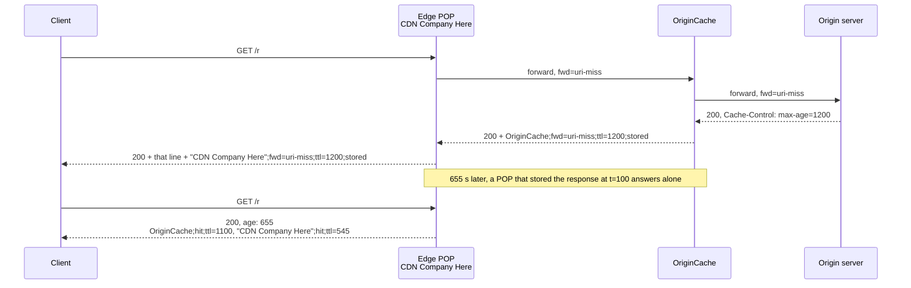

# Standardized Cache Diagnostics with the Cache-Status Response Header (RFC 9211)

> [!summary] Claim
> `Cache-Status` is an RFC 9651 Structured Field List where each cache appends one member, origin-side first, so a strict parser that combines every field line before parsing reconstructs the whole cache chain, and a single malformed member from any tier blinds you to all of them.

Part of [HTTP Caching and Conditional Requests](README.md) in [API Engineering](../README.md).

## TL;DR

- Mechanism: every cache that handled a response appends one List member such as `Edge;hit;ttl=545` or `Edge;fwd=uri-miss;stored`, and the first member is the cache closest to the origin (RFC 9211 Section 2).
- Contract: combine all `Cache-Status` field lines with `, ` before parsing, and if any part fails RFC 9651 parsing or a type constraint, ignore the entire field (RFC 9651 Sections 2.2 and 4.2).
- Trap: overwriting instead of appending (Starlette `MutableHeaders.__setitem__`), splitting on commas (`httpx` `get_list(split_commas=True)`), or emitting one invalid member silently erases every tier's diagnostics.
- Portability: the field is ordinary HTTP field semantics, identical on HTTP/1.1, HTTP/2, and HTTP/3; the lab passes unchanged on CPython 3.12.13, 3.13.18, 3.14.6, 3.14.10, 3.15.2, and the free-threaded 3.14.6t and 3.15.0b3t builds.
- When not to use it: do not expose `key` or upstream members to unauthenticated clients (RFC 9211 Section 6), and do not use it for in-process application caches, where a metric or span attribute is the right channel.

## Mental model



The request travels toward the origin and each cache that forwards it records why (`fwd=uri-miss`).
The response travels back, and each cache appends its own field line after the lines already present, which is why the origin-side cache is always the first List member.
On the later request the edge answers from storage, so the `OriginCache` member it replays is the one frozen into the stored response at `t=100`, and only the last member describes this request.
Reading that inner `ttl=1100` as live freshness is the most common misreading of a multi-tier chain.

## How it works

### Wire layout

The field value is a Structured Field List (RFC 9211 Section 2, RFC 9651 Section 3.1).
Each member is an Item whose bare value identifies the cache and MUST be a String or a Token, followed by Parameters (RFC 9211 Section 2, RFC 9651 Section 3.1.2):

```text
cache-status: OriginCache;hit;ttl=1100
cache-status: "CDN Company Here";hit;ttl=545
```

These two field lines are one List, `OriginCache;hit;ttl=1100, "CDN Company Here";hit;ttl=545`, because a repeated field name combines into one comma-separated value in order (RFC 9110 Section 5.2), and a proxy MUST NOT reorder field lines with the same name (RFC 9110 Section 5.3).
The byte grammar the parser walks, per RFC 9651 Section 4.2.1 and Section 4.2.3.2:

- members are separated by `,` with optional SP or HTAB on either side, and a trailing comma fails parsing;
- the identifier is a Token (starts with `ALPHA` or `*`, then `tchar`, `:`, or `/`) or a String (`"`-delimited printable ASCII with only `\"` and `\\` escapes);
- each parameter is `;`, optional SP, a key of `lcalpha`, `DIGIT`, `_`, `-`, `.`, `*` that starts with `lcalpha` or `*`, and optionally `=` plus a bare item;
- a parameter with no `=` is Boolean true, and a serializer MUST omit the value of a true Boolean (RFC 9651 Section 3.1.2), so `hit` is canonical and `hit=?1` is legal but non-canonical;
- a duplicate parameter key overwrites the earlier value in place (RFC 9651 Section 4.2.3.2 step 7), so `ttl=1;ttl=2` means `ttl=2`.

Canonical serialization has no SP after `;` (RFC 9651 Section 4.1.1.2), while every example in RFC 9211 Section 3 is written with `; `.
Both parse to the same value; only byte comparison distinguishes them.

### Parameters and their types

| Parameter | Type | Meaning (RFC 9211) | Only meaningful with `fwd` |
| --- | --- | --- | --- |
| `hit` | Boolean | Satisfied from cache without going forward; a stale response served without going forward can count (Section 2.1) | no |
| `fwd` | Token | Went forward, and why: `bypass`, `method`, `uri-miss`, `vary-miss`, `miss`, `request`, `stale`, `partial` (Section 2.2) | n/a |
| `fwd-status` | Integer | Status the next hop returned; defaults to the sent status (Section 2.3) | yes |
| `ttl` | Integer | Remaining freshness in seconds as this cache computes it, negative when stale (Section 2.4) | no |
| `stored` | Boolean | This cache stored the response (Section 2.5) | yes |
| `collapsed` | Boolean | Collapsed with another forward request; `?0` means it tried and had to forward anyway (Section 2.6) | yes |
| `key` | String | Implementation-specific cache key representation (Section 2.7) | no |
| `detail` | String or Token | Cache-specific extra information (Section 2.8) | no |

`hit` and `fwd` are exclusive, but only as a "should" (RFC 9211 Section 2.1), so a parser accepts both and a linter flags them.
The IANA "HTTP Cache-Status" registry holds exactly these eight entries (registry XML `updated` 2022-06-21, as of 2026-11), and new parameters go through Expert Review (RFC 9211 Section 4).
RFC 9651 Section 2.2 says a field-specific constraint violation also voids the entire field unless the field definition says otherwise, and RFC 9211 says nothing otherwise, so `ttl=1.5` or `fwd="uri-miss"` (a String, not a Token) makes the whole `Cache-Status` value absent.

### Computing `ttl`

`ttl` is `freshness_lifetime - current_age` (RFC 9211 Section 2.4).
A shared cache takes `freshness_lifetime` from `s-maxage`, else `max-age`, else `Expires - Date`, else a heuristic (RFC 9111 Section 4.2.1).
`current_age` is `corrected_initial_age + resident_time`, where `corrected_age_value = age_value + response_delay` may serve as `corrected_initial_age` (RFC 9111 Section 4.2.3).
The response is fresh while `freshness_lifetime > current_age` (RFC 9111 Section 4.2), so at exactly `current_age == max-age` it is stale; the lab pins that boundary.
Because `age_value` is the upstream `Age`, a lower tier that stored a response at age 100 starts its own countdown at 100; with `max-age=1200`, that is one timeline that yields the RFC example's `ttl=1100` and later `ttl=545`, although RFC 9211 Section 3 states neither the lifetime nor the times.

### Where libraries help and hurt

- `httpx` joins repeated lines with `", "` in `Headers.__getitem__`, a valid combination for RFC 9651 Section 4.2, which requires a comma-separated combined value, and the comma SP that RFC 9110 Section 5.3 recommends (httpx 0.28.1 httpx/_models.py, Headers.__getitem__).
- `httpx` `Headers.get_list(key, split_commas=True)` splits on every `,`, including commas inside quoted Strings (httpx 0.28.1 httpx/_models.py, Headers.get_list).
- Starlette `MutableHeaders.__setitem__` deletes every duplicate line of that name and overwrites the first one in place, while `MutableHeaders.append` adds a line and preserves the rest (starlette 1.10.0 starlette/datastructures.py, MutableHeaders.__setitem__ and MutableHeaders.append).
- Starlette `Headers.__getitem__` returns the first matching line only, so `request.headers["cache-status"]` sees one tier (starlette 1.10.0 starlette/datastructures.py, Headers.__getitem__).
- The ASGI spec says response `headers` order must be preserved, and request header duplicates must be preserved as received ([ASGI HTTP and WebSocket spec](https://asgi.readthedocs.io/en/latest/specs/www.html), `http.response.start` and the HTTP connection scope).

## Numbers and limits

| Quantity | Value | Source |
| --- | --- | --- |
| Integer range for `ttl` and `fwd-status` | -999,999,999,999,999 to 999,999,999,999,999 (15 digits) | RFC 9651 Section 3.3.1 |
| Minimum List members a parser must support | 1024 | RFC 9651 Section 3.1 |
| Minimum parameters per member, minimum key length | 256 parameters, 64 characters | RFC 9651 Section 3.1.2 |
| Minimum String length (`key`, quoted identifiers) | 1024 characters | RFC 9651 Section 3.3.3 |
| Minimum Token length (`fwd`, bare identifiers) | 512 characters | RFC 9651 Section 3.3.4 |
| Registered parameters | 8 (registry `updated` 2022-06-21) | IANA http-cache-status registry XML, fetched 2026-11-10 |
| Defined `fwd` reasons | 8 | RFC 9211 Section 2.2 |
| Bytes per canonical hit member, RFC example names | 24 (`OriginCache;hit;ttl=1100`), 30 (`"CDN Company Here";hit;ttl=545`) | counted with `len()` on CPython 3.14.6 |
| Live `docs.netlify.com` member sizes | 33 and 61 bytes, two lines both named `"Netlify Edge"` | `curl -sS -o /dev/null -D - https://docs.netlify.com/` on 2026-11-10 20:52:02 GMT (`ttl=31527644`, then `fwd=stale;fwd-status=200;ttl=-15087;stored`), see Pitfalls |
| Live `www.netlify.com` `ttl` | 31533489 s (about 365.0 days), one `"Netlify Edge"; hit` line | same command and time against `https://www.netlify.com/` |
| Lab test module | 88 tests, `88 passed in 0.11s` | `uv run --frozen pytest ... -q` from `labs/`, CPython 3.14.6, macOS 27.2 arm64 (`uname -r` 27.2.0) |

The test duration is a smoke number for the suite, not a benchmark of the parser.

## Portability

| Dimension | Result | Evidence |
| --- | --- | --- |
| CPython 3.12.13 | 88 passed | lab run, full `uv.lock` env (`UV_PROJECT_ENVIRONMENT=<tmp> uv run --frozen --python <interpreter> pytest <module> -q`), macOS 27.2 arm64, 2026-11-10 |
| CPython 3.13.18 | 88 passed | lab run, full `uv.lock` env, same command |
| CPython 3.14.6 (workspace interpreter) and 3.14.10 | 88 passed on each | lab runs, full `uv.lock` env, same command |
| CPython 3.15.2 | 88 passed | lab run, full `uv.lock` env, same command |
| CPython 3.15.0b3 (what `uv run --python 3.15` picked first) | pytest plugin load error, `ModuleNotFoundError: No module named 'hypothesis._native'` in the pinned hypothesis wheel | lab run; environment failure, not lab behavior |
| CPython 3.15.0b3t and 3.14.6t free-threaded, `sys._is_gil_enabled()` is `False` | 86 passed on each, on the revision before the `no-cache` and non-ASCII `max-age` cases were added, in a minimal venv with only the pinned `httpx`, `httpcore`, `h11`, `starlette`, `anyio`, `pytest`, `pytest-asyncio`, `idna`, `certifi` | lab runs with `PYTHONPATH=src`; the full lock cannot install there (`uv sync --frozen` on 3.14.6t stops because `psycopg-binary==3.3.8` has no wheel or sdist for that build) |
| CPython 3.12.16 and 3.15.2t named in the matrix | not run | `uv python list` here offers 3.12.13 and 3.15.0b3t only |
| httpx 0.28.1, starlette 1.10.0 | combination and overwrite behavior pinned by tests | `test_httpx_comma_split_corrupts_a_quoted_identifier_the_parser_keeps`, `test_starlette_setitem_drops_the_upstream_member_and_append_keeps_it` |
| Uvicorn 0.54.0, Hypercorn 0.18.0, Granian 2.8.7 | both `cache-status` lines of a two-tier `SharedCacheLayer` chain arrive over HTTP/1.1 on loopback as two separate lines, origin-side first, on each server | ASGI spec, `http.response.start` ("Order must be preserved in the HTTP response"); verifier loopback run on 2026-11-10 with `http.client`, outside the pytest module; HTTP/2 and HTTP/3 through these servers not exercised |
| HTTP/1.1 | repeated lines combine in order; proxies must not reorder | RFC 9110 Sections 5.2 and 5.3 |
| HTTP/2 | same field semantics, names lowercased; only `Cookie` gets a special split rule | RFC 9113 Sections 8.2 and 8.2.3 |
| HTTP/3 over QUIC | same field semantics, uppercase names malformed | RFC 9114 Section 4.2 |
| Debian Trixie and Alpine musl containers | not run | no container definitions in the workspace yet |

## Worked example

The [implementation](../labs/src/api_labs/f03_http_caching_and_conditional_requests/cache_status.py) has three layers: a strict RFC 9651 List parser and serializer, the `CacheStatusEntry` model with RFC 9211 type checks and a linter, and `SharedCacheLayer`, an ASGI middleware that stores `200` `GET` responses, collapses concurrent misses, and appends its own member.
The [test](../labs/tests/f03_http_caching_and_conditional_requests/test_cache_status_header_for_observability_rfc_9211.py) drives it in-process through `httpx.ASGITransport`.

Parsing combines every field line before running the List algorithm, then type-checks each registered parameter (verbatim from the lab):

```python
def parse_cache_status(field_lines: Sequence[str]) -> tuple[CacheStatusEntry, ...]:
    """Parse every `Cache-Status` field line, origin-side member first (RFC 9211 Section 2)."""
    # RFC 9651 Section 4.2: combine all field lines into one comma-separated value first.
    members = parse_list(", ".join(field_lines))
    entries: list[CacheStatusEntry] = []
    for item, params in members:
        if not isinstance(item, (str, Token)):
            raise StructuredFieldError(f"a cache identifier must be a String or Token: {item!r}")
        known = {n: _checked(n, v) for n, v in params.items() if n in _PARAM_TYPES}
        fwd = known.get("fwd")
        detail = known.get("detail")
        entries.append(
            CacheStatusEntry(
                cache=item,
                hit=known.get("hit") is True,
                fwd=fwd.value if isinstance(fwd, Token) else None,
                fwd_status=_int_or_none(known.get("fwd-status")),
                ttl=_int_or_none(known.get("ttl")),
                stored=_bool_or_none(known.get("stored")),
                collapsed=_bool_or_none(known.get("collapsed")),
                key=_str_or_none(known.get("key")),
                detail=detail if isinstance(detail, (str, Token)) else None,
                extensions=tuple((n, v) for n, v in params.items() if n not in _PARAM_TYPES),
            )
        )
    return tuple(entries)
```

Age and freshness follow RFC 9111, and emission appends rather than replaces (verbatim from the lab):

```python
@dataclass(slots=True)
class _Captured:
    status: int
    headers: list[tuple[bytes, bytes]]
    body: bytes
    request_time: float
    response_time: float
    freshness_lifetime: int | None = None
    age_value: int = 0

    def current_age(self, now: float) -> float:
        # RFC 9111 Section 4.2.3, using corrected_age_value as corrected_initial_age.
        corrected_initial_age = self.age_value + (self.response_time - self.request_time)
        return corrected_initial_age + (now - self.response_time)
```

```python
async def _emit(
    send: Send, response: _Captured, entry: CacheStatusEntry | None, *, age: int | None = None
) -> None:
    """Send *response*, appending (never replacing) this cache's member (RFC 9211 Section 2)."""
    headers = [(n, v) for n, v in response.headers if age is None or n.lower() != b"age"]
    if age is not None:
        headers.append((b"age", str(age).encode("ascii")))
    if entry is not None:
        headers.append((b"cache-status", entry.serialize().encode("ascii")))
    await send({"type": "http.response.start", "status": response.status, "headers": headers})
    await send({"type": "http.response.body", "body": response.body})
```

The two-POP test rebuilds the RFC 9211 Section 3 two-layer example from first principles, then shows the bytes differ from the RFC's text while the parsed values match (verbatim from the lab):

```python
@pytest.mark.unit
@pytest.mark.asyncio
async def test_two_pops_reproduce_the_rfc9211_two_layer_example() -> None:
    clock = FakeClock()
    origin, calls = make_origin("max-age=1200")
    origin_cache = SharedCacheLayer(origin, name=Token("OriginCache"), clock=clock)
    pop_a = SharedCacheLayer(origin_cache, name="CDN Company Here", clock=clock)
    pop_b = SharedCacheLayer(origin_cache, name="CDN Company Here", clock=clock)
    await fetch(pop_a)
    clock.now = 100
    await fetch(pop_b)
    clock.now = 655
    response = await fetch(pop_b)
    rfc_example = 'OriginCache; hit; ttl=1100, "CDN Company Here"; hit; ttl=545'
    assert (
        response.headers["cache-status"]
        == 'OriginCache;hit;ttl=1100, "CDN Company Here";hit;ttl=545'
    )
    assert response.headers["cache-status"] != rfc_example
    assert parse_cache_status([response.headers["cache-status"]]) == parse_cache_status(
        [rfc_example]
    )
    assert response.headers["age"] == "655"
    assert calls == ["GET /r"]
```

Collapsing three concurrent misses produces one origin call, one `stored` member, and two `collapsed` members (verbatim from the lab):

```python
@pytest.mark.unit
@pytest.mark.asyncio
async def test_concurrent_misses_collapse_into_one_forward() -> None:
    gate = asyncio.Event()
    origin, calls = make_origin("max-age=60", gate=gate)
    edge = SharedCacheLayer(origin, name=Token("Edge"), clock=FakeClock())
    async with client(edge) as c:
        tasks = [asyncio.create_task(c.get("/r")) for _ in range(3)]
        await wait_for_waiters(edge, 2)
        gate.set()
        responses = await asyncio.gather(*tasks)
    assert calls == ["GET /r"]
    assert sorted(r.headers["cache-status"] for r in responses) == [
        "Edge;fwd=uri-miss;ttl=60;collapsed",
        "Edge;fwd=uri-miss;ttl=60;collapsed",
        "Edge;fwd=uri-miss;ttl=60;stored",
    ]
    assert {r.text for r in responses} == {"v1"}
```

Captured output, CPython 3.14.6 on macOS 27.2 arm64, run from `labs/`:

```text
$ uv run --frozen pytest tests/f03_http_caching_and_conditional_requests/test_cache_status_header_for_observability_rfc_9211.py -q
........................................................................ [ 81%]
................                                                         [100%]
88 passed in 0.11s
```

```text
$ uv run --frozen pytest tests/f03_http_caching_and_conditional_requests/test_cache_status_header_for_observability_rfc_9211.py -v --no-header -p no:cacheprovider -k "two_pops or netlify or concurrent or cold_miss"
============================= test session starts ==============================
collecting ... collected 88 items / 82 deselected / 6 selected

tests/f03_http_caching_and_conditional_requests/test_cache_status_header_for_observability_rfc_9211.py::test_live_netlify_two_member_chain_parses_and_lints_clean PASSED [ 16%]
tests/f03_http_caching_and_conditional_requests/test_cache_status_header_for_observability_rfc_9211.py::test_netlify_blog_example_is_not_a_structured_list_so_whole_field_is_ignored PASSED [ 33%]
tests/f03_http_caching_and_conditional_requests/test_cache_status_header_for_observability_rfc_9211.py::test_netlify_docs_examples_hit_with_fwd_is_valid_but_flagged_and_true_token_is_void PASSED [ 50%]
tests/f03_http_caching_and_conditional_requests/test_cache_status_header_for_observability_rfc_9211.py::test_cold_miss_appends_one_member_per_tier_origin_side_first PASSED [ 66%]
tests/f03_http_caching_and_conditional_requests/test_cache_status_header_for_observability_rfc_9211.py::test_two_pops_reproduce_the_rfc9211_two_layer_example PASSED [ 83%]
tests/f03_http_caching_and_conditional_requests/test_cache_status_header_for_observability_rfc_9211.py::test_concurrent_misses_collapse_into_one_forward PASSED [100%]

======================= 6 passed, 82 deselected in 0.08s =======================
```

## Pitfalls

> [!warning] Overwriting the upstream member
> Trigger: an edge middleware sets the header with `response.headers["cache-status"] = ...` in Starlette.
> Symptom: only the outermost cache ever appears; origin-shield hit ratios read as zero.
> Fix: `MutableHeaders.append`, which keeps earlier lines (starlette 1.10.0 starlette/datastructures.py, MutableHeaders.__setitem__ deletes duplicates); RFC 9211 Section 2 says caches SHOULD preserve the existing value.
> The lab's mutation that inserts the member first instead of last fails two tests.

> [!warning] One invalid member blinds every tier
> Trigger: a vendor's documentation shows `Cache-Status: "Netlify Edge"; hit, fwd=stale` for a stale-while-revalidate hit ([Netlify blog, published 2024-04-08](https://www.netlify.com/blog/gain-better-insights-into-edge-caching-behavior-on-netlify)).
> Symptom: `fwd=stale` as a List member is a Token followed by `=`, which fails RFC 9651 Section 4.2.1 at the `=`, so a strict consumer drops the entire field, including the valid `"Netlify Edge"; hit`.
> Fix: a stale response served without going forward can be a hit with a negative `ttl`, for example `"Netlify Edge"; hit; ttl=-5` (RFC 9211 Sections 2.1 and 2.4); validate emitters in CI with a strict parser, as `test_netlify_blog_example_is_not_a_structured_list_so_whole_field_is_ignored` does.
> Scope of this evidence: only documentation text was compared, and no response carrying the blog's value was captured here.
> Netlify's current documentation page ([Debug with Cache-Status](https://docs.netlify.com/build/caching/caching-overview/), fetched 2026-11-10) writes the same case as one member, `"Netlify Edge"; hit; fwd=stale`, which parses but breaks the SHOULD in RFC 9211 Section 2.1 that `hit` and `fwd` are exclusive, and the same page writes `stored=true` and `stored=false` in its durable-cache examples.
> `true` is a Token, not the Boolean `?1`, so a strict consumer applying the RFC 9211 Section 2.5 type voids the whole field for those values; `test_netlify_docs_examples_hit_with_fwd_is_valid_but_flagged_and_true_token_is_void` pins both behaviors.

> [!warning] Splitting on commas
> Trigger: a log pipeline splits the combined value on `,` (for example `httpx` `get_list(..., split_commas=True)`).
> Symptom: `"CDN, Inc";hit` becomes `"CDN` and `Inc";hit`, the next stage fails, and the record is dropped or mislabeled.
> Fix: pass the raw field lines to an RFC 9651 parser; never tokenize Structured Fields with `split`.

> [!warning] Identical identifiers on different tiers
> Trigger: two caching tiers both identify as the same String.
> Symptom: the live capture `curl -sS -o /dev/null -D - https://docs.netlify.com/` at 2026-11-09 06:43:50 GMT returned `cache-status: "Netlify Edge"; hit; ttl=31489195` then `cache-status: "Netlify Edge"; fwd=stale; fwd-status=200; ttl=-10521; stored`; by RFC 9211 Section 2 ordering the first is closer to the origin, but the values do not say which instance each is.
> Netlify's documentation names only two identifiers, `Netlify Edge` and `Netlify Durable` (the latter for serverless functions with the durable directive), and says "a response might have multiple Cache-Status headers if multiple caches were involved" and that "each request you make could land on a different instance of the cache" ([Debug with Cache-Status](https://docs.netlify.com/build/caching/caching-overview/), fetched 2026-11-10); it does not explain two `Netlify Edge` lines on a static site, and this note does not guess.
> A re-capture on 2026-11-10 20:52:02 GMT returned the same two-line shape, `ttl=31527644` then `fwd=stale; fwd-status=200; ttl=-15087; stored`; the lab fixture keeps the 2026-11-09 values.
> The two `ttl` values differ by about a year, which is legal because each cache computes freshness with its own configuration (RFC 9211 Section 2.4), but dashboards that average `ttl` by identifier mix them.
> Fix: give every tier a distinct identifier (role plus POP or hostname), within the exposure policy in Security and robustness.

> [!warning] Treating replayed inner members as live
> Trigger: an edge hit replays the stored response, including members appended upstream when it was stored.
> Symptom: in the two-POP test the inner `OriginCache;hit;ttl=1100` is reported at `t=655`, when the origin cache's real remaining freshness is 545 seconds, and the origin cache never saw the request.
> Fix: attribute a request only to members after the last `hit`; earlier members describe the request that filled the cache.

> [!warning] Grepping instead of parsing
> Trigger: alerting on the substring `"; hit"` copied from RFC 9211 Section 3.
> Symptom: canonical serializers emit `;hit` without SP (RFC 9651 Section 4.1.1.2), so the alert never fires; the lab asserts that its output and the RFC text differ byte-wise yet parse identically.
> Fix: parse, then aggregate on typed fields.

> [!warning] Members on locally generated responses
> Trigger: the cache rejects a request itself (`400`, `414`) and still appends a member.
> Symptom: error budgets attribute proxy-generated errors to origin traffic.
> Fix: RFC 9211 Section 2 says an intermediary SHOULD NOT add a member to responses it generates unless they are based on a stored response; the lab's `414` path emits none.

## Security and robustness

- Threat: probing.
  RFC 9211 Section 6 notes that `Cache-Status` helps attackers infer other users' activity, for example timing attacks keyed on whether a response is stored.
  Kettle's research uses cache-hit indicators such as `CF-Cache-Status: HIT` and key-disclosure debug headers such as Akamai's `X-Cache-Key` to find poisoning vectors ([Web Cache Entanglement, 2020-08-05](https://portswigger.net/research/web-cache-entanglement)).
- Control: expose `key` only to authorized clients.
  RFC 9211 Section 6 allows omitting the field, sending it only to authorized clients, or withholding sensitive parameters, and says obfuscating the key does not help.
  The lab emits `key` only when exactly one `cache-debug` request header matches a secret, compared with `hmac.compare_digest`; a duplicated header is refused rather than resolved.
  [API8:2023 Security Misconfiguration](https://api-security.owasp.org/editions/2023/en/0xa8-security-misconfiguration/) says misconfigurations "expose sensitive user data, but also system details", and lists missing cache control directives among its triggers; verbose cache diagnostics on public responses expose that kind of system detail.
- Control: strip upstream members at the trust boundary.
  Upstream identifiers can be internal hostnames or IP addresses, which RFC 9211 Section 2 lists as identifier choices; preserving the chain internally and dropping all but your own member at the public edge is a deliberate deviation from the SHOULD in RFC 9211 Section 2, justified by the Section 6 options of omitting the field or sending sensitive information only to authorized clients.
- Threat: forged members.
  Members are unauthenticated text, and in a multi-tenant CDN the origin, which a tenant controls, can emit lines that claim to be your edge.
  Trust only the member your own tier appended, which is the last one at your egress, and key dashboards on identifiers you control.
- Robustness: serialization is a header-injection boundary.
  The lab's serializer refuses a String containing CR or LF and refuses invalid Tokens, keys, and out-of-range Integers, so `edge\r\nSet-Cookie: x=1` raises instead of reaching the wire; `key` is built from the raw path with non-printable bytes and `%` percent-escaped, so attacker-chosen paths cannot crash serialization.
- Robustness: bounded parsing.
  A parser must support 1024 members (RFC 9651 Section 3.1), but a log pipeline should still cap field size at ingestion, because members arrive from tiers you do not control.
- Robustness: collapse safety.
  A collapsed waiter must never hang on a failed leader; the lab releases waiters in a `finally` block, and the mutation that releases only on success makes `test_failed_leader_releases_waiters_instead_of_hanging_them` time out.

## The principal's view

The decision is to make `Cache-Status` the single cache-diagnostics contract across every tier you own and every CDN you buy, instead of `X-Cache`, `CF-Cache-Status`, and vendor-specific values whose semantics differ per product.
The payoff is that one strict parser at log ingestion turns every response into typed rows: hit ratio per tier, `fwd` reason mix, collapse effectiveness, and `ttl` distributions, which feed the RED metrics in [[RED-and-USE-Metrics-and-OpenTelemetry-HTTP-Semantic-Conventions]] and canonical log lines in [[Structured-Logging-with-Structlog-and-Stripe-Canonical-Log-Lines]].
The organizational cost is strictness: RFC 9651 makes one team's malformed member erase every other team's data, so the contract needs a CI gate (a strict parser plus a linter like `lint_cache_status`) on every emitter, and vendor-specific information goes in `detail` or a prefixed registered parameter (RFC 9211 Sections 2.8 and 4), never in ad hoc syntax.
The second cost is an exposure policy: who may see upstream members and `key`, decided once at the edge rather than per service.
Choose something else when the question is latency rather than cache behavior (`Server-Timing` or traces, see [[Distributed-Tracing-W3C-Trace-Context-and-Baggage-Propagation]]), when the cache is inside the application process (emit a metric or span attribute, since no HTTP cache handled the request), or when the consumer is a browser you do not control and the field would only leak topology.

## Interview questions

> [!question] L5: In `Cache-Status: A;hit, B;fwd=uri-miss;stored`, which cache is closer to the user, and what happened at each?
>
> > [!success]- Answer
> > The last member, `B`, is closer to the user, because the first member is the cache closest to the origin (RFC 9211 Section 2).
> > `B` had no response for the URI, forwarded, and stored what came back.
> > `A` served the request from its own storage without going forward.
> >
> > Follow-up: Why must a proxy never reorder `Cache-Status` field lines?

> [!question] L5: Why does a canonical serializer write `hit` and not `hit=?1`, and must a parser accept both?
>
> > [!success]- Answer
> > RFC 9651 Section 3.1.2 requires serializers to omit the value of a true Boolean parameter.
> > Parsers must still accept `hit=?1`, because the requirement is only on serialization.
> > Both produce the same parsed value, so only byte comparison tells them apart.
> >
> > Follow-up: What does `collapsed=?0` say that an absent `collapsed` does not?

> [!question] L5: Predict the output: `h = httpx.Headers([("cache-status", '"CDN, Inc";hit'), ("cache-status", "Edge;hit")])`, then `h["cache-status"]` and `h.get_list("cache-status", split_commas=True)` (httpx 0.28.1).
>
> > [!success]- Answer
> > `h["cache-status"]` is `'"CDN, Inc";hit, Edge;hit'`, the two lines joined with `", "`, which is valid RFC 9651 input.
> > `get_list(..., split_commas=True)` is `['"CDN', 'Inc";hit', 'Edge;hit']`, because it splits inside the quoted String.
> > The lab asserts both values in `test_httpx_comma_split_corrupts_a_quoted_identifier_the_parser_keeps`.
> >
> > Follow-up: Which Structured Field types can safely be split across field lines, and which cannot (RFC 9651 Section 4.2)?

> [!question] L6: Debug this API - after a CDN vendor started appending `Edge; hit, fwd=stale` for stale-while-revalidate hits, why did your origin-shield hit-ratio dashboard drop to zero although the shield config is unchanged?
>
> > [!success]- Answer
> > The combined value now contains the List member `fwd=stale`, a Token followed by `=`, which fails RFC 9651 List parsing.
> > A conforming consumer must then ignore the entire field or treat the whole message as malformed (RFC 9651 Section 4.2), so the shield's valid member disappears too.
> > The fix on the vendor side is `Edge; hit; ttl=-N`; on your side, count parse failures as their own metric so a blind spot alerts rather than reading as zero.
> >
> > Follow-up: Should a consumer ever fall back to partial parsing, and what does RFC 9651 Section 1.1 say about that?

> [!question] L6: Three requests for the same uncached URL arrive at once at a cache that collapses misses: what `Cache-Status` does each get, and what changes if the origin replies `Cache-Control: private`?
>
> > [!success]- Answer
> > The leader gets `fwd=uri-miss;stored` with a `ttl`, and the two waiters get `fwd=uri-miss;collapsed`, all from one origin request.
> > With `private` the shared cache cannot store or reuse the response, so the waiters forward themselves and report `collapsed=?0`, and the origin sees three requests (RFC 9111 Section 4 on collapsing, RFC 9211 Section 2.6).
> > The lab pins both outcomes, and a mutation that disables collapsing fails three tests.
> >
> > Follow-up: What must happen to the waiters if the leader's forward raises?

> [!question] L6: An edge POP stored a response at `t=100` from an origin cache that had stored it at `t=0` with `max-age=1200`; when the POP serves it at `t=655`, what are both `ttl` values and the `Age`?
>
> > [!success]- Answer
> > The POP computes `current_age = 100 + 555 = 655` from the upstream `Age` plus resident time (RFC 9111 Section 4.2.3), so it reports `ttl=545` and sends `Age: 655`.
> > The origin cache's member is replayed from storage and still says `ttl=1100`, its value at `t=100`.
> > These are the values of the two-layer example in RFC 9211 Section 3, which states no timeline; the lab reproduces them with this one.
> >
> > Follow-up: If the POP ignored the upstream `Age` header, what `ttl` would it report and what freshness bug follows?

> [!question] L7+: Design the exposure policy for `Cache-Status` on a public API behind two CDNs and an internal shield.
>
> > [!success]- Answer
> > Emit full members, including `key`, internally and to authenticated debugging clients only, gated by a credential checked in constant time at the outermost edge.
> > For anonymous clients, strip upstream members and `key` at the public boundary and keep only a minimal member, or omit the field, which RFC 9211 Section 6 allows.
> > Log the full chain server-side regardless, so observability does not depend on what clients see.
> > The trade-off is a deliberate deviation from the SHOULD-preserve in Section 2 at the trust boundary, which must be documented so internal debugging does not rely on public responses.
> >
> > Follow-up: Why does hashing the cache key before exposing it not mitigate poisoning risk?

> [!question] L7+: In a multi-tenant CDN, how do you trust `Cache-Status` data when tenants control their origins?
>
> > [!success]- Answer
> > Members are unauthenticated, so a tenant origin can emit lines that claim your edge's identifier.
> > Trust only members appended by tiers you operate, which you can locate because your egress appends last, or record your own tier's decision out of band in logs keyed by request id.
> > Optionally strip incoming lines that use your reserved identifiers before appending your own.
> >
> > Follow-up: Does stripping forged lines conflict with RFC 9211's preservation guidance, and how would you justify it?

> [!question] L7+: Your organization runs three CDN vendors with different hit headers; how do you migrate to `Cache-Status` without losing a quarter of dashboards?
>
> > [!success]- Answer
> > Define the contract first: unique identifiers per tier, the eight registered parameters, `detail` for vendor states, and prefixed registered extensions for anything shared.
> > Ship a strict parser and linter as a shared library and a CI contract test that every emitter, including vendor configs, must pass.
> > Run old and new headers in parallel, compare derived hit ratios per tier until they agree, and track parse-failure rate as a first-class SLI.
> > Retire vendor headers only after the failure rate is zero for a full traffic cycle.
> >
> > Follow-up: Which vendor-specific concepts would you refuse to map onto `fwd` reasons, and why?

## Related

Prerequisites: [[Cache-Invalidation-Upon-Unsafe-Methods-and-Purge-Patterns]]

Next: [[Cache-Stampede-Singleflight-Coalescing-and-Probabilistic-Early-Expiration]]

See also: [[Structured-Field-Values-for-HTTP-RFC-9651]], [[HTTP-Caching-Architecture-Private-Shared-and-Gateway-Caches]], [[Cache-Control-Directives-and-Freshness-Lifetime-Calculation]], [[Stale-While-Revalidate-and-Stale-If-Error-RFC-5861]], [[Vary-Header-Mechanics-and-Cache-Hit-Collapse]], [[Web-Cache-Poisoning-and-Cache-Deception-Attacks]], [[Edge-Caching-and-CDN-Shielding-for-Dynamic-and-Public-APIs]], [[HTTP-Message-Abstraction-RFC-9110]], [[RED-and-USE-Metrics-and-OpenTelemetry-HTTP-Semantic-Conventions]]

- Lab: `labs/tests/f03_http_caching_and_conditional_requests/test_cache_status_header_for_observability_rfc_9211.py`

## Further reading

- [RFC 9211, The Cache-Status HTTP Response Header Field](https://www.rfc-editor.org/rfc/rfc9211.html): the definition, parameter semantics, examples, and security considerations.
- [RFC 9651, Structured Field Values for HTTP](https://www.rfc-editor.org/rfc/rfc9651.html): the parsing and serialization algorithms; it obsoletes RFC 8941, which RFC 9211 cites.
- [RFC 9111, HTTP Caching](https://www.rfc-editor.org/rfc/rfc9111.html): freshness lifetime, age calculation, and request collapsing that `ttl`, `stored`, and `collapsed` report on.
- [RFC 9110, HTTP Semantics](https://www.rfc-editor.org/rfc/rfc9110.html): Sections 5.2 and 5.3 on combining field lines and why proxies must not reorder them.
- [IANA HTTP Cache-Status registry](https://www.iana.org/assignments/http-cache-status/): the authoritative list of parameters.
- [ASGI HTTP and WebSocket specification](https://asgi.readthedocs.io/en/latest/specs/www.html): the header ordering and duplicate rules every Python ASGI cache middleware relies on.
- [James Kettle, Web Cache Entanglement](https://portswigger.net/research/web-cache-entanglement): the research RFC 9211 cites for why exposing cache keys helps attackers.
