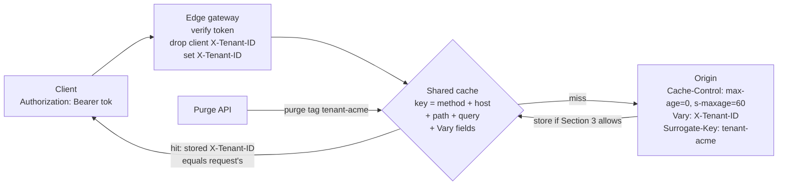

# Caching Authenticated and Multi-Tenant API Responses Without Cross-Tenant Data Leaks

> [!summary] Claim
> A shared cache keys on method and URL plus whatever `Vary` names, so a tenant-specific response leaks to every other tenant the moment it becomes storable without the tenant in that key; HTTP protects you only for the `Authorization` header and only until you add `public`, `s-maxage`, or `must-revalidate`, so the safe design is `private` for per-user data and, for tenant-wide data, an edge that derives the tenant from the verified credential before the cache and a response that varies on it.

Part of [HTTP Caching and Conditional Requests](README.md) in [API Engineering](../README.md).

## TL;DR

Mechanism: a shared cache looks up a stored response by target URI and the request fields nominated by `Vary` `(RFC 9111 Section 4)`, so anything that selected the content but is not in that key, such as the tenant decoded from a token, is invisible to the cache.
Contract rule: a shared cache must not reuse a response to a request with `Authorization` unless the response carries `public`, `s-maxage`, or `must-revalidate` `(RFC 9111 Section 3.5)`, and must never store an unqualified `private` response `(RFC 9111 Section 5.2.2.7)`.
The trap: `Cache-Control: public, max-age=60` on a bearer-authenticated endpoint switches that protection off, cookie-authenticated requests never had it, and a `Set-Cookie` on a cacheable response is replayed to the next requester `(RFC 9111 Section 7.3)`; the lab reproduces all three.
Portability fact: these are cache semantics defined independently of HTTP/1.1, HTTP/2, and HTTP/3, and the lab's 42 tests pass on CPython 3.12.13, 3.13.18, 3.14.6, 3.14.10, and 3.15.2 on macOS, and its earlier 40-test revision also passed on 3.12.16, a 3.15.2 free-threaded build, and in Debian Trixie and Alpine containers.
When not to use it: if a response is filtered by the caller's own permissions or holds a single user's data, do not share it at all; send `private` (or `no-store` for secrets) and cache below HTTP with the principal in the key.

## Mental model



A request enters the edge gateway first, which verifies the bearer token, deletes any `X-Tenant-ID` the client sent, and writes the verified tenant into `X-Tenant-ID`.
Only then does the shared cache compute its key: the method, the lowercased `Host`, the path, and the query, plus, for each stored response, the request values of the fields its `Vary` names.
On a miss the origin answers with a tenant-wide representation, `s-maxage` so a shared cache may store it even though the request carried `Authorization`, `Vary: X-Tenant-ID` so the tenant becomes part of the key, and a `Surrogate-Key` tag so one tenant's entries can be purged without touching another's.
If the cache sat in front of the gateway instead, it would record the client's `X-Tenant-ID` (normally absent) as the selecting value, and every tenant would match the first tenant's entry.

## How it works

### What a shared cache is allowed to store

A cache must not store a response unless, among other conditions, `no-store` is absent, a shared cache sees no unqualified `private`, and "the Authorization header field is not present in the request ... or a response directive is present that explicitly allows shared caching" `(RFC 9111 Section 3)`.
The response also needs something that makes it storable: `public`, `max-age`, `s-maxage` for a shared cache, `Expires`, a cache extension, or a heuristically cacheable status code `(RFC 9111 Section 3)`.
Section 3.5 names the three directives that lift the `Authorization` restriction: `must-revalidate` `(RFC 9111 Section 5.2.2.2)`, `public` `(RFC 9111 Section 5.2.2.9)`, and `s-maxage` `(RFC 9111 Section 5.2.2.10)`.
`public` is the dangerous one because it carries no freshness or revalidation obligation: it "explicitly marks the response as cacheable" and "permits a shared cache to reuse a response to a request containing an Authorization header field" `(RFC 9111 Section 5.2.2.9)`.
`s-maxage` also implies `proxy-revalidate` for shared caches, so a stale entry must be revalidated before reuse `(RFC 9111 Section 5.2.2.10)`.
RFC 9110 explains why origins usually omit `Authorization` from `Vary`: "reuse of that response for a different user is prohibited by the field definition" `(RFC 9110 Section 12.5.5)`; that prohibition is exactly what the three directives remove.

### What a shared cache uses as the key

The cache key is "at a minimum, the request method and target URI", and "many HTTP caches in common use today only cache GET responses and therefore only use the URI as the cache key" `(RFC 9111 Section 2)`.
`Vary` extends the key: a stored response is reused without revalidation only if every request field it nominates matches the original request's value, after whitespace removal, combining field lines, and normalization known to preserve semantics; a field absent from one request matches only if it is absent from the other, and `Vary: *` never matches `(RFC 9111 Section 4.1)`.
Note the phrase "the original request (i.e., the request that caused the cached response to be stored)": the selecting values are the request as the cache saw it, not as the origin saw it after a downstream gateway rewrote it.
Repeated field lines are combined with a comma before comparison `(RFC 9110 Section 5.3)`, which is why `combined_headers` in the lab joins them with `", "`.
Caches may add more material to the key, for example "double keying" by referring site `(RFC 9111 Section 2, Section 7.2)`; a CDN cache-key rule that adds a verified tenant claim is the same idea configured at the edge rather than signaled by `Vary`.

### Targeted fields can silently replace `private`

A cache that implements `CDN-Cache-Control` "MUST select the first (in target-list order) field with a valid, non-empty value ... and it MUST ignore the Cache-Control and Expires header fields in that response" `(RFC 9213 Section 2.2)`.
So `Cache-Control: private` with `CDN-Cache-Control: max-age=60` is stored by the CDN; the `private` was in the field the CDN no longer reads.
Targeted fields are Structured Field Dictionaries, and an empty or unparsable one must be ignored, falling back to `Cache-Control` `(RFC 9213 Section 2.1)`; the lab uses its `Cache-Control` parser for them, which is a simplification the RFC warns can diverge.

### Cookies, `Set-Cookie`, and the qualified `private`

Section 3.5 mentions only the `Authorization` header field, so a request authenticated by a `Cookie` gets no protection: a `max-age=60` response to it is storable and reusable for anyone, which the lab's `test_cookie_authenticated_max_age_response_leaks_to_another_session` demonstrates.
`Set-Cookie` "does not inhibit caching; a cacheable response with a Set-Cookie header field can be (and often is) used to satisfy subsequent requests" `(RFC 9111 Section 7.3)`, so a session-rotating response that is also cacheable hands one user's session to the next requester.
The qualified form `private="Set-Cookie"` lets a shared cache store the response minus the listed fields, but RFC 9111 itself notes that it "is often handled by caches as if an unqualified private directive was received" `(RFC 9111 Section 5.2.2.7)`; the lab treats it that way.
Starlette's `SessionMiddleware` calls `headers.add_vary_header("Cookie")` whenever the handler read `request.session` (starlette 1.10.0 starlette/middleware/sessions.py, SessionMiddleware.__call__), and `add_vary_header` appends to any existing `Vary` (starlette 1.10.0 starlette/datastructures.py, MutableHeaders.add_vary_header), so a `Vary`-honoring cache gives every session its own entry, which `test_starlette_session_middleware_vary_cookie_gives_each_session_its_own_entry` proves; the hit rate for that URL becomes one entry per session.

### Purging per tenant

`Surrogate-Key` is "proprietary to Fastly": it indexes a stored response under extra space-separated keys that "cannot be used to find and serve the content in a request, but can be used to target the content for purging" (Fastly documentation, Surrogate-Key, as of 2026-11).
Prefixing tags with the tenant (`tenant-acme`) makes a tenant offboarding, a data-residency move, or a leak response a single purge that cannot evict other tenants; the lab's `purge_tag` evicts exactly the entries indexed under the tag.
Purging and invalidation on unsafe methods are covered in [[Cache-Invalidation-Upon-Unsafe-Methods-and-Purge-Patterns]].

## Numbers and limits

| Quantity | Value | Source |
|---|---|---|
| Value a cache uses for a `delta-seconds` it cannot represent | `2147483648` (2^31) or the greatest positive integer it can conveniently represent; an overflow must never be treated as negative | `(RFC 9111 Section 1.2.2)`; lab `test_delta_seconds_is_digits_only_and_overflow_uses_two_to_the_31` asserts the lab caps at 2^31 |
| Directives that unlock reuse of `Authorization` responses | 3: `public`, `s-maxage`, `must-revalidate` | `(RFC 9111 Section 3.5)` |
| Directives a targeted-field cache must implement | 5: `max-age`, `must-revalidate`, `no-store`, `no-cache`, `private` | `(RFC 9213 Section 2.2)` |
| Fastly `Surrogate-Key` limits | 1024 bytes per key, 16,384 bytes per header; the key being parsed when a limit is hit and every later key in that header are ignored | Fastly documentation, Surrogate-Key (as of 2026-11) |
| Exposure window in CVE-2026-82755 | up to one hour (`Cache-Control: public, max-age=3600`, no `Vary`) | NVD CVE-2026-82755 |
| Origin calls, 2 tenants, `public, max-age=60` | 1 call, second tenant served the first tenant's invoices | lab, `test_public_without_a_tenant_key_serves_acme_invoices_to_globex` |
| Origin calls, 2 tenants, `max-age=60` with `Authorization` | 2 calls, 0 stored (`detail=authorization`) | lab, `test_max_age_alone_is_not_shared_across_authorization_requests` |
| Origin calls, 3 principals in 2 tenants, `s-maxage=60` + `Vary: X-Tenant-ID` | 2 calls (one per tenant), 1 hit | lab, `test_edge_verified_tenant_header_shares_within_a_tenant_and_isolates_tenants` |
| Stored entries per URL | one per distinct value of the `Vary` fields: tenants for `X-Tenant-ID`, sessions for `Cookie` | derived from `(RFC 9111 Section 4.1)`; lab asserts 2 entries with selecting values `("acme",)` and `("globex",)` in `test_edge_verified_tenant_header_shares_within_a_tenant_and_isolates_tenants` |
| Lab run time | `42 passed` in 0.11s to 0.32s over two runs (2026-11-10) | `uv run --frozen pytest <test> -q` from `labs/`, CPython 3.14.6, macOS 27.2 arm64 (Darwin 27.2.0), Apple M3 Pro |

## Portability

| Runtime, library, or layer | Behavior | Evidence |
|---|---|---|
| CPython 3.12.13 (macOS) | 42 passed | lab, full `uv.lock` env (`UV_PROJECT_ENVIRONMENT=<tmp> uv run --frozen --python 3.12.13 pytest <test> -q`) from `labs/` |
| CPython 3.12.16 | 40 passed on Debian Trixie and on Alpine | lab, Docker `python:3.12-trixie` and `python:3.12-alpine` (Python 3.12.16) |
| CPython 3.13.18 | 42 passed on macOS; 40 passed on Debian Trixie | lab, Homebrew 3.13.18 with the full `uv.lock` env, and Docker `python:3.13-trixie` |
| CPython 3.14.6 (workspace `.venv`) | 42 passed | lab, `uv run --frozen pytest <test> -q` with the full lock |
| CPython 3.14.10 | 42 passed on macOS; 40 passed on Debian Trixie and Alpine | lab, Homebrew 3.14.10 with the full `uv.lock` env, Docker `python:3.14-trixie` and `python:3.14-alpine` |
| CPython 3.15.2 | 42 passed on macOS; 40 passed on Debian Trixie and Alpine | lab, Homebrew 3.15.2 with the full `uv.lock` env, Docker `python:3.15-trixie` and `python:3.15-alpine` |
| CPython 3.15.2t free-threaded | 40 passed with the GIL off | lab, interpreter built from the python.org `Python-3.15.2.tgz` with `./configure --disable-gil` (no uv or Docker build of 3.15.2t exists), minimal venv, `python -X gil=0 -m pytest <test> -q`, `sys._is_gil_enabled()` False; `uv sync --frozen --python <that interpreter>` of the full lock fails: `psycopg-binary==3.3.8` has no wheel or sdist for the free-threaded ABI (run 2026-11-10) |
| Debian Trixie container | 40 passed | Docker `python:*-trixie` (Debian GNU/Linux 13, glibc 2.41, linux-aarch64 under OrbStack on the M3 Pro), `pip install` of the same pins, `PYTHONPATH=src python -m pytest <test> -q`; linux x86_64 was not run |
| Alpine musl container | 40 passed | Docker `python:*-alpine` (Alpine Linux v3.24, musl libc, linux-aarch64), same method; the lab is pure Python over in-process ASGI, so no libc path is exercised beyond the interpreter |
| Starlette 1.10.0 `SessionMiddleware` | adds `Vary: Cookie` when the session was read | source read and `test_starlette_session_middleware_vary_cookie_gives_each_session_its_own_entry` |
| httpx 0.28.1 `ASGITransport` | drives the whole gateway, cache, and origin stack in-process | every async test in the lab |
| Uvicorn 0.54.0, Hypercorn 0.18.0, Granian 2.8.7 over HTTP/1.1 sockets | the same `TenantEdge`, `SharedCache`, and `Origin` stack served over loopback by each server returned `alice` a `uri-miss; stored` for `acme`, `bob` a `hit` for `acme`, and `mallory` a `vary-miss; stored` for `globex`, with `Cache-Control` and `Vary` unchanged; Uvicorn and Hypercorn contain no `cache-control` handling, so the policy is entirely the application's and the intermediary's | ad hoc run on 2026-11-10 from the workspace venv (`uvicorn`, `hypercorn`, `granian --interface asgi` on ephemeral ports, `httpx` client, servers terminated afterwards), not a lab test; `grep -ril cache-control` over the Uvicorn and Hypercorn packages returned nothing |
| Granian 2.8.7 source | no cache policy logic: the one `cache-control` string in the compiled extension sits inside a run of standard header names (`accept` through `x-frame-options`, including `cache-status` and `cdn-cache-control`), the name table of the Rust `http` crate that Granian links through `hyper` | `strings _granian.cpython-314-darwin.so`; Granian v2.8.7 `Cargo.lock` pins `http` 1.5.0, whose `src/header/name.rs` `standard_headers!` table defines these names |
| HTTP/1.1, HTTP/2, HTTP/3 | identical: storage, `Vary`, and `Authorization` rules are defined on the version-independent message abstraction | `(RFC 9110 Section 6)`, `(RFC 9111 Section 3, Section 4.1)` |
| CDNs implementing `CDN-Cache-Control` | `Cache-Control` is ignored when a targeted field is valid, so `private` there does not bind them | `(RFC 9213 Section 2.2)`; lab `test_cdn_cache_control_replaces_private_for_a_cache_that_targets_it` |

Cells that say 40 passed record the revision before the host-key and `no-cache` cases were added; the 42-case revision was run on macOS only, on 2026-11-10.

## Worked example

The [implementation](../labs/src/api_labs/f03_http_caching_and_conditional_requests/multi_tenant_cache.py) is a small shared cache as ASGI middleware (`SharedCache`), an edge gateway (`TenantEdge`), and a Starlette origin (`Origin`) whose `CachePolicy` is chosen per test.
The cache handles `GET` and `200` only, needs explicit freshness, never revalidates and so refuses to store `no-cache` responses `(RFC 9111 Section 5.2.2.4)`, and reports what it did in `Cache-Status` with `hit`, `fwd`, `stored`, and `detail` `(RFC 9211 Section 2.1, 2.2, 2.5, 2.8)`.
The [test](../labs/tests/f03_http_caching_and_conditional_requests/test_caching_authenticated_and_multi_tenant_api_responses.py) has 42 cases, which include two-tenant leak tests, a host-based tenancy key test, edge-ordering tests, and unit tests for `combined_headers`, `delta_seconds`, and entry replacement.

Simplified excerpt of the implementation (verbatim lines 30-32, 86-102, 140-147, 258-268, and 308-323 of `multi_tenant_cache.py`; the rest omitted):

```python
# RFC 9111 Section 3.5: directives that let a shared cache reuse a response to a request
# that carried `Authorization`.
AUTHORIZATION_OVERRIDES = frozenset({"public", "s-maxage", "must-revalidate"})

def refusal_reason(
    *, status: int, request_has_authorization: bool, directives: Mapping[str, str | None]
) -> str | None:
    """Return why a shared cache must not store this response, or None if it may."""
    if status != 200:
        return "status"
    if "no-store" in directives:
        return "no-store"
    if "private" in directives:
        return "private"
    if "no-cache" in directives:
        return "no-cache"
    if request_has_authorization and not AUTHORIZATION_OVERRIDES & directives.keys():
        return "authorization"
    if shared_lifetime(directives) <= 0:
        return "no-freshness"
    return None

    def matches(self, request_headers: Mapping[str, str]) -> bool:
        """RFC 9111 Section 4.1: every nominated field must match; `*` never matches."""
        if "*" in self.vary:
            return False
        return all(
            request_headers.get(name) == value
            for name, value in zip(self.vary, self.selecting, strict=True)
        )

@dataclass(frozen=True, slots=True)
class CachePolicy:
    cache_control: str
    vary: str | None = None
    tag_tenant: bool = False


PUBLIC = CachePolicy("public, max-age=60")
MAX_AGE_ONLY = CachePolicy("max-age=60")
PRIVATE = CachePolicy("private, max-age=60")
TENANT_SHARED = CachePolicy("max-age=0, s-maxage=60", vary="X-Tenant-ID", tag_tenant=True)

@dataclass(slots=True)
class TenantEdge:
    """Edge gateway: drop client-sent `x-tenant-id`, then set it from the verified token."""

    app: ASGIApp

    async def __call__(self, scope: Scope, receive: Receive, send: Send) -> None:
        if scope["type"] != "http":
            await self.app(scope, receive, send)
            return
        raw: list[tuple[bytes, bytes]] = list(scope["headers"])
        headers = [(n, v) for n, v in raw if n.lower() != b"x-tenant-id"]
        principal = bearer_principal(combined_headers(raw))
        if principal is not None:
            headers.append((b"x-tenant-id", principal.tenant.encode()))
        await self.app({**scope, "headers": headers}, receive, send)
```

Simplified excerpt of the test (verbatim lines 125-136, 239-254, and 270-280; imports, `INVOICES_KEY`, `FakeClock`, `get`, and `stack` omitted):

```python
@pytest.mark.unit
@pytest.mark.asyncio
async def test_public_without_a_tenant_key_serves_acme_invoices_to_globex() -> None:
    origin, cache = stack(PUBLIC)

    first = await get(cache, "/v1/invoices", user="alice")
    leaked = await get(cache, "/v1/invoices", user="mallory")

    assert first.headers["cache-status"] == "lab; fwd=uri-miss; stored"
    assert leaked.headers["cache-status"] == "lab; hit"
    assert leaked.json() == {"tenant": "acme", "invoices": ["INV-A1", "INV-A2"]}
    assert origin.calls == [("/v1/invoices", "alice")]

@pytest.mark.unit
@pytest.mark.asyncio
async def test_edge_verified_tenant_header_shares_within_a_tenant_and_isolates_tenants() -> None:
    origin, cache = stack(TENANT_SHARED)
    edge = TenantEdge(cache)

    alice = await get(edge, "/v1/invoices", user="alice")
    bob = await get(edge, "/v1/invoices", user="bob")
    mallory = await get(edge, "/v1/invoices", user="mallory")

    assert alice.headers["cache-status"] == "lab; fwd=uri-miss; stored"
    assert bob.headers["cache-status"] == "lab; hit"
    assert mallory.headers["cache-status"] == "lab; fwd=vary-miss; stored"
    assert mallory.json() == {"tenant": "globex", "invoices": ["INV-G1"]}
    assert origin.calls == [("/v1/invoices", "alice"), ("/v1/invoices", "mallory")]
    assert [e.selecting for e in cache.entries[INVOICES_KEY]] == [("acme",), ("globex",)]

@pytest.mark.unit
@pytest.mark.asyncio
async def test_cache_in_front_of_the_gateway_keys_on_an_absent_header_and_leaks() -> None:
    origin = Origin(TENANT_SHARED)
    cache = SharedCache(TenantEdge(origin.app()), clock=FakeClock())

    await get(cache, "/v1/invoices", user="alice")
    leaked = await get(cache, "/v1/invoices", user="mallory")

    assert leaked.headers["cache-status"] == "lab; hit"
    assert leaked.json()["tenant"] == "acme"
```

The first test is the seed's catastrophe: `globex` receives `acme`'s invoices from the cache and the origin never sees `mallory`.
The second is the fix: `bob` shares `alice`'s tenant entry, `mallory` misses with `fwd=vary-miss` and gets `globex` data, the origin is called once per tenant, and the cache holds exactly one entry per tenant keyed on the edge-written value.
The third shows that the fix depends on layer order: with the cache outside the gateway, the stored selecting value for `x-tenant-id` is "absent", which matches every client that did not send the header.

Captured run, macOS 27.2 arm64 (Apple M3 Pro), CPython 3.14.6, from `labs/`:

```text
$ uv run --frozen pytest tests/f03_http_caching_and_conditional_requests/test_caching_authenticated_and_multi_tenant_api_responses.py -q
..........................................                               [100%]
42 passed in 0.11s
```

## Pitfalls

> [!warning] `public` on a bearer-authenticated endpoint
> Trigger: a developer adds `Cache-Control: public, max-age=N` to a tenant-scoped `GET` to "turn on the CDN", and the tenant comes from the token, not the URL.
> Symptom: the first tenant's response is served to every tenant for `N` seconds; NVD CVE-2026-82755 (ash_authentication_oauth2_server from 0.1.3 before 0.3.1) is the same shape with the tenant taken from a header or the Host rather than a token: tenant-specific OAuth discovery metadata sent as `public, max-age=3600` with no `Vary` was served to another tenant's clients for up to an hour, so they could send authorization codes and secrets to the wrong tenant's token endpoint.
> Fix: drop `public`; use `private` for per-user data, or `s-maxage` plus `Vary` on an edge-verified tenant field for tenant-wide data; the lab's mutation that stopped `public` from unlocking `Authorization` failed `test_public_without_a_tenant_key_serves_acme_invoices_to_globex`.

> [!warning] Cookie-authenticated APIs get no `Authorization` protection
> Trigger: a browser API authenticates with a session cookie and returns `Cache-Control: max-age=60` for client-side speed.
> Symptom: a shared cache stores it and serves one user's `/v1/me` to the next user, because Section 3.5 only names `Authorization`.
> Fix: `private` on every per-user response, or `Vary: Cookie` (Starlette's `SessionMiddleware` adds it when the session is read) at the cost of one entry per session; the mutation that treated `Cookie` like `Authorization` failed the cookie-leak test, which shows the leak depends on that gap.

> [!warning] Cache keyed on the client's tenant header, or placed before the gateway
> Trigger: the origin sends `Vary: X-Tenant-ID` but the gateway that sets the header sits behind the cache, or the gateway keeps a client-supplied value.
> Symptom: with the cache in front, every request has no `X-Tenant-ID` at the cache, so all tenants share one entry; with a pass-through gateway, an attacker sends the victim's tenant ID and gets a `hit` on the victim's entry without the origin ever checking the token.
> Fix: verify and overwrite at the edge before the cache; both mutations that let a client value survive (set only when missing, or kept alongside the verified value) failed `test_spoofed_tenant_header_is_replaced_by_the_edge_before_the_cache_sees_it`, which asserts the stored selecting values, not just the response body.

> [!warning] Default cache keys that omit a tenant dimension
> Trigger: relying on a proxy's default key in a multi-tenant deployment.
> Symptom: NVD CVE-2026-2836 reports that the default cache key of the Pingora proxy framework's alpha caching feature used "only the URI path, excluding critical factors such as the host header (authority)", enabling "Cross-tenant data leakage" in multi-tenant deployments; Pingora 0.8.0 removed the default.
> Fix: write the key function explicitly and test it with two tenants on the same path, as this lab does for both header-based and host-based tenancy (`test_host_is_in_the_primary_key_so_host_based_tenants_do_not_share_entries`).

> [!warning] Cacheable responses that set cookies
> Trigger: a session-refresh `Set-Cookie` on a response that is also `public` or `max-age`-cacheable.
> Symptom: the next requester receives the first user's session cookie from the cache `(RFC 9111 Section 7.3)`; `test_cached_set_cookie_is_replayed_to_the_next_requester` shows it byte for byte.
> Fix: never set cookies on shareable responses; send `no-store` or `private` on any response that carries `Set-Cookie`.

> [!warning] Tenant keying applied to per-user resources
> Trigger: one global policy (`s-maxage` plus `Vary: X-Tenant-ID`) applied to every route, including `/v1/me`.
> Symptom: users in the same tenant see each other's profile; `test_tenant_shared_policy_on_a_per_user_resource_leaks_within_the_tenant` shows `bob` receiving `alice`.
> Fix: classify each route by the narrowest principal that selects its content (public, tenant, user) and give user-scoped routes `private`.

## Security and robustness

Threat model: the attacker is an authenticated user of another tenant, or of the same tenant, who wants another principal's data, and the shared cache is the confused deputy that serves it without consulting authorization.
A cache hit bypasses every origin-side check, including the tenant-scoped queries in [[Defeating-BOLA-API1-2023-Tenant-Scoped-Queries-and-PostgreSQL-RLS]]; that is why the cache key must carry the same principal dimension that selected the content.
OWASP API8:2023 Security Misconfiguration lists "Security or cache control directives are not sent to clients" as a vulnerability indicator, with a scenario where private conversations ended up in the browser cache because the API sent no `Cache-Control` (OWASP API Security Top 10 2023, API8).
Semantic and application-level caches have the same failure: NVD CVE-2026-89032 reports that LiteLLM before 1.101.0-rc.1 let authenticated users read other tenants' cached responses through its semantic cache because of a metadata key mismatch between `_get_semantic_cache_tenant_scope()` and `_get_metadata_variable_name()`.
Defense in depth:
- classify every route as public, tenant, or user scoped, and derive `Cache-Control` from the classification rather than per handler;
- default to `private` (and `no-store` for credentials and tokens), so forgetting a header fails safe for shared caches;
- derive the tenant at the edge from the verified credential, strip client copies of that header, and put the cache after that step;
- tag every shared entry with a tenant `Surrogate-Key` and keep a tested per-tenant purge runbook;
- monitor `Cache-Status` `(RFC 9211 Section 2)` for `hit` on routes classified as user scoped, which should never happen;
- remember that `no-store` "is not a reliable or sufficient mechanism for ensuring privacy" against malicious caches `(RFC 9111 Section 5.2.2.5)`; TLS and not sending the data are the real controls.
Poisoning through unkeyed inputs and cache deception are the adjacent attacks; see [[Web-Cache-Poisoning-and-Cache-Deception-Attacks]].

## The principal's view

The decision is not "should we cache authenticated APIs" but "which layer owns the principal dimension of the key".
Option one is to make HTTP shared caches structurally unable to hold private data: `private` everywhere authenticated, caching done inside the service with explicit `(tenant, user, resource)` keys, and the CDN reserved for public assets; this costs CDN offload for authenticated traffic and buys an invariant that no CDN configuration change can break.
Option two is tenant-scoped edge caching: the gateway verifies tokens, the cache key includes the verified tenant, and responses use `s-maxage` plus a tenant `Surrogate-Key`; this buys large offload for tenant-wide reads (catalogs, configuration, dashboards) but couples correctness to layer order, header stripping, and CDN key configuration owned by a different team.
Choose option two only when the read volume justifies it, the representation is provably identical for every principal in the tenant, and you can put a two-tenant leak test like this lab's into the CDN configuration pipeline.
Organizationally, the failure modes in this note come from the policy being split across three owners (application headers, gateway, CDN rules); a single route classification table that generates all three is the control that scales.
When per-user personalization dominates, prefer client-side caching with validators (see [[Conditional-GET-Revalidation-and-304-Not-Modified]]) or push data to the client over an authenticated channel instead of trying to share responses.

## Interview questions

> [!question] L5: Why does a shared cache not normally serve one user's response to a bearer-authenticated `GET` to another user, and what turns that off?
>
> > [!success]- Answer
> > RFC 9111 Section 3.5 forbids a shared cache from reusing a response to a request with `Authorization` unless the response allows shared caching.
> > The three directives that allow it are `public`, `s-maxage`, and `must-revalidate`.
> > So `Cache-Control: max-age=60` alone is safe from shared reuse, but `public, max-age=60` is shared across tokens.
> >
> > Follow-up: Does the same protection apply to a session cookie?

> [!question] L5: What is the difference between `private` and `no-store`?
>
> > [!success]- Answer
> > `private` forbids shared caches from storing the response but allows the user's own private cache to store it.
> > `no-store` forbids every cache from storing it and asks caches to remove it from volatile storage promptly.
> > Neither is a privacy guarantee against a malicious cache; RFC 9111 says so explicitly for `no-store`.
> >
> > Follow-up: Which one would you put on a token endpoint response?

> [!question] L5: Why is `Vary: Authorization` usually unnecessary, and when would it become relevant?
>
> > [!success]- Answer
> > RFC 9110 Section 12.5.5 says the `Authorization` field definition already prohibits reuse for a different user, so naming it in `Vary` is redundant.
> > It only matters after you have explicitly allowed shared caching with `public`, `s-maxage`, or `must-revalidate`; then varying on it gives one entry per token.
> > One entry per token is usually a worse design than `private`, because hit rates collapse and tokens rotate.
> >
> > Follow-up: What does `Vary: Cookie` do to hit rate?

> [!question] L6: Predict the output: the cache sits in front of the gateway, the origin sends `Cache-Control: max-age=0, s-maxage=60` and `Vary: X-Tenant-ID`, `alice` (tenant `acme`) requests `/v1/invoices`, then `mallory` (tenant `globex`) does.
>
> > [!success]- Answer
> > `mallory` receives `{"tenant": "acme", ...}` with `Cache-Status: lab; hit`.
> > The cache recorded the selecting value of `x-tenant-id` from the request it saw, which had no such field, and absent matches absent for `mallory` too.
> > `s-maxage` made the response storable despite `Authorization`, so nothing stopped the reuse.
> > This is `test_cache_in_front_of_the_gateway_keys_on_an_absent_header_and_leaks`.
> >
> > Follow-up: What changes if a client sends `X-Tenant-ID: acme` and the gateway only sets the header when it is missing?

> [!question] L6: Debug this API: after a CDN migration, support reports that users occasionally see another customer's name in the dashboard header for about a minute; the origin sends `Cache-Control: private` and the new CDN config also sets `CDN-Cache-Control: max-age=60` "to cache everything at the edge".
>
> > [!success]- Answer
> > A cache that implements RFC 9213 uses the first valid targeted field and ignores `Cache-Control`, so the CDN never sees the `private`.
> > The requests are cookie-authenticated, so the `Authorization` rule of RFC 9111 Section 3.5 does not apply either, and the one-minute window is the `max-age=60`.
> > Fix by putting `private` (or no `max-age`) in `CDN-Cache-Control` for user-scoped routes, purge the edge, and add a two-user leak test to the CDN config pipeline.
> >
> > Follow-up: How would `Cache-Status` have shown this before customers did?

> [!question] L6: Your tenant-scoped catalog uses `s-maxage=300` and `Vary: X-Tenant-ID`, and a customer offboards with a legal requirement that their cached data be gone within minutes; what do you do?
>
> > [!success]- Answer
> > Tag every shared response with a tenant surrogate key, for example `Surrogate-Key: tenant-acme`, and purge that tag.
> > The purge evicts all of that tenant's entries across URLs and leaves other tenants warm; the lab's `purge_tag("tenant-acme")` evicts one entry and `globex` still hits.
> > `Surrogate-Key` is Fastly-specific, with 1024 bytes per key and 16,384 bytes per header (as of 2026-11), so check your CDN's equivalent and limits.
> >
> > Follow-up: What do you do about browsers that cached the same data privately?

> [!question] L7+: Design the caching policy for a multi-tenant SaaS API with 10,000 tenants, a CDN, and endpoints ranging from public docs to per-user inboxes.
>
> > [!success]- Answer
> > Classify every route as public, tenant, or user scoped in one machine-readable table that generates application headers, gateway rules, and CDN key rules.
> > Public routes get `public` with long `max-age`; tenant routes get `s-maxage` plus a key on the edge-verified tenant and a tenant surrogate key; user routes get `private` or `no-store`, and are cached inside the service with explicit principal keys.
> > The gateway verifies tokens and strips client copies of tenant headers before the cache, and CI runs a two-tenant, two-user leak test against the real CDN configuration.
> > Expect per-URL cardinality equal to the number of active tenants, so 10,000 tenants on a hot route is 10,000 entries; size the CDN tier and purge rate limits accordingly.
> >
> > Follow-up: Where does this break if one tenant's data is filtered by per-user permissions?

> [!question] L7+: Argue for or against removing the gateway's header stripping because "the origin re-validates the token anyway".
>
> > [!success]- Answer
> > Against: on a cache hit the origin is never consulted, so its token check cannot protect a response selected by the cache key.
> > If the key includes a client-controllable field, an attacker who sets the victim's tenant ID gets a hit on the victim's entry.
> > The invariant is that every field in the cache key is derived from verified identity at or before the cache, and origin checks only protect misses.
> >
> > Follow-up: How would you test this invariant continuously in production?

> [!question] L7+: A semantic cache in front of an LLM API returns cached completions for similar prompts; what is the cross-tenant risk, and how does it relate to HTTP caching?
>
> > [!success]- Answer
> > It is the same bug class: the key (an embedding similarity bucket) must include the tenant, and any mismatch between the code that writes the scope and the code that reads it leaks data.
> > NVD CVE-2026-89032 describes this in LiteLLM before 1.101.0-rc.1, including returning cached tool calls to a different principal.
> > The defense is the same as for HTTP: scope keys by verified principal, test with two tenants, and treat cached tool outputs as untrusted when the principal differs.
> >
> > Follow-up: Would you ever share semantic cache entries across tenants, and under what proof?

## Related

Prerequisites: [[Cache-Stampede-Singleflight-Coalescing-and-Probabilistic-Early-Expiration]]

Next: [[Client-Side-HTTP-Caching-in-Python-Clients]]

See also: [[API-Authentication-and-Authorization]], [[02-Programming-Languages/Python/Python-Backend-Interview-Prep/07-Auth-and-Security]], [[HTTP-Caching-Architecture-Private-Shared-and-Gateway-Caches]], [[Cache-Control-Directives-and-Freshness-Lifetime-Calculation]], [[Vary-Header-Mechanics-and-Cache-Hit-Collapse]], [[Cache-Invalidation-Upon-Unsafe-Methods-and-Purge-Patterns]], [[Cache-Status-Header-for-Observability-RFC-9211]], [[Web-Cache-Poisoning-and-Cache-Deception-Attacks]], [[Conditional-GET-Revalidation-and-304-Not-Modified]], [[Defeating-BOLA-API1-2023-Tenant-Scoped-Queries-and-PostgreSQL-RLS]], [[Security-Headers-for-HTTP-APIs-HSTS-Nosniff-Cache-Control-and-Security-Txt]], [[Edge-Caching-and-CDN-Shielding-for-Dynamic-and-Public-APIs]], [[API-Authentication-Architecture-Edge-Verification-vs-Zero-Trust-Propagation]], [[Where-Authorization-Lives-Gateway-Middleware-vs-Domain-and-Query-Layer]], [[OAuth-2-0-for-Browser-Based-Applications-BFF-and-Cookies-RFC-10017]]

- Lab: `labs/tests/f03_http_caching_and_conditional_requests/test_caching_authenticated_and_multi_tenant_api_responses.py`

## Further reading

- [RFC 9111 Section 3 and 3.5](https://www.rfc-editor.org/rfc/rfc9111.html#section-3.5): the storage conditions and the three directives that allow shared reuse of `Authorization` responses.
- [RFC 9111 Section 4.1](https://www.rfc-editor.org/rfc/rfc9111.html#section-4.1): how `Vary` extends the cache key, including the absent-matches-absent rule.
- [RFC 9111 Section 7.3](https://www.rfc-editor.org/rfc/rfc9111.html#section-7.3): caching of sensitive information and why `Set-Cookie` does not inhibit caching.
- [RFC 9110 Section 12.5.5](https://www.rfc-editor.org/rfc/rfc9110.html#section-12.5.5): `Vary` semantics and why `Authorization` is normally left out of it.
- [RFC 9213 Section 2.2](https://www.rfc-editor.org/rfc/rfc9213.html#section-2.2): targeted cache-control fields replace `Cache-Control` for the caches that implement them.
- [RFC 9211](https://www.rfc-editor.org/rfc/rfc9211.html): `Cache-Status`, the field that makes a leaking `hit` observable.
- [NVD CVE-2026-82755](https://nvd.nist.gov/vuln/detail/CVE-2026-82755): tenant-specific OAuth metadata served cross-tenant by `public, max-age=3600` without `Vary`.
- [NVD CVE-2026-2836](https://nvd.nist.gov/vuln/detail/CVE-2026-2836): Pingora's default cache key omitted the authority, enabling cross-tenant leakage.
- [NVD CVE-2026-89032](https://nvd.nist.gov/vuln/detail/CVE-2026-89032): a tenant-scope key mismatch in LiteLLM's semantic cache.
- [starlette 1.10.0 starlette/middleware/sessions.py](https://github.com/encode/starlette/blob/1.10.0/starlette/middleware/sessions.py): `SessionMiddleware` adds `Vary: Cookie` when the session is read.
