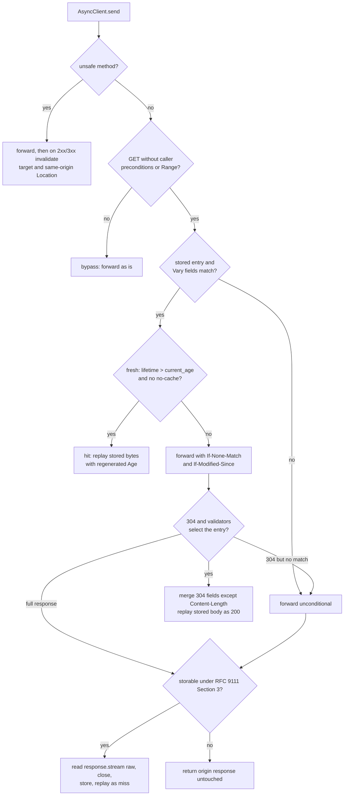

# Implementing RFC 9111 Compliant Client-Side Caching in httpx Transports

> [!summary] Claim
> An `httpx` client cache belongs in an `AsyncBaseTransport` wrapper that stores the still content-coded bytes from `response.stream`, computes `current_age` from `Date`, `Age`, and its own request and response clock readings (RFC 9111 Section 4.2.3), revalidates with the stored `ETag` and `Last-Modified`, and treats itself as a shared cache the moment more than one user's requests flow through it.

Part of [HTTP Caching and Conditional Requests](README.md) in [API Engineering](../README.md).

## TL;DR

- Mechanism: `AsyncClient` calls `transport.handle_async_request(request)` once per hop and then wraps whatever `Response` comes back (`(httpx 0.28.1 httpx/_client.py, AsyncClient._send_single_request)`), so a wrapper transport can answer from its store, rewrite the request into a conditional one, and turn a `304` into a `200` before the client ever sees it.
- Contract rule: a stored response is reused only while `freshness_lifetime > current_age` (RFC 9111 Section 4.2), it must carry a regenerated `Age` when served without validation (RFC 9111 Section 4), and a `304` updates only the stored response its validators identify (RFC 9111 Section 4.3.4).
- The trap: buffering with `aread()` stores decoded bytes under a `Content-Encoding: gzip` header, and buffering with `aiter_raw()` raises `StreamConsumed` on a `Response(content=...)` from `httpx.MockTransport`; read `response.stream` instead.
- Portability fact: the 68-test lab passes unchanged on CPython `3.12.16`, `3.13.18`, `3.14.10`, `3.15.2`, and `3.15.2t` free-threaded with `httpx 0.28.1`, on macOS and on Debian Trixie and Alpine, and the cache gave the same hit and revalidation sequence over real sockets behind Uvicorn, Hypercorn, and Granian, including HTTP/2 with prior knowledge; CPython's documented default limit of 4300 digits for `int()` from `str` means an uncapped `delta-seconds` parser crashes on a hostile `max-age`.
- When not to use it: skip a client cache for per-user, rapidly changing, or write-heavy endpoints, and do not put a private-mode cache in a service that makes calls for many end users.

## Mental model



A request enters through `AsyncClient.send`, and the first split is safety: unsafe methods are always written through and, on a non-error status, evict the target URI and any same-origin `Location` or `Content-Location` (RFC 9111 Section 4.4).
Safe requests that the caller already made conditional, and every method other than `GET`, bypass the store as a lab policy: RFC 9111 Section 4.3.2 says a cache SHOULD evaluate applicable preconditions against a stored response it could reuse and MUST NOT evaluate those that only apply to the origin, so forwarding them unchanged gives up that saving but never answers a precondition wrongly.
For a plain `GET` the wrapper looks up one entry per URL and checks the request fields nominated by the stored `Vary` (RFC 9111 Section 4.1).
A fresh entry is replayed with a regenerated `Age`; a stale one turns the request into a conditional request carrying the stored validators (RFC 9111 Section 4.3.1).
A `304` that names the stored response freshens its header fields and the stored body is replayed as a `200`; a `304` that names nothing cannot be used, so the wrapper drops the entry and repeats the request unconditionally.
Any full response goes through the storability rules of RFC 9111 Section 3, and only storable ones are buffered; the rest stream through untouched.

## How it works

### Where the cache plugs into httpx

`httpx.AsyncBaseTransport` is a plain class, not an `abc.ABC`: subclasses override one coroutine, `handle_async_request(request) -> Response`, whose default raises `NotImplementedError`, plus a no-op `aclose()` that `__aexit__` calls (`(httpx 0.28.1 httpx/_transports/base.py, AsyncBaseTransport)`).
The maintainers document wrapping the default transport as "a useful pattern" in the custom transports section of `docs/advanced/transports.md` at tag `0.28.1`.
`AsyncClient._send_single_request` asserts that the returned `response.stream` is an `AsyncByteStream`, then replaces it with a `BoundAsyncStream` and extracts cookies (`(httpx 0.28.1 httpx/_client.py, AsyncClient._send_single_request)`).
So the wrapper sees one hop: redirects, authentication flows, and cookie jars live above it in the client, and connection pooling and HTTP framing live below it in the inner transport.
That placement means the same wrapper caches over `httpx.AsyncHTTPTransport`, `httpx.ASGITransport`, and `httpx.MockTransport`.

### Reading the body without losing it

`httpx.Response` exposes three ways to read a body, and only one is right for a cache:

| Reader | What it yields | Source |
|---|---|---|
| `await response.aread()` | content-decoded bytes (every coding in `SUPPORTED_DECODERS`: `gzip` and `deflate` always, `br` and `zstd` only when `brotli` and `zstandard` are installed, `(httpx 0.28.1 httpx/_decoders.py, SUPPORTED_DECODERS)`), memoized in `_content` | `(httpx 0.28.1 httpx/_models.py, Response.aread)` via `Response.aiter_bytes` |
| `response.aiter_raw()` | raw bytes, but raises `StreamConsumed` if `is_stream_consumed` is already set | `(httpx 0.28.1 httpx/_models.py, Response.aiter_raw)` |
| `async for chunk in response.stream` | raw bytes straight from the `AsyncByteStream` | `(httpx 0.28.1 httpx/_content.py, ByteStream)` re-yields its bytes on every iteration |

A cache must store what the origin sent, with the metadata the origin sent, because the replayed `Response` is built from those headers and `httpx` decodes it again on the way to the caller.
RFC 9111 Section 3.2 names the failure the other choice causes: a cache that decodes the content coding while receiving creates "a disconnect between the data it has stored and the response's original metadata".
`aiter_raw()` looks right and fails with `httpx.MockTransport`: its `handle_async_request` returns the handler's `Response` unchanged (`(httpx 0.28.1 httpx/_transports/mock.py, MockTransport.handle_async_request)`), and `Response(content=...)` calls `self.read()` inside `__init__` (`(httpx 0.28.1 httpx/_models.py, Response.__init__)`), which marks the stream consumed.
Iterating `response.stream` works for both cases; the lab's `_read_raw` does that and closes the response in a `finally`, because `aiter_raw` only calls `aclose()` after the last chunk and an exception mid-body would otherwise leak the pooled connection.

### Freshness and age

The wrapper keeps `request_time` and `response_time` from an injectable clock and computes, exactly as RFC 9111 Section 4.2.3 writes it:

```text
apparent_age          = max(0, response_time - date_value)
corrected_age_value   = age_value + (response_time - request_time)
corrected_initial_age = max(apparent_age, corrected_age_value)
current_age           = corrected_initial_age + (now - response_time)
```

`freshness_lifetime` takes the first match of `s-maxage` (shared mode only), `max-age`, then `Expires - Date` (RFC 9111 Section 4.2.1).
An invalid `Expires`, "especially the value "0"", means already expired (RFC 9111 Section 5.3), and a `max-age` with non-integer content is treated as stale, which RFC 9111 Section 4.2.1 encourages.
With duplicate directives RFC 9111 Section 4.2.1 allows either using the first occurrence or treating the response as stale; the lab chooses the first occurrence, and its `parse_cache_control` uses `dict.setdefault` for that and keeps commas inside quoted arguments such as `no-cache="set-cookie, x-a"`.
Heuristic freshness is a `MAY` (RFC 9111 Section 4.2.2), and the lab does not use one, so a `200` that carries only an `ETag` is stored with a lifetime of 0 and revalidated on every use; the sibling [[Cache-Control-Directives-and-Freshness-Lifetime-Calculation]] covers the heuristic.
`HTTP-date` values are parsed in all three formats that RFC 9110 Section 5.6.7 requires, as UTC with `calendar.timegm`, never with the local zone (RFC 9111 Section 4.2); a zone other than `GMT` is rejected, which RFC 9111 Section 4.2 recommends.
`email.utils.parsedate_tz` returns an offset of `0` for an asctime date as well as for `GMT`, so the lab checks the last token itself; that was found by a failing test, not by reading.

### Storing

RFC 9111 Section 3 lists the conditions; the wrapper implements the ones that apply to `GET`:
the status is final and not `206` or `304` (the lab does not understand range responses), neither request nor response has `no-store`, and the response has `public`, `max-age`, `Expires`, `private` (private mode) or `s-maxage` (shared mode), or a heuristically cacheable status (RFC 9110 Section 15.1 lists `200, 203, 204, 206, 300, 301, 308, 404, 405, 410, 414, 501`).
In shared mode it also refuses `private`, and refuses a request with `Authorization` unless the response has `public`, `s-maxage`, or `must-revalidate` (RFC 9111 Section 3.5).
Stored header fields drop `Connection`, every field `Connection` names, and the other hop-by-hop fields of RFC 9110 Section 7.6.1, plus the proxy fields of RFC 9111 Section 3.1.

### Validation and the 304 merge

A stale entry produces `If-None-Match` from the stored `ETag` and `If-Modified-Since` from the stored `Last-Modified`; RFC 9111 Section 4.3.1 says the cache "MUST send the relevant entity tags" and "SHOULD send the Last-Modified value".
The conditional request is a new `httpx.Request`, and it must be built with `extensions=request.extensions`: `BaseClient.build_request` stores the client's timeout there (`(httpx 0.28.1 httpx/_client.py, BaseClient.build_request)`), and httpcore reads it with `timeouts.get("connect", None)`, where `None` means no timeout (`(httpcore 1.0.9 httpcore/_async/connection.py, AsyncHTTPConnection._connect)`).
On `304`, the RFC 9111 Section 4.3.4 selection runs: a strong `ETag` in the `304` must equal a strong stored `ETag`, a weak one matches by opaque-tag, a `Last-Modified` must equal the stored one, and a `304` with no validator selects only a stored response that also has none.
A selected entry gets each `304` field, except `Content-Length`, replacing the stored field of the same name (RFC 9111 Section 3.2), and new `request_time` and `response_time` readings, so its age restarts from the validation.
The detailed merge and origin-side evaluation are owned by [[Conditional-GET-Revalidation-and-304-Not-Modified]].

### Invalidation

A `2xx` or `3xx` response to an unsafe method evicts the target URI, and the URIs in `Location` and `Content-Location` only if they share scheme, host, and port with the target, because RFC 9111 Section 4.4 forbids cross-origin invalidation to prevent denial of service.
Purge patterns beyond that are in [[Cache-Invalidation-Upon-Unsafe-Methods-and-Purge-Patterns]].

## Numbers and limits

| Quantity | Value | Source or measurement |
|---|---|---|
| `delta-seconds` cap | `2147483648` (`2^31`) | RFC 9111 Section 1.2.2 |
| CPython `int` from `str` digit limit | `4300` by default | Python `stdtypes` documentation, Integer string conversion length limitation ("The default limit is 4300 digits as provided in `sys.int_info.default_max_str_digits`"); measured: `sys.get_int_max_str_digits()` printed `4300` and `int("9" * 5000)` raised `ValueError: Exceeds the limit (4300 digits) for integer string conversion` (`uv run --frozen python`, CPython `3.14.6`, macOS 27.2 arm64, 2026-11-10) |
| Float overflow of a 400-digit `max-age` | `OverflowError: int too large to convert to float` | measured in the same run: `float(int("9" * 400))`; removing the lab's cap makes 5 test cases fail (`test_delta_seconds_are_capped_at_2_pow_31` and `test_hostile_delta_seconds_do_not_crash_the_client`) |
| Typical heuristic fraction of `now - Last-Modified` | 10% | RFC 9111 Section 4.2.2 ("A typical setting of this fraction might be 10%"); the lab uses none |
| Heuristically cacheable status codes | 12 | RFC 9110 Section 15.1 |
| `Age` resolution | whole seconds; the lab truncates with `int()` | RFC 9111 Section 5.1 (`Age = delta-seconds`) |
| httpx default timeout | 5.0 seconds | `(httpx 0.28.1 httpx/_config.py, DEFAULT_TIMEOUT_CONFIG)` |
| httpx default `Accept-Encoding` here | `gzip, deflate, br` | measured: `httpx.AsyncClient().headers["accept-encoding"]` in the lab venv; built from `SUPPORTED_DECODERS` minus `identity` (`(httpx 0.28.1 httpx/_client.py, ACCEPT_ENCODING)`), so it depends on which optional decoders are installed |
| Lab store bound | 256 entries, 1 MiB per body | lab policy defaults `max_entries` and `max_body_bytes`, not RFC numbers |
| Lab suite | 68 tests, `68 passed` in 0.11s to 0.24s over the CPython `3.14.6` runs, 100% line and branch coverage of `client_cache.py` (238 statements, 84 branches) | `uv run --frozen pytest tests/f03_http_caching_and_conditional_requests/test_client_side_http_caching_in_python_clients.py -q`, coverage with `--cov=api_labs.f03_http_caching_and_conditional_requests.client_cache --cov-branch`, CPython `3.14.6`, macOS 27.2 arm64 (`uname -r` `27.2.0`), 2026-11-10 |
| Mutation score | 17 of 17 mutants killed by the 68-test suite; one of them (`<=` to `<` in the body size check) survived the previous 67-test suite and is killed by `test_body_exactly_at_the_size_limit_is_stored_and_one_byte_more_is_not` | finish run on 2026-11-10: one mutation per run, suite rerun, file restored, SHA-1 `4571c04d9b25d33e4d424eed1986c4d002273614` identical before and after |

## Portability

| Dimension | Version | Result |
|---|---|---|
| CPython | `3.12.16` | `68 passed` on Debian Trixie aarch64 (`ghcr.io/astral-sh/uv:python3.14-trixie`, uv `0.13.7`): `UV_PROJECT_ENVIRONMENT=/tmp/venv uv run --frozen --python 3.12.16 pytest ... --no-cov` |
| CPython | `3.13.18` | `68 passed` on macOS 27.2 arm64, isolated environment, `uv run --frozen --python /opt/homebrew/bin/python3.13` |
| CPython | `3.14.10` | `68 passed` on macOS 27.2 arm64 with `--python /opt/homebrew/bin/python3.14`; the workspace `.venv` (`3.14.6`) also passes |
| CPython | `3.15.2` | `68 passed` on macOS 27.2 arm64 with `--python /opt/homebrew/bin/python3.15` |
| CPython free-threaded | `3.15.2t` (`sys._is_gil_enabled()` is `False`) | `68 passed` on Debian Trixie aarch64 via `PYTHONPATH=src uv run --no-project --python 3.15.2+freethreaded --with httpx==0.28.1 --with httpcore==1.0.9 --with anyio==4.16.0 --with pytest==9.2.0 --with pytest-asyncio==1.4.1.post1 pytest ...`, because `uv run --frozen --python 3.15.2+freethreaded` fails with "Distribution `psycopg-binary==3.3.8` ... doesn't have a source distribution or wheel for the current platform" |
| Containers | Debian GNU/Linux 13 (trixie), glibc 2.41, and Alpine Linux v3.23, musl, both aarch64, CPython `3.14.10` | `68 passed` in each, run as `docker run --rm -v "$PWD/labs:/src:ro" ghcr.io/astral-sh/uv:python3.14-<trixie\|alpine> ...` on a copy of `labs/` without `.venv`; x86-64 images were not run |
| `type` alias statement | CPython `>= 3.12` | the module uses `type Headers = ...`, introduced by PEP 695 (`Python-Version: 3.12`); the `3.12.16` run above executes it |
| `time.tzset` in the date test | Unix only | the Python `time` documentation lists `time.tzset` as "Availability: Unix", so `test_all_three_date_forms_parse_as_utc_whatever_the_local_zone` carries `skipif(not hasattr(time, "tzset"))`; the skip itself was not exercised here because every platform run was Unix |
| httpx | `0.28.1` | `aread` decodes, `aiter_raw` raises `StreamConsumed` on a pre-read `Response`, `MockTransport` returns handler responses as is, and `extensions["timeout"]` survives only if copied; all proven in the lab |
| httpx inner transports | `ASGITransport`, `MockTransport`, `AsyncHTTPTransport` | the first two are proven by the lab suite; `AsyncHTTPTransport` over loopback sockets is proven by the server runs below |
| HTTP/1.1 | `uvicorn 0.54.0`, `hypercorn 0.18.0`, `granian 2.8.7` (the `uv.lock` pins) | each served a script origin on `127.0.0.1` and the cache returned `miss`, `hit`, then `revalidated` after the clock moved 61 seconds, with the gzip body decoded once and the origin counting 2 requests (1 conditional) |
| HTTP/2 | `h2 4.4.1` over cleartext with prior knowledge (RFC 9113 Section 3.3) | the same sequence over `AsyncHTTPTransport(http1=False, http2=True)` against Hypercorn and Granian (`--http 2`), with the inner transport reporting `http_version` `HTTP/2`; httpcore takes this path at `self._http2 and not self._http1` (`(httpcore 1.0.9 httpcore/_async/connection.py, AsyncHTTPConnection._connect)`); Uvicorn has no HTTP/2 and was run on HTTP/1.1 only; TLS with ALPN was not run |
| HTTP/3 over QUIC | n/a | the PyPI metadata for `httpx 0.28.1` lists an `http2` extra and no HTTP/3 extra, so the wrapper has no HTTP/3 transport to wrap; RFC 9111 defines caching over the version-independent semantics of RFC 9110 |
| hishel, CacheControl | `2.0.0` (2026-11-05), `0.14.4` (2025-11-14) per PyPI (as of 2026-11) | metadata only, and this note makes no claim about their behavior: CacheControl's PyPI summary is "httplib2 caching for requests", and hishel's metadata lists an `httpx` extra requiring `httpx>=0.28.1` |

The server runs used a throwaway script (not kept) that started each server as a subprocess on a free loopback port, served one ASGI app (`Cache-Control: max-age=60`, a strong `ETag`, a gzip body, a `304` for a matching `If-None-Match`, and a `no-store` `/count` route), and drove `CachingTransport(httpx.AsyncHTTPTransport(...), clock=...)` from the lab; the macOS 27.2 arm64 captured result, CPython `3.14.6` from `labs/.venv`, was:

```text
uvicorn-h1    (['HTTP/1.1'], 'miss', 'hit', 'revalidated', True, '2,1')
hypercorn-h1  (['HTTP/1.1'], 'miss', 'hit', 'revalidated', True, '2,1')
granian-h1    (['HTTP/1.1'], 'miss', 'hit', 'revalidated', True, '2,1')
hypercorn-h2c (['HTTP/2'], 'miss', 'hit', 'revalidated', True, '2,1')
granian-h2c   (['HTTP/2'], 'miss', 'hit', 'revalidated', True, '2,1')
```

Each tuple is the `http_version` values seen by the inner transport, the `cache_status` of three `GET`s, whether all three bodies decoded to the same text, and the origin's `requests,conditional` counts.
The `http_version` had to be read from a spy around the inner transport: a replayed response is rebuilt by `_replay` with only the `cache_status` extension, so `http_version` and the other transport extensions of the origin response do not reach the caller on a `miss`, `hit`, or `revalidated` answer, and they do on a `bypass` or a non-storable response.

## Worked example

The [implementation](../labs/src/api_labs/f03_http_caching_and_conditional_requests/client_cache.py) holds the header helpers, the `Entry` age and freshness arithmetic, and `CachingTransport`; the [test](../labs/tests/f03_http_caching_and_conditional_requests/test_client_side_http_caching_in_python_clients.py) drives it through `httpx.AsyncClient` over `httpx.ASGITransport`, a scripted origin that records every request it receives, and a fake clock shared by origin and cache.

The request path, verbatim from the lab:

```python
    async def handle_async_request(self, request: httpx.Request) -> httpx.Response:
        if request.method not in SAFE_METHODS:
            response = await self._inner.handle_async_request(request)
            if 200 <= response.status_code < 400:  # RFC 9111 Section 4.4: non-error only
                self._invalidate(request.url, response)
            return response
        if request.method != "GET" or CALLER_PRECONDITIONS & set(request.headers.keys()):
            return _tag(await self._inner.handle_async_request(request), "bypass")

        key = str(request.url)
        req_cc = parse_cache_control(request.headers.get_list("cache-control"))
        entry = self._store.get(key)
        if entry is not None and not vary_matches(entry, request.headers):
            entry = None
        if entry is not None and self._is_fresh(entry, req_cc):
            self._store.move_to_end(key)
            return self._replay(request, entry, "hit", age=entry.current_age(self._clock()))
        if "only-if-cached" in req_cc:  # RFC 9111 Section 5.2.1.7
            return _tag(httpx.Response(504, request=request), "only-if-cached-miss")

        outbound = request if entry is None else _conditional(request, entry)
        request_time = self._clock()
        response = await self._inner.handle_async_request(outbound)
        response_time = self._clock()

        if entry is not None and response.status_code == 304:
            not_modified = storable_headers(response.headers.multi_items())
            await response.aclose()
            if selects_for_update(entry, not_modified):
                fresh = Entry(
                    status=entry.status,
                    headers=merge_304_headers(entry.headers, not_modified),
                    body=entry.body,
                    request_time=request_time,
                    response_time=response_time,
                    vary=entry.vary,
                )
                self._put(key, fresh)
                return self._replay(request, fresh, "revalidated", age=None)
            # The 304 names no stored response: it cannot be used (RFC 9111 Section 4.3.4).
            # pop, not del: a concurrent unsafe request may have invalidated the key meanwhile.
            self._store.pop(key, None)
            request_time = self._clock()
            response = await self._inner.handle_async_request(request)
            response_time = self._clock()

        if not self._may_store(request, response, req_cc):
            return _tag(response, "miss")
        body = await _read_raw(response)
        stored = Entry(
            status=response.status_code,
            headers=storable_headers(response.headers.multi_items()),
            body=body,
            request_time=request_time,
            response_time=response_time,
            vary=tuple(
                (name, "" if name == "*" else _normalize(request.headers, name))
                for name in _vary_names(storable_headers(response.headers.multi_items()))
            ),
        )
        if len(body) <= self._max_body_bytes:
            self._put(key, stored)
        else:
            self._store.pop(key, None)
        return self._replay(request, stored, "miss", age=None)
```

The age arithmetic, verbatim:

```python
    def current_age(self, now: float) -> float:
        """RFC 9111 Section 4.2.3, using the conservative corrected_initial_age."""
        date_header = _first(self.headers, "date")
        date_value = parse_http_date(date_header) if date_header is not None else None
        if date_value is None:
            date_value = self.response_time  # RFC 9110 Section 6.6.1: use the receipt time
        age_value = parse_delta_seconds(_first(self.headers, "age")) or 0
        apparent_age = max(0.0, self.response_time - date_value)
        response_delay = self.response_time - self.request_time
        corrected_age_value = age_value + response_delay
        corrected_initial_age = max(apparent_age, corrected_age_value)
        resident_time = now - self.response_time
        return corrected_initial_age + resident_time
```

The body reader, verbatim:

```python
async def _read_raw(response: httpx.Response) -> bytes:
    """Read the still content-coded body and always release the connection.

    Iterate `response.stream`, not `aiter_raw()`: a `Response(content=...)` built by
    `httpx.MockTransport` handlers is already read in `__init__`, and `aiter_raw()` on it
    raises `StreamConsumed`; `aread()` would return decoded bytes.
    """
    stream = response.stream
    if not isinstance(stream, httpx.AsyncByteStream):
        raise TypeError("the inner transport returned a sync stream")
    try:
        return b"".join([chunk async for chunk in stream])
    finally:
        await response.aclose()
```

A test, verbatim, that pins RFC 9111 Section 4.2.3 with an upstream `Age` and a slow origin:

```python
@pytest.mark.unit
@pytest.mark.asyncio
async def test_upstream_age_and_response_delay_count_toward_current_age() -> None:
    reply = Reply(headers=(("cache-control", "max-age=60"), ("age", "30")), delay=5.0)
    client, _, origin, clock = build(lambda _request: reply)
    async with client:
        await client.get("/a")  # corrected_initial_age = 30 + 5 = 35
        clock.now += 24
        at_59 = await client.get("/a")
        clock.now += 1
        at_60 = await client.get("/a")
    assert (status(at_59), at_59.headers["age"]) == ("hit", "59")
    assert status(at_60) == "miss"
    assert len(origin.seen) == 2
```

Captured output (CPython `3.14.6`, macOS 27.2 arm64, from `labs/`):

```text
$ uv run --frozen pytest tests/f03_http_caching_and_conditional_requests/test_client_side_http_caching_in_python_clients.py -q
...................................................................      [100%]
68 passed in 0.16s
```

Each mechanism was checked by mutation: 17 deliberate breaks, one per run, including `>=` for `>` in the freshness check (16 test cases fail), dropping `response_delay` (1), storing `aread()` output (2), matching a strong `304` weakly (1), merging `Content-Length` (1), dropping `extensions` from the conditional request (1), removing the `2^31` cap (5), `del` for `pop` after an unmatched `304` (1), removing the LRU refresh (1), accepting a non-`GMT` zone (1), and removing the `finally` that closes the response (1); each made at least one test fail, and the file's SHA-1 matched before and after.
The one mutant that survived the first pass, `<=` to `<` in the body size check, led to `test_body_exactly_at_the_size_limit_is_stored_and_one_byte_more_is_not`.

## Pitfalls

> [!warning] Storing decoded bytes under the original `Content-Encoding`
> Trigger: the wrapper buffers with `await response.aread()` (or `aiter_bytes()`), which returns content-decoded bytes (`(httpx 0.28.1 httpx/_models.py, Response.aiter_bytes)`), and stores them with the origin's `Content-Encoding: gzip`.
> Symptom: the replayed `Response` is decoded a second time, so the first gzip response raises `httpx.DecodingError: Error -3 while decompressing data: incorrect header check`; the lab mutation that stores `aread()` output fails `test_gzip_body_is_stored_raw_and_decoded_once_on_replay` and `test_mock_transport_responses_built_with_content_are_stored_raw` exactly this way.
> Fix: store the raw bytes from `response.stream` with the headers that describe them, which is also what RFC 9111 Section 3.2 asks for.

> [!warning] `aiter_raw()` against `httpx.MockTransport`
> Trigger: the wrapper reads with `response.aiter_raw()` and the inner transport is `MockTransport` (or any handler) returning `httpx.Response(200, content=...)`.
> Symptom: `httpx.StreamConsumed`, because `Response.__init__` already read a `content=` body; the cache works against real sockets and fails in the test suite, or the reverse when tests use `stream=`.
> Fix: iterate `response.stream` directly; `ByteStream.__aiter__` re-yields its bytes (`(httpx 0.28.1 httpx/_content.py, ByteStream)`); lab test `test_mock_transport_responses_built_with_content_are_stored_raw`.

> [!warning] A private cache inside a multi-user service
> Trigger: one `AsyncClient` with a private-mode cache is shared by a backend-for-frontend that forwards each end user's `Authorization`.
> Symptom: the lab test `test_private_mode_serves_one_users_response_to_another` shows Bob receiving Alice's `Cache-Control: private, max-age=60` response, because a private cache is "dedicated to a single user" (RFC 9111 Section 1) and is allowed to store `private` responses (RFC 9111 Section 5.2.2.7).
> Incident: Valve's own statement on 2015-12-25 says a second caching configuration "incorrectly cached web traffic for authenticated users", so "some users" saw "Steam Store responses which were generated for other users" between 11:50 and 13:20 PST, for about 34k users (`http://store.steampowered.com/news/19852/`); that was a CDN partner's cache, not a client library, and it is the same failure class as a cache that ignores who the response was made for.
> Fix: run such a cache in shared mode, which refuses `private` and applies the `Authorization` rule of RFC 9111 Section 3.5, or key the store by user, or give each user their own client.

> [!warning] Rebuilding the request without `extensions`
> Trigger: the conditional request is built as `httpx.Request(method, url, headers=...)` without `extensions=request.extensions`.
> Symptom: the client's timeout disappears for every revalidation, because httpcore reads `request.extensions.get("timeout", {})` and passes `timeouts.get(..., None)` on, where `None` means no timeout: the pool wait (`(httpcore 1.0.9 httpcore/_async/connection_pool.py, AsyncConnectionPool.handle_async_request)`) and the response read (`(httpcore 1.0.9 httpcore/_async/http11.py, AsyncHTTP11Connection._receive_response_headers)`); a stalled origin then hangs the caller instead of raising after the default 5 seconds.
> Fix: copy `extensions`; lab test `test_conditional_request_keeps_the_client_timeout_extension` fails with `KeyError: 'timeout'` when the copy is removed.

> [!warning] Mutating the store after an `await` as if nothing changed
> Trigger: the wrapper looks up an entry, awaits the origin, and then runs `del self._store[key]` when the `304` names no stored response.
> Symptom: `KeyError` when another task's `POST` to the same URL invalidated the entry while the revalidation was in flight; lab test `test_unmatched_304_survives_a_concurrent_invalidation_of_the_same_url` reproduces it by issuing that `POST` from inside the origin.
> Fix: treat every post-`await` store access as racing (`pop(key, None)`); for coalescing concurrent misses see [[Cache-Stampede-Singleflight-Coalescing-and-Probabilistic-Early-Expiration]], which this lab does not implement.

> [!warning] Ignoring the caller's own preconditions
> Trigger: the caller sends `If-None-Match` for its own copy and the wrapper answers from the store.
> Symptom: the caller gets a `200` with a body it already has, or the wrapper's validators overwrite the caller's.
> Fix: RFC 9111 Section 4.3.2 makes evaluating such preconditions a `SHOULD` and allows forwarding them; the lab bypasses the store for any request with `If-Match`, `If-None-Match`, `If-Modified-Since`, `If-Unmodified-Since`, `If-Range`, or `Range` (test `test_caller_preconditions_bypass_the_cache`).

No advisories were found for `cachecontrol`, `requests-cache`, or `hishel` in the GitHub Advisory Database API with `ecosystem=pip` (as of 2026-11), so apart from the Steam postmortem above these pitfalls cite the RFC and the lab rather than an incident record.

## Security and robustness

- Cross-user disclosure: a private-mode cache in a multi-user service hands one user's object to another, the outcome OWASP API Security Top 10 2023 files under `API1:2023 - Broken Object Level Authorization`; decide shared or private per deployment, and remember RFC 9111 Section 7.3: `Set-Cookie` "does not inhibit caching".
- Hostile freshness values (`API10:2023 - Unsafe Consumption of APIs`: trusting what an upstream API sends): a `max-age` or `Age` of thousands of digits made the uncapped parser raise `ValueError` (4300-digit limit) or `OverflowError` (float conversion); the lab caps at `2^31` before calling `int()`, as RFC 9111 Section 1.2.2 requires, and `test_hostile_delta_seconds_do_not_crash_the_client` proves both paths.
- Clock and zone attacks: `Expires` with a non-`GMT` zone is invalid and therefore stale, and dates never pass through local time (RFC 9111 Section 4.2), so a host's `TZ` cannot extend freshness.
- Memory (`API4:2023 - Unrestricted Resource Consumption`): the store is an LRU bounded by entry count and per-body size; note that the lab buffers a storable body before checking its size, so a production cache should check `Content-Length` first and stream oversized responses through.
- Invalidation abuse: only same-origin `Location` and `Content-Location` are evicted (RFC 9111 Section 4.4).
- Timing side channel: a cache hit is observably faster, which RFC 9111 Section 7.2 describes; in-process clients rarely expose that, but a shared service cache can.
- Persistence: this store is in memory only; RFC 9111 Section 5.2.2.5 defines `no-store` as "MUST NOT intentionally store the information in non-volatile storage" and "MUST make a best-effort attempt to remove the information from volatile storage as promptly as possible after forwarding it", so a disk-backed cache must honour it before writing.

## The principal's view

The decision is not "cache or not" but which party owns freshness: a client cache turns the origin's `Cache-Control` into a contract the client team now depends on, so the API's caching headers become part of its compatibility surface, with the same review and versioning as its JSON fields.
Prefer an established, pinned library (hishel `2.0.0` lists an `httpx` extra in its PyPI metadata as of 2026-11; this note did not test it) over a hand-rolled wrapper unless you need to prove behavior the way this lab does, because the rules a wrapper has to get right (304 selection, age correction, `Vary` normalization, the size cap on `delta-seconds`) each need their own test, as the mutation list above shows.
Classify every deployment as private or shared before enabling it: a CLI or desktop client is private, while a backend service calling another API for many users is a shared cache in RFC 9111 Section 1 terms even though it runs inside a client library.
The benefit is bounded by the origin's headers: without `max-age` the best a client cache can do is turn full responses into `304`s, which saves bytes and serialization but not round trips, so the larger win is often an origin change (`max-age` plus `stale-while-revalidate`, see [[Stale-While-Revalidate-and-Stale-If-Error-RFC-5861]]).
Choose a different mechanism when data is per-user and changes often (a push channel or change feed), when consistency after writes matters across processes (an in-process cache only sees its own writes, RFC 9111 Section 4.4), or when the shared tier is already a CDN that does this better (see [[HTTP-Caching-Architecture-Private-Shared-and-Gateway-Caches]]).

## Interview questions

> [!question] L5: Where does a response cache plug into `httpx`, and why at that layer?
>
> > [!success]- Answer
> > In an `httpx.AsyncBaseTransport` that wraps the real transport, because `AsyncClient._send_single_request` calls `transport.handle_async_request` once per hop and accepts whatever `Response` it returns.
> > Only the transport can answer without contacting the network, rewrite the request into a conditional one, and turn a `304` into a `200`.
> > Redirects, auth flows, and cookies stay in the client above it.
> >
> > Follow-up: What does the wrapper have to copy from the original request when it builds the conditional one?

> [!question] L5: Is a stored response with `Cache-Control: max-age=60`, no `Age`, and a current `Date` still fresh at exactly 60 seconds?
>
> > [!success]- Answer
> > No.
> > RFC 9111 Section 4.2 defines `response_is_fresh = (freshness_lifetime > current_age)`, a strict comparison.
> > At 60 seconds the cache must revalidate; the lab's `test_entry_turns_stale_when_age_reaches_max_age` fails if `>` becomes `>=`.
> >
> > Follow-up: What does the cache send in that revalidation if the stored response had an `ETag` and a `Last-Modified`?

> [!question] L6: Predict the output: an origin takes 5 seconds and returns `Cache-Control: max-age=60`, `Age: 30`, and a `Date` equal to its send time, so what does the client cache do on requests 24 and then 25 seconds later?
>
> > [!success]- Answer
> > `corrected_age_value = 30 + 5 = 35`, `apparent_age = 0`, so `corrected_initial_age = 35` (RFC 9111 Section 4.2.3).
> > After 24 seconds `current_age = 59 < 60`: a hit with `Age: 59`.
> > After 25 seconds `current_age = 60`: not fresh, so the request goes to the origin.
> > The lab's `test_upstream_age_and_response_delay_count_toward_current_age` asserts exactly this.
> >
> > Follow-up: Why does the RFC add `response_delay` to `Age` instead of trusting `Age` alone?

> [!question] L6: Why must a client cache store the raw content-coded bytes rather than the decoded body?
>
> > [!success]- Answer
> > The replayed `Response` carries the stored headers, including `Content-Encoding`, and `httpx` decodes based on those headers.
> > Decoded bytes under `Content-Encoding: gzip` get decoded again and raise `httpx.DecodingError`.
> > RFC 9111 Section 3.2 describes the same disconnect between stored data and stored metadata.
> >
> > Follow-up: Which `httpx` reader yields raw bytes for both network responses and `Response(content=...)` objects?

> [!question] L6: Debug this API: why does a cache wrapped around `httpx.MockTransport` fail with `httpx.StreamConsumed` on the first request in tests while the same cache over `AsyncHTTPTransport` works in production?
>
> > [!success]- Answer
> > The cache buffers with `response.aiter_raw()`.
> > The test handler returns `httpx.Response(200, content=...)`, whose `__init__` already read the body, so `aiter_raw()` sees `is_stream_consumed` set and raises.
> > Production responses come from a network stream that has not been read, so they pass.
> > Iterate `response.stream` instead, and close the response in a `finally`.
> >
> > Follow-up: What happens to the pooled connection if the body read fails halfway and there is no `finally`?

> [!question] L6: What must a client cache do when a `304` arrives with `ETag: "v9"` but the stored response has `ETag: "v1"`?
>
> > [!success]- Answer
> > It must not use that `304` to update anything: a strong validator in a `304` selects only stored responses with the same strong validator (RFC 9111 Section 4.3.4).
> > The cache cannot serve its stored body, so it has to obtain a full response, which the lab does by repeating the request without validators.
> > Serving the stored `"v1"` body would present a stale representation as validated.
> >
> > Follow-up: How would the answer change if the `304` carried `W/"v1"`?

> [!question] L7+: What do you require before a team adds a client cache to a backend-for-frontend that calls an internal profile API for millions of users?
>
> > [!success]- Answer
> > The cache is shared in RFC 9111 Section 1 terms, so it must refuse `private` and honour the `Authorization` rule of Section 3.5, or be keyed by user identity.
> > The origin's `Cache-Control` must be reviewed as part of the API contract, with tests that pin it.
> > Memory must be bounded, oversized bodies streamed through, and hits, misses, and revalidations exported as metrics.
> > Invalidation is process-local (Section 4.4), so writes from other instances need short lifetimes or a shared tier.
> >
> > Follow-up: When would you put this cache in a gateway instead of the client library?

> [!question] L7+: How do you make a client cache robust against a hostile or broken origin?
>
> > [!success]- Answer
> > Cap `delta-seconds` at `2^31` before integer conversion (RFC 9111 Section 1.2.2), which also avoids CPython's 4300-digit `int` limit and float overflow.
> > Treat invalid `Expires` and non-`GMT` dates as stale, never use local time, and bound the store by entries and bytes.
> > Invalidate only same-origin `Location` URIs, and never let the cache turn a caller's own preconditions into answers.
> >
> > Follow-up: Which of these protections would you test with property-based tests, and what property would you state?

> [!question] L5: Does a request with `Cache-Control: no-store` stop the cache from answering it from an existing entry?
>
> > [!success]- Answer
> > No.
> > RFC 9111 Section 5.2.1.5 says the directive forbids storing this request and its response, and that if the request is satisfied from a cache, `no-store` "does not apply to the already stored response".
> > Use `no-cache` to force revalidation.
> >
> > Follow-up: Which request directive asks the cache never to contact the origin, and what status does it return on a miss?

## Related

Prerequisites: [[Caching-Authenticated-and-Multi-Tenant-API-Responses]]

Next: [[Web-Cache-Poisoning-and-Cache-Deception-Attacks]]

See also: [[HTTP-Caching-Architecture-Private-Shared-and-Gateway-Caches]], [[Cache-Control-Directives-and-Freshness-Lifetime-Calculation]], [[Conditional-GET-Revalidation-and-304-Not-Modified]], [[Strong-vs-Weak-Validators-ETag-and-Last-Modified]], [[Vary-Header-Mechanics-and-Cache-Hit-Collapse]], [[Stale-While-Revalidate-and-Stale-If-Error-RFC-5861]], [[Cache-Invalidation-Upon-Unsafe-Methods-and-Purge-Patterns]], [[Cache-Stampede-Singleflight-Coalescing-and-Probabilistic-Early-Expiration]], [[Cache-Status-Header-for-Observability-RFC-9211]], [[Compression-and-Content-Encoding-Aware-ETags]], [[HTTP-Compression-Gzip-Brotli-Zstandard-and-BREACH]], [[Hop-by-Hop-vs-End-to-End-Headers-and-Connection-Header-Abuse]], [[Outbound-Connection-Pools-Limits-and-DNS-TTL-Staleness]], [[HTTP-Message-Abstraction-RFC-9110]]

- Lab: `labs/tests/f03_http_caching_and_conditional_requests/test_client_side_http_caching_in_python_clients.py`

## Further reading

- [RFC 9111: HTTP Caching](https://www.rfc-editor.org/rfc/rfc9111.html) - Sections 3 (storing), 4.2.3 (age), 4.3.4 (304 selection), and 4.4 (invalidation) are the algorithm this note implements.
- [RFC 9110 Section 5.6.7: Date/Time Formats](https://www.rfc-editor.org/rfc/rfc9110.html#section-5.6.7) - the three `HTTP-date` forms a recipient must accept, all in UTC.
- [RFC 9110 Section 15.1: Overview of Status Codes](https://www.rfc-editor.org/rfc/rfc9110.html#section-15.1) - the heuristically cacheable status list.
- [RFC 5861: stale-while-revalidate and stale-if-error](https://www.rfc-editor.org/rfc/rfc5861.html) - the extensions this lab deliberately leaves out.
- [RFC 9211: The Cache-Status HTTP Response Header Field](https://www.rfc-editor.org/rfc/rfc9211.html) - the standard way to report what the lab reports in `response.extensions["cache_status"]`.
- [RFC 9113 Section 3.3: Starting HTTP/2 with Prior Knowledge](https://www.rfc-editor.org/rfc/rfc9113.html#section-3.3) - the cleartext HTTP/2 path the portability runs used.
- [Valve, Steam Store caching incident statement (2015-12-30)](http://store.steampowered.com/news/19852/) - the original postmortem of a cache serving authenticated users' responses to other users.
- [httpx 0.28.1 `httpx/_transports/base.py`](https://github.com/encode/httpx/blob/0.28.1/httpx/_transports/base.py) - the two-method transport contract.
- [httpx 0.28.1 `httpx/_models.py`](https://github.com/encode/httpx/blob/0.28.1/httpx/_models.py) - `Response.__init__`, `aread`, `aiter_raw`, and `aclose`, which decide how a cache must read bodies.
- [httpx 0.28.1 `docs/advanced/transports.md`](https://github.com/encode/httpx/blob/0.28.1/docs/advanced/transports.md) - the maintainers' wrapping-transport pattern.
