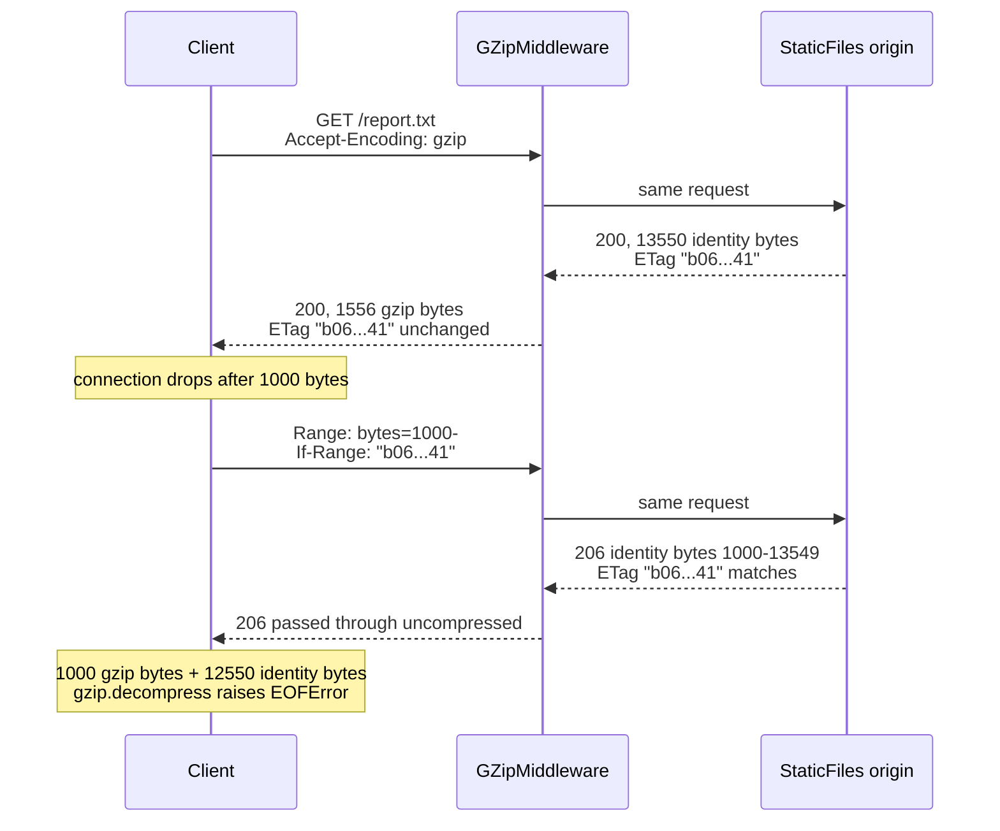

# Why Content-Encoding Must Change the Strong ETag: Avoiding Proxy Cache Corruption Across Gzip and Identity

> [!summary] Claim
> A gzip body and an identity body are two different byte sequences, so a layer that compresses a response must either give it a distinct strong `ETag` or mark the tag weak; reusing the identity tag lets `If-Range` splice gzip and identity bytes together and lets a cache hand gzip bytes to a client that never asked for them.

Part of [HTTP Caching and Conditional Requests](README.md) in [API Engineering](../README.md).

## TL;DR

- Mechanism: `Content-Encoding` is a property of the representation, so the gzip form and the identity form are distinct representations with distinct representation data (RFC 9110 Section 8.4).
- Contract rule: a validator shared by a gzip representation and an unencoded one is weak by definition, and a strong tag for a content-encoded representation has to differ from the unencoded tag (RFC 9110 Sections 8.8.1 and 8.8.3.3).
- Trap: Starlette 1.10.0 `GZipMiddleware` sets `Content-Encoding: gzip` and leaves the origin's strong `ETag` untouched, so behind `StaticFiles` a resumed download returns `206` identity bytes that the client appends to gzip bytes (measured in the lab: `EOFError` on decode).
- Portability: the 40 lab tests pass on CPython 3.12.13, 3.13.18, 3.14.6, 3.14.10, and 3.15.2 on macOS and on 3.14.10 in Debian 13 and Alpine containers, and the collision reproduces behind Uvicorn and Hypercorn (HTTP/1.1 and HTTP/2) but not behind Granian 2.8.7, whose `http.response.pathsend` extension makes Starlette skip compression of static files.
- When not to: do not rewrite tags if the bytes are pre-compressed at build time with their own tags, and do not use a strong `-gzip` suffix when the gzip bytes are not reproducible (randomized BREACH padding, a changed `compresslevel`); weaken instead.

## Mental model



The client trusts the contract that one strong tag names exactly one byte sequence, so when `If-Range` matches it appends the `206` bytes to the prefix it already holds.
The origin evaluated `If-Range` against its own identity representation, because it never saw the gzip one, and Starlette's middleware forwards every `206` untouched.
The two layers each behave reasonably in isolation; the bug is that the compression layer changed the representation data without changing the validator that names it.
The same shared tag also lets a cache that selects variants by the `ETag` in a `304` serve the stored gzip variant to an identity-only client.

## How it works

Content codings are representation metadata, not transport framing.
RFC 9110 Section 8.4 says the codings in `Content-Encoding` "are a characteristic of the representation; the representation is defined in terms of the coded form", which is the opposite of a transfer coding (RFC 9112 Section 7).
RFC 9110 Section 8.8.1 defines a strong validator as one that "changes value whenever a change occurs to the representation data that would be observable in the content of a 200 (OK) response to GET", and then gives this exact case: "if the origin server sends the same validator for a representation with a gzip content coding applied as it does for a representation with no content coding, then that validator is weak."
RFC 9110 Section 8.8.3 then requires that a tag failing the strong characteristics "MUST" be marked `W/`.
The note in RFC 9110 Section 8.8.3.3 states the consequence directly: a strong entity tag for a content-encoded representation "has to be distinct from the entity tag of an unencoded representation to prevent potential conflicts during cache updates and range requests", while transfer codings "do not result in distinct entity tags."

Two comparison functions decide what a shared tag breaks (RFC 9110 Section 8.8.3.2).
`If-None-Match` uses weak comparison (RFC 9110 Section 13.1.2), so `W/"x"` and `"x"` match and revalidation survives weakening.
`If-Range` uses strong comparison and a client "MUST NOT generate an If-Range header field containing an entity tag that is marked as weak" (RFC 9110 Section 13.1.5), so a weakened tag simply disables range resumption, which fails closed.
A strong tag that is shared fails open: `If-Range` matches, and the server sends a range of a different byte sequence.

Starlette 1.10.0 shows the mechanism in source.
`GZipMiddleware.__call__` chooses `GZipResponder` when `"gzip" in headers.get("Accept-Encoding", "")`, a substring test, so `gzip;q=0` still triggers compression (starlette 1.10.0 starlette/middleware/gzip.py, GZipMiddleware.__call__).
`IdentityResponder.send_with_compression` sets `self.partial_response = message["status"] == 206` and then forwards the start message and body of a `206` unchanged, and on a body of at least `minimum_size` bytes it adds `Vary: Accept-Encoding`, sets `Content-Encoding`, and sets or deletes `Content-Length`, but never reads or writes `ETag` (starlette 1.10.0 starlette/middleware/gzip.py, IdentityResponder.send_with_compression).
Starlette's `FileResponse` sends `{"type": "http.response.pathsend"}` instead of body messages when the server advertises that extension in `scope["extensions"]`, and `IdentityResponder.send_with_compression` forwards such a message with the start message uncompressed (starlette 1.10.0 starlette/responses.py, FileResponse.__call__ and FileResponse._handle_simple; starlette 1.10.0 starlette/middleware/gzip.py, IdentityResponder.send_with_compression).
The ASGI Path Send extension says the server offloads the file transfer "directly to the server" and that the application is responsible for the headers, so no middleware ever sees the bytes.
On the origin side, `FileResponse.set_stat_headers` builds a strong tag from `md5(f"{st_mtime}-{st_size}")` of the identity file (starlette 1.10.0 starlette/responses.py, FileResponse.set_stat_headers), and `FileResponse._should_use_range` returns `False` for any `If-Range` starting with `W/` and otherwise compares it to that identity tag (starlette 1.10.0 starlette/responses.py, FileResponse._should_use_range).
`StaticFiles.is_not_modified` strips `W/` from the request's tags before comparing, which is the weak comparison that keeps `304` working after weakening (starlette 1.10.0 starlette/staticfiles.py, StaticFiles.is_not_modified).

The cache half depends on which caching specification the cache follows.
RFC 2616 Section 13.6 told a cache to send "the entity tags in an If-None-Match header field from all its cache entries for the resource" so the server "can use the ETag header field in its 304 (Not Modified) response to tell the cache which entry is appropriate", and to return that entry to the client.
With one tag shared across codings, the `304` for an identity request names the stored gzip entry.
RFC 9111 Section 4.3.4 narrows the candidate set to stored responses "that could have been chosen for that request", which applies `Vary` before the tag lookup, and says that if none has the same strong validator the cache "MUST NOT use the new response to update any stored responses."
A strict RFC 9111 cache therefore refuses the cross-variant update and refetches, but RFC 9111 Section 4.3.1 still lets it send tags of variants "it cannot choose", so the shared tag still wastes a round trip.

Servers resolved the trade-off in three different ways, each verified in its source or documentation.
Apache `mod_deflate` appends the coding to the tag by default (`DeflateAlterETag AddSuffix`, the default since 2.4.0), and its documentation notes that this "prevents serving "HTTP Not Modified" (304) responses to conditional requests for compressed content"; the directive with `NoChange` and `Remove` options exists from 2.4.58 (Apache httpd 2.4 mod_deflate documentation, DeflateAlterETag).
nginx 1.7.3 (2014-07-08) changed strong tags to weak on response modification: "weak entity tags are now preserved on response modifications, and strong ones are changed to weak" (nginx CHANGES).
Django 5.2 `GZipMiddleware.process_response` prefixes `W/` to a strong tag after compressing, citing RFC 9110 Section 8.8.1 in its comment (django 5.2 django/middleware/gzip.py, GZipMiddleware.process_response); its earlier `;gzip` suffix broke `304` matching, as reported in Django ticket 26771.

The lab's `EncodingAwareGZipMiddleware` implements both correct policies.
`suffix` rewrites `"x"` to `"x-gzip"` on a compressed `200`, maps inbound `If-None-Match` tags ending in `-gzip` back to `"x"` so the origin can still answer `304`, drops inbound tags without the suffix because they cannot name the gzip representation, and re-tags every `304` on the gzip path, including one that answers `If-None-Match: *` or `If-Modified-Since`, because a `304` must carry the `ETag` the `200` would have carried (RFC 9110 Section 15.4.5).
`weaken` rewrites `"x"` to `W/"x"` on the `200` and on the `304`, and leaves the rest to weak comparison and the `If-Range` ban on weak tags.
Both policies also delete `http.response.pathsend` from `scope["extensions"]` on the gzip path, so the origin streams the file as ordinary body messages that the layer can compress; without that, a server that advertises the extension receives a `pathsend` message after a buffered, never-sent start message and fails with `RuntimeError: ASGI flow error: Response not started`, which Granian 2.8.7 turned into a `500` before the fix.
Both policies assume the layer owns the coding for the path: it compresses every `200` that arrives without `Content-Encoding`, so an origin that pre-compresses some files needs those paths excluded.
Neither policy touches `If-Range`, so a `"x-gzip"` resume token never matches the origin's `"x"` and the origin answers a full `200`.

## Numbers and limits

| Quantity | Value | Source |
|---|---|---|
| Lab body, identity | 13550 bytes | measured, lab `BODY`, CPython 3.14.6, macOS 27.2 arm64 |
| Same body, gzip level 1 / 6 / 9 | 1589 / 1547 / 1556 bytes | measured, `gzip.compress(..., mtime=0)`, zlib 1.2.12, CPython 3.14.6 |
| `206` returned on corrupted resume | `Content-Range: bytes 1000-13549/13550` | measured; the client held a 1556-byte gzip representation |
| Origin requests, identity after gzip, shared tag, RFC 2616 cache | 2, wrong body served | measured, lab test |
| Same, RFC 9111 cache | 3 (wasted `304`, then full fetch) | measured, lab test |
| Same, `suffix` / `weaken` policy, RFC 2616 cache | 2 / 3, correct body | measured, lab test |
| Starlette `GZipMiddleware` defaults | `minimum_size=500`, `compresslevel=9`, `thread_minimum_size=131072` | starlette 1.10.0 starlette/middleware/gzip.py, GZipMiddleware.__init__ |
| Starlette worker-thread compression limit | `anyio.CapacityLimiter(40)` | starlette 1.10.0 starlette/middleware/gzip.py, _get_gzip_capacity_limiter |
| Django `GZipMiddleware` skip threshold / BREACH padding | `< 200` bytes (non-streaming responses only) / `max_random_bytes = 100` | django 5.2 django/middleware/gzip.py, GZipMiddleware.process_response and GZipMiddleware.max_random_bytes |
| Apache `DeflateAlterETag` | default `AddSuffix`; directive in 2.4.58+ | Apache httpd 2.4 docs (as of 2026-11) |
| nginx strong-to-weak on modification | since 1.7.3, 2014-07-08 | nginx CHANGES |
| Lab suite runtime | 40 tests in 0.14 to 0.22 s over four runs | measured, `uv run --frozen pytest ... -q`, CPython 3.14.6, macOS 27.2 arm64 |
| Gzip output across zlib builds | levels 1 / 6 / 9 give 1589 / 1547 / 1556 bytes with identical SHA-256 prefix `19bf87de60c86896` (level 9) under zlib 1.2.12, 1.3.1, and 1.3.2; zlib-ng 1.3.1 gives 1573 / 1546 / 1556 bytes with a different payload at every level | measured, `gzip.compress(..., mtime=0)` on macOS 27.2 arm64, Debian 13 aarch64, and Alpine aarch64 (CPython 3.14.6 / 3.14.10); zlib-ng through `ctypes` on Homebrew `zlib-ng-compat` |

The gzip sizes show why a strong suffix tag is a promise about bytes, not about content: three levels give three different byte sequences for one identity body.

## Portability

| Leg | Result | Evidence |
|---|---|---|
| CPython 3.12.13 | 40 passed | lab run, uv-managed interpreter, macOS 27.2 arm64 (pinned 3.12.16 not available here) |
| CPython 3.13.18 | 40 passed | lab run, macOS |
| CPython 3.14.6 (workspace) and 3.14.10 | 40 passed each | lab runs, macOS |
| CPython 3.15.2 | 40 passed | lab run, macOS |
| CPython free-threaded (3.15.0b3t and 3.14.6t) | not run | `uv` cannot build the environment because `psycopg-binary==3.3.8` has no wheel for either build; the pinned 3.15.2t is not installed here |
| Debian 13 (trixie) container | 40 passed | `ghcr.io/astral-sh/uv:python3.14-trixie-slim`, CPython 3.14.10, aarch64, zlib 1.3.1, `uv run --frozen pytest ... -q` |
| Alpine (musl) container | 40 passed | `ghcr.io/astral-sh/uv:python3.14-alpine`, CPython 3.14.10, aarch64, zlib 1.3.2, same command |
| zlib build | gzip bytes identical for zlib 1.2.12, 1.3.1, 1.3.2; different under zlib-ng 1.3.1 | measured, see Numbers and limits; a deployment that swaps in zlib-ng changes the bytes behind a strong `-gzip` tag |
| Starlette | 1.10.0 only | pinned; installed `gzip.py` byte-identical to the GitHub `1.10.0` tag (diffed) |
| Uvicorn 0.54.0, HTTP/1.1 | Starlette leg corrupts (`EOFError`); `suffix` and `weaken` resume cleanly | one-off probe, see Worked example |
| Hypercorn 0.18.0, HTTP/1.1 and HTTP/2 (h2c, prior knowledge, h2 4.4.1) | same result as Uvicorn on both | one-off probe, client reported `HTTP/2` |
| Granian 2.8.7, HTTP/1.1 and HTTP/2 (h2c) | Starlette leg does not corrupt: `FileResponse` uses `pathsend`, so nothing is compressed; `suffix` and `weaken` resume cleanly | one-off probe; the extension is defined by the ASGI Path Send specification |
| HTTP/3 over QUIC | not run | no HTTP/3 leg was built; RFC 9110 semantics are shared by all versions (RFC 9110 Abstract), and `Content-Encoding`, `ETag`, and `If-Range` are RFC 9110 fields |
| Transfer-coding `gzip` (HTTP/1.1 `TE`) | does not change the tag | RFC 9110 Section 8.8.3.3 note; RFC 9112 Section 7 |

## Worked example

The [implementation](../labs/src/api_labs/f03_http_caching_and_conditional_requests/content_encoding_etags.py) builds `/static` from real Starlette `StaticFiles` behind either Starlette's `GZipMiddleware` (`policy="starlette"`) or the lab's middleware, plus a resuming downloader and a two-mode variant cache.
The [test](../labs/tests/f03_http_caching_and_conditional_requests/test_compression_and_content_encoding_aware_etags.py) pins the file `mtime` with `os.utime`, so the Starlette tag `"b0635f78d3ea8ed06498bcb6901a5341"` is deterministic.

The re-tagging core, simplified excerpt:

```python
    def _encoded_tag(self, tag: EntityTag) -> EntityTag:
        if self.policy == "weaken":
            return EntityTag(tag.opaque, weak=True)
        return EntityTag(tag.opaque + GZIP_SUFFIX, weak=tag.weak)

    def _retag_304(self, headers: MutableHeaders) -> None:
        etag = parse_etag_list(headers.get("etag", ""))
        if len(etag) == 1:
            headers["etag"] = str(self._encoded_tag(etag[0]))
```

The inbound half of `suffix`, simplified excerpt:

```python
    kept: list[str] = []
    for tag in parse_etag_list(if_none_match):
        if tag.opaque.endswith(GZIP_SUFFIX):
            base = tag.opaque.removesuffix(GZIP_SUFFIX)
            kept.append(str(EntityTag(base, weak=tag.weak)))
```

The reproduction against unmodified Starlette, simplified excerpt:

```python
async def test_range_resume_across_shared_strong_etag_corrupts_the_download(
    static_dir: Path,
) -> None:
    async with client_for(build_static_app(static_dir, "starlette")) as client:
        outcome = await resume_download(client, URL, cut=CUT)
    assert outcome.statuses == (200, 206)  # If-Range matched: identity bytes after gzip bytes
    assert outcome.assembled[:2] == b"\x1f\x8b"  # gzip magic from the first response
    assert outcome.assembled[CUT:] == BODY[CUT:]  # identity tail from the 206
    assert outcome.decoded != BODY
    assert outcome.error is not None
```

Captured output of a probe script that calls `resume_download(client, URL, cut=1000)` against each stack and prints `policy, statuses, first_etag, error` (CPython 3.14.6, macOS 27.2 arm64):

```text
starlette (200, 206) "b0635f78d3ea8ed06498bcb6901a5341" EOFError
suffix (200, 200) "b0635f78d3ea8ed06498bcb6901a5341-gzip" None
weaken (200, 200) W/"b0635f78d3ea8ed06498bcb6901a5341" None
```

Captured output of a one-off script (not part of the lab and not committed) that started each server on `127.0.0.1` with an app mounting `build_static_app` for the three policies and ran `resume_download(client, path, cut=1000)` over `httpx` 0.28.1 (CPython 3.14.6, macOS 27.2 arm64; the `h2c` legs use `httpx.AsyncClient(http1=False, http2=True)`):

```text
== uvicorn HTTP/1.1
   starlette: statuses=(200, 206) etag="b0635f78d3ea8ed06498bcb6901a5341" error=EOFError ok=False
   suffix: statuses=(200, 200) etag="b0635f78d3ea8ed06498bcb6901a5341-gzip" error=None ok=True
   weaken: statuses=(200, 200) etag=W/"b0635f78d3ea8ed06498bcb6901a5341" error=None ok=True
== hypercorn HTTP/1.1 and HTTP/2 h2c: identical three lines to uvicorn
== granian HTTP/1.1 and HTTP/2 h2c
   starlette: statuses=(200, 206) etag="b0635f78d3ea8ed06498bcb6901a5341" error=None ok=True
   suffix: statuses=(200, 200) etag="b0635f78d3ea8ed06498bcb6901a5341-gzip" error=None ok=True
   weaken: statuses=(200, 200) etag=W/"b0635f78d3ea8ed06498bcb6901a5341" error=None ok=True
```

Captured run, from `labs/`, CPython 3.14.6, macOS 27.2 arm64:

```text
$ uv run --frozen pytest tests/f03_http_caching_and_conditional_requests/test_compression_and_content_encoding_aware_etags.py -q
........................................                                 [100%]
40 passed in 0.22s
```

## Pitfalls

> [!warning] Compression middleware in front of a range-capable origin
> Trigger: Starlette `GZipMiddleware` (or any layer that keeps the tag) wraps `StaticFiles` or `FileResponse`, which advertise `Accept-Ranges: bytes`.
> Symptom: resumed downloads fail to decompress or decode to garbage; the `206` carries `Content-Range: bytes 1000-13549/13550` while the client holds a 1556-byte gzip body (lab measurement).
> Fix: weaken or suffix the tag in the compressing layer, or exclude range-served paths from on-the-fly compression.

> [!warning] Suffixing without mapping the suffix back
> Trigger: the layer appends `-gzip` on the way out but the origin compares the inbound `If-None-Match` against its unsuffixed tag.
> Symptom: compressed resources never return `304`; every revalidation is a full `200`.
> Fix: strip the suffix on the inbound tag when the response will be compressed and re-tag every `304` on that path, including those answering `If-None-Match: *` or `If-Modified-Since` (lab test `test_suffix_policy_tags_every_gzip_path_304_with_the_gzip_tag`), as the lab does; this is the trade-off Apache documents for `DeflateAlterETag AddSuffix` and the failure reported in Django ticket 26771.

> [!warning] A compression layer that does not know about `http.response.pathsend`
> Trigger: the server advertises the ASGI Path Send extension (Granian 2.8.7 does) and an origin such as Starlette `FileResponse` uses it.
> Symptom: a layer that buffers the body for compression gets a `pathsend` message with no body, fails with `RuntimeError: ASGI flow error: Response not started` and the client sees a `500` (the lab middleware before its fix); Starlette's own `GZipMiddleware` instead forwards the message uncompressed, so static files silently go out as identity bytes and the collision never appears.
> Fix: remove `http.response.pathsend` from `scope["extensions"]` before calling the origin when the layer must compress, as the lab does (`test_gzip_path_withdraws_pathsend_so_the_body_is_compressed`), and test the compression layer on every server you deploy.

> [!warning] Substring negotiation of `Accept-Encoding`
> Trigger: `"gzip" in accept_encoding` (Starlette 1.10.0) or a `\bgzip\b` regex (Django 5.2).
> Symptom: a client that sent `gzip;q=0`, which RFC 9110 Section 12.5.3 defines as "not acceptable", receives gzip anyway (lab test `test_gzip_q0_refusal_is_ignored_by_substring_matching`).
> Fix: parse qvalues; treat `x-gzip` as `gzip` (RFC 9110 Section 8.4.1.3).

> [!warning] A strong suffix on non-reproducible gzip bytes
> Trigger: gzip output varies per response (Django's Heal The Breach padding inserts a random-length `FNAME` field in `compress_string`, django 5.2 django/utils/text.py, compress_string) or across deploys (a changed `compresslevel`; lab sizes 1589 vs 1556 bytes for levels 1 and 9).
> Symptom: two different byte sequences carry the same strong `"x-gzip"`, so a range resume across the change splices incompatible gzip streams.
> Fix: weaken when the bytes are not deterministic, or fold the coding parameters into the tag.

> [!warning] `206` and `304` responses that skip `Vary`
> Trigger: the compression layer adds `Vary: Accept-Encoding` only to the bodies it compresses; Starlette passes `206` untouched (lab probe shows no `Vary` on the `206`).
> Symptom: a shared cache stores the partial or the revalidation under a key that ignores `Accept-Encoding`.
> Fix: add `Vary: Accept-Encoding` to every response of a negotiated resource, including `304`, which RFC 9110 Section 15.4.5 requires to carry the `Vary` a `200` would have sent.

## Security and robustness

Content integrity is the asset: a shared strong tag turns a correct cache or downloader into a source of corrupted bytes without any attacker.
On the attacker side, cache-key confusion between encoded and unencoded variants is the same class of bug as [[Web-Cache-Poisoning-and-Cache-Deception-Attacks]]; treat `Accept-Encoding` normalization at the edge and per-coding tags as one control.
Compression of secrets reflected next to attacker input is the BREACH side channel covered in [[HTTP-Compression-Gzip-Brotli-Zstandard-and-BREACH]]; Django's random `FNAME` padding, which its 5.2 middleware documentation names Heal The Breach, is one mitigation, and it is exactly what makes a strong gzip tag false, so randomized compression must pair with weak tags.
Parse `If-None-Match` as `#entity-tag`, not by splitting on commas: `etagc` permits `,` inside quotes (RFC 9110 Section 8.8.3), and the lab's parser returns no validators for a malformed list so the request falls through to a safe `200`.
The lab middleware buffers the whole `200` body before compressing, which bounds nothing; a production layer must stream like Starlette does or cap the buffered size, or it becomes an unrestricted resource consumption risk (OWASP API4:2023, see [[Unrestricted-Resource-Consumption-API4-2023-Payload-Depth-and-Limit-Guards]]).
Defense in depth: Starlette's `FileResponse` already refuses `If-Range` values that start with `W/`, so weakening at the compression layer and the origin's own check fail closed together, which the lab confirms with a client that deliberately sends a weak `If-Range`.

## The principal's view

The decision is where content coding lives in the architecture, because whoever applies the coding owns the validator.
Pre-compressing at build time (one file per coding, each with its own tag computed from its own bytes) gives strong tags, `304`s, and range resume for every coding, at the cost of storage and a build step.
On-the-fly compression in middleware or at the edge should weaken tags by default, which keeps `304` revalidation and gives up range resume of compressed bodies; that is the nginx and Django choice and the safest default for dynamic JSON APIs where nobody resumes a range.
A strong suffix is right only when the compressor is deterministic and its parameters are pinned, and it needs the inbound mapping, which is more code that someone must keep in sync with the outbound rule.
Organizationally, the failure appears at a team boundary: the platform team adds compression to a gateway and the service team owns `ETag`s, and neither layer is wrong in isolation, so put "a transforming hop must re-derive or weaken validators" into the gateway contract and test it end to end with a resumed download.
Choose transfer-coding compression (`TE: gzip` in HTTP/1.1, RFC 9110 Section 10.1.4) only on paths you control end to end; it leaves tags untouched by definition, but HTTP/2 and HTTP/3 allow `TE` to carry only `trailers` (RFC 9113 Section 8.2.2, RFC 9114 Section 4.2), so it does not generalize.
For large immutable artifacts, consider content-addressed URLs instead, which make the validator problem disappear for that path.

## Interview questions

> [!question] L5: Why is a strong `ETag` shared by a gzip response and an identity response a spec violation?
>
> > [!success]- Answer
> > A strong validator must change whenever the representation data observable in a `200` changes (RFC 9110 Section 8.8.1).
> > `Content-Encoding` is part of the representation, so gzip and identity are different representation data.
> > RFC 9110 Section 8.8.1 states that a validator shared by a gzip and an uncoded representation is weak, and Section 8.8.3 requires weak tags to carry `W/`.
> >
> > Follow-up: Why does `Transfer-Encoding: gzip` not need a different tag?

> [!question] L5: Which conditional request headers use weak comparison and which use strong comparison, and why does it matter here?
>
> > [!success]- Answer
> > `If-None-Match` uses weak comparison (RFC 9110 Section 13.1.2), so weakening a tag keeps `304` revalidation working.
> > `If-Range` uses strong comparison and a client must not send a weak tag in it (RFC 9110 Section 13.1.5).
> > So weakening disables range resume of compressed bodies but never corrupts them.
> >
> > Follow-up: What does `If-Match` use, and what happens to a `PUT` guarded by a weakened tag?

> [!question] L5: Predict the output: when Starlette 1.10.0 `GZipMiddleware` with defaults receives `GET` with `Accept-Encoding: gzip;q=0` for a 13550-byte `text/plain` body, what `Content-Encoding` comes back?
>
> > [!success]- Answer
> > `Content-Encoding: gzip`.
> > `GZipMiddleware.__call__` tests `"gzip" in headers.get("Accept-Encoding", "")`, which ignores the qvalue.
> > RFC 9110 Section 12.5.3 says a qvalue of `0` means "not acceptable", so the client explicitly refused gzip; the lab test `test_gzip_q0_refusal_is_ignored_by_substring_matching` asserts this behavior.
> >
> > Follow-up: What should a server send for `Accept-Encoding: gzip;q=0, identity;q=0`?

> [!question] L6: Debug this API: users report corrupt resumed downloads (fresh downloads are fine) of `/static/export.csv` from `Starlette(routes=[Mount("/static", StaticFiles(...))], middleware=[Middleware(GZipMiddleware)])`; what is happening?
>
> > [!success]- Answer
> > The first response is gzip with the identity file's strong `ETag`, because `GZipMiddleware` does not touch `ETag`.
> > The resume sends `Range` with `If-Range` set to that tag; `FileResponse._should_use_range` matches it against the identity tag and returns a `206` of identity bytes, which `GZipMiddleware` forwards uncompressed.
> > The client appends identity bytes to gzip bytes; the lab reproduces it with statuses `(200, 206)` and an `EOFError` on decode.
> > Fix by weakening or suffixing the tag in the compressing layer, or by not compressing range-served files on the fly.
> >
> > Follow-up: Which response header in the `206` would let a careful client detect the mismatch before appending?

> [!question] L6: You add a `-gzip` suffix to compressed tags and the `304` rate for compressed clients drops to zero; why, and what is the fix?
>
> > [!success]- Answer
> > The client now sends `If-None-Match: "x-gzip"`, but the origin compares it against its own `"x"` and never matches.
> > This is the documented cost of Apache `DeflateAlterETag AddSuffix` and the failure in Django ticket 26771.
> > The fix is to map `"x-gzip"` back to `"x"` on the way in when the response will be compressed, then re-tag the `304` as `"x-gzip"`.
> > Drop unsuffixed tags on that path, because they name the identity representation and cannot validate the gzip one.
> >
> > Follow-up: Why must the `304` carry `"x-gzip"` rather than `"x"` for a shared cache to update the right entry?

> [!question] L6: How does an RFC 2616-style cache end up serving gzip bytes to an identity-only client when tags are shared?
>
> > [!success]- Answer
> > The cache holds the gzip variant and gets an identity request that `Vary: Accept-Encoding` does not let it reuse.
> > Per RFC 2616 Section 13.6 it forwards `If-None-Match` with the tags of all stored entries; the origin's identity tag matches and it answers `304`.
> > The cache uses the `304`'s `ETag` to pick the entry to return, and that is the gzip one, so the client receives `Content-Encoding: gzip` it never accepted.
> > RFC 9111 Section 4.3.4 restricts the update to entries the request could have chosen, which blocks this but costs a wasted round trip (3 origin requests in the lab instead of 2).
> >
> > Follow-up: Which stored responses must a cache exclude from the `If-None-Match` union per RFC 9111 Section 4.3.1?

> [!question] L7+: Suffix or weaken: which do you standardize across a gateway fleet, and what would change your mind?
>
> > [!success]- Answer
> > Weaken by default for on-the-fly compression, because it is correct even when gzip bytes are not reproducible and needs no inbound mapping.
> > It costs range resume of compressed bodies, which dynamic JSON APIs rarely need.
> > Use a strong suffix, or better pre-compressed files with their own tags, for large downloadable artifacts where resume matters and the compressor and level are pinned.
> > Evidence that would change the choice: measurable resume traffic on compressed paths, or a client population that relies on `If-Range`.
> >
> > Follow-up: How would you test the policy end to end in CI across the gateway and the service?

> [!question] L7+: A team enables BREACH mitigation that pads each gzip response with random bytes but keeps a strong `-gzip` tag; what breaks, and what is the general rule?
>
> > [!success]- Answer
> > Each response is now a different byte sequence under one strong tag, which violates RFC 9110 Section 8.8.1.
> > A resume with `If-Range: "x-gzip"` would match and splice bytes from two different gzip streams.
> > The general rule is that a strong tag is a promise about bytes, so any non-deterministic transformation must produce a weak tag, as Django 5.2 does after compressing.
> >
> > Follow-up: Can a byte-range request ever be served safely for a randomized gzip representation?

> [!question] L7+: Your edge compresses with Brotli and your origin with gzip, and both pass the origin's tag through; how do you design the validator scheme?
>
> > [!success]- Answer
> > Each coding is its own representation, so each needs its own strong tag or a weak tag (RFC 9110 Section 8.8.3.3).
> > The layer that applies a coding owns its tag: the origin emits `"x"` and `"x-gzip"`, the edge emits `"x-br"` or `W/"x"`, and each layer maps only its own suffix on inbound `If-None-Match`.
> > Every response of the resource carries `Vary: Accept-Encoding`, including `304` (RFC 9110 Section 15.4.5).
> > Range resume stays available only for codings whose bytes are deterministic.
> >
> > Follow-up: What breaks if the edge decompresses the origin's gzip and recompresses with Brotli but keeps `"x-gzip"`?

## Related

Prerequisites: [[Strong-vs-Weak-Validators-ETag-and-Last-Modified]]

Next: [[Conditional-GET-Revalidation-and-304-Not-Modified]]

See also: [[Vary-Header-Mechanics-and-Cache-Hit-Collapse]], [[Range-Requests-Partial-Content-and-206-Semantics]], [[HTTP-Compression-Gzip-Brotli-Zstandard-and-BREACH]], [[Content-Negotiation-Media-Types-and-Charsets]], [[HTTP-Caching-Architecture-Private-Shared-and-Gateway-Caches]], [[Optimistic-Concurrency-Control-If-Match-and-412-Precondition-Failed]], [[Web-Cache-Poisoning-and-Cache-Deception-Attacks]], [[Pure-ASGI-Middleware-Onion-Architecture-and-Send-Receive-Wrapping]], [[Starlette-Responses-StreamingResponse-FileResponse-and-Background-Execution]], [[In-Process-Testing-of-ASGI-Apps-with-HTTPX-ASGITransport]], [[Edge-Caching-and-CDN-Shielding-for-Dynamic-and-Public-APIs]]

- Lab: `labs/tests/f03_http_caching_and_conditional_requests/test_compression_and_content_encoding_aware_etags.py`

## Further reading

- [RFC 9110 Sections 8.4, 8.8.1, 8.8.3.3, 13.1.2, 13.1.5](https://www.rfc-editor.org/rfc/rfc9110.html) - the representation model of content codings, the weak-validator rule for gzip, and the comparison functions.
- [RFC 9111 Sections 4.1, 4.3.1, 4.3.4](https://www.rfc-editor.org/rfc/rfc9111.html) - how a shared cache keys variants with `Vary` and which stored responses a `304` may update.
- [RFC 2616 Section 13.6](https://www.rfc-editor.org/rfc/rfc2616.txt) - the original variant-selection-by-`ETag` design that made shared tags corrupt caches.
- [RFC 9112 Section 7](https://www.rfc-editor.org/rfc/rfc9112.html) - transfer codings, the hop-by-hop alternative that does not change validators.
- [Starlette 1.10.0 `starlette/middleware/gzip.py`](https://github.com/Kludex/starlette/blob/1.10.0/starlette/middleware/gzip.py) - the compression layer that keeps the tag.
- [Apache httpd `mod_deflate` `DeflateAlterETag`](https://httpd.apache.org/docs/2.4/mod/mod_deflate.html) - the suffix policy and its documented `304` trade-off.
- [nginx CHANGES, 1.7.3](https://nginx.org/en/CHANGES) - the strong-to-weak policy for modified responses.
- [ASGI extensions, Path Send](https://asgi.readthedocs.io/en/latest/extensions.html) - the `http.response.pathsend` extension that takes file bytes out of the middleware's reach.
- [Django 5.2 `django/middleware/gzip.py`](https://github.com/django/django/blob/5.2/django/middleware/gzip.py) - weakening after compression, plus BREACH padding.
