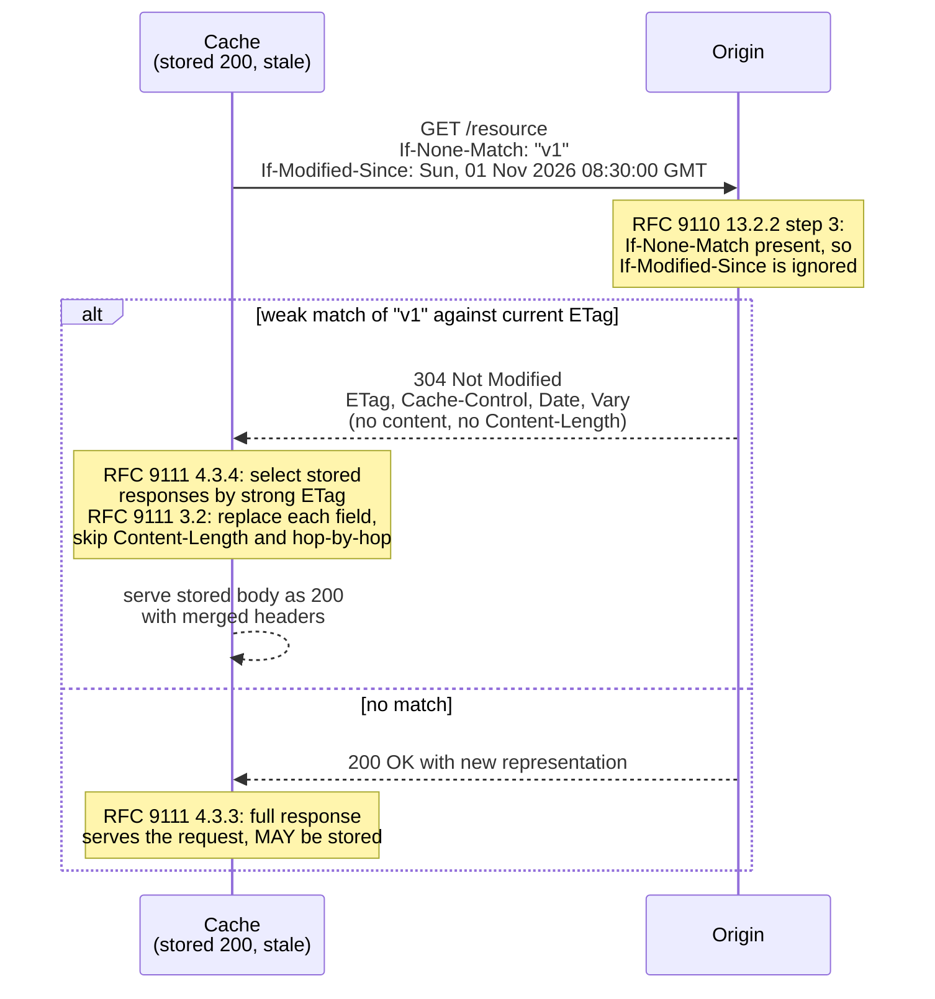

# Conditional GET Revalidation: If-None-Match, If-Modified-Since, and 304 Not Modified Header Merging

> [!summary] Claim
> A conditional `GET` is two algorithms, not one: the origin evaluates `If-None-Match` and ignores `If-Modified-Since` whenever `If-None-Match` is present (RFC 9110 Section 13.2.2), and the cache that receives `304 Not Modified` must pick which stored responses the validators in that `304` identify, then overwrite their header fields one by one while never touching `Content-Length` or the stored body (RFC 9111 Sections 3.2 and 4.3.4).

Part of [HTTP Caching and Conditional Requests](README.md) in [API Engineering](../README.md).

## TL;DR

- Mechanism: a cache holding a stale response sends `If-None-Match` with its stored entity tags and `If-Modified-Since` with its stored `Last-Modified`; the origin answers `304` with only cache-update metadata, and the cache freshens the stored response's headers and serves the stored body as a `200`.
- Contract rule: `If-None-Match` is evaluated with the weak comparison function and, when present at all, makes `If-Modified-Since` irrelevant (RFC 9110 Sections 13.1.2 and 13.1.3); a `304` must carry `Cache-Control`, `Content-Location`, `Date`, `ETag`, `Expires`, and `Vary` if a `200` would have (RFC 9110 Section 15.4.5).
- The trap: a `304` whose strong `ETag` matches no stored response must update nothing (RFC 9111 Section 4.3.4), and a `Content-Length` in a `304` must never overwrite the stored one (RFC 9111 Section 3.2).
- Portability fact: the lab passes on CPython `3.12.16`, `3.13.18`, `3.14.10`, and `3.15.2` on Debian Trixie and Alpine, and `h2 4.4.1` accepts a `304` with `content-length: 5000` when `HEADERS` carries `END_STREAM` but raises `InvalidBodyLengthError` when an empty `DATA` frame ends the stream, while `aioquic 1.7.2` rejects that `304` in both framings.
- When not to use it: content-addressed URLs with `immutable` freshness never need revalidation, and `If-Modified-Since` alone is the wrong validator for resources that can change twice inside one second.

## Mental model



The cache starts with a stored `200` it can no longer serve without validation, so it copies the stored `ETag` into `If-None-Match` and the stored `Last-Modified` into `If-Modified-Since`, the second only for intermediaries that predate entity tags (RFC 9111 Section 4.3.1).
The origin walks the fixed precedence list of RFC 9110 Section 13.2.2; at step 3 it finds `If-None-Match`, compares the listed tags weakly against the current `ETag`, and never reaches the date check at step 4.
On a match it sends `304` with the metadata a `200` would have carried for cache control, and nothing that describes the content.
The cache then runs a second, separate algorithm: it identifies which of its stored responses the `304`'s validators name, and for each one it overwrites stored header fields with the `304`'s fields, except the fields RFC 9111 Section 3.2 forbids.
On a mismatch the origin sends a full `200`, which the cache MUST use to satisfy the request and MAY store in place of the old entry (RFC 9111 Section 4.3.3).

## How it works

### Origin side: the precedence list

RFC 9110 Section 13.2.2 fixes the order: `If-Match` (step 1), `If-Unmodified-Since` (step 2), `If-None-Match` (step 3), `If-Modified-Since` only "When the method is GET or HEAD, If-None-Match is not present" (step 4), then `If-Range` (step 5).
Steps 1 and 2 are the lost-update guards covered in [[Optimistic-Concurrency-Control-If-Match-and-412-Precondition-Failed]]; this note owns steps 3 and 4.
Step 3 has three outcomes: condition true continues to the method, condition false on `GET` or `HEAD` returns `304`, condition false on any other method returns `412 Precondition Failed`.
The rule that makes the precedence bite is in RFC 9110 Section 13.1.3: "A recipient MUST ignore If-Modified-Since if the request contains an If-None-Match header field".
It keys on presence, not validity, so a syntactically broken `If-None-Match` still disables the date check; the lab treats an unparseable list as matching nothing, which makes the condition true and yields a full `200`.

`If-None-Match` evaluation (RFC 9110 Section 13.1.2):

1. `*` is false if the origin has any current representation.
2. A list of entity tags is false if one listed tag matches the selected representation's tag under weak comparison.
3. Otherwise the condition is true.

Weak comparison means the opaque-tags match "character-by-character, regardless of either or both" being tagged as weak (RFC 9110 Section 8.8.3.2), so `W/"v2"` in the request matches a current strong `"v2"`.
The grammar is `If-None-Match = "*" / #entity-tag`, with `opaque-tag = DQUOTE *etagc DQUOTE` and `etagc = %x21 / %x23-7E / obs-text` (RFC 9110 Sections 8.8.3 and 13.1.2).
`%x23-7E` includes `,` (`%x2C`), so `"a,b"` is one legal entity tag, and a parser that splits the field on commas is wrong.
Lists also tolerate empty elements: a recipient "MUST accept lists" of the form `[ element ] *( OWS "," OWS [ element ] )` (RFC 9110 Section 5.6.1.2).
A list that mixes `*` with tags is "syntactically invalid" (RFC 9110 Section 13.1.2).

`If-Modified-Since` evaluation (RFC 9110 Section 13.1.3) is false when the representation's last modification date "is earlier or equal to the date provided", and the field is ignored when the value is not a valid `HTTP-date`, when it "has more than one member", when the method is neither `GET` nor `HEAD`, or when the resource has no modification date.
`HTTP-date` has three accepted formats, `IMF-fixdate`, the obsolete RFC 850 form, and `asctime`, and a sender "MUST generate those timestamps in the IMF-fixdate format" (RFC 9110 Section 5.6.7).
An RFC 850 two-digit year that "appears to be more than 50 years in the future" must be read as the most recent past year with the same two digits (RFC 9110 Section 5.6.7).
The comparison is on the whole timestamp, not on the year alone: with `now` at `2026-11-09 12:00:00`, `09-Nov-76 12:00:00` is exactly 50 years ahead and stays `2076`, and one second later it becomes `1976`; the lab does this in `_resolve_two_digit_year`.

### What a 304 carries on the wire

A `304` "MUST generate" `Content-Location`, `Date`, `ETag`, `Vary`, `Cache-Control`, and `Expires` whenever a `200` to the same request would have, and "SHOULD NOT generate representation metadata other than the above listed fields unless said metadata exists for the purpose of guiding cache updates" (RFC 9110 Section 15.4.5).
A `304` "is terminated by the end of the header section; it cannot contain content or trailers" (RFC 9110 Section 15.4.5).
`Content-Length` is allowed in a `304` only if it "equals the decimal number of octets that would have been sent in the content of a 200" (RFC 9110 Section 8.6).
In HTTP/1.1 any `304` "is always terminated by the first empty line after the header fields, regardless of the header fields present" (RFC 9112 Section 6.3), so the bytes on the wire are just the status line, fields, and `CRLF CRLF` (hand-written illustration, not captured output):

```text
HTTP/1.1 304 Not Modified\r\n
etag: "v1"\r\n
cache-control: max-age=300\r\n
date: Mon, 09 Nov 2026 12:05:00 GMT\r\n
vary: accept-encoding\r\n
\r\n
```

`h11` implements that rule in `_body_framing`, which returns `("content-length", (0,))` for status `204` or `304` before it ever reads `Content-Length` `(h11 0.16.0 h11/_connection.py, _body_framing)`.
HTTP/2 and HTTP/3 say the same thing in frame terms: a response "defined to have no content" (RFC 9113 Section 8.1.1), or "defined as never having content" (RFC 9114 Section 4.1.2), may carry a non-zero `content-length` "even though no content is included in DATA frames" (both sections).
`h2 4.4.1` honours that only on one path: `H2Stream.receive_headers` calls `_initialize_content_length`, which special-cases `HEAD` and nothing else, and when `END_STREAM` arrives on a `DATA` frame `_track_content_length` compares the declared length to the zero bytes received and raises `InvalidBodyLengthError` `(h2 4.4.1 h2/stream.py, H2Stream._initialize_content_length)` `(h2 4.4.1 h2/stream.py, H2Stream._track_content_length)`.
When `END_STREAM` rides on the `HEADERS` frame, `_track_content_length` never runs, so the same `304` is accepted; the lab proves both paths, and upstream issue `python-hyper/h2#1330` reports the same split (open, as of 2026-11).
`aioquic 1.7.2` is stricter than RFC 9114 on the same case: `validate_headers` stores any response `content-length` as `expected_content_length`, a `304` included, `H3Connection._check_content_length` raises `MessageError` when the received DATA total differs, and `H3Connection.handle_event` answers a `ProtocolError` by closing the QUIC connection with `H3_MESSAGE_ERROR` (`0x10E`) `(aioquic 1.7.2 src/aioquic/h3/connection.py, validate_headers)` `(aioquic 1.7.2 src/aioquic/h3/connection.py, H3Connection._check_content_length)` `(aioquic 1.7.2 src/aioquic/h3/connection.py, H3Connection.handle_event)`.
Because that check also runs when `END_STREAM` rides on the `HEADERS` frame, aioquic rejects the `304` in both framings, where `h2` rejects it in one; the lab proves both over an in-memory QUIC pair.
Uvicorn's `httptools` protocol skips adding `transfer-encoding: chunked` when the status is `204` or `304` `(uvicorn 0.54.0 uvicorn/protocols/http/httptools_impl.py, RequestResponseCycle.send)`, and Starlette's `Response.init_headers` does not populate `content-length` for `204`, `304`, or `1xx` `(starlette 1.10.0 starlette/responses.py, Response.init_headers)`.
Run over a loopback socket, Uvicorn `0.54.0` (both `--http httptools` and `--http h11`), Hypercorn `0.18.0`, and Granian `2.8.7` each framed a `304` as header-only with no `transfer-encoding`; the three differ on a handler-supplied `content-length` (see Portability).

### Cache side: which stored responses a 304 updates

RFC 9111 Section 4.3.4 starts from the "initial set": every stored response that could have been chosen for the request, ignoring freshness.
It then takes the first rule that applies:

1. If the `304` contains strong validators, every stored response with one of those strong validators is updated; "If none of the initial set contains at least one of the same strong validators, then the cache MUST NOT use the new response to update any stored responses."
2. If it contains only weak validators that correspond to stored responses, "the most recent of those matching stored responses is identified for update."
3. If it contains no validator, and the initial set has exactly one stored response that also lacks a validator, that one is updated.

Rule 1 is what keeps content-negotiated variants apart: a `304` naming `"a-gzip"` must not refresh the identity variant stored under `"a"` (see [[Compression-and-Content-Encoding-Aware-ETags]]).
A `Last-Modified` value is "implicitly weak" unless the conditions of RFC 9110 Section 8.8.2.2 prove it strong, which, for a client or cache, need a stored `Date` at least one second after it and confidence that both came from the same clock; the lab treats it as weak and says so in its docstring.
If the cache merged its own tags into a client's `If-None-Match` and the `304` names a tag "that is not in the client's list, the cache MUST generate a 200 (OK) response for the client by reusing its corresponding stored response" (RFC 9111 Section 4.3.2).

### Cache side: merging header fields

For each response selected, "the cache MUST add each header field in the provided response to the stored response, replacing field values that are already present" (RFC 9111 Section 3.2), with four exceptions:

- fields excepted from storage by RFC 9111 Section 3.1: `Connection` and every field it names, other fields that must be removed before forwarding (RFC 9110 Section 7.6.1 lists `Proxy-Connection`, `Keep-Alive`, `TE`, `Transfer-Encoding`, and `Upgrade`), `Proxy-Authenticate`, `Proxy-Authentication-Info`, and `Proxy-Authorization`, and fields named as arguments of `no-cache` or `private` (which the lab does not model);
- fields the stored response depends on, which a cache that stored processed content (for example decoded `Content-Encoding`) "MAY omit" on an exceptional basis;
- fields the implementation processes and removes, such as `Content-Range`;
- `Content-Length`, always.

Replacement is per field name: if the stored response had two `Link` lines and the `304` has one, the merged response has one.
Fields the `304` does not mention, such as `Content-Type` and the stored `Content-Length`, survive untouched, and the stored body is reused byte for byte.
Age restarts too: RFC 9111 Section 4.2.3 defines resident time as the time "since the stored response was last validated by the origin server", so the lab sets `response_time` to the arrival of the `304` and `resident_time = now - response_time` counts from the revalidation (asserted in `test_strong_validator_freshens_only_matching_variants`); the freshness arithmetic itself lives in [[Cache-Control-Directives-and-Freshness-Lifetime-Calculation]].

### What Starlette does

`StaticFiles.file_response` builds a `FileResponse`, asks `is_not_modified`, and returns `NotModifiedResponse(response.headers)` on a match `(starlette 1.10.0 starlette/staticfiles.py, StaticFiles.file_response)`.
`NotModifiedResponse.NOT_MODIFIED_HEADERS` is exactly `cache-control`, `content-location`, `date`, `etag`, `expires`, and `vary`, so `Last-Modified` and `Content-Length` are dropped `(starlette 1.10.0 starlette/staticfiles.py, NotModifiedResponse)`.
`is_not_modified` checks a non-empty `If-None-Match` first and returns without looking at `If-Modified-Since`, which is the RFC precedence; it strips `W/` from request tags and compares against the always-strong `FileResponse` tag, which is weak comparison for that case `(starlette 1.10.0 starlette/staticfiles.py, StaticFiles.is_not_modified)`.
It splits `If-None-Match` on `,`, which would break a tag containing a comma, but `FileResponse.set_stat_headers` sets (via `setdefault`) a quoted MD5 hex digest of the file mtime and size, and `StaticFiles` supplies no tag of its own, so the split is harmless there `(starlette 1.10.0 starlette/responses.py, FileResponse.set_stat_headers)`.
The `If-Modified-Since` path uses `email.utils.parsedate`, which returned the first date of a two-date value and ignored a `PST` zone in this lab, so Starlette answers `304` where RFC 9110 Section 13.1.3 says to ignore the field; the lab pins that behaviour.

## Numbers and limits

| Quantity | Value | Source or measurement |
|---|---|---|
| Fields a `304` must carry if a `200` would have | 6: `Cache-Control`, `Content-Location`, `Date`, `ETag`, `Expires`, `Vary` | RFC 9110 Section 15.4.5 |
| Starlette `NotModifiedResponse` allowlist | the same 6 names, lowercase | `(starlette 1.10.0 starlette/staticfiles.py, NotModifiedResponse)` |
| `HTTP-date` resolution | 1 second | RFC 9110 Section 8.8.3 ("the one-second resolution of HTTP-date values") |
| `IMF-fixdate` length | 29 octets, fixed | derived from the ABNF in RFC 9110 Section 5.6.7 (`Sun, 06 Nov 1994 08:49:37 GMT`) |
| Gap that lets a client or cache deduce `Last-Modified` strong | `Date` at least 1 second after `Last-Modified`, same clock | RFC 9110 Section 8.8.2.2 |
| RFC 850 two-digit year window | more than 50 years ahead, compared on the full timestamp -> most recent past year with the same two digits | RFC 9110 Section 5.6.7; tested at the one-second boundary in the lab |
| `If-None-Match` list elements accepted by the lab | 64, counting empty elements | lab policy `MAX_LIST_ELEMENTS`, not an RFC number; RFC 9110 Section 5.6.1.2 only bounds empty elements, at "a reasonable number" |
| `h2` tolerance for `content-length` on a `304` ended by `DATA` | 0 bytes of mismatch | measured in the lab with `h2 4.4.1`; `end_stream and expected != actual` raises `(h2 4.4.1 h2/stream.py, H2Stream._track_content_length)` |
| `aioquic` tolerance for `content-length` on a `304` | 0 bytes of mismatch, in both framings; connection closed with `H3_MESSAGE_ERROR` (`0x10E`) | measured in the lab with `aioquic 1.7.2`; `(aioquic 1.7.2 src/aioquic/h3/connection.py, H3Connection._check_content_length)` |
| nginx `if_modified_since` default | `exact` (directive since `0.7.24`) | nginx `ngx_http_core_module` documentation (as of 2026-11) |
| Apache `FileETag` default | `MTime Size`; was `INode MTime Size` in `2.3.14` and earlier | Apache HTTP Server 2.4 core documentation (as of 2026-11) |
| Lab suite | 50 tests, `50 passed in 0.23s` | `uv run --frozen pytest tests/f03_http_caching_and_conditional_requests/test_conditional_get_revalidation_and_304_not_modified.py -v`, CPython `3.14.6`, macOS 27.2 arm64 (Darwin `27.2.0`), run 2026-11-10 |

## Portability

| Dimension | Version | Result |
|---|---|---|
| CPython, macOS arm64 | `3.12.13`, `3.13.18`, `3.14.10`, `3.15.2` | each `50 passed`, `UV_PROJECT_ENVIRONMENT=<tmp>/venv-<minor> uv run --frozen --python <interpreter> pytest ... -q` from `labs/`, with `<interpreter>` `3.12` for 3.12.13 and the explicit `/opt/homebrew/bin/python3.<minor>` for the others, run 2026-11-10; the workspace `.venv` (`3.14.6`) also passes |
| CPython, Debian 13 (Trixie, glibc) | `3.12.16`, `3.13.18`, `3.14.10`, `3.15.2` | each `50 passed`: `docker run --rm -v labs:/work:ro -w /work -e PYTHONPATH=/work/src python:<minor>-trixie ...` with a fresh venv and the lab's direct pins (`starlette==1.10.0 httpx==0.28.1 h11==0.16.0 h2==4.4.1 aioquic==1.7.2 cryptography==50.0.2 pytest==9.2.0 pytest-asyncio==1.4.1.post1`); transitive packages resolved at run time; OrbStack Docker `29.8.2` on aarch64, run 2026-11-10 |
| CPython, Alpine 3.24 (musl libc) | `3.12.16`, `3.13.18`, `3.14.10`, `3.15.2` | each `50 passed`: the same command with `python:<minor>-alpine`; Alpine 3.24 ships musl libc, and `platform.libc_ver()` returns an empty name there, so musl is the distribution's fact rather than a probe result |
| CPython free-threaded | `3.15.0b3+freethreaded`, `sys._is_gil_enabled()` is `False` | `46 passed, 4 skipped`: `aioquic` cannot be installed because `pylsqpack 1.0.0` fails to build, so the four HTTP/3 tests skip through `pytest.importorskip`; `PYTHONPATH=src uv run --no-project --python 3.15t --with starlette==1.10.0 --with httpx==0.28.1 --with h11==0.16.0 --with h2==4.4.1 --with cryptography==50.0.2 --with pytest==9.2.0 --with pytest-asyncio==1.4.1.post1 pytest ... -rs`, because the lock has no `psycopg-binary 3.3.8` wheel for that interpreter |
| CPython free-threaded | `3.15.2t` | not run: neither `uv python list --all-versions` nor Homebrew offers that interpreter on this machine |
| Starlette | `1.10.0` | `If-None-Match` beats `If-Modified-Since`, `304` keeps only `etag` for a `FileResponse` with no `Cache-Control`, and lenient `If-Modified-Since` parsing; all proven in the lab |
| HTTP/1.1 parser | `h11 0.16.0` | `304` with `content-length: 5000` framed as bodyless and the connection reused; proven in the lab |
| HTTP/2 state machine | `h2 4.4.1` | `304` plus `content-length` accepted with `END_STREAM` on `HEADERS`, rejected with `InvalidBodyLengthError` when an empty `DATA` frame ends the stream; proven in the lab, while RFC 9113 Section 8.1.1 allows both (an empty `DATA` frame carries no content); upstream issue `python-hyper/h2#1330`, open (as of 2026-11) |
| HTTP/3 | RFC 9114 | a non-zero `Content-Length` on a response defined as never having content is allowed, and a mismatching one on other responses is a stream error of type `H3_MESSAGE_ERROR` (RFC 9114 Section 4.1.2); read in the RFC text, not run as a protocol conformance test |
| HTTP/3 library | `aioquic 1.7.2` | closes the connection with `H3_MESSAGE_ERROR` (`0x10E`, reason `content-length does not match data size`) for a `304` with `content-length: 5000`, with `END_STREAM` on `HEADERS` and with an empty `DATA` frame alike, and accepts the same `304` without `content-length`; proven in the lab over an in-memory QUIC pair, no sockets |
| Uvicorn, HTTP/1.1 | `0.54.0` | `--http httptools` and `--http h11` both answered a Starlette `Response(status_code=304)` with a header-only `HTTP/1.1 304 Not Modified`, no `transfer-encoding`, and forwarded a handler-set `content-length: 5000`; raw `GET` with `If-None-Match: "v1"` over a loopback socket, CPython `3.14.6`, macOS 27.2 arm64, run 2026-11-10 (scratch script, not part of the lab) |
| Hypercorn, HTTP/1.1 | `0.18.0` | `HTTP/1.1 304 ` with an empty reason phrase (RFC 9112 Section 4 makes the reason phrase optional but requires the space), header-only, no `transfer-encoding`, handler-set `content-length: 5000` forwarded; same probe and run as Uvicorn |
| Granian, HTTP/1.1 | `2.8.7` | `HTTP/1.1 304 Not Modified`, header-only, no `transfer-encoding`, and the handler-set `content-length: 5000` was dropped from the wire while `etag` and `cache-control` were kept; same probe and run as Uvicorn |
| Servers over HTTP/2 or HTTP/3 | Uvicorn, Hypercorn, Granian | not run: the server probe used cleartext HTTP/1.1 only, so server-level `304` framing on HTTP/2 and HTTP/3 is not claimed here |

## Worked example

The [implementation](../labs/src/api_labs/f03_http_caching_and_conditional_requests/conditional_get.py) holds the origin evaluator, the `304` projection, the cache-side selection and merge, a Starlette origin, and a one-entry revalidating cache; the [test](../labs/tests/f03_http_caching_and_conditional_requests/test_conditional_get_revalidation_and_304_not_modified.py) proves each rule, and the tests that pin library behaviour cover `h11`, `h2`, `aioquic`, and Starlette.

The origin evaluator, verbatim from the lab:

```python
def evaluate_cache_validators(
    method: str,
    headers: Sequence[tuple[str, str]],
    current: Representation | None,
    *,
    now: datetime,
) -> Evaluation:
    """Steps 3 and 4 of RFC 9110 Section 13.2.2.

    Steps 1 and 2 (`If-Match`, `If-Unmodified-Since`) belong to the optimistic concurrency lab.
    `current is None` means the target resource has no current representation.
    """
    inm_lines = field_lines(headers, "if-none-match")
    if inm_lines:
        # Presence alone disables If-Modified-Since (RFC 9110 Section 13.1.3), even if invalid.
        parsed = parse_if_none_match(", ".join(inm_lines))
        if parsed is AnyRepresentation.STAR:
            condition = current is None
        elif isinstance(parsed, list):
            condition = not (
                current is not None
                and current.etag is not None
                and any(weak_match(tag, current.etag) for tag in parsed)
            )
        else:
            condition = True  # nothing listed can match
        if condition:
            return Evaluation(Outcome.PERFORM, "if-none-match")
        failed = Outcome.NOT_MODIFIED if method in {"GET", "HEAD"} else Outcome.PRECONDITION_FAILED
        return Evaluation(failed, "if-none-match")

    ims_lines = field_lines(headers, "if-modified-since")
    if (
        method in {"GET", "HEAD"}
        and len(ims_lines) == 1
        and current is not None
        and current.last_modified is not None
    ):
        since = parse_http_date(ims_lines[0], now=now)
        if since is not None:
            if current.last_modified <= since:
                return Evaluation(Outcome.NOT_MODIFIED, "if-modified-since")
            return Evaluation(Outcome.PERFORM, "if-modified-since")
    return Evaluation(Outcome.PERFORM, "none")
```

The cache-side merge, verbatim; `excluded_from_update` returns the hop-by-hop fields, the fields named by `Connection`, the three proxy fields, `Content-Length`, and `Content-Range`:

```python
def merge_header_fields(
    stored_headers: Sequence[tuple[str, str]],
    new_headers: Sequence[tuple[str, str]],
    *,
    protected: frozenset[str] = frozenset(),
) -> HeaderList:
    """Add each new field, replacing values already present (RFC 9111 Section 3.2).

    `protected` names fields a cache that stores processed content keeps (for example a browser
    that decoded `Content-Encoding` while storing), which Section 3.2 allows on an exceptional
    basis.
    """
    skip = excluded_from_update(new_headers) | protected
    replacements: dict[str, HeaderList] = {}
    for name, value in new_headers:
        if name.lower() not in skip:
            replacements.setdefault(name.lower(), []).append((name, value))

    merged: HeaderList = []
    emitted: set[str] = set()
    for name, value in stored_headers:
        lowered = name.lower()
        if lowered not in replacements:
            merged.append((name, value))
        elif lowered not in emitted:
            merged.extend(replacements[lowered])  # replace in place, at the first occurrence
            emitted.add(lowered)
    for lowered, lines in replacements.items():
        if lowered not in emitted:
            merged.extend(lines)
    return merged
```

The end-to-end round trip through `httpx.ASGITransport` into the Starlette origin, verbatim from the test:

```python
@pytest.mark.unit
@pytest.mark.asyncio
async def test_revalidation_round_trip_merges_304_headers_into_stored_response() -> None:
    resource = OriginResource(body=b'{"id": 1}', version=1, last_modified=LAST_MODIFIED)
    cache = RevalidatingCache()
    async with client_for(build_origin_app(resource)) as client:
        first = await cache.get(client, "/resource", now=0.0)
        resource.cache_control = "max-age=300"
        resource.clock = NOW + timedelta(minutes=5)
        second = await cache.get(client, "/resource", now=300.0)

    assert first.source == "network"
    assert second.source == "revalidated"
    assert second.sent_validators == [
        ("if-none-match", '"v1"'),
        ("if-modified-since", format_http_date(LAST_MODIFIED)),
    ]
    assert second.status == 200
    assert second.body == b'{"id": 1}'
    merged = dict(second.headers)
    assert merged["cache-control"] == "max-age=300"
    assert merged["date"] == format_http_date(NOW + timedelta(minutes=5))
    # Fields absent from the 304 survive from the stored 200.
    assert merged["content-type"] == "application/json"
    assert merged["content-length"] == "9"
    assert merged["x-request-cost"] == "expensive"
    assert (resource.full_responses, resource.not_modified_responses) == (1, 1)
```

Captured on CPython `3.14.6`, macOS 27.2 arm64, from `labs/`:

```text
$ uv run --frozen pytest tests/f03_http_caching_and_conditional_requests/test_conditional_get_revalidation_and_304_not_modified.py -q
..................................................                       [100%]
50 passed in 0.41s
```

The tests were checked by mutation: 13 deliberate breaks, each applied to the lab source or the test file, the suite rerun with the command above, and the file restored with its SHA-256 checked.
Twelve were killed on the first run; the break that made a strong `304` tag select by weak comparison survived, so `test_strong_304_validator_does_not_match_a_stored_weak_tag_with_the_same_opaque_value` was added, and it now kills that break too.
The breaks, with the number of failing tests, are:

- the RFC 850 limit made inclusive (1), ignoring month, day, and time (2), and a 51-year window (2);
- `If-Modified-Since` `<=` changed to `<` (2);
- `Content-Length` merged into the stored response (1);
- strong `304` selection by weak comparison (1 after the new test);
- `response_time` not reset on freshen (1);
- the `If-None-Match` list-size validation dropped (1);
- `Last-Modified` kept in the `304` next to an `ETag` (1), and the whole `200` header set copied into the `304` (1);
- the `aioquic` test with `content-length` changed from `5000` to `0` (2), and with the empty `DATA` frame left without `END_STREAM` (1);
- the `h2` test with `END_STREAM` moved from `HEADERS` to an empty `DATA` frame (1).

## Pitfalls

> [!warning] Exact-match `If-Modified-Since` at the edge
> Trigger: a client builds `If-Modified-Since` from its own clock or from `Date` instead of the stored `Last-Modified`, behind nginx, whose `if_modified_since` directive defaults to `exact` (nginx `ngx_http_core_module` documentation).
> Symptom: every revalidation returns a full `200`, although RFC 9110 Section 13.1.3 defines the condition as "earlier or equal".
> Fix: clients and caches copy the stored `Last-Modified` verbatim, which RFC 9110 Section 13.1.3 calls "most interoperable"; set `if_modified_since before` only if exact-match protection against clock rollback is not needed; prefer entity tags.

> [!warning] Per-node entity tags behind a load balancer
> Trigger: entity tags derived from per-host file metadata, as Apache's `FileETag` default `INode MTime Size` did in `2.3.14` and earlier (Apache HTTP Server 2.4 core documentation).
> Symptom: the same file has a different `ETag` on each node, so `If-None-Match` matches only when the request lands on the node that issued the tag, and the `304` rate depends on the balancer.
> Fix: derive tags from content or a version counter shared by all nodes; on Apache use `FileETag MTime Size` (the current default) or `Digest`, with identical modification times across nodes.

> [!warning] Lenient date parsing turns an ignored field into a `304`
> Trigger: an origin parses `If-Modified-Since` with `email.utils.parsedate`, as `StaticFiles.is_not_modified` does `(starlette 1.10.0 starlette/staticfiles.py, StaticFiles.is_not_modified)`.
> Symptom: a value with two dates, or with a `PST` zone, produces `304` in the lab, although RFC 9110 Section 13.1.3 says such a field "MUST" be ignored; a stale copy is confirmed as current.
> Fix: parse the three `HTTP-date` forms strictly, as the lab's `parse_http_date` does, and send entity tags so `If-Modified-Since` is ignored anyway.

> [!warning] `Content-Length: 0` on a `304`
> Trigger: an origin or framework stamps `Content-Length: 0` on every bodyless response, including `304`, which RFC 9110 Section 8.6 forbids unless the value equals the `200` length.
> Symptom: a cache that merges the `304` blindly rewrites the stored `Content-Length` to `0` and then serves the stored body with wrong framing; RFC 9111 Section 3.2 excludes `Content-Length` from updates for this reason.
> Fix: never merge `Content-Length` (lab test `test_merge_skips_content_length_hop_by_hop_and_proxy_fields`), and do not send it on a `304` unless it is the real `200` length.

> [!warning] HTTP/2 `304` whose stream ends on an empty `DATA` frame, and HTTP/3 `304` with any `content-length`
> Trigger: a server or proxy copies the `200`'s `content-length` into a `304` and closes the stream with an empty `DATA` frame instead of `END_STREAM` on `HEADERS`.
> Symptom: an `h2 4.4.1` client raises `InvalidBodyLengthError: Expected 5000 bytes, received 0` (lab test `test_h2_rejects_304_content_length_when_an_empty_data_frame_ends_the_stream`), although RFC 9113 Section 8.1.1 allows the field.
> Fix: send `END_STREAM` on the `HEADERS` frame of every `304`, or drop `content-length` from it; the client-side gap is tracked upstream as `python-hyper/h2#1330`, open (as of 2026-11).
> HTTP/3 is stricter: `aioquic 1.7.2` closes the connection with `H3_MESSAGE_ERROR` for the same `304` in both framings (lab test `test_aioquic_h3_rejects_304_content_length_in_both_framings`), so dropping `content-length` from every `304` is the only fix that works for both.

> [!warning] `If-Modified-Since` honoured next to `If-None-Match`
> Trigger: a hand-written handler checks the date first, or checks both and returns `304` if either matches.
> Symptom: a representation that changed twice in the same second keeps its `Last-Modified`, the date check passes, and the client is told its old copy is current; the lab's first test shows exactly this.
> Fix: implement RFC 9110 Section 13.2.2 literally: if `If-None-Match` is present, the date is never consulted.

## Security and robustness

- Entity tags as tracking identifiers: a site can issue a per-user tag with a long freshness lifetime and read it back from `If-None-Match` later; RFC 9110 Section 17.14 asks user agents to clear caches when the user clears cookies or enters private browsing.
- Information disclosure through tag construction: CVE-2003-1418 records that Apache HTTP Server `1.3.22` through `1.3.27` on OpenBSD revealed inode numbers through `ETag` (NVD); hash a version or the content, never raw file metadata.
- Validators are not integrity checks: RFC 9110 Section 17.14 says they do not "guard against malicious changes, or detect on-path attacks"; a matching `ETag` proves nothing about who produced the bytes.
- Resource consumption (OWASP `API4:2023 Unrestricted Resource Consumption`): an `If-None-Match` with thousands of tags or empty elements costs parsing time on every request; RFC 9110 Section 5.6.1.2 requires a recipient to accept only "a reasonable number" of empty elements, "not so much that they could be used as a denial-of-service mechanism", and the lab, as its own policy, caps at 64 elements of any kind and treats more as invalid.
- Header injection through a `304`: the merge overwrites stored fields with whatever the `304` carries, so a shared cache that accepts `304` responses from an untrusted or compromised upstream lets that upstream rewrite `Cache-Control`, `Vary`, or `Set-Cookie` on a stored response; the poisoning variants belong to [[Web-Cache-Poisoning-and-Cache-Deception-Attacks]].
- Security misconfiguration (OWASP `API8:2023 Security Misconfiguration`): validators on an authenticated response let a shared cache revalidate one tenant's stored copy for another unless the cache key separates them, which [[Caching-Authenticated-and-Multi-Tenant-API-Responses]] covers.
- Timing: RFC 9111 Section 7.2 notes that cache hits leak which resources were fetched before, and a fast `304` is such a hit.

## The principal's view

The decision is which validator the API commits to, and the answer for any resource that can change more than once per second, or that is served by more than one node, is a strong entity tag derived from a version counter or a content hash, sent together with `Last-Modified` only as a fallback for old intermediaries.
That is an organizational commitment, not a library choice: the tag must be computed the same way by every service that renders the resource, including after a content-encoding change (see [[Compression-and-Content-Encoding-Aware-ETags]]), so ownership of the tag function belongs with the resource's owning team and goes in the API guidelines.
The benefit is bounded: a `304` saves the representation bytes and the serialization work, not the request round trip or the authorization check, so revalidation helps large or expensive responses and does little for small JSON documents behind a CDN that already holds them fresh.
When a resource never changes after it is published, version the URL and serve `immutable` freshness instead; when clients need change notification rather than change detection, a push channel or a change feed is the better protocol, because polling with `If-None-Match` still costs one request per client per interval.
For writes, the same tags power `If-Match`, so getting tag generation right once pays twice; see [[Optimistic-Concurrency-Control-If-Match-and-412-Precondition-Failed]].

## Interview questions

> [!question] L5: What does the origin return when a `GET` carries `If-None-Match: "v1"` and an `If-Modified-Since` equal to the resource's `Last-Modified`, while the current tag is `"v2"`?
>
> > [!success]- Answer
> > `200 OK` with the full representation.
> > RFC 9110 Section 13.1.3 says a recipient MUST ignore `If-Modified-Since` when `If-None-Match` is present.
> > The tag check fails to match, so the condition is true and the method runs.
> >
> > Follow-up: Why does a cache send both fields if the origin ignores one?

> [!question] L5: Which comparison function does `If-None-Match` use, and does `W/"x"` match a current `"x"`?
>
> > [!success]- Answer
> > Weak comparison (RFC 9110 Section 13.1.2), which compares opaque-tags and ignores the `W/` prefix.
> > So `W/"x"` matches `"x"` and the origin returns `304`.
> > `If-Match`, by contrast, uses strong comparison.
> >
> > Follow-up: Why is weak comparison safe for cache validation but not for lost-update protection?

> [!question] L6 (Predict-the-output): What does the lab's `evaluate_cache_validators` return for `If-None-Match: *, "v2"` plus a matching `If-Modified-Since`, and for `If-Modified-Since: Sun, 01 Nov 2026 08:30:00 GMT, Mon, 01 Jan 1990 00:00:00 GMT` alone?
>
> > [!success]- Answer
> > Both return `Outcome.PERFORM`, so the origin sends `200`.
> > The first `If-None-Match` is invalid (a list may not mix `*` and tags), but its presence still disables `If-Modified-Since`, and an unparseable list matches nothing.
> > The second value has two members, so RFC 9110 Section 13.1.3 requires ignoring it.
> > Starlette `1.10.0` `StaticFiles` returns `304` for the second case, because `email.utils.parsedate` reads only the first date.
> >
> > Follow-up: Which of the two behaviours would you change first in a production framework, and why?

> [!question] L6: What should a cache do with a `Content-Length: 0` field that arrives in a `304`?
>
> > [!success]- Answer
> > Ignore it for the stored response: RFC 9111 Section 3.2 excludes `Content-Length` from header updates.
> > For framing, HTTP/1.1 ends every `304` at the blank line regardless of `Content-Length` (RFC 9112 Section 6.3).
> > The origin was also wrong to send it, since RFC 9110 Section 8.6 only allows the value a `200` would have had.
> >
> > Follow-up: Which other fields does RFC 9111 Section 3.2 keep out of the merge?

> [!question] L6 (Debug-this-API): Mobile clients behind your nginx edge revalidate every 60 seconds with an `If-Modified-Since` built from the device clock, and the logs show only `200` responses for unchanged documents - where is the bug?
>
> > [!success]- Answer
> > The clients do not copy the stored `Last-Modified`, and nginx's `if_modified_since` defaults to `exact`, so any timestamp other than the exact `Last-Modified` fails the match.
> > Confirm by replaying one request with `If-Modified-Since` set to the stored `Last-Modified` and seeing `304`.
> > Fix the client to copy `Last-Modified` and, better, to send the stored `ETag` in `If-None-Match`, which also makes the date irrelevant.
> >
> > Follow-up: What would you log at the edge to catch this class of bug without packet captures?

> [!question] L6: Which stored responses does a `304` with `ETag: "a-gzip"` update when the cache holds two variants of `/doc` tagged `"a"` (identity) and `"a-gzip"`?
>
> > [!success]- Answer
> > Only the gzip variant: RFC 9111 Section 4.3.4 updates every stored response with one of the `304`'s strong validators and nothing else.
> > If the `304` carried a strong tag that matched no stored response, the cache MUST NOT update any.
> > The lab tests both cases.
> >
> > Follow-up: What changes if the `304` carries only a weak tag that matches both variants?

> [!question] L7+: When your shared cache forwards the union of a client's `If-None-Match` list and its own stored tags, and the origin answers `304` naming a tag only the cache had, what must the cache send to the client, and why does the union exist?
>
> > [!success]- Answer
> > A `200` built from its own stored response for that tag, updated with the `304` metadata (RFC 9111 Section 4.3.2).
> > The client's copy is not the one that matched, so a `304` would tell the client to reuse the wrong bytes.
> > The union exists so one inbound request can validate the cache and the client together.
> >
> > Follow-up: How would you test this path in an in-process lab without a real CDN?

> [!question] L7+: After a proxy upgrade, why does an `h2` client start failing some `304` responses with `InvalidBodyLengthError: Expected 5000 bytes, received 0`, and which side is wrong?
>
> > [!success]- Answer
> > The proxy now copies the `200`'s `content-length` into the `304` and ends the stream with an empty `DATA` frame instead of setting `END_STREAM` on `HEADERS`.
> > RFC 9113 Section 8.1.1 allows a non-zero `content-length` on a no-content response, so the proxy is within the specification.
> > `h2 4.4.1` only exempts `HEAD` when it checks the length on a `DATA` frame, so the client side is the stricter one; the lab reproduces both paths.
> > The quick fix is at the proxy: send `END_STREAM` on `HEADERS` for `304`, or better, omit `content-length` from every `304`, because `aioquic 1.7.2` rejects an HTTP/3 `304` with that field in both framings.
> >
> > Follow-up: How would you write a regression test that fails on the old proxy behaviour and passes on the fix?

> [!question] L7+: Should a public JSON API invest in `ETag` revalidation or in versioned URLs with long freshness?
>
> > [!success]- Answer
> > Versioned URLs with `immutable` freshness for anything that never changes after publication, because no request reaches the origin at all.
> > Strong entity tags for mutable resources, because they also enable `If-Match` for writes.
> > A `304` saves bytes and rendering but not the round trip or authorization, so for small documents the gain is modest.
> >
> > Follow-up: What metric would show that revalidation is paying for itself?

## Related

Prerequisites: [[Compression-and-Content-Encoding-Aware-ETags]]

Next: [[Optimistic-Concurrency-Control-If-Match-and-412-Precondition-Failed]]

See also: [[REST-APIs]], [[02-Programming-Languages/Python/Python-Backend-Interview-Prep/05-REST-API-Design]], [[Strong-vs-Weak-Validators-ETag-and-Last-Modified]], [[Cache-Control-Directives-and-Freshness-Lifetime-Calculation]], [[HTTP-Caching-Architecture-Private-Shared-and-Gateway-Caches]], [[Vary-Header-Mechanics-and-Cache-Hit-Collapse]], [[Stale-While-Revalidate-and-Stale-If-Error-RFC-5861]], [[Client-Side-HTTP-Caching-in-Python-Clients]], [[Web-Cache-Poisoning-and-Cache-Deception-Attacks]], [[Caching-Authenticated-and-Multi-Tenant-API-Responses]], [[HTTP-1-1-Framing-Keep-Alive-and-Chunked-Encoding]], [[HTTP-2-Binary-Framing-and-Stream-State-Machine]], [[HTTP-3-Framing-and-QPACK-Header-Compression-RFC-9114]], [[HTTP-Message-Abstraction-RFC-9110]]

- Lab: `labs/tests/f03_http_caching_and_conditional_requests/test_conditional_get_revalidation_and_304_not_modified.py`

## Further reading

- [RFC 9110 Section 13: Conditional Requests](https://www.rfc-editor.org/rfc/rfc9110.html#section-13) - defines `If-None-Match`, `If-Modified-Since`, and the precedence list in Section 13.2.2.
- [RFC 9110 Section 15.4.5: 304 Not Modified](https://www.rfc-editor.org/rfc/rfc9110.html#section-15.4.5) - the fields a `304` must and should not carry.
- [RFC 9110 Section 8.8: Validator Fields](https://www.rfc-editor.org/rfc/rfc9110.html#section-8.8) - `Last-Modified`, `ETag`, the entity-tag grammar, and the weak and strong comparison functions.
- [RFC 9111 Section 4.3: Validation](https://www.rfc-editor.org/rfc/rfc9111.html#section-4.3) - how a cache builds a conditional request and which stored responses a `304` freshens.
- [RFC 9111 Section 3.2: Updating Stored Header Fields](https://www.rfc-editor.org/rfc/rfc9111.html#section-3.2) - the merge rule and its `Content-Length` exception.
- [RFC 9112 Section 6.3: Message Body Length](https://www.rfc-editor.org/rfc/rfc9112.html#section-6.3) - why a `304` on HTTP/1.1 ends at the blank line.
- [RFC 9113 Section 8.1.1: Malformed Messages](https://www.rfc-editor.org/rfc/rfc9113.html#section-8.1.1) - the HTTP/2 allowance for `content-length` on a no-content response.
- [RFC 9114 Section 4.1.2: Malformed Requests and Responses](https://www.rfc-editor.org/rfc/rfc9114.html#section-4.1.2) - the same allowance for HTTP/3.
- [nginx ngx_http_core_module: if_modified_since and etag](https://nginx.org/en/docs/http/ngx_http_core_module.html) - the `exact` default that departs from the RFC comparison.
- [Apache HTTP Server 2.4 core: FileETag](https://httpd.apache.org/docs/2.4/mod/core.html) - how file metadata becomes an entity tag, and the inode default it dropped.
- [NVD API record: CVE-2003-1418](https://services.nvd.nist.gov/rest/json/cves/2.0?cveId=CVE-2003-1418) - inode disclosure through `ETag` in Apache HTTP Server `1.3.22` through `1.3.27`.
- [python-hyper/h2 issue 1330](https://github.com/python-hyper/h2/issues/1330) - the upstream report that `h2` accepts or rejects a `304` with `content-length` by framing alone.
- [aioquic 1.7.2 h3/connection.py](https://github.com/aiortc/aioquic/blob/1.7.2/src/aioquic/h3/connection.py) - `validate_headers` and `_check_content_length`, the source of the HTTP/3 rejection of a `304` that carries `content-length`.
