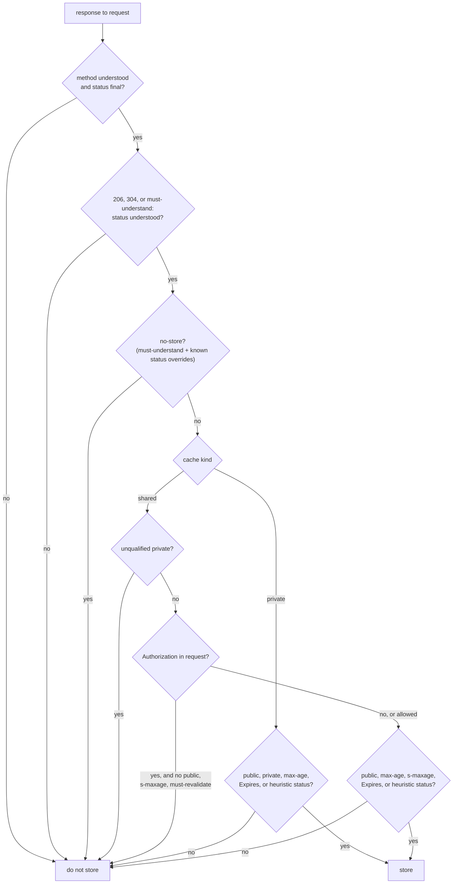

# HTTP Caching Architecture: Private, Shared, and Gateway Caches and Cacheability Rules (RFC 9111)

> [!summary] Claim
> Whether a response may be stored depends on who will reuse it: RFC 9111 Section 3 gives one ordered checklist, and the two lines that differ for a shared cache (`private` and the `Authorization` guard) are the whole difference between a fast API and a cross-user data leak.

Part of [HTTP Caching and Conditional Requests](README.md) in [API Engineering](../README.md).

## TL;DR

- Mechanism: a cache stores a response only if every RFC 9111 Section 3 condition holds - understood method, final status, no `no-store`, the shared-cache `private` and `Authorization` rules, and at least one positive permission such as `max-age`, `Expires`, `public`, or a heuristically cacheable status.
- Contract rule: a private cache serves one user and may store authenticated and `private` responses; a shared cache (forward proxy, gateway, CDN) must refuse an unqualified `private` response, and must refuse a response to an authenticated request unless `public`, `s-maxage`, or `must-revalidate` explicitly allows it (RFC 9111 Section 3 and Section 3.5).
- Trap: `must-revalidate` reads like a restriction but unlocks shared storage of authenticated responses, and a gateway that turns `Authorization` into `X-User-Id` before its cache silently removes the guard altogether; the lab leaks Bob's view of Alice's order in both cases.
- Portability: the rules are version-independent across HTTP/1.1, HTTP/2, and HTTP/3; implementations diverge, for example Varnish 7.7.0 passes every request with `Authorization` even when the response says `public`, and the Litestar 2.25.0 response cache, with its default key builder and filter, ignores the request and response headers entirely.
- When not to use it: do not put a shared cache in front of per-user API responses unless the cache key includes the identity or the origin marks every such response `private`; per-user data belongs in a private cache or in an application cache keyed by tenant.

## Mental model



Every response first passes the checks that apply to all caches: the method and status must be understood, and `no-store` stops storage unless `must-understand` is also present and the cache implements that status code's caching rules, in which case it SHOULD ignore `no-store` (RFC 9111 Section 3 and Section 5.2.2.3).
The path then splits on the kind of cache, because RFC 9111 Section 1 defines a shared cache as one that "stores responses for reuse by more than one user" and a private cache as one "dedicated to a single user".
On the shared branch, an unqualified `private` ends the walk, and a request carrying `Authorization` ends it too unless the response carries one of the three directives that Section 3.5 lists as explicit permission.
Both branches end in the same positive test: storage needs an affirmative reason, either explicit freshness, an explicit `public` or (for a private cache) `private`, or a status defined as heuristically cacheable.
A gateway cache is not a third kind: a gateway is a reverse proxy that "acts as an origin server for the outbound connection" (RFC 9110 Section 3.7), and its accelerator cache is a shared cache under every rule above.

## How it works

### Where caches sit

RFC 9110 Section 3.7 names three intermediaries: a proxy chosen by the client, a gateway (reverse proxy) that acts as an origin server for the outbound connection and is often used for "accelerator" caching, and a tunnel that relays bytes and is no longer a party to HTTP.
Any client or server may use a cache, "though not when acting as a tunnel" (RFC 9111 Section 1), so a TLS `CONNECT` tunnel through a corporate proxy cannot cache, while a TLS-terminating gateway or CDN can.
A typical API path has three caches with different owners: the user agent's private cache, an optional forward proxy cache run by the client's organization, and the gateway or CDN cache run by the API owner.
The API owner configures only the last one, but the response headers it emits govern all three, because a proxy "MUST pass cache directives through in forwarded messages" and "It is not possible to target a directive to a specific cache" (RFC 9111 Section 5.2); instead, directive semantics are scoped by cache kind, with `s-maxage` and `proxy-revalidate` addressed to shared caches and `private` excluding them.

### The cache key and reuse

The cache key is at minimum the method and target URI, and "many HTTP caches in common use today only cache GET responses and therefore only use the URI as the cache key" (RFC 9111 Section 2).
`Vary` adds request fields to the effective key (RFC 9111 Section 4.1), which [[Vary-Header-Mechanics-and-Cache-Hit-Collapse]] covers; the lab cache simply declines to store any response with `Vary`, which is conforming because caching is optional (RFC 9111 Section 2).
`Authorization` is not part of the key, which is exactly why Section 3.5 exists: without it, the key `GET http://api/orders/7` would hand one user's response to the next.
Reuse is a separate checklist (RFC 9111 Section 4): URI and method match, `Vary` fields match, no `no-cache` unless validated, and the response is fresh, allowed stale, or validated; when reused without validation the cache MUST generate `Age` equal to the current age.
Unsafe methods are written through: a cache "is not allowed to generate a reply to such a request before having forwarded the request" (RFC 9111 Section 4), and a non-error response to one MUST invalidate the target URI (RFC 9111 Section 4.4), which [[Cache-Invalidation-Upon-Unsafe-Methods-and-Purge-Patterns]] develops.

### The storage checklist, line by line

RFC 9111 Section 3 says "A cache MUST NOT store a response to a request unless" all of these hold, and the lab's `may_store` evaluates them in this order:

| RFC 9111 Section 3 condition | Lab `Reason` when it fails | Example that fails |
| --- | --- | --- |
| request method understood | `METHOD_NOT_UNDERSTOOD` | `PROPFIND`, or `get` (method tokens are case-sensitive, RFC 9110 Section 9.1) |
| status final | `STATUS_NOT_FINAL` | `103` |
| 206, 304, or `must-understand`: status understood | `STATUS_NOT_UNDERSTOOD` | `206` in a cache without range support |
| no `no-store` response directive | `NO_STORE` | `Cache-Control: NO-STORE` (names are case-insensitive, RFC 9111 Section 5.2) |
| shared: `private` absent or qualified | `PRIVATE` | `private, max-age=60` |
| shared: no `Authorization`, or `public` / `s-maxage` / `must-revalidate` | `AUTHORIZATION` | `max-age=60` on an authenticated `GET` |
| some positive permission | `NO_PERMISSION` | `302` with no freshness and no `public` |

Two extra rules come from elsewhere.
The request `no-store` directive asks a cache not to store "any response to it" (RFC 9111 Section 5.2.1.5), but request directives "are advisory; caches MAY implement them" (RFC 9111 Section 5.2.1); the lab honors it as `REQUEST_NO_STORE`.
`POST` responses "are only cacheable when they include explicit freshness information ... and a Content-Location header field that has the same value as the POST's target URI", and a cached `POST` response can then answer a later `GET` or `HEAD`, never another `POST` (RFC 9110 Section 9.3.3); the lab resolves a relative `Content-Location` against the target URI as RFC 9110 Section 8.7 requires.

The positive permissions are `public`; `private` in a private cache; `Expires`; `max-age`; `s-maxage` in a shared cache; a cache extension that allows it; or a status "defined as heuristically cacheable" (RFC 9111 Section 3).
RFC 9110 Section 15.1 lists those statuses as `200`, `203`, `204`, `206`, `300`, `301`, `308`, `404`, `405`, `410`, `414`, and `501`, so a `404` with no headers at all is storable, while a `302` needs explicit freshness; "any response with a final status code can be cached if the response has explicit freshness information" (RFC 9110 Section 16.2.2).
Presence is what counts, not validity: `Expires: 0` still satisfies the checklist, and the cache must treat it as already expired (RFC 9111 Section 5.3), so the response is stored but never served fresh.
An unrecognized directive such as `community="UCI"` MUST be ignored (RFC 9111 Section 5.2.3), so it grants nothing in a cache that does not implement it.

### Shared-cache details that change what is stored

A qualified `private="Set-Cookie"` limits only the listed fields: "a shared cache MUST NOT store the listed header fields ... but MAY store the remainder" (RFC 9111 Section 5.2.2.7), and the specification warns that the qualified form "is often handled by caches as if an unqualified private directive was received".
`Set-Cookie` alone does not inhibit caching: "a cacheable response with a Set-Cookie header field can be (and often is) used to satisfy subsequent requests to caches" (RFC 9111 Section 7.3).
`must-understand` exists so that a new status code can opt into caching only where the cache knows its rules; a response with it "SHOULD also contain the no-store directive", which a cache that implements `must-understand` SHOULD then ignore for statuses whose caching requirements it implements (RFC 9111 Section 5.2.2.3).
Caches MUST include all received header fields when storing a response, with exceptions: connection-specific fields (`Connection` and the fields it names, and fields such as `Proxy-Connection`, `Keep-Alive`, `TE`, `Transfer-Encoding`, and `Upgrade` from RFC 9110 Section 7.6.1) must be removed before forwarding and MAY be removed before storage, and the proxy fields `Proxy-Authenticate`, `Proxy-Authentication-Info`, and `Proxy-Authorization` MUST NOT be stored unless the proxy's identity is in the cache key (RFC 9111 Section 3.1); the lab drops all of them, and [[Hop-by-Hop-vs-End-to-End-Headers-and-Connection-Header-Abuse]] covers the forwarding rule.

### Why three directives unlock authenticated responses

Section 3.5 names `must-revalidate`, `public`, and `s-maxage` as the directives that let a shared cache reuse a response to an `Authorization` request.
`public` says so directly: it "permits a shared cache to reuse a response to a request containing an Authorization header field" (RFC 9111 Section 5.2.2.9).
`s-maxage` does the same, "subject to the above requirements on maximum age and revalidation" (RFC 9111 Section 5.2.2.10).
`must-revalidate` permits it "subject to the above requirement on revalidation" (RFC 9111 Section 5.2.2.2), and that requirement only binds once the response is stale, so while it is fresh every user gets the stored copy.
`proxy-revalidate` is not on the list: it is the shared-cache-only analog of `must-revalidate`, and "on its own does not imply that a response is cacheable" (RFC 9111 Section 5.2.2.8); the lab asserts that `proxy-revalidate, max-age=60` is still refused.

### What the pinned Python stack does

Starlette 1.10.0 and FastAPI 0.162.0 contain no response cache; the cache-related code in the installed packages is validation, not storage: Starlette's static-file conditional requests (starlette 1.10.0 starlette/staticfiles.py, StaticFiles.is_not_modified) with the `304` field list (starlette 1.10.0 starlette/staticfiles.py, NotModifiedResponse.NOT_MODIFIED_HEADERS), and FastAPI setting `Cache-Control: no-cache` on server-sent event streams (fastapi 0.162.0 fastapi/routing.py, the `StreamingResponse` branch for `text/event-stream`).
httpx 0.28.1 has no cache either, so client-side caching needs a separate transport ([[Client-Side-HTTP-Caching-in-Python-Clients]]).
Litestar 2.25.0 ships an application response cache, which is the case RFC 9111 Section 6 describes: "The requirements in this specification do not necessarily apply to how applications use data after it is retrieved".
Its default key is `request.method + request.url.path + urlencode(sorted query params)` (litestar 2.25.0 litestar/config/response_cache.py, default_cache_key_builder), so no request header, including `Authorization`, reaches the key.
Its storage filter has the signature `Callable[[HTTPScope, int], bool]` and is called with the status only (litestar 2.25.0 litestar/config/response_cache.py, ResponseCacheConfig.cache_response_filter; litestar/middleware/response_cache.py, ResponseCacheMiddleware.__call__), and the default filter accepts `2xx`, `301`, and `308` (default_do_cache_predicate), so a response's own `Cache-Control: private, no-store` cannot influence it.
On a hit, `HTTPRoute._get_cached_response` replays the stored ASGI messages without calling the handler (litestar 2.25.0 litestar/routes/http.py, HTTPRoute._get_cached_response).

## Numbers and limits

| Quantity | Value | Source |
| --- | --- | --- |
| Heuristically cacheable statuses in RFC 9110 | 12: `200 203 204 206 300 301 308 404 405 410 414 501` | RFC 9110 Section 15.1 |
| Directives that unlock shared storage of authenticated responses | 3: `public`, `s-maxage`, `must-revalidate` | RFC 9111 Section 3.5 |
| `delta-seconds` overflow value | 2147483648 (2^31), "over 68 years" | RFC 9111 Section 1.2.2 |
| Typical heuristic freshness fraction | 10% of the time since `Last-Modified` | RFC 9111 Section 4.2.2 |
| Methods with defined caching semantics | 3: `GET`, `HEAD`, `POST`; "the overwhelming majority of cache implementations only support GET and HEAD" | RFC 9110 Section 9.2.3 |
| Varnish 7.7.0 hit-for-miss TTL for uncacheable responses | 120 s | varnish-cache varnish-7.7.0 bin/varnishd/builtin.vcl, vcl_beresp_hitmiss |
| nginx `proxy_cache_valid` with a time only | caches only `200`, `301`, `302` | nginx ngx_http_proxy_module documentation (as of 2026-11) |
| Steam 2015 cache misconfiguration | about 34k users, 11:50 to 13:20 PST, traffic up 2000% over the Steam Sale average | Valve, "Update on Christmas Issues", 2015-12-30 |
| Lab `may_store` cost, shared cache, authenticated `public` response | 1.56 us per call | measured, command below |
| Lab origin calls, two users, `max-age=60` vs `public, max-age=60` through the shared cache | 2 vs 1 | `test_shared_cache_refuses_authenticated_max_age_response`, `test_directives_that_unlock_shared_storage_leak_across_users` |

The timing came from `uv run --frozen python -m timeit -s "from api_labs.f03_http_caching_and_conditional_requests.cacheability import may_store, CacheKind as K" "may_store(kind=K.SHARED, method='GET', target_uri='http://t/x', status=200, request_headers=[('authorization','Bearer a')], response_headers=[('cache-control','public, max-age=60'),('content-type','application/json')])"` on macOS 27.2 (arm64, Darwin 27.2.0) with CPython 3.14.6, which printed `200000 loops, best of 5: 1.56 usec per loop` on two of three runs and `1.65 usec` on the third, and `1.6 usec` on a later rerun; it is one machine and one input, so treat it as an order of magnitude.

## Portability

| Dimension | Behavior | Evidence |
| --- | --- | --- |
| CPython 3.12 | 69 passed on 3.12.13; the pinned 3.12.16 could not be installed: `uv python install 3.12.16` printed `No download found for request: cpython-3.12.16-macos-aarch64-none` | `uv run --frozen --python 3.12 --isolated pytest`, this lab, 2026-11-09 |
| CPython 3.13.18 | 69 passed | `uv run --frozen --python 3.13 --isolated pytest`, this lab |
| CPython 3.14.10 | 69 passed, and also on the 3.14.6 lab virtual environment | `uv run --frozen --python 3.14.10 --isolated pytest`, this lab |
| CPython 3.15.2 | 69 passed | `uv run --frozen --python 3.15.2 --isolated pytest`, this lab |
| CPython 3.15.2t free-threaded | not run: uv resolves `3.15t` to 3.15.0b3t here and `psycopg-binary==3.3.8` has no wheel for it (`error: Distribution psycopg-binary==3.3.8 ... doesn't have a source distribution or wheel for the current platform`), so `uv run --frozen` cannot sync | `uv run --frozen --python 3.15t --isolated pytest`, this lab |
| Debian Trixie container | 69 passed on CPython 3.14.10, glibc 2.41, linux/arm64 under OrbStack | `docker run ghcr.io/astral-sh/uv:python3.14-trixie-slim`, `uv run --frozen pytest <module> -q` on a copy of the lab |
| Alpine container (musl libc) | 69 passed on CPython 3.14.10, linux/arm64 under OrbStack | `docker run ghcr.io/astral-sh/uv:python3.14-alpine`, same command |
| HTTP/1.1, HTTP/2, HTTP/3 | identical cacheability rules: RFC 9110 Section 6 states that the message abstraction makes requirements "independent of the HTTP version, such that a message in one version can be relayed through other versions", and RFC 9111 itself never mentions a wire version; no HTTP/2 or HTTP/3 connection was exercised here | RFC 9110 Section 6; RFC 9111 Abstract and Section 1 |
| Varnish default VCL | run: `varnish:7.7` image (varnishd 7.7.3) with its packaged `default.vcl` in front of a Python backend; two requests with different `Authorization` values to a `public, max-age=60` response each reached the backend (`hit#10 auth=Bearer a`, `hit#11 auth=Bearer b`) and neither was a hit, while two anonymous requests gave one backend call; `private, max-age=60` and `public` with `Set-Cookie` each reached the backend twice; the 7.7.0 `builtin.vcl` source agrees | `docker run varnish:7.7`, 2026-11-09; varnish-cache varnish-7.7.0 bin/varnishd/builtin.vcl, vcl_req_authorization, vcl_req_cookie, vcl_beresp_cookie, vcl_beresp_control |
| nginx `proxy_cache` | run: `nginx:stable` (nginx/1.30.6) with `proxy_cache` and no other cache directive: a request with `Authorization: Bearer a` to a `public, max-age=60` response was cached and the second request with `Authorization: Bearer b` was a `HIT` carrying `auth=Bearer a`, so nginx has no built-in `Authorization` guard; `private, max-age=60`, `Set-Cookie`, and `Vary: *` responses were each `MISS` twice; the documentation says `Set-Cookie` and `Vary: *` responses are not cached, and `$http_authorization` appears only in the example values for `proxy_cache_bypass` and `proxy_no_cache` | `docker run nginx:stable`, 2026-11-09; nginx ngx_http_proxy_module documentation (as of 2026-11) |
| Uvicorn 0.54.0, Hypercorn 0.18.0 | no HTTP cache: a search of their installed sources finds no `Cache-Control` or `max-age` handling | lab `.venv` site-packages |
| Granian 2.8.7 | no HTTP cache: the Python sources have no cache handling, and in the Rust core at tag v2.8.7 the only `cache-control` string is `max-age=<expires>` set on static-file responses (granian 2.8.7 src/files.rs, serve_static_file); no storage, validator, or conditional-request code | lab `.venv` site-packages; github.com/emmett-framework/granian tag v2.8.7, grep of `src/` |
| Starlette 1.10.0, FastAPI 0.162.0, httpx 0.28.1 | no response cache | lab `.venv` site-packages; see How it works |
| Litestar 2.25.0 response cache | key ignores headers; ignores response `Cache-Control`; serves user B the body generated for user A | `test_litestar_response_cache_ignores_authorization_and_no_store`, `test_litestar_default_key_is_method_path_and_sorted_query_only` |

Varnish and nginx ran on linux/arm64 containers with a Python `http.server` backend on the host, not on the CPython matrix; the Varnish image is 7.7.3, so the 7.7.0 `builtin.vcl` citation is for the source and the run is for behavior.
The packaged Varnish `default.vcl` also includes a `hit-miss.vcl`, so the run shows the packaged configuration, not a bare `builtin.vcl`.
Containers were removed afterwards.

## Worked example

The [implementation](../labs/src/api_labs/f03_http_caching_and_conditional_requests/cacheability.py) holds a pure `may_store` decision function, a first-match `freshness_lifetime`, and `HTTPCache`, an ASGI middleware that acts as either a private or a shared cache in front of an origin; the [test](../labs/tests/f03_http_caching_and_conditional_requests/test_http_caching_architecture_private_shared_and_gateway_caches.py) drives a Starlette origin and a Litestar app in process through `httpx.ASGITransport`, with an injected clock.
`HTTPCache` is deliberately small: it reuses only fresh responses, never validates, assigns no heuristic freshness, and computes `Age` as the received `Age` plus resident time rather than the full RFC 9111 Section 4.2.3 formula.

The decision function, verbatim from lines 143 to 194 of `cacheability.py`:

```python
def may_store(
    *,
    kind: CacheKind,
    method: str,
    target_uri: str,
    status: int,
    request_headers: Sequence[tuple[str, str]],
    response_headers: Sequence[tuple[str, str]],
    understood_methods: frozenset[str] = UNDERSTOOD_METHODS,
    understood_statuses: frozenset[int] = UNDERSTOOD_STATUSES,
) -> StorageDecision:
    """Apply the RFC 9111 Section 3 storage rules, plus RFC 9110 Section 9.3.3 for POST."""
    cc = parse_cache_control(field_values(response_headers, "cache-control"))
    shared = kind is CacheKind.SHARED
    if method not in understood_methods:  # method tokens are case-sensitive
        return StorageDecision(Reason.METHOD_NOT_UNDERSTOOD)
    if status < 200:
        return StorageDecision(Reason.STATUS_NOT_FINAL)
    status_understood = status in understood_statuses
    if (status in (206, 304) or "must-understand" in cc) and not status_understood:
        return StorageDecision(Reason.STATUS_NOT_UNDERSTOOD)
    if "no-store" in cc and not ("must-understand" in cc and status_understood):
        return StorageDecision(Reason.NO_STORE)
    if "no-store" in parse_cache_control(field_values(request_headers, "cache-control")):
        return StorageDecision(Reason.REQUEST_NO_STORE)
    omit: frozenset[str] = frozenset()
    if shared and "private" in cc:
        omit = listed_field_names(cc["private"])
        if not omit:
            return StorageDecision(Reason.PRIVATE)
    authorized = bool(field_values(request_headers, "authorization"))
    if shared and authorized and not SHARED_AUTH_OVERRIDES & cc.keys():
        return StorageDecision(Reason.AUTHORIZATION)
    explicit_freshness = (
        "max-age" in cc
        or (shared and "s-maxage" in cc)
        or bool(field_values(response_headers, "expires"))
    )
    if method == "POST":
        locations = field_values(response_headers, "content-location")
        same_uri = bool(locations) and urljoin(target_uri, locations[0]) == target_uri
        if not (explicit_freshness and same_uri):
            return StorageDecision(Reason.POST_NOT_CACHEABLE)
    permitted = (
        explicit_freshness
        or "public" in cc
        or (not shared and "private" in cc)
        or status in HEURISTICALLY_CACHEABLE
    )
    if not permitted:
        return StorageDecision(Reason.NO_PERMISSION)
    return StorageDecision(Reason.STORABLE, omit)
```

The two leak tests, verbatim from lines 350 to 383 of the test module; the origin echoes the caller's `Authorization` or `X-User-Id` into the body, and `origin.calls` records every request that reached it:

```python
@pytest.mark.unit
@pytest.mark.asyncio
@pytest.mark.parametrize(
    "cache_control",
    ["public, max-age=60", "s-maxage=60", "must-revalidate, max-age=60"],
)
async def test_directives_that_unlock_shared_storage_leak_across_users(cache_control: str) -> None:
    origin = Origin(cache_control=cache_control)
    cache = HTTPCache(origin.app(), kind=SHARED, clock=FakeClock())
    async with _client(cache) as client:
        await client.get("/orders/7", headers={"authorization": "Bearer alice"})
        bob = await client.get("/orders/7", headers={"authorization": "Bearer bob"})
    assert bob.text == "order 7 for Bearer alice"
    assert bob.headers["age"] == "0"
    assert origin.calls == ["GET"]


@pytest.mark.unit
@pytest.mark.asyncio
async def test_gateway_that_rewrites_authorization_disables_the_section_3_5_guard() -> None:
    origin = Origin(cache_control="max-age=60")
    cache = HTTPCache(origin.app(), kind=SHARED, clock=FakeClock())
    async with _client(cache) as client:
        await client.get("/orders/7", headers={"x-user-id": "alice"})
        leaked = await client.get("/orders/7", headers={"x-user-id": "bob"})
    assert leaked.text == "order 7 for alice"

    origin = Origin(cache_control="private, max-age=60")
    cache = HTTPCache(origin.app(), kind=SHARED, clock=FakeClock())
    async with _client(cache) as client:
        await client.get("/orders/7", headers={"x-user-id": "alice"})
        safe = await client.get("/orders/7", headers={"x-user-id": "bob"})
    assert safe.text == "order 7 for bob"
    assert origin.calls == ["GET", "GET"]
```

The Litestar comparison, verbatim from lines 528 to 547: the handler marks its own response `private, no-store`, and the framework cache serves it to the next user anyway.

```python
def _litestar_app(key_builder: Any = None) -> Litestar:
    @get("/me", cache=60, cache_key_builder=key_builder)
    async def me(request: Request[Any, Any, Any]) -> Response[str]:
        return Response(
            f"profile of {request.headers.get('authorization')}",
            media_type="text/plain",
            headers={"cache-control": "private, no-store"},
        )

    return Litestar([me], response_cache_config=ResponseCacheConfig())


@pytest.mark.unit
@pytest.mark.asyncio
async def test_litestar_response_cache_ignores_authorization_and_no_store() -> None:
    async with _client(_litestar_app()) as client:
        alice = await client.get("/me", headers={"authorization": "Bearer alice"})
        bob = await client.get("/me", headers={"authorization": "Bearer bob"})
    assert alice.headers["cache-control"] == "private, no-store"
    assert bob.text == "profile of Bearer alice"
```

Captured on macOS 27.2 (arm64) with CPython 3.14.6, pytest 9.2.0, from `labs/`; the `-v` run is filtered to the `platform` line (interpreter path shortened to `.venv/bin/python`) and result lines:

```text
$ uv run --frozen pytest tests/f03_http_caching_and_conditional_requests/test_http_caching_architecture_private_shared_and_gateway_caches.py -q
.............................................................            [100%]
69 passed in 0.26s
$ uv run --frozen pytest tests/f03_http_caching_and_conditional_requests/test_http_caching_architecture_private_shared_and_gateway_caches.py -v -k "unlock_shared or rewrites_authorization or litestar_response_cache or proxy-revalidate"
platform darwin -- Python 3.14.6, pytest-9.2.0, pluggy-1.7.0 -- .venv/bin/python
tests/f03_http_caching_and_conditional_requests/test_http_caching_architecture_private_shared_and_gateway_caches.py::test_storage_decision_table[shared-auth-proxy-revalidate-refused] PASSED [ 16%]
tests/f03_http_caching_and_conditional_requests/test_http_caching_architecture_private_shared_and_gateway_caches.py::test_directives_that_unlock_shared_storage_leak_across_users[public, max-age=60] PASSED [ 33%]
tests/f03_http_caching_and_conditional_requests/test_http_caching_architecture_private_shared_and_gateway_caches.py::test_directives_that_unlock_shared_storage_leak_across_users[s-maxage=60] PASSED [ 50%]
tests/f03_http_caching_and_conditional_requests/test_http_caching_architecture_private_shared_and_gateway_caches.py::test_directives_that_unlock_shared_storage_leak_across_users[must-revalidate, max-age=60] PASSED [ 66%]
tests/f03_http_caching_and_conditional_requests/test_http_caching_architecture_private_shared_and_gateway_caches.py::test_gateway_that_rewrites_authorization_disables_the_section_3_5_guard PASSED [ 83%]
tests/f03_http_caching_and_conditional_requests/test_http_caching_architecture_private_shared_and_gateway_caches.py::test_litestar_response_cache_ignores_authorization_and_no_store PASSED [100%]
======================= 6 passed, 63 deselected in 0.16s =======================
```

## Pitfalls

> [!warning] A caching rule for anonymous traffic applied to authenticated traffic (Steam, 2015-12-25)
> Trigger: during a denial-of-service attack, "a second caching configuration was deployed that incorrectly cached web traffic for authenticated users" at Valve's web caching partner (Valve, "Update on Christmas Issues", 2015-12-30).
> Symptom: between 11:50 and 13:20 PST, store page requests for about 34k users "may have been returned and seen by other users", including billing addresses, purchase history, and email addresses.
> Fix: cache rules in a gateway or CDN must be scoped by path and by the absence of credentials, and the origin should mark every per-user response `private` (or `no-store`) so that an over-broad edge rule still meets a refusal.

> [!warning] `must-revalidate` as a "stricter" directive
> Trigger: an engineer adds `must-revalidate` to an authenticated `max-age=60` response to make caches "check more often".
> Symptom: RFC 9111 Section 3.5 now permits a shared cache to store and reuse it, and while it is fresh every user receives the first user's body; the lab's `must-revalidate, max-age=60` case returns `order 7 for Bearer alice` to Bob with one origin call.
> Fix: use `private, max-age=60` for per-user data, and reserve `must-revalidate`, `public`, and `s-maxage` for responses that are identical for every caller.

> [!warning] The gateway strips `Authorization` before its own cache
> Trigger: an API gateway validates the token, removes `Authorization`, and forwards an internal identity header such as `X-User-Id` (see [[External-Authorization-Ext-Authz-and-Global-Rate-Limit-Filters]]), with a shared cache between it and the origin.
> Symptom: the cache sees an anonymous request with `max-age=60` and stores it; the lab's second user receives `order 7 for alice`.
> Fix: emit `private` from the origin for identity-dependent responses, put the cache before the credential rewrite, or add the identity to the cache key; the same lab request with `private, max-age=60` returns each user's own body.

> [!warning] An application cache that does not read HTTP at all
> Trigger: `@get("/me", cache=60)` in Litestar 2.25.0 on an endpoint that depends on the caller.
> Symptom: the default key is method, path, and sorted query, and the storage filter sees only the status, so `Cache-Control: private, no-store` on the response changes nothing; Bob receives `profile of Bearer alice`.
> Fix: give the handler a `cache_key_builder` that includes a digest of the credential or the tenant (the lab's `test_litestar_per_credential_key_turns_the_app_cache_private`), or do not cache identity-dependent handlers.

> [!warning] Trusting `Set-Cookie` to keep a response out of shared caches
> Trigger: a login or session-refresh response with `Cache-Control: max-age=60` and `Set-Cookie`.
> Symptom: RFC 9111 Section 7.3 says such a response "can be (and often is)" reused, so a conforming shared cache may hand one user's session cookie to others; Varnish 7.7.0 and nginx happen to refuse it by default, which hides the bug until the response crosses a different cache.
> Fix: send `Cache-Control: private` or `no-store` on any response that sets a session cookie, or `private="Set-Cookie"` if the body is genuinely shared; the lab proves the qualified form strips only that field.

## Security and robustness

Threat model: an attacker who can make a shared cache store a response generated for someone else reads that person's data, and an attacker who can make it store a response generated for the attacker serves it to everyone; the first is RFC 9111 Section 7.3 (caching of sensitive information), the second is cache poisoning (RFC 9111 Section 7.1), covered with deception attacks in [[Web-Cache-Poisoning-and-Cache-Deception-Attacks]].
A cross-user cache leak behaves like broken object level authorization (OWASP API1:2023) that the authorization code never sees, because the cache answers before the origin runs; the authorization check passed for the first user and was never repeated.
Default to refusal at every layer: origins mark per-user responses `private`, gateways bypass the cache for requests with credentials as Varnish's builtin VCL does, and only an allowlist of paths is cacheable at the edge.
Treat any header that carries identity (`Authorization`, `Cookie`, `X-User-Id`, tenant headers, mTLS-derived headers) as either part of the cache key or a reason to bypass; [[Caching-Authenticated-and-Multi-Tenant-API-Responses]] designs that key.
Parse `Cache-Control` defensively: names are case-insensitive, the first occurrence wins, quoted arguments can contain commas, and `delta-seconds` can be arbitrarily long; the lab compares length before calling `int()` so a 5000-digit `max-age` is capped at 2^31 instead of raising `ValueError` on CPython's 4300-digit limit, and it rejects non-ASCII digits such as `"\u0661\u0662"` that `str.isdigit()` accepts.
Strip connection-specific and proxy-credential fields before storage (RFC 9111 Section 3.1), so a cached response never replays `Proxy-Authenticate` or a field named in `Connection` to a different client (the lab's `test_each_never_stored_field_is_dropped_from_the_replay` checks each of the eight fixed names).
`no-store` "is not a reliable or sufficient mechanism for ensuring privacy" (RFC 9111 Section 5.2.2.5): a compromised or non-conforming cache can ignore it, so confidentiality still depends on TLS and on not sending the data to an untrusted intermediary in the first place.
Private caches leak too: they "can be used to reconstruct a user's activity" (RFC 9111 Section 7), and timing can reveal which resources a browser has cached, which RFC 9111 Section 7.2 says can be mitigated by adding the referring site to the cache key ("double keying").

## The principal's view

The architectural decision is which layer owns per-user caching, and the defensible answer is "not the shared cache": shared caches are for responses that are byte-identical for every caller, and anything identity-dependent is either `private` or keyed explicitly by tenant in an application cache whose key design is reviewed like an authorization rule.
That decision has an organizational cost: the CDN or gateway team owns the edge configuration, the service team owns the response headers, and an incident like Steam's happens when one team changes its layer under load without the other's invariant written down.
Make the invariant mechanical: a contract test per endpoint that asserts the `Cache-Control` value, a gateway rule that bypasses the cache when credentials are present, and an edge allowlist of cacheable paths, so no single change can turn on shared storage of authenticated responses.
Prefer splitting resources over clever directives: serve the shared part (catalog, configuration, public profile) from a URI that is `public` and long-lived, and the per-user part from a small `private` resource, rather than relying on `private="field"` or `Vary` on a mixed response that many caches handle coarsely.
Framework response caches such as Litestar's are fast and useful for anonymous endpoints, but they sit outside RFC 9111 (Section 6), so treat them as application caches with their own key contract, not as HTTP caches.
When most traffic is authenticated and personalized, an HTTP shared cache buys little; invest instead in conditional requests ([[Conditional-GET-Revalidation-and-304-Not-Modified]]), a private client cache, and data-layer caching keyed by tenant.

## Interview questions

> [!question] L5: What is the difference between a private and a shared cache, and where does an API gateway's cache fall?
>
> > [!success]- Answer
> > A private cache is dedicated to a single user, usually inside the user agent; a shared cache stores responses for reuse by more than one user (RFC 9111 Section 1).
> > A gateway is a reverse proxy that acts as the origin for the outbound connection (RFC 9110 Section 3.7), and its cache serves every client, so it is a shared cache under all RFC 9111 rules.
> > The practical consequence is that `private` and requests with `Authorization` are refused by the gateway cache by default but stored by the browser cache.
> >
> > Follow-up: Which built-in directives target only shared caches?

> [!question] L5: Predict the output: a shared cache receives these four responses to authenticated `GET` requests; which does it store? `max-age=60`; `public, max-age=60`; `must-revalidate, max-age=60`; `proxy-revalidate, max-age=60`.
>
> > [!success]- Answer
> > `max-age=60`: not stored, because the request carried `Authorization` and no unlocking directive is present.
> > `public, max-age=60`: stored, `public` is explicit permission (RFC 9111 Section 5.2.2.9).
> > `must-revalidate, max-age=60`: stored, and reused for other users while fresh (RFC 9111 Section 3.5 and Section 5.2.2.2).
> > `proxy-revalidate, max-age=60`: not stored, `proxy-revalidate` is not one of the three directives Section 3.5 lists.
> >
> > Follow-up: What would a Varnish 7.7.0 default configuration do with the `public` case?

> [!question] L5: Is a `404 Not Found` with no caching headers storable, and is a `302 Found`?
>
> > [!success]- Answer
> > The `404` is storable, because RFC 9110 Section 15.1 defines `404` as heuristically cacheable, which satisfies the last permission in RFC 9111 Section 3.
> > The `302` is not, because it is not heuristically cacheable and carries no explicit freshness or `public`.
> > Adding `max-age` makes the `302` storable, since any final status can be cached with explicit freshness.
> >
> > Follow-up: Why does that make an API that returns `404` before a resource is created risky behind a CDN?

> [!question] L6: Debug this API: after enabling a CDN, users occasionally see another user's order although every handler returns `Cache-Control: max-age=30` and the CDN conforms to RFC 9111; what is going on?
>
> > [!success]- Answer
> > A conforming shared cache refuses responses to requests with `Authorization`, so look for where `Authorization` disappears: an API gateway in front of the CDN origin that validates the token and forwards `X-User-Id` instead.
> > From the cache's point of view the request is anonymous and `max-age=30` is permission to store it, keyed only by URI.
> > Fix it by returning `private, max-age=30` from identity-dependent handlers, moving the cache in front of the credential rewrite, or keying the cache by identity; then add a contract test on the header.
> >
> > Follow-up: How would you detect this class of leak in production before users report it?

> [!question] L6: When may a response to `POST` be cached, and what can it be used for?
>
> > [!success]- Answer
> > Only with explicit freshness and a `Content-Location` equal to the target URI after resolving it (RFC 9110 Section 9.3.3 and Section 8.7).
> > It can then satisfy a later `GET` or `HEAD` for that URI, but never another `POST`, because unsafe requests are written through (RFC 9111 Section 4).
> > A non-error `POST` response also invalidates the stored responses for the target URI (RFC 9111 Section 4.4).
> >
> > Follow-up: Why does RFC 9110 suggest `303 See Other` as the more cache-friendly design?

> [!question] L6: What does `private="Set-Cookie"` do, and why might you not rely on it?
>
> > [!success]- Answer
> > It lets a shared cache store the response but not the `Set-Cookie` field, so the body is shared and the cookie is not (RFC 9111 Section 5.2.2.7).
> > RFC 9111 itself notes that the qualified form is often treated as unqualified `private`, so many caches will not store the response at all.
> > The lab implements the qualified form and shows the replayed response lacks `Set-Cookie`, but a portable design separates the shared and the per-user parts into different resources.
> >
> > Follow-up: Why does `Set-Cookie` alone not prevent caching?

> [!question] L7+: Your platform team wants to enable a framework response cache (for example Litestar's) on all read endpoints for a latency win; what do you require?
>
> > [!success]- Answer
> > Framework caches are application caches outside RFC 9111 (Section 6), and Litestar 2.25.0 keys on method, path, and sorted query and ignores the response's `Cache-Control`, so `private, no-store` does not protect anything.
> > Require an explicit per-endpoint classification (anonymous, per-tenant, per-user), a reviewed key builder that includes the tenant or credential digest for the non-anonymous classes, and a test that two identities never share a body.
> > Default to off for any handler that reads identity, and measure the hit rate first, because personalized endpoints rarely hit.
> >
> > Follow-up: How would you enforce that classification in code review or CI?

> [!question] L7+: Design the caching layers for a public catalog API that also serves per-user pricing, fronted by a CDN.
>
> > [!success]- Answer
> > Split the resources: the catalog at a URI that is `public, s-maxage=...` with strong validators, and per-user pricing at a separate URI marked `private` with short `max-age` and conditional revalidation.
> > Configure the CDN to bypass on credentials and to cache only an allowlist of catalog paths, so an origin mistake meets an edge refusal and vice versa.
> > Invalidate catalog entries by surrogate keys on writes, and accept that per-user responses are served by the private cache and the origin, with data-layer caching keyed by tenant.
> >
> > Follow-up: What breaks if you instead use one URI with `Vary: Authorization`?

## Related

Prerequisites: [[HTTP-Trailers-Streaming-Checksums-and-gRPC-Status]]

Next: [[Cache-Control-Directives-and-Freshness-Lifetime-Calculation]]

See also: [[REST-APIs]], [[02-Programming-Languages/Python/Python-Backend-Interview-Prep/05-REST-API-Design]], [[HTTP-Message-Abstraction-RFC-9110]], [[Hop-by-Hop-vs-End-to-End-Headers-and-Connection-Header-Abuse]], [[Caching-Authenticated-and-Multi-Tenant-API-Responses]], [[Vary-Header-Mechanics-and-Cache-Hit-Collapse]], [[Web-Cache-Poisoning-and-Cache-Deception-Attacks]], [[Cache-Invalidation-Upon-Unsafe-Methods-and-Purge-Patterns]], [[API-Gateway-Architecture-Responsibilities-and-Anti-Patterns]], [[Edge-Caching-and-CDN-Shielding-for-Dynamic-and-Public-APIs]]

- Lab: `labs/tests/f03_http_caching_and_conditional_requests/test_http_caching_architecture_private_shared_and_gateway_caches.py`

## Further reading

- [RFC 9111 Section 3](https://www.rfc-editor.org/rfc/rfc9111.html#section-3): the normative storage checklist this note implements line by line.
- [RFC 9111 Section 3.5](https://www.rfc-editor.org/rfc/rfc9111.html#section-3.5): the `Authorization` guard and the three directives that lift it.
- [RFC 9111 Section 5.2.2](https://www.rfc-editor.org/rfc/rfc9111.html#section-5.2.2): the response directives, including the qualified forms of `private` and `no-cache`.
- [RFC 9111 Section 7](https://www.rfc-editor.org/rfc/rfc9111.html#section-7): poisoning, timing attacks, and caching of sensitive information.
- [RFC 9110 Section 3.7](https://www.rfc-editor.org/rfc/rfc9110.html#section-3.7): proxies, gateways, and tunnels; Section 3.8 adds that a cache cannot be used while acting as a tunnel.
- [RFC 9110 Section 9.3.3](https://www.rfc-editor.org/rfc/rfc9110.html#section-9.3.3): when a `POST` response is cacheable.
- [Varnish 7.7.0 builtin.vcl](https://github.com/varnishcache/varnish-cache/blob/varnish-7.7.0/bin/varnishd/builtin.vcl): a production cache whose defaults are stricter than RFC 9111 for credentials and cookies.
- [Valve, "Update on Christmas Issues"](https://store.steampowered.com/oldnews/19852): a first-party account of a cache configuration that served authenticated pages across users.
- [Litestar 2.25.0 response_cache.py](https://github.com/litestar-org/litestar/blob/v2.25.0/litestar/config/response_cache.py): an application cache whose key and filter show what RFC 9111 Section 6 leaves to applications.
