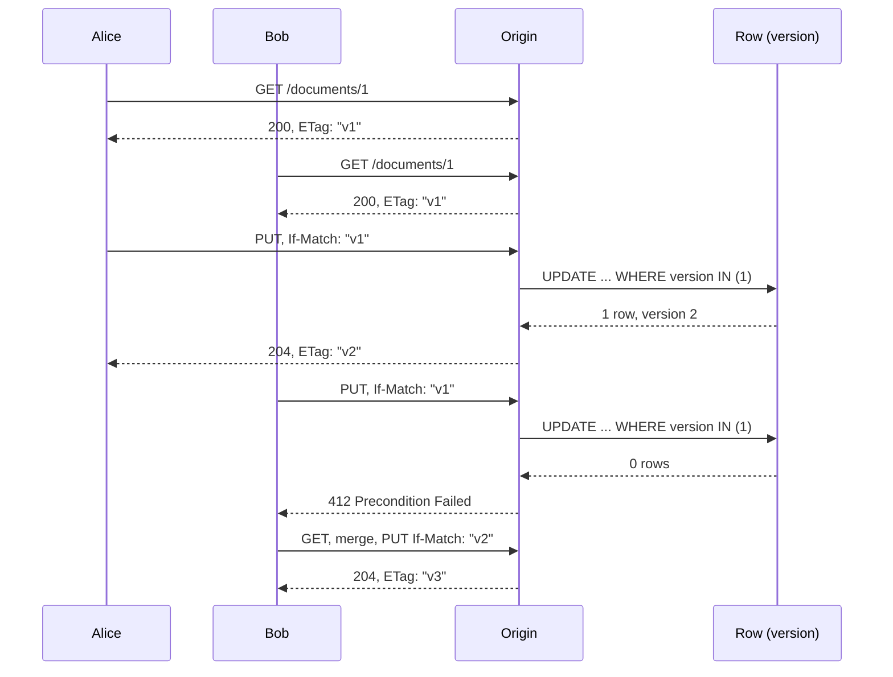

# Preventing Lost Updates with If-Match, 412 Precondition Failed, and 428 Precondition Required (RFC 9110)

> [!summary] Claim
> `If-Match` stops lost updates only when the server compares the tag and writes the row in one atomic step, and `428 Precondition Required` is what makes clients actually send it.

Part of [HTTP Caching and Conditional Requests](README.md) in [API Engineering](../README.md).

## TL;DR

- Mechanism: the client echoes the `ETag` it read in `If-Match`; the origin applies the write only if that tag still strongly matches the current representation, otherwise it answers `412 Precondition Failed` (RFC 9110 Section 13.1.1).
- Contract rule: if the server demands conditional writes, it answers a bare `PUT` with `428 Precondition Required` and explains how to resubmit (RFC 6585 Section 3).
- Trap: comparing in Python and then running an unconditional `UPDATE` reopens the race; the lab shows two writers both getting `204` while sending a correct `If-Match`.
- Portability: the lab passes unchanged on CPython 3.12.13, 3.13.18, 3.14.6, 3.14.10, 3.15.2, and free-threaded 3.15.0b3t, because the guarantee comes from the SQL statement and not the interpreter.
- When not to use it: blind appends, commutative counters, and edits to disjoint sub-resources do not need a base version, and forcing `If-Match` there only adds conflicts (RFC 5789 Section 2).

## Mental model



Both editors read version 1 and get the same strong `ETag`.
Alice's `PUT` carries `If-Match: "v1"`, and the server turns that into a version predicate on the `UPDATE`, so the row moves to version 2 and Alice learns the new tag from the `204` response.
Bob's `PUT` carries the same stale tag, the same predicate now matches zero rows, and Bob gets `412` instead of silently overwriting Alice's title.
Bob then rereads, reapplies his change on top of version 2, and lands version 3 with both edits intact.
Without the precondition, both `PUT` requests would return success and the second would erase the first: the lost update that RFC 9110 Section 13 names explicitly.

## How it works

### The wire contract

A conditional write looks like this on HTTP/1.1:

```text
PUT /documents/1 HTTP/1.1
Host: api.example
Content-Type: application/json
If-Match: "v1"

{"title": "Final", "body": "v1 text"}
```

The field grammar is `If-Match = "*" / #entity-tag`, where `entity-tag = [ weak ] opaque-tag`, `weak = %s"W/"` (case-sensitive), and `opaque-tag = DQUOTE *etagc DQUOTE` with `etagc = %x21 / %x23-7E / obs-text` (RFC 9110 Sections 13.1.1 and 8.8.3).
Three consequences of that grammar matter for parsers:

- `etagc` includes `%x2C`, so `"a,b"` is one tag, and splitting the field value on `,` is wrong.
- `#entity-tag` is a list, so a request may carry several `If-Match` field lines, and a recipient may combine them with `, ` without changing their meaning (RFC 9110 Section 5.3).
- A recipient must tolerate empty list elements such as `"a", , "b"` (RFC 9110 Section 5.6.1.2), and a list that mixes `*` with tags is syntactically invalid (RFC 9110 Section 13.1.1).

### Evaluation rules

RFC 9110 Section 13.1.1 defines the evaluation:
`*` is true if the origin has a current representation, a list is true if any listed tag matches the selected representation's tag, and anything else is false.
The comparison must be the strong comparison of RFC 9110 Section 8.8.3.2: two tags match only if neither is weak and their opaque-tags match character by character.
So `W/"v1"` never satisfies `If-Match`, even against a current `ETag: W/"v1"`.
When the condition is false, the origin "MUST NOT perform the requested method" and may answer `412`, or a `2xx` if it can tell that the same change has already been applied (RFC 9110 Section 13.1.1).
The same section advises answering `412` for every failed precondition on resources where clients are not cooperating, and the lab does exactly that.

Ordering is part of the contract.
RFC 9110 Section 13.2.1 says preconditions are evaluated after the normal request checks and "just before" the server processes the content, and that a server must ignore preconditions when its response to the same request without them, prior to processing the content, would have been a status code other than `2xx` or `412`, so redirects and early-detectable failures win.
That is why a `PUT` with `If-Match: "v1"` to a document that does not exist answers `404`, not `412`.
RFC 9110 Section 13.2.2 then fixes precedence: `If-Match` first, `If-Unmodified-Since` only when `If-Match` is absent, then `If-None-Match`.

`412` is defined in RFC 9110 Section 15.5.13.
`428` comes from RFC 6585 Section 3, which ties it to the lost update problem, says the response SHOULD explain how to resubmit, and says it MUST NOT be stored by a cache.
`PUT` responses are not cacheable anyway (RFC 9110 Section 9.3.4).

### Which ETag a write response may carry

RFC 9110 Section 9.3.4 forbids a validator such as `ETag` in a successful `PUT` response unless the stored representation is identical to the request content and the validator describes it.
The lab therefore stores the validated request bytes verbatim and returns them on `GET`, so the `ETag` in its `204` response is legitimate.
An API that normalizes, re-serializes, or adds server fields (`id`, `updated_at`) must drop the `ETag` from the write response; RFC 9110 Section 13.1.1 notes that leaving it out encourages the client to `GET` before its next request.

### Where the guarantee actually comes from

`If-Match` is a protocol to carry the client's base version; the atomicity has to come from storage.
The lab maps a strong tag `"v<N>"` to a row version and writes with one statement.
Simplified excerpt: the SQL that the concatenated string literals in the lab's `DocumentStore.conditional_update` produce, one clause per line.

```sql
UPDATE documents SET content = ?, version = version + 1
WHERE id = ? AND version IN (SELECT value FROM json_each(?))
RETURNING version
```

The predicate and the write execute as one statement, so two writers holding `"v1"` cannot both match.
Zero returned rows is ambiguous, so the store then checks whether the row still exists to choose between `404` and `412` (`test_zero_updated_rows_are_split_into_missing_and_stale`).
This is the same compare-and-set that ORM version counters perform; [[Optimistic-vs-Pessimistic-Locking-Version-ID-Col-and-FOR-UPDATE-SKIP-LOCKED]] covers that side.

### What the pinned stack does and does not do

Starlette 1.10.0 defines `HTTP_412_PRECONDITION_FAILED` and `HTTP_428_PRECONDITION_REQUIRED` (starlette 1.10.0 starlette/status.py, module constants) and never evaluates `If-Match`: a search of the installed package for conditional request fields found only `if-none-match` and `if-modified-since` in `StaticFiles.is_not_modified` and `if-range` in `starlette/responses.py` (starlette 1.10.0 starlette/staticfiles.py, StaticFiles.is_not_modified).
That `is_not_modified` splits `If-None-Match` on `,` and strips `W/`, which is fine for the weak comparison `GET` revalidation needs and wrong for `If-Match`.
`Headers.__getitem__` and `Headers.get` return only the first matching field line, while `Headers.getlist` returns all of them (starlette 1.10.0 starlette/datastructures.py, Headers.getlist), so precondition code must call `getlist`.

FastAPI decides which error a client sees first.
`get_request_handler` reads the body and raises a `json_invalid` `RequestValidationError` on undecodable JSON before it calls `solve_dependencies` (fastapi 0.162.0 fastapi/routing.py, get_request_handler).
`solve_dependencies` runs sub-dependencies first and validates body parameters with `request_body_to_args` afterwards (fastapi 0.162.0 fastapi/dependencies/utils.py, solve_dependencies).
A precondition written as a dependency therefore yields `428` or `412` before a schema `422`, which is the order RFC 9110 Section 13.2.1 asks for, but malformed JSON still wins with `422`.
The same function runs a plain `def` dependency through `run_in_threadpool` and an `async def` one on the event loop, which matters once the dependency touches a thread-bound resource.
FastAPI 0.162.0 also defaults `strict_content_type` to `True` in `get_request_handler`, so a `PUT` with no `Content-Type` is not parsed as JSON at all, and a non-JSON media type is never parsed as JSON whatever the setting.

## Numbers and limits

| Quantity | Value | Source |
|---|---|---|
| Lab tests | 25 passed in 0.22 s | measured: `uv run --frozen pytest <lab> -q`, CPython 3.14.6, macOS 27.2 arm64 (as of 2026-11) |
| Writers that win one race on the same `ETag` | exactly 1 of 2 with `conditional_update`, 2 of 2 with `check_then_write` | measured in the lab with an `asyncio.Barrier(2)` forcing the interleaving, CPython 3.14.6, macOS 27.2 arm64 |
| Round trips to land one conflicting write | 4: `GET`, `PUT` -> `412`, `GET`, `PUT` | lab test `test_if_match_turns_the_lost_update_into_412_and_a_clean_retry` |
| `k` writers from one `ETag`, retrying in lockstep | `k` rounds and `k(k+1)/2` `PUT` requests to land all `k` | arithmetic from one winner per round, not measured |
| Python `int()` digit ceiling | 4300 digits by default, `ValueError` above it | Python docs, `sys.int_info.default_max_str_digits`; guards CVE-2020-10735 (NVD, published 2022-09-09) |
| Lab cap on version digits | 18, so the largest accepted version is below `2**63 - 1` (19 digits) | lab `_VERSION_TAG`; SQLite stores `INTEGER` as a signed integer in at most 8 bytes (SQLite docs, Datatypes In SQLite) |
| Lab cap on tags per `If-Match` | 16 -> `400` | lab design choice, `MAX_IF_MATCH_TAGS` |
| h11 header buffer default | 16 KiB (`DEFAULT_MAX_INCOMPLETE_EVENT_SIZE = 16 * 1024`) | (h11 0.16.0 h11/_connection.py, DEFAULT_MAX_INCOMPLETE_EVENT_SIZE); Uvicorn's h11 protocol uses it unless `h11_max_incomplete_event_size` is set (uvicorn 0.54.0 uvicorn/protocols/http/h11_impl.py, H11Protocol.__init__) |

The default h11 buffer of 16 KiB leaves room for a 5000-digit tag, which is why the digit cap is needed: removing it from `_VERSION_TAG` makes the lab's 5000-digit `If-Match` case fail with `ValueError: Exceeds the limit (4300 digits) for integer string conversion` instead of answering `412` (re-run during verification, CPython 3.14.6).

## Portability

| Leg | Result | Evidence |
|---|---|---|
| CPython 3.12.13 | 25 passed | lab run, `uv run --frozen --python <uv-managed 3.12.13>` with a separate `UV_PROJECT_ENVIRONMENT` |
| CPython 3.13.18 | 25 passed | lab run, `uv run --frozen --python /opt/homebrew/bin/python3.13` with a separate `UV_PROJECT_ENVIRONMENT` |
| CPython 3.14.6 | 25 passed, plus ruff, mypy, pyright clean | lab run in the workspace `.venv` |
| CPython 3.14.10 | 25 passed | lab run, `uv run --frozen --python /opt/homebrew/bin/python3.14` |
| CPython 3.15.2 | 25 passed | lab run, `uv run --frozen --python /opt/homebrew/bin/python3.15` |
| CPython 3.15.0b3 free-threaded | 25 passed, `Py_GIL_DISABLED=1` and `sys._is_gil_enabled()` stayed `False` after the run | lab run in a venv holding only the lab's pinned packages, because `psycopg-binary==3.3.8` has no wheel and `aioquic==1.7.2` failed to build for `cp315t` |
| CPython 3.12.16 and 3.15.2t (pinned matrix patch levels) | not run | this machine offered only 3.12.13 and 3.15.0b3t for those legs |
| Debian Trixie and Alpine musl containers | not run | the workspace has no container definitions yet |
| Uvicorn, Hypercorn, Granian | not run; semantics are origin-level | the precondition lives in the application, and RFC 9110 Section 13.2.1 assigns evaluation to the origin or a cache, not the transport |
| HTTP/1.1, HTTP/2, HTTP/3 | same semantics on every version | RFC 9110 Section 6 defines the message abstraction independently of version; the lab only exercises ASGI in-process |
| Starlette 1.10.0 | no built-in `If-Match` evaluation | installed source grep plus the GitHub tag file, identical by `diff` |
| FastAPI 0.162.0 | dependency before body validation, malformed JSON before both | lab test `test_fastapi_order_json_decode_then_dependencies_then_body_schema` and the source cited above |

## Worked example

The [implementation](../labs/src/api_labs/f03_http_caching_and_conditional_requests/if_match_preconditions.py) is a FastAPI app over an in-memory SQLite table with a version column, and the [test](../labs/tests/f03_http_caching_and_conditional_requests/test_optimistic_concurrency_control_if_match_and_412_precondition_failed.py) drives it through `httpx.ASGITransport`.

Simplified excerpt (verbatim lines from the implementation; parsing helpers and the `GET` route omitted): the precondition dependency.

```python
    async def precondition(request: Request, doc_id: int) -> frozenset[int] | None:
        """Evaluate If-Match as a dependency, which FastAPI runs before body validation.

        `async def` keeps it on the event loop thread; a plain `def` dependency runs in a
        worker thread, where this single-threaded SQLite connection refuses to be used.
        """
        current = store.get(doc_id)
        if current is None:
            # RFC 9110 Section 13.2.1: a 404 detectable up front outranks any precondition.
            raise ProblemError(404, "Not Found", f"document {doc_id} does not exist")
        field_lines = request.headers.getlist("if-match")
        if not field_lines:
            if require_if_match:
                raise ProblemError(
                    428,
                    "Precondition Required",
                    "This resource only accepts conditional writes: GET it, then resend the "
                    "PUT with If-Match set to the ETag you received.",
                )
            return None
        try:
            condition = parse_if_match(field_lines)
        except MalformedPreconditionError as exc:
            raise ProblemError(400, "Bad Request", str(exc)) from exc
        versions = expected_versions(condition)
        if versions is not None and current.version not in versions:
            raise ProblemError(412, "Precondition Failed", "GET the document, reapply, retry.")
        return versions
```

The early check in the dependency gives the RFC 9110 Section 13.2.1 ordering; it is not the safety mechanism.
The safety mechanism is the conditional write, shown here verbatim from `DocumentStore`:

```python
    async def conditional_update(
        self, doc_id: int, versions: frozenset[int] | None, content: bytes
    ) -> int | WriteFailure:
        """Compare and write in one statement: the version predicate is the lock."""
        await self._pause()
        if versions is None:
            row = self._db.execute(
                "UPDATE documents SET content = ?, version = version + 1 "
                "WHERE id = ? RETURNING version",
                (content, doc_id),
            ).fetchone()
        else:
            row = self._db.execute(
                "UPDATE documents SET content = ?, version = version + 1 "
                "WHERE id = ? AND version IN (SELECT value FROM json_each(?)) "
                "RETURNING version",
                (content, doc_id, json.dumps(sorted(versions))),
            ).fetchone()
        if row is not None:
            return int(row[0])
        # Zero rows updated is ambiguous: tell "gone" apart from "changed".
        return WriteFailure.MISSING if self.get(doc_id) is None else WriteFailure.STALE
```

The race test parks both writers on an `asyncio.Barrier(2)` placed exactly where a database round trip would sit, then compares the two strategies (verbatim from the test):

```python
@pytest.mark.unit
@pytest.mark.asyncio
async def test_check_then_write_loses_an_update_even_with_if_match() -> None:
    statuses, final, etag = await race_two_writers("check_then_write")

    assert statuses == [204, 204]  # Both callers were told their write succeeded.
    assert etag == '"v3"'
    assert final in ({"title": "Alice", "body": "v1 text"}, {"title": "Draft", "body": "Bob"})


@pytest.mark.unit
@pytest.mark.asyncio
async def test_conditional_update_statement_admits_exactly_one_writer() -> None:
    statuses, final, etag = await race_two_writers("conditional_update")

    assert statuses == [204, 412]
    assert etag == '"v2"'
    assert final in ({"title": "Alice", "body": "v1 text"}, {"title": "Draft", "body": "Bob"})
```

Captured output, CPython 3.14.6 on macOS 27.2 arm64, from `labs/` (the full `-v` listing shows all 25 node IDs passing):

```text
$ uv run --frozen pytest tests/f03_http_caching_and_conditional_requests/test_optimistic_concurrency_control_if_match_and_412_precondition_failed.py -q
.........................                                                [100%]
25 passed in 0.22s
```

## Pitfalls

No CVE or public postmortem specific to `If-Match` handling turned up in this research; the pitfalls below are grounded in the specification, the pinned source, and the lab's mutations.

> [!warning] Check-then-write
> Trigger: the handler reads the row, compares the version in Python, awaits anything (a log call, an auth lookup, a second query), and then runs an unconditional `UPDATE`.
> Symptom: under concurrency both writers get `204`, the version advances twice, and one edit is gone, exactly what `test_check_then_write_loses_an_update_even_with_if_match` shows.
> Fix: put the version in the `WHERE` clause of the write, or hold a row lock across the read and the write; see [[Transaction-Isolation-Levels-and-Concurrency-Anomalies-in-APIs]].

> [!warning] Weak comparison in `If-Match`
> Trigger: reusing a cache revalidation helper, such as the `W/`-stripping split in `StaticFiles.is_not_modified`, for write preconditions.
> Symptom: a weak tag, which may be shared by different byte sequences (RFC 9110 Section 8.8.1), authorizes an overwrite.
> Fix: strong comparison only (RFC 9110 Section 13.1.1); weak tags never match.

> [!warning] Only the first field line is read
> Trigger: `request.headers.get("if-match")` in Starlette or FastAPI.
> Symptom: a client or proxy that sends the list as two field lines gets `412` for a tag that is current.
> Fix: `request.headers.getlist("if-match")`, joined with `, ` per RFC 9110 Section 5.3, then a tokenizer that respects quoted commas.

> [!warning] Version tags that parse but do not compare
> Trigger: mapping `"v01"` or `"v1 "` to version 1 with `int()`, or accepting any digit count.
> Symptom: non-identical opaque-tags are treated as equal, which breaks the character-by-character rule, and a long digit string raises `ValueError` past the 4300-digit `int()` limit and turns into a `500`.
> Fix: accept only the canonical spelling with a bounded digit count, as `_VERSION_TAG` does.

> [!warning] `If-Match: *` as a compliance checkbox
> Trigger: a client library that sends `*` to get past a `428`.
> Symptom: every write succeeds again, so lost updates are back; `test_wildcard_matches_any_current_version_so_it_cannot_prevent_lost_updates` lands version 3 from a stale view.
> Fix: document that `*` only asserts existence; reject it on resources that need a real base version, or log and alert on it.

> [!warning] A `PUT` response `ETag` that describes something else
> Trigger: returning `ETag` for a server-normalized or re-serialized representation after `PUT`.
> Symptom: the client reuses its local copy with a tag that names different bytes, and the next conditional request is based on content the server never stored (RFC 9110 Section 9.3.4).
> Fix: store and return the exact bytes, or omit `ETag` from the write response and let the client `GET`.

> [!warning] Sync dependency on a thread-bound resource
> Trigger: writing the precondition dependency as `def` when it touches an SQLite connection or another object that belongs to one thread.
> Symptom: turning the lab's `precondition` into a plain `def` fails every `PUT` with `sqlite3.ProgrammingError: SQLite objects created in a thread can only be used in that same thread`, because FastAPI runs the dependency through `run_in_threadpool` (reproduced during verification, CPython 3.14.6).
> Fix: `async def` for loop-bound work, or a connection per thread; see [[Async-Def-vs-Def-Endpoints-and-AnyIO-Threadpool-Limiter-Semantics]].

> [!warning] Version counters that restart
> Trigger: deriving `"v<N>"` from a per-row counter whose row id can be reused after a delete.
> Symptom: a recreated resource reuses `"v1"`, so a client holding the old `"v1"` overwrites new content; RFC 9110 Section 8.8.1 requires a strong validator to be unique across all versions of the resource over time.
> Fix: never reuse ids (the lab declares `AUTOINCREMENT`), or mix an incarnation id into the tag.

## Security and robustness

Threat model: a concurrent client, a buggy retry loop, or a hostile caller tries to change state it has not seen, or to crash or slow the precondition parser.
OWASP API Security Top 10 2023 `API6:2023 Unrestricted Access to Sensitive Business Flows` is the closest category for clients that skip preconditions to force writes, and `API4:2023 Unrestricted Resource Consumption` covers parser abuse.

- Parser input is untrusted: the tokenizer is a single linear regex per element, the tag count is capped at 16, and the digit count at 18, so the worst input costs one pass over a header that an h11-based server such as Uvicorn's `h11` protocol bounds at 16 KiB by default.
- Authorization before preconditions: RFC 9110 Section 13.2.1 puts failures detectable before content processing ahead of `412`, so an unauthorized caller should get `401` or `403` and never learn from `412` versus `204` whether its guessed tag is current.
- `412` responses carry no `ETag` and no representation in the lab, so they do not leak current content to a caller that has not been through `GET` and its access checks.
- Proxies: an intermediary that is not the origin and cannot act as a cache must forward `If-Match` untouched and not evaluate it (RFC 9110 Section 13.2.1), and a cache may ignore it (RFC 9110 Section 13.1.1); a gateway that strips unknown headers breaks the whole scheme without any error.
- `428` is advisory unless enforced on every write path: a bulk endpoint, an admin tool, or a message consumer that writes the same rows without the version predicate brings lost updates back.
- Defense in depth: keep the version predicate in the storage write even when the early check in the dependency passes, because only the storage check is atomic.

## The principal's view

The decision is where the concurrency contract lives.
Header-based `If-Match` keeps HTTP semantics, works with generic clients and caches, and returns the standard `412`; Google AIP-154 instead puts an `etag` field in the resource body and maps a mismatch to `ABORTED` (HTTP `409`), and its changelog records the change from `FAILED_PRECONDITION` (`400`) to `ABORTED` on 2021-03-05.
Kubernetes carries `resourceVersion` in object metadata and answers a stale update with `409 Conflict`.
Both choices work because they are uniform across one platform; mixing `409` and `412` for the same failure across teams is what breaks client libraries.

Making `If-Match` mandatory with `428` is an organizational decision as much as a protocol one.
It moves conflict handling into every client, so it pays only where concurrent humans or agents edit shared state; for blind appends, counters, and per-field patches, an atomic server-side operation such as `PATCH` with commutative semantics or a dedicated action endpoint avoids conflicts altogether (RFC 5789 Section 2 says patch formats that do not need a known base point do not need this care).
AIP-154 also notes that services with strong consistency or parallelism requirements may require an etag on every request, which is the same policy as `428` expressed as `INVALID_ARGUMENT`.

Choose pessimistic locking (`SELECT ... FOR UPDATE` or leases) when conflicts are frequent and retries are expensive, such as long human edits of a hot document, because optimistic retries then multiply the work: with `k` writers in lockstep, landing all `k` costs `k(k+1)/2` writes.
Choose operational transforms or CRDTs when many parties edit the same document in real time, because there "reject and retry" is a poor user experience.

## Interview questions

> [!question] L5: What is a lost update, and which header prevents it on `PUT`?
>
> > [!success]- Answer
> > Two clients read the same version, both write, and the second write silently replaces the first.
> > The client sends the `ETag` it read in `If-Match`, and the origin applies the write only if that tag still strongly matches, otherwise it answers `412 Precondition Failed` (RFC 9110 Section 13.1.1).
> >
> > Follow-up: Why does the server not need to see the old body to detect the conflict?

> [!question] L5: What is the difference between `412` and `428`?
>
> > [!success]- Answer
> > `412` means the request carried a precondition and it evaluated to false (RFC 9110 Section 15.5.13).
> > `428` means the request carried no precondition and the server requires one (RFC 6585 Section 3).
> > A `428` response should tell the client how to resubmit, and a cache must not store it.
> >
> > Follow-up: Does `If-Match: *` satisfy a `428` policy, and does it prevent lost updates?

> [!question] L5: Why must `If-Match` use strong comparison?
>
> > [!success]- Answer
> > A weak tag may be shared by representations whose bytes differ (RFC 9110 Section 8.8.1), so a weak match does not prove the client saw the current data.
> > RFC 9110 Section 13.1.1 therefore requires the strong comparison function, under which `W/"1"` never matches anything.
> >
> > Follow-up: Which conditional header is allowed to use weak comparison, and why is that safe?

> [!question] L6: Predict the output: with `If-Match` required, what status does the lab app return for four `PUT /documents/1` requests with `Content-Type: application/json`, namely no `If-Match` and body `{"title": ""}`, no `If-Match` and body `{"title": `, `If-Match: "v0"` and body `{"title": ""}`, and `If-Match: "v1"` (current) and body `{"title": ""}`?
>
> > [!success]- Answer
> > `428`, `422`, `412`, `422`.
> > FastAPI 0.162.0 decodes JSON in `get_request_handler` before `solve_dependencies`, so truncated JSON fails with `json_invalid` before the precondition dependency runs.
> > Inside `solve_dependencies`, sub-dependencies run before `request_body_to_args`, so the precondition decides `428` or `412` before the schema `422`.
> > With a current tag the precondition passes and the empty `title` fails schema validation.
> >
> > Follow-up: RFC 9110 Section 13.2.1 wants preconditions before content processing; how would you make even malformed JSON lose to `412`?

> [!question] L6: Debug this API: every `PUT` sends a correct `If-Match` and the handler does `row = await repo.get(id)`, returns `412` if `row.version != expected`, then calls `await repo.save(row_with_changes)`, yet support tickets show edits disappearing, so what is wrong?
>
> > [!success]- Answer
> > The comparison and the write are separate steps with an `await` between them, so two requests can both pass the check before either writes.
> > The lab reproduces this with a barrier: both writers get `204` and the version jumps from 1 to 3.
> > Fix it by making the write conditional, `UPDATE ... WHERE id = ? AND version = ?`, and mapping zero rows to `412` or `404`.
> >
> > Follow-up: Which isolation level, if any, would make the original code correct on PostgreSQL, and at what cost?

> [!question] L6: Why does a Starlette handler answer `412` when a client sends `If-Match: "v7"` and `If-Match: "v1"` as two field lines and the current tag is `"v1"`?
>
> > [!success]- Answer
> > `request.headers.get` returns only the first field line, so the handler saw only `"v7"`.
> > RFC 9110 Section 5.3 lets a recipient combine list field lines with `, `, so the request means `"v7", "v1"`, which matches.
> > Use `headers.getlist` and a tokenizer that treats `"a,b"` as one tag.
> >
> > Follow-up: Why is `str.split(",")` still wrong after you switch to `getlist`?

> [!question] L7+: Your platform has 400 services, half returning `409` and half `412` for stale writes, so what do you standardize and how do you migrate?
>
> > [!success]- Answer
> > Pick one contract per transport: `If-Match` with `412` and `428` for HTTP resources, because generic clients and caches understand it, and keep body-level versions only where a platform convention such as AIP-154's `etag` field already holds.
> > Ship it in a shared middleware or library that does the parsing, strong comparison, and problem details, and make the storage layer expose only conditional writes.
> > Migrate by accepting both client behaviors for a deprecation window, emitting metrics on unconditional writes, then turning on `428` per resource once the metric reaches zero.
> >
> > Follow-up: How do you keep bulk and asynchronous write paths inside the same contract?

> [!question] L7+: When is optimistic concurrency with `If-Match` the wrong choice?
>
> > [!success]- Answer
> > When conflicts are frequent: with `k` writers from one tag in lockstep, landing all of them costs `k(k+1)/2` writes, so pessimistic locks or a single-writer queue do less work.
> > When the operation is commutative or append-only, because a server-side atomic operation avoids conflicts entirely (RFC 5789 Section 2).
> > When many users edit one document live, because OT or CRDT merging beats reject-and-retry.
> >
> > Follow-up: How would you detect from production metrics that a resource has crossed from optimistic-friendly to contention-bound?

> [!question] L7+: Why may the lab return an `ETag` on its `204` for `PUT`, while many APIs that do the same are wrong?
>
> > [!success]- Answer
> > RFC 9110 Section 9.3.4 allows a validator in a successful `PUT` response only if the stored representation is identical to the request content and the validator describes it.
> > The lab stores and serves the request bytes verbatim, which `test_put_etag_describes_the_stored_bytes_exactly` checks.
> > An API that adds `updated_at` or re-serializes JSON stores different bytes, so its `ETag` names a representation the client does not hold.
> >
> > Follow-up: What should such an API return instead so that clients can still chain conditional writes cheaply?

## Related

Prerequisites: [[Conditional-GET-Revalidation-and-304-Not-Modified]]

Next: [[Vary-Header-Mechanics-and-Cache-Hit-Collapse]]

See also: [[REST-APIs]], [[02-Programming-Languages/Python/Python-Backend-Interview-Prep/05-REST-API-Design]], [[02-Programming-Languages/Python/Python-Backend-Interview-Prep/06-SQL-and-SQLAlchemy]], [[Strong-vs-Weak-Validators-ETag-and-Last-Modified]], [[Compression-and-Content-Encoding-Aware-ETags]], [[Cache-Invalidation-Upon-Unsafe-Methods-and-Purge-Patterns]], [[Optimistic-vs-Pessimistic-Locking-Version-ID-Col-and-FOR-UPDATE-SKIP-LOCKED]], [[Transaction-Isolation-Levels-and-Concurrency-Anomalies-in-APIs]], [[Problem-Details-for-HTTP-APIs-RFC-9457]], [[Async-Def-vs-Def-Endpoints-and-AnyIO-Threadpool-Limiter-Semantics]], [[Dependency-Injection-Engine-DAG-Resolution-and-Use-Cache-Mechanics]], [[Idempotency-Key-Header-Specification-and-State-Machine-Draft-08]]

- Lab: `labs/tests/f03_http_caching_and_conditional_requests/test_optimistic_concurrency_control_if_match_and_412_precondition_failed.py`

## Further reading

- [RFC 9110 Section 13](https://www.rfc-editor.org/rfc/rfc9110.html#section-13): the normative `If-Match` evaluation, precedence, and timing rules this note implements.
- [RFC 9110 Section 8.8](https://www.rfc-editor.org/rfc/rfc9110.html#section-8.8): strong versus weak validators and the `entity-tag` grammar, including the comma inside `etagc`.
- [RFC 9110 Section 9.3.4](https://www.rfc-editor.org/rfc/rfc9110.html#section-9.3.4): when a `PUT` response may carry an `ETag`.
- [RFC 6585 Section 3](https://www.rfc-editor.org/rfc/rfc6585.html#section-3): the definition of `428 Precondition Required` and its caching rule.
- [RFC 5789 Sections 2 and 2.2](https://www.rfc-editor.org/rfc/rfc5789.html#section-2): why `PATCH` needs `If-Match` for base-point formats and when `409` versus `412` applies.
- [RFC 9457](https://www.rfc-editor.org/rfc/rfc9457.html): the `application/problem+json` body the lab uses for `400`, `404`, `412`, and `428`.
- [Google AIP-154](https://google.aip.dev/154): a body-field etag design that maps mismatches to `ABORTED`, with its dated changelog.
- [Kubernetes API concepts](https://kubernetes.io/docs/reference/using-api/api-concepts/): `resourceVersion` optimistic concurrency answered with `409 Conflict`.
- [starlette 1.10.0 staticfiles.py](https://github.com/Kludex/starlette/blob/1.10.0/starlette/staticfiles.py): the weak, comma-splitting `If-None-Match` helper that must not be reused for `If-Match`.
- [CVE-2020-10735](https://nvd.nist.gov/vuln/detail/CVE-2020-10735): the `int()` parsing DoS behind the 4300-digit limit that the version-tag digit cap respects.
