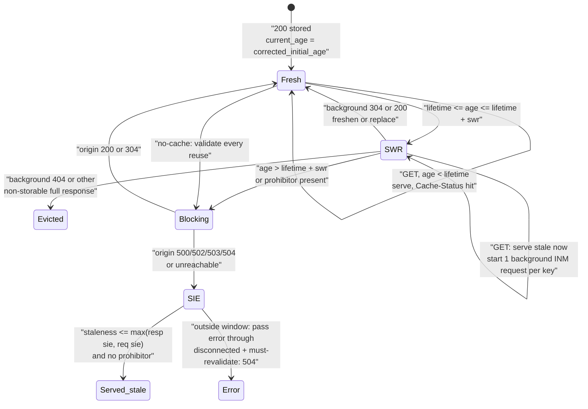

# Serving Stale Content Safely: stale-while-revalidate and stale-if-error Under Origin Outages (RFC 5861)

> [!summary] Claim
> `stale-while-revalidate` trades a bounded window of staleness for latency by answering from cache while one request-triggered background revalidation runs, and `stale-if-error` trades a separate bounded window for availability by substituting a stored response for a `500`, `502`, `503`, or `504`; both are permissions a cache may use, both are cancelled by `no-cache`, `must-revalidate`, and `proxy-revalidate`, and neither changes freshness.

Part of [HTTP Caching and Conditional Requests](README.md) in [API Engineering](../README.md).

## TL;DR

Mechanism: once `current_age` exceeds the freshness lifetime, `stale-while-revalidate=N` lets a cache answer from storage for N more seconds while it revalidates without blocking (RFC 5861 Section 3), and `stale-if-error=M` lets it answer from storage for M seconds past expiry when the origin would produce `500`, `502`, `503`, or `504` (RFC 5861 Section 4).
Contract rule: a cache must not generate a stale response unless explicitly permitted, and must not do so when `no-cache`, `must-revalidate`, or an applicable `proxy-revalidate` or `s-maxage` forbids it (RFC 9111 Section 4.2.4).
Trap: under a literal reading of RFC 9111 Section 5.2.2.10, `s-maxage` carries `proxy-revalidate` semantics for shared caches, so the common CDN header `s-maxage=60, stale-while-revalidate=30` asks a strict cache to do two contradictory things; Cloudflare documents that `s-maxage` disables `stale-while-revalidate` and causes `stale-if-error` to be ignored, while nginx applies both windows anyway (as of 2026-11).
Portability: neither directive is implemented by Starlette 1.10.0, FastAPI 0.162.0, httpx 0.28.1, or the ASGI servers in the lab workspace; they are honored by intermediaries (nginx since 1.11.10, Cloudflare, Fastly) and by Chrome 75 and Firefox 68 for `stale-while-revalidate`, and the lab passes on CPython 3.12.13, 3.13.18, 3.14.6, 3.14.10, and 3.15.2.
When not to use: any response whose reuse after expiry could cause incorrect operation (authorization decisions, balances, inventory reservations) should carry `must-revalidate` instead, which RFC 9111 Section 5.2.2.2 reserves for exactly that case.

## Mental model



A stored `200 OK` starts `Fresh` and is reused while `freshness_lifetime > current_age` (RFC 9111 Section 4.2).
When it expires, the `stale-while-revalidate` window decides whether the next request is answered from storage immediately (`SWR`) while a single conditional request runs in the background, or must wait for the origin (`Blocking`).
A background `304 Not Modified` freshens the stored headers and a `200 OK` replaces the entry; a background `5xx` leaves the old entry in place, and a non-storable full response such as `404 Not Found` evicts it.
In the blocking path, an origin failure that maps to `500`, `502`, `503`, or `504` enters the `stale-if-error` decision, which is the only route from an origin error to a `200 OK` for the client.
The prohibiting directives (`no-cache`, `must-revalidate`, `proxy-revalidate`, and `s-maxage` in strict mode) remove every edge into `SWR` and `Served_stale`.

## How it works

### The two directives and their windows

RFC 5861 is an Informational Independent Submission by Mark Nottingham, dated May 2010, and both directives are registered in the IANA HTTP Cache Directive Registry with pointers to RFC 5861 Section 3 and Section 4.
The grammar is identical for both:

```text
stale-while-revalidate = "stale-while-revalidate" "=" delta-seconds
stale-if-error         = "stale-if-error" "=" delta-seconds
delta-seconds          = 1*DIGIT
```

`delta-seconds` is a non-negative integer, and a value too large to represent must be treated as `2147483648` (2^31) or the greatest positive integer the cache can conveniently represent, never as a negative value (RFC 9111 Section 1.2.2).
Directive names compare case-insensitively and recipients ought to accept both the token and quoted-string argument forms (RFC 9111 Section 5.2), so `Stale-While-Revalidate="30"` is a valid 30-second window.

For a stored response with freshness lifetime `L` (from `s-maxage` for a shared cache, then `max-age`, then `Expires - Date`, RFC 9111 Section 4.2.1), define `staleness = current_age - L`:

| Region | Condition | Permitted action |
|---|---|---|
| Fresh | `staleness < 0` | Reuse without contacting the origin (RFC 9111 Section 4.2) |
| SWR window | the response carries `stale-while-revalidate=swr` and `0 <= staleness <= swr` | Reuse now, revalidate in the background (RFC 5861 Section 3) |
| SIE window | the response or request carries `stale-if-error=sie` and `0 <= staleness <= sie` and the origin produced `500`, `502`, `503`, or `504` | Reuse instead of the error (RFC 5861 Section 4) |
| Truly stale | outside both | Block on the origin and pass its answer, including an error, through |

The windows are independent and both start at expiry, not one after the other.
An absent directive grants no window at all, not a zero-length one: at `staleness == 0` the response is already stale (RFC 9111 Section 4.2), and a cache MUST NOT serve it stale without explicit permission (RFC 9111 Section 4.2.4), so the lab keeps an absent or invalid directive as `None` and forwards (`test_expiry_boundary_without_directives_is_never_served_stale`).
With `max-age=60, stale-while-revalidate=30, stale-if-error=100` and an origin returning `500`, the lab serves stale at age 160 (staleness 100) and passes the `500` through at age 161, so the two windows never add up (`test_windows_are_independent_and_both_start_at_expiry`).
RFC 5861 Section 4.1 pins the boundary: with `max-age=600, stale-if-error=1200`, a `500 Internal Server Error` at age 900 is replaced by the stored `200 OK` with `Age: 900`, and only "after the age is greater than 1800 seconds" must the cache write the error through, so age 1800 itself is still inside the window.
The lab tests ages 900, 1800, and 1801 against exactly that example.

`stale-while-revalidate` is a response directive only.
`stale-if-error` works in both directions: as a request directive its scope is that one request, and as a response directive it applies to every request the stored response can satisfy (RFC 5861 Section 4).
The lab takes the larger of the two windows for a given request, since either party granting permission is enough.

### What counts as an error

RFC 5861 Section 4 defines an error as "any situation that would result in a 500, 502, 503, or 504 HTTP response status code being returned", and its introduction names "a network segment, or DNS failure" as examples alongside `500 Internal Server Error`.
So a refused connection, which a gateway would turn into `502 Bad Gateway`, qualifies, while `501 Not Implemented`, `404 Not Found`, and `429 Too Many Requests` do not.
RFC 9111 Section 4.3.3 gives the general latitude: a cache that receives a `5xx` while validating "can either forward this response to the requesting client or act as if the server failed to respond", and in the latter case can send a stored response subject to Section 4.2.4.

### Freshness is not extended

Neither directive changes the freshness lifetime: a stale response served under either directive is still stale and carries a non-zero `Age` (RFC 5861 Section 3 and Section 4).
RFC 5861 also asks for a `Warning` header, but RFC 9111 Section 5.5 obsoletes `Warning` "as it is not widely generated or surfaced to users", so a current cache signals staleness through `Age` and, if it implements RFC 9211, a negative `ttl` in `Cache-Status`.
RFC 9211 Section 3 shows a stale hit as `Cache-Status: ExampleCache; hit; ttl=-412`, and Section 2.3 defines `fwd-status` as the status the next hop returned, which is how the lab reports a masked failure: `lab; fwd=stale; fwd-status=500; ttl=-300`.
Every response reused without validation must carry an `Age` equal to `current_age`, replacing any stored one (RFC 9111 Section 4).
`current_age` includes the upstream `Age` the cache received: `corrected_age_value = age_value + response_delay` and `current_age = corrected_initial_age + resident_time` (RFC 9111 Section 4.2.3).
A response that arrived with `Age: 500` and `max-age=600` is therefore stale after 100 seconds of residence, not 600.

### The prohibitors, and the s-maxage contradiction

RFC 9111 Section 4.2.4 says a cache "MUST NOT generate a stale response if it is prohibited by an explicit in-protocol directive (e.g., by a no-cache response directive, a must-revalidate response directive, or an applicable s-maxage or proxy-revalidate response directive".
`must-revalidate` adds that "in all circumstances, a cache MUST NOT ignore" it, and that a disconnected cache must generate an error whose status "SHOULD be 504 (Gateway Timeout)" (RFC 9111 Section 5.2.2.2).
Unqualified `no-cache` is stronger still: the response must not be reused without successful validation even while fresh (RFC 9111 Section 5.2.2.4).
`s-maxage` "incorporates the semantics of the proxy-revalidate response directive" for a shared cache (RFC 9111 Section 5.2.2.10), so a strict shared cache must refuse to serve an `s-maxage` response stale.
Yet Section 4 also says "a cache extension can override any of the requirements listed", and `s-maxage=N, stale-while-revalidate=M` is a widely published CDN recipe, so implementations diverge.
Cloudflare documents the strict reading for both: `stale-if-error` is ignored when "an applicable `s-maxage` or `proxy-revalidate`" or `must-revalidate` directive is present, and "`s-maxage` disables `stale-while-revalidate`" (as of 2026-11).
nginx takes the lenient reading: it uses `s-maxage` only as the lifetime, never parses `must-revalidate` or `proxy-revalidate`, and applies both stale windows regardless (nginx release-1.31.8 src/http/ngx_http_upstream.c, ngx_http_upstream_process_cache_control).
Fastly lists `s-maxage` only as a TTL source, reads the stale TTLs from the stale directives independently, and documents that Compute services ignore `must-revalidate` and `proxy-revalidate` (as of 2026-11).
The lab makes the choice explicit with `StaleCache(s_maxage_blocks_stale=True)` and tests both settings.

### Background revalidation: one request, triggered by a request

RFC 5861 Section 3 says the cache "SHOULD attempt to revalidate it while still serving stale responses (i.e., without blocking)", and Section 5 recommends that "such validation be predicated upon an incoming request, to avoid the possibility of an amplification attack".
The revalidation is a conditional request: when the stored response has an `ETag` the cache "MUST send the relevant entity tags" in `If-None-Match` (RFC 9111 Section 4.3.1).
On `304 Not Modified`, the cache replaces each stored header field with the one in the `304`, except `Content-Length`, fields excepted from storage, and fields the stored response depends on (RFC 9111 Section 3.2 and Section 4.3.4), and resets the age inputs; the lab implements only the `Content-Length` exception.
On a full response the cache must use it (RFC 9111 Section 4.3.3), which in the background means replacing the entry, or evicting it if the new response is not storable.
RFC 5861 Section 3 asks only that the cache "attempt to revalidate", so one background request per key satisfies it; RFC 9111 Section 4 describes the related practice of combining requests on a miss ("collapse requests"); coalescing is what keeps `stale-while-revalidate` from multiplying origin load at expiry; the general technique is in [[Cache-Stampede-Singleflight-Coalescing-and-Probabilistic-Early-Expiration]].

In an asyncio cache the background request is an `asyncio.Task`, and the task registry holds no strong reference: the pure-Python fallback uses `_scheduled_tasks = weakref.WeakSet()` (CPython 3.14.6 Lib/asyncio/tasks.py, _scheduled_tasks), and the default C `Task` is linked into a per-thread intrusive list without a reference count (CPython 3.14.6 Modules/_asynciomodule.c, register_task).
So a fire-and-forget task with no other strong reference can be garbage collected before it finishes; on CPython 3.14.6 (macOS 27.2 arm64) a task awaiting an unreferenced `asyncio.Event` was collected after `del` and `gc.collect()`, logging "Task was destroyed but it is pending!".
The lab holds every task in a set and removes it in a done callback, and exposes `drain()` so a lifespan shutdown can wait for in-flight revalidations.

### What the Python stack implements

Starlette 1.10.0, FastAPI 0.162.0, httpx 0.28.1, Uvicorn 0.54.0, Hypercorn 0.18.0, and Granian 2.8.7 contain no source file mentioning `stale-while-revalidate` or `stale-if-error` (searched in the pinned `site-packages`); an origin built on them emits the directives as opaque header text.
Werkzeug 3.1.9 parses both: `stale_if_error` is defined on `_CacheControl`, the base class of `RequestCacheControl` and `ResponseCacheControl`, and `stale_while_revalidate` on `ResponseCacheControl` only (werkzeug 3.1.9 werkzeug/datastructures/cache_control.py, ResponseCacheControl).
Litestar 2.25.0 can generate `stale-while-revalidate` but has no `stale_if_error` field (litestar 2.25.0 litestar/datastructures/headers.py, CacheControlHeader).
The enforcement therefore lives in the intermediary: nginx documents that the `stale-while-revalidate` extension "permits using a stale cached response if it is currently being updated" and that `stale-if-error` permits one "in case of an error" (since 1.11.10), with `proxy_cache_background_update on` needed to start the update as a background subrequest.

## Numbers and limits

| Parameter or metric | Value | Source or measurement context |
|---|---|---|
| Statuses that count as an error for `stale-if-error` | `500`, `502`, `503`, `504` | RFC 5861 Section 4 |
| `delta-seconds` overflow value | `2147483648` (2^31) | RFC 9111 Section 1.2.2 |
| RFC example: `max-age=600, stale-while-revalidate=30` | stale reuse for ages 600 to 630 s | RFC 5861 Section 3.1; lab boundary test at ages 630 and 631 |
| RFC example: `max-age=600, stale-if-error=1200` | stored `200` returned at age 900; error written through after age 1800 | RFC 5861 Section 4.1; lab test at ages 900, 1800, 1801 |
| RFC guidance on total tolerable staleness | `max-age=600` plus `stale-while-revalidate=600` -> up to 20 minutes from cache | RFC 5861 Section 3.1 |
| nginx release honoring both header directives | `1.11.10`; a background update for `stale-while-revalidate` also needs `proxy_cache_background_update on` | nginx ngx_http_proxy_module documentation (as of 2026-11) |
| Browser support for `stale-while-revalidate` | Chrome 75, Firefox 68 | web.dev article by Jeff Posnick (as of 2026-11) |
| Browser support for request `stale-if-error` | none | MDN `Cache-Control` reference (as of 2026-11) |
| Cloudflare `stale-if-error` trigger set | `500`, `502`, `503`, `504`, not configurable | Cloudflare cache-control documentation (as of 2026-11) |
| Origin requests for 20 concurrent stale hits on one key | 1 background revalidation (plus the initial fill) | Measured in the lab, `test_concurrent_stale_hits_trigger_one_background_revalidation`, CPython 3.14.6, macOS 27.2 arm64 |
| Lab suite runtime | 41 tests in 0.14 s to 0.27 s | Measured over 8 runs of `uv run --frozen pytest tests/f03_http_caching_and_conditional_requests/test_stale_while_revalidate_and_stale_if_error_rfc_5861.py -q` on CPython 3.14.6, and 0.14 s to 0.42 s over 3 runs each on 3.12.13, 3.13.18, 3.14.10, and 3.15.2, macOS 27.2 arm64 (as of 2026-11) |

## Portability

| Runtime, library, server, or protocol | Behavior | Proof |
|---|---|---|
| CPython 3.12.13 | 41 passed | Lab run with `uv run --frozen --python 3.12.13` in a separate `UV_PROJECT_ENVIRONMENT`; 3.12.16 is not offered by uv 0.11.26 here |
| CPython 3.13.18 | 41 passed | Lab run with `uv run --frozen --python 3.13.18` |
| CPython 3.14.6 and 3.14.10 | 41 passed on both | Lab run on the workspace venv (3.14.6) and with `--python 3.14.10` |
| CPython 3.15.2 | 41 passed | Lab run with `uv run --frozen --python 3.15.2` |
| Debian GNU/Linux 13 (trixie), `python:3.14-trixie`, CPython 3.14.10, Linux aarch64 | 41 passed | Lab run inside the container with `pip install uv` then `uv run --frozen pytest <test path> -q` on a copy of the lab files, Docker 29.8.2 (OrbStack) on macOS 27.2 arm64 |
| Alpine Linux 3.24 (musl libc), `python:3.14-alpine`, CPython 3.14.10, Linux aarch64 | 41 passed | Same command in the Alpine container; `zope-interface` built from source, all other wheels resolved from the lock |
| CPython 3.15.2t free-threaded | Not run | Only 3.15.0b3t is available here, and `uv` cannot install the lock on it: `psycopg-binary==3.3.8` has no wheel for that interpreter |
| CPython 3.15.0b3 | Not run | Collection fails inside the pinned `hypothesis` plugin (`No module named 'hypothesis._native'`), before the lab is imported |
| Starlette 1.10.0, FastAPI 0.162.0, httpx 0.28.1 | No implementation; directives are opaque header text | Source search of the pinned packages |
| Werkzeug 3.1.9 | Parses `stale-if-error` on request and response, `stale-while-revalidate` on response | (werkzeug 3.1.9 werkzeug/datastructures/cache_control.py, _CacheControl) |
| Litestar 2.25.0 | Emits `stale-while-revalidate`; no `stale-if-error` field | (litestar 2.25.0 litestar/datastructures/headers.py, CacheControlHeader) |
| Uvicorn 0.54.0, Hypercorn 0.18.0, Granian 2.8.7 | Not caches; no reference to either directive | Source search of the pinned packages |
| nginx | Honors both header directives since 1.11.10, even with `s-maxage`, `must-revalidate`, or `proxy-revalidate`; a `stale-while-revalidate` value also sets the error window unless `stale-if-error` follows; `proxy_cache_use_stale` adds `http_403`, `http_404`, `http_429` beyond RFC 5861 | nginx ngx_http_proxy_module documentation; (nginx release-1.31.8 src/http/ngx_http_upstream.c, ngx_http_upstream_process_cache_control) |
| Cloudflare | Asynchronous `stale-while-revalidate` with `UPDATING` status, disabled by `s-maxage`; `stale-if-error` ignored with `s-maxage`, `proxy-revalidate`, `must-revalidate`, `no-cache`, `no-store`, or Always Online | Cloudflare documentation (as of 2026-11) |
| Fastly | `stale-while-revalidate` asynchronous; in an SIE window a sick origin gets stale content automatically, while an erroring origin's `5xx` needs VCL `return(deliver_stale)` on CDN services; Compute ignores `must-revalidate` and `proxy-revalidate` | Fastly documentation (as of 2026-11) |
| HTTP/1.1, HTTP/2, HTTP/3 | Identical: `Cache-Control` and `Age` are version-independent fields | RFC 9110 Abstract (semantics "shared by all versions") and RFC 9111 |

## Worked example

The [implementation](../labs/src/api_labs/f03_http_caching_and_conditional_requests/stale_cache.py) is a pure ASGI middleware, `StaleCache`, in front of an origin ASGI app, with an injected clock so every window boundary is tested to the second.
The [test](../labs/tests/f03_http_caching_and_conditional_requests/test_stale_while_revalidate_and_stale_if_error_rfc_5861.py) drives it in-process through `httpx.AsyncClient(transport=httpx.ASGITransport(app=cache), base_url="http://test")` against a scriptable origin that can hang on an `asyncio.Event`, fail with a chosen status, or raise.

The request path, verbatim from `stale_cache.py` (`StaleCache.__call__`, `_stale_if_error_allows`, and `_spawn_revalidation`):

```python
    async def __call__(self, scope: Scope, receive: Receive, send: Send) -> None:
        if scope["type"] != "http" or scope["method"] != "GET":
            await self.app(scope, receive, send)
            return
        key = scope["path"] + "?" + scope["query_string"].decode("latin-1")
        request_cc = parse_cache_control(header_values(scope["headers"], b"cache-control"))
        now = self.clock()
        entry = self.entries.get(key)

        if entry is not None:
            staleness = entry.staleness(now)
            # RFC 9111 Section 4: unqualified no-cache means validate on every reuse.
            if staleness < 0 and not entry.policy.no_cache:
                await self._send_stored(send, entry, now, Outcome.HIT)
                return
            policy = entry.policy
            swr = policy.stale_while_revalidate
            if not policy.stale_forbidden and swr is not None and staleness <= swr:
                self._spawn_revalidation(key, scope, entry)
                await self._send_stored(send, entry, now, Outcome.STALE_WHILE_REVALIDATE)
                return

        try:
            origin = await self._fetch(scope, entry)
        except OriginUnavailableError:
            origin = None
        status = 502 if origin is None else origin.status

        if entry is not None and status in STALE_IF_ERROR_STATUSES:
            if self._stale_if_error_allows(entry, request_cc, now):
                await self._send_stored(send, entry, now, Outcome.STALE_IF_ERROR, fwd_status=status)
                return
            if origin is None and entry.policy.stale_forbidden:
                # RFC 9111 Section 5.2.2.2: a disconnected cache SHOULD answer 504.
                origin = OriginResponse(504, [(b"content-type", b"text/plain")], b"")
        if origin is None:
            origin = OriginResponse(502, [(b"content-type", b"text/plain")], b"")

        self.outcomes.append(Outcome.FORWARDED)
        if entry is not None and origin.status == 304:
            self._freshen(key, entry, origin, now)
            await self._send_stored(send, self.entries[key], self.clock(), Outcome.FORWARDED)
            return
        self._maybe_store(key, origin, now)
        await _send_response(send, origin.status, origin.headers, origin.body)

    def _stale_if_error_allows(
        self, entry: Entry, request_cc: dict[str, str | None], now: float
    ) -> bool:
        if entry.policy.stale_forbidden:
            return False
        # RFC 5861 Section 4: the request directive applies to that request, the
        # response directive to every request the stored response can satisfy.
        windows = [
            w
            for w in (entry.policy.stale_if_error, delta_seconds(request_cc.get("stale-if-error")))
            if w is not None
        ]
        return bool(windows) and entry.staleness(now) <= max(windows)

    def _spawn_revalidation(self, key: str, scope: Scope, entry: Entry) -> None:
        """Start one background conditional request per key (request-triggered only)."""
        if key in self._inflight:
            return
        task = asyncio.create_task(self._revalidate(key, scope, entry))
        # The event loop keeps only weak references to tasks; hold a strong one.
        self._tasks.add(task)
        self._inflight[key] = task
        task.add_done_callback(self._tasks.discard)
        task.add_done_callback(lambda _t: self._inflight.pop(key, None))
```

The non-blocking property is tested by making the origin hang and requiring the stale answer to arrive anyway, verbatim from the test module:

```python
@pytest.mark.unit
@pytest.mark.asyncio
async def test_rfc5861_3_1_stale_is_served_without_waiting_for_revalidation(rig: Rig) -> None:
    await rig.get(0)
    rig.origin.body = b"v2"
    rig.origin.gate = asyncio.Event()  # the origin now hangs until released
    stale = await asyncio.wait_for(rig.get(610), timeout=2.0)
    assert stale.text == "v1"
    assert stale.headers["age"] == "610"
    assert stale.headers["cache-status"] == "lab; hit; ttl=-10"
    assert "warning" not in stale.headers
    await settle()
    assert rig.origin.calls == 2  # the background revalidation is in flight
    rig.origin.gate.set()
    await rig.cache.drain()
    fresh = await rig.get(615)
    assert fresh.text == "v2"
    assert fresh.headers["age"] == "5"
    assert rig.cache.outcomes == [Outcome.FORWARDED, Outcome.STALE_WHILE_REVALIDATE, Outcome.HIT]
```

Captured output (filtered with `grep` to the platform line and the per-test results, with the module path prefix stripped and the absolute interpreter path shortened to `.venv/bin/python`), run from `labs/` on CPython 3.14.6, macOS 27.2 arm64 (Darwin 27.2.0), pytest 9.2.0, pytest-asyncio 1.4.1.post1:

```text
$ uv run --frozen pytest tests/f03_http_caching_and_conditional_requests/test_stale_while_revalidate_and_stale_if_error_rfc_5861.py -v -p no:cacheprovider
platform darwin -- Python 3.14.6, pytest-9.2.0, pluggy-1.7.0 -- .venv/bin/python
test_fresh_entry_is_served_without_contacting_origin PASSED [  2%]
test_rfc5861_3_1_stale_is_served_without_waiting_for_revalidation PASSED [  4%]
test_swr_window_ends_exactly_at_max_age_plus_delta[630-Outcome.STALE_WHILE_REVALIDATE] PASSED [  6%]
test_swr_window_ends_exactly_at_max_age_plus_delta[631-Outcome.FORWARDED] PASSED [  8%]
test_concurrent_stale_hits_trigger_one_background_revalidation PASSED [ 10%]
test_background_revalidation_is_conditional_and_304_freshens_entry PASSED [ 12%]
test_failed_background_revalidation_keeps_the_stale_entry PASSED [ 14%]
test_background_404_evicts_instead_of_serving_stale PASSED [ 16%]
test_rfc5861_4_1_stale_if_error_window[900-200-success] PASSED [ 18%]
test_rfc5861_4_1_stale_if_error_window[1800-200-success] PASSED [ 20%]
test_rfc5861_4_1_stale_if_error_window[1801-500-failure] PASSED [ 22%]
test_windows_are_independent_and_both_start_at_expiry[80-200-Outcome.STALE_WHILE_REVALIDATE] PASSED [ 24%]
test_windows_are_independent_and_both_start_at_expiry[160-200-Outcome.STALE_IF_ERROR] PASSED [ 26%]
test_windows_are_independent_and_both_start_at_expiry[161-500-Outcome.FORWARDED] PASSED [ 28%]
test_only_500_502_503_504_count_as_errors[500-200] PASSED [ 30%]
test_only_500_502_503_504_count_as_errors[502-200] PASSED [ 32%]
test_only_500_502_503_504_count_as_errors[503-200] PASSED [ 34%]
test_only_500_502_503_504_count_as_errors[504-200] PASSED [ 36%]
test_only_500_502_503_504_count_as_errors[501-501] PASSED [ 38%]
test_only_500_502_503_504_count_as_errors[404-404] PASSED [ 40%]
test_only_500_502_503_504_count_as_errors[429-429] PASSED [ 42%]
test_unreachable_origin_is_a_502_situation_masked_by_stale_if_error PASSED [ 44%]
test_expiry_boundary_without_directives_is_never_served_stale[200-max-age=60] PASSED [ 46%]
test_expiry_boundary_without_directives_is_never_served_stale[200-max-age=0] PASSED [ 48%]
test_expiry_boundary_without_directives_is_never_served_stale[200-public] PASSED [ 51%]
test_expiry_boundary_without_directives_is_never_served_stale[500-max-age=60] PASSED [ 53%]
test_expiry_boundary_without_directives_is_never_served_stale[500-max-age=0] PASSED [ 55%]
test_expiry_boundary_without_directives_is_never_served_stale[500-public] PASSED [ 57%]
test_explicit_zero_windows_still_cover_the_expiry_instant PASSED [ 59%]
test_request_stale_if_error_directive_applies_to_that_request_only PASSED [ 61%]
test_prohibiting_directives_override_both_extensions[must-revalidate] PASSED [ 63%]
test_prohibiting_directives_override_both_extensions[proxy-revalidate] PASSED [ 65%]
test_prohibiting_directives_override_both_extensions[no-cache] PASSED [ 67%]
test_no_cache_entry_is_validated_even_while_fresh PASSED [ 69%]
test_s_maxage_implies_proxy_revalidate_unless_configured_lenient[True-v2] PASSED [ 71%]
test_s_maxage_implies_proxy_revalidate_unless_configured_lenient[False-v1] PASSED [ 73%]
test_each_stale_hit_after_a_finished_revalidation_starts_a_new_one PASSED [ 75%]
test_client_if_none_match_is_not_forwarded_to_the_origin PASSED [ 77%]
test_304_does_not_replace_the_stored_content_length PASSED [ 79%]
test_s_maxage_takes_precedence_over_max_age_for_the_shared_cache PASSED [ 81%]
test_response_delay_counts_toward_current_age PASSED [ 83%]
test_upstream_age_counts_toward_staleness PASSED [ 85%]
test_directive_parsing[max-age=600, Stale-While-Revalidate="30", stale-if-error=1200-expected0] PASSED [ 87%]
test_directive_parsing[max-age=600, community="x, stale-if-error=60, y"-expected1] PASSED [ 89%]
test_directive_parsing[max-age=600, stale-while-revalidate=-1, stale-if-error=1e3-expected2] PASSED [ 91%]
test_directive_parsing[max-age=10, max-age=900, stale-if-error=5-expected3] PASSED [ 93%]
test_directive_parsing[max-age=abc, stale-while-revalidate=30-expected4] PASSED [ 95%]
test_directive_parsing[max-age=60, stale-while-revalidate=0, stale-if-error=0-expected5] PASSED [ 97%]
test_delta_seconds_overflow_is_capped_at_2_pow_31 PASSED [100%]
============================== 49 passed in 0.14s ==============================
```

Every test was checked by mutation: 34 deliberate breaks of the mechanism (for example `<=` -> `<` at a window edge, revalidating inline instead of in a task, removing the single-flight check, dropping the strong task reference, treating `501` as an error, evicting on a background `503`, dropping the upstream `Age`, adding the `stale-while-revalidate` window to the `stale-if-error` window) each made at least one test fail.
Twelve of them came from the finishing pass, and five survived at first: a `304` replacing the stored `Content-Length`, `max-age` winning over `s-maxage`, an ignored response delay in `current_age`, an in-flight slot that is never released, and a client `If-None-Match` forwarded to the origin.
Five tests were added for them (`test_each_stale_hit_after_a_finished_revalidation_starts_a_new_one`, `test_client_if_none_match_is_not_forwarded_to_the_origin`, `test_304_does_not_replace_the_stored_content_length`, `test_s_maxage_takes_precedence_over_max_age_for_the_shared_cache`, `test_response_delay_counts_toward_current_age`), and all twelve are now killed.

## Pitfalls

> [!warning] A prohibitor silently disables both extensions
> Trigger: a framework default or a security review adds `must-revalidate` (or the CDN recipe uses `s-maxage`) to responses that also carry `stale-while-revalidate` and `stale-if-error`.
> Symptom: the first origin outage produces `504 Gateway Timeout` or the origin's `503` instead of stale content, and latency spikes at every expiry, although the headers "look right".
> Fix: treat `must-revalidate`, `proxy-revalidate`, `no-cache`, and `s-maxage` as mutually exclusive with stale serving (RFC 9111 Section 4.2.4) unless the cache's documentation says otherwise; use a CDN-only header such as `Surrogate-Control` (Fastly) to scope stale rules to one tier.

> [!warning] The window is too short for the traffic
> Trigger: `stale-while-revalidate=5` on a key that sees one request a minute.
> Symptom: almost every request after expiry falls outside the window and blocks, so the directive has no measurable effect.
> Fix: RFC 5861 Section 3.1 states that only a request inside the window triggers asynchronous validation; size the window from the key's inter-arrival time, not from the tolerated staleness alone.

> [!warning] Caching the error during background revalidation
> Trigger: a revalidation path that stores whatever the origin returns.
> Symptom: one `503` during a deploy replaces the good entry, and every later request gets the error until the next refresh.
> Fix: on `500`, `502`, `503`, or `504` keep the stored response (RFC 9111 Section 4.3.3 allows acting "as if the server failed to respond"); on a non-storable full response such as `404`, evict, because the resource really changed.
> The lab's mutations that evict on a background `503` or keep the entry after a background `404` are both caught.

> [!warning] Fire-and-forget asyncio revalidation tasks
> Trigger: `asyncio.create_task(revalidate())` with the result discarded.
> Symptom: rare revalidations that never complete, and lost tasks at shutdown, because the task registry holds no strong reference (CPython 3.14.6 Modules/_asynciomodule.c, register_task; Lib/asyncio/tasks.py, _scheduled_tasks).
> Fix: keep a strong reference until the done callback runs, de-duplicate per key, and drain on lifespan shutdown (see [[Graceful-Shutdown-SIGTERM-Drain-Windows-and-Kubernetes-PreStop-Hooks]]).

> [!warning] Stale on the wrong statuses
> Trigger: nginx `proxy_cache_use_stale ... http_404` or a custom cache that treats every `5xx` (including `501`) as an error.
> Symptom: deleted resources reappear from cache, or a deliberate `501 Not Implemented` is masked.
> Fix: RFC 5861 Section 4 limits errors to `500`, `502`, `503`, and `504`; extend that set only as a documented, per-route decision.

> [!warning] The outage is invisible
> Trigger: `stale-if-error` masks origin failures and dashboards count only edge status codes.
> Symptom: the origin has been returning `503` for an hour, users see `200 OK`, and the incident is found when the window expires and errors appear all at once.
> Fix: alert on origin status (RFC 9211 `fwd-status`), on negative `ttl` in `Cache-Status`, and on `Age` percentiles; see [[Cache-Status-Header-for-Observability-RFC-9211]].

> [!warning] Relying on Warning to mark stale content
> Trigger: clients or tests expect `Warning: 110 - "Response is Stale"` because RFC 5861 mentions a warning header.
> Symptom: the header never appears on modern caches.
> Fix: RFC 9111 Section 5.5 obsoletes `Warning`; detect staleness from `Age` against the freshness lifetime or from `Cache-Status`.

No primary-source production postmortem attributing an outage to these directives was found for this note; the pitfalls above are mechanism-level and each is reproduced by a lab test.

## Security and robustness

Amplification: a cache that revalidates on timers instead of on requests can be made to generate unbounded origin traffic; RFC 5861 Section 5 recommends request-triggered validation, and per-key single flight bounds the background load at one request per key at a time (OWASP API4:2023 Unrestricted Resource Consumption).
Authorization staleness: a stale response replays the authorization state of the moment it was stored, so a revoked permission or a deleted resource stays visible for the whole window; do not grant either directive on responses whose correctness depends on current authorization, and see [[Caching-Authenticated-and-Multi-Tenant-API-Responses]].
Poison persistence: a poisoned entry survives as long as its stale windows, so a large `stale-if-error` extends the blast radius of [[Web-Cache-Poisoning-and-Cache-Deception-Attacks]]; purge must remove the stored entry rather than mark it stale, see [[Cache-Invalidation-Upon-Unsafe-Methods-and-Purge-Patterns]].
Client-supplied windows: the request form of `stale-if-error` lets any client ask for older data on error; it only affects that client's response, but a shared cache should cap request-supplied values (the lab does not, and says so).
Input validation: parse `delta-seconds` as `1*DIGIT` only, cap overflow at 2^31 (RFC 9111 Section 1.2.2), treat invalid freshness as stale (RFC 9111 Section 4.2.1), use the first occurrence of a duplicated directive, and never split on commas inside quoted strings; the lab tests each case, including `community="x, stale-if-error=60, y"`, which must not grant a window.
Defense in depth: stale serving is one layer; pair it with origin timeouts so the blocking path fails fast ([[Timeout-Taxonomy-Connect-Read-Write-Pool-and-Deadline-Propagation]]) and with a circuit breaker so the cache does not keep hammering a down origin ([[Circuit-Breakers-State-Machines-Half-Open-Probing-and-When-Not-to-Use-Them]]).

## The principal's view

The architectural decision is a per-resource staleness budget written down as part of the API contract: how old a representation may be in normal operation (`max-age` plus `stale-while-revalidate`) and during an origin outage (`max-age` plus `stale-if-error`).
These are two different budgets owned by different people: latency hiding is a performance choice the platform team can tune, while serving hour-old data during an outage is a product decision about correctness.
The organizational trade-off is that the directive is set at the origin but enforced by whichever cache sits in front, so the same header behaves differently on nginx, Cloudflare, Fastly, and browsers; standardize one edge configuration, test it the way the lab does, and expose `Cache-Status` so teams can see which branch fired.
Choose a different mechanism when the staleness budget is near zero: event-driven purge or surrogate-key invalidation for content that must change everywhere at once, conditional requests with `no-cache` for data that must be checked every time, and streaming or push APIs for state that clients watch continuously.
For availability under origin failure, `stale-if-error` is the cheapest degradation mode HTTP offers, but it only covers `GET` and only for data already cached; static fallbacks or partial responses ([[Backend-for-Frontend-BFF-Aggregation-Fan-Out-and-Partial-Degradation]]) cover the rest.

## Interview questions

> [!question] L5: What is the difference between `stale-while-revalidate` and `stale-if-error`?
>
> > [!success]- Answer
> > `stale-while-revalidate=N` lets a cache answer from storage for N seconds after expiry while it revalidates in the background, which hides latency (RFC 5861 Section 3).
> > `stale-if-error=M` lets a cache answer from storage for M seconds after expiry only when the origin would produce `500`, `502`, `503`, or `504`, which improves availability (RFC 5861 Section 4).
> > Both windows start at expiry, neither extends freshness, and `stale-if-error` is also a request directive while `stale-while-revalidate` is response-only.
> >
> > Follow-up: Which directives cancel both, and what must a disconnected cache return for a `must-revalidate` response?

> [!question] L5: Predict the output: a shared cache stores `200 OK` with `Cache-Control: max-age=600, stale-if-error=1200` at t=0 and the origin returns `500` from then on, so what does the client get at t=900, t=1800, and t=1801?
>
> > [!success]- Answer
> > At t=900 the stored `200 OK` with `Age: 900`, because staleness 300 is within 1200.
> > At t=1800 still the stored `200 OK` with `Age: 1800`, because RFC 5861 Section 4.1 writes the error through only "after the age is greater than 1800 seconds".
> > At t=1801 the origin's `500 Internal Server Error`.
> > The lab asserts exactly these three results in `test_rfc5861_4_1_stale_if_error_window`.
> >
> > Follow-up: What changes if the request carries `Cache-Control: stale-if-error=3600`?

> [!question] L5: Why does `Age` matter for stale serving, and what value should a cache send on a stale response?
>
> > [!success]- Answer
> > Staleness is `current_age - freshness_lifetime`, and `current_age` includes the `Age` the cache received from upstream plus its own resident time (RFC 9111 Section 4.2.3).
> > A cache must replace any stored `Age` with its `current_age` when reusing a response without validation (RFC 9111 Section 4).
> > A response that arrived with `Age: 500` and `max-age=600` is stale after 100 seconds of residence.
> >
> > Follow-up: What happens to staleness accounting in a two-tier CDN if the inner tier drops `Age`?

> [!question] L6: Debug this API: the origin sends `Cache-Control: public, s-maxage=60, stale-while-revalidate=300, stale-if-error=86400`, yet during an origin outage the CDN returns `503` to everyone, so what is the likely cause and how do you confirm it?
>
> > [!success]- Answer
> > `s-maxage` incorporates `proxy-revalidate` semantics for shared caches (RFC 9111 Section 5.2.2.10), and RFC 9111 Section 4.2.4 forbids generating a stale response when an applicable `s-maxage` is present.
> > Cloudflare documents that it ignores `stale-if-error` and disables `stale-while-revalidate` in that case (as of 2026-11), so neither stale window applies.
> > Confirm by reading `Cache-Status` or the vendor status header on a failing response and by replaying the header set in a lab cache with strict `s-maxage` handling, as `test_s_maxage_implies_proxy_revalidate_unless_configured_lenient` does.
> > Fix by dropping `s-maxage` and expressing the edge lifetime in a header whose stale semantics the vendor documents, such as Fastly's `Surrogate-Control`, which overrides `Cache-Control` at Fastly and is removed before delivery (as of 2026-11).
> >
> > Follow-up: How would you scope stale rules to the CDN without letting browsers serve stale too?

> [!question] L6: Your asyncio caching proxy serves stale correctly, yet the origin sees 400 revalidation requests in the second after a hot key expires; what is missing?
>
> > [!success]- Answer
> > Per-key single flight: each stale hit inside the window spawns its own background request.
> > Keep an in-flight map from cache key to the revalidation task, skip spawning when one exists, and remove the key in a done callback.
> > RFC 5861 Section 3 asks only that the cache "attempt to revalidate", so one request per key is enough, and the lab measures 1 revalidation for 20 concurrent stale hits.
> >
> > Follow-up: Where do you hold the task references, and why does CPython make that necessary?

> [!question] L6: When the origin answers a background revalidation with `503`, what should the cache store, and what changes if it answers `404`?
>
> > [!success]- Answer
> > On `503` keep the stored response unchanged, because RFC 9111 Section 4.3.3 allows the cache to act as if the server failed to respond, and caching the error would turn a transient failure into a cached outage.
> > On `404` the origin gave a full response, which the cache must use (RFC 9111 Section 4.3.3), so evict the old entry since a `404` is not stored by this cache.
> > Serving the old `200` after a `404` resurrects deleted content for the rest of the window.
> >
> > Follow-up: Should a `429 Too Many Requests` during revalidation be treated like the `503` or like the `404`?

> [!question] L7+: You own the edge for 300 internal APIs; how do you decide per-route `stale-while-revalidate` and `stale-if-error` values, and how do you stop teams from shipping dangerous ones?
>
> > [!success]- Answer
> > Make the staleness budget an explicit field in the API contract, split into normal-operation staleness and outage staleness, with an owner for each.
> > Derive `stale-while-revalidate` from the key's request inter-arrival time so a request actually lands in the window (RFC 5861 Section 3.1), and `stale-if-error` from the longest outage the data can tolerate.
> > Lint response headers in CI for contradictions such as `must-revalidate` or `s-maxage` with stale directives, and forbid stale directives on authorization-sensitive routes.
> > Require `Cache-Status` with `fwd-status` at the edge and alert on origin failures that stale serving is masking.
> >
> > Follow-up: What is your migration plan when a CDN vendor changes how it interprets `s-maxage` with stale directives?

> [!question] L7+: When is `stale-if-error` the wrong availability tool, and what do you use instead?
>
> > [!success]- Answer
> > It covers only cacheable `GET` responses that are already stored, so it does nothing for writes, cold keys, personalized responses, or the first request after a purge.
> > It is wrong for data whose reuse after expiry can cause incorrect operation, where RFC 9111 Section 5.2.2.2 says `must-revalidate` belongs.
> > Alternatives are static fallbacks, partial responses from a backend-for-frontend, multi-region origins with failover, and client-side retry with budgets; stale serving is the cheapest layer, not the whole design.
> >
> > Follow-up: How do you test the outage path continuously rather than discovering it during the outage?

## Related

Prerequisites: [[Vary-Header-Mechanics-and-Cache-Hit-Collapse]], [[Cache-Control-Directives-and-Freshness-Lifetime-Calculation]], [[Conditional-GET-Revalidation-and-304-Not-Modified]]

Next: [[Cache-Invalidation-Upon-Unsafe-Methods-and-Purge-Patterns]]

See also: [[Cache-Stampede-Singleflight-Coalescing-and-Probabilistic-Early-Expiration]], [[Cache-Status-Header-for-Observability-RFC-9211]], [[HTTP-Caching-Architecture-Private-Shared-and-Gateway-Caches]], [[Caching-Authenticated-and-Multi-Tenant-API-Responses]], [[Web-Cache-Poisoning-and-Cache-Deception-Attacks]], [[Edge-Caching-and-CDN-Shielding-for-Dynamic-and-Public-APIs]], [[Circuit-Breakers-State-Machines-Half-Open-Probing-and-When-Not-to-Use-Them]], [[Graceful-Shutdown-SIGTERM-Drain-Windows-and-Kubernetes-PreStop-Hooks]], [[CPython-Asyncio-Event-Loop-Internals-Selectors-Ready-Queue-and-Timers]]

- Lab: `labs/tests/f03_http_caching_and_conditional_requests/test_stale_while_revalidate_and_stale_if_error_rfc_5861.py`

## Further reading

- [RFC 5861: HTTP Cache-Control Extensions for Stale Content](https://www.rfc-editor.org/rfc/rfc5861.html) - The defining text for both directives, including the Section 3.1 and 4.1 examples that fix the window boundaries and the Section 5 amplification guidance.
- [RFC 9111: HTTP Caching](https://www.rfc-editor.org/rfc/rfc9111.html) - Section 4.2.4 on when stale responses are allowed, Section 4.2.3 on age, Section 4.3 on validation, Section 5.2.2 on the prohibiting directives, and Section 5.5 obsoleting `Warning`.
- [RFC 9211: The Cache-Status HTTP Response Header Field](https://www.rfc-editor.org/rfc/rfc9211.html) - The standard way to expose stale hits (`ttl` below zero) and masked origin failures (`fwd-status`).
- [IANA HTTP Cache Directive Registry](https://www.iana.org/assignments/http-cache-directives/http-cache-directives.xml) - Registers both directives against RFC 5861 Sections 3 and 4.
- [nginx ngx_http_proxy_module](https://nginx.org/en/docs/http/ngx_http_proxy_module.html) - `proxy_cache_use_stale` and `proxy_cache_background_update`, the reference open-source implementation of both directives.
