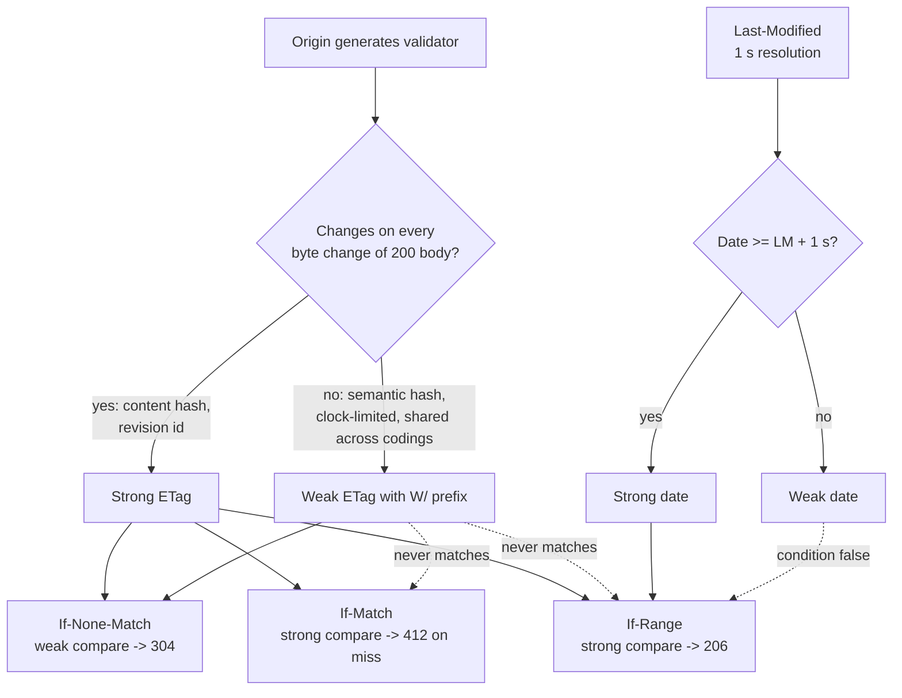

# Strong vs Weak Validators: ETag Generation, W/ Prefix Semantics, and Last-Modified Granularity (RFC 9110)

> [!summary] Claim
> A validator is only as strong as the mechanism that generates it: `W/` is the origin's admission that equal tags may name different bytes, so RFC 9110 lets weak tags validate caches (`If-None-Match`) but forbids them from guarding writes (`If-Match`) or splicing byte ranges (`If-Range`), and a one-second `Last-Modified` is weak by default for the same reason.

Part of [HTTP Caching and Conditional Requests](README.md) in [API Engineering](../README.md).

## TL;DR

- Mechanism: a strong validator changes whenever the bytes of a `200 OK` would change, a weak one only when the origin decides old responses are no longer acceptable substitutes `(RFC 9110 Section 8.8.1)`.
- Contract: strong comparison needs both tags non-weak with identical opaque-tags, weak comparison ignores `W/`; `If-Match` and `If-Range` use strong, `If-None-Match` uses weak `(RFC 9110 Sections 8.8.3.2, 13.1.1, 13.1.2, 13.1.5)`.
- Trap: `Last-Modified` has one-second resolution, so two writes in one second share it; a client or cache may treat it as strong only when a `Date` at least one second later proves the second had closed, and an origin only when it reliably knows the representation did not change twice in that second `(RFC 9110 Section 8.8.2.2)`.
- Portability: the rules are version-independent HTTP semantics, but implementations differ: Starlette 1.10.0 and nginx 1.29.3 accept an exact `If-Range` date without the strength check, and Apache 2.4.65 downgrades its file ETag to `W/` within one second of `mtime`.
- When not to: do not mint a weak tag for a resource you will ever guard with `If-Match` or serve with `Range`; do not use a metadata-derived tag (`mtime` plus size) as "strong" when files can be rewritten at equal size with restored timestamps.

## Mental model



The origin decides strength at generation time: hashing the exact representation bytes or assigning a revision identifier yields a strong tag, while hashing a semantic form, grouping representations, or relying on a coarse clock yields a weak one that MUST carry `W/` `(RFC 9110 Section 8.8.3)`.
Every precondition then picks its comparison function from what the client is about to do with the answer.
Cache revalidation (`If-None-Match`) only needs "is my stored copy an acceptable substitute", so both strengths flow into it.
Lost-update prevention (`If-Match`) and range splicing (`If-Range`) need byte equality, so the dashed edges show that a weak tag can never satisfy them, whatever its opaque value.
`Last-Modified` enters the same graph as a date validator whose strength is decided by the one-second rule, not by a prefix.

## How it works

### Wire grammar

`ETag = entity-tag`, `entity-tag = [ weak ] opaque-tag`, `weak = %s"W/"`, `opaque-tag = DQUOTE *etagc DQUOTE`, `etagc = %x21 / %x23-7E / obs-text` `(RFC 9110 Section 8.8.3)`.
The `%s` makes `W/` case-sensitive, so `w/"x"` is not a weak tag; it is not a valid `entity-tag` at all.
`etagc` excludes `SP` (`0x20`) and `DQUOTE` (`0x22`) but includes `,` (`0x2C`), so `"a,b"` is one legal tag and a list parser that splits `If-None-Match` on commas is wrong.
`""` is a legal tag with an empty opaque value.
Because RFC 2616 defined `opaque-tag` as a `quoted-string`, some recipients still backslash-unescape, so servers ought to avoid `\` in tags `(RFC 9110 Section 8.8.3)`.
`If-Match` and `If-None-Match` are `"*" / #entity-tag`; a list mixing `*` with tags is syntactically invalid `(RFC 9110 Sections 13.1.1, 13.1.2)`, and recipients MUST parse and ignore a reasonable number of empty list elements `(RFC 9110 Section 5.6.1.2)`.
`If-Range = entity-tag / HTTP-date`, and a recipient tells them apart by looking for a `DQUOTE` in the first three characters (`W/"` puts it at index 2) `(RFC 9110 Section 13.1.5)`.

### Comparison functions

Strong comparison: equivalent only if both tags are not weak and the opaque-tags match character by character; weak comparison: equivalent if the opaque-tags match, regardless of either `W/` `(RFC 9110 Section 8.8.3.2)`.
The RFC's Table 3 is the whole truth table: `W/"1"` vs `W/"1"` is a weak match but a strong mismatch, `W/"1"` vs `"1"` is the same, `"1"` vs `"1"` matches both ways, and different opaque values never match.
Note the asymmetry with plain string equality: two identical strings `W/"1"` and `W/"1"` fail strong comparison.

### Which precondition uses which function

- `If-Match`: the origin MUST use strong comparison, because the client wants the method refused if the representation data changed at all `(RFC 9110 Section 13.1.1)`.
- `If-None-Match`: recipients MUST use weak comparison, because weak tags are fine for cache validation `(RFC 9110 Section 13.1.2)`.
- `If-Range`: a client MUST NOT send a weak tag, and the server evaluates a tag with strong comparison, so a weak tag always makes the condition false and the server ignores `Range` and sends the full `200` `(RFC 9110 Section 13.1.5)`.
- Strong validators are usable for cache validation, partial content, and lost-update avoidance; weak validators only where the client does not need exact equality with bytes it already holds `(RFC 9110 Section 8.8.1)`.

The reason is mechanical: a `206` body is spliced into bytes the client already has, and a `PUT` under `If-Match` overwrites state the client believes it read, so "semantically equivalent" bytes corrupt both.

### Generating strong and weak entity tags

A strong validator is unique across all versions of all representations of a resource over time, but not across resources `(RFC 9110 Section 8.8.1)`.
The RFC names revision control and a collision-resistant hash of the representation data as strong generators, and a representation shared by `gzip` and identity codings under one tag makes that tag weak `(RFC 9110 Section 8.8.1)`; [[Compression-and-Content-Encoding-Aware-ETags]] owns the content-coding consequences.
An origin SHOULD change a weak tag whenever it considers prior representations unacceptable substitutes `(RFC 9110 Section 8.8.1)`.

Real generators in the stack, read at the pinned tags:

- Starlette builds `etag_base = str(stat_result.st_mtime) + "-" + str(stat_result.st_size)` and emits `f'"{hashlib.md5(etag_base.encode(), usedforsecurity=False).hexdigest()}"'`, always unprefixed (strong-form) `(starlette 1.10.0 starlette/responses.py, FileResponse.set_stat_headers)`.
- Litestar's file response uses `"<mtime>-<size>-<adler32(path)>"` (the `mtime` part is omitted when it is falsy), its docstring says it is derived from Flask, and its `ETag` header type renders `W/"..."` when `weak=True` `(litestar 2.25.0 litestar/response/file.py, create_etag_for_file)` and `(litestar 2.25.0 litestar/datastructures/headers.py, ETag)`.
- nginx emits `"%xT-%xO"`, the hex `Last-Modified` time and hex content length, and its gzip filter calls `ngx_http_weak_etag`, which prepends `W/` `(nginx 1.29.3 src/http/ngx_http_core_module.c, ngx_http_set_etag)` and `(nginx 1.29.3 src/http/modules/ngx_http_gzip_filter_module.c, ngx_http_gzip_header_filter)`.
- Apache marks its metadata file ETag weak when `request_time - mtime < 1` second (the `FileETag Digest` path returns before this check), because "it could be modified again later in the second" `(httpd 2.4.65 modules/http/http_etag.c, ap_make_etag_ex)`; the default `FileETag` is `MTime Size`, and was `INode MTime Size` in 2.3.14 and earlier (Apache `core` documentation, `FileETag`).

All four defaults are metadata validators (Apache's optional `FileETag Digest` is the exception): they are strong only if the filesystem metadata changes whenever the bytes do.

### Last-Modified granularity

`Last-Modified = HTTP-date`, generated in `IMF-fixdate` form such as `Sun, 06 Nov 1994 08:49:37 GMT`, which has no sub-second field `(RFC 9110 Sections 5.6.7, 8.8.2)`.
Recipients MUST accept all three `HTTP-date` formats (IMF-fixdate, obsolete RFC 850, and `asctime`) `(RFC 9110 Section 5.6.7)`.
An origin with a clock MUST NOT send a `Last-Modified` later than its `Date`, and MUST replace a future value with the message origination date `(RFC 9110 Section 8.8.2.1)`.
A date used as a validator is implicitly weak unless the origin reliably knows the representation did not change twice in that second, or the client or cache holds a `Date` at least one second after `Last-Modified` and has reason to believe both came from the same clock (or are far enough apart that clock skew is unlikely) `(RFC 9110 Section 8.8.2.2)`.
The proof is the RFC's own: if two responses in one second carried the same `Last-Modified`, at least one has `Date` equal to it, so a `Date` one second later means the second had closed when the response was generated `(RFC 9110 Section 8.8.2.2)`.
`If-Range` with a date requires exactly this strength and an exact match, unlike the "earlier than or equal to" test of `If-Unmodified-Since` `(RFC 9110 Section 13.1.5)`.
Caches also use `Last-Modified` for heuristic freshness, no more than some fraction of the interval since `Last-Modified`, with "10%" as the RFC's typical setting `(RFC 9111 Section 4.2.2)`; [[Cache-Control-Directives-and-Freshness-Lifetime-Calculation]] owns that computation.

### What Starlette actually checks

- `StaticFiles.is_not_modified` treats `If-None-Match: *` as a match, else tests `etag in [tag.strip().removeprefix("W/") for tag in if_none_match.split(",")]`, a weak comparison with a comma split; it falls back to `If-Modified-Since` with `email.utils.parsedate` only when `If-None-Match` is absent or empty `(starlette 1.10.0 starlette/staticfiles.py, StaticFiles.is_not_modified)`.
- `FileResponse._should_use_range` returns `False` for any `If-Range` starting with `W/`, else `http_if_range == self.headers["last-modified"] or http_if_range == self.headers["etag"]`, with no date-strength check `(starlette 1.10.0 starlette/responses.py, FileResponse._should_use_range)`.
- `Last-Modified` comes from `formatdate(stat_result.st_mtime, usegmt=True)`, which truncates to the second, while the ETag hashes the full float `str(st_mtime)` `(starlette 1.10.0 starlette/responses.py, FileResponse.set_stat_headers)`.

So in Starlette the ETag is finer than `Last-Modified`, but the date path of `If-Range` trusts the coarse one.

### nginx comparison details

`ngx_http_test_if_match(r, header, weak)` strips `W/` from both sides only when `weak` is set; for `If-Match` it is called with `weak = 0` and then compares raw bytes, so a stored `W/"x"` and a presented `W/"x"` compare equal `(nginx 1.29.3 src/http/modules/ngx_http_not_modified_filter_module.c, ngx_http_test_if_match)`.
RFC 9110 strong comparison says that pair does not match, so nginx agrees with the RFC for mixed-strength pairs (the raw bytes differ) but is looser for weak-weak pairs.
nginx `If-Range` compares the full tag bytes and, for dates, requires `if_range_time == last_modified_time` without a strength test `(nginx 1.29.3 src/http/modules/ngx_http_range_filter_module.c, ngx_http_range_header_filter)`.
The default `if_modified_since` mode is `exact` (`NGX_HTTP_IMS_EXACT`) `(nginx 1.29.3 src/http/ngx_http_core_module.c, ngx_http_core_merge_loc_conf)`.

## Numbers and limits

| Quantity | Value | Source or measurement context |
|---|---|---|
| `HTTP-date` resolution | `1` s | `time-of-day = hour ":" minute ":" second` `(RFC 9110 Section 5.6.7)` |
| IMF-fixdate length | `29` bytes (`Mon, 09 Nov 2026 12:00:00 GMT`) | Asserted in `test_two_writes_in_one_second_share_last_modified_but_not_strong_etag`, CPython 3.14.6, macOS 27.2 arm64 |
| Strength window for a date | `Date - Last-Modified >= 1` s on the wire | `(RFC 9110 Section 8.8.2.2)`; boundary cases `+799 ms` weak and `+800 ms` strong from `12:00:00.200` tested in the lab |
| Apache weak-ETag window | `request_time - mtime < 1` s -> `W/` | `(httpd 2.4.65 modules/http/http_etag.c, ap_make_etag_ex)` `(as of 2026-11)` |
| Starlette `FileResponse` ETag size | `34` bytes (`32` hex MD5 digits + `2` quotes) | `hashlib.md5(...).hexdigest()` `(starlette 1.10.0 starlette/responses.py, FileResponse.set_stat_headers)` |
| Lab `strong_etag` size | `34` bytes (`128` bits of SHA-256 as `32` hex digits + quotes) | Asserted in `test_strong_tag_tracks_bytes_and_weak_tag_tracks_semantics` |
| `float` spacing of `st_mtime` near `1.793e9` s (late Oct 2026; the same for every value in `[2^30, 2^31)` s, years 2004 to 2038) | `238.4` ns (`2^-22` s) | `uv run --frozen python -c "import math; print(math.ulp(1_793_000_000.0))"` in `labs/` -> `2.384185791015625e-07`, CPython 3.14.6, macOS 27.2 arm64 (Darwin 27.2.0) |
| Starlette ETag blind spot | Same-size rewrite with `mtime` moved by `0`, `1`, or `100` ns -> `304`; by `1,000` ns -> `200` | `test_starlette_metadata_etag_returns_304_for_changed_bytes_of_equal_size`, APFS on macOS 27.2 arm64, CPython 3.12.13, 3.13.18, 3.14.6, 3.14.10, 3.15.2, and free-threaded 3.14.6t and 3.15.0b3t; also on the container `overlay` filesystem, CPython 3.12.16 to 3.15.2, Debian Trixie and Alpine musl |
| Heuristic freshness from `Last-Modified` | "typical" fraction `10%` of the interval since `Last-Modified` | `(RFC 9111 Section 4.2.2)` |
| nginx default `if_modified_since` | `exact` | `(nginx 1.29.3 src/http/ngx_http_core_module.c, ngx_http_core_merge_loc_conf)` `(as of 2026-11)` |

## Portability

| Runtime, library, server, or protocol | Strong vs weak comparison | `If-Range` handling | `Last-Modified` strength | Verification source |
|---|---|---|---|---|
| CPython `3.12.13` and `3.12.16` | Lab comparison functions and ASGI app behave per RFC 9110 | Weak tag -> `200`; strong tag -> `206` | Same-second double write refused | `62 passed` under `uv run --python 3.12` (`3.12.13`) on macOS 27.2 arm64, and `62 passed` on `3.12.16` in the `python:3.12-trixie` container |
| CPython `3.13.18` | Same | Same | Same | `62 passed` under `uv run --python 3.13` |
| CPython `3.14.6` (workspace) and `3.14.10` | Same | Same | Same | `62 passed` under the workspace `.venv` (`3.14.6`) and `uv run --python 3.14.10` |
| CPython `3.15.2` | Same | Same | Same | `62 passed` under `uv run --python 3.15.2` |
| CPython `3.15.2t` free-threaded | `3.15.2t` not run; `3.14.6t` and `3.15.0b3t` with the GIL disabled: same | Same | Same | `uv` 0.11.26 here has no `3.15.2t` download; the full workspace cannot sync on free-threaded builds (`psycopg-binary==3.3.8` has no wheel, `aioquic==1.7.2` fails to build, and on `3.14.6t` `orjson==3.13.0` too), so `62 passed` was run under `python -X gil=0` in a venv holding only the lock's `starlette 1.10.0`, `httpx 0.28.1`, `anyio 4.16.0`, `pytest 9.2.0`, and `pytest-asyncio 1.4.1.post1`, with `sys._is_gil_enabled()` -> `False` |
| Debian Trixie and Alpine musl containers | Not run | Not run | Not run | `62 passed` in each of `python:3.12-trixie`, `3.13-trixie`, `3.14-trixie`, `3.15-trixie` (Debian GNU/Linux 13, glibc 2.41) and `python:3.12-alpine`, `3.13-alpine`, `3.14-alpine`, `3.15-alpine` (Alpine Linux 3.24, musl), CPython `3.12.16`, `3.13.18`, `3.14.10`, `3.15.2`; Docker 29.8.2 on OrbStack, `linux/arm64`, test tree copied to the container's `overlay` root so `tmp_path` and `os.utime` ran on a nanosecond-`mtime` filesystem; minimal venv with the lock's `starlette 1.10.0`, `httpx 0.28.1`, `anyio 4.16.0`, `pytest 9.2.0`, `pytest-asyncio 1.4.1.post1` |
| CPython `email.utils.parsedate_to_datetime` | n/a | n/a | Parses all three `HTTP-date` forms; also accepts `+0500`, and returns a naive `datetime` for `asctime` | Probed under CPython 3.14.6; the lab's `parse_http_date` rejects the non-GMT offset (`test_parse_http_date_rejects_invalid_and_non_gmt`) |
| `starlette 1.10.0` `StaticFiles` / `FileResponse` | `If-None-Match` weak via `removeprefix("W/")`, naive comma split | `W/` -> full `200`; exact date match -> `206` with no strength check | `formatdate` truncates; ETag uses float `mtime` | Characterization tests pass in all five CPython runs above; source `(starlette 1.10.0 starlette/staticfiles.py, StaticFiles.is_not_modified)` |
| `litestar 2.25.0` | `ETag.from_header` regex `([Ww]/)?"(.+)"` accepts lowercase `w/` | Not examined | `formatdate(mtime, usegmt=True)` | `(litestar 2.25.0 litestar/datastructures/headers.py, ETAG_RE)`; `(litestar 2.25.0 litestar/response/file.py, ASGIFileResponse.start_response)` |
| `uvicorn 0.54.0`, `hypercorn 0.18.0`, `fastapi 0.162.0`, `httpx 0.28.1` | Pass `ETag` and precondition headers through; no validator logic | n/a | n/a | No occurrence of `etag` in the installed Python sources of these packages |
| `granian 2.8.7` | ASGI path passes headers through; built-in static files emit no `ETag` | Built-in static files ignore `Range` and preconditions: always full `200` | No `Last-Modified` on built-in static files, only `cache-control: max-age=<expires>` when configured | `(granian 2.8.7 src/files.rs, serve_static_file)`; no occurrence of `etag` in the installed Python sources |
| nginx `1.29.3` | `If-None-Match` weak; `If-Match` raw byte compare (`W/"x"` == `W/"x"`) | Raw tag compare; exact date, no strength check | Exact-match `If-Modified-Since` by default | nginx sources cited in How it works |
| Apache httpd `2.4.65` | n/a here | n/a here | File ETag forced `W/` within `1` s of `mtime` | `(httpd 2.4.65 modules/http/http_etag.c, ap_make_etag_ex)` |
| HTTP/1.1, HTTP/2, HTTP/3 | Identical: validators are version-independent semantics | Identical | Identical | RFC 9110 "defines aspects of the protocol that are shared by all versions" (RFC 9110 Abstract); `ETag` MAY travel in a trailer section `(RFC 9110 Section 8.8.3)` |

## Worked example

The [implementation](../labs/src/api_labs/f03_http_caching_and_conditional_requests/validator_strength.py) provides a strict `entity-tag` parser, a quote-aware list parser, both comparison functions, the three precondition evaluators, strong (byte hash) and weak (canonical JSON hash) generators, `HTTP-date` formatting and parsing, the `Last-Modified` strength rule, and a Starlette app whose `GET` and `PUT` on `/doc` apply each precondition with its RFC comparison.
The [test](../labs/tests/f03_http_caching_and_conditional_requests/test_strong_vs_weak_validators_etag_and_last_modified.py) has 62 cases, all `@pytest.mark.unit`, including characterization tests of `starlette 1.10.0` against real files under `tmp_path` with `os.utime` setting nanosecond `mtime` values.

Simplified excerpt of the comparison core (docstrings and the list scanner trimmed):

```python
COMPARISON_FOR_FIELD: Final[dict[str, Comparison]] = {
    "if-match": "strong",
    "if-none-match": "weak",
    "if-range": "strong",
}


def strong_compare(left: EntityTag, right: EntityTag) -> bool:
    return not left.weak and not right.weak and left.opaque == right.opaque


def weak_compare(left: EntityTag, right: EntityTag) -> bool:
    return left.opaque == right.opaque


def if_match_holds(field_value: str, current: EntityTag | None) -> bool:
    if current is None:
        return False
    return _any_match(field_value, current, COMPARISON_FOR_FIELD["if-match"])


def if_none_match_holds(field_value: str, current: EntityTag | None) -> bool:
    if current is None:
        return True
    return not _any_match(field_value, current, COMPARISON_FOR_FIELD["if-none-match"])
```

Simplified excerpt of the date rules and `If-Range`:

```python
def last_modified_is_strong(last_modified: datetime, date: datetime) -> bool:
    on_wire_lm = last_modified.replace(microsecond=0)
    on_wire_date = date.replace(microsecond=0)
    return on_wire_date - on_wire_lm >= ONE_SECOND


def if_range_holds(field_value, current_etag, last_modified, *, date_is_strong) -> bool:
    stripped = field_value.strip(_OWS)
    if '"' in stripped[:3]:
        if current_etag is None:
            return False
        try:
            presented = parse_entity_tag(stripped)
        except ValueError:
            return False
        return strong_compare(presented, current_etag)
    presented_date = parse_http_date(stripped)
    if presented_date is None or last_modified is None or not date_is_strong:
        return False
    return presented_date == last_modified.replace(microsecond=0)
```

The origin-side strength signal in the app is a per-second change counter: `Document.replace` increments `changes_in_modified_second` when a write lands in the same wire second as the previous one, and `GET /doc` passes `date_is_strong = document.changes_in_modified_second == 1`, which is the "origin reliably knows the representation did not change twice during the second" branch of `(RFC 9110 Section 8.8.2.2)`.

Simplified excerpt of the two tests that carry the note's main claims:

```python
async def test_weak_tag_revalidates_with_304_but_cannot_guard_a_put() -> None:
    clock = FakeClock(T0)
    document = Document(body={"id": 1, "name": "ada"}, modified_at=T0)
    async with client_for(build_document_app(document, weak_tags=True, clock=clock)) as client:
        first = await client.get("/doc")
        tag = first.headers["etag"]
        assert tag.startswith('W/"')
        revalidated = await client.get("/doc", headers={"if-none-match": tag})
        assert revalidated.status_code == 304
        assert revalidated.content == b""
        write = await client.put("/doc", json={"id": 1, "name": "grace"}, headers={"if-match": tag})
        assert write.status_code == 412
        assert document.body == {"id": 1, "name": "ada"}


async def test_starlette_if_range_date_splices_bytes_from_a_same_second_rewrite(
    tmp_path: Path,
) -> None:
    target = tmp_path / "blob.bin"
    _write(target, b"AAAAAAAA", MTIME_NS + 100_000_000)
    app = Starlette(routes=[Mount("/static", StaticFiles(directory=tmp_path))])
    async with client_for(app) as client:
        first = await client.get("/static/blob.bin")
        _write(target, b"BBBBBBBB", MTIME_NS + 700_000_000)
        resumed = await client.get(
            "/static/blob.bin",
            headers={"range": "bytes=4-7", "if-range": first.headers["last-modified"]},
        )
        by_etag = await client.get(
            "/static/blob.bin",
            headers={"range": "bytes=4-7", "if-range": first.headers["etag"]},
        )
    assert resumed.headers["last-modified"] == first.headers["last-modified"]
    assert resumed.headers["etag"] != first.headers["etag"]
    assert resumed.status_code == 206
    assert first.content[:4] + resumed.content == b"AAAABBBB"
    assert by_etag.status_code == 200
    assert by_etag.content == b"BBBBBBBB"
```

The second test is the granularity hazard end to end: the file is rewritten 600 ms later in the same second, `Last-Modified` is unchanged, Starlette's sub-second ETag did change, and a client resuming with the date in `If-Range` gets `206` and assembles `AAAABBBB`, a file that never existed.
Per RFC 9110 that client should not have sent the date, because its first response's `Date` was in the same second as `Last-Modified` `(RFC 9110 Section 13.1.5)`; resuming with the ETag instead produces a full `200` with `BBBBBBBB`, which the same test asserts.

Captured output, `uv run --frozen pytest tests/f03_http_caching_and_conditional_requests/test_strong_vs_weak_validators_etag_and_last_modified.py -q` in `labs/`, CPython 3.14.6, macOS 27.2 arm64 (Darwin 27.2.0):

```text
.....................................................................    [100%]
69 passed in 1.22s
```

## Pitfalls

> [!warning] Weak tag sent on a `PUT` with `If-Match` always fails
> - **Trigger**: an API emits `W/` tags (for example because a gzip layer weakened them, as nginx does in `ngx_http_gzip_header_filter`) and clients echo the tag in `If-Match`.
> - **Symptom**: every conditional write returns `412 Precondition Failed`, even with no concurrent writer, because strong comparison never matches a weak tag `(RFC 9110 Sections 8.8.3.2, 13.1.1)`; the lab's `test_weak_tag_revalidates_with_304_but_cannot_guard_a_put` shows the `412`.
> - **Fix**: give writable resources a strong tag derived from a revision number or a hash of the identity-coded bytes, computed before any content coding; see [[Optimistic-Concurrency-Control-If-Match-and-412-Precondition-Failed]].

> [!warning] Resuming a download with a same-second `Last-Modified` splices two versions
> - **Trigger**: a client resumes with `Range` and `If-Range: <Last-Modified>` where its stored `Date` is not at least one second after `Last-Modified`, against a server that matches dates exactly without a strength test (`starlette 1.10.0` `FileResponse._should_use_range`, nginx 1.29.3 `ngx_http_range_header_filter`).
> - **Symptom**: `206 Partial Content` with bytes from the new version appended to bytes of the old one; reproduced as `AAAABBBB` in `test_starlette_if_range_date_splices_bytes_from_a_same_second_rewrite`.
> - **Fix**: clients resume with a strong ETag in `If-Range`, and send a date only when `Date >= Last-Modified + 1 s` `(RFC 9110 Section 13.1.5)`; origins that can count writes per second can refuse the date as the lab app does.

> [!warning] Metadata ETags (`mtime` plus size) labelled strong
> - **Trigger**: a file is rewritten at the same size with its `mtime` restored or moved by less than the representable spacing, for example by tools that preserve timestamps or by `os.utime`.
> - **Symptom**: Starlette 1.10.0 hashes `str(st_mtime)` and `st_size`, so the ETag is unchanged and `If-None-Match` returns `304` for different bytes; the lab shows this at `0`, `1`, and `100` ns offsets and a `200` at `1,000` ns, because `float` spacing near `1.79e9` s is `238` ns.
> - **Fix**: for artifacts that can be rebuilt deterministically, use a content hash (Apache offers `FileETag Digest`), or mark metadata tags `W/` and never use them for `If-Match` or `If-Range`.

> [!warning] Inode-bearing file ETags leak data and differ across replicas (`CVE-2003-1418`)
> - **Trigger**: Apache's file ETag included the inode number (`FileETag INode MTime Size`, the default in 2.3.14 and earlier per the Apache `core` documentation).
> - **Symptom**: `CVE-2003-1418` records that Apache HTTP Server 1.3.22 through 1.3.27 on OpenBSD revealed the inode number through `ETag` (NVD, CVSS v2 `4.3`); by the same mechanism, replicas serving one file from different filesystems emit different tags, so revalidation through a load balancer misses.
> - **Fix**: exclude host-local metadata from tags (the 2.4 default is `MTime Size`) or derive them from content or revision.

> [!warning] Splitting `If-None-Match` on commas
> - **Trigger**: a list parser does `field.split(",")`, as `StaticFiles.is_not_modified` does in `starlette 1.10.0`.
> - **Symptom**: an opaque-tag containing `,` (legal `etagc`) never matches, so the server sends `200` instead of `304`; `test_starlette_naive_split_misses_an_etag_that_contains_a_comma` shows it, and it is harmless in Starlette only because its own tags are hex.
> - **Fix**: scan quoted strings; the lab's `parse_entity_tag_list` does, and a comma-split variant of the list parser fails seven tests.

## Security and robustness

- Information disclosure: anything encoded in a tag is readable by every client, so inode numbers (`CVE-2003-1418`), internal revision counters of other tenants, or database row versions that reveal write rates are an OWASP API3:2023 (Broken Object Property Level Authorization) style exposure; hash such inputs with a server-side key if they must feed the tag.
- Tracking: a client cache stores the tag and replays it in `If-None-Match`, so a unique per-user tag on a shared URL is a persistent identifier; never mint per-user tags on cacheable public resources (see [[Caching-Authenticated-and-Multi-Tenant-API-Responses]]).
- Strict parsing: reject `w/`, unquoted values, `SP`, and inner `DQUOTE` (the lab raises `ValueError` for all six non-conforming forms tested), and treat a malformed `If-Range` as false so the server falls back to a full `200`, which is always safe.
- Fail safe on a malformed precondition, never with a `500`: the lab's `/doc` app ignores an unparseable `If-None-Match` and performs the `GET` (`test_malformed_if_none_match_is_ignored_and_the_get_is_performed`), answers an unparseable `If-Match` with `400` without writing (`test_malformed_if_match_is_a_400_and_never_writes`), and answers a body that is not JSON with `422`; a list of only empty elements is a valid empty `#entity-tag` list that matches no tag `(RFC 9110 Section 5.6.1)`.
- Bounded work: precondition lists are attacker-controlled; the lab's scanner is linear in field length, but cap the number of list members you compare if tags are expensive to compute.
- Date input: `email.utils.parsedate_to_datetime` accepts numeric zones such as `+0500`, and `email.utils.parsedate`, which Starlette uses, returns a tuple without the zone, so a non-GMT date shifts the comparison by the offset; `HTTP-date` is always GMT `(RFC 9110 Section 5.6.7)`, so reject other zones.
- Never let a precondition bypass authorization: evaluate preconditions only after normal request checks, because a server MUST ignore preconditions when the unconditional response would not be `2xx` or `412` `(RFC 9110 Section 13.2.1)`; a `304` must not reveal that a resource the caller cannot read exists.
- Defense in depth for writes: `If-Match` protects against lost updates only if the tag is strong and the compare-and-write is atomic in storage; see [[Optimistic-Concurrency-Control-If-Match-and-412-Precondition-Failed]].

## The principal's view

The architectural decision is who owns the validator: the storage layer (a revision number or row version committed with the write) or the edge (a hash or file metadata computed at serving time).
Storage-owned strong validators make `If-Match`, `If-Range`, and cache revalidation all correct by construction and survive compression, re-serialization, and replica fan-out, at the cost of threading a version column through every write path and every team's schema.
Edge-computed validators are free to adopt and fine for read-mostly content, but they inherit the weakest property of whatever they hash: second-granular dates, float `mtime`, per-host inodes, or serializer key order.
A sound platform rule is: writable API resources expose a strong, storage-owned `ETag` and require `If-Match` (with `428 Precondition Required` when absent, owned by the OCC note), while static and derived content may use weak tags for `304` savings only.
Choose differently when the resource has no stable bytes at all, such as a live dashboard: a weak, time-bucketed tag (the RFC's weather-report example `(RFC 9110 Section 8.8.1)`) or no validator plus short `max-age` is honest; and for large binary artifacts, content-addressed URLs with `immutable` remove revalidation entirely.

## Interview questions

> [!question] L5: What exactly does the `W/` prefix promise, and what does it not promise?
>
> > [!success]- Answer
> > `W/` says the origin may reuse the same opaque value for representations whose bytes differ, as long as it considers them acceptable substitutes.
> > It promises cache-validation equivalence, not byte equality (RFC 9110 Section 8.8.1).
> > The prefix is case-sensitive, so `w/"x"` is not a weak tag (RFC 9110 Section 8.8.3).
> >
> > Follow-up: When should an origin change a weak tag?

> [!question] L5: Which comparison does each of `If-Match`, `If-None-Match`, and `If-Range` use, and why?
>
> > [!success]- Answer
> > `If-Match` uses strong comparison because it guards against overwriting changed bytes.
> > `If-None-Match` uses weak comparison because it only asks whether a stored copy is still acceptable.
> > `If-Range` uses strong comparison because the `206` body is spliced into bytes the client already has (RFC 9110 Sections 13.1.1, 13.1.2, 13.1.5).
> >
> > Follow-up: Why is it pointless for a client to send a weak tag in `If-Range`?

> [!question] L5: Predict the output: `strong_compare(parse_entity_tag('W/"1"'), parse_entity_tag('W/"1"'))` and `weak_compare` on the same pair.
>
> > [!success]- Answer
> > `strong_compare` returns `False` and `weak_compare` returns `True`.
> > Strong comparison requires both tags to be non-weak, so identical weak strings still fail it (RFC 9110 Section 8.8.3.2, Table 3).
> > The lab parametrizes all four rows of Table 3 and a mutation that drops the weakness check fails six tests.
> >
> > Follow-up: What does nginx 1.29.3 do with that pair under `If-Match`?

> [!question] L6: Why is a one-second `Last-Modified` implicitly weak, and how can a cache prove a given one is strong?
>
> > [!success]- Answer
> > Two changes within one second produce the same `Last-Modified`, so a client could hold either version under one validator.
> > If a cached response's `Date` is at least one second after its `Last-Modified` and both come from one clock, the second had closed when that response was generated, so no later change can share the value.
> > The RFC's argument: of two same-second responses with one `Last-Modified`, at least one has `Date` equal to it (RFC 9110 Section 8.8.2.2).
> >
> > Follow-up: How can an origin, rather than a cache, know a date is strong?

> [!question] L6: Debug this API: since the CDN enabled compression, every mobile `PATCH` with `If-Match` returns `412 Precondition Failed` while `GET` revalidation still returns `304`, so what happened?
>
> > [!success]- Answer
> > The compression layer made the tag weak (nginx's gzip filter calls `ngx_http_weak_etag`, which prepends `W/`), clients now echo `W/"..."` in `If-Match`, and an RFC-compliant origin's strong comparison never matches a weak tag.
> > `If-None-Match` uses weak comparison, which is why `304` still works.
> > Fix it by exposing a strong, storage-owned tag for writable resources that does not depend on content coding, and by not compressing at a layer that rewrites origin tags for those routes.
> >
> > Follow-up: What should a compressing proxy do with a strong tag instead of weakening it?

> [!question] L6: Is Starlette's `FileResponse` ETag, `md5(str(st_mtime) + "-" + str(st_size))` sent without `W/`, a strong validator?
>
> > [!success]- Answer
> > Only if every byte change also changes `mtime` or size.
> > A same-size rewrite with a restored `mtime`, or one shifted by less than the `float` spacing of `st_mtime` (`238` ns near `1.79e9` s), keeps the tag, and the lab shows `StaticFiles` answering `304` for changed bytes at `0`, `1`, and `100` ns offsets.
> > By RFC 9110 Section 8.8.3 a tag that does not meet the strong characteristics MUST be marked `W/`, so for such deployments it is strong in form only.
> >
> > Follow-up: What would you change so `If-Range` resumption is safe?

> [!question] L7+: Design the validator strategy for a multi-region JSON API with optimistic concurrency, CDN caching, and gzip at the edge.
>
> > [!success]- Answer
> > Commit a monotonic revision with every write and expose it as a strong `ETag`, plus a coding suffix when the edge emits distinct codings so each coding has its own strong tag.
> > Require `If-Match` on writes and do the compare-and-set in storage, so two regions cannot both pass the check.
> > Let the CDN revalidate with `If-None-Match`, which tolerates weak tags if any layer weakens them, but keep write routes on origin tags.
> > The trade-off is schema and write-path coupling to a version column, which buys correctness independent of serializers and replicas.
> >
> > Follow-up: How do you migrate existing clients that cached old hash-based tags?

> [!question] L7+: When would you deliberately ship weak validators, and what would you forbid alongside them?
>
> > [!success]- Answer
> > For representations whose bytes vary without meaningful change, such as JSON whose key order or whitespace is not stable, or time-bucketed live data like the RFC's weather report (RFC 9110 Section 8.8.1).
> > A weak tag over a canonical form still saves bandwidth through `304`, and the lab shows a key-reorder keeps the weak tag but changes the strong one.
> > Alongside, forbid `Range` with `If-Range` on those routes and refuse `If-Match` writes keyed on them, because both need byte equality.
> >
> > Follow-up: How would you detect clients that send weak tags in `If-Match` in production?

> [!question] L7+: nginx matches `If-Match: W/"x"` against a stored `W/"x"` while RFC 9110 says no match, so which should a gateway follow, and what breaks when it does?
>
> > [!success]- Answer
> > Follow RFC 9110: `If-Match` exists to prevent lost updates, and a weak tag by definition cannot prove the bytes are unchanged.
> > Accepting weak-weak pairs means a write can be applied on top of a representation that changed without changing its weak tag, which is a silent lost update.
> > What breaks when you tighten is clients that echo weak tags; surface that as `412` with a strong `ETag` in the response so they can re-read and retry.
> >
> > Follow-up: Where in the gateway would you log the strength of tags received in `If-Match`?

## Related

Prerequisites: [[Cache-Control-Directives-and-Freshness-Lifetime-Calculation]]

Next: [[Compression-and-Content-Encoding-Aware-ETags]]

See also: [[REST-APIs]], [[02-Programming-Languages/Python/Python-Backend-Interview-Prep/05-REST-API-Design]], [[Conditional-GET-Revalidation-and-304-Not-Modified]], [[Optimistic-Concurrency-Control-If-Match-and-412-Precondition-Failed]], [[Range-Requests-Partial-Content-and-206-Semantics]], [[HTTP-Message-Abstraction-RFC-9110]], [[Caching-Authenticated-and-Multi-Tenant-API-Responses]], [[Client-Side-HTTP-Caching-in-Python-Clients]]

- Lab: `labs/tests/f03_http_caching_and_conditional_requests/test_strong_vs_weak_validators_etag_and_last_modified.py`

## Further reading

- [RFC 9110: HTTP Semantics](https://www.rfc-editor.org/rfc/rfc9110.html) - Section 8.8 defines strong and weak validators, `Last-Modified` strength, `ETag` grammar, and the comparison functions; Section 13 defines which precondition uses which.
- [RFC 9111: HTTP Caching](https://www.rfc-editor.org/rfc/rfc9111.html) - Section 4.2.2 uses `Last-Modified` for heuristic freshness and Section 4.3.2 covers how caches handle conditional requests.
- [starlette 1.10.0 responses.py](https://github.com/Kludex/starlette/blob/1.10.0/starlette/responses.py) - `FileResponse.set_stat_headers` and `_should_use_range` show a metadata ETag and an `If-Range` without the date-strength check.
- [starlette 1.10.0 staticfiles.py](https://github.com/Kludex/starlette/blob/1.10.0/starlette/staticfiles.py) - `StaticFiles.is_not_modified` implements weak `If-None-Match` comparison with a comma split.
- [nginx 1.29.3 ngx_http_not_modified_filter_module.c](https://github.com/nginx/nginx/blob/release-1.29.3/src/http/modules/ngx_http_not_modified_filter_module.c) - `ngx_http_test_if_match` shows a production server's strong and weak comparison in C.
- [Apache httpd 2.4.65 http_etag.c](https://github.com/apache/httpd/blob/2.4.65/modules/http/http_etag.c) - `ap_make_etag_ex` weakens tags within one second of `mtime`, the generation-side answer to `Last-Modified` granularity.
- [CVE-2003-1418](https://nvd.nist.gov/vuln/detail/CVE-2003-1418) - The record of inode disclosure through Apache `ETag`, the canonical example of a validator leaking host metadata.
