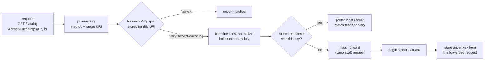

# The Vary Header: Secondary Cache Keys, Normalization Traps, and Why Vary: User-Agent Destroys Hit Rates

> [!summary] Claim
> `Vary` turns every nominated request field into part of the cache key (RFC 9111 Section 4.1), so the hit ratio is set by how many distinct values those fields take inside one freshness lifetime; a cache may merge values only by semantics-preserving normalization, and any coarser canonicalization is safe only when the cache also forwards the canonical value to the origin.

Part of [HTTP Caching and Conditional Requests](README.md) in [API Engineering](../README.md).

## TL;DR

- Mechanism: a stored response is reusable only if every request field its `Vary` names matches the request that caused it to be stored, after whitespace removal, line combining, and normalization "known to have identical semantics" (RFC 9111 Section 4.1).
- Contract rule: an origin "SHOULD generate a Vary header field on a cacheable response when it wishes that response to be selectively reused", generally because the content was tailored to those request fields (RFC 9110 Section 12.5.5); `Vary: *` always fails to match, and an absent field matches only an absent field (RFC 9111 Section 4.1).
- The trap: with 8000 synthetic `User-Agent` strings and 1000 requests per freshness lifetime, the lab's hit ratio is 56.5% under `Vary: User-Agent` and 99.8% under `Vary: Sec-CH-UA-Mobile`; a cache that canonicalizes `Accept-Encoding` for the key but forwards the original header served a gzip body to a client that sent `Accept-Encoding: identity`.
- Portability fact: HTTP/2 and HTTP/3 split `Cookie` into crumbs that the receiver must rejoin with `"; "`, not the list comma (RFC 9113 Section 8.2.3, RFC 9114 Section 4.2.1), but measured here Granian `2.8.7` over HTTP/2 and Hypercorn `0.18.0` over HTTP/3 hand the ASGI app the crumbs as separate `cookie` entries; the lab passes on CPython `3.12.13` and `3.12.16`, `3.13.18`, `3.14.10`, `3.15.2`, and `3.15.0b3` free-threaded, and on Debian Trixie and Alpine containers.
- When not to use it: do not `Vary` on high-cardinality fields (`User-Agent`, `Cookie`, `Authorization`); use `Cache-Control: private`, a URL that encodes the variant, or a low-cardinality client hint instead.

## Mental model



The request's method and URI select the primary entry, which can hold many stored responses, each carrying its own `Vary`.
For each distinct `Vary` spec stored under that URI, the cache combines the request's field lines, applies its normalizers, and probes for a stored response with the same nominated values; a `*` spec is skipped because it can never match.
When several stored responses match, the cache takes the most recent one, preferring responses that carried a `Vary` field over a default response that omitted it.
On a miss the cache forwards the request, and the arrow from `M` to `W` is the whole safety argument: the response must be stored under the key of the request the origin actually saw, so if the cache rewrote a field for its key, it must forward the rewritten field.

## How it works

### The wire form and the grammar

`Vary = #( "*" / field-name )` (RFC 9110 Section 12.5.5).
Field names are case-insensitive (RFC 9110 Section 5.1), repeated field lines combine into one comma-separated list (RFC 9110 Section 5.2), and recipients must ignore a reasonable number of empty list elements (RFC 9110 Section 5.6.1.2).
So these two responses nominate exactly the same fields:

```text
HTTP/1.1 200 OK\r\n
vary: Accept-Encoding, ,Origin\r\n
vary: accept-encoding\r\n
\r\n

HTTP/1.1 200 OK\r\n
vary: accept-encoding, origin\r\n
\r\n
```

The lab's `parse_vary` returns `("accept-encoding", "origin")` for both, and returns `"*"` as soon as a `*` member appears.
A proxy "MUST NOT generate" `*` (RFC 9110 Section 12.5.5); only an origin can say "other aspects of the request", including "the client's network address", chose this response.
RFC 9110 Section 12.5.5 also says there is no need to list `Authorization`, because reuse for another user is already prohibited by the field definition, and RFC 9111 Section 3.5 allows a shared cache to reuse a response to an authenticated request only with `must-revalidate`, `public`, or `s-maxage`.

### Matching (RFC 9111 Section 4.1)

The cache "MUST NOT use that stored response without revalidation unless all the presented request header fields nominated by that Vary field value match those fields in the original request".
Two field sets match "if and only if" one can be transformed into the other by:

1. adding or removing whitespace where the field's syntax allows it;
2. combining multiple field lines with the same name;
3. normalizing both values "in a way that is known to have identical semantics", for example reordering where order is not significant, or case-normalization where values are case-insensitive.

Then three edge rules:

- "If (after any normalization that might take place) a header field is absent from a request, it can only match another request if it is also absent there"; the lab keys an absent field as `None` and an empty `Accept-Language:` as `""`, and they do not match.
- "A stored response with a Vary header field value containing a member `*` always fails to match."
- If several stored responses match, a qvalue ranking "MAY" choose, otherwise "the most recent response (as determined by the Date header field) is chosen"; and when some stored responses for the URI omit `Vary`, the cache "SHOULD choose the most recent ... stored response with a valid Vary field value".

The last rule exists because "some resources mistakenly omit the Vary header field from their default response", and a response with no `Vary` matches every request.

Matching is per stored response, not per URI: a response stored with `Vary: accept-encoding` and a newer one stored with `Vary: accept-encoding, origin` can both be candidates, and the lab test `test_each_stored_response_is_matched_against_its_own_vary` checks that a request from a third `Origin` still reuses the first.

### What normalization is allowed to do

The third bullet is narrow, and the field specifications decide what it permits:

| Field | Known identical semantics | Not known to be identical |
|---|---|---|
| `Accept-Encoding` | case of codings, which "are case-insensitive" (RFC 9110 Section 8.4.1); `q` name case and `q=1` as the default weight (RFC 9110 Section 12.4.2) | reordering equal-weight members; dropping codings the origin does not support |
| `Accept-Language` | case of subtags, "case-insensitive" (RFC 9110 Section 8.5.1); `q` spelling | reordering, because "some recipients treat the order in which language tags are listed as an indication of descending priority" (RFC 9110 Section 12.5.4) |
| `Cookie` | rejoining HTTP/2 or HTTP/3 crumbs with `"; "` (RFC 9113 Section 8.2.3) | joining crumbs with `", "`; reordering cookie pairs |

The lab's `normalize_weighted_list` applies only the left column: it drops OWS and empty elements, lowercases tokens, and writes `q=1.0` as no weight, but keeps member order.
That alone cut the synthetic `Accept-Language` workload from 4062 distinct keys to 520.

### Canonicalization: coarser than the RFC, safe only if forwarded

A canonicalizer maps a field to the value the origin's selection actually depends on, for example `Accept-Encoding` to the one coding the origin will send, or `Accept-Language` to the one supported language.
`select_content_coding` applies RFC 9110 Section 12.5.3: a qvalue of 0 excludes a coding, `*` covers codings not listed, and the highest non-zero qvalue among the origin's supported codings wins, with `identity` as the fallback when none qualifies.
It does not model `identity;q=0` or `*;q=0`, which RFC 9110 Section 12.5.3 says also make `identity` unacceptable; a production canonicalizer must handle them the way the origin does.
`lookup_language` applies RFC 4647 Section 3.4 Lookup, truncating each range from the end and removing a singleton with its trailing subtag, so `zh-Hant-CN-x-private1-private2` falls back through `zh-Hant-CN-x-private1`, `zh-Hant-CN`, `zh-Hant`, and `zh` (the RFC's own example, pinned by a test).

Canonicalization is not one of the three RFC 9111 Section 4.1 transformations, so it is only correct when the cache rewrites the request it forwards: then the origin sees exactly the canonical value, and the response's `Vary` describes the field the cache keyed on.
If the cache keys on the canonical value but forwards the original header, the stored response was selected from a different input than its key says.

### What Starlette 1.10.0 actually emits

- `GZipMiddleware.__call__` chooses `GZipResponder` when `"gzip" in headers.get("Accept-Encoding", "")` `(starlette 1.10.0 starlette/middleware/gzip.py, GZipMiddleware.__call__)`; that substring test treats `gzip;q=0` as acceptance, and `Headers.get` returns only the first field line `(starlette 1.10.0 starlette/datastructures.py, Headers.__getitem__)`, so `Accept-Encoding: br` plus `Accept-Encoding: gzip` on two lines is answered with identity.
- `IdentityResponder.send_with_compression` calls `headers.add_vary_header("Accept-Encoding")` only on the paths that reach compression, so a single-chunk body under `minimum_size` (default `500`) goes out with no `Vary` at all `(starlette 1.10.0 starlette/middleware/gzip.py, IdentityResponder.send_with_compression)`.
- `MutableHeaders.add_vary_header` appends with `", ".join([*self.getlist("vary"), vary])` and collapses all `vary` lines into one, without deduplicating `(starlette 1.10.0 starlette/datastructures.py, MutableHeaders.add_vary_header)`.
- `CORSMiddleware.send` adds `Origin` to `Vary` on every non-preflight response in every branch: through `allow_explicit_origin` when it echoes the origin, and otherwise unconditionally, even for a request with no `Origin` and under `allow_origins=["*"]` without credentials, where the response carries the constant `Access-Control-Allow-Origin: *` `(starlette 1.10.0 starlette/middleware/cors.py, CORSMiddleware.send)`.
- `SessionMiddleware` adds `Vary: Cookie` when `session.accessed` is true `(starlette 1.10.0 starlette/middleware/sessions.py, SessionMiddleware.__call__)`, and `HTTPConnection.session` calls `mark_accessed()` on every property access `(starlette 1.10.0 starlette/requests.py, HTTPConnection.session)`, so even `"user" in request.session` sets it; Flask `3.1.2` and earlier missed exactly that `in` case (CVE-2026-27205).

### HTTP/2 and HTTP/3 cookie crumbs

RFC 9113 Section 8.2.3 lets an HTTP/2 client split `Cookie` into separate fields, "each with one or more cookie-pairs", for HPACK efficiency, and requires the receiver to concatenate them "using the two-octet delimiter of 0x3b, 0x20" before passing them to a non-HTTP/2 context; RFC 9114 Section 4.2.1 says the same for HTTP/3 and QPACK, and names "a generic HTTP server application" among the contexts that must receive one concatenated string.
`h2 4.4.1` splits outbound cookies only when `H2Configuration(split_outbound_cookies=True)` (default `False`) and rejoins inbound ones in `_combine_cookie_fields` with `b"; ".join(cookies)` when `normalize_inbound_headers` is true (the default) `(h2 4.4.1 h2/utilities.py, _combine_cookie_fields)` `(h2 4.4.1 h2/config.py, H2Configuration)`.
A cache that receives crumbs and combines them with the generic list comma builds `theme=dark, lang=fr`, which never matches the HTTP/1.1 key `theme=dark; lang=fr`; the lab's `combined_field_value` special-cases `cookie`.

The servers do not all follow that rule, so a cache or key function behind an ASGI server cannot assume one `cookie` entry.
Probe, run here on CPython `3.14.6`, macOS 27.2 arm64, with `uvicorn 0.54.0`, `hypercorn 0.18.0`, `granian 2.8.7`, and `aioquic 1.7.2` from the locked `labs/.venv`:
a 10-line ASGI app returned `[(k, v) for k, v in scope["headers"]]` for `cookie`, `accept-encoding`, and `accept-language` as JSON, and a client sent `Accept-Encoding: br` and `Accept-Encoding: gzip` on two lines plus either two `Cookie` lines (HTTP/1.1) or `cookie: a=1; b=2` split into crumbs by `h2` with `split_outbound_cookies=True` (HTTP/2) or sent as two `cookie` fields by `aioquic` (HTTP/3).
The client was a raw socket for HTTP/1.1 and HTTP/2 cleartext with prior knowledge, and `aioquic.h3` for QUIC with a throwaway self-signed certificate.
The probe scripts are one-off and are not part of the lab, so these rows are a measurement, not a gated test.

| Server and protocol | `scope["headers"]` seen by the ASGI app |
|---|---|
| Uvicorn `0.54.0`, HTTP/1.1 | `accept-encoding: br`, `accept-encoding: gzip`, `cookie: a=1`, `cookie: b=2` (four entries, nothing combined) |
| Hypercorn `0.18.0`, HTTP/1.1 | same four entries |
| Granian `2.8.7`, HTTP/1.1 | same four entries |
| Hypercorn `0.18.0`, HTTP/2 | `accept-encoding: br`, `accept-encoding: gzip`, `cookie: a=1; b=2` (crumbs rejoined) |
| Granian `2.8.7`, HTTP/2 | `accept-encoding: br`, `accept-encoding: gzip`, `cookie: a=1`, `cookie: b=2` (crumbs left split) |
| Hypercorn `0.18.0` with `aioquic 1.7.2`, HTTP/3 | `accept-encoding: br`, `accept-encoding: gzip`, `cookie: a=1`, `cookie: b=2` (crumbs left split) |

No source line of `aioquic 1.7.2` (`aioquic/h3/`) or `hypercorn 0.18.0` (`hypercorn/protocol/h3.py`) mentions `cookie`, which matches the HTTP/3 row.
Under the RFC text above, Granian over HTTP/2 and Hypercorn over HTTP/3 pass the crumbs to the application unjoined; whether that is a conformance defect depends on whether an ASGI app counts as a "generic HTTP server application", and this note does not rule on it.
The practical rule holds either way: join `cookie` lines with `"; "` in the key function, as `combined_field_value` does, and do not rely on the server to have done it.

## Numbers and limits

Simulation rows were measured with the lab's `simulate` on one URI, 100000 requests, seed `2026`, no eviction, and a freshness lifetime counted in requests; the workloads are synthetic, so the ratios show the mechanism, not any production site.
Command: `uv run --frozen python -c "..."` calling `simulate` from `labs/`, CPython `3.14.6`, macOS 27.2 arm64; the pinned values are asserted by the test.

| Quantity | Value | Source or measurement |
|---|---|---|
| Distinct `User-Agent` strings in a 100000-request sample | "just shy of 8,000" | Fastly blog, Rogier Mulhuijzen, 2014-08-18 |
| Distinct `Accept-Encoding` values in a 100000-request sample | 44 | same Fastly post |
| Cloudflare default for `Vary` | not considered, except `vary: accept-encoding`, the Cache Rules Vary setting, and Vary for images | Cloudflare cache-control docs (as of 2026-11) |
| `Vary: User-Agent`, 8000-string Zipf population | 5713 variants; hit ratio 94.3% (no expiry), 80.3% (10000 requests per lifetime), 56.5% (1000), 31.4% (100) | lab, measured |
| `Vary: Sec-CH-UA-Mobile`, same requests | 2 variants; 99.998%, 99.98%, 99.8%, 98.0% | lab, measured; 2, 20, 200, and 1980 misses |
| `Vary: Accept-Language`, raw / semantic / canonical, 1000 requests per lifetime | 4062 / 520 / 3 variants; hit ratio 48.3% / 74.8% / 99.7% | lab, measured |
| Same, 100 requests per lifetime | 17.6% / 40.6% / 97.1% | lab, measured |
| `Vary: Authorization` with a token per request, 5000 requests | 0 hits | lab, measured |
| Twelve `Accept-Encoding` spellings through Starlette `GZipMiddleware` | 12 variants raw, 10 semantic, 2 canonical | lab, measured |
| `CORSMiddleware(allow_origins=["*"])`, 20 origins | 20 variants of one byte-identical body, 0 hits | lab, measured |
| Starlette `GZipMiddleware` `minimum_size` default | 500 bytes; below it no `Vary` is added | `(starlette 1.10.0 starlette/middleware/gzip.py, GZipMiddleware.__init__)` |
| Lab suite | 35 tests, `35 passed in 3.02s` | `uv run --frozen pytest tests/f03_http_caching_and_conditional_requests/test_vary_header_mechanics_and_cache_hit_collapse.py -q`, CPython `3.14.6`, macOS 27.2 arm64 |

The closed form behind the table: with no expiry each distinct secondary key misses once, so `hits = requests - variants`, which the test asserts; with a lifetime of `L` requests, each refill opens a new window at that miss, so a variant requested continuously misses about once per `L` requests: two variants cost exactly `2 x 100 = 200` misses at `L = 1000`, but 1980 rather than 2000 at `L = 100`, because a window reopens at the variant's first request after expiry, not on a fixed grid.

## Portability

| Dimension | Version | Result |
|---|---|---|
| CPython | `3.12.13` | `35 passed`, `UV_PROJECT_ENVIRONMENT=<tmp>/venv-3.12 uv run --frozen --python 3.12 pytest ...` |
| CPython | `3.12.16` | `35 passed in 2.24s` in the `python:3.12-trixie` container (command below) |
| CPython | `3.13.18` | `35 passed`, same command with `--python 3.13` |
| CPython | `3.14.10` | `35 passed`, `--python /opt/homebrew/bin/python3.14`; the workspace `.venv` (`3.14.6`) also passes |
| CPython | `3.15.2` | `35 passed`, `--python /opt/homebrew/bin/python3.15` |
| CPython free-threaded | `3.15.0b3+freethreaded` (`3.15.2t` not available here), `sys._is_gil_enabled()` is `False` before and after the run | `35 passed` with `PYTHONPATH=src uv run --no-project --python 3.15t --with starlette==1.10.0 --with httpx==0.28.1 --with h2==4.4.1 --with itsdangerous==2.2.0 --with pytest==9.2.0 --with pytest-asyncio==1.4.1.post1 --with anyio==4.16.0 ...`, because the lock has no `psycopg-binary 3.3.8` wheel for that interpreter |
| Starlette | `1.10.0` | `gzip;q=0` compressed, first-line-only `Accept-Encoding`, `Vary: Origin` under `allow_origins=["*"]`, `Vary: Cookie` on `in request.session`; all proven in the lab |
| HTTP/1.1 | RFC 9110 Section 5.3 | repeated lines combine with `,`; proven by `combined_field_value` tests |
| HTTP/2 | `h2 4.4.1` | crumbs split with `split_outbound_cookies=True`, rejoined with `"; "` by default, left split with `normalize_inbound_headers=False`; proven in the lab |
| HTTP/3 | RFC 9114 Section 4.2.1; `aioquic 1.7.2`, Hypercorn `0.18.0` | the RFC requires concatenation with `"; "` before a generic HTTP server application; measured: Hypercorn over QUIC passes the crumbs to the ASGI app as two `cookie` entries (table above) |
| Uvicorn, Hypercorn, Granian | `0.54.0`, `0.18.0`, `2.8.7` | repeated `Accept-Encoding` and `Cookie` lines over HTTP/1.1 reach the ASGI app as separate entries on all three, so the Starlette first-line-only behavior above applies behind each; HTTP/2 cookie handling differs (table above) |
| Containers | `python:3.14-trixie` (Debian GNU/Linux 13, glibc 2.41) and `python:3.14-alpine` (musl) on `aarch64`, CPython `3.14.10`; also `python:3.12-trixie` (`3.12.16`) and `python:3.15-trixie` (`3.15.2`) | `35 passed in 2.45s` (Trixie), `35 passed in 2.55s` (Alpine), `35 passed in 2.24s` (3.12.16), `35 passed in 2.26s` (3.15.2) |
| CPython free-threaded `3.15.2t` | not run | no `3.15.2t` interpreter exists here, and the official `python` images have no free-threaded tag (`docker pull python:3.15t-trixie` returned `not found`); `3.15.0b3+freethreaded` above is the nearest leg |

Container command, from a copy of `labs/` without `.venv` mounted at `/work/labs`, on Docker `29.8.2` (OrbStack, Linux `7.2.12` aarch64):
`docker run --rm -v "$PWD/ctr:/work" python:3.14-alpine sh /work/run.sh`, where `run.sh` creates a venv, runs `pip install starlette==1.10.0 httpx==0.28.1 h2==4.4.1 itsdangerous==2.2.0 pytest==9.2.0 pytest-asyncio==1.4.1.post1 anyio==4.16.0`, and then `PYTHONPATH=src python -m pytest tests/f03_http_caching_and_conditional_requests/test_vary_header_mechanics_and_cache_hit_collapse.py -q`.
The containers use `pip` with the same pins as the lock, not `uv sync --frozen`, so transitive packages are not lock-identical.

## Worked example

The [implementation](../labs/src/api_labs/f03_http_caching_and_conditional_requests/vary_cache.py) holds the `Vary` parser, the field combiner, the semantic normalizer, two canonicalizers, the cache, an async edge cache, and the deterministic workloads; the [test](../labs/tests/f03_http_caching_and_conditional_requests/test_vary_header_mechanics_and_cache_hit_collapse.py) proves each rule and pins Starlette and `h2` behaviour.

The lookup, verbatim from the lab:

```python
    def lookup(self, uri: str, request_headers: HeaderLines) -> StoredResponse | None:
        matches: list[StoredResponse] = []
        for spec, variants in self._store.get(uri, {}).items():
            if spec == WILDCARD:
                continue  # "*" always fails to match (RFC 9111 Section 4.1)
            hit = variants.get(self.nominated_values(request_headers, spec))
            if hit is not None:
                matches.append(hit)
        if not matches:
            return None
        # Prefer the most recent match that carried a Vary field (RFC 9111 Section 4.1).
        with_vary = [stored for stored in matches if stored.has_vary]
        return max(with_vary or matches, key=lambda stored: stored.stored_at)
```

The edge cache, verbatim; the single line that chooses `forwarded` decides whether canonicalization is safe:

```python
    async def get(self, uri: str, headers: HeaderLines) -> StoredResponse:
        keyed = rewrite_request(headers, self.canonicalizers)
        stored = self.cache.lookup(uri, keyed)
        if stored is not None:
            self.hits += 1
            return stored
        self.misses += 1
        forwarded = keyed if self.forward_canonical else headers
        status, response_headers, body = await self.upstream(uri, forwarded)
        return self.cache.store(uri, keyed, status, response_headers, body)
```

The end-to-end failure through `httpx.ASGITransport` into a Starlette app with `GZipMiddleware`, verbatim from the test:

```python
@pytest.mark.unit
@pytest.mark.asyncio
async def test_key_only_canonicalization_serves_gzip_to_a_client_that_refused_it() -> None:
    def canonical(value: str | None) -> str:
        return select_content_coding(value, ("gzip",))

    async with client_for(gzip_app()) as client:

        async def upstream(uri: str, headers: HeaderLines) -> tuple[int, HeaderLines, bytes]:
            return await raw_get(client, uri, headers)

        broken = EdgeCache(upstream, {"accept-encoding": canonical}, forward_canonical=False)
        fixed = EdgeCache(upstream, {"accept-encoding": canonical}, forward_canonical=True)
        for edge in (broken, fixed):
            await edge.get("/catalog", [("accept-encoding", "gzip;q=0")])
        served_broken = await broken.get("/catalog", [("accept-encoding", "identity")])
        served_fixed = await fixed.get("/catalog", [("accept-encoding", "identity")])

    assert (broken.hits, fixed.hits) == (1, 1)
    assert header(served_broken.headers, "content-encoding") == "gzip"
    assert served_broken.body[:2] == b"\x1f\x8b"
    assert header(served_fixed.headers, "content-encoding") is None
    assert served_fixed.body == PAYLOAD
```

The first request says `gzip;q=0`, which RFC 9110 Section 12.5.3 reads as "not acceptable", so both caches key it as `identity`.
The broken cache forwards the original header, Starlette's substring test compresses anyway, and the gzip body is stored under the `identity` key; the second client, who asked for `identity`, gets bytes starting `1f 8b`.
The fixed cache forwards `Accept-Encoding: identity`, and the origin's answer matches the key.

Captured on CPython `3.14.6`, macOS 27.2 arm64, from `labs/`:

```text
$ uv run --frozen pytest tests/f03_http_caching_and_conditional_requests/test_vary_header_mechanics_and_cache_hit_collapse.py -q
...................................                                      [100%]
35 passed in 3.02s
```

Every test was checked by mutation, in two passes, and the files were restored byte for byte (sha256 checked).
The first pass made 19 breaks in the module and 4 in the test setup (removing `GZipMiddleware`, not splitting cookies, an explicit CORS origin, a route that never touches the session); each made at least one test fail after one missing case was added.
The final pass made 18 more breaks in the module with `uv run --frozen pytest <test> -q`: crumbs joined with a comma, `Vary: *` not recognised, the prefer-a-response-with-`Vary` rule dropped, freshness `<` changed to `<=`, singleton subtags kept on truncation, an invalid qvalue treated as weight 1, `q=1` written explicitly, `Vary` members not deduplicated, normalizers skipped in the key, the canonicalizer keeping the original line, equal coding weights going to the later entry, the edge forwarding the original request, field-line whitespace not stripped, an absent field combined as the empty string, `Vary` names not lowercased, a newer response not replacing the same key, zero-weight language ranges kept, and the `spec == WILDCARD` guard removed; 17 failed a test and one survived.
The survivor, removing the `spec == WILDCARD` guard in `lookup`, is an equivalent mutant: a `*` response is stored under the empty key `()`, and the guard's replacement key for `"*"` is `(("*", None),)`, which no stored key equals, so the guard documents the rule rather than enforcing it.

## Pitfalls

> [!warning] `Vary: User-Agent` on a shared cache
> Trigger: an origin varies markup or JSON shape by device and lists `User-Agent` in `Vary`.
> Symptom: one variant per distinct string; the Fastly sample saw almost 8000 strings in 100000 requests, and the lab's synthetic version of that population fell to a 56.5% hit ratio at 1000 requests per lifetime and 31.4% at 100.
> Fix: vary on a low-cardinality signal instead, such as `Sec-CH-UA-Mobile` (`sf-boolean`, `?0` or `?1`, a low-entropy hint in the WICG UA-CH draft), and send `Vary: Sec-CH-UA-Mobile` as RFC 8942 Section 2.2 requires; or derive a device class at the edge and forward it.

> [!warning] Canonicalizing the key without canonicalizing the request
> Trigger: an edge rule maps `Accept-Encoding` or `Accept-Language` to a small set for the cache key, but the origin still receives the client's original header.
> Symptom: the origin selects from an input the key does not describe; in the lab, a gzip body stored under the `identity` key was served to an `identity` client because Starlette `1.10.0` compresses for `gzip;q=0`.
> Fix: rewrite the forwarded header to the canonical value (lab test `test_key_only_canonicalization_serves_gzip_to_a_client_that_refused_it`), and make the canonicalizer match the origin's selection logic exactly.

> [!warning] A cache that ignores `Vary`
> Trigger: a cache implementation keys on URI alone.
> Symptom: one client's language, encoding, or per-user variant is served to everyone; CVE-2025-9901 records that libsoup's `SoupCache` ignored `Vary`, "potentially exposing sensitive user information" (NVD).
> Fix: test every cache layer, including client libraries, with a two-variant fixture before trusting it; mark per-user responses `Cache-Control: private` so correctness does not depend on `Vary` alone.

> [!warning] A missing `Vary: Cookie` on session reads
> Trigger: a framework adds `Vary: Cookie` only on some kinds of session access.
> Symptom: Flask `3.1.2` and earlier missed the Python `in` operator, so a caching proxy could store a per-user page (CVE-2026-27205, fixed in `3.1.3`); Starlette `1.10.0` sets the flag on any `request.session` access, which the lab confirms.
> Fix: send `Cache-Control: private` or `no-store` on anything rendered from a session; treat `Vary: Cookie` as a backstop, not the control.

> [!warning] Treating `Vary: Authorization` as a cache key
> Trigger: an API sends `Vary: Authorization` and expects a shared cache to keep one copy per user.
> Symptom: per-request tokens give 0 hits in the lab, and a cache that does not honour the variance leaks across users; Hono before `4.12.18` cached responses carrying `Vary: Authorization` or `Vary: Cookie` and could serve them to other users (CVE-2026-44457, NVD).
> Fix: RFC 9110 Section 12.5.5 says `Authorization` need not be listed; decide shared cacheability with `public`, `s-maxage`, or `private` (RFC 9111 Section 3.5), and see [[Caching-Authenticated-and-Multi-Tenant-API-Responses]] for tenant-scoped keys.

> [!warning] CORS middleware that varies on `Origin` for a constant response
> Trigger: `CORSMiddleware(allow_origins=["*"])` in Starlette `1.10.0`.
> Symptom: `Access-Control-Allow-Origin: *` is constant, yet `Vary: Origin` is added, so 20 origins produced 20 stored copies of one body and no hits in the lab.
> Fix: if the response really does not depend on `Origin`, strip `Origin` from `Vary` at the edge, or normalize `Origin` to a constant in the forwarded request; never do that when origins are allow-listed or credentials are allowed, because then the response does depend on it.

## Security and robustness

- Unkeyed inputs (OWASP `API8:2023 Security Misconfiguration`): any request field the origin reads but `Vary` does not list is an unkeyed input, and an attacker who controls it can poison the shared variant; the attack catalogue is in [[Web-Cache-Poisoning-and-Cache-Deception-Attacks]], and RFC 9111 Section 7.1 names parser differences as a common vector.
- Over-broad normalization is a correctness and a security bug: merging two values the origin treats differently serves one client's variant to another, so every normalizer must be semantics-preserving or paired with request rewriting.
- Resource consumption (OWASP `API4:2023 Unrestricted Resource Consumption`): with `Vary` on a client-controlled field, every distinct value creates a stored object and an origin fetch, so an attacker can sweep values to evict hot objects and multiply origin load; cap variants per URI at the cache, and drop `Vary` fields the origin does not need.
- Sensitive variance: a per-user response must not rely on `Vary: Cookie` or `Vary: Authorization` alone, as the three CVEs above show; `Cache-Control: private` is enforced by the cache's storage rules, which are simpler than key construction.
- Privacy: `Accept-Language` can carry "the complete linguistic preferences of the user" (RFC 9110 Section 12.5.4), and RFC 9111 Section 7.2 notes that cache hits reveal what was fetched before, so a fine-grained variant can identify a user to anyone who can time a request.
- Observability: report the selected variant and the hit or miss reason with `Cache-Status` (see [[Cache-Status-Header-for-Observability-RFC-9211]]) so a hit-ratio collapse is attributed to `Vary` and not to freshness.

## The principal's view

The decision is not "which `Vary` value", it is where content negotiation lives.
Every field in `Vary` is a dimension of the cache key that the edge must store, purge, and warm independently, so the organization should allow only fields with a small, known value set, and require that each one have an edge canonicalizer that is also applied to the forwarded request.
That makes negotiation a platform contract owned jointly by the API team and the edge team: the origin's selection logic and the edge's canonicalizer are the same function and must be tested as one, as the lab's `gzip;q=0` case shows when they drift.
For anything with real cardinality, such as device-specific layouts, per-tenant data, or experiments, encode the variant in the URL or use `private` caching; a URL-keyed variant is visible in logs, purgeable by path, and does not depend on every intermediary implementing RFC 9111 Section 4.1 correctly, which libsoup did not.
Choose a different mechanism entirely when the variance is per user: a shared cache is the wrong layer, and the right investment is a cheap origin or an application cache keyed by tenant.
The trade-off is URL proliferation and loss of transparent negotiation, which is usually cheaper than a hit ratio that silently halves after a framework upgrade adds a `Vary` field.

## Interview questions

> [!question] L5: A shared cache holds a response with `Vary: Accept-Language` stored from a request with no `Accept-Language` field; can it serve a request that sends `Accept-Language:` with an empty value?
>
> > [!success]- Answer
> > No.
> > RFC 9111 Section 4.1 says an absent field matches only an absent field, and an empty field is present.
> > The cache forwards the request, or revalidates.
> >
> > Follow-up: Which RFC 9111 Section 4.1 transformation could ever make those two requests match?

> [!question] L5: Why is `Vary: *` worse than `Cache-Control: private` for a response that should not be shared?
>
> > [!success]- Answer
> > A stored response with `*` "always fails to match" (RFC 9111 Section 4.1), so a shared cache may still store it but can never reuse it without the origin, wasting space and a lookup.
> > `private` tells the shared cache not to store it at all, and leaves the browser cache usable.
> > RFC 9110 Section 12.5.5 also forbids proxies from generating `*`.
> >
> > Follow-up: When would an origin legitimately send `Vary: *`?

> [!question] L6 (Predict-the-output): The lab's cache stores `/doc` from a request with `Accept-Language: fr` and `Vary: accept-language`, then stores a newer response with no `Vary`; what do requests with `fr` and with `de` get?
>
> > [!success]- Answer
> > `fr` gets the French response, and `de` gets the response without `Vary`.
> > Both stored responses match the `fr` request, and RFC 9111 Section 4.1 says the cache SHOULD prefer the most recent one with a valid `Vary` field, so the newer default loses.
> > Only the default matches `de`, because a response without `Vary` matches every request.
> >
> > Follow-up: What production bug does that SHOULD rule defend against?

> [!question] L6: Is it legal for a cache to treat `Accept-Language: fr, en` and `Accept-Language: en, fr` as the same key?
>
> > [!success]- Answer
> > Not as a pure normalization.
> > RFC 9111 Section 4.1 allows reordering only "when order is not significant", and RFC 9110 Section 12.5.4 warns that some recipients rank equal-weight tags by order.
> > It is safe only if the cache also rewrites the forwarded request to one canonical value, so the origin sees what the key says.
> >
> > Follow-up: Which reorderings would be safe for `Accept-Encoding`, and why is the answer still "few"?

> [!question] L6 (Debug-this-API): After you enable a CDN rule that normalizes `Accept-Encoding` to `gzip` or `identity`, a few clients report garbled JSON, and the CDN logs show cache hits; where is the bug?
>
> > [!success]- Answer
> > The rule changed the cache key but not the forwarded request, so the origin still selected the coding from the client's original header.
> > A Starlette `1.10.0` origin compresses whenever the substring `gzip` appears, including `gzip;q=0`, so a gzip body was stored under the `identity` key and served to clients that cannot decode it.
> > Confirm by replaying the first miss's original header against the origin and comparing `Content-Encoding` with the key; fix by forwarding the canonical header and aligning the origin's parser with RFC 9110 Section 12.5.3.
> >
> > Follow-up: What test would you add to the CDN configuration pipeline to catch this before rollout?

> [!question] L6: An HTTP/2 client sends `cookie: a=1` and `cookie: b=2` as two fields to a cache that varies on `Cookie`; what key value must it build, and what goes wrong if it uses the generic combining rule?
>
> > [!success]- Answer
> > `a=1; b=2`, because RFC 9113 Section 8.2.3 requires crumbs to be joined with `"; "`.
> > The generic RFC 9110 Section 5.2 rule would produce `a=1, b=2`, which never matches the same cookie set sent over HTTP/1.1, so the hit ratio splits by protocol.
> > `h2 4.4.1` rejoins them by default; with `normalize_inbound_headers=False`, behind Granian `2.8.7` over HTTP/2, or behind Hypercorn `0.18.0` over HTTP/3, the cache sees two lines and must rejoin them itself.
> >
> > Follow-up: Why does HTTP/2 allow the split at all?

> [!question] L7+: Your product team wants device-specific API responses behind a shared CDN; how do you design negotiation so the hit ratio survives?
>
> > [!success]- Answer
> > Define a closed device-class vocabulary, derive it at the edge from `Sec-CH-UA-Mobile` or a server-side mapping, forward it as the request field the origin reads, and vary only on that.
> > For classes that change layout radically, prefer distinct URLs, which make purges and logs explicit.
> > Measure variants per URI and hit ratio per `Vary` field as release gates.
> > The lab shows the scale: 2 variants keep 99.8% at 1000 requests per lifetime where `User-Agent` drops to 56.5%.
> >
> > Follow-up: What happens to the design when a third-party cache in the path ignores `Vary` entirely?

> [!question] L7+: Your security team proposes adding `Vary: Authorization` and `Vary: Cookie` to every API response "for safety"; what do you say?
>
> > [!success]- Answer
> > It does not provide the safety they want: correctness then depends on every cache honouring `Vary`, and libsoup (CVE-2025-9901) and Hono's cache middleware before `4.12.18` (CVE-2026-44457) did not.
> > It also destroys shared caching, since keys become per user or per request.
> > Use `Cache-Control: private` or `no-store` for per-user data, and `public` or `s-maxage` only for responses that are truly shared, as RFC 9111 Section 3.5 intends.
> >
> > Follow-up: Which responses in a typical API are safe to mark `public`?

> [!question] L7+: A framework upgrade adds `Vary: Origin` to every response and the CDN hit ratio halves; how do you decide whether to strip it?
>
> > [!success]- Answer
> > Check whether the response bytes depend on `Origin`: with a wildcard allow-list and no credentials, Starlette `1.10.0` still adds `Vary: Origin` while `Access-Control-Allow-Origin` is the constant `*`, so stripping it is safe there.
> > With an allow-list or credentials, the response echoes the origin, and stripping `Vary` would serve one site's CORS grant to another.
> > Prove the decision with a test that compares bodies and headers across origins, as the lab does.
> >
> > Follow-up: Where would you enforce that decision so it survives the next upgrade?

## Related

Prerequisites: [[Optimistic-Concurrency-Control-If-Match-and-412-Precondition-Failed]]

Next: [[Stale-While-Revalidate-and-Stale-If-Error-RFC-5861]]

See also: [[HTTP-Caching-Architecture-Private-Shared-and-Gateway-Caches]], [[Cache-Control-Directives-and-Freshness-Lifetime-Calculation]], [[Compression-and-Content-Encoding-Aware-ETags]], [[Conditional-GET-Revalidation-and-304-Not-Modified]], [[Caching-Authenticated-and-Multi-Tenant-API-Responses]], [[Web-Cache-Poisoning-and-Cache-Deception-Attacks]], [[Cache-Status-Header-for-Observability-RFC-9211]], [[Cache-Stampede-Singleflight-Coalescing-and-Probabilistic-Early-Expiration]], [[Content-Negotiation-Media-Types-and-Charsets]], [[HTTP-Compression-Gzip-Brotli-Zstandard-and-BREACH]], [[HPACK-Header-Compression-and-Dynamic-Table-Security]], [[Structured-Field-Values-for-HTTP-RFC-9651]]

- Lab: `labs/tests/f03_http_caching_and_conditional_requests/test_vary_header_mechanics_and_cache_hit_collapse.py`

## Further reading

- RFC 9111 Section 4.1 (https://www.rfc-editor.org/rfc/rfc9111.html): the matching rules, the normalization allowance, `*`, and selection among several matches.
- RFC 9110 Sections 5.2, 5.3, and 12.5.5 (https://www.rfc-editor.org/rfc/rfc9110.html): field combining and the `Vary` grammar and purpose.
- RFC 9110 Sections 12.4.2, 12.5.3, and 12.5.4: qvalues and the `Accept-Encoding` and `Accept-Language` semantics that bound what a normalizer may merge.
- RFC 9113 Section 8.2.3 (https://www.rfc-editor.org/rfc/rfc9113.html) and RFC 9114 Section 4.2.1 (https://www.rfc-editor.org/rfc/rfc9114.html): cookie crumbs and their `"; "` rejoin rule.
- RFC 4647 Section 3.4 (https://www.rfc-editor.org/rfc/rfc4647.html): Lookup, the right model for canonicalizing `Accept-Language` to one supported tag.
- RFC 8942 Sections 2.2 and 3.2 (https://www.rfc-editor.org/rfc/rfc8942.html): servers that select on client hints must list them in `Vary`; an Experimental RFC.
- WICG User-Agent Client Hints, Section 3.7 (https://wicg.github.io/ua-client-hints/): `Sec-CH-UA-Mobile`, a one-bit replacement for `User-Agent` variance; a Community Group draft, not a W3C standard (as of 2026-11).
- Fastly, "Best practices for using the Vary header" (https://www.fastly.com/blog/best-practices-using-vary-header): the original field measurements of `User-Agent` and `Accept-Encoding` cardinality.
- NVD CVE-2025-9901, CVE-2026-27205, CVE-2026-44457: three recent cases where `Vary` was ignored or missing and per-user data could cross users.
