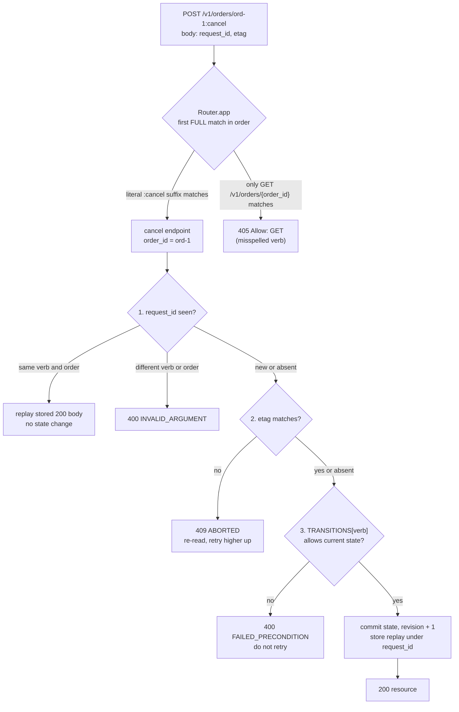

# Custom Methods Beyond CRUD: Modeling State Transitions and Action Endpoints (POST :cancel, AIP-136)

> [!summary] Claim
> A state transition belongs in a `POST /v1/{name}:{verb}` custom method backed by one transition table, and its guards must run in a fixed order - replay by `request_id`, then `etag`, then the table - because checking the state first turns every lost-response retry of a successful `:cancel` into a false `FAILED_PRECONDITION`.

Part of [REST and Resource Modeling](README.md) in [API Engineering](../README.md).

## TL;DR

- Mechanism: a custom method is `POST` on the resource URI plus a literal `:verb` suffix (`Verb = ":" LITERAL` in `google/api/http.proto`), and Starlette compiles `/v1/orders/{order_id}:cancel` to the regex `^/v1/orders/(?P<order_id>[^/]+):cancel$`.
- Contract rule: `state` is output only and changes only through transition methods (AIP-216), an illegal transition is `FAILED_PRECONDITION` (`400`), a stale `etag` is `ABORTED` (`409`), and a repeated `request_id` replays the first success (AIP-155).
- The trap: the item route `/v1/orders/{order_id}` also matches `/v1/orders/ord-1:cancel` with `order_id == "ord-1:cancel"`, so a `GET` on the action URI, a misspelled verb (`405`, not `404`), or a same-method generic route registered first all misroute silently unless IDs are constrained to exclude `:`.
- Portability fact: the lab's 15 tests pass unchanged on CPython 3.12.16, 3.13.18, 3.14.10, and 3.15.2 (Debian Trixie and Alpine containers), on 3.15.2 free-threaded (Debian Trixie container), and on macOS 3.12.13, 3.14.6, and 3.15.0b3 free-threaded; FastAPI `0.162.0` answers `Allow: GET` where plain Starlette `1.10.0` would add `HEAD`.
- When not to use it: declarative-friendly resources (AIP-128) should avoid custom methods, and a transition that needs its own audit trail, payload, or lifetime is better modeled as a created noun (`POST /v1/orders/{id}/cancellations`) or a long-running operation.

## Mental model



The router walks its route list in registration order and hands the request to the first route whose regex and method both match, remembering the first regex-only match as a fallback that produces `405`.
Inside the endpoint the three guards run strictly top to bottom: the replay check must come before the state check because a successful `:cancel` moves the order to `CANCELLED`, which is exactly the state from which `cancel` is illegal.
The `etag` check comes before the table so that a client acting on a stale read gets the retryable `ABORTED` instead of a misleading non-retryable `FAILED_PRECONDITION`.
Only the bottom path mutates anything, and it records the response body under the `request_id` in the same synchronous step.

## How it works

### Why a verb and not `PATCH {"state": "CANCELLED"}`

AIP-216 says the `state` field should be output only and that APIs should not allow a `State` enum to be directly updated through an `update` method or directly set through the `create` method, because update methods are not expected to have side effects and a writable state implies any value is reachable (AIP-216, Output only).
AIP-203 then fixes what the server does with a client-supplied output-only field: it "must clear out any value in this field and must not throw an error" (AIP-203, Output only).
The lab proves that rule: `POST /v1/orders?order_id=ord-9` with body `{"state": "DELIVERED"}` returns `201` with `state` `PENDING_PAYMENT` and `Location: /v1/orders/ord-9`.
A transition is therefore a separate method per verb, which AIP-216 specifies as `POST`, a `:` plus the custom verb in the URI, `body: "*"`, the resource `name` as the only path variable, the resource itself as the response, and `FAILED_PRECONDITION` (HTTP `400`) when the transition is not allowed (AIP-216, State transition methods).
AIP-136 adds the general rules: the HTTP method must be `GET` or `POST`, `POST` must be used if the method has side effects, the verb in the URI must match the RPC verb, and word separation uses `camelCase` (AIP-136, Guidance).
`POST` is correct on the wire because its semantics are "the resource's own specific semantics" (RFC 9110 Section 9.3.3), and it is the method that RFC 9110 does not list as idempotent (RFC 9110 Section 9.2.2).
That last point is what forces an explicit idempotency mechanism: "A client SHOULD NOT automatically retry a request with a non-idempotent method unless it has some means to know that the request semantics are actually idempotent" (RFC 9110 Section 9.2.2).

### The `:verb` suffix in URI grammar

The `google.api.http` path template grammar is `Template = "/" Segments [ Verb ]` with `Verb = ":" LITERAL` (`google/api/http.proto`, Path template syntax), so the verb is a suffix of the last segment, not a new segment.
In RFC 3986 a colon is an ordinary path character: `pchar = unreserved / pct-encoded / sub-delims / ":" / "@"` (RFC 3986 Section 3.3).
The one exception is the first segment of a relative-path reference, which "cannot contain a colon (":") character" (RFC 3986 Section 3.3) and is written with the ABNF rule `segment-nz-nc`, because it "would be mistaken for a scheme name"; such a segment "must be preceded by a dot-segment (e.g., "./this:that")" (RFC 3986 Section 4.2).
CPython implements this literally: `urlsplit` delegates to `_urlsplit`, which treats everything before the first `:` as a scheme when the text starts with an ASCII letter and every character before the colon is a legal scheme character, which `ord-1` is (CPython 3.14.6 `Lib/urllib/parse.py`, `_urlsplit`), and `urljoin` returns the reference unchanged when its scheme differs from the base (CPython 3.14.6 `Lib/urllib/parse.py`, `urljoin`).
`httpx.URL.join` delegates to `urllib.parse.urljoin` (httpx 0.28.1 `httpx/_urls.py`, `URL.join`), so both return `"ord-1:cancel"` for `urljoin("https://api.test/v1/orders/", "ord-1:cancel")`, which the lab asserts.
`http.proto` also says that when a single-segment variable such as `{name}` is expanded on the client, "all characters except `[-_.~0-9a-zA-Z]` are percent-encoded", so a colon inside an ID travels as `%3A` while the verb's colon travels raw (`google/api/http.proto`, Path template syntax).
On HTTP/2 and HTTP/3 the same bytes ride in the `:path` pseudo-header, which carries the path and query of the target URI (RFC 9113 Section 8.3.1; RFC 9114 Section 4.3.1), so the suffix is version-independent.

### How Starlette and FastAPI route `{order_id}:cancel`

`compile_path` scans the template with `PARAM_REGEX = re.compile("{([a-zA-Z_][a-zA-Z0-9_]*)(:[a-zA-Z_][a-zA-Z0-9_]*)?}")`, escapes the literal text between parameters with `re.escape`, and substitutes each parameter with its convertor regex (starlette 1.10.0 `starlette/routing.py`, `compile_path`).
The default `StringConvertor.regex` is `[^/]+` (starlette 1.10.0 `starlette/convertors.py`, `StringConvertor`), so the colon outside the braces becomes a literal; captured in the lab environment:

```text
'^/v1/orders/(?P<order_id>[^/]+):cancel$' /v1/orders/{order_id}:cancel {'order_id': 'StringConvertor'}
'^/v1/orders/(?P<order_id>[^/]+)$' /v1/orders/{order_id} {'order_id': 'StringConvertor'}
AssertionError: Unknown path convertor 'cancel'
```

The third line is the typo `/v1/orders/{order_id:cancel}`: inside braces a colon introduces a convertor, so registration fails with an `assert`, and under `python -O` the same call raises `KeyError 'cancel'` (measured in the lab environment).
Because `[^/]+` admits `:`, the item route also matches `/v1/orders/ord-1:cancel`, which is why method dispatch decides the outcome.
`Route.matches` returns `Match.FULL` when the regex and method match and `Match.PARTIAL` when only the regex matches (starlette 1.10.0 `starlette/routing.py`, `Route.matches`).
`Router.__call__` only enters the middleware stack; the loop lives in `Router.app`, which iterates `self.routes` in order, dispatches the first `FULL` match, and otherwise falls back to the first `PARTIAL` match, whose `handle` answers `405` with an `Allow` header (raised as `HTTPException(status_code=405, headers=...)` when an application is in the scope, otherwise sent as a plain-text `405`) (starlette 1.10.0 `starlette/routing.py`, `Router.app` and `Route.handle`).
FastAPI 0.162.0 overrides that loop with the same first-`FULL`-then-first-`PARTIAL` logic in `APIRouter.app`, and `APIRoute.handle` falls through to Starlette's `Route.handle` for directly registered routes (fastapi 0.162.0 `fastapi/routing.py`, `APIRouter.app` and `APIRoute.handle`); the result satisfies the RFC 9110 requirement that a `405` response carry `Allow` (RFC 9110 Section 15.5.6).
FastAPI's `APIRoute` builds `route.methods = {method.upper() for method in methods}` without the `HEAD` that Starlette's `Route.__init__` adds for `GET` routes (fastapi 0.162.0 `fastapi/routing.py`, `_populate_api_route_state`; starlette 1.10.0 `starlette/routing.py`, `Route.__init__`), so the lab's misspelled `:cancle` answers `405` with `Allow: GET`.
Path parameter validation such as `Path(pattern=...)` runs only after a route is chosen, so it cannot steer routing, but it turns the item route's capture of `ord-1:cancel` into a `422` instead of a misleading `404`.

### Percent-decoding happens before routing

The ASGI scope defines `path` "with percent-encoded sequences and UTF-8 byte sequences decoded into characters" and `raw_path` as the bytes "unmodified from the bytes that were received by the web server" (ASGI HTTP Connection Scope).
Uvicorn's h11 protocol computes `path = unquote(raw_path.decode("ascii"))` (uvicorn 0.54.0 `uvicorn/protocols/http/h11_impl.py`, `H11Protocol.handle_events`), its httptools protocol calls `urllib.parse.unquote` when `%` is present (uvicorn 0.54.0 `uvicorn/protocols/http/httptools_impl.py`, `HttpToolsProtocol.on_headers_complete`), and Hypercorn sets `"path": unquote(path.decode("ascii"))` (hypercorn 0.18.0 `hypercorn/protocol/http_stream.py`, `HTTPStream.handle`).
`get_route_path` reads `scope["path"]` (starlette 1.10.0 `starlette/_utils.py`, `get_route_path`), so `POST /v1/orders/ord-1%3Acancel` reaches the `cancel` endpoint; the lab records `("/v1/orders/ord-1:cancel", b"/v1/orders/ord-1%3Acancel")` for that request and the order ends `CANCELLED`.
The router therefore cannot distinguish an ID that contains an encoded colon from an ID followed by a verb, which is the strongest reason to forbid `:` in resource IDs.

### Guard order inside the transition

The lab's `OrderStore.apply` runs three guards and one commit with no `await` between them, so on one event loop the read-check-write is atomic.
First, replay: if `request_id` was seen for the same `(verb, order_id)`, return the stored body; if it was seen for a different request, return `400 INVALID_ARGUMENT` (`REQUEST_ID_REUSED`).
AIP-155 requires that "Providing a request ID must guarantee idempotency" and that on a duplicate "the server should return the response for the previously successful request, because the client most likely did not receive the previous response" (AIP-155, Guidance); it does not say what to do when a request ID is reused with different content, so the lab's rejection follows Stripe, whose idempotency layer "compares incoming parameters to those of the original request and errors if they're not the same" (Stripe API reference, Idempotent requests, as of 2026-11).
AIP-155 also permits returning current data when the historical response cannot be reproduced (AIP-155, Stale success responses); the lab stores the snapshot, so a replayed `:pay` after `:ship` still returns `PAID` with `etag` `"2"`.
Second, concurrency: a supplied `etag` that differs from the current one is `ABORTED`, as AIP-154 requires for a mismatched `etag`, and AIP-154 explicitly allows `etag` on custom methods (AIP-154, Guidance and Etags on request methods).
Third, the table: `TRANSITIONS[verb]` holds the set of legal source states and the target; any other source state is `FAILED_PRECONDITION` with an `ErrorInfo` carrying `state`, `verb`, and `allowedFrom` in the AIP-193 HTTP/1.1+JSON shape (AIP-193, HTTP/1.1+JSON representation).

### 400 `FAILED_PRECONDITION` versus 409 `ABORTED` versus 409 `Conflict`

`google/rpc/code.proto` maps `FAILED_PRECONDITION` to `400 Bad Request`, `ABORTED` to `409 Conflict`, and `ALREADY_EXISTS` to `409 Conflict`, and gives the selection rule: use `ABORTED` "if the client should retry at a higher level", and `FAILED_PRECONDITION` "if the client should not retry until the system state has been explicitly fixed" (`google/rpc/code.proto`, `Code`).
RFC 9110 defines `409` as "a conflict with the current state of the target resource" where "the user might be able to resolve the conflict and resubmit" (RFC 9110 Section 15.5.10), so a plain REST API that answers an illegal transition with `409` is spec-compliant; what matters is that the API never uses one status for both "re-read and retry" and "stop".
The lab picks the AIP mapping and the M6 mutation (illegal transition mapped to `409`) fails two tests, which pins the contract.

### The same action in three public API styles

| API | Action endpoint | Illegal-state behavior |
|---|---|---|
| Google AIP | `POST /v1/{name=publishers/*/books/*}:publish` (AIP-216) | `FAILED_PRECONDITION`, HTTP `400` (AIP-216) |
| Google long-running operations | `POST /v1/{name=operations/**}:cancel`, best effort, cancelled operation gets `Code.CANCELLED` (`google/longrunning/operations.proto`, `CancelOperation`) | `UNIMPLEMENTED` if the server does not support cancellation; cancelling an already finished operation is not specified |
| Stripe | `POST /v1/payment_intents/{id}/cancel`, legal from `requires_payment_method`, `requires_capture`, `requires_confirmation`, `requires_action`, rarely `processing` (as of 2026-11) | "Returns an error if the PaymentIntent is already canceled or isn't in a cancelable state" |
| GitHub | `PUT /repos/{owner}/{repo}/pulls/{pull_number}/merge` with optional `sha` (as of 2026-11) | `405` "if merge cannot be performed", `409` "if sha was provided and pull request head did not match" |

Stripe uses a sub-path verb instead of a colon suffix, which avoids the item-route capture entirely because `/cancel` is a separate segment that `[^/]+` cannot swallow, at the cost of a URI that looks like a child collection.
GitHub's `405` for an unmergeable pull request overloads a status that RFC 9110 reserves for "the method received in the request-line is known by the origin server but not supported by the target resource" (RFC 9110 Section 15.5.6), which is the ambiguity this note's error mapping avoids.

## Numbers and limits

| Quantity | Value | Source |
|---|---:|---|
| Lab states x verbs | `5 x 4 = 20` pairs, `5` legal | `TRANSITIONS` in the lab; every pair asserted by `test_transition_table_covers_every_state_and_verb` |
| Allowed HTTP methods for a custom method | `GET` or `POST` | AIP-136, Guidance |
| `request_id` length in the AIP-155 example | `36` ASCII characters ("A random UUID is recommended") | AIP-155 `CreateBookRequest` example comment |
| Resource ID length in the AIP-155 example | `4-63` characters of `[a-z][0-9]-` | AIP-155 `CreateBookRequest` example comment; the lab's `ORDER_ID_PATTERN` is `^[a-z][a-z0-9-]{3,62}$` |
| Stripe idempotency key length | up to `255` characters | Stripe Idempotent requests (as of 2026-11) |
| Stripe idempotency key retention | pruned once at least `24` hours old (API v1) | Stripe Idempotent requests (as of 2026-11) |
| Starlette default path parameter regex | `[^/]+` | starlette 1.10.0 `starlette/convertors.py`, `StringConvertor.regex` |
| Route lookup cost | linear in the number of routes before the first `FULL` match | starlette 1.10.0 `starlette/routing.py`, `Router.app` loop; fastapi 0.162.0 `fastapi/routing.py`, `APIRouter.app` loop |
| Lab tests | `15 passed in 0.15s` | `uv run --frozen pytest ... -v --no-header -p no:cacheprovider`, CPython 3.14.6, Darwin 27.2.0 arm64 (macOS 27.2), measured 2026-11-10 |
| Lab module coverage | `100%` (123 statements, 20 branches) | `uv run --frozen pytest ... --cov=api_labs.f04_rest_and_resource_modeling.order_state_machine --cov-branch`, CPython 3.14.6, same machine |
| Mutations caught | `22` of `22` source mutations (`13` by the fact-checker, `9` by the finisher) | one-mutation-at-a-time rerun of the test module, CPython 3.14.6, Darwin 27.2.0 arm64; `extra="forbid"` removal, `UUID4` -> `str`, and a changed `ErrorInfo.domain` survived the drafted tests and are now killed by added assertions |

No latency figure is given: the lab measures behavior, not speed, and a routing microbenchmark would mostly measure the regex count, not the custom-method design.

## Portability

| Leg | Version | Result |
|---|---|---|
| CPython | `3.12.13` (`macos-aarch64`) | Proven: `15 passed` via `UV_PROJECT_ENVIRONMENT=<scratch venv> uv run --frozen --python 3.12.13 pytest ...` |
| CPython | `3.12.16` | Proven: `15 passed` in the `python:3.12.16-trixie` and `python:3.12.16-alpine` containers (see the container rows) |
| CPython | `3.13.18` | Proven: `15 passed` via `uv run --frozen --python 3.13.18` in a separate environment |
| CPython | `3.14.6` (workspace `.venv`) and `3.14.10` | Proven: `15 passed` on both (`3.14.10` in a separate environment on macOS, and in the `python:3.14.10-trixie` and `python:3.14.10-alpine` containers) |
| CPython | `3.15.2` (default GIL) | Proven: `15 passed` via `uv run --frozen --python 3.15.2` in a separate environment on macOS, and in the `python:3.15.2-trixie` and `python:3.15.2-alpine` containers |
| CPython | `3.15.0b3` free-threaded, `sys._is_gil_enabled()` is `False` | Proven: `15 passed` with `uv run --no-project --python 3.15t` and the pinned `fastapi`, `starlette`, `pydantic`, `pydantic-core`, `httpx`, `httpcore`, `anyio`, `pytest`, `pytest-asyncio`; the frozen lock cannot install because `psycopg-binary==3.3.8` has no wheel for it |
| CPython | `3.15.2` free-threaded (`3.15.2t`), `sys._is_gil_enabled()` is `False` | Proven: `15 passed in 0.49s` in the `ghcr.io/astral-sh/uv:python3.15-trixie` container (uv `0.13.7`, `uv python install 3.15.2+freethreaded`, Linux glibc aarch64) with the same nine pins and `PYTHONPATH=src` |
| Starlette vs FastAPI | starlette `1.10.0`, fastapi `0.162.0` | `GET` routes: Starlette adds `HEAD`, FastAPI does not (source, and the lab's `Allow: GET` assertion) |
| Uvicorn | `0.54.0`, h11 and httptools protocols | Both percent-decode `path` before routing: over a real socket, `curl --http1.1 -X POST http://127.0.0.1:<port>/v1/orders/ord-1%3Acancel` against the lab app gave `200`, `path` `/v1/orders/ord-1:cancel`, `raw_path` `b'/v1/orders/ord-1%3Acancel'`, order `CANCELLED` on each protocol; Uvicorn has no HTTP/2 |
| Hypercorn | `0.18.0` | Percent-decodes `path`: the same socket probe over HTTP/1.1 and h2c (`curl --http2-prior-knowledge`) gave `200`, decoded `path`, raw `raw_path`, order `CANCELLED` |
| Granian | `2.8.7` | Percent-decodes `path` (`--interface asgi`): the same socket probe over HTTP/1.1 and h2c (`--http 2`) gave `200`, decoded `path`, raw `raw_path`, order `CANCELLED`; Rust source not read, behavior measured only |
| HTTP/1.1, HTTP/2, HTTP/3 | RFC 9112, RFC 9113, RFC 9114 | The `:verb` suffix is part of the `origin-form` request target or the `:path` pseudo-header in all three (RFC 9112 Section 3.2.1; RFC 9113 Section 8.3.1; RFC 9114 Section 4.3.1); the pytest lab runs in-process through `httpx.ASGITransport`; HTTP/1.1 and h2c were exercised by the socket probe above (curl 8.22.0); HTTP/3 rests on the specification text (RFC 9114 Section 4.3.1 defines the request target through the `:path` pseudo-header), because no QUIC server was run here |
| Debian Trixie (glibc), Alpine (musl) | `python:3.12.16`, `3.13.18`, `3.14.10`, `3.15.2` official images, each in `-trixie` and `-alpine` | Proven: `15 passed` in all eight containers (Docker `29.8.2` on OrbStack, linux/arm64, 2026-11-10): the lab copy mounted read-only at `/lab`, then `python -m venv /tmp/v`, `pip install` of `fastapi==0.162.0 starlette==1.10.0 pydantic==2.14.3 pydantic-core==2.50.4 httpx==0.28.1 httpcore==1.0.9 anyio==4.16.0 pytest==9.2.0 pytest-asyncio==1.4.1.post1`, and `PYTHONPATH=src python -m pytest <test> -q -p no:cacheprovider`; `platform.libc_ver()` reported glibc on Trixie and none (musl) on Alpine; these runs install the nine pins with `pip`, not the full frozen lock |

## Worked example

The lab models an order with five states and four transition verbs.
The [implementation](../labs/src/api_labs/f04_rest_and_resource_modeling/order_state_machine.py) holds the transition table, the guard order, and the FastAPI app; the [test](../labs/tests/f04_rest_and_resource_modeling/test_custom_methods_and_state_machine_transitions_aip_136.py) drives it in-process through `httpx.AsyncClient(transport=httpx.ASGITransport(app=app), base_url="http://test")`.

### Implementation (`labs/src/api_labs/f04_rest_and_resource_modeling/order_state_machine.py`)

```python
"""AIP-136 custom methods driving an AIP-216 state machine for an order resource.

Routes:
    POST /v1/orders?order_id=ID       create; `state` is output only (AIP-203)
    GET  /v1/orders/{order_id}        read
    POST /v1/orders/{order_id}:pay      PENDING_PAYMENT -> PAID
    POST /v1/orders/{order_id}:ship     PAID -> SHIPPED
    POST /v1/orders/{order_id}:deliver  SHIPPED -> DELIVERED
    POST /v1/orders/{order_id}:cancel   PENDING_PAYMENT | PAID -> CANCELLED

Errors use the AIP-193 HTTP/1.1+JSON shape: {"error": {"code", "status", "message", "details"}}.
"""

from dataclasses import dataclass, field
from enum import StrEnum
from typing import Annotated, Any, Final, Literal

from fastapi import Body, FastAPI, Path, Query
from fastapi.responses import JSONResponse
from pydantic import UUID4, BaseModel, ConfigDict


class State(StrEnum):
    """Order lifecycle states; output only, changed only by custom methods (AIP-216)."""

    PENDING_PAYMENT = "PENDING_PAYMENT"
    PAID = "PAID"
    SHIPPED = "SHIPPED"
    DELIVERED = "DELIVERED"
    CANCELLED = "CANCELLED"


Verb = Literal["pay", "ship", "deliver", "cancel"]
VERBS: Final[tuple[Verb, ...]] = ("pay", "ship", "deliver", "cancel")

# verb -> (states the verb may be called from, state after the verb)
TRANSITIONS: Final[dict[Verb, tuple[frozenset[State], State]]] = {
    "pay": (frozenset({State.PENDING_PAYMENT}), State.PAID),
    "ship": (frozenset({State.PAID}), State.SHIPPED),
    "deliver": (frozenset({State.SHIPPED}), State.DELIVERED),
    "cancel": (frozenset({State.PENDING_PAYMENT, State.PAID}), State.CANCELLED),
}

# 4-63 chars of [a-z0-9-], starting with a letter: no ':' so the verb suffix is unambiguous.
ORDER_ID_PATTERN: Final = r"^[a-z][a-z0-9-]{3,62}$"
DOMAIN: Final = "orders.example.com"


class InvalidTransitionError(Exception):
    """Raised when a verb is called from a state that does not allow it."""

    def __init__(self, verb: Verb, state: State) -> None:
        super().__init__(f"cannot {verb} an order in state {state}")
        self.verb = verb
        self.state = state


def next_state(state: State, verb: Verb) -> State:
    """Pure transition function: the whole lifecycle is the TRANSITIONS table."""
    allowed_from, target = TRANSITIONS[verb]
    if state not in allowed_from:
        raise InvalidTransitionError(verb, state)
    return target


class ApiError(Exception):
    """An error rendered as an AIP-193 google.rpc.Status JSON body."""

    def __init__(
        self,
        code: int,
        status: str,
        message: str,
        *,
        reason: str | None = None,
        metadata: dict[str, str] | None = None,
    ) -> None:
        super().__init__(message)
        self.code = code
        self.status = status
        self.message = message
        self.reason = reason
        self.metadata = metadata or {}

    def response(self) -> JSONResponse:
        error: dict[str, Any] = {"code": self.code, "status": self.status, "message": self.message}
        if self.reason is not None:
            error["details"] = [
                {
                    "@type": "type.googleapis.com/google.rpc.ErrorInfo",
                    "reason": self.reason,
                    "domain": DOMAIN,
                    "metadata": self.metadata,
                }
            ]
        return JSONResponse({"error": error}, status_code=self.code)


@dataclass(frozen=True, slots=True)
class Order:
    order_id: str
    state: State
    revision: int

    @property
    def etag(self) -> str:
        return f'"{self.revision}"'

    def to_json(self) -> dict[str, str]:
        return {"name": f"orders/{self.order_id}", "state": self.state, "etag": self.etag}


@dataclass(frozen=True, slots=True)
class _Replay:
    fingerprint: tuple[Verb, str]
    body: dict[str, str]


@dataclass
class OrderStore:
    """In-memory store; `apply` has no await point, so it is atomic on one event loop."""

    orders: dict[str, Order] = field(default_factory=dict[str, Order])
    replays: dict[str, _Replay] = field(default_factory=dict[str, _Replay])
    transitions_applied: int = 0

    def create(self, order_id: str) -> Order:
        if order_id in self.orders:
            raise ApiError(409, "ALREADY_EXISTS", f"orders/{order_id} already exists")
        order = Order(order_id, State.PENDING_PAYMENT, 1)
        self.orders[order_id] = order
        return order

    def get(self, order_id: str) -> Order:
        order = self.orders.get(order_id)
        if order is None:
            raise ApiError(404, "NOT_FOUND", f"orders/{order_id} not found")
        return order

    def apply(
        self, order_id: str, verb: Verb, *, request_id: str | None, etag: str | None
    ) -> dict[str, str]:
        # 1. Replay first: a retried success must not be re-checked against the new state.
        if request_id is not None:
            prior = self.replays.get(request_id)
            if prior is not None:
                if prior.fingerprint != (verb, order_id):
                    raise ApiError(
                        400,
                        "INVALID_ARGUMENT",
                        "request_id was already used for a different request",
                        reason="REQUEST_ID_REUSED",
                        metadata={"requestId": request_id},
                    )
                return prior.body
        order = self.get(order_id)
        # 2. Optimistic concurrency (AIP-154): a stale etag is ABORTED, retry at a higher level.
        if etag is not None and etag != order.etag:
            raise ApiError(
                409,
                "ABORTED",
                f"etag {etag} does not match current etag {order.etag}",
                reason="ETAG_MISMATCH",
                metadata={"currentEtag": order.etag},
            )
        # 3. State machine (AIP-216): a disallowed transition is FAILED_PRECONDITION.
        try:
            target = next_state(order.state, verb)
        except InvalidTransitionError as exc:
            allowed_from = ",".join(sorted(TRANSITIONS[verb][0]))
            raise ApiError(
                400,
                "FAILED_PRECONDITION",
                str(exc),
                reason="INVALID_STATE_TRANSITION",
                metadata={"state": order.state, "verb": verb, "allowedFrom": allowed_from},
            ) from exc
        updated = Order(order_id, target, order.revision + 1)
        self.orders[order_id] = updated
        self.transitions_applied += 1
        body = updated.to_json()
        if request_id is not None:
            self.replays[request_id] = _Replay((verb, order_id), body)
        return body


class TransitionRequest(BaseModel):
    """Body of every state transition custom method (`body: "*"`)."""

    model_config = ConfigDict(extra="forbid")

    request_id: UUID4 | None = None
    etag: str | None = None


class OrderInput(BaseModel):
    """Create body; `state` is OUTPUT_ONLY, so it is accepted and ignored (AIP-203)."""

    state: str | None = None


OrderId = Annotated[str, Path(pattern=ORDER_ID_PATTERN)]


def _transition_endpoint(store: OrderStore, verb: Verb) -> Any:
    async def endpoint(
        order_id: OrderId,
        body: Annotated[TransitionRequest | None, Body()] = None,
    ) -> JSONResponse:
        request = body or TransitionRequest()
        request_id = None if request.request_id is None else str(request.request_id)
        try:
            result = store.apply(order_id, verb, request_id=request_id, etag=request.etag)
        except ApiError as exc:
            return exc.response()
        return JSONResponse(result)

    endpoint.__name__ = f"{verb}_order"
    return endpoint


def build_app(store: OrderStore) -> FastAPI:
    """Register custom methods first: a later same-method `/{order_id}` route cannot shadow them."""
    app = FastAPI()
    for verb in VERBS:
        app.add_api_route(
            f"/v1/orders/{{order_id}}:{verb}",
            _transition_endpoint(store, verb),
            methods=["POST"],
            name=f"orders:{verb}",
            response_model=None,
        )

    @app.post("/v1/orders", response_model=None)
    async def create_order(
        order_id: Annotated[str, Query(pattern=ORDER_ID_PATTERN)],
        body: Annotated[OrderInput | None, Body()] = None,
    ) -> JSONResponse:
        try:
            order = store.create(order_id)
        except ApiError as exc:
            return exc.response()
        return JSONResponse(
            order.to_json(), status_code=201, headers={"Location": f"/v1/orders/{order_id}"}
        )

    @app.get("/v1/orders/{order_id}", response_model=None)
    async def get_order(order_id: OrderId) -> JSONResponse:
        try:
            return JSONResponse(store.get(order_id).to_json())
        except ApiError as exc:
            return exc.response()

    return app
```

### Test (simplified excerpt: two of the fifteen tests)

```python
@pytest.mark.unit
@pytest.mark.asyncio
async def test_retry_with_same_request_id_replays_instead_of_failing(
    store_and_client: tuple[OrderStore, httpx.AsyncClient],
) -> None:
    store, client = store_and_client
    first = await client.post("/v1/orders/ord-1:cancel", json={"request_id": RID_1})
    retry = await client.post("/v1/orders/ord-1:cancel", json={"request_id": RID_1})
    assert first.status_code == retry.status_code == 200
    assert retry.json() == first.json()
    assert store.transitions_applied == 1
    # The same retry without a request_id is a fresh call and hits the state machine.
    blind_retry = await client.post("/v1/orders/ord-1:cancel")
    assert blind_retry.status_code == 400
    assert blind_retry.json()["error"]["status"] == "FAILED_PRECONDITION"


@pytest.mark.unit
@pytest.mark.asyncio
async def test_get_on_a_custom_method_uri_is_captured_by_the_item_route() -> None:
    naive = FastAPI()

    @naive.get("/v1/orders/{order_id}")
    async def get_order(order_id: str) -> dict[str, str]:
        return {"order_id": order_id}

    async with httpx.AsyncClient(
        transport=httpx.ASGITransport(app=naive), base_url="http://test"
    ) as client:
        captured = await client.get("/v1/orders/ord-1:cancel")
    assert captured.status_code == 200
    assert captured.json() == {"order_id": "ord-1:cancel"}

    store = OrderStore()
    store.create("ord-1")
    async with httpx.AsyncClient(
        transport=httpx.ASGITransport(app=build_app(store)), base_url="http://test"
    ) as client:
        guarded = await client.get("/v1/orders/ord-1:cancel")
    assert guarded.status_code == 422  # the id pattern rejects ':' instead of a misleading 404
    assert store.orders["ord-1"].state is State.PENDING_PAYMENT
```

The first excerpted test is the claim of this note: delete the replay lookup (M2) or move it after the state check (M3) and it fails, because the retry hits `CANCELLED` and gets `400`.
The second shows why the item route must not accept `:` in IDs.

### Captured output

Executed from `labs/` with `uv run --frozen pytest tests/f04_rest_and_resource_modeling/test_custom_methods_and_state_machine_transitions_aip_136.py -v --no-header -p no:cacheprovider` on CPython 3.14.6, Darwin 27.2.0 arm64 (macOS 27.2):

```text
============================= test session starts ==============================
collecting ... collected 15 items

tests/f04_rest_and_resource_modeling/test_custom_methods_and_state_machine_transitions_aip_136.py::test_transition_table_covers_every_state_and_verb PASSED [  6%]
tests/f04_rest_and_resource_modeling/test_custom_methods_and_state_machine_transitions_aip_136.py::test_colon_verb_routes_to_custom_method_and_returns_resource PASSED [ 13%]
tests/f04_rest_and_resource_modeling/test_custom_methods_and_state_machine_transitions_aip_136.py::test_custom_method_accepts_an_empty_body PASSED [ 20%]
tests/f04_rest_and_resource_modeling/test_custom_methods_and_state_machine_transitions_aip_136.py::test_illegal_transition_is_failed_precondition_400 PASSED [ 26%]
tests/f04_rest_and_resource_modeling/test_custom_methods_and_state_machine_transitions_aip_136.py::test_retry_with_same_request_id_replays_instead_of_failing PASSED [ 33%]
tests/f04_rest_and_resource_modeling/test_custom_methods_and_state_machine_transitions_aip_136.py::test_replay_returns_the_historical_response_not_the_current_state PASSED [ 40%]
tests/f04_rest_and_resource_modeling/test_custom_methods_and_state_machine_transitions_aip_136.py::test_request_id_reused_for_another_request_is_rejected PASSED [ 46%]
tests/f04_rest_and_resource_modeling/test_custom_methods_and_state_machine_transitions_aip_136.py::test_malformed_request_id_is_rejected_instead_of_disabling_idempotency PASSED [ 53%]
tests/f04_rest_and_resource_modeling/test_custom_methods_and_state_machine_transitions_aip_136.py::test_stale_etag_is_aborted_409_and_changes_nothing PASSED [ 60%]
tests/f04_rest_and_resource_modeling/test_custom_methods_and_state_machine_transitions_aip_136.py::test_state_is_output_only_on_create_and_errors_use_google_rpc_codes PASSED [ 66%]
tests/f04_rest_and_resource_modeling/test_custom_methods_and_state_machine_transitions_aip_136.py::test_get_on_a_custom_method_uri_is_captured_by_the_item_route PASSED [ 73%]
tests/f04_rest_and_resource_modeling/test_custom_methods_and_state_machine_transitions_aip_136.py::test_misspelled_verb_is_405_with_allow_from_the_item_route PASSED [ 80%]
tests/f04_rest_and_resource_modeling/test_custom_methods_and_state_machine_transitions_aip_136.py::test_generic_post_route_registered_first_shadows_the_custom_method PASSED [ 86%]
tests/f04_rest_and_resource_modeling/test_custom_methods_and_state_machine_transitions_aip_136.py::test_percent_encoded_colon_is_decoded_before_routing PASSED [ 93%]
tests/f04_rest_and_resource_modeling/test_custom_methods_and_state_machine_transitions_aip_136.py::test_relative_reference_with_a_colon_parses_as_a_uri_scheme PASSED [100%]

============================== 15 passed in 0.15s ==============================
```

## Pitfalls

> [!warning] Blind retry of a transition
> Trigger: a client times out on `POST /v1/orders/ord-1:cancel`, the cancel actually committed, and the client retries without a `request_id`.
> Symptom: the retry returns `400 FAILED_PRECONDITION` and the client reports a failed cancellation for an order that is cancelled; the lab's `blind_retry` assertion shows exactly this.
> Fix: send a UUID `request_id` on every transition and check it before the state machine (AIP-155); RFC 9110 Section 9.2.2 already says a client should not retry a non-idempotent method without such a mechanism.
> Source: Stripe's engineering write-up describes the same ambiguity, a connection that terminates midway leaves the client unable to tell whether retrying is safe, and gives the charge endpoint as the example where "accidentally calling it twice would lead to the customer being double-charged" (Stripe blog, Designing robust and predictable APIs with idempotency, as of 2026-11).

> [!warning] The item route swallows the action URI
> Trigger: `GET /v1/orders/ord-1:cancel`, or a `POST` to a misspelled verb such as `:cancle`, with `/v1/orders/{order_id}` registered for `GET`.
> Symptom: the `GET` returns whatever the item handler does with `order_id == "ord-1:cancel"` (the lab's naive app returns `200`), and the misspelled `POST` returns `405 Allow: GET` instead of `404`, which sends the caller debugging methods instead of spelling.
> Fix: constrain IDs with a pattern that excludes `:` (`422` instead of a silent capture), and document in the API reference that `405` on a `:verb` URI usually means an unknown verb.

> [!warning] Registration order shadows custom methods
> Trigger: a generic `POST /v1/orders/{order_id}` (for example a legacy "action in body" endpoint) is registered before `POST /v1/orders/{order_id}:cancel`.
> Symptom: every `:cancel` call reaches the generic handler with `order_id == "ord-1:cancel"`; the lab shows the handler flip when only registration order changes.
> Fix: register custom methods first, never add a same-method item route, and keep a route-table test like `test_generic_post_route_registered_first_shadows_the_custom_method`.

> [!warning] Relative links that start with an ID
> Trigger: a client or HATEOAS link builder resolves `ord-1:cancel` against `https://api.test/v1/orders/`.
> Symptom: the result is the absolute URI `ord-1:cancel` with scheme `ord-1`, and the request fails far from the bug.
> Fix: emit absolute-path links (`/v1/orders/ord-1:cancel`) or prefix a dot-segment (`./ord-1:cancel`) as RFC 3986 Section 4.2 requires.

> [!warning] Colon inside the convertor braces
> Trigger: writing `/v1/orders/{order_id:cancel}` instead of `/v1/orders/{order_id}:cancel`.
> Symptom: route registration fails with `AssertionError: Unknown path convertor 'cancel'`, or `KeyError` under `python -O`, both measured here.
> Fix: keep the verb outside the braces and cover each route with at least one request in tests so registration runs in CI.

> [!warning] One status for retryable and terminal conflicts
> Trigger: mapping both a stale `etag` and an illegal transition to the same `409`.
> Symptom: generic retry middleware either loops on a terminal state or gives up on a transient race.
> Fix: `ABORTED` (`409`) means re-read and retry; `FAILED_PRECONDITION` (`400`) means stop (`google/rpc/code.proto`); if you choose RFC 9110 `409` for illegal transitions, distinguish them with a machine-readable `reason`.

> [!warning] Edge policy evaluates a different path than the router
> Trigger: an authorization rule at a gateway or mesh matches the request path as received, while the backend routes on a decoded or normalized path, so `ord-1%3Arefund` or a variant slips past a rule written for `*:refund`.
> Symptom: a deny rule that works in a test with the literal path does nothing for an encoded variant, and the backend executes the verb.
> Fix: canonicalize before policy and enforce per-verb authorization in the application; the incident class is real: Istio `CVE-2021-39156` (ISTIO-SECURITY-2021-008, disclosed 2021-08-24) let a request for `/user/profile#section1` bypass a `DENY` policy on `/user/profile` while the backend received the normalized path `/user/profile%23section1`, and the fix removes the fragment before authorization and routing.

No primary-source incident or CVE specific to the `:verb` suffix was found; the Stripe write-up and `CVE-2021-39156` are the nearest primary sources for the two mechanisms above, and the lab proves the `:verb` specifics.

## Security and robustness

- Function-level authorization: every verb is a distinct business function, and OWASP API5:2023 notes that attackers reach unauthorized functions "by simply guessing the endpoint URL and parameters" and that administrative functions are key targets, recommending deny-by-default authorization; map each verb to its own permission (`orders.cancel`, `orders.refund`) instead of one `orders.update`.
- Canonicalization before policy: because servers decode `%3A` into `path` before routing (ASGI spec; lab; the Uvicorn, Hypercorn, and Granian socket probe in Portability), a gateway rule that matches raw strings such as `*:refund` misses `ord-1%3Arefund` while the application still routes it to `refund`; enforce verb policy on the decoded path or inside the application.
- Replay store scoping: the lab's replay map is global and fingerprints only `(verb, order_id)`; production stores must key by principal as well, or a second caller who learns a `request_id` receives the first caller's stored response.
- Business-flow abuse: transition verbs such as `:pay` or `:reserve` are the "sensitive business flows" of OWASP API6:2023, whose examples include buying all stock of an item and reserving every slot; rate-limit and bot-screen them per flow, not per route prefix.
- Input strictness: `TransitionRequest` uses `extra="forbid"` and a `UUID4` `request_id`, so a typo such as `requestId` fails with `422` (`extra_forbidden`, order left `PENDING_PAYMENT`) and `"not-a-uuid"` fails with `422` (`uuid_parsing`), with no transition applied, instead of silently disabling idempotency; `test_malformed_request_id_is_rejected_instead_of_disabling_idempotency` pins both.
- Concurrency: `apply` has no `await` point, so it is atomic on one event loop; moving it to a `def` endpoint (threadpool) or to multiple workers requires a lock or a conditional database update keyed on the `etag`, which the lab does not exercise.

## The principal's view

The decision is not "custom method or not" but where lifecycle authority lives: in an imperative verb set, in a declarative desired-state field reconciled by the server, or in first-class event nouns.
Verbs (`:cancel`, `:ship`) win when transitions are few, user-intended, and must be refused synchronously; they keep the state machine in one table and give each transition its own permission, metric, and audit line.
Declarative APIs (see [[Declarative-Friendly-APIs-and-Reconciliation-Loops-AIP-128]]) win for infrastructure that tools such as Terraform drive, and AIP-136 says declarative-friendly resources "usually should not employ custom methods"; the cost is that illegal transitions surface as reconciliation failures instead of immediate errors.
Event nouns (`POST /v1/orders/{id}/cancellations`) win when the transition carries its own data, has to be listed and audited, or can be reverted, because creation with a client-chosen ID gives idempotency for free; the cost is an extra resource type and a looser coupling between the noun and the parent's state.
A transition that takes seconds or calls external systems should return a long-running operation (AIP-216 allows an `Operation` resolving to the resource; see [[Long-Running-Operations-202-Accepted-and-Operation-Resources-AIP-151]]), and if most of the surface is verbs with no stable resources, the API is an RPC API and gRPC with HTTP transcoding states that honestly.
The organizational trade-off is governance: a verb vocabulary needs a review gate (naming, the `GET`/`POST` rule, the error mapping) or every team invents `:doCancel`, `:cancelOrder`, and `/cancel` side by side.

## Interview questions

> [!question] L5: Why is `PATCH /v1/orders/ord-1` with `{"state": "CANCELLED"}` the wrong way to cancel an order?
>
> > [!success]- Answer
> > AIP-216 makes `state` output only, because update methods should not have side effects and a writable state implies any value is reachable.
> > AIP-203 requires the server to ignore an output-only field on input rather than act on it.
> > A dedicated `POST :cancel` gets its own permission, its own legal-source-state check, and its own error.
> >
> > Follow-up: What should the server return if the `PATCH` body contains only `state`?

> [!question] L5: Which HTTP methods may an AIP-136 custom method use, and what decides between them?
>
> > [!success]- Answer
> > Only `GET` or `POST`.
> > `GET` for methods that read data or state, `POST` for anything with side effects, and since 2026-06-09 `POST` is also allowed for reads whose payload could exceed URL limits.
> >
> > Follow-up: Why does AIP-136 forbid `PUT` or `DELETE` for custom methods?

> [!question] L6: Predict the output: with FastAPI `0.162.0` and routes registered as `GET /v1/orders/{order_id}` then `POST /v1/orders/{order_id}:cancel`, what do `GET /v1/orders/ord-1:cancel` and `POST /v1/orders/ord-1:cancle` return?
>
> > [!success]- Answer
> > The `GET` is a `FULL` match for the item route with `order_id == "ord-1:cancel"`, because `[^/]+` admits `:`; the item handler runs and typically returns `404` (or `422` if the ID has a pattern).
> > The `POST` matches no `:cancel` literal, but the item route's regex matches with the wrong method, so it is `PARTIAL` and the router answers `405` with `Allow: GET`.
> > FastAPI does not add `HEAD` to `GET` routes, so the header is `GET`, not `GET, HEAD`.
> >
> > Follow-up: What single change makes the `GET` fail fast with a validation error?

> [!question] L6: Debug this API: mobile clients on flaky networks report "cancel failed" for orders that the database shows as `CANCELLED`, so what is happening and how do you fix it?
>
> > [!success]- Answer
> > The first `POST :cancel` committed but the response was lost; the client retried, and the retry hit the state machine from `CANCELLED`, which returns `FAILED_PRECONDITION`.
> > Fix the client to send a UUID `request_id` and the server to check it before the state table, replaying the stored `200`.
> > Verify with a test that cancels twice with the same `request_id` and asserts one state change and identical bodies.
> >
> > Follow-up: What should the server do when the same `request_id` arrives for a different order?

> [!question] L6: Distinguish `FAILED_PRECONDITION`, `ABORTED`, and `ALREADY_EXISTS` for an order API, with their HTTP mappings.
>
> > [!success]- Answer
> > `FAILED_PRECONDITION` (`400`): the transition is illegal from the current state, so do not retry until the state changes.
> > `ABORTED` (`409`): a concurrency check such as a stale `etag` failed, so re-read and retry the read-modify-write.
> > `ALREADY_EXISTS` (`409`): a create collided with an existing resource ID.
> >
> > Follow-up: When is RFC 9110 `409` an acceptable choice for an illegal transition?

> [!question] L6: How can a caller bypass a WAF rule that blocks `POST *:refund` for non-admins?
>
> > [!success]- Answer
> > The attacker sends `POST /v1/orders/ord-1%3Arefund`; the WAF matches the raw target and sees no `:refund`.
> > The ASGI server decodes `%3A` into `scope["path"]`, Starlette routes on the decoded path, and the refund endpoint runs.
> > Enforce function-level authorization inside the application per verb, and canonicalize before any edge policy.
> >
> > Follow-up: Which ASGI scope key preserves the original bytes, and why is routing not done on it?

> [!question] L7+: When a duplicate `request_id` arrives after the order has changed, do you replay the stored snapshot or return the current resource?
>
> > [!success]- Answer
> > Returning the snapshot is the most faithful replay and is what the lab does, so a replayed `:pay` after `:ship` still shows `PAID`.
> > AIP-155 permits returning current data when the historical response cannot be recreated, which saves storage but makes the replay look like a different outcome.
> > The choice is a retention budget: store bodies for the replay window, document the window, and fall back to current state only after it.
> >
> > Follow-up: How long should the window be, and what sets the lower bound?

> [!question] L7+: What governance do you put around custom methods when 40 teams are adding verbs?
>
> > [!success]- Answer
> > A linted vocabulary: verb plus noun, no prepositions, no standard-method verbs, `camelCase` after the colon, `POST` for side effects (AIP-136).
> > A shared error contract: illegal transition is `FAILED_PRECONDITION`, stale `etag` is `ABORTED`, every transition accepts `request_id`.
> > A rule for when a verb must instead be a noun or a long-running operation, and per-verb permissions and metrics generated from the same table.
> >
> > Follow-up: How would you detect a team modeling a whole workflow as one generic `:execute` verb?

> [!question] L7+: When would you model cancellation as `POST /v1/orders/{id}/cancellations` instead of `POST /v1/orders/{id}:cancel`?
>
> > [!success]- Answer
> > When the cancellation has its own data (reason, actor, refund amount), must be listed or audited, can itself fail or be reverted, or takes time.
> > A created noun gets idempotency from a client-chosen ID and a natural history, at the cost of another resource type and a weaker link to the parent's `state`.
> > A verb is better when the transition is instantaneous, data-free, and must be refused synchronously.
> >
> > Follow-up: How do you keep the parent's `state` and the cancellation resource consistent?

## Related

Prerequisites: [[Field-Masks-and-Update-Masks-AIP-134-and-AIP-161]], [[HTTP-Method-Semantics-Safety-and-Idempotency-Invariants]], [[Resource-Oriented-Design-Collections-Resources-and-Subresources]]

Next: [[Resource-Associations-Many-to-Many-Links-and-Polymorphism-AIP-124]]

See also: [[02-Programming-Languages/Python/Python-Backend-Interview-Prep/05-REST-API-Design]], [[Field-Behavior-Semantics-Input-Only-Output-Only-and-Immutable-AIP-203]], [[HTTP-Status-Code-Taxonomy-and-Selection-Decision-Trees]], [[Declarative-Friendly-APIs-and-Reconciliation-Loops-AIP-128]], [[Soft-Delete-Undelete-and-Expiration-Lifecycles-AIP-164]], [[Idempotent-Request-Identification-and-Request-ID-Correlation-AIP-155]], [[Google-AIP-193-Error-Model-and-Rich-Error-Details]], [[Long-Running-Operations-202-Accepted-and-Operation-Resources-AIP-151]], [[Optimistic-Concurrency-Control-If-Match-and-412-Precondition-Failed]], [[Idempotency-Key-Header-Specification-and-State-Machine-Draft-08]], [[URI-Syntax-Resolution-and-Templates-RFC-6570]], [[Defeating-BFLA-API5-2023-Function-Level-Guards-and-Deny-By-Default-Routers]]

- Lab: `labs/tests/f04_rest_and_resource_modeling/test_custom_methods_and_state_machine_transitions_aip_136.py`

## Further reading

- [AIP-136 Custom methods](https://google.aip.dev/136): the `GET`/`POST` rule, the `:verb` URI rule, naming, and the declarative-friendly exception.
- [AIP-216 States](https://google.aip.dev/216): output-only `state`, state transition methods, and `FAILED_PRECONDITION` for illegal transitions.
- [AIP-155 Request identification](https://google.aip.dev/155): `request_id` idempotency and stale success responses.
- [AIP-154 Resource freshness validation](https://google.aip.dev/154): `etag` on custom methods and `ABORTED` on mismatch.
- [google/rpc/code.proto](https://github.com/googleapis/googleapis/blob/master/google/rpc/code.proto): the canonical code-to-HTTP mapping and the `FAILED_PRECONDITION` versus `ABORTED` decision rule.
- [google/api/http.proto](https://github.com/googleapis/googleapis/blob/master/google/api/http.proto): the path template grammar that defines `Verb = ":" LITERAL` and the percent-encoding of variables.
- [RFC 9110](https://www.rfc-editor.org/rfc/rfc9110.html): Sections 9.2.2, 9.3.3, 15.5.6, and 15.5.10 for idempotency, `POST`, `405`, and `409`.
- [RFC 3986](https://www.rfc-editor.org/rfc/rfc3986.html): Sections 3.3 and 4.2 for colons in path segments and relative references.
- [ASGI HTTP connection scope](https://asgi.readthedocs.io/en/latest/specs/www.html): the decoded `path` versus `raw_path` contract that routing depends on.
- [Stripe: Designing robust and predictable APIs with idempotency](https://stripe.com/blog/idempotency): the author's account of idempotency keys for retried charges, which motivates checking `request_id` first.
- [ISTIO-SECURITY-2021-008](https://istio.io/latest/news/security/istio-security-2021-008/): the official bulletin for `CVE-2021-39156`, a path-based authorization bypass from policy and routing disagreeing on the path.
- [Starlette 1.10.0 routing.py](https://github.com/Kludex/starlette/blob/1.10.0/starlette/routing.py): `compile_path`, `Route.matches`, `Route.handle`, and the route loop in `Router.app`.
