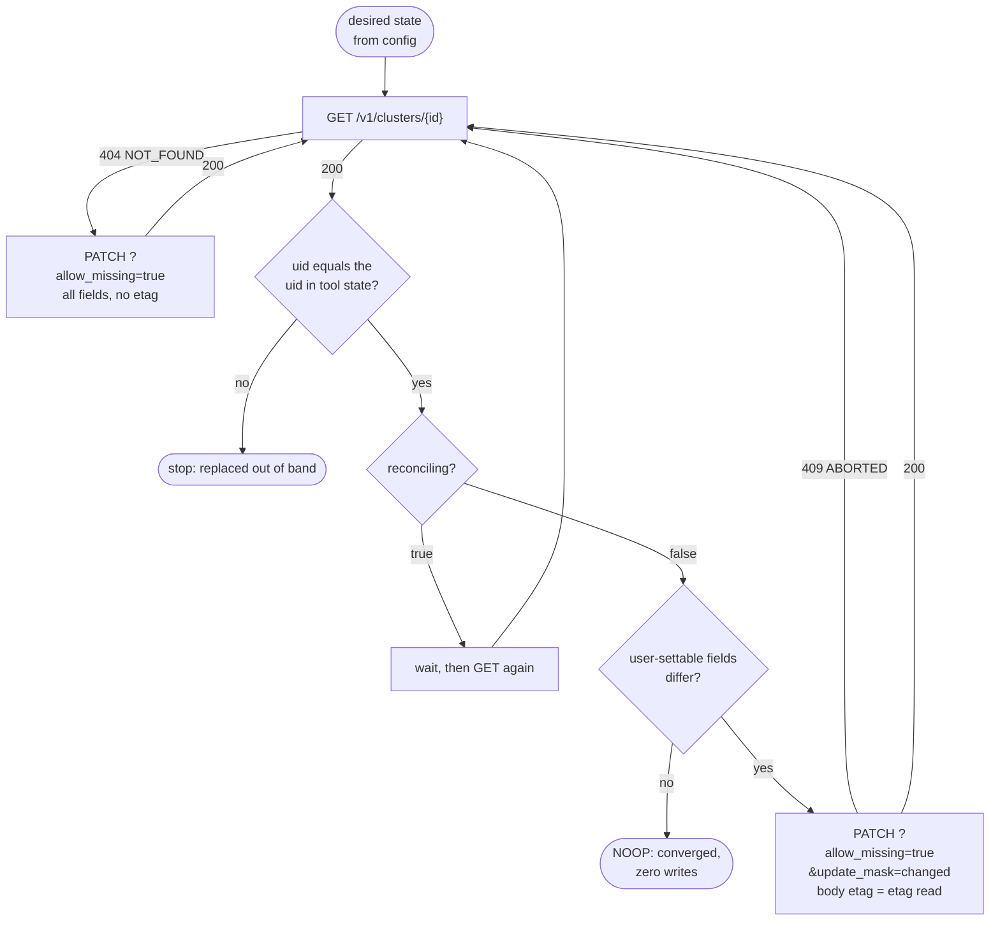

# Declarative-Friendly APIs: Desired vs Reconciling State, uid, etag, and allow_missing Upserts (AIP-128)

> [!summary] Claim
> A resource is declarative-friendly when a tool that only knows the desired end state can converge it with one read and at most one masked write per change: `allow_missing` turns `Update` into create-or-update (AIP-134), `etag` turns that write into a compare-and-swap that fails with `ABORTED` (AIP-154), `uid` tells the tool whether the name still points at the resource it created (AIP-148), and the output-only `reconciling` flag tells it when `GET`, which shows current rather than intended state, is not yet worth diffing (AIP-128).

Part of [REST and Resource Modeling](README.md) in [API Engineering](../README.md).

## TL;DR

- Mechanism: the tool reads the resource, waits while `reconciling` is `true`, diffs the user-settable fields, and sends one `PATCH` with `allow_missing=true`, an `update_mask` of the changed fields, and the `etag` it read; a second run with no change sends zero writes.
- Contract rule: with `allow_missing`, a missing resource is created with every field applied whatever the mask says, an existing one is updated only on masked fields, and an identical one is returned unchanged (AIP-134); a stale `etag` must fail with `ABORTED`, which maps to `409 Conflict` (AIP-154, `google/rpc/code.proto`).
- The trap: `GET` returns current state (AIP-128), so a client that diffs while `reconciling` is `true` sees a change that is already in flight and writes again; and `ALREADY_EXISTS` and `ABORTED` are both `409`, so only the `status` string in the AIP-193 error body tells "pick another name" from "re-read and retry".
- Portability fact: the lab passes unchanged on CPython `3.12.13`, `3.13.18`, `3.14.10`, `3.15.2`, and `3.15.0b3` free-threaded; the conventions are protocol-neutral, but Starlette `1.10.0` keeps the last of duplicated query parameters, so `allow_missing=false&allow_missing=true` silently upserts unless the service rejects duplicates.
- When not to use it: imperative workflows (send an email, rotate a key now) belong in custom methods (AIP-136), and data-plane records without client-chosen IDs cannot be declarative because the tool cannot find them again (AIP-133).

## Mental model



The tool starts from configuration, never from history, so its first move is always a read.
A `404` means create, and the create is the same `PATCH` with `allow_missing=true`, so a create that races another creator degrades into an update rather than a duplicate.
A `200` is first checked by `uid`: the name may now point at a different resource that someone deleted and recreated, and adopting it silently would hand the tool's configuration to an object it never created.
While `reconciling` is `true` the `GET` body describes the system mid-flight, so the tool waits instead of diffing.
Once the resource is steady, the diff decides between `NOOP` and one masked `PATCH` that carries the `etag` it just read; `409 ABORTED` sends it back to the read, because the system told it the read is stale.

## How it works

### The resource contract

AIP-128 asks declarative-friendly resources to use "only strongly-consistent standard methods" and to set `style: DECLARATIVE_FRIENDLY` in the `google.api.resource` annotation (AIP-128, Guidance).
It then delegates almost everything to other AIPs, and each delegation is a field or a flag the tool depends on:

| Requirement | Strength | Source |
|---|---|---|
| `etag` field on the resource | must | AIP-154, Declarative-friendly resources |
| `etag` accepted on `Delete` | must | AIP-135, Protected delete |
| `validate_only` on mutating methods | must (AIP-163) vs should (AIP-128 list) | AIP-163, Declarative-friendly resources |
| `uid`, `display_name`, `create_time`, `update_time` | should | AIP-148 |
| `allow_missing` on `Delete` | should | AIP-135, Delete if existing |
| `allow_missing` on `Update` | may, client-assigned names only | AIP-134, Create or update |
| long-running `Create` and `Update` | should | AIP-133, AIP-134 |
| no custom methods | should not use | AIP-128, Further reading -> AIP-136 |
| client-specified ID on create | must on the management plane | AIP-133, User-specified IDs |

AIP-128 and AIP-163 disagree on strength: the AIP-128 list says resources "should provide change validation", while AIP-163 says a declarative-friendly resource "must include a `validate_only` field on methods that mutate the resource" (both read 2026-11).

### `reconciling`: current state, not intended state

AIP-128 says a resource whose updates take more than a few seconds "should include a `bool reconciling` field", output only, and that a resource "must set the reconciling field to `true` if the current state of the resource does not match the user's intended state", "regardless of whether the root cause of going into reconciliation was user or system action".
Its note is the part that shapes clients: "Services responding to a `GET` request must return the resource's current state (not the intended state)."
The lab models a cluster whose `node_count` the reconciler moves one node per tick, so after `PATCH node_count=5` on a 3-node cluster, `GET` shows `4` then `5`, with `reconciling` `true` until they match (`test_get_returns_current_state_while_reconciling`).
A simulated hardware loss (`ClusterService.lose_nodes`) sets `reconciling` with no user write at all (`test_system_caused_drift_also_sets_reconciling`).

Kubernetes solves the same problem with two stanzas instead of one flag: `spec` is "a complete description of the desired state" and `status` "summarizes the current state", and `PUT` and `POST` "MUST ignore the `status` values" (Kubernetes API conventions, Spec and Status).
It adds `metadata.generation`, "a sequence number representing a specific generation of the desired state", and `observedGeneration`, the generation "most recently observed by the component responsible for acting upon changes" (Kubernetes API conventions, Metadata and Typical status properties; `apimachinery v0.34.1 pkg/apis/meta/v1/types.go, ObjectMeta.Generation` and `Condition.ObservedGeneration`).
The conventions also name the reconciler's contract: "the system's behavior is *level-based* rather than *edge-based*", so after `2 -> 5 -> 3` the system "is not required to 'touch base' at 5".
The lab proves the level-based property: intent `5` is superseded by `3` after one tick, and the observed node counts are `[2, 3, 3, 3, 3, 3, 3]`, never `4` or `5` (`test_reconciler_is_level_based_and_skips_superseded_intent`).

### `allow_missing` on `Update`: the upsert

AIP-134 allows `bool allow_missing` on `Update` only "if the service uses client-assigned resource names", and fixes four behaviours (AIP-134, Create or update):

1. Missing resource: it is created and "all fields are applied regardless of any provided field mask".
2. Missing required fields or invalid values: `INVALID_ARGUMENT`.
3. Existing resource where "all fields match": "the existing resource is returned unchanged".
4. Existing resource otherwise: "only fields declared in the field mask are updated".

Without `allow_missing`, a missing resource is `NOT_FOUND` (`404`) (AIP-134, Errors).
The caller "must have the update permissions to call Update even with `allow_missing` set to `true`", and AIP-134 points services that want to stop creation through `Update` at IAM conditions, which means update permission alone is enough to create unless the service adds a check.
On the wire, the request is a `PATCH` whose body is the resource and whose remaining request fields (`update_mask`, `allow_missing`, `validate_only`) are query parameters (AIP-134, Guidance: "All remaining fields should map to URI query parameters"):

```text
PATCH /v1/clusters/prod-db?allow_missing=true&update_mask=display_name HTTP/1.1
authorization: Bearer admin
content-type: application/json

{"display_name": "Prod DB v2", "node_count": 3, "etag": "\"<16 hex digits>\""}
```

ProtoJSON maps field names to lowerCamelCase and a `FieldMask` to one comma-separated string such as `"f.fooBar,h"`, and parsers accept both the camelCase and the original proto name (protobuf.dev ProtoJSON Format); the lab keeps snake_case for readability.
The mask rules come from the same AIP: an omitted mask means "all fields that are populated", an empty mask is a no-op, and `*` means full replacement (AIP-134, Request message); the sibling note [[Field-Masks-and-Update-Masks-AIP-134-and-AIP-161]] owns the details.
Starlette parses the query string with `parse_qsl(..., keep_blank_values=True)`, so `update_mask=` arrives as an empty string and the lab can tell it apart from an absent mask (`starlette 1.10.0 starlette/datastructures.py, QueryParams.__init__`).

### `etag`: compare-and-swap in the body

AIP-154 makes the `etag` a server-computed string that "should conform to RFC 7232" and should include quotes, so `"foo"`, not `foo`; RFC 7232 has since been obsoleted by RFC 9110, whose Section 8.8.3 now defines `entity-tag`.
A matching `etag` "must permit the request", a mismatching one "must send an `ABORTED` error response" unless another error such as `PERMISSION_DENIED` takes precedence, and an absent one "should" be permitted (AIP-154, Guidance).
On `Update` the `etag` rides inside the resource body; on `Delete` it is a request field because there is no body (AIP-154, Etags on request methods; AIP-135, Protected delete).
`google/rpc/code.proto` explains the choice of code: use `ABORTED` "if the client should retry at a higher level", for example "when a client-specified test-and-set fails, indicating the client should restart a read-modify-write sequence", and its HTTP mapping is `409 Conflict`.
AIP-154's changelog records the switch on 2021-03-05 from `FAILED_PRECONDITION` ("which becomes HTTP 400") to `ABORTED` (`409`).
HTTP's own mechanism for the same guarantee is the `If-Match` header evaluated with strong comparison and answered with `412 Precondition Failed` (RFC 9110 Sections 13.1.1 and 15.5.13); the sibling note [[Optimistic-Concurrency-Control-If-Match-and-412-Precondition-Failed]] covers that path.

The lab computes the `etag` as the first 16 hex digits of SHA-256 over the canonical JSON of the representation, so it changes when the reconciler moves a node even though `update_time` does not (`test_reconciler_progress_changes_the_etag`).
That is AIP-148's rule for timestamps (user changes "must refresh" `update_time`, internal changes "may") combined with AIP-154's description of the `etag` as a checksum "based on the current content of a resource".
The cost is real: a declarative client holding an `etag` from mid-reconciliation will get `ABORTED` even if no human touched the resource, which is one more reason to wait for `reconciling: false` before planning.

### `uid`: the name is not the identity

AIP-148 defines `uid` as an output-only, system-assigned UUID4 that declarative-friendly resources should include.
Kubernetes states the reason directly: `uid` is "used to distinguish between objects with the same name that have been deleted and recreated" (Kubernetes API conventions, Metadata), and `DeleteOptions.Preconditions` carries an optional `UID` so a delete can be bound to one incarnation (`apimachinery v0.34.1 pkg/apis/meta/v1/types.go, Preconditions`).
A UUIDv4 carries 122 random bits, with the version and variant bits overwritten (RFC 9562 Section 5.4), and RFC 9562 Section 6.9 says implementations "SHOULD utilize a cryptographically secure pseudorandom number generator".
The lab's client stores the `uid` it created, like a tool's state file, and raises `ReplacedOutOfBandError` when the same name later returns another `uid` (`test_client_detects_out_of_band_replacement_by_uid`).

### `allow_missing` on `Delete`, and `validate_only`

With `allow_missing`, deleting a missing resource "is a no-op" and "the `etag` field is ignored"; AIP-135 says declarative-friendly resources should expose it, which makes `destroy` idempotent.
Permission "must be checked prior to checking if the resource exists", so a caller without permission sees `PERMISSION_DENIED` (`403`) rather than learning existence from `404` (AIP-135, Errors).
`validate_only` must run the permission checks and every other validation of a live request, and "must fail if it determines that the actual request would fail" (AIP-163); for a create it should omit values such as generated IDs, so the lab omits `uid` and `etag` from a validate-only create.

### Output-only fields on input

A declarative tool often sends back what it read.
AIP-203 says that for an `OUTPUT_ONLY` field, "the server must clear out any value in this field and must not throw an error", and must ignore such fields in update masks (AIP-203, Output only).
The lab drops `uid`, `etag`, `reconciling`, `create_time`, `update_time`, and `name` from the input before applying it, then reads `etag` separately for the precondition (`test_output_only_fields_in_input_are_ignored_without_error`).

## Numbers and limits

| Quantity | Value | Source |
|---|---|---|
| `annotations` total size | `262144` bytes, summed over `len(key) + len(value)` in bytes (lab: UTF-8 bytes) | `apimachinery v0.34.1 pkg/api/validation/objectmeta.go, TotalAnnotationSizeLimitB` and `ValidateAnnotationsSize`; AIP-148 requires "the Kubernetes limits"; lab boundary test accepts `262144` and rejects `262145` |
| `display_name` length | `<= 63` characters | AIP-148, `display_name` |
| Client-assigned ID | 4 to 63 characters from `/[a-z][0-9]-/` (example guidance) | AIP-133, `CreateBookRequest` comment |
| `request_id` | up to 36 ASCII characters, UUID recommended (example comment) | AIP-155 |
| `uid` randomness | 122 random bits in a UUIDv4 | RFC 9562 Section 5.4 |
| `ABORTED`, `ALREADY_EXISTS` | both `409 Conflict` | `google/rpc/code.proto` HTTP Mapping lines |
| `FAILED_PRECONDITION`, `INVALID_ARGUMENT` | both `400 Bad Request` | `google/rpc/code.proto` |
| Converge from nothing to 3 nodes | 1 write, 5 reads, 3 reconciler ticks; rerun: 1 read, 0 writes | measured in the lab, `test_converge_from_nothing_is_one_write_and_rerun_is_zero` |
| Scale 3 -> 6 nodes | 1 write, actions `UPDATE, WAIT, WAIT, WAIT, NOOP` | measured, `test_client_waits_instead_of_rewriting_while_reconciling` |
| Recovery from a 3-node hardware loss | 0 client writes | measured, `test_client_does_not_fight_system_repair` |
| Lost-update race inside `converge` | 2 writes (one `409 ABORTED`, one success) | measured, `test_converge_rereads_after_a_race_inside_its_own_loop` |
| Lab runtime | `50 passed in 0.12s` (`0.11s` to `0.15s` over six runs) | `uv run --frozen pytest <test> -q`, CPython `3.14.6`, macOS 27.2 arm64 (Darwin `27.2.0`), re-measured 2026-11-10 |

The write and read counts are deterministic because the reconciler is a counter the test advances, not wall-clock time; they describe this lab's model, not any production service.

## Portability

| Dimension | Version | Result |
|---|---|---|
| CPython | `3.12.16` | `50 passed` in the `python:3.12.16-trixie` and `python:3.12.16-alpine` containers (see the container row); the host has only `3.12.13`, which also gave `50 passed` via `UV_PROJECT_ENVIRONMENT=../tmpvenv-3.12 uv run --frozen --python 3.12 pytest ...` |
| CPython | `3.13.18` | `50 passed`, isolated environment, `--python /opt/homebrew/bin/python3.13` |
| CPython | `3.14.10` | `50 passed`, isolated environment; the workspace `.venv` (`3.14.6`) also passes |
| CPython | `3.15.2` | `50 passed`, isolated environment, `--python /opt/homebrew/bin/python3.15` |
| CPython free-threaded | `3.15.0b3+freethreaded` (`3.15.2t` is not installed here and has no image here), `sys._is_gil_enabled()` is `False` | `50 passed` via `PYTHONPATH=src uv run --no-project --python 3.15t --with starlette==1.10.0 --with httpx==0.28.1 ... python -m pytest ...`, because the lock has no `psycopg-binary 3.3.8` wheel for that interpreter |
| Starlette | `1.10.0` | duplicated query parameters: last value wins (`ImmutableMultiDict.__init__` builds a `dict`); blank values kept; both read in source and exercised by the lab |
| Containers (Linux aarch64, Docker `29.8.2`) | Debian Trixie (glibc) and Alpine (musl) images of `python:3.12.16`, `3.13.18`, `3.14.10`, `3.15.2` | `50 passed` in each of the eight images, 2026-11-10: `docker run --rm -v "$PWD":/src:ro <image>` then `pip install starlette==1.10.0 httpx==0.28.1 httpcore==1.0.9 anyio==4.16.0 pytest==9.2.0 pytest-asyncio==1.4.1.post1` and `PYTHONPATH=src python -m pytest <test> -q`; the `3.15.2t` free-threaded build was not run in a container |
| httpx | `0.28.1` | `ASGITransport` in-process transport; all 50 tests run without sockets |
| Uvicorn, Hypercorn, Granian | `0.54.0`, `0.18.0`, `2.8.7` | a verifier smoke run (not part of the lab) served `build_app` on each server over loopback and drove it with httpx: converge `CREATE, WAIT, WAIT, WAIT, NOOP` with 1 write, rerun `NOOP`, duplicated `allow_missing` -> `400 INVALID_ARGUMENT`, `ETag` header equal to the body `etag`, stale `etag` -> `409 ABORTED`; each server passes both duplicated values through to the app |
| HTTP/1.1, HTTP/2, HTTP/3 | RFC 9110 semantics | HTTP/1.1 passed the smoke run on all three servers; HTTP/2 cleartext with prior knowledge (httpx `http2=True`, `h2 4.4.1`) passed on Hypercorn and Granian (`--http 2`); Uvicorn has no HTTP/2; no HTTP/3 (QUIC) leg was run here, so that cell rests on the specifications: RFC 9114 Section 1 says "HTTP/3 supports the same semantics over a new transport protocol: QUIC", and RFC 9110 Section 1.2 says "All three major versions of HTTP rely on the semantics defined by this document"; the contract uses only method, path, query, JSON body, status, and the `ETag` field, all defined by RFC 9110 and carried unchanged by RFC 9114 Section 4 |
| gRPC | AIP transcoding | AIPs are written proto-first and map to HTTP by `google.api.http` (AIP-127: "APIs must provide HTTP definitions for each RPC that they define"); no gRPC leg was run here, so the cell rests on `google/api/http.proto`: with `body` set, the fields it names travel in the body and "all other fields are passed via the URL query parameters", which is how `allow_missing`, `update_mask`, and `validate_only` reach this lab as query parameters and `etag` as a body field of the resource |

## Worked example

The [implementation](../labs/src/api_labs/f04_rest_and_resource_modeling/declarative_friendly.py) holds the `ClusterService` (store, reconciler, the four standard methods), a Starlette app that maps them onto HTTP with AIP-193 error bodies, and the `DeclarativeClient`; the [test](../labs/tests/f04_rest_and_resource_modeling/test_declarative_friendly_apis_and_reconciliation_loops_aip_128.py) has 50 in-process tests.

The service's `Update`, verbatim excerpt (lines 252-305 of the implementation):

```python
    def update(
        self,
        token: str | None,
        cluster_id: str,
        body: JSONObject,
        *,
        update_mask: list[str] | None,
        allow_missing: bool,
        validate_only: bool,
    ) -> JSONObject:
        # Permission before existence, so a 404 never leaks to an unauthorized caller.
        self._authorize(token, "clusters.update")
        fields = _input_fields(body)
        record = self.records.get(cluster_id)
        if record is None:
            if not allow_missing:
                raise ApiError(Code.NOT_FOUND, f"clusters/{cluster_id} not found")
            if self.upsert_requires_create:
                self._authorize(token, "clusters.create")
            if body.get("etag") not in (None, ""):
                # Lab design choice: an etag names a version that no longer exists.
                raise ApiError(Code.ABORTED, "etag given but the resource does not exist")
            if CLUSTER_ID.fullmatch(cluster_id) is None:
                raise ApiError(Code.INVALID_ARGUMENT, f"cluster_id must match {CLUSTER_ID.pattern}")
            # AIP-134: on create every field applies, whatever the update_mask says.
            return self._insert(cluster_id, _spec_from(fields), validate_only)
        self._check_etag(record, body.get("etag"))
        if update_mask is None:  # AIP-134: implied mask of the populated fields
            paths = [key for key, value in fields.items() if _is_populated(value)]
        elif update_mask == ["*"]:
            paths = list(SPEC_FIELDS)
        else:
            paths = [path for path in update_mask if path not in OUTPUT_ONLY_FIELDS]
        merged: JSONObject = {
            "display_name": record.desired.display_name,
            "node_count": record.desired.node_count,
            "annotations": record.desired.annotations,
        }
        for path in paths:
            if path not in SPEC_FIELDS:
                raise ApiError(Code.INVALID_ARGUMENT, f"unknown update_mask path {path!r}")
            if path in fields:
                merged[path] = fields[path]
            else:
                merged.pop(path)  # a masked but absent field is cleared
        spec = _spec_from(merged)
        if spec == record.desired:
            return self.represent(record)  # AIP-134: all fields match, returned unchanged
        candidate = replace(record, desired=spec, update_time=self.clock)
        if validate_only:
            return self.represent(candidate)
        self.records[cluster_id] = candidate
        self.commits += 1
        return self.represent(candidate)
```

The client's plan and converge loop, verbatim excerpt (lines 457-502):

```python
    async def plan(self, cluster_id: str, desired: JSONObject) -> Plan:
        response = await self.http.get(f"/v1/clusters/{cluster_id}", headers=self._auth)
        if response.status_code == 404:
            return Plan(Action.CREATE)
        response.raise_for_status()
        current: JSONObject = response.json()
        uid = str(current["uid"])
        known = self.known_uids.setdefault(cluster_id, uid)
        if known != uid:
            raise ReplacedOutOfBandError(f"clusters/{cluster_id}: uid {known} became {uid}")
        if current["reconciling"] is True:
            return Plan(Action.WAIT)  # GET shows the current state, so a diff now is noise
        mask = tuple(sorted(key for key, value in desired.items() if current.get(key) != value))
        if not mask:
            return Plan(Action.NOOP)
        return Plan(Action.UPDATE, mask, str(current["etag"]))

    async def apply(self, cluster_id: str, desired: JSONObject, plan: Plan) -> httpx.Response:
        body = dict(desired) if plan.etag is None else {**desired, "etag": plan.etag}
        params = {"allow_missing": "true", "update_mask": ",".join(plan.update_mask)}
        self.write_requests += 1
        response = await self.http.patch(
            f"/v1/clusters/{cluster_id}", params=params, json=body, headers=self._auth
        )
        if response.status_code == 200:
            self.known_uids[cluster_id] = str(response.json()["uid"])
        return response

    async def converge(
        self, cluster_id: str, desired: JSONObject, tick: Callable[[], None], max_rounds: int = 20
    ) -> list[Action]:
        """Plan and apply until a plan is a no-op; re-read after ABORTED (code.proto)."""
        actions: list[Action] = []
        for _ in range(max_rounds):
            plan = await self.plan(cluster_id, desired)
            actions.append(plan.action)
            if plan.action is Action.NOOP:
                return actions
            if plan.action is Action.WAIT:
                tick()
                continue
            response = await self.apply(cluster_id, desired, plan)
            if response.status_code == 409 and error_status(response) == Code.ABORTED:
                continue
            response.raise_for_status()
        raise RuntimeError(f"no convergence in {max_rounds} rounds: {actions}")
```

The test that pins the declarative property (zero writes on the second run), verbatim excerpt (lines 396-406 of the test):

```python
@pytest.mark.unit
@pytest.mark.asyncio
async def test_converge_from_nothing_is_one_write_and_rerun_is_zero(
    http: httpx.AsyncClient, service: ClusterService
) -> None:
    client = DeclarativeClient(http, "admin")
    actions = await client.converge("prod-db", DESIRED, service.tick)
    assert actions == [Action.CREATE, Action.WAIT, Action.WAIT, Action.WAIT, Action.NOOP]
    assert (client.write_requests, service.commits) == (1, 1)
    assert await client.converge("prod-db", DESIRED, service.tick) == [Action.NOOP]
    assert client.write_requests == 1
```

Captured on CPython `3.14.6`, macOS 27.2 arm64, from `labs/`:

```text
$ uv run --frozen pytest tests/f04_rest_and_resource_modeling/test_declarative_friendly_apis_and_reconciliation_loops_aip_128.py -q
..................................................                       [100%]
50 passed in 0.12s
```

The suite was checked by mutation in two passes.
The drafter reports 48 deliberate breaks, and an independent re-run of 20 of them (applying the mask on an `allow_missing` create, accepting a mismatched `etag`, returning intended instead of current `node_count`, a reconciler that chases a superseded intent, a client that ignores `reconciling`, a client that drops the `etag`, checking existence before permission in `Update` and in `Delete`, keeping the last duplicated query parameter, and 11 more) made at least one test fail each.
A finishing pass ran 8 more breaks against the 48-test suite: 5 failed a test, and 3 survived (counting annotation size in characters instead of UTF-8 bytes, a reconciler that always adds a node, and an uncounted delete commit), so the suite gained two tests and two assertions (`test_annotation_budget_counts_utf8_bytes_not_characters`, `test_scale_down_converges_one_node_per_tick_toward_the_intent`, and commit counts in the two delete tests) and all three now fail a test.
The module was restored byte-for-byte (SHA-256 checked) after every run.

## Pitfalls

> [!warning] Diffing while `reconciling` is `true`
> Trigger: a tool plans from `GET` while the service is still acting on the previous change, which AIP-128 requires `GET` to show as current state.
> Symptom: every plan shows the in-flight field as a change, so the tool keeps writing; with the lab's no-op rule each extra write is harmless, but it costs a request, can land on a fresh `etag`, and in a service that is not idempotent restarts the work.
> Fix: wait on `reconciling` (or on the long-running operation, AIP-151) before diffing; the lab's mutation that drops the wait fails seven tests.

> [!warning] Reading `409` without reading `status`
> Trigger: a client retries every `409 Conflict`.
> Symptom: `ALREADY_EXISTS` from a create is retried forever, or `ABORTED` is treated as fatal and the tool gives up on a simple race; both map to `409` (`google/rpc/code.proto`).
> Fix: branch on the AIP-193 `error.status` string: `ABORTED` means re-read and re-plan, `ALREADY_EXISTS` means the name is taken; the lab's client retries only `ABORTED` and raises on everything else.

> [!warning] An `etag` that moves with system state
> Trigger: the `etag` hashes fields the system changes on its own, as AIP-154's "checksum based on the current content" invites and as this lab does.
> Symptom: a tool that read the resource mid-reconciliation gets `ABORTED` with no human writer involved, and a long reconciliation can starve a read-modify-write loop.
> Fix: plan only from a steady read; or document the `etag` as weak and compute it over user-settable fields only, which AIP-154 permits ("Resources may use either strong or weak etags") at the price of not detecting system changes.

> [!warning] Adopting a recreated resource by name
> Trigger: someone deletes and recreates a resource with the same client-assigned name between two tool runs.
> Symptom: the tool's next plan diffs against a new object with new dependencies, secrets, or data, and quietly "fixes" it into the old configuration.
> Fix: store `uid` in tool state and stop when it changes; Kubernetes adds a delete precondition on `uid` for the same reason (`apimachinery v0.34.1, Preconditions`).

> [!warning] Configuration stored in annotations
> Trigger: a client keeps its own state in the resource, which AIP-148 explicitly allows ("Annotations exist to allow client tools to store their own state information without requiring a database"), and Kubernetes' client-side apply does with `kubectl.kubernetes.io/last-applied-configuration` (Kubernetes Server-Side Apply documentation).
> Symptom: the annotation budget is `262144` bytes across all keys and values (`TotalAnnotationSizeLimitB`), so a large enough configuration cannot be stored, and every tool shares the same budget.
> Fix: keep annotations small and dot-namespaced (AIP-148), and prefer server-side tracking of field ownership, which Kubernetes moved to with Server-Side Apply; no public incident is cited here, the limit and the mechanism are each read from source.

## Security and robustness

- `allow_missing` is a create path behind an update permission: AIP-134 requires only update permission, so a principal granted `update` but not `create` can create resources unless the service adds a check; the lab proves both outcomes with `upsert_requires_create` off (`200`, one resource) and on (`403`, none) (`test_update_permission_alone_can_create_through_allow_missing`).
- Existence oracle: checking permission before existence (AIP-135, Errors) keeps `404` from telling an unauthorized caller which names exist; the lab answers a reader's `PATCH` on a missing name with `403 PERMISSION_DENIED`, and a mutation that swaps the order fails one test in `Update` and, separately, one in `Delete`.
- Mass assignment (OWASP API3:2023 Broken Object Property Level Authorization, previously "Mass Assignment"): output-only fields are dropped without error as AIP-203 requires, and unknown fields are rejected with `INVALID_ARGUMENT`, so a body cannot set `uid`, `reconciling`, or an invented `is_admin`; see [[Defeating-BOPLA-and-Mass-Assignment-API3-2023-Strict-Input-Output-Schemas]].
- Parameter pollution: Starlette `1.10.0` keeps the last of duplicated query parameters, so `?allow_missing=false&allow_missing=true` reaches the service as `true`; a proxy or WAF that reads the first value would see a different request than the service, so the lab rejects any repeated control parameter with `400` (`test_duplicated_control_parameter_is_rejected_not_last_wins`).
- Strict booleans: `allow_missing=yes` is `INVALID_ARGUMENT`, not `false`, so a typo cannot silently turn an upsert into a `404` or the reverse.
- Unguessable `uid`: the lab seeds `random.Random` so tests are deterministic; a service must draw `uid` bits from a CSPRNG (RFC 9562 Section 6.9), because a predictable `uid` lets an attacker forge the delete precondition that is supposed to bind to one incarnation.
- Bounded input: `display_name <= 63` characters, `node_count` in `1..100` (a lab choice), annotation keys dot-namespaced and the whole map `<= 262144` bytes, and the body must be a JSON object; each limit has a test.
- Defense in depth for `validate_only`: it runs the same authorization and `etag` checks as the real call (AIP-163), so it cannot be used to probe state that the real call would refuse to touch.

## The principal's view

The decision is not whether to add `allow_missing`; it is whether the API is a control plane that tools will drive by desired state, and that decision fixes the resource model before the first field is named.
If the answer is yes, client-assigned names, `etag`, `uid`, and a way to expose in-flight work are not optional extras, because a tool that cannot find, fence, and identify a resource falls back to storing provider IDs, guessing at conflicts, and recreating things, which AIP-133's rationale describes as forcing every dependent resource to change.
AIP-128 chooses a single representation plus a `reconciling` bit and pushes intent tracking into long-running operations; Kubernetes chooses `spec`, `status`, `generation`, and `observedGeneration`, which lets any reader see intent and progress separately at the price of two write paths and a `/status` subresource with its own authorization.
For a new control plane I would take the Kubernetes split when many independent controllers act on the same object, and the AIP shape when one service owns reconciliation and clients mostly read results, because it keeps a single representation for every client and leaves intent tracking to the LRO.
Organizationally, declarative-friendliness is a platform property: one team that adds a custom method for a state change, or a `PUT` that clears unknown fields, breaks every tool integration at once, so it belongs in the API linter and design review (see [[Google-AIP-System-Architecture-and-Core-Tenets]]), not in each team's judgment.
Choose an imperative or event API instead when the operation has no steady state to converge to (a payment, a message send, a one-time key rotation), or when the work is a workflow whose intermediate steps matter; forcing those into declarative shape produces resources whose `reconciling` never means anything.

## Interview questions

> [!question] L5: What does `PATCH .../clusters/prod-db?allow_missing=true&update_mask=display_name` with `{"display_name": "x", "node_count": 3}` create when the cluster does not exist?
>
> > [!success]- Answer
> > A cluster with `display_name` `x` and `node_count` `3`.
> > AIP-134 says that when the resource is missing, "all fields are applied regardless of any provided field mask".
> > If `node_count` were required and absent, the call would fail with `INVALID_ARGUMENT` and create nothing.
> >
> > Follow-up: What does the same request do if the cluster exists with `node_count` `5`?

> [!question] L5: Why does a declarative-friendly resource carry a `uid` when its name is already unique?
>
> > [!success]- Answer
> > The name is unique at a moment, not across time: a client-assigned name can be deleted and reused.
> > `uid` is system-assigned and changes on recreate, so a tool can tell its resource from a replacement (AIP-148; Kubernetes API conventions, Metadata).
> > The lab's client stops with `ReplacedOutOfBandError` when the `uid` changes.
> >
> > Follow-up: Where else would you use `uid` as a precondition?

> [!question] L5: Predict the output: after the lab creates `prod-db` with `node_count: 3` and the reconciler ticks once, what do `GET`'s `node_count`, `reconciling`, `etag`, and `update_time` show compared with the create response?
>
> > [!success]- Answer
> > `node_count` is `1` and `reconciling` is `true`, because `GET` shows current state and the reconciler adds one node per tick.
> > The `etag` differs, because the lab hashes the current representation and the node count changed.
> > `update_time` is unchanged, because a system step is not a user change (AIP-148 says internal changes "may" refresh it; the lab does not).
> > `test_reconciler_progress_changes_the_etag` asserts all four.
> >
> > Follow-up: What happens if the client now sends an update with the `etag` from the create response?

> [!question] L6: `ALREADY_EXISTS` and `ABORTED` both arrive as `409 Conflict`, so how must a client tell them apart, and what does it do for each?
>
> > [!success]- Answer
> > It reads `error.status` in the AIP-193 body, not the HTTP status.
> > `ABORTED` means a test-and-set failed, so the client restarts the read-modify-write sequence (`google/rpc/code.proto` guidance).
> > `ALREADY_EXISTS` means the client-chosen name is taken; retrying the same create can never succeed.
> > A client that retries every `409` loops forever on a taken name.
> >
> > Follow-up: Which code would you return for an `etag` mismatch on a `Delete`, and why not `FAILED_PRECONDITION`?

> [!question] L6: Debug this API: why does a Terraform-style tool report a `node_count` change and send a `PATCH` that changes nothing on every run while a cluster scales from 3 to 50 nodes?
>
> > [!success]- Answer
> > The tool diffs `GET`, which AIP-128 requires to show current state, while `reconciling` is `true`.
> > Every plan sees the in-flight count as drift and writes the same intent again, which the service treats as "all fields match" and returns unchanged.
> > Fix the client to wait on `reconciling: false` or on the operation before diffing; if the service does not expose `reconciling`, it violates AIP-128 for slow updates.
> > The lab shows the correct client sending one write for `3 -> 6`, and the mutation that removes the wait fails.
> >
> > Follow-up: How would you detect this from server-side metrics alone?

> [!question] L6: AIP-134 lets a caller with update permission create a resource through `allow_missing`, so what is the risk and how do you contain it?
>
> > [!success]- Answer
> > Creation may be governed separately (quota, cost, naming policy), and `allow_missing` bypasses a `create` grant that the operator thought was required.
> > AIP-134 keeps the update permission requirement and points at IAM conditions to stop creation through `Update`.
> > A service can also require the create permission on the missing branch, as the lab's `upsert_requires_create` flag does.
> >
> > Follow-up: Why must the permission check still happen before the existence check?

> [!question] L7+: For a new infrastructure control plane, would you use the AIP-128 shape (one representation plus `reconciling`) or the Kubernetes shape (`spec`, `status`, `generation`, `observedGeneration`)?
>
> > [!success]- Answer
> > The Kubernetes shape when several controllers act on one object, because readers can see intent, observation, and staleness separately and controllers write `status` under separate authorization.
> > The AIP shape when one service owns reconciliation, because there is one representation and intent is tracked by the long-running operation.
> > The cost of the split is two write paths and stricter authorization design; the cost of the single representation is that intent is invisible after the operation is gone.
> > Either way the reconciler must be level-based, reading the latest intent rather than replaying a queue.
> >
> > Follow-up: How would you expose `observedGeneration` semantics in an AIP-style API without a `status` stanza?

> [!question] L7+: What breaks when your `etag` hashes the full current representation and the reconciler changes it every few seconds during a 20-minute rollout, and what are your options?
>
> > [!success]- Answer
> > Any client that read the resource during the rollout gets `ABORTED` on its next write, so read-modify-write loops starve and tools report spurious conflicts.
> > Option one: keep the strong `etag` and require clients to plan only from steady reads.
> > Option two: compute a weak `etag` over user-settable fields, which AIP-154 permits with the `W/` prefix, accepting that system changes no longer fence writes.
> > Option three: separate intent from observation, as Kubernetes does with `generation`, and fence on the intent version.
> >
> > Follow-up: Which of these keeps `If-Match` semantics correct for an HTTP-native client?

> [!question] L7+: Why must the reconciler be level-based, and how would you test that it is?
>
> > [!success]- Answer
> > Intent can change faster than the system converges, and missed or reordered events must not matter; the Kubernetes conventions say the system drives toward the most recent `spec` regardless of previous versions of that stanza.
> > An edge-based reconciler that replays each intent visits superseded states, which costs time and can take real actions (scaling up to 5 before going down to 3).
> > Test: change intent twice mid-flight and assert the observed trajectory never visits the superseded value; the lab asserts `[2, 3, 3, 3, 3, 3, 3]` for `1 -> 5 -> 3`.
> >
> > Follow-up: How does a level-based reconciler recover after it was down for an hour?

## Related

Prerequisites: [[Resource-Revisions-and-Historical-Snapshots-AIP-162]]

Next: [[Field-Behavior-Semantics-Input-Only-Output-Only-and-Immutable-AIP-203]]

See also: [[Full-Replacement-PUT-and-Upsert-Semantics]], [[Field-Masks-and-Update-Masks-AIP-134-and-AIP-161]], [[Custom-Methods-and-State-Machine-Transitions-AIP-136]], [[Soft-Delete-Undelete-and-Expiration-Lifecycles-AIP-164]], [[Resource-Identifiers-UUIDv4-vs-UUIDv7-ULID-and-Public-IDs]], [[Resource-Oriented-Design-Collections-Resources-and-Subresources]], [[HTTP-Method-Semantics-Safety-and-Idempotency-Invariants]], [[HTTP-Status-Code-Taxonomy-and-Selection-Decision-Trees]], [[Optimistic-Concurrency-Control-If-Match-and-412-Precondition-Failed]], [[Strong-vs-Weak-Validators-ETag-and-Last-Modified]], [[Long-Running-Operations-202-Accepted-and-Operation-Resources-AIP-151]], [[Dry-Run-and-Validate-Only-Requests-AIP-163]], [[Google-AIP-193-Error-Model-and-Rich-Error-Details]], [[Error-Taxonomy-Retryability-and-Client-Contract-Design]], [[Idempotent-Request-Identification-and-Request-ID-Correlation-AIP-155]], [[Google-AIP-System-Architecture-and-Core-Tenets]], [[Defeating-BOPLA-and-Mass-Assignment-API3-2023-Strict-Input-Output-Schemas]]

- Lab: `labs/tests/f04_rest_and_resource_modeling/test_declarative_friendly_apis_and_reconciliation_loops_aip_128.py`

## Further reading

- [AIP-128: Declarative-friendly interfaces](https://google.aip.dev/128) - the `reconciling` field, the current-state rule for `GET`, and the list of stricter rules in other AIPs.
- [AIP-134: Standard methods: Update](https://google.aip.dev/134) - `allow_missing` create-or-update semantics, mask rules, and the update-permission requirement.
- [AIP-135: Standard methods: Delete](https://google.aip.dev/135) - protected delete with `etag`, `allow_missing` delete, and permission-before-existence.
- [AIP-154: Resource freshness validation](https://google.aip.dev/154) - the `etag` contract and its `ABORTED` error.
- [AIP-148: Standard fields](https://google.aip.dev/148) - `uid`, `annotations`, and the timestamp fields.
- [AIP-133: Standard methods: Create](https://google.aip.dev/133) - why declarative clients need user-specified IDs.
- [AIP-163: Change validation](https://google.aip.dev/163) - `validate_only` and its must-fail-when-real-fails rule.
- [AIP-203: Field behavior documentation](https://google.aip.dev/203) - output-only fields on input are cleared without error.
- [AIP-193: Errors](https://google.aip.dev/193) - the HTTP/1.1+JSON error body whose `status` distinguishes the two `409`s.
- [google/rpc/code.proto](https://github.com/googleapis/googleapis/blob/master/google/rpc/code.proto) - canonical codes, their HTTP mappings, and the `ABORTED` vs `FAILED_PRECONDITION` guidance.
- [Kubernetes API conventions](https://github.com/kubernetes/community/blob/master/contributors/devel/sig-architecture/api-conventions.md) - `spec` and `status`, level-based behaviour, `generation`, `resourceVersion`, and `uid`.
- [Kubernetes Server-Side Apply](https://kubernetes.io/docs/reference/using-api/server-side-apply/) - field ownership and conflicts as the server-side answer to client-side apply.
- [RFC 9110 Section 13.1.1: If-Match](https://www.rfc-editor.org/rfc/rfc9110.html#section-13.1.1) - the HTTP-native precondition that AIP etags parallel.
- [RFC 9562 Section 5.4: UUID Version 4](https://www.rfc-editor.org/rfc/rfc9562.html#section-5.4) - the format AIP-148 requires for `uid`.
