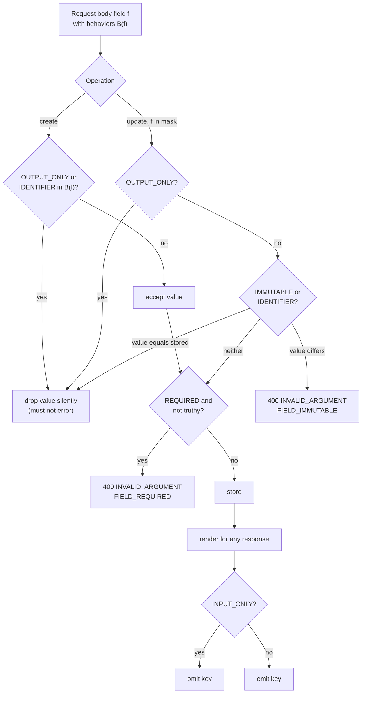

# Field Behavior Contracts: REQUIRED, OUTPUT_ONLY, INPUT_ONLY, and IMMUTABLE Fields (Google AIP-203)

> [!summary] Claim
> AIP-203 field behaviors are a per-field contract about direction and lifetime (who may write a field, when, and whether it is ever read back), and because the annotation itself "does not itself add any validation", every guarantee exists only if the server enforces it from one registry on create, update, output, and schema generation.

Part of [REST and Resource Modeling](README.md) in [API Engineering](../README.md).

## TL;DR

- Mechanism: `google.api.field_behavior` is a repeated enum option (extension number `1052` on `google.protobuf.FieldOptions`) attached to each field's descriptor, never to message bytes, so a server must read it and act on it per request (`field_behavior.proto`).
- Contract rule: `OUTPUT_ONLY` input is cleared without error, `IMMUTABLE` input is ignored when equal and rejected with `INVALID_ARGUMENT` when different, `INPUT_ONLY` is never emitted, and `REQUIRED` means a "truthy" value is stored, not merely that a key is present (AIP-203 Vocabulary).
- The trap: Pydantic's nearest tools mean something else: `Field(frozen=True)` guards attribute assignment only, `extra="forbid"` turns a harmless round-tripped `uid` into a `422`, `SecretStr` still emits the key, and a required `str` accepts `""` (measured in the lab, pydantic 2.14.3).
- Portability: the behavior is application-layer JSON policy, so the lab's 40 tests pass unchanged on CPython 3.12.13, 3.12.16, 3.13.18, 3.14.6, 3.14.10, 3.15.2, free-threaded 3.14.6t and 3.15.0b3t, and in Debian Trixie and Alpine containers, and the same create, immutable-change, and output-only-mask scenario passes the same assertions under Uvicorn, Hypercorn, and Granian over HTTP/1.1 and HTTP/2 (h2c).
- When not to use it: do not annotate "conditionally immutable" fields as `IMMUTABLE` (AIP-203 forbids it), and do not lean on `OUTPUT_ONLY` as authorization; per-caller property permissions are OWASP API3 territory, not a static field annotation.

## Mental model



Every arrow is decided by one lookup, the field's behavior set, plus the operation in progress.
On create, server-owned values (`OUTPUT_ONLY` and the `IDENTIFIER` field `name`) leave the request on the "drop" arrow before validation, so a client that echoes back a fetched resource never fails.
On update, only paths in the update mask (or, with no mask, the fields the client sent) enter the diagram; output-only paths take the same silent "drop" arrow, immutable paths are compared to the stored value, and only a real change takes the `400` arrow.
`REQUIRED` is checked against truthiness after those filters, so a required field absent from the mask is never checked at all, which is exactly AIP-203's rule that an update "may omit the field provided that the field is also absent from the field mask".
Output is a separate gate: whatever got stored, `INPUT_ONLY` keys never reach the wire.

## How it works

### The annotation is descriptor metadata, not payload

`field_behavior.proto` declares `extend google.protobuf.FieldOptions { repeated google.api.FieldBehavior field_behavior = 1052; }`, so the behaviors are options on the field descriptor compiled into the schema, and they add zero bytes to any serialized message (`googleapis google/api/field_behavior.proto`).
The enum has nine values: `FIELD_BEHAVIOR_UNSPECIFIED = 0`, `OPTIONAL = 1`, `REQUIRED = 2`, `OUTPUT_ONLY = 3`, `INPUT_ONLY = 4`, `IMMUTABLE = 5`, `UNORDERED_LIST = 6`, `NON_EMPTY_DEFAULT = 7`, and `IDENTIFIER = 8`, and the file warns that the enum "may receive new values in the future".
The proto comment is explicit that the option "does not change the behavior in protocol buffers itself; it only denotes the behavior and may affect how API tooling handles the field".
AIP-203 repeats the point: "The vocabulary given in this document is for descriptive purposes only, and does not itself add any validation" (AIP-203 Guidance).
Consequence: a JSON request with `"uid": "forged"` and one without it are both valid wire messages, and the difference in outcome is entirely server code.

### What each value obliges the server to do

AIP-203 makes the annotation mandatory on every field of a message used in a request (since 2023-05, AIP-203 History), forbids `FIELD_BEHAVIOR_UNSPECIFIED`, and requires at least one of `REQUIRED`, `OPTIONAL`, or `OUTPUT_ONLY` (AIP-203 Guidance); the exceptions are the AIP-154 `etag` field, which "should not" carry an annotation, and `oneof` fields, which "may" omit it but "should" document their behaviors in comments.
Unannotated fields are read as `OPTIONAL` for backward compatibility, yet the annotation still "must not be omitted".

| Behavior | Server obligation (AIP-203 Vocabulary) | Lab mechanism |
| --- | --- | --- |
| `REQUIRED` | Create must supply a value; the stored value must be "truthy"; an update may omit it only if it is absent from the mask | `plan_create` and `plan_update` call `is_truthy` |
| `OPTIONAL` | Not required | no check |
| `OUTPUT_ONLY` | "must clear out any value" and "must not throw an error"; "must ignore" it in update masks | dropped into `Plan.ignored` |
| `INPUT_ONLY` | Provided in requests, "not included in output"; "rare", for example `ttl` (AIP-214) | `render` excludes it |
| `IMMUTABLE` | "should ignore the field if the value matches, but should error with `INVALID_ARGUMENT` if a change is requested", even when the field is in the mask | equality check, else `FIELD_IMMUTABLE` |
| `IDENTIFIER` | Only on `name`; behaves as `OUTPUT_ONLY` on create and `IMMUTABLE` on update | both rules applied to `name` |

AIP-203 defines "truthy" precisely: for primitives, anything except `0`, `0.0`, empty string or bytes, and `false`; for repeated fields and maps, at least one entry; for messages, at least one truthy field.
Its corollary is sharp: "a required boolean must be set to `true`", because proto3 cannot distinguish `false` from unset.
`IMMUTABLE` "does not imply input nor required" (AIP-203 Changelog, 2023-05-24), and the extension's own example in `field_behavior.proto` annotates `expire_time` with `OUTPUT_ONLY` and `IMMUTABLE` together.
Behaviors on a nested message are independent of the parent field: an `OPTIONAL` `title` can contain a `REQUIRED` `text`, meaning "if a `title` is specified, the `text` field is required".

The standard fields of AIP-148 inherit these rules: `create_time`, `update_time`, `delete_time`, and `uid` are output only, `uid` "must be a UUID4", and `update_time` must be refreshed by "any change to the resource made by users" (AIP-148 Timestamps and `uid`).
AIP-128 adds the output-only `bool reconciling` for resources whose updates take time (AIP-128 Reconciliation).
`INVALID_ARGUMENT` is `google.rpc.Code` value `3`, whose documented HTTP mapping is `400 Bad Request` (`googleapis google/rpc/code.proto`), and AIP-193 sends it over HTTP/1.1+JSON as `{"error": {"code": 400, "status": "INVALID_ARGUMENT", "message": ..., "details": [...]}}`, where every error "must include an `ErrorInfo` within `details`" (AIP-193 HTTP/1.1+JSON representation, ErrorInfo).
RFC 9110 defines `400` as a request the server "cannot or will not process ... due to something that is perceived to be a client error" (RFC 9110 Section 15.5.1).

### The JSON Schema and OpenAPI mirror: readOnly and writeOnly

For JSON APIs the closest standard vocabulary is `readOnly` and `writeOnly` (JSON Schema Validation 2020-12 Section 9.4).
`readOnly: true` means the value "is managed exclusively by the owning authority, and attempts by an application to modify the value of this property are expected to be ignored or rejected", and `writeOnly: true` means the value "is never present when the instance is retrieved from the owning authority".
JSON Schema leaves "ignored or rejected" open; AIP-203 closes it for `OUTPUT_ONLY` to "ignore, never error".
OpenAPI 3.0.3 said a read-only property "SHOULD NOT be sent as part of the request" and that `required` on it applies "on the response only" (OAS 3.0.3 Schema Object, `readOnly`).
OpenAPI 3.1.1 defers to JSON Schema, keeps both keywords as annotations, and notes that ignoring a `readOnly: true` field in a `PUT` "particularly if the value has not been changed" lets one schema serve `GET` and `PUT`, adding that "the behavior of `readOnly` in particular differs from that specified by version 3.0" (OAS 3.1.1 Section 4.8.24.3.2).
There is no JSON Schema keyword for `IMMUTABLE`, so OpenAPI-only contracts cannot state it; the lab documents it in the behavior table and enforces it in code.

### How the Python stack maps (and does not map) these behaviors

Pydantic calls `__get_pydantic_json_schema__` on `Annotated` metadata objects (`pydantic 2.14.3 pydantic/_internal/_generate_schema.py, _extract_get_pydantic_json_schema`), which is how the lab's `Behaviors` marker writes `readOnly` and `writeOnly` into the generated schema from the same object the server reads at runtime.
Pydantic itself already emits `readOnly: True` for computed fields (`pydantic 2.14.3 pydantic/_internal/_generate_schema.py, GenerateSchema._computed_field_schema`) and `writeOnly=True, format='password'` for secret types (`pydantic 2.14.3 pydantic/types.py, _SecretField.__get_pydantic_core_schema__`).
A field with `exclude=True` disappears from the serialization-mode schema because `GenerateJsonSchema.field_is_present` returns `not field.get('serialization_exclude')` in `serialization` mode (`pydantic 2.14.3 pydantic/json_schema.py, GenerateJsonSchema.field_is_present`), and FastAPI passes validation-mode and serialization-mode fields to one `generate_definitions` call (`fastapi 0.162.0 fastapi/_compat/v2.py, get_definitions`), where Pydantic prefers the plain model name and falls back to the `-Input` and `-Output` suffixes only when the two schemas differ (`pydantic 2.14.3 pydantic/json_schema.py, GenerateJsonSchema.get_defs_ref`, `_MODE_TITLE_MAPPING`); the lab's routes return `dict[str, Any]`, so its OpenAPI document has a single `Disk` schema.
None of those annotations change validation: `extra` defaults to `'ignore'` (`pydantic 2.14.3 pydantic/config.py, ConfigDict.extra`), so unknown keys vanish, and a `readOnly` field is still accepted on input.
`Field(frozen=True)` is enforced in `_check_frozen`, which is called from `BaseModel._setattr_handler`, the attribute-assignment path behind `BaseModel.__setattr__`, and from `BaseModel.__delattr__` (`pydantic 2.14.3 pydantic/main.py, _check_frozen`); `model_copy(update=...)` is documented as "no validation is performed on updated values" (`pydantic 2.14.3 pydantic/main.py, BaseModel.model_copy`).
FastAPI's response filtering is a re-validate-then-serialize pass through the response model (`fastapi 0.162.0 fastapi/routing.py, serialize_response`), which hides fields only if the response model omits or excludes them.

## Numbers and limits

| Quantity | Value | Source |
| --- | --- | --- |
| Extension field number of `field_behavior` on `FieldOptions` | `1052` | `google/api/field_behavior.proto` (as of 2026-11) |
| Defined `FieldBehavior` values | 9 (`0` to `8`); 8 usable, `UNSPECIFIED` forbidden | `google/api/field_behavior.proto`, AIP-203 |
| Annotation made mandatory | 2023-05 | AIP-203 History and Changelog (2023-05-10) |
| `INVALID_ARGUMENT` code and HTTP mapping | `3` -> `400 Bad Request` | `google/rpc/code.proto` |
| `ErrorInfo.reason` limit | at most 63 characters, `[A-Z][A-Z0-9_]+[A-Z0-9]` | AIP-193 ErrorInfo |
| JSON Schema keywords for the concept | 2 (`readOnly`, `writeOnly`); none for immutability | JSON Schema Validation 2020-12 Section 9.4 |
| `plan_update`, no mask, 9 round-tripped fields | 1.39 to 1.48 us per call | measured, see below |
| `render` (one `model_dump` with an `exclude` set) | 1.71 to 1.80 us per call | measured |
| `Disk.model_validate` of the same round-tripped body (dict; JSON bytes via `model_validate_json`) | 0.95 to 0.99 us; 1.15 to 1.23 us per call | measured |
| Naive `model_copy(update=model_dump(exclude_unset=True))` | 1.88 to 2.09 us per call | measured |
| `behavior_table(Disk)` (done once at import) | 6.18 to 6.59 us | measured |
| Lab size | 40 tests; 15 of 15 fact-check mutations and 9 of 9 finish-pass mutations killed | lab runs, 2026-11-10 |

Measured figures are the best of 7 repeats of 20,000 calls with `timeit` in a one-off script (not part of the lab), four runs each (two for `model_validate_json`), `uv run --frozen python` on CPython 3.14.6, macOS 27.2 arm64 (`uname -r` `27.2.0`), Apple M3 Pro, 2026-11-10.
The conclusion they support is narrow: enforcement costs less than the naive copy it replaces and about as much as the JSON body parse that already happens, so per-request field-behavior checks are not a performance trade-off at this resource size.

## Portability

| Leg | Result | Evidence |
| --- | --- | --- |
| CPython 3.12.13 | 40 passed | lab, full `uv.lock` environment, macOS 27.2 arm64 |
| CPython 3.12.16 | 40 passed | container leg below (`python:3.12-slim-trixie`) |
| CPython 3.13.18 | 40 passed | lab, full `uv.lock` environment |
| CPython 3.14.6 (workspace `.venv`) | 40 passed | lab, plus ruff, mypy, pyright gates |
| CPython 3.14.10 | 40 passed | lab, `--python /opt/homebrew/bin/python3.14` |
| CPython 3.15.2 | 40 passed | lab, `--python /opt/homebrew/bin/python3.15` |
| CPython 3.15.0b3 (uv's pick for `--python 3.15`) | not counted: pytest plugin load error `ModuleNotFoundError: No module named 'hypothesis._native'` | environment failure in the full lock, not in this lab |
| CPython 3.15.0b3t free-threaded, GIL off | 40 passed | minimal pinned set (pydantic, pydantic-core, fastapi, starlette, httpx, httpcore, h11, anyio, pytest, pytest-asyncio) |
| CPython 3.14.6t free-threaded, GIL off | 40 passed | same minimal pinned set |
| CPython 3.15.2t | not run | no 3.15.2 free-threaded build was available through uv, Docker Hub (`python:3.15-slim` reports `Py_GIL_DISABLED` 0), or already on this machine |
| Debian GNU/Linux 13 (trixie), glibc, aarch64 | 40 passed | `docker run` of `python:3.14-slim-trixie` (CPython 3.14.10) and `python:3.12-slim-trixie` (CPython 3.12.16), full `uv.lock` via `uv run --frozen`, OrbStack on macOS 27.2 |
| Alpine Linux 3.24.4, musl, aarch64 | 40 passed | `docker run` of `python:3.14-alpine` (CPython 3.14.10), same command |
| Uvicorn 0.54.0, Hypercorn 0.18.0, Granian 2.8.7 over HTTP/1.1 | pass | one-off driver (not in the lab) started each server on loopback and ran the forged create, immutable `PATCH` (`400` `FIELD_IMMUTABLE`), and output-only mask `PATCH` against the lab app with `httpx` 0.28.1; asserted `uid` server-assigned, `state` `READY`, no `ttl_seconds` in output |
| Hypercorn and Granian over HTTP/2 | pass | same driver, `httpx` `http2=True` with prior knowledge over cleartext (h2c); `response.http_version` was `HTTP/2`; Uvicorn has no HTTP/2 so it was not run |
| HTTP/3 over QUIC | not run | field behavior is a property of the content, which RFC 9110 defines "after it has been extracted from the message framing" (RFC 9110 Section 6.4), so the framing version cannot change it; no QUIC client was run |
| gRPC and HTTP-JSON transcoding | not run | the behaviors live in a descriptor option that "does not change the behavior in protocol buffers itself" (`field_behavior.proto`); see [[HTTP-JSON-to-gRPC-Transcoding-and-Google-API-HTTP-Annotations-AIP-127]] |

## Worked example

The lab is a disk resource with one field of every behavior: [implementation](../labs/src/api_labs/f04_rest_and_resource_modeling/field_behavior.py) and [test](../labs/tests/f04_rest_and_resource_modeling/test_field_behavior_semantics_input_only_output_only_and_immutable_aip_203.py).
One model serves create, update, and output, as AIP-133 and AIP-134 do with a single resource message, and each field carries its behaviors as `Annotated` metadata:

```python
    name: Annotated[str, behaviors(B.IDENTIFIER)] = ""
    display_name: Annotated[str, behaviors(B.REQUIRED)] = ""
    disk_type: Annotated[str, behaviors(B.REQUIRED, B.IMMUTABLE)] = ""
    size_gb: Annotated[int, Field(ge=0), behaviors(B.OPTIONAL)] = 0
    ttl_seconds: Annotated[int | None, Field(ge=1), behaviors(B.INPUT_ONLY, B.OPTIONAL)] = None
    uid: Annotated[str, behaviors(B.OUTPUT_ONLY)] = ""
    state: Annotated[str, behaviors(B.OUTPUT_ONLY)] = ""
    create_time: Annotated[datetime | None, behaviors(B.OUTPUT_ONLY)] = None
    update_time: Annotated[datetime | None, behaviors(B.OUTPUT_ONLY)] = None
    expire_time: Annotated[datetime | None, behaviors(B.OUTPUT_ONLY)] = None
```

Every field has a default on purpose: Pydantic's "required" means "key present", AIP-203's means "truthy value stored", and an update may legitimately omit a required field, so the parse layer never decides requiredness.
`behavior_table(Disk)` runs once at import and refuses a model with an unannotated field, `OUTPUT_ONLY` combined with `REQUIRED` or `INPUT_ONLY`, `IDENTIFIER` on any field but `name`, or a field lacking one of `REQUIRED`, `OPTIONAL`, `OUTPUT_ONLY`, `IDENTIFIER`.
The `Behaviors` marker also writes the schema annotations from the same object:

```python
    def __get_pydantic_json_schema__(
        self, core_schema: CoreSchema, handler: GetJsonSchemaHandler
    ) -> JsonSchemaValue:
        schema = handler(core_schema)
        if B.OUTPUT_ONLY in self.values:
            schema["readOnly"] = True
        if B.INPUT_ONLY in self.values:
            schema["writeOnly"] = True
        return schema
```

The update rule is the whole of the mental-model diagram's update branch:

```python
def plan_update(
    stored: Disk,
    body: Disk,
    update_mask: Sequence[str] | None,
    table: Mapping[str, frozenset[FieldBehavior]],
) -> Plan:
    """Apply AIP-203 per masked path; no mask means "the fields the client sent"."""
    paths = sorted(body.model_fields_set) if update_mask is None else list(update_mask)
    changes: dict[str, Any] = {}
    ignored: list[str] = []
    for path in paths:
        if path not in table:
            raise InvalidArgument(path, "UNKNOWN_FIELD", f"`{path}` is not a field of Disk")
        values = table[path]
        if B.OUTPUT_ONLY in values:
            ignored.append(path)
            continue
        new = getattr(body, path)
        if values & {B.IMMUTABLE, B.IDENTIFIER}:
            if new == getattr(stored, path):
                ignored.append(path)
                continue
            raise InvalidArgument(path, "FIELD_IMMUTABLE", f"`{path}` cannot change after create")
        if B.REQUIRED in values and not is_truthy(new):
            raise InvalidArgument(path, "FIELD_REQUIRED", f"`{path}` cannot be cleared")
        changes[path] = new
    return Plan(changes, tuple(ignored))


def render(resource: Disk, table: Mapping[str, frozenset[FieldBehavior]]) -> dict[str, Any]:
    """Serialize for output; INPUT_ONLY fields never leave the server."""
    hidden = {f for f, values in table.items() if B.INPUT_ONLY in values}
    return resource.model_dump(mode="json", exclude=hidden)
```

Mask paths here are top-level snake_case names only; path syntax, nesting, and `*` belong to [[Field-Masks-and-Update-Masks-AIP-134-and-AIP-161]].
With no mask the lab uses the keys the client sent (`model_fields_set`), which departs from AIP-134's implied mask of "all fields that are populated (have a non-empty value)": a maskless `{"size_gb": 0}` sets `size_gb` to `0` here, where AIP-134 would skip it, and `test_maskless_patch_applies_every_sent_key_even_an_empty_value` pins the lab's choice.
`DiskStore.update` returns the stored resource untouched when the plan has no changes, so an all-ignored update does not refresh `update_time`, and it converts the input-only `ttl_seconds` into the output-only `expire_time` from the injected clock.
AIP-214 actually puts `ttl` and `expire_time` in a `oneof expiration` so a client may also set `expire_time` directly; the lab simplifies `expire_time` to output-only.

A forged create and an immutable change, captured with a throwaway driver script calling `create_app` over `httpx.ASGITransport` (`uv run --frozen python`, CPython 3.14.6, macOS 27.2 arm64):

```text
POST /v1/disks?disk_id=d1
{"display_name": "data", "disk_type": "pd-ssd", "ttl_seconds": 3600, "uid": "forged", "state": "DELETED"}
200 {"name":"disks/d1","display_name":"data","disk_type":"pd-ssd","size_gb":0,"uid":"00000000-0000-4000-8000-000000000001","state":"READY","create_time":"2026-11-10T12:00:00Z","update_time":"2026-11-10T12:00:00Z","expire_time":"2026-11-10T13:00:00Z"}

PATCH /v1/disks/d1?update_mask=disk_type
{"disk_type": "pd-standard"}
400 {"error":{"code":400,"message":"`disk_type` cannot change after create","status":"INVALID_ARGUMENT","details":[{"@type":"type.googleapis.com/google.rpc.ErrorInfo","reason":"FIELD_IMMUTABLE","domain":"disks.example.com","metadata":{"field":"disk_type"}}]}}
```

The forged `uid` and `state` were dropped without error, `ttl_seconds` was consumed into `expire_time` and not echoed, and the immutable change came back as an AIP-193 error with an `ErrorInfo`.
The tests also pin the Pydantic traps described under Pitfalls, so a library upgrade that changes them fails the lab.

```text
$ cd labs && uv run --frozen pytest tests/f04_rest_and_resource_modeling/test_field_behavior_semantics_input_only_output_only_and_immutable_aip_203.py -q
........................................                                 [100%]
40 passed in 0.16s
```

That run used CPython 3.14.6 on macOS 27.2 arm64; `ruff format --check`, `ruff check`, `mypy`, and `pyright` all passed on the same tree.

## Pitfalls

> [!warning] Treating `extra="forbid"` as output-only enforcement
> Trigger: a separate create model with `ConfigDict(extra="forbid")` that simply leaves out server-owned fields.
> Symptom: a client that does `GET`, edits one field, and sends the object back receives `422` with `extra_forbidden` for `uid` (pinned in the lab with FastAPI 0.162.0), violating AIP-203's "must not throw an error as a result of the presence of a value in this field on input".
> Fix: accept the full resource shape and drop output-only values in one policy step; reserve `extra="forbid"` for genuinely unknown keys, and even then decide whether tolerant readers matter more.

> [!warning] `Field(frozen=True)` is not `IMMUTABLE`
> Trigger: marking `disk_type` frozen and building the updated resource with `model_copy(update=...)` or `model_validate({**stored.model_dump(), **patch})`.
> Symptom: the frozen value changes; only attribute assignment such as `disk.disk_type = ...` (or `del`) raises `frozen_field` (pydantic 2.14.3 `_check_frozen`, pinned in the lab).
> Fix: compare against the stored value in the update path and return `400 INVALID_ARGUMENT` on a difference, as AIP-203 prescribes.

> [!warning] Mass assignment through a generic merge
> Trigger: `stored.model_copy(update=body.model_dump(exclude_unset=True))` on a model that contains server-owned fields.
> Symptom: the client sets `state` and `uid` (pinned in the lab); GitHub's 2012 incident is the canonical case, where a user "exploited a security vulnerability in the public key update form in order to add his public key to the rails organization", and GitHub named the root cause "the mass-assignment vulnerability" (GitHub blog, "Public Key Security Vulnerability and Mitigation", 2012-03-04).
> Fix: write only fields the behavior table allows, and test that every `OUTPUT_ONLY` field survives a forged write.

> [!warning] `REQUIRED` checked as "present" instead of "truthy"
> Trigger: a Pydantic field `display_name: str` with no default.
> Symptom: `{"display_name": ""}` validates (pinned in the lab), while AIP-203 says an empty string is not truthy and the request must fail; conversely, the same field raises `ValidationError` when the key is absent (pinned in the lab), so a partial update that omits it fails before any mask logic runs.
> Fix: give fields defaults and check truthiness in the policy layer, scoped to the mask on update.

> [!warning] `SecretStr` mistaken for `INPUT_ONLY`
> Trigger: storing a write-only credential as `SecretStr` and returning the model.
> Symptom: the response still contains the key with `"**********"` (pinned in the lab), which tells a reader that a secret exists and fails a contract that says the field is never present; Pydantic's schema marks it `writeOnly` all the same.
> Fix: exclude `INPUT_ONLY` keys at render time from the same registry, and keep `SecretStr` only as a logging guard.

> [!warning] Changing a behavior after release
> Trigger: adding `OUTPUT_ONLY`, `IMMUTABLE`, or `REQUIRED` to an existing field, or removing `OUTPUT_ONLY`.
> Symptom: AIP-203 lists each of these as backward incompatible: clients that wrote the field now have writes ignored or rejected, or clients that sent junk now overwrite data.
> Fix: treat the behavior set as part of the API surface and run it through the breaking-change gate; the compatible moves are adding `OPTIONAL`, adding `IDENTIFIER` to `name`, `REQUIRED` -> `OPTIONAL`, `OUTPUT_ONLY` or `IMMUTABLE` -> `IDENTIFIER`, and removing `REQUIRED`, `INPUT_ONLY`, or `IMMUTABLE` (AIP-203 Backwards compatibility).

## Security and robustness

- Threat model: OWASP API3:2023 Broken Object Property Level Authorization merges the old "Excessive Data Exposure" and "Mass Assignment" risks, and its prevention list says to "avoid using functions that automatically bind a client's input into code variables" and to "allow changes only to the object's properties that should be updated by the client"; `OUTPUT_ONLY` handles the second half statically, `INPUT_ONLY` the first half for write-only values.
- Boundary: a static annotation is per field, not per caller, so a field an admin may write but a user may not (OWASP's `blocked` example) is not `OUTPUT_ONLY`; it needs an authorization check, see [[Defeating-BOPLA-and-Mass-Assignment-API3-2023-Strict-Input-Output-Schemas]].
- Silent drop versus error: AIP-203 chooses silent drop for `OUTPUT_ONLY` so round trips work; the cost is that a client never learns its write was ignored, so log `Plan.ignored` at debug level and expose it in tests, never in the response.
- Equality for `IMMUTABLE` must compare canonical values: the lab compares parsed Pydantic values, so `"pd-ssd"` versus `"pd-ssd "` is a change; normalize before comparing if the field has a canonical form.
- Unknown mask paths fail closed with `400` (`UNKNOWN_FIELD`) instead of being ignored, so a typo in `update_mask` cannot silently skip a write.
- Defense in depth: the lab strips forged values in `plan_create` and then also overwrites every server-owned field in `DiskStore.create`; mutation testing showed the first layer was invisible end to end until a direct `plan_create` test pinned it.
- Error responses carry the field name in `ErrorInfo.metadata` but never echo the rejected value, so an error body cannot leak an input-only secret.

## The principal's view

The decision is where field behavior lives: in one machine-readable registry that drives validation, rendering, schema generation, SDK generation, and compatibility checks, or scattered across separate `Create`, `Update`, and `Read` models whose differences nobody reviews.
AIP-203 picks the registry and makes it mandatory because clients generate method signatures from it; the organizational cost is that every new field needs a deliberate behavior decision in review, and changing one later is a versioned breaking change.
The Python ecosystem leans the other way: FastAPI tutorials and Pydantic encourage separate input and output models, which is fine for small APIs but drifts once a resource has a dozen server-owned fields and several mutation paths.
Choose explicit per-operation models when the API is small, when create and update genuinely accept different shapes, or when you publish only OpenAPI 3.0, whose `readOnly` rules differ from 3.1.
Choose the registry (proto annotations, or `Annotated` metadata as in the lab) when the resource has many fields, when declarative clients round-trip whole objects (AIP-128), or when you generate SDKs and need `IMMUTABLE`, which JSON Schema cannot express.
Do not rely on field behavior when access is role-dependent; that is authorization, and it belongs in a layer that knows the caller.

## Interview questions

> [!question] L5: What must a server do when a create request includes a value for an `OUTPUT_ONLY` field such as `create_time`?
>
> > [!success]- Answer
> > It must clear the value and must not return an error because the field was present (AIP-203 Output only).
> > The stored value is whatever the server assigns, for example the creation timestamp.
> > The same applies when an output-only path appears in an update mask: it is ignored.
> >
> > Follow-up: Why does AIP-203 prefer ignoring over rejecting, given that JSON Schema allows either?

> [!question] L5: Why is `Field(frozen=True)` in Pydantic not enough to implement `IMMUTABLE`?
>
> > [!success]- Answer
> > Pydantic enforces `frozen` only on attribute assignment, in `_check_frozen` called from `BaseModel._setattr_handler`.
> > Update paths usually build a new model with `model_copy(update=...)` or `model_validate` of a merged dict, and neither path checks `frozen`.
> > `IMMUTABLE` also needs a comparison with the stored value so that an unchanged value is accepted and a changed one returns `INVALID_ARGUMENT`.
> >
> > Follow-up: Where in a FastAPI handler would you put that comparison so every mutation method shares it?

> [!question] L5: Predict the output: for the lab's disk created with `disk_type="pd-ssd"` at `update_time` `2026-11-10T12:00:00Z`, what status and `update_time` does `PATCH /v1/disks/d1?update_mask=disk_type` with body `{"disk_type": "pd-ssd"}` return?
>
> > [!success]- Answer
> > `200` with `update_time` still `2026-11-10T12:00:00Z`.
> > `disk_type` is `IMMUTABLE` and the value equals the stored one, so AIP-203 says to ignore it, the plan has no changes, and `DiskStore.update` returns the stored resource unchanged.
> > The lab pins this in `test_immutable_field_with_unchanged_value_is_accepted_as_a_no_op`.
> >
> > Follow-up: What should happen if the mask were `disk_type,display_name` and only `display_name` differed?

> [!question] L6: Debug this API: a client that fetches a resource, changes one field, and sends the whole object back with `PATCH` and no mask gets `422` with `extra_forbidden` on `uid`; why, and what is the fix?
>
> > [!success]- Answer
> > The update endpoint uses a dedicated input model with `extra="forbid"` that omits server-owned fields, so the echoed output-only `uid` is treated as unknown.
> > That violates AIP-203, which forbids erroring on output-only values, and it breaks every declarative client that round-trips resources.
> > Fix it by accepting the full resource model and dropping output-only fields in the policy step; with no mask, the implied mask then contains the output-only fields and they are ignored.
> > Add a round-trip regression test, `GET` -> edit -> `PATCH`, like `test_get_modify_patch_round_trip_succeeds_without_a_mask`.
> >
> > Follow-up: Would `extra="ignore"` alone fix it, and what would it silently hide?

> [!question] L6: What does `REQUIRED` mean on a resource field during an update, and how does that differ from Pydantic's required fields?
>
> > [!success]- Answer
> > On update, a `REQUIRED` field may be omitted if it is also absent from the field mask; if it is in the mask it must be truthy (AIP-203 Required).
> > Pydantic's required field means the key must be present in every parse, so using it on a shared resource model breaks partial updates.
> > Pydantic also accepts `""` for a required `str`, which AIP-203 counts as not truthy.
> >
> > Follow-up: Why must a required boolean be `true` under AIP-203?

> [!question] L6: How do you express these behaviors in OpenAPI, and what is lost?
>
> > [!success]- Answer
> > `OUTPUT_ONLY` maps to `readOnly: true` and `INPUT_ONLY` to `writeOnly: true` (JSON Schema Validation 2020-12 Section 9.4).
> > `IMMUTABLE` and `IDENTIFIER` have no keyword, so only prose or a vendor extension can carry them.
> > `readOnly` semantics changed between OpenAPI versions: 3.0.3 says a read-only property "SHOULD NOT be sent as part of the request", while 3.1.1 defers to JSON Schema, where the owner may ignore or reject it.
> >
> > Follow-up: How would you keep the runtime policy and the published schema from drifting?

> [!question] L7+: Your organization wants to add `OUTPUT_ONLY` to an existing `priority` field that clients currently write; what do you do?
>
> > [!success]- Answer
> > AIP-203 lists adding `OUTPUT_ONLY` to a field previously accepted as input as backward incompatible: existing writes would be silently dropped.
> > Because the drop is silent, clients would not even see an error, so the breakage surfaces as data drift.
> > Options are a new field with the new semantics plus deprecation of the old one, or a new major version; meanwhile measure how many callers write `priority`.
> >
> > Follow-up: Which field-behavior changes are backward compatible, and why is removing `IMMUTABLE` one of them?

> [!question] L7+: Is `OUTPUT_ONLY` an authorization mechanism, and how would you design property-level write control for a resource where admins may set `blocked` but owners may not?
>
> > [!success]- Answer
> > No: field behavior is static per field and caller-independent, while OWASP API3 is about per-caller property permissions.
> > Keep `blocked` `OPTIONAL` in the field-behavior registry, and add an authorization layer that computes the writable field set from the caller's role before the plan runs.
> > Reject unauthorized writes with `403` or `INVALID_ARGUMENT` depending on whether existence of the field is secret, and test with forged writes per role.
> >
> > Follow-up: How would you make the authorization layer consume the same registry without coupling roles into the schema?

> [!question] L7+: Why does AIP-203 introduce `IDENTIFIER` instead of annotating `name` as `OUTPUT_ONLY` and `IMMUTABLE`?
>
> > [!success]- Answer
> > `name` is never fully constructed by the user on create, so it looks output-only there, yet it is the primary identifier when the resource itself is the request payload, as in Standard Update (AIP-203 Rationale).
> > A single `OUTPUT_ONLY` annotation would tell clients to ignore it on update, and `IMMUTABLE` alone would imply it is input on create.
> > `IDENTIFIER` names the context-dependent behavior once, and changing `OUTPUT_ONLY` or `IMMUTABLE` to `IDENTIFIER` is listed as backward compatible.
> >
> > Follow-up: How should a server treat a `name` in an update body that differs from the URL path?

## Related

Prerequisites: [[Declarative-Friendly-APIs-and-Reconciliation-Loops-AIP-128]]

Next: [[Offset-Limit-Pagination-Mechanics-Cost-and-Window-Drift]]

See also: [[02-Programming-Languages/Python/Python-Backend-Interview-Prep/04-FastAPI]], [[Field-Masks-and-Update-Masks-AIP-134-and-AIP-161]], [[Full-Replacement-PUT-and-Upsert-Semantics]], [[Partial-Updates-JSON-Merge-Patch-RFC-7396-vs-JSON-Patch-RFC-6902]], [[HTTP-Status-Code-Taxonomy-and-Selection-Decision-Trees]], [[Google-AIP-193-Error-Model-and-Rich-Error-Details]], [[Compatibility-Taxonomy-Wire-Source-and-Semantic-Compatibility-AIP-180]], [[Defeating-BOPLA-and-Mass-Assignment-API3-2023-Strict-Input-Output-Schemas]], [[JSON-Schema-2020-12-Core-and-Validation-Vocabularies]], [[OpenAPI-3-1-Architecture-and-JSON-Schema-Alignment]], [[Annotated-Constraints-Field-Metadata-and-Custom-Types]], [[JSON-Schema-Generation-Internals-and-GenerateJsonSchema]], [[Protobuf-Editions-2023-2024-vs-Proto2-and-Proto3-Presence-Semantics]], [[HTTP-JSON-to-gRPC-Transcoding-and-Google-API-HTTP-Annotations-AIP-127]]

- Lab: `labs/tests/f04_rest_and_resource_modeling/test_field_behavior_semantics_input_only_output_only_and_immutable_aip_203.py`

## Further reading

- [AIP-203 Field behavior documentation](https://google.aip.dev/203): the normative vocabulary, the "truthy" definition, and the backward-compatibility list.
- [google/api/field_behavior.proto](https://raw.githubusercontent.com/googleapis/googleapis/master/google/api/field_behavior.proto): the enum values, extension number `1052`, and the statement that the option does not change protobuf behavior.
- [AIP-134 Standard methods: Update](https://raw.githubusercontent.com/aip-dev/google.aip.dev/master/aip/general/0134.md): how update masks interact with required, output-only, and identifier fields.
- [AIP-148 Standard fields](https://raw.githubusercontent.com/aip-dev/google.aip.dev/master/aip/general/0148.md): the output-only `create_time`, `update_time`, and `uid` every resource reuses.
- [AIP-214 Resource expiration](https://raw.githubusercontent.com/aip-dev/google.aip.dev/master/aip/general/0214.md): the canonical `INPUT_ONLY` `ttl` paired with `expire_time`.
- [AIP-193 Errors](https://raw.githubusercontent.com/aip-dev/google.aip.dev/master/aip/general/0193.md): the `INVALID_ARGUMENT` HTTP/1.1+JSON shape and `ErrorInfo` requirements.
- [google/rpc/code.proto](https://raw.githubusercontent.com/googleapis/googleapis/master/google/rpc/code.proto): `INVALID_ARGUMENT = 3` and its `400` mapping.
- [JSON Schema Validation 2020-12 Section 9.4](https://json-schema.org/draft/2020-12/json-schema-validation.html): the `readOnly` and `writeOnly` definitions.
- [OpenAPI 3.1.1 Section 4.8.24.3.2](https://spec.openapis.org/oas/v3.1.1.html): validating `readOnly` and `writeOnly`, and the change from 3.0.
- [OWASP API3:2023 Broken Object Property Level Authorization](https://raw.githubusercontent.com/OWASP/API-Security/master/editions/2023/en/0xa3-broken-object-property-level-authorization.md): the threat this contract partly mitigates.
- [pydantic v2.14.3 pydantic/main.py](https://raw.githubusercontent.com/pydantic/pydantic/v2.14.3/pydantic/main.py): `_check_frozen` and `model_copy`, the source of the frozen-field trap.
