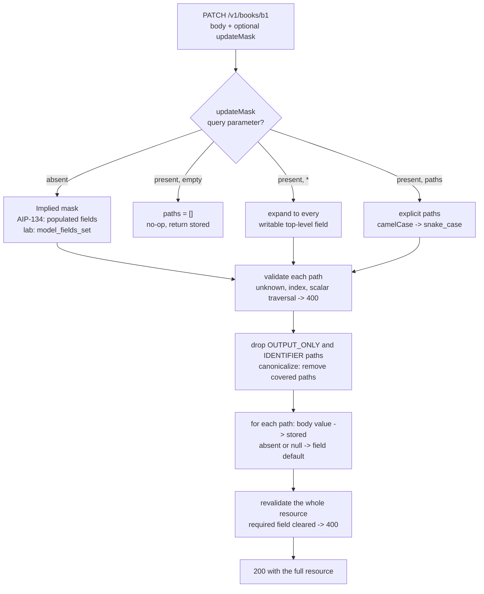

# Update Masks and Field Masks (Google AIP-134 and AIP-161) and Pydantic exclude_unset Semantics

> [!summary] Claim
> A partial update is only correct when the server knows, per field, whether the client meant "leave it", "set it", or "clear it"; an explicit `update_mask` carries that intent out of band, while Pydantic's `model_fields_set` (the engine behind `exclude_unset=True`) recovers it from which JSON keys were present, including an explicit `null`.

Part of [REST and Resource Modeling](README.md) in [API Engineering](../README.md).

## TL;DR

- Mechanism: an update mask is a list of dot-separated paths relative to the resource; the server copies exactly those paths from the request body onto the stored resource and ignores every other body value (AIP-134, AIP-161, `field_mask.proto`).
- Contract rule: an omitted mask means "the fields that are populated", an empty mask (`paths: []`) should be a no-op, and `*` means full replacement, so `?updateMask=` and no `updateMask` parameter are two different requests (AIP-134 Request message).
- The trap: proto3 implicit presence cannot tell "unset" from "set to the default", so the AIP-134 implied mask cannot clear a field, while `exclude_unset` can; the common `model_copy(update=...)` recipe then skips validation and replaces nested objects wholesale (pydantic 2.14.3 `pydantic/main.py`, `BaseModel.model_copy`).
- Portability: the lab passes 34 of 34 tests with the full lock on CPython 3.12.13, 3.13.18, 3.14.6, 3.14.10, and 3.15.2 on macOS, with the pinned direct dependencies on 3.12.16 and 3.15.2 in Debian Trixie and Alpine (musl) containers and on 3.15.0b3 free-threaded, and the same requests behave identically on Uvicorn, Hypercorn, and Granian over HTTP/1.1, HTTP/2, and (Hypercorn) HTTP/3; the `3.15.2t` build does not exist for this machine, so that exact leg was not run.
- When not to use it: if the resource is small, flat, and has no nullable fields, RFC 7396 merge patch is simpler; if clients cannot be trusted to name fields, a mask is not an authorization boundary and you still need a per-field write allowlist.

## Mental model



The request first resolves which mask applies, and that decision is driven only by whether the `updateMask` query parameter exists and what it holds, never by the body.
An absent parameter falls back to an implied mask; this lab derives it from `model_fields_set` (keys present, including `null`), where AIP-134 text derives it from populated non-empty values.
Every path then passes the same validation, and paths the client may not write are silently dropped because AIP-161 and AIP-203 require ignoring output-only fields rather than rejecting them.
The copy step treats a path as naming a whole subtree, so `author` replaces the author and `author.given_name` touches one leaf; an absent or `null` body value at a masked path resets the field to its default.
The merged document is revalidated as a full `Book`, which is where clearing a required field such as `title` turns into `400`.

## How it works

### The wire form of a mask

`google.protobuf.FieldMask` is one field, `repeated string paths = 1` (`field_mask.proto`, `message FieldMask`).
In JSON it is a single string where paths are separated by commas and each segment is converted to lowerCamelCase, so `paths: ["user.display_name", "photo"]` becomes `"user.displayName,photo"` (`field_mask.proto`, section "JSON Encoding of Field Masks").
The protobuf Python runtime implements that rule in `FieldMask.FromJsonString`, which splits on `,` and raises `ValueError` if a JSON path contains `_` (protobuf 7.36.2 `google/protobuf/internal/field_mask.py`, `FieldMask.FromJsonString` and `_CamelCaseToSnakeCase`; identical to tag `v36.2` `python/google/protobuf/internal/field_mask.py`).
On HTTP, AIP-134 says the resource field "must" map to the `PATCH` body and all remaining request fields, including `update_mask`, "should" map to URI query parameters (AIP-134 Guidance).
In a query string, `,` and `*` are RFC 3986 `sub-delims` and are legal unencoded (RFC 3986 Section 2.2 and Section 3.4), and ASGI hands the application the "URL portion after the ?, percent-encoded" as the byte string `scope["query_string"]` (ASGI HTTP Connection Scope).

### The four mask states

AIP-134 (Request message, changelog entry 2026-10-08) defines the server behavior:

| `updateMask` on the wire | Mask value | Required behavior |
|---|---|---|
| parameter absent | field not set | "must treat an omitted field mask as an implied field mask equivalent to all fields that are populated (have a non-empty value)" |
| `?updateMask=` | `paths: []` | "should treat the request as a no-op and return the existing resource unmodified" |
| `?updateMask=*` | `paths: ["*"]` | "must support a special value `*`, meaning full replacement (the equivalent of `PUT`)" |
| `?updateMask=title,author.givenName` | explicit paths | update exactly these paths; the service ignores body values not covered by the mask (`field_mask.proto`, "Field Masks in Update Operations") |

AIP-134 also notes that `*` is an API-level convention that standard protobuf runtimes do not recognize as a path, and the lab confirms `FieldMask(paths=["*"]).IsValidForDescriptor(...)` returns `False` (protobuf 7.36.2 `google/protobuf/internal/field_mask.py`, `_IsValidPath`).

### Path validity

AIP-161 requires `.` traversal into singular message fields, allows a repeated field only as the whole terminal element, and requires `INVALID_ARGUMENT` for an index such as `authors.0` (AIP-161 Repeated fields).
Writes with a path that cannot exist "should" return `INVALID_ARGUMENT` (AIP-161 Invalid field mask entries).
Paths to output-only fields "must" be ignored, whether named directly or reached through a parent message (AIP-161 Output only fields; AIP-203 Output only).
`IDENTIFIER` (the `name` field) is immutable on update and accepted as input (AIP-203 Identifier), so the lab takes `name` from the URL and ignores it in a mask.
For an immutable field AIP-203 says the service "should ignore the field if the value matches, but should error with `INVALID_ARGUMENT` if a change is requested" (AIP-203 Immutable); the lab's `BookPatch` has no `name` field, so a body that tries to change it is rejected by FastAPI request validation with `422` (`extra_forbidden`), not with a `400` `INVALID_ARGUMENT`.
Protobuf's validator encodes the same structural rule: every non-terminal segment must be a non-repeated `TYPE_MESSAGE` field and the terminal segment must exist (protobuf 7.36.2 `google/protobuf/internal/field_mask.py`, `_IsValidPath`).

### Merge or replace at the end of a path

The protobuf reference semantics are not what most REST designers expect.
`field_mask.proto` says a repeated field at the end of a path is appended to, and a sub-message at the end of a path is merged into the existing sub-message, unless the implementation offers an override.
The Python runtime implements that default in `_MergeMessage`: repeated fields call `MergeFrom` (append) unless `replace_repeated_field=True`, and a message field is merged and only cleared first when `replace_message_field=True` (protobuf 7.36.2 `google/protobuf/internal/field_mask.py`, `_MergeMessage`).
A consequence the lab proves: with default flags, mask `author` plus a source whose `author` is unset leaves the destination author untouched, so a client cannot clear a sub-message.
AIP-161 Read-write consistency pushes the other way: updating with mask `M` and reading with mask `M` must return the same data, and reading then writing back with `M` must be a no-op.
With merge semantics, `PATCH ?updateMask=author` with `{"author": {"given_name": "P. L."}}` would read back the old `family_name`, which is not what was sent, so the lab replaces the subtree named by a path and merges only below the deepest named segment.

### Where Pydantic tracks presence

pydantic-core fills `__pydantic_fields_set__` during validation: `ModelFieldsValidationState::validate_field` adds the field name to `fields_set` only when the input supplied a value that validated, and the default pathway does not add it (pydantic 2.14.3 `pydantic-core/src/validators/model_fields.rs`, `ModelFieldsValidationState::validate_field`; pydantic-core version `2.50.4` in `pydantic-core/Cargo.toml` at that tag).
An explicit `null` is a supplied value, so `{"rating": null}` puts `rating` in the set, and `{}` does not.
`model_dump(exclude_unset=True)` is implemented in the serializer: when `extra.exclude_unset` is set, every attribute not in `__pydantic_fields_set__` is replaced with the missing sentinel so the field serializer omits it (pydantic 2.14.3 `pydantic-core/src/serializers/type_serializers/model.rs`, `get_inner_value`).
Assignment also marks a field as set: the memoized setattr handler for a model field writes `__dict__[name]` and then `__pydantic_fields_set__.add(name)` (pydantic 2.14.3 `pydantic/main.py`, `_model_field_setattr_handler`), which is why a `mode="after"` validator that assigns a derived field pollutes the implied mask.
`model_copy(update=...)` updates `__dict__` directly and adds the keys to `__pydantic_fields_set__`, and its docstring states "Updates are *not* applied recursively, and no validation is performed on updated values" (pydantic 2.14.3 `pydantic/main.py`, `BaseModel.model_copy`).
FastAPI's partial-update tutorial composes exactly these two calls, `item.model_dump(exclude_unset=True)` then `stored_item_model.model_copy(update=update_data)` (fastapi 0.162.0 `docs_src/body_updates/tutorial002_py310.py`, `update_item`).

### Three different "implied mask" rules in the wild

| Implementation | Rule for an omitted mask | `{"rating": null}` | `{"title": ""}` |
|---|---|---|---|
| AIP-134 text | fields that are populated with a non-empty value | not in mask, cannot clear | not in mask |
| grpc-gateway v2.33.0 `runtime.FieldMaskFromRequestBody` | every JSON leaf key present; a non-empty object recurses, anything else (including `null` and `{}`) is a leaf path, and a repeated or map field is always a leaf path | in mask | in mask |
| this lab, `mask_from_fields_set` | every key in `model_fields_set`, recursing into nested models that have set fields | in mask, clears | in mask |

The grpc-gateway row is source reading confirmed by a run: the BFS in `FieldMaskFromRequestBody` enqueues children only for `map[string]interface{}` with `len(m) > 0`, appends repeated and map fields directly (`fd.IsList(), fd.IsMap()`), and otherwise appends `item.path` (grpc-gateway v2.33.0 `runtime/fieldmask.go`, `FieldMaskFromRequestBody`).
Running that function from a Go module pinned to `github.com/grpc-ecosystem/grpc-gateway/v2 v2.33.0` against `descriptorpb.FieldDescriptorProto` (go1.27.4 darwin/arm64) returned `paths=[name number]` for `{"name":"n","number":null}`, `[options]` for `{"options":{}}`, `[options.packed]` for `{"options":{"packed":false}}`, `[name]` for `{"name":""}`, `[proto3_optional]` for `{"proto3Optional":null}` (JSON names become proto names), and `[]` for `{}`; for `FileDescriptorProto` the body `{"dependency":["a"],"messageType":[{"name":"m"}],"name":"x"}` returned `[dependency message_type name]`, so a repeated field is a leaf path and its elements are not walked.
The generated `PATCH` handler computes that body-derived mask first, when `protoReq.<Mask> == nil || len(protoReq.<Mask>.GetPaths()) == 0` (or `!protoReq.Has<Mask>() || ...` under `use_opaque_api`), and only afterwards calls `runtime.PopulateQueryParameters`, which overwrites the mask with whatever the query string carries (grpc-gateway v2.33.0 `protoc-gen-grpc-gateway/internal/gengateway/template.go`, the `$isFieldMask` branch precedes the `PopulateQueryParameters` call; same order in the code `protoc-gen-grpc-gateway` generated here).
That branch is generated only for `PATCH` with `allow_patch_feature` on (the default, `flag.Bool("allow_patch_feature", true, ...)` in `protoc-gen-grpc-gateway/main.go`) and a body that is a single field rather than `*`.
Because the body maps to the resource field, `protoReq.<Mask>` is always `nil` when that check runs, and the `len(...GetPaths()) == 0` half of the condition cannot be reached from an HTTP request in this configuration.
An in-process gateway built from a generated `Books.UpdateBook` (`PATCH /v1/{book.name=books/*}`, `body: book`) and a stub server that echoed the mask it received behaved as follows:

| Request | Mask the server received |
|---|---|
| no `updateMask`, body `{"title":"X","rating":null}` | `[rating title]` |
| `?updateMask=`, body `{"title":"X"}` | `[]` (the AIP-134 no-op input, not the body-derived mask) |
| `?update_mask=`, body `{"title":"X"}` | `[]` |
| `?updateMask=title`, body `{"title":"X","rating":5}` | `[title]` |
| `?updateMask=*`, body `{"title":"X"}` | `[*]` |
| `?updateMask=title,author.givenName` | `[title author.givenName]` (query paths are passed through verbatim, camelCase) |
| no `updateMask`, body `{"author":{},"tags":["a"]}` | `[author tags]` |

So grpc-gateway v2.33.0 keeps the absent/empty distinction for a mask sent in the query string; what is left for the service to enforce is the AIP-134 rule that an empty mask is a no-op, and the camelCase-to-`snake_case` conversion of query paths.
It still differs from AIP-134 on the implied mask: an absent mask becomes every JSON key present, `null` included.
`field_mask.proto` itself warns that libraries differ on empty masks and `*`, and that services may need to special-case them.
`field_mask.proto` also states its own rule for an omitted mask, "replace fields which are present", which is closer to presence than to AIP-134's "populated (have a non-empty value)" (`field_mask.proto` on `main`, as of 2026-11).

### Relation to JSON Merge Patch

RFC 7396 gives `null` in a patch "special meaning to indicate the removal of existing values in the target" and states that merge patch suits documents that "do not make use of explicit null values" (RFC 7396 Section 1 and Section 2).
An update mask removes that restriction because the mask, not the value, says which fields change, so "set `rating` to `null`" and "leave `rating` alone" are both expressible; see [[Partial-Updates-JSON-Merge-Patch-RFC-7396-vs-JSON-Patch-RFC-6902]] for the full comparison.

## Numbers and limits

| Quantity | Value | Source or measurement |
|---|---|---|
| Fields in `FieldMask` | `1` (`repeated string paths = 1`) | `field_mask.proto`, `message FieldMask` |
| Mask states with distinct semantics | `4` (absent, empty, `*`, explicit) | AIP-134 Request message (as of 2026-11, last changed 2026-10-08) |
| Positions where a repeated field may appear in a path | `1` (last only) | `field_mask.proto`; AIP-161 Repeated fields |
| Paths after canonicalizing `title, author.given_name, author, author.family_name` | `2` (`author`, `title`) | lab `test_lab_parser_and_canonical_form_match_protobuf_field_mask`, equal to protobuf `CanonicalFormFromMask` |
| `BookPatch.model_validate(body)` | `0.71` to `0.75 us/call` | measured: `min(timeit.repeat(fn, number=20000, repeat=7)) / 20000` on the `_stored()` book and the patch `{"author": {"given_name": "P. L."}, "rating": null}`, range over three invocations of `uv run --frozen python bench.py`, CPython 3.14.6 workspace `.venv`, macOS 27.2 (`uname -r` `27.2.0`) arm64, Apple M3 Pro (verify run, 2026-11-10) |
| `mask_from_fields_set(patch)` | `0.63` to `0.67 us/call` | same runs |
| `apply_update_mask(stored, patch, mask)` (dump, copy 2 paths, revalidate) | `7.33` to `7.43 us/call` | same runs |
| `naive_model_copy_update(stored, patch)` (no validation) | `1.63` to `1.68 us/call` | same runs |

The roughly `5.7 us` difference between the validated apply and `model_copy` buys type enforcement and correct nested merging; it is a microbenchmark of one small model, not an endpoint latency, and it will grow with resource size because the lab dumps and revalidates the whole resource.

## Portability

| Leg | Version | Result and evidence |
|---|---|---|
| CPython 3.12, macOS | 3.12.13 (uv), arm64, protobuf backend `upb` | `34 passed in 0.56s`, `UV_PROJECT_ENVIRONMENT=<scratch venv> uv run --frozen --python <path to python3.12> pytest <test> -q -p no:cacheprovider` (full lock) |
| CPython 3.12, Linux containers | 3.12.16 (`python:3.12.16-slim-trixie`, Debian GNU/Linux 13, glibc 2.41, aarch64; and `python:3.12.16-alpine`, Alpine Linux v3.24, musl, `/lib/ld-musl-aarch64.so.1`, aarch64) | `34 passed in 0.18s` on Trixie (protobuf backend `upb`) and `34 passed in 0.20s` on Alpine (protobuf backend `python`); `docker run --rm -v <copy of pyproject.toml, src, tests>:/labs python:<tag> sh run.sh`, where `run.sh` creates a venv, `pip install`s the pinned direct dependencies listed in the 3.15 row, and runs `PYTHONPATH=src python -m pytest <test> -q -p no:cacheprovider` (OrbStack Docker 29.8.2 on the macOS host) |
| CPython 3.13, macOS | 3.13.18 (Homebrew), arm64, protobuf backend `upb` | `34 passed in 0.89s`, same command with `--python /opt/homebrew/bin/python3.13` |
| CPython 3.14, macOS | 3.14.6 (workspace `.venv`) and 3.14.10 (Homebrew), protobuf backend `upb` | `34 passed in 0.38s` (3.14.6, `uv run --frozen pytest <test> -v -p no:cacheprovider`) and `34 passed in 1.74s` (3.14.10, full lock, `--python /opt/homebrew/bin/python3.14`) |
| CPython 3.15, macOS | 3.15.2 (Homebrew), arm64, protobuf backend `upb` | `34 passed in 0.61s` with the full lock (`--python /opt/homebrew/bin/python3.15`); `34 passed in 0.34s` with only the pinned direct dependencies: `PYTHONPATH=src uv run --no-project --python /opt/homebrew/bin/python3.15 --with pydantic==2.14.3 --with pydantic-core==2.50.4 --with fastapi==0.162.0 --with starlette==1.10.0 --with httpx==0.28.1 --with httpcore==1.0.9 --with anyio==4.16.0 --with protobuf==7.36.2 --with pytest==9.2.0 --with pytest-asyncio==1.4.1.post1 pytest <test> -q`; the full lock fails only on uv's 3.15.0b3, where collection stops with `ModuleNotFoundError: No module named 'hypothesis._native'` (seen in the verify pass, not rerun) |
| CPython 3.15, Linux containers | 3.15.2 (`python:3.15.2-slim-trixie`, glibc 2.41; `python:3.15.2-alpine`, musl), aarch64, GIL enabled | `34 passed in 0.18s` on Trixie (`upb`) and `34 passed in 0.19s` on Alpine (`python` backend), same container command |
| CPython 3.15t | 3.15.0b3 free-threaded (uv `cpython-3.15.0b3+freethreaded`), `sys._is_gil_enabled()` is `False`, protobuf backend `python` (wheel tag `py3-none-any`, no `google._upb`) | `34 passed in 0.75s`, same pinned `--with` set as the 3.15 row; the full lock does not install because `psycopg-binary==3.3.8` "doesn't have a source distribution or wheel for the current platform"; the matrix target `3.15.2t` was not run because no build exists for this machine: `uv python list --only-downloads --all-versions` offers only `3.15.0b3+freethreaded` and the `python:3.15.2-slim-trixie` image ships `python3.15` with no `python3.15t` |
| protobuf runtime | 7.36.2, `upb` and pure-Python backends | both backends produced identical `FieldMask` results in the lab (`upb` on macOS 3.12 to 3.15.2 and Debian, `python` on Alpine and on 3.15.0b3t) |
| pydantic and pydantic-core | 2.14.3 and 2.50.4 | `model_fields_set`, `exclude_unset`, and `model_copy` behavior proven by the lab, including on musl (Alpine); source cited above |
| FastAPI and Starlette | 0.162.0 and 1.10.0 | `Query(alias="updateMask")` distinguishes absent (`None`) from empty (`""`), proven by `test_empty_mask_is_a_noop` and over real sockets (below) |
| grpc-gateway | v2.33.0 | `runtime.FieldMaskFromRequestBody` and a generated `PATCH` handler were run in Go (go1.27.4 darwin/arm64, modules fetched with the default `GOPROXY`, `protoc` and `protoc-gen-grpc-gateway` built from the same tag); results in the grpc-gateway section above: a query-string mask, empty or not, overrides the body-derived mask |
| Uvicorn | 0.54.0 (default HTTP implementation for HTTP/1.1; `--http zttp --http2` with zttp 0.0.35, installed in a scratch venv, for HTTP/2) | the lab app (`build_app`) served on `127.0.0.1`: `PATCH /v1/books/b1?updateMask=` returned `200` with `title` `Mary Poppins` and `update_time` `7` (no-op), `?updateMask=author.givenName,rating` with `{"author": {"given_name": "P. L."}}` returned `author` `{"given_name": "P. L.", "family_name": "Travers"}` and `rating` `null`, `?updateMask=author` replaced the subtree (`family_name` `""`), no mask with `{"rating": null}` cleared `rating` and kept `title`, `?updateMask=*` with `{"rating": 5}` returned `400` `INVALID_ARGUMENT: ['title']`, and `?updateMask=tags.0` returned `400`, over HTTP/1.1 (`httpx` 0.28.1); with `--http zttp --http2`, the empty-mask no-op, the `author.givenName` leaf merge, and the `*` rejection gave the same results over HTTP/2 prior knowledge (`httpx` with `http1=False, http2=True`, response `http_version` `HTTP/2`) and over HTTP/1.1 |
| Hypercorn | 0.18.0 | the same six requests, identical results, over HTTP/1.1 and HTTP/2 prior knowledge (`hypercorn labapp:app --bind 127.0.0.1:<port>`) |
| Granian | 2.8.7 | the same six requests, identical results, `granian --interface asgi --http 1` over HTTP/1.1 and `--http 2` over HTTP/2 prior knowledge; `granian --help` offers `--http [auto|1|2]` only |
| HTTP/3 over QUIC | Hypercorn 0.18.0 with `--quic-bind`, aioquic 1.7.2 client, self-signed certificate | `PATCH ?updateMask=` returned `200` and `update_time` `7`, `?updateMask=author.givenName,rating` returned `200` with the leaf-merged author and `rating` `null`, `?updateMask=*` with `{"rating": 5}` returned `400` `INVALID_ARGUMENT: ['title']`; Uvicorn and Granian expose no HTTP/3 option (`granian --help`; no `h3` module in `uvicorn/protocols/http/`) and were not run |

The server legs ran from scratch scripts (not part of the lab, which stays in-process by design) on macOS 27.2 arm64, CPython 3.14.6, with unencoded `,` and `*` in the query string; the byte-identical results across servers and HTTP versions match the ASGI contract that every server hands the application the same `query_string` (ASGI HTTP Connection Scope).
All container and server runs used the same code as the macOS lab run, after the four tests described under Worked example were added.

## Worked example

The [implementation](../labs/src/api_labs/f04_rest_and_resource_modeling/field_masks.py) defines `Book` (stored resource), `BookPatch` (every field optional), the mask parser and validator, `apply_update_mask`, the `model_copy` anti-pattern for contrast, and a FastAPI app.
The [test](../labs/tests/f04_rest_and_resource_modeling/test_field_masks_and_update_masks_aip_134_and_aip_161.py) drives the app through `httpx.ASGITransport` and cross-checks the lab against protobuf's own `FieldMask` on a dynamically built `lab.Book` descriptor.

Verbatim excerpt of `field_masks.py`, the implied mask from presence:

```python
def mask_from_fields_set(patch: BaseModel, prefix: str = "") -> tuple[str, ...]:
    """Derive an implied mask from the keys the client sent, including explicit nulls."""
    paths: list[str] = []
    for name in sorted(patch.model_fields_set):
        value: object = getattr(patch, name)
        if isinstance(value, BaseModel) and value.model_fields_set:
            paths.extend(mask_from_fields_set(value, f"{prefix}{name}."))
        else:
            paths.append(f"{prefix}{name}")
    return tuple(paths)
```

Verbatim excerpt of `field_masks.py`, applying a mask:

```python
def apply_update_mask(stored: Book, patch: BookPatch, mask: tuple[str, ...]) -> Book:
    """Copy exactly the masked paths from `patch` onto `stored`; absent or null -> default.

    A path names a whole subtree: `author` replaces the author, `author.given_name` touches
    one leaf.  Raises `InvalidFieldMaskError` or pydantic `ValidationError`.
    """
    paths = resolve_mask(mask)
    if not paths:
        return stored
    supplied = _as_object_map(_strip_none(patch.model_dump(exclude_unset=True)))
    merged = stored.model_dump()
    for path in paths:
        _write(merged, path, _lookup(supplied, path))
    merged["update_time"] = stored.update_time + 1
    return Book.model_validate(merged)
```

Verbatim excerpt of `field_masks.py`, the endpoint:

```python
    @app.patch("/v1/books/{book_id}")
    async def update_book(  # pyright: ignore[reportUnusedFunction]
        book_id: str,
        patch: BookPatch,
        update_mask: Annotated[str | None, Query(alias="updateMask")] = None,
    ) -> Book:
        stored = store.get(book_id)
        if stored is None:
            raise HTTPException(status_code=404, detail="NOT_FOUND")
        try:
            explicit = parse_update_mask(update_mask)
            mask = explicit if explicit is not None else mask_from_fields_set(patch)
            updated = apply_update_mask(stored, patch, mask)
        except InvalidFieldMaskError as exc:
            raise HTTPException(status_code=400, detail=str(exc)) from exc
        except ValidationError as exc:
            fields = sorted(".".join(str(part) for part in err["loc"]) for err in exc.errors())
            raise HTTPException(status_code=400, detail=f"INVALID_ARGUMENT: {fields}") from exc
        store[book_id] = updated
        return updated
```

Verbatim excerpt of the test, the protobuf trap that motivates subtree replacement:

```python
@pytest.mark.unit
def test_protobuf_merge_message_cannot_clear_a_submessage_by_default() -> None:
    book_cls = _proto_book_class()
    source = book_cls()  # author unset: the client wants to clear it

    merged = book_cls()
    merged.author.given_name = "Pamela"
    _field_mask("author").MergeMessage(source, merged)
    assert merged.HasField("author")
    assert merged.author.given_name == "Pamela"

    replaced = book_cls()
    replaced.author.given_name = "Pamela"
    _field_mask("author").MergeMessage(source, replaced, replace_message_field=True)
    assert not replaced.HasField("author")

    cleared = apply_update_mask(_stored(), BookPatch.model_validate({"author": None}), ("author",))
    assert cleared.author == Author()
```

Captured run, from `labs/`, `uv run --frozen pytest tests/f04_rest_and_resource_modeling/test_field_masks_and_update_masks_aip_134_and_aip_161.py -v -p no:cacheprovider`, CPython 3.14.6, macOS 27.2 arm64 (Apple M3 Pro); the absolute path prefix is shortened to `labs`, the module path to `test_...py`, and the `hypothesis profile`, `rootdir`, `configfile`, `plugins`, and `asyncio` header lines are omitted:

```text
platform darwin -- Python 3.14.6, pytest-9.2.0, pluggy-1.7.0 -- labs/.venv/bin/python
collecting ... collected 34 items

test_...py::test_fields_set_separates_omitted_from_explicit_null PASSED [  2%]
test_...py::test_mask_from_fields_set_recurses_into_nested_models PASSED [  5%]
test_...py::test_aip134_populated_implied_mask_cannot_express_a_clear PASSED [  8%]
test_...py::test_validator_assignment_marks_a_field_as_set PASSED [ 11%]
test_...py::test_naive_model_copy_update_skips_validation_and_replaces_nested_objects PASSED [ 14%]
test_...py::test_parse_update_mask_distinguishes_absent_from_empty PASSED [ 17%]
test_...py::test_canonical_mask_removes_covered_paths_and_sorts PASSED [ 20%]
test_...py::test_canonical_mask_covers_only_at_a_segment_boundary PASSED [ 23%]
test_...py::test_unmappable_paths_return_400[unknown] PASSED [ 26%]
test_...py::test_unmappable_paths_return_400[repeated-index] PASSED [ 29%]
test_...py::test_unmappable_paths_return_400[scalar-traversal] PASSED [ 32%]
test_...py::test_unmappable_paths_return_400[nested-unknown] PASSED [ 35%]
test_...py::test_unmappable_paths_return_400[wildcard-mixed] PASSED [ 38%]
test_...py::test_explicit_mask_ignores_unmasked_body_values PASSED [ 41%]
test_...py::test_masked_path_absent_from_body_clears_to_default PASSED [ 44%]
test_...py::test_omitted_mask_uses_fields_set_so_null_clears_and_omission_keeps PASSED [ 47%]
test_...py::test_empty_mask_is_a_noop PASSED [ 50%]
test_...py::test_wildcard_is_full_replacement PASSED [ 52%]
test_...py::test_message_path_replaces_subtree_but_leaf_path_merges PASSED [ 55%]
test_...py::test_unknown_body_keys_are_rejected_with_422[identifier-in-body] PASSED [ 58%]
test_...py::test_unknown_body_keys_are_rejected_with_422[unknown-nested-key] PASSED [ 61%]
test_...py::test_unknown_book_returns_404_not_found PASSED [ 64%]
test_...py::test_output_only_and_identifier_paths_are_ignored PASSED [ 67%]
test_...py::test_aip161_read_then_write_with_same_mask_is_a_noop[scalar] PASSED [ 70%]
test_...py::test_aip161_read_then_write_with_same_mask_is_a_noop[message] PASSED [ 73%]
test_...py::test_aip161_read_then_write_with_same_mask_is_a_noop[leaf] PASSED [ 76%]
test_...py::test_aip161_read_then_write_with_same_mask_is_a_noop[pair] PASSED [ 79%]
test_...py::test_aip161_read_then_write_with_same_mask_is_a_noop[wildcard] PASSED [ 82%]
test_...py::test_aip161_write_then_read_with_same_mask_returns_what_was_sent PASSED [ 85%]
test_...py::test_lab_parser_and_canonical_form_match_protobuf_field_mask PASSED [ 88%]
test_...py::test_protobuf_validator_rejects_wildcard_and_repeated_index PASSED [ 91%]
test_...py::test_protobuf_merge_message_appends_repeated_fields_unless_told_to_replace PASSED [ 94%]
test_...py::test_protobuf_merge_message_cannot_clear_a_submessage_by_default PASSED [ 97%]
test_...py::test_protobuf_merge_message_raises_key_error_on_unknown_path PASSED [100%]

============================== 34 passed in 0.38s ==============================
```

The tests are discriminating, checked in two passes by mutating `field_masks.py` one change at a time and rerunning the test module.
The independent verify pass applied 11 mutations (empty mask parsed as absent, endpoint branching on truthiness, `null` kept instead of reset, output-only filter dropped, covered paths kept, absent masked path keeping the old value, subtree merge instead of replace, traversal into scalars, final revalidation skipped, non-recursive implied mask, `snake_case` JSON paths accepted), and every one turned between 1 and 5 tests red.
The finish pass applied 10 more: 6 turned tests red (`update_time` not bumped: 3; `null` kept: 1; `name` dropped from `NON_WRITABLE`: 3; empty resolved mask no longer short-circuiting: 2; final revalidation replaced by `model_construct`: 5; the `400` detail without field names: 1) and 4 survived on the 30-test version (canonical coverage by bare string prefix instead of a path ancestor, `extra="forbid"` removed from `BookPatch`, `extra="forbid"` removed from `AuthorPatch`, the unknown-book `404` changed to `400`).
Those survivors led to four added tests, `test_canonical_mask_covers_only_at_a_segment_boundary`, the two cases of `test_unknown_body_keys_are_rejected_with_422` (a `name` in the body and an unknown author key both give `422` `extra_forbidden` with the store untouched), and `test_unknown_book_returns_404_not_found`; rerunning the four survivors against the 34-test module turned each red, and each mutation was restored and its file hash checked.

## Pitfalls

> [!warning] `model_copy(update=model_dump(exclude_unset=True))` on nested or required fields
> Trigger: the FastAPI tutorial recipe (fastapi 0.162.0 `docs_src/body_updates/tutorial002_py310.py`, `update_item`) applied to a resource with a nested model or a non-nullable field.
> Symptom: `{"author": {"given_name": "P. L."}}` leaves `stored.author` as a plain `dict` and drops `family_name`; `{"title": null}` stores `None` in a `str` field, because `model_copy` does no validation and no recursion (pydantic 2.14.3 `pydantic/main.py`, `BaseModel.model_copy`); the lab proves both in `test_naive_model_copy_update_skips_validation_and_replaces_nested_objects`.
> Fix: merge into `stored.model_dump()` path by path and finish with `Book.model_validate(merged)`, as `apply_update_mask` does.

> [!warning] Treating an empty mask like an absent mask
> Trigger: `if not request.update_mask: mask = derive_from_body()` in your own handler or middleware, or any layer that rebuilds the mask when `len(paths) == 0`; the grpc-gateway v2.33.0 generated handler contains that condition (`protoc-gen-grpc-gateway/internal/gengateway/template.go`), but a mask sent in the query string still reaches the service as an empty mask because the query is parsed afterwards (run here), so the trap is in code you write after the gateway.
> Symptom: a client that sends `?updateMask=` to mean "touch nothing" (AIP-134: no-op) gets every body field written.
> Fix: branch on presence, not truthiness; the lab's `parse_update_mask` returns `None` for absent and `()` for empty, and a mutation that parses empty as absent fails three tests, while one that makes the endpoint branch on truthiness fails `test_empty_mask_is_a_noop`.

> [!warning] Assuming protobuf `MergeMessage` replaces
> Trigger: implementing a REST update with protobuf's `FieldMask.MergeMessage` default flags.
> Symptom: repeated fields are appended (`["classic"]` + `["new"]` -> `["classic", "new"]`), and mask `author` with an unset source author cannot clear the author (protobuf 7.36.2 `google/protobuf/internal/field_mask.py`, `_MergeMessage`), which breaks AIP-161 read-write consistency.
> Fix: pass `replace_message_field=True, replace_repeated_field=True`, or implement subtree replacement yourself; an unknown path raises `KeyError` from `fields_by_name[name]` before the dead `if field is None` branch can run, so validate paths first.

> [!warning] A validator that assigns marks the field as set
> Trigger: a `@model_validator(mode="after")` that writes `self.slug = ...` unconditionally on the patch model.
> Symptom: `{}` produces `model_fields_set == {"slug"}`, so the implied mask clears `slug` on every request (pydantic 2.14.3 `pydantic/main.py`, `_model_field_setattr_handler`).
> Fix: assign only when the source field is in `model_fields_set`, or derive the value on the stored resource, not on the patch.

> [!warning] Using `exclude_none` where `exclude_unset` was meant
> Trigger: `patch.model_dump(exclude_none=True)` to build the update.
> Symptom: `{"rating": null}` becomes `{}` and the client can never clear `rating`; the lab asserts this in `test_fields_set_separates_omitted_from_explicit_null`.
> Fix: use `exclude_unset=True`, and decide explicitly what `null` means for each field.

## Security and robustness

- A mask is not authorization: OWASP API3:2023 Broken Object Property Level Authorization lists an endpoint that "allows a user to change, add/or delete the value of a sensitive object's property" as vulnerable (previously "Mass Assignment"), and a client can put any path in `updateMask`.
- The canonical incident is GitHub on 2012-03-04, where a user exploited the public key update form to add a key to the `rails` organization; GitHub's postmortem names the root cause as "a failure to properly check incoming form parameters, a problem known as the mass-assignment vulnerability" (GitHub blog, "Public Key Security Vulnerability and Mitigation").
- Defense in depth for masks: `extra="forbid"` on the patch model rejects unknown body keys, `resolve_mask` rejects unknown paths with `400`, `NON_WRITABLE` drops output-only and identifier paths, and the final `Book.model_validate` re-enforces every type and required field; add a per-caller writable-path allowlist when roles differ (see [[Defeating-BOPLA-and-Mass-Assignment-API3-2023-Strict-Input-Output-Schemas]]).
- Ignore, do not reject, output-only paths: AIP-203 requires the server not to error on them, and AIP-161 gives the reason: it permits the same field mask to be used for input and output.
- Bound the mask: the lab has no limit on path count or length; production code should cap both (for example by the number of schema leaves) because canonicalization here is quadratic in the number of paths (`canonical_mask` compares every pair).
- Concurrency: a mask narrows what is written, not when; two masked updates of the same field still race, so pair masks with `etag`, which AIP-134 says must fail with `ABORTED` on mismatch and is unaffected by `update_mask` (see [[Optimistic-Concurrency-Control-If-Match-and-412-Precondition-Failed]]).
- Clearing required fields must fail closed: `?updateMask=*` with a body lacking `title` returns `400 INVALID_ARGUMENT: ['title']` in the lab rather than storing an invalid resource.

## The principal's view

The decision is not "mask or no mask" but where the three-state intent (leave, set, clear) is carried: in a separate mask, in the presence of JSON keys, or in a patch document format.
Explicit masks cost every client a second, schema-aware argument, but make the request self-describing, survive field additions without wiping unknown data (the AIP-134 argument against `PUT`), and give logs and audit trails a precise statement of intent.
Presence-based implied masks (`exclude_unset`, grpc-gateway) are friendlier but couple correctness to every serializer in the path: a client SDK that emits defaults for unset fields, or drops `null`, silently changes the meaning of every request.
For an organization, standardize one implied-mask rule and the empty-mask rule in the API style guide and in shared middleware, because the AIP text, grpc-gateway, and the Pydantic-based lab already disagree on the implied-mask rule, and a layer that rebuilds an empty mask would break the no-op rule.
Choose JSON Merge Patch when resources are document-shaped, have no meaningful `null`, and clients are browsers; choose JSON Patch when you need array element operations, which masks forbid; choose masks when you have protobuf contracts, gRPC transcoding, or declarative clients that must not clobber fields they do not know about (see [[Declarative-Friendly-APIs-and-Reconciliation-Loops-AIP-128]]).
Masks do not replace field-level authorization, so budget that work separately.

## Interview questions

> [!question] L5: What is the difference between `?updateMask=` and omitting `updateMask` entirely in an AIP-134 update?
>
> > [!success]- Answer
> > Omitting it means an implied mask of the populated fields in the body.
> > Sending it empty means `paths: []`, which AIP-134 says should be a no-op that returns the existing resource.
> > The server must therefore branch on parameter presence, not truthiness.
> >
> > Follow-up: A gateway in front of the service rebuilds a missing mask from the body; how would you test that `?updateMask=` still arrives as an empty mask?

> [!question] L5: Why does `model_dump(exclude_none=True)` break partial updates that `exclude_unset=True` handles?
>
> > [!success]- Answer
> > `exclude_none` drops every `None`, so an explicit `{"rating": null}` disappears and the client cannot clear the field.
> > `exclude_unset` drops only fields absent from `__pydantic_fields_set__`, and an explicit `null` is in that set because it was supplied and validated.
> >
> > Follow-up: What other operations add a name to `model_fields_set` besides validation input?

> [!question] L5: Why does AIP-161 forbid indexes like `tags.0` in a mask?
>
> > [!success]- Answer
> > A repeated field may appear only as the last element of a path, and AIP-161 requires `INVALID_ARGUMENT` for index access.
> > Indexes are unstable under concurrent edits, and the protobuf validator itself rejects a repeated field in a non-terminal position.
> >
> > Follow-up: How would you let clients add one tag without resending the list?

> [!question] L6 (Predict-the-output): If the stored book has `author = {given_name: "Pamela", family_name: "Travers"}` and a client sends `PATCH ?updateMask=author` with body `{"author": {"given_name": "P. L."}}` to the lab, and separately the same body with `?updateMask=author.givenName`, what is `author` after each?
>
> > [!success]- Answer
> > With `author`, the subtree is replaced: `{"given_name": "P. L.", "family_name": ""}`.
> > With `author.givenName`, only the leaf changes: `{"given_name": "P. L.", "family_name": "Travers"}`.
> > Protobuf's default `MergeMessage` would merge in the first case and keep `Travers`, which violates AIP-161 read-write consistency.
> >
> > Follow-up: What does the lab return for `?updateMask=author` with body `{"author": null}`?

> [!question] L6: Why can an AIP-134 implied mask never clear a field, and how does the lab's implied mask differ?
>
> > [!success]- Answer
> > AIP-134 defines the implied mask as fields that are populated with a non-empty value, and in proto3 implicit presence a cleared field is indistinguishable from an unset one.
> > So `{"rating": null}` or `{"title": ""}` yields an empty mask for those fields.
> > The lab derives the mask from `model_fields_set`, which records keys that were present, so `null` is in the mask and clears the field.
> > The cost is that the lab deviates from the AIP text, which must be documented.
> >
> > Follow-up: How do proto3 `optional` fields change this analysis?

> [!question] L6: When does `?updateMask=*` return `400` in the lab, and why is that correct?
>
> > [!success]- Answer
> > `*` expands to every writable top-level field, so any field missing from the body is reset to its default.
> > `title` has no default, so a body without `title` fails revalidation with `INVALID_ARGUMENT: ['title']`.
> > That matches full-replacement semantics: a `PUT`-equivalent that omits a required field is invalid, not a partial update.
> >
> > Follow-up: Why does AIP-134 warn producers about adding new mutable fields when clients use `*`?

> [!question] L7+ (Debug-this-API): After a FastAPI service shipped the tutorial `model_copy(update=item.model_dump(exclude_unset=True))` pattern, responses for some books started emitting serialization warnings and lost `author.family_name` on every partial edit - what is happening?
>
> > [!success]- Answer
> > `model_dump` turns the nested patch model into a plain `dict`, and `model_copy` writes it into `__dict__` without validation or recursion.
> > The stored `author` is now a `dict` holding only the keys the client sent, so `family_name` is gone and pydantic 2.14.3 emits a `UserWarning` "Pydantic serializer warnings" wrapping a `PydanticSerializationUnexpectedValue` that reports "Expected `Author`" on dump (reproduced on CPython 3.14.6).
> > Fix by merging path by path into `stored.model_dump()` and revalidating with `Book.model_validate`, or by using explicit masks.
> > Add a regression test asserting the type and every sibling field after a nested patch.
> >
> > Follow-up: How would you migrate the corrupted rows that were already written?

> [!question] L7+: What do you standardize when writing the update-mask section of a company-wide API style guide for REST and gRPC services fronted by grpc-gateway?
>
> > [!success]- Answer
> > Fix the four states: absent means implied, empty means no-op, `*` means full replacement, explicit paths are validated and canonicalized.
> > Pick one implied-mask rule (populated values or present keys) and say what `null` means, since AIP-134, grpc-gateway, and Pydantic disagree.
> > Require subtree replacement at the end of a path for read-write consistency, and forbid index paths.
> > Mandate output-only paths be ignored, per-role writable-path allowlists, and `etag` for concurrent writers.
> > Ship it as shared middleware with a conformance test suite, because the implied-mask rule differs between the AIP text and grpc-gateway, and a layer that rebuilds an empty mask from the body breaks the no-op rule.
> >
> > Follow-up: How do you roll out a change of the implied-mask rule (for example, from populated values to present keys) without breaking clients that relied on the old one?

> [!question] L7+: A team proposes replacing masks with JSON Merge Patch everywhere; when is that a regression?
>
> > [!success]- Answer
> > RFC 7396 reserves `null` for deletion, so any field where `null` is a legal stored value cannot be set to `null`.
> > Merge patch replaces arrays wholesale and cannot express "update only these fields, ignore the rest of what I sent", which declarative clients rely on.
> > It also loses the explicit, loggable statement of intent and the reuse of the same mask for reads.
> >
> > Follow-up: Which resources in a typical product would you leave on merge patch anyway?

## Related

Prerequisites: [[Partial-Updates-JSON-Merge-Patch-RFC-7396-vs-JSON-Patch-RFC-6902]]

Next: [[Custom-Methods-and-State-Machine-Transitions-AIP-136]]

See also: [[02-Programming-Languages/Python/Python-Backend-Interview-Prep/04-FastAPI]], [[02-Programming-Languages/Python/Python-Backend-Interview-Prep/05-REST-API-Design]], [[Full-Replacement-PUT-and-Upsert-Semantics]], [[Field-Behavior-Semantics-Input-Only-Output-Only-and-Immutable-AIP-203]], [[Sparse-Fieldsets-Partial-Responses-and-Read-Masks-AIP-157]], [[Declarative-Friendly-APIs-and-Reconciliation-Loops-AIP-128]], [[Optimistic-Concurrency-Control-If-Match-and-412-Precondition-Failed]], [[Defeating-BOPLA-and-Mass-Assignment-API3-2023-Strict-Input-Output-Schemas]], [[Protobuf-Editions-2023-2024-vs-Proto2-and-Proto3-Presence-Semantics]], [[HTTP-JSON-to-gRPC-Transcoding-and-Google-API-HTTP-Annotations-AIP-127]], [[Pydantic-v2-Architecture-CoreSchema-and-Rust-Pydantic-Core]]

- Lab: `labs/tests/f04_rest_and_resource_modeling/test_field_masks_and_update_masks_aip_134_and_aip_161.py`

## Further reading

- [AIP-134: Standard methods: Update](https://google.aip.dev/134) - the normative rules for `update_mask`: omitted, empty, and `*` masks, `allow_missing`, and `etag` behavior.
- [AIP-161: Field masks](https://google.aip.dev/161) - path syntax, repeated-field limits, output-only handling, read-write consistency, and the non-standard map and wildcard extensions.
- [AIP-203: Field behavior documentation](https://raw.githubusercontent.com/aip-dev/google.aip.dev/master/aip/general/0203.md) - why output-only paths are ignored and how `IDENTIFIER` and `IMMUTABLE` behave on update.
- [`google/protobuf/field_mask.proto`](https://raw.githubusercontent.com/protocolbuffers/protobuf/main/src/google/protobuf/field_mask.proto) - the type definition, its JSON encoding, and the append-and-merge default for update operations.
- [protobuf `python/google/protobuf/internal/field_mask.py` at v36.2](https://raw.githubusercontent.com/protocolbuffers/protobuf/v36.2/python/google/protobuf/internal/field_mask.py) - the reference `MergeMessage`, `CanonicalFormFromMask`, and `IsValidForDescriptor` implementations the lab cross-checks.
- [pydantic `pydantic-core/src/serializers/type_serializers/model.rs` at v2.14.3](https://raw.githubusercontent.com/pydantic/pydantic/v2.14.3/pydantic-core/src/serializers/type_serializers/model.rs) - where `exclude_unset` masks unset attributes with the missing sentinel.
- [grpc-gateway `runtime/fieldmask.go` at v2.33.0](https://raw.githubusercontent.com/grpc-ecosystem/grpc-gateway/v2.33.0/runtime/fieldmask.go) - a production implied-mask derivation from JSON key presence.
- [RFC 7396: JSON Merge Patch](https://www.rfc-editor.org/rfc/rfc7396.html) - the `null`-means-delete alternative and its stated limitation.
- [OWASP API3:2023 Broken Object Property Level Authorization](https://owasp.org/API-Security/editions/2023/en/0xa3-broken-object-property-level-authorization/) - the threat class a mask does not defend against on its own.
