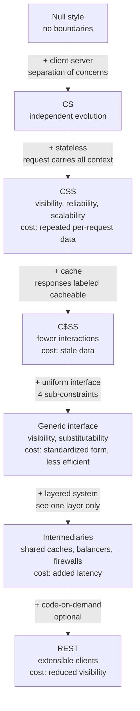

# Fielding's Dissertation in Depth: Deriving the Six REST Constraints and Uniform Interface

> [!summary] Claim
> REST is not a URL style but a set of constraints added one at a time to a null style - client-server, stateless, cache, uniform interface, layered system, and optional code-on-demand - each bought for a named property at a named cost, and the uniform interface (four sub-constraints) is the one that lets caches, balancers, and gateways act on messages they were never written for.

Part of [REST and Resource Modeling](README.md) in [API Engineering](../README.md).

## TL;DR

- Mechanism: Fielding derives REST in Chapter 5 of his 2000 UC Irvine dissertation by starting from the "Null style" and adding constraints in order (client-server, stateless, cache, uniform interface, layered system, code-on-demand), stating for each the properties it induces and the trade-off it costs.
- Contract rule: the uniform interface is four constraints - identification of resources, manipulation through representations, self-descriptive messages, and hypermedia as the engine of application state - and RFC 9110 encodes the generic half of it as method semantics that "ought to have the same semantics when applied to any resource" `(RFC 9110 Section 9.1)`.
- The trap: "stateless" means no stored application context on the server between requests, not "no database"; a cursor or wizard step held in process memory and keyed by a cookie silently breaks the moment a layer such as a round-robin balancer is inserted, which the lab reproduces as the same first page returned six times.
- Portability fact: REST constrains the interface, not the protocol (dissertation Section 5.3.2), and RFC 9110 defines one set of semantics shared by HTTP/1.1, HTTP/2, and HTTP/3 `(RFC 9110 Section 1.2)`; the lab's 39 tests pass unchanged on CPython 3.12.16 through 3.15.2 and 3.15.2 free-threaded, on Debian Trixie and Alpine musl containers, and the same origin and cache answer identically under Uvicorn, Hypercorn (HTTP/1.1 and HTTP/2), and Granian.
- When not to use it: Fielding states the REST interface is "designed to be efficient for large-grain hypermedia data transfer" and "not optimal for other forms of architectural interaction" (Section 5.1.5); for chatty fine-grained calls inside one organization, streaming RPC, or push-based event flows, choose gRPC, an event protocol, or a purpose-built RPC instead of bending HTTP.

## Mental model



Read the diagram top to bottom as Fielding's Figures 5-1 through 5-8: every arrow adds one constraint, and each box names the property gained and the cost paid.
Statelessness comes before caching because a cache can only decide reuse when "all of the information that might factor into the reusability of a cached response" is present in each request (Section 5.2.2, function 4).
The uniform interface comes before layering because intermediaries "can actively transform the content of messages because the messages are self-descriptive and their semantics are visible to intermediaries" (Section 5.1.6).
Code-on-demand is last and optional because it "reduces visibility", so the architecture only gains or suffers from it in realms where it is known to be in effect (Section 5.1.7).

## How it works

### Architectural style as constraints, not features

Fielding defines an architectural style as a set of constraints on elements and states that REST "has been developed" by the second of two design processes: a designer "starts with the system needs as a whole, without constraints, and then incrementally identifies and applies constraints to elements of the system" (Section 5.1.1).
The consequence for API design reviews is that each REST rule is a trade, and the review question is always "which induced property do we need, and can we afford its cost here".
The dissertation is dated 2000, and RFC 9110 cites it as `[REST]`: "Doctoral Dissertation, University of California, Irvine, September 2000" `(RFC 9110 Section 19.2)`.

### The six constraints, with the property and the cost Fielding names

| Order | Constraint (dissertation section) | Property induced | Cost Fielding states |
|---:|---|---|---|
| 1 | Client-server (5.1.2) | Portability of UI, simpler servers, components "evolve independently" | Not stated as a cost in 5.1.2 |
| 2 | Stateless (5.1.3) | Visibility, reliability, scalability | "the repetitive data (per-interaction overhead)"; less server control over consistent behavior |
| 3 | Cache (5.1.4) | Eliminate some interactions, lower average latency | stale data "can decrease reliability" |
| 4 | Uniform interface (5.1.5) | Simplicity, visibility, independent evolvability | "degrades efficiency" by using a standardized form |
| 5 | Layered system (5.1.6) | Bounded complexity, shared caches, load balancing, security policy at boundaries | "add overhead and latency" |
| 6 | Code-on-demand, optional (5.1.7) | Simpler, extensible clients | "reduces visibility" |

### Stateless: where the state lives, not whether there is state

The stateless constraint is that "each request from client to server must contain all of the information necessary to understand the request, and cannot take advantage of any stored context on the server", so "session state is therefore kept entirely on the client" (Section 5.1.3).
Resource state, such as rows in a database, is not session state: every replica in the lab reads the same `OrderStore`, which is legitimate shared resource state behind the interface.
Application state, such as "which page of the feed this client has seen", is the thing that must travel in the request.
In the lab, the stateless origin puts the cursor in the URI (`/orders?after=2`) and hands it to the client as a `next` link, while the anti-pattern `build_session_pager` keeps `cursors[sid]` in a Python `dict` owned by one replica and keyed by a `sid` cookie.
Fielding singles out exactly this mechanism in Section 6.3.4.2: a cookie "is defined as being attached to any future requests for a given set of resource identifiers, usually encompassing an entire site, rather than being associated with the particular application state", and he concludes that "cookie-based applications on the Web will never be reliable".
The lab's `RoundRobin` layer makes the failure deterministic: replica `b` receives the cookie `sid=a-1`, does not know it, opens a fresh session, and returns page one again.

### Cache: control data labels every response

The cache constraint requires that "the data within a response to a request be implicitly or explicitly labeled as cacheable or non-cacheable" (Section 5.1.4).
Fielding's default rule, "the response to a retrieval request is cacheable and the responses to other requests are non-cacheable", with authenticated responses restricted to non-shared caches (Section 5.2.2), is the ancestor of the RFC 9111 rules the lab's `SharedCache` implements:

- A shared cache must not store a response if `no-store` is present, if `private` is present (unless its qualified form "allows a shared cache to store a modified response"), or if the request carried `Authorization` unless a directive explicitly allows shared caching `(RFC 9111 Section 3)`.
- The directives that allow it are `must-revalidate`, `public`, and `s-maxage` `(RFC 9111 Section 3.5)`.
- Freshness lifetime for a shared cache is `s-maxage` if present, else `max-age`, else `Expires` minus `Date` `(RFC 9111 Section 4.2.1)`; a response is fresh while its age "has not yet exceeded" that lifetime `(RFC 9111 Section 4.2)`.
- A cache "MUST invalidate the target URI" after a non-error (`2xx` or `3xx`) response to an unsafe method, and "MAY invalidate" the URIs in `Location` and `Content-Location` `(RFC 9111 Section 4.4)`; the lab does both, for same-origin path values only.
- `Age` is a non-negative integer of seconds, and its presence "implies that the response was not generated or validated by the origin server for this request" `(RFC 9111 Section 5.1)`.

The lab cache deliberately implements a subset: it stores only `200` responses to `GET` with an `s-maxage` or `max-age` lifetime (never `Expires`), from anonymous requests or from `Authorization` requests whose response carries one of the three directives above, and it serves hits only to requests without `Authorization`.
It never stores a response carrying `Vary`, and never stores one carrying `no-cache`, because it does not revalidate and an unqualified `no-cache` response "MUST NOT be used to satisfy any other request without forwarding it for validation" `(RFC 9111 Section 5.2.2.4)`.
It honors the request `no-store` directive, under which "a cache MUST NOT store any part of either this request or any response to it" `(RFC 9111 Section 5.2.1.5)`, and ignores the request `no-cache` directive, which only says the client "prefers" validation `(RFC 9111 Section 5.2.1.4)`.
Each simplification is conservative: a cache that stores less than RFC 9111 permits is still conforming, because RFC 9111 Section 3 only lists when a cache "MUST NOT" store.

### Uniform interface: four sub-constraints

Fielding names the four interface constraints in Section 5.1.5 and elaborates the data elements in Section 5.2.1.

1. Identification of resources: "a resource R is a temporally varying membership function MR(t)" mapping time to a set of equivalent values; the identifier names the mapping, and "the only thing that is required to be static for a resource is the semantics of the mapping" (Section 5.2.1.1).
2. Manipulation through representations: a representation is "a sequence of bytes, plus representation metadata to describe those bytes" (Section 5.2.1.2); RFC 9110 restates it as "information that is intended to reflect a past, current, or desired state of a given resource" `(RFC 9110 Section 3.2)`.
3. Self-descriptive messages: "standard methods and media types are used to indicate semantics and exchange information, and responses explicitly indicate cacheability" (Section 5.3.1).
4. Hypermedia as the engine of application state: the model application "moves from one state to the next by examining and choosing from among the alternative state transitions in the current set of representations" (Section 5.3.3).

RFC 9110 carries the generic-method half of this directly: "the standardized request methods in HTTP are not resource-specific, since uniform interfaces provide for better visibility and reuse in network-based systems [REST]" `(RFC 9110 Section 9.1)`.
That is why the lab's `SharedCache` contains no word about orders: it decides everything from the method token, the status code, and `Cache-Control`, `Authorization`, `Vary`, `Location`, and `Content-Location`.
Safe methods are `GET`, `HEAD`, `OPTIONS`, and `TRACE` `(RFC 9110 Section 9.2.1)`, idempotent methods are `PUT`, `DELETE`, and the safe methods `(RFC 9110 Section 9.2.2)`, and the cache constant `SAFE_METHODS` is that list.
The `405` contract is also part of the uniform interface: the origin "MUST generate an `Allow` header field in a `405` response containing a list of the target resource's currently supported methods" `(RFC 9110 Section 15.5.6)`.
Starlette builds `Allow` as `", ".join(self.methods)` where `self.methods` is a `set` built in `Route.__init__` `(starlette 1.10.0 starlette/routing.py, Route.handle)`, and its router hands a method mismatch to the first partially matching route only `(starlette 1.10.0 starlette/routing.py, Router.app)`, so two `Route` objects for one path produce an `Allow` that omits the second route's methods.

Fielding's 2008 post sharpened the hypermedia constraint into rules, including that "a REST API must not define fixed resource names or hierarchies" and "should be entered with no prior knowledge beyond the initial URI (bookmark) and set of standardized media types" (roy.gbiv.com, "REST APIs must be hypertext-driven").
The lab's `hypermedia_order_ids` client knows only `/` and the relation names `orders` and `next`; moving the namespace to `/v2/purchase-orders` leaves it working while a client with `/orders` hard-coded gets `404`.
The link relation and `Link` header machinery is covered in [[Richardson-Maturity-Model-HATEOAS-and-Web-Linking-RFC-8288]].

### Layered system: each component sees one layer

The layered constraint restricts "knowledge of the system to a single layer" (Section 5.1.6).
In the lab, the client talks to `SharedCache(RoundRobin([replica_a, replica_b]))` and receives byte-identical status, headers, and body to a direct call, except the `Age` header on a hit, which RFC 9111 Section 5.1 defines precisely as the trace of a cache.
Fielding's Section 6.5.2 states the payoff: "What makes HTTP significantly different from RPC is that the requests are directed to resources using a generic interface with standard semantics that can be interpreted by intermediaries almost as well as by the machines that originate services".

### Code-on-demand: the optional constraint

Code-on-demand allows "client functionality to be extended by downloading and executing code in the form of applets or scripts" and is "only an optional constraint within REST" because it reduces visibility (Section 5.1.7).
The lab does not exercise it; in API terms its modern descendants are scripts shipped to browsers, and an API that requires clients to run server-supplied code is outside the core constraints.

## Numbers and limits

| Quantity | Value | Source or measurement |
|---|---:|---|
| Constraint groups in REST | 6, one optional | Dissertation Sections 5.1.2-5.1.7 |
| Uniform interface sub-constraints | 4 | Dissertation Section 5.1.5 |
| Safe methods defined by RFC 9110 | 4 (`GET`, `HEAD`, `OPTIONS`, `TRACE`) | `(RFC 9110 Section 9.2.1)` |
| Heuristically cacheable status codes in RFC 9110 | 12 (`200`, `203`, `204`, `206`, `300`, `301`, `308`, `404`, `405`, `410`, `414`, `501`) | `(RFC 9110 Section 15.1)` |
| Directives that let a shared cache store an `Authorization` response | 3 (`must-revalidate`, `public`, `s-maxage`) | `(RFC 9111 Section 3.5)` |
| Stateful pager, 5 orders, page size 2, 6 requests via 2-replica round robin | 12 ids returned, 2 distinct (`[1, 2] * 6`) | Lab, `test_server_side_session_cursor_breaks_under_round_robin`, CPython 3.14.6, macOS 27.2 arm64 |
| Same pager, single replica | 5 ids, each once, then an empty page | Same test |
| Cache entry with `max-age=60` | hit with `Age: 59` at 59 s, origin refetch at 60 s | Lab, `test_entry_goes_stale_exactly_when_age_reaches_max_age` |
| Distinct `Allow` orderings for one Starlette route `GET, DELETE` across `PYTHONHASHSEED=0..7` | 5 of the 6 possible permutations in 8 runs | Measured with `uv run --frozen python` on CPython 3.14.6, starlette 1.10.0, macOS 27.2 arm64 |
| Lab runtime, 39 tests | `0.21s` (other runs on the same machine: `0.19s` to `0.66s`) | `uv run --frozen pytest ... -q -p no:cacheprovider`, CPython 3.14.6, macOS 27.2 arm64 |
| Lab tests | 39 collected: 15 storability cases, 5 unsafe-response `Location` cases, 2 `Allow` layouts, 2 `Content-Location` cases, 15 single tests | `uv run --frozen pytest <test path> --collect-only -q`, CPython 3.14.6, macOS 27.2 arm64 |
| Mutations of the lab source that the tests must kill | 15 of 15 killed | Mutation record in `report.md`, run from `labs/` on CPython 3.14.6 |

## Portability

Every row below was run here on the final 39-test lab file unless it cites a specification.
Host: macOS 27.2 arm64 (`uname -rm`: `27.2.0 arm64`).
Containers: OrbStack on the same host, Linux aarch64, official `python:<version>-trixie` (Debian 13, glibc 2.41) and `python:<version>-alpine` (Alpine v3.24, musl) images, each running `pip install uv` (`uv 0.13.7`) and `uv run --frozen` against a copy of the locked workspace without its `.venv`.

| Leg | Version | Result and evidence |
|---|---|---|
| CPython 3.12 | `3.12.13` (macOS, uv-managed) and `3.12.16` (Trixie and Alpine containers) | `39 passed in 0.27s` (macOS, `uv run --frozen --python 3.12`), `39 passed in 0.24s` (Trixie), `39 passed in 0.25s` (Alpine) |
| CPython 3.13 | `3.13.18` | `39 passed in 0.29s` (macOS), `39 passed in 0.20s` (Trixie), `39 passed in 0.33s` (Alpine) |
| CPython 3.14 | `3.14.6` (workspace), `3.14.10` | `39 passed` on `3.14.6` (macOS, locked); `3.14.10` with `--no-project` and pinned `starlette==1.10.0`, `httpx==0.28.1`, `httpcore==1.0.9`, `anyio==4.16.0`, `asgi-lifespan==2.1.0`, `pytest==9.2.0`, `pytest-asyncio==1.4.1.post1`: `39 passed in 0.41s` (macOS Homebrew); locked `3.14.10`: `39 passed in 0.24s` (Trixie), `39 passed in 0.29s` (Alpine) |
| CPython 3.15 | `3.15.2` | `39 passed in 0.62s` (macOS Homebrew, `--no-project` pins above); locked: `39 passed in 0.53s` (Trixie), `39 passed in 0.34s` (Alpine); the locked macOS workspace on uv's older `3.15.0b3` fails at import with `ModuleNotFoundError: No module named 'hypothesis._native'`, a beta build problem and not a lab failure |
| CPython 3.15 free-threaded | `3.15.2t` (Trixie, uv-downloaded `3.15.2+freethreaded`, `sys._is_gil_enabled()` is `False`); `3.15.0b3t` (macOS) | `39 passed in 0.27s` (Trixie) and `39 passed in 0.22s` (macOS) via `--no-project` with the pins above; the locked workspace cannot install on either because `psycopg-binary==3.3.8` has no wheel for the free-threaded build, which is a workspace dependency gap and not a lab failure |
| Starlette releases | `1.7.0`, `1.8.0`, `1.9.0`, `1.10.0` | `39 passed` for each on CPython 3.14.6 (`--no-project`, other pins as above); the `Allow` source reading is for `1.10.0` only `(starlette 1.10.0 starlette/routing.py, Route.handle)` and `(starlette 1.10.0 starlette/routing.py, Router.app)`; upstream discussion `#2738` and the unmerged PR `#3682` confirm the behavior is known and open |
| ASGI servers | Uvicorn `0.54.0`, Hypercorn `0.18.0`, Granian `2.8.7` | A throwaway driver (not part of the lab) served `SharedCache(RoundRobin([HitCounter(origin), HitCounter(origin)]))` plus the split-route `Allow` demo under each server on `127.0.0.1` and used `httpx` over real sockets: paging returned `[1, 2, 3, 4, 5]`, the second `GET /orders/1` carried `Age: 0` (one cache hit), and `PUT /items/1` returned `405` with `Allow` equal to `{GET, HEAD}` with `DELETE` missing, on all three servers, CPython 3.14.6 on macOS |
| HTTP/1.1 | `HTTP/1.1` | Same driver: `http_version` was `HTTP/1.1` under Uvicorn, Hypercorn, and Granian, with identical results |
| HTTP/2 | `HTTP/2` | Same driver against Hypercorn with prior-knowledge cleartext HTTP/2 (`httpx.AsyncClient(http1=False, http2=True)`): `http_version` was `HTTP/2` and the results were identical to HTTP/1.1 |
| HTTP/3 over QUIC | specification | Not run: REST "does not restrict communication to a particular protocol" (dissertation Section 5.3.2), and RFC 9110 "separates the definition of semantics" and caching from the HTTP/1.1 messaging syntax "to allow each major protocol version to progress independently while referring to the same core semantics" `(RFC 9110 Section 1.2)`; the lab decides everything from method, status, and header fields, so the claim rests on the specification and no QUIC measurement exists |
| Containers | Debian Trixie (glibc 2.41), Alpine v3.24 (musl) | Every container run above is `39 passed`; the list of CPython versions run per image is in the CPython rows |

## Worked example

The [implementation](../labs/src/api_labs/f04_rest_and_resource_modeling/rest_constraints.py) builds a stateless origin, a stateful anti-pattern, a counting layer, a round-robin balancer, and a shared cache from in-process ASGI components, and the [test](../labs/tests/f04_rest_and_resource_modeling/test_fieldings_dissertation_and_the_six_constraints_of_rest.py) turns each constraint into an invariant that fails when its mechanism is removed.

### Implementation (`labs/src/api_labs/f04_rest_and_resource_modeling/rest_constraints.py`)

```python
"""Fielding's REST constraints as executable invariants over in-process ASGI components.

Each piece maps to one constraint from Chapter 5 of Fielding's dissertation:
``build_origin`` is the server half of client-server, ``RoundRobin`` puts two
replicas behind a layer so statelessness becomes observable, ``SharedCache``
applies the cache constraint using only self-descriptive control data, and the
``links`` objects in every representation drive application state (hypermedia).
"""

from __future__ import annotations

import itertools
from dataclasses import dataclass, field
from typing import TYPE_CHECKING, Any

from starlette.applications import Starlette
from starlette.responses import JSONResponse, PlainTextResponse, Response
from starlette.routing import Route

if TYPE_CHECKING:
    from collections.abc import Callable, Sequence

    import httpx
    from starlette.requests import Request
    from starlette.types import ASGIApp, Message, Receive, Scope, Send

PAGE_SIZE = 2
SAFE_METHODS = frozenset({"GET", "HEAD", "OPTIONS", "TRACE"})  # RFC 9110 Section 9.2.1
Headers = list[tuple[bytes, bytes]]


@dataclass
class Order:
    """One resource; its URI is assigned by the origin, never by the client."""

    id: int
    status: str = "pending"


@dataclass
class OrderStore:
    """Resource state shared by every replica, standing in for a database."""

    orders: dict[int, Order] = field(default_factory=dict[int, Order])

    @classmethod
    def with_orders(cls, count: int) -> OrderStore:
        return cls({i: Order(i) for i in range(1, count + 1)})


def _non_negative_int(text: str) -> int | None:
    """ASCII digits only: ``str.isdigit`` also accepts superscript two, which ``int`` rejects."""
    return int(text) if text.isascii() and text.isdigit() else None


def _order_body(order: Order, prefix: str) -> dict[str, Any]:
    links = {"self": f"{prefix}/{order.id}"}
    if order.status == "pending":
        links["cancel"] = f"{prefix}/{order.id}/cancel"
    return {"id": order.id, "status": order.status, "links": links}


def build_origin(
    store: OrderStore,
    *,
    prefix: str = "/orders",
    content_location: bool = True,
    max_age: int = 60,
) -> Starlette:
    """Stateless origin: every request carries all it needs (cursor in the URI)."""
    cache_control = {"Cache-Control": f"max-age={max_age}"}

    async def root(request: Request) -> Response:
        return JSONResponse({"links": {"orders": f"{prefix}?after=0"}}, headers=cache_control)

    async def collection(request: Request) -> Response:
        after = _non_negative_int(request.query_params.get("after", "0"))
        if after is None:
            return PlainTextResponse("after must be a non-negative integer", status_code=400)
        ids = sorted(i for i in store.orders if i > after)
        page = ids[:PAGE_SIZE]
        links: dict[str, str] = {}
        if len(ids) > PAGE_SIZE:
            links["next"] = f"{prefix}?after={page[-1]}"
        items = [_order_body(store.orders[i], prefix) for i in page]
        return JSONResponse({"items": items, "links": links})

    async def item(request: Request) -> Response:
        order = store.orders.get(request.path_params["order_id"])
        if order is None:
            return PlainTextResponse("no such order", status_code=404)
        if request.method == "DELETE":
            del store.orders[order.id]
            return Response(status_code=204)
        return JSONResponse(_order_body(order, prefix), headers=cache_control)

    async def cancel(request: Request) -> Response:
        order = store.orders.get(request.path_params["order_id"])
        if order is None:
            return PlainTextResponse("no such order", status_code=404)
        if order.status != "pending":
            return PlainTextResponse(f"order is {order.status}", status_code=409)
        order.status = "cancelled"
        headers = {"Content-Location": f"{prefix}/{order.id}"} if content_location else {}
        return JSONResponse(_order_body(order, prefix), headers=headers)

    return Starlette(
        routes=[
            Route("/", root, methods=["GET"]),
            Route(prefix, collection, methods=["GET"]),
            Route(prefix + "/{order_id:int}", item, methods=["GET", "DELETE"]),
            Route(prefix + "/{order_id:int}/cancel", cancel, methods=["POST"]),
        ]
    )


def build_session_pager(store: OrderStore, replica: str) -> Starlette:
    """Stateful anti-pattern: the paging cursor lives in this process, keyed by a cookie."""
    cursors: dict[str, int] = {}
    counter = itertools.count(1)

    async def next_page(request: Request) -> Response:
        sid = request.cookies.get("sid")
        if sid is None or sid not in cursors:
            sid = f"{replica}-{next(counter)}"
            cursors[sid] = 0
        start = cursors[sid]
        page = sorted(store.orders)[start : start + PAGE_SIZE]
        cursors[sid] = start + len(page)
        response = JSONResponse({"items": page})
        response.set_cookie("sid", sid)
        return response

    return Starlette(routes=[Route("/feed/next", next_page, methods=["GET"])])


class HitCounter:
    """Transparent layer that counts the HTTP requests reaching the wrapped app."""

    def __init__(self, app: ASGIApp) -> None:
        self.app = app
        self.count = 0

    async def __call__(self, scope: Scope, receive: Receive, send: Send) -> None:
        if scope["type"] == "http":
            self.count += 1
        await self.app(scope, receive, send)


class RoundRobin:
    """Layered-system load balancer: each request goes to the next replica in turn."""

    def __init__(self, backends: Sequence[ASGIApp]) -> None:
        self._cycle = itertools.cycle(backends)

    async def __call__(self, scope: Scope, receive: Receive, send: Send) -> None:
        await next(self._cycle)(scope, receive, send)


def cache_directives(headers: Headers) -> dict[str, str | None]:
    """Parse every ``Cache-Control`` line into ``{directive: argument-or-None}``."""
    directives: dict[str, str | None] = {}
    for name, value in headers:
        if name.lower() != b"cache-control":
            continue
        for part in value.decode("latin-1").split(","):
            key, sep, arg = part.strip().partition("=")
            if key and key.lower() not in directives:  # first occurrence wins
                directives[key.lower()] = arg.strip('"') if sep else None
    return directives


def _header(headers: Headers, name: bytes) -> str | None:
    for key, value in headers:
        if key.lower() == name:
            return value.decode("latin-1")
    return None


def freshness_lifetime(directives: dict[str, str | None]) -> int | None:
    """RFC 9111 Section 4.2.1 for a shared cache: s-maxage, then max-age."""
    for name in ("s-maxage", "max-age"):
        value = directives.get(name)
        if value is not None:
            return _non_negative_int(value) or 0  # invalid -> stale
    return None


def shared_storable(request_headers: Headers, status: int, response_headers: Headers) -> bool:
    """Subset of RFC 9111 Section 3 for a shared cache with no heuristic freshness."""
    directives = cache_directives(response_headers)
    if status != 200 or {"no-store", "no-cache", "private"} & directives.keys():
        return False  # no-cache: this lab cache never revalidates (RFC 9111 Section 5.2.2.4)
    if "no-store" in cache_directives(request_headers):
        return False  # RFC 9111 Section 5.2.1.5

    if _header(response_headers, b"vary") is not None:
        return False  # this lab cache does not build Vary secondary keys
    if _header(request_headers, b"authorization") is not None and not (
        {"public", "s-maxage", "must-revalidate"} & directives.keys()
    ):
        return False  # RFC 9111 Section 3.5
    return freshness_lifetime(directives) is not None


@dataclass
class _Entry:
    status: int
    headers: Headers
    body: bytes
    stored_at: float
    lifetime: int


@dataclass
class _Captured:
    status: int = 0
    headers: Headers = field(default_factory=list[tuple[bytes, bytes]])
    chunks: list[bytes] = field(default_factory=list[bytes])


def _cache_key(scope: Scope) -> str:
    path: str = scope["path"]
    query: bytes = scope.get("query_string", b"")
    return path + ("?" + query.decode("latin-1") if query else "")


class SharedCache:
    """Shared cache that decides everything from method, status, and header fields.

    It knows nothing about orders: the uniform interface is what lets it work.
    """

    def __init__(self, app: ASGIApp, clock: Callable[[], float]) -> None:
        self.app = app
        self.clock = clock
        self.entries: dict[str, _Entry] = {}
        self.hits = 0

    async def __call__(self, scope: Scope, receive: Receive, send: Send) -> None:
        if scope["type"] != "http":
            await self.app(scope, receive, send)
            return
        key = _cache_key(scope)
        request_headers: Headers = list(scope["headers"])
        method: str = scope["method"]
        authorized = _header(request_headers, b"authorization") is not None
        entry = self.entries.get(key) if method == "GET" and not authorized else None
        if entry is not None:
            age = int(self.clock() - entry.stored_at)
            if age < entry.lifetime:  # fresh while age has not reached the lifetime
                self.hits += 1
                headers = [*entry.headers, (b"age", str(age).encode())]
                await self._replay(send, entry.status, headers, entry.body)
                return
            del self.entries[key]

        captured = _Captured()

        async def capture(message: Message) -> None:
            if message["type"] == "http.response.start":
                captured.status = message["status"]
                captured.headers = list(message.get("headers", []))
            elif message["type"] == "http.response.body":
                captured.chunks.append(message.get("body", b""))

        await self.app(scope, receive, capture)
        status, headers, body = captured.status, captured.headers, b"".join(captured.chunks)
        if method not in SAFE_METHODS and 200 <= status < 400:
            self._invalidate(key, headers)  # RFC 9111 Section 4.4
        elif method == "GET" and shared_storable(request_headers, status, headers):
            lifetime = freshness_lifetime(cache_directives(headers)) or 0
            self.entries[key] = _Entry(status, headers, body, self.clock(), lifetime)
        await self._replay(send, status, headers, body)

    def _invalidate(self, target: str, response_headers: Headers) -> None:
        self.entries.pop(target, None)
        for name in (b"location", b"content-location"):
            value = _header(response_headers, name)
            if value is not None and value.startswith("/"):  # same origin by construction
                self.entries.pop(value, None)

    @staticmethod
    async def _replay(send: Send, status: int, headers: Headers, body: bytes) -> None:
        await send({"type": "http.response.start", "status": status, "headers": headers})
        await send({"type": "http.response.body", "body": body})


async def hypermedia_order_ids(client: httpx.AsyncClient, entry: str = "/") -> list[int]:
    """Client that knows one URI and the link relations ``orders`` and ``next``."""
    href: str | None = (await client.get(entry)).raise_for_status().json()["links"]["orders"]
    ids: list[int] = []
    for _ in range(1000):
        if href is None:
            return ids
        page = (await client.get(href)).raise_for_status().json()
        ids.extend(item["id"] for item in page["items"])
        href = page["links"].get("next")
    raise RuntimeError("next links did not terminate")


async def session_order_ids(client: httpx.AsyncClient, max_requests: int) -> list[int]:
    """Client of the stateful pager: it relies on the server remembering its cursor."""
    ids: list[int] = []
    for _ in range(max_requests):
        page: list[int] = (await client.get("/feed/next")).raise_for_status().json()["items"]
        if not page:
            break
        ids.extend(page)
    return ids


def build_allow_demo(*, split_routes: bool) -> Starlette:
    """Same resource, two route layouts: one ``Route`` for all methods, or one per method."""

    async def read(request: Request) -> Response:
        return PlainTextResponse("item")

    async def delete(request: Request) -> Response:
        return Response(status_code=204)

    if split_routes:
        routes = [
            Route("/items/{item_id}", read, methods=["GET"]),
            Route("/items/{item_id}", delete, methods=["DELETE"]),
        ]
    else:

        async def both(request: Request) -> Response:
            return await (delete(request) if request.method == "DELETE" else read(request))

        routes = [Route("/items/{item_id}", both, methods=["GET", "DELETE"])]
    return Starlette(routes=routes)
```

### Tests (simplified excerpt of the test module)

```python
"""Each REST constraint from Fielding Chapter 5 as an invariant that a broken mechanism fails."""

from __future__ import annotations

from typing import TYPE_CHECKING

import httpx
import pytest
from asgi_lifespan import LifespanManager
from starlette.applications import Starlette
from starlette.responses import JSONResponse, Response
from starlette.routing import Route

from api_labs.f04_rest_and_resource_modeling.rest_constraints import (
    HitCounter,
    OrderStore,
    RoundRobin,
    SharedCache,
    build_allow_demo,
    build_origin,
    build_session_pager,
    hypermedia_order_ids,
    session_order_ids,
)

if TYPE_CHECKING:
    from starlette.requests import Request
    from starlette.types import ASGIApp


class FakeClock:
    """Injected monotonic clock so freshness arithmetic is deterministic."""

    def __init__(self) -> None:
        self.now = 1000.0

    def __call__(self) -> float:
        return self.now


def client_for(app: ASGIApp) -> httpx.AsyncClient:
    return httpx.AsyncClient(transport=httpx.ASGITransport(app=app), base_url="http://test")


@pytest.mark.unit
@pytest.mark.asyncio
async def test_stateless_paging_survives_round_robin_replicas() -> None:
    store = OrderStore.with_orders(5)
    replica_a = HitCounter(build_origin(store))
    replica_b = HitCounter(build_origin(store))
    async with client_for(RoundRobin([replica_a, replica_b])) as client:
        ids = await hypermedia_order_ids(client)

    assert ids == [1, 2, 3, 4, 5]
    assert (replica_a.count, replica_b.count) == (2, 2)  # root + 3 pages, alternating


@pytest.mark.unit
@pytest.mark.asyncio
async def test_server_side_session_cursor_breaks_under_round_robin() -> None:
    store = OrderStore.with_orders(5)
    async with client_for(build_session_pager(store, "a")) as client:
        single_replica = await session_order_ids(client, max_requests=6)
    async with client_for(
        RoundRobin([build_session_pager(store, "a"), build_session_pager(store, "b")])
    ) as client:
        balanced = await session_order_ids(client, max_requests=6)

    assert single_replica == [1, 2, 3, 4, 5]
    assert balanced == [1, 2] * 6  # each replica sees an unknown cookie and restarts


@pytest.mark.unit
@pytest.mark.asyncio
async def test_cache_key_includes_the_query_string() -> None:
    async def echo(request: Request) -> Response:
        return JSONResponse(
            {"n": request.query_params["n"]}, headers={"Cache-Control": "max-age=60"}
        )

    origin = HitCounter(Starlette(routes=[Route("/r", echo, methods=["GET"])]))
    async with client_for(SharedCache(origin, FakeClock())) as client:
        one = await client.get("/r", params={"n": "1"})
        two = await client.get("/r", params={"n": "2"})
        again = await client.get("/r", params={"n": "1"})

    assert (one.json(), two.json(), again.json()) == ({"n": "1"}, {"n": "2"}, {"n": "1"})
    assert "age" in again.headers  # the second request for ?n=1 is the only hit
    assert origin.count == 2


def action_origin(status: int, headers: dict[str, str]) -> Starlette:
    """Cacheable ``GET /r`` plus an unsafe ``POST /act`` that answers with a chosen status."""

    async def read(request: Request) -> Response:
        return JSONResponse({"n": 1}, headers={"Cache-Control": "max-age=60"})

    async def act(request: Request) -> Response:
        return Response(status_code=status, headers=headers)

    return Starlette(
        routes=[Route("/r", read, methods=["GET"]), Route("/act", act, methods=["POST"])]
    )


@pytest.mark.unit
@pytest.mark.asyncio
@pytest.mark.parametrize(
    ("status", "headers", "invalidated"),
    [
        (303, {"Location": "/r"}, True),
        (201, {"Location": "/r"}, True),
        (201, {}, False),
        (409, {"Location": "/r"}, False),
        (303, {"Location": "http://other.example/r"}, False),
    ],
    ids=[
        "redirect-with-location-invalidates",
        "created-with-location-invalidates",
        "no-header-leaves-entry",
        "error-status-leaves-entry",
        "other-origin-location-leaves-entry",
    ],
)
async def test_non_error_unsafe_response_invalidates_uris_named_in_location(
    status: int, headers: dict[str, str], invalidated: bool
) -> None:
    origin = HitCounter(action_origin(status, headers))
    async with client_for(SharedCache(origin, FakeClock())) as client:
        await client.get("/r")
        assert (await client.post("/act")).status_code == status
        await client.get("/r")

    assert origin.count == (3 if invalidated else 2)  # GET, POST, and a refetch only if purged


@pytest.mark.unit
@pytest.mark.asyncio
@pytest.mark.parametrize(
    ("content_location", "status_seen"),
    [(True, "cancelled"), (False, "pending")],
    ids=["content-location-invalidates", "action-uri-leaves-stale-entry"],
)
async def test_post_action_invalidates_resource_only_through_content_location(
    content_location: bool, status_seen: str
) -> None:
    origin = build_origin(OrderStore.with_orders(1), content_location=content_location)
    async with client_for(SharedCache(origin, FakeClock())) as client:
        order = (await client.get("/orders/1")).json()
        assert (await client.post(order["links"]["cancel"])).status_code == 200
        after = await client.get("/orders/1")

    assert after.json()["status"] == status_seen


@pytest.mark.unit
@pytest.mark.asyncio
async def test_last_full_page_has_no_next_link_and_no_trailing_request() -> None:
    origin = HitCounter(build_origin(OrderStore.with_orders(4)))
    async with client_for(origin) as client:
        ids = await hypermedia_order_ids(client)
        last = await client.get("/orders?after=2")

    assert ids == [1, 2, 3, 4]
    assert last.json()["links"] == {}  # exactly one page remains, so no `next`
    assert origin.count == 4  # root, two pages, and the explicit fetch of the last page


@pytest.mark.unit
@pytest.mark.asyncio
@pytest.mark.parametrize(
    ("split_routes", "allow"),
    [(False, {"GET", "HEAD", "DELETE"}), (True, {"GET", "HEAD"})],
    ids=["one-route", "split-routes-drop-delete"],
)
async def test_405_allow_header_depends_on_route_layout(
    split_routes: bool, allow: set[str]
) -> None:
    async with client_for(build_allow_demo(split_routes=split_routes)) as client:
        response = await client.put("/items/1")
        read = await client.get("/items/1")
        deleted = await client.delete("/items/1")

    assert response.status_code == 405
    assert set(response.headers["allow"].split(", ")) == allow
    assert (read.text, deleted.status_code) == ("item", 204)  # both work; only Allow lies
```

### Captured run

Command run from `labs/` on CPython 3.14.6 (`uv run --frozen python -VV`: `Python 3.14.6 (main, Jun 23 2026, 15:46:31) [Clang 22.1.3 ]`), macOS 27.2 on arm64:

```text
$ uv run --frozen pytest tests/f04_rest_and_resource_modeling/test_fieldings_dissertation_and_the_six_constraints_of_rest.py -q -p no:cacheprovider
.......................................                                  [100%]
39 passed in 0.21s
```

The excerpt above is a simplified selection of the 39 collected tests, copied from the lab file; the remaining tests are in the lab module.

Reading the results against the constraints:

- `test_stateless_paging_survives_round_robin_replicas` and `test_server_side_session_cursor_breaks_under_round_robin` are the stateless constraint: same data, same balancer, and only the location of the cursor differs.
- The `test_control_data_alone_decides_shared_storability` cases, `test_request_no_store_forbids_storing_the_response`, and `test_cache_hits_are_served_only_to_requests_without_authorization` are self-descriptive messages: the cache's decision changes with header fields alone.
- `test_non_error_unsafe_response_invalidates_uris_named_in_location` pins the other half of RFC 9111 Section 4.4: a `2xx` or `3xx` answer to `POST` purges a `Location` URI, an error status does not, and a `Location` on another origin never does.
- `test_cache_key_includes_the_query_string` and `test_last_full_page_has_no_next_link_and_no_trailing_request` guard the cache key and the `next` link that the paging argument depends on.
- `test_post_action_invalidates_resource_only_through_content_location` shows the edge of RFC 9111 Section 4.4: a `POST` to `/orders/1/cancel` invalidates `/orders/1/cancel`, and the cached `/orders/1` stays stale unless the response names it in `Content-Location`.
- `test_hypermedia_client_survives_namespace_move_hardcoded_client_breaks` is the hypermedia constraint, and `test_layered_system_is_invisible_to_the_client` is the layered constraint.

## Pitfalls

> [!warning] Unsafe actions behind `GET` links
> Trigger: a destructive action reachable with `GET`, for example a "delete" link.
> Symptom: on 06 May 2005, 37signals reported that Google Web Accelerator, which prefetched the content behind each link, was "essentially clicking every link on the page" including "delete this" and "cancel that" links, and ignored JavaScript confirmations; they found it when users reported that their Backpack pages were "disappearing" (Signal vs. Noise, "Google Web Accelerator: Hey, not so fast", quotation marks normalized to ASCII).
> Fix: RFC 9110 makes the resource owner responsible: when parameters select an unsafe action, the owner "MUST disable or disallow that action when it is accessed using a safe request method" `(RFC 9110 Section 9.2.1)`; use `POST` or `DELETE`.

> [!warning] Session cursor in process memory
> Trigger: pagination, wizards, or carts whose position is held in a server `dict` keyed by a cookie.
> Symptom: works on one replica, then after a second replica is added behind a round-robin balancer the client sees page one repeatedly (lab: `[1, 2] * 6`).
> Fix: put the cursor in the request, as an opaque `next` link or query parameter; sticky sessions hide the bug but tie scalability and failover to one process, the exact property Section 5.1.3 says statelessness buys.

> [!warning] Action endpoints leave the resource stale in caches
> Trigger: state changes through `POST /orders/1/cancel` while `GET /orders/1` is cacheable.
> Symptom: the cache invalidates only the target URI `/orders/1/cancel`; readers keep getting `"status": "pending"` until `max-age` expires (lab case `action-uri-leaves-stale-entry`).
> Fix: return the new representation with `Content-Location: /orders/1` (which RFC 9111 Section 4.4 lets a cache use, but only as a MAY), prefer methods on the resource URI itself, or purge explicitly; see [[Cache-Invalidation-Upon-Unsafe-Methods-and-Purge-Patterns]] and [[Custom-Methods-and-State-Machine-Transitions-AIP-136]].

> [!warning] Starlette `Allow` misses methods when routes are split
> Trigger: `Route("/items/{id}", read, methods=["GET"])` and `Route("/items/{id}", delete, methods=["DELETE"])` registered separately.
> Symptom: `PUT /items/1` returns `405` with `Allow` listing only `GET` and `HEAD`, although `DELETE` works, violating `(RFC 9110 Section 15.5.6)`; the order of the listed methods also changes between processes because it comes from a `set`.
> Fix: one `Route` per path with all methods, and compare `Allow` as a set in tests.
> Upstream: reported in Starlette discussion `#2738` on 2024-10-25 ("Allow header returns the first route method it encounters", maintainer reply "Seems valid.", still open as of 2026-11); pull request `#3682` ("Include all matching routes in the `Allow` header of `405` responses") was closed on 2026-10-23 without merging, so `1.10.0` (released 2026-10-24) still has the behavior.

> [!warning] A cache that ignores the control data
> Trigger: a shared cache or CDN rule that stores by URL shape, such as "cache every path ending in `.css` or `.png`", and disregards the response's `Cache-Control`.
> Symptom: in the 2017 Web Cache Deception disclosure's generic example, `GET /home.php/non-existent.css` returned the logged-in user's `home.php` page, the proxy saw a `css` extension and stored it, and an attacker fetching the same URL received the victim's personal data; the author applied the pattern to PayPal, which "was vulnerable to web cache deception" and has since fixed it (Omer Gil, "Web Cache Deception Attack", 2017-02-27).
> Fix: "Configure the cache mechanism to cache files only if their HTTP caching headers allow", which is the self-descriptive-messages constraint applied to the cache; the lab's `shared_storable` decides from method, status, `Cache-Control`, `Vary`, and `Authorization` only.

> [!warning] Calling RPC over HTTP "REST"
> Trigger: one endpoint, `POST` for everything, the operation named in the body.
> Symptom: no intermediary can cache, retry, or authorize by method, because the semantics are not visible; Fielding's 2008 verdict on the SocialSite REST API, which he faulted for "so much coupling on display", was "That is RPC. It screams RPC."
> Fix: either map operations onto resources and standard methods, or adopt an RPC protocol deliberately and stop paying for HTTP layering you cannot use.

## Security and robustness

- Shared caches leaking per-user data are the security face of the cache constraint: the RFC 9111 Section 3 and Section 3.5 rules on `private` and `Authorization` are the defense, and the lab proves that an `Authorization` response is stored only with `public`, `s-maxage`, or `must-revalidate`; multi-tenant cases are in [[Caching-Authenticated-and-Multi-Tenant-API-Responses]].
- OWASP API8:2023 Security Misconfiguration lists "security or cache control directives are not sent to clients" and advises being "specific about which HTTP verbs each API can be accessed by" (OWASP API Security Top 10 2023).
- Cache keys must cover every request input that changes the response; the lab refuses to store any response with `Vary` rather than risk a wrong key, and cache poisoning and deception are covered in [[Web-Cache-Poisoning-and-Cache-Deception-Attacks]] and [[Vary-Header-Mechanics-and-Cache-Hit-Collapse]].
- Invalidation is origin-scoped: a cache "MUST NOT trigger an invalidation" for a `Location` or `Content-Location` URI whose origin differs from the target URI, to prevent denial of service `(RFC 9111 Section 4.4)`; the lab ignores any `Location` or `Content-Location` value that does not start with `/`, so a URI on another origin can never purge an entry (`test_non_error_unsafe_response_invalidates_uris_named_in_location`, case `other-origin-location-leaves-entry`).
- Fielding's Section 6.3.4.2 names the privacy issue: cookies "allow data to be passed without sufficiently identifying its semantics", and combined with `Referer` enable cross-site tracking.
- Hypermedia clients must bound link following; `hypermedia_order_ids` raises `RuntimeError` after 1000 pages so a server that returns a `next` cycle cannot hang it.
- Input on the cursor path is validated: a non-digit `after` returns `400` instead of a `500` from `int()`.
  The check is `text.isascii() and text.isdigit()`, because `str.isdigit()` alone accepts superscript two (`after=%C2%B2`), which `int()` rejects; before this fix the lab returned `500` for that cursor and for `Cache-Control: max-age=` followed by that character.

## The principal's view

The decision a principal owns is which constraints the organization's APIs commit to, written down per constraint, because "REST" as a label commits to nothing.
Statelessness and self-descriptive messages are almost always worth their cost: they are what lets platform teams insert gateways, caches, and balancers without coordinating with every service team, and Fielding's client-server argument is already an organizational one: independent evolution supports "the Internet-scale requirement of multiple organizational domains" (Section 5.1.2).
Full hypermedia is a narrower bet: it pays when clients are long-lived, numerous, and outside your release cadence, so that servers must keep "the freedom to control their own namespace"; it costs client-library complexity and is often replaced in practice by versioned contracts and generated SDKs, which re-introduce exactly the out-of-band coupling Fielding's 2008 rules forbid.
The uniform interface's stated cost, efficiency, is where to choose differently: high-rate internal service calls, bidirectional streaming, and push notifications are better served by gRPC or an event protocol, and Fielding himself contrasts REST, where "consuming components usually pull representations", with push-based event styles, accepting that pull "is less efficient when viewed as a single client wishing to monitor a single resource" because "the scale of the Web makes an unregulated push model infeasible" (Section 5.4).
The organizational trade-off is governance: a constraint-based style guide can be checked by a linter and a cache conformance test, whereas "be RESTful" cannot.

## Interview questions

> [!question] L5: List REST's constraints in the order Fielding derives them and say which one is optional.
>
> > [!success]- Answer
> > Client-server, stateless, cache, uniform interface, layered system, and code-on-demand, starting from the null style (dissertation Sections 5.1.1-5.1.7).
> > Code-on-demand is optional because it reduces visibility.
> > The uniform interface is itself four constraints: identification of resources, manipulation through representations, self-descriptive messages, and hypermedia as the engine of application state.
> >
> > Follow-up: Why must statelessness come before caching in the derivation?

> [!question] L5: Predict the output: with the lab's `SharedCache` in front of `build_origin(store, content_location=False)`, a client sends `GET /orders/1`, then `POST /orders/1/cancel` (which returns `200`), then `GET /orders/1`; what `status` does the last response carry, and does it have an `Age` header?
>
> > [!success]- Answer
> > `"status": "pending"`, with an `Age` header, because it is served from the cache.
> > RFC 9111 Section 4.4 requires invalidating only the target URI, `/orders/1/cancel`, which was never cached.
> > With `content_location=True` the response names `/orders/1` and the lab cache invalidates it, so the last `GET` shows `"cancelled"`.
> >
> > Follow-up: Why does RFC 9111 refuse to let `Content-Location` invalidate a URI on another origin?

> [!question] L6: A team stores a JWT in a cookie and says their API is therefore stateful and not REST. Are they right?
>
> > [!success]- Answer
> > Not necessarily: the constraint forbids the server relying on "stored context on the server" between requests, not credentials in a request.
> > A self-contained token that any replica can verify travels with every request, so each request is understandable in isolation.
> > The cookie becomes a REST problem when it references server-held application state, such as a cursor or wizard step, or when, as Fielding argues in Section 6.3.4.2, it is bound to the whole site rather than to the client's current application state.
> >
> > Follow-up: What does the `Authorization` header in the request do to shared cacheability, and how can the origin override it?

> [!question] L6: Debug this API: `PUT /items/1` on a Starlette 1.10.0 service returns `405` with `Allow: GET, HEAD`, yet `DELETE /items/1` returns `204`, and the ordering in `Allow` differs between pods; explain both.
>
> > [!success]- Answer
> > The service registers two `Route` objects for `/items/{id}`, one with `GET` and one with `DELETE`.
> > `Router.app` hands a method mismatch to the first partial match only, and `Route.handle` builds `Allow` from that route's `self.methods`, so `DELETE` is missing, which violates RFC 9110 Section 15.5.6.
> > `self.methods` is a `set` of strings, and string hashing is randomized per process, so the join order changes between pods; the lab measured 5 distinct orderings over `PYTHONHASHSEED=0..7`.
> > Fix: one `Route` per path with all methods, and assert `Allow` as a set.
> >
> > Follow-up: Why is `405` heuristically cacheable, and what could a cache do with a wrong `Allow`?

> [!question] L6: Your load balancer moved from sticky to round-robin and a paged export started returning duplicates; what is the cause and the fix?
>
> > [!success]- Answer
> > The cursor lived in one replica's memory and was found by a session cookie, so a request landing on another replica started a new session at offset zero.
> > That is a violation of the stateless constraint, which requires each request to carry everything needed to understand it.
> > Move the cursor into the request, for example a `next` link with an opaque position, so any replica can serve any page; the lab shows the same data and balancer returning `[1, 2] * 6` before and `[1, 2, 3, 4, 5]` after.
> >
> > Follow-up: What does the stateless design cost, in Fielding's words, and when is that cost significant?

> [!question] L6: Why can a CDN cache your `GET /products/42` without being told anything about products, and what design choices take that ability away?
>
> > [!success]- Answer
> > The uniform interface gives every resource the same method semantics, and self-descriptive messages carry cacheability in `Cache-Control`, so the cache decides from method, status, and header fields alone.
> > The lab's `SharedCache` has no domain knowledge and still caches, expires, and invalidates correctly.
> > Tunneling reads through `POST`, varying the response on headers not named in `Vary`, or hiding semantics in a body envelope removes that visibility.
> >
> > Follow-up: Which `Cache-Control` directives make an authenticated response storable by a shared cache?

> [!question] L7+: Fielding says the uniform interface "degrades efficiency", so where does that cost show up in a modern API platform, and how do you decide when to pay it?
>
> > [!success]- Answer
> > It shows up as chattiness for fine-grained resources, as generic representations larger than a purpose-built message, and as round trips that a stateful protocol would avoid.
> > Pay it at organizational boundaries, where intermediaries, independent evolution, and many clients matter.
> > Inside one team with tight latency budgets or streaming needs, choose gRPC or an event protocol, and keep REST at the edge.
> > Coarse-grained resources and safe query methods (see [[The-HTTP-QUERY-Method-Safe-Requests-with-Bodies-RFC-10008]]) reduce the cost without abandoning the interface.
> >
> > Follow-up: How would you measure whether a REST edge is costing more than the gateway features it enables?

> [!question] L7+: Fielding's 2008 post says a REST API "must not define fixed resource names or hierarchies", yet most successful public APIs document fixed paths; were they wrong, and what would you mandate?
>
> > [!success]- Answer
> > Fixed, documented paths are out-of-band coupling, so by Fielding's definition those APIs are not hypermedia-driven, and he says to "choose some other buzzword".
> > They chose generated SDKs and versioning over namespace freedom, which is a defensible trade when clients are fewer and release-coupled.
> > I would mandate the constraints that protect the platform (statelessness, standard method semantics, explicit cache control) and require links only where the server must change URIs or state transitions without client releases.
> >
> > Follow-up: Which lab test would fail if a server moved its namespace, and what client design passes it?

> [!question] L7+: How do you evaluate, against the REST constraints, an architect's proposal for a server-side "conversation" resource so that clients can send only deltas?
>
> > [!success]- Answer
> > If the conversation is a named resource with its own URI that the client references in each request, the state is resource state and requests remain self-contained.
> > If instead the server infers the conversation from the connection or a cookie, it is session state, and it breaks layering, retries on other replicas, and cache reuse.
> > The trade is exactly Fielding's: fewer repeated bytes per request versus visibility, reliability, and scalability.
> >
> > Follow-up: How does idempotency of `PUT` on that resource interact with client retries after a dropped connection?

## Related

Prerequisites: [[Web-Cache-Poisoning-and-Cache-Deception-Attacks]]

Next: [[Richardson-Maturity-Model-HATEOAS-and-Web-Linking-RFC-8288]]

See also: [[REST-APIs]], [[02-Programming-Languages/Python/Python-Backend-Interview-Prep/05-REST-API-Design]], [[Reading-Fieldings-2000-Dissertation-Why-REST-Was-Written-for-the-Web-and-Where-JSON-APIs-Diverged]], [[HTTP-Message-Abstraction-RFC-9110]], [[HTTP-Method-Semantics-Safety-and-Idempotency-Invariants]], [[Cache-Control-Directives-and-Freshness-Lifetime-Calculation]], [[Cache-Invalidation-Upon-Unsafe-Methods-and-Purge-Patterns]], [[Caching-Authenticated-and-Multi-Tenant-API-Responses]], [[Resource-Oriented-Design-Collections-Resources-and-Subresources]], [[Protocol-Design-Over-HTTP-BCP-56-RFC-9205]]

- Lab: `labs/tests/f04_rest_and_resource_modeling/test_fieldings_dissertation_and_the_six_constraints_of_rest.py`

## Further reading

- [Fielding, Architectural Styles and the Design of Network-based Software Architectures, UC Irvine, 2000](https://ics.uci.edu/~fielding/pubs/dissertation/top.htm): the primary source; read Chapter 3 for the base styles and Chapter 5 for the derivation.
- [Dissertation Chapter 5, Representational State Transfer](https://ics.uci.edu/~fielding/pubs/dissertation/rest_arch_style.htm): the six constraints, the data elements, and the connector, component, and data views.
- [Dissertation Chapter 6, Experience and Evaluation](https://ics.uci.edu/~fielding/pubs/dissertation/evaluation.htm): where HTTP mismatches REST, including cookies (6.3.4.2), and why HTTP is not RPC (6.5.2).
- [Fielding, REST APIs must be hypertext-driven, 2008](https://roy.gbiv.com/untangled/2008/rest-apis-must-be-hypertext-driven): the author's own rules for the hypermedia constraint.
- [RFC 9110, HTTP Semantics](https://www.rfc-editor.org/rfc/rfc9110.html): the uniform interface as a standard, especially Sections 3, 9.1, 9.2, and 15.5.6.
- [RFC 9111, HTTP Caching](https://www.rfc-editor.org/rfc/rfc9111.html): the cache constraint as a standard, especially Sections 3, 3.5, 4.2.1, and 4.4.
- [RFC 8288, Web Linking](https://www.rfc-editor.org/rfc/rfc8288.html): the standard link model that hypermedia controls build on.
- [Omer Gil, Web Cache Deception Attack, 2017](https://omergil.blogspot.com/2017/02/web-cache-deception-attack.html): the original disclosure of what happens when a cache ignores the response's own control data.
- [Starlette discussion 2738, Allow header returns the first route method it encounters](https://github.com/Kludex/starlette/discussions/2738): the upstream report behind the split-route `Allow` pitfall.
