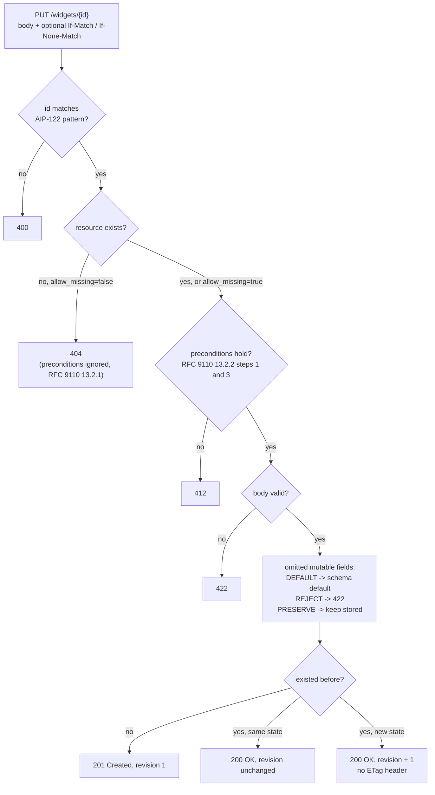

# PUT Semantics: Full Replacement, Defaulting Omitted Fields, and Client-Supplied ID Creation (AIP-133)

> [!summary] Claim
> A `PUT` body is the whole new state of the resource, so every field the client leaves out is set to whatever the server's schema says an absent field means, and an old client that never knew about a field erases it on every read-modify-write, even when its `If-Match` entity tag matches perfectly.

Part of [REST and Resource Modeling](README.md) in [API Engineering](../README.md).

## TL;DR

- Mechanism: `PUT` asks that the target resource "be created or replaced with the state defined by the representation enclosed" (RFC 9110 Section 9.3.4), so the server builds the new state from the body alone and fills every omitted field from its schema defaults.
- Contract rule: answer `201 Created` when the `PUT` created the resource and `200 OK` or `204 No Content` when it replaced one, and send no `ETag` in the `PUT` response unless the stored bytes equal the received bytes (RFC 9110 Section 9.3.4).
- The trap: a client generated before a field existed parses the `GET` body with an ignore-unknown-members decoder (pydantic's default `extra='ignore'`), sends the rest back, and wipes the new field; `If-Match` does not catch it because nobody else wrote in between.
- Portability fact: the lab passes on CPython `3.12.13`, `3.12.16` (Debian Trixie and Alpine containers), `3.13.18`, `3.14.10`, `3.15.2`, and `3.15.2` free-threaded (built from the python.org source tarball); FastAPI `0.162.0` validates a typed body before the handler runs, so a stale `If-Match` with an invalid body yields `422` where RFC 9110 Section 13.2.1 ordering yields `412`.
- When not to use it: for resources that will gain fields, Google standardizes on `PATCH` with an update mask and calls full-replacement `PUT` "strongly discouraged" (AIP-134); use `PUT` for whole documents the client fully owns, and for create-at-a-client-chosen-URI with `If-None-Match: *`.

## Mental model



A `PUT` first passes the checks that do not need the body: the client-chosen ID must be a legal resource ID, and if the resource is absent and the API forbids create-on-update, the answer is `404` no matter what preconditions say, because RFC 9110 Section 13.2.1 makes a server ignore preconditions when the unconditional answer would not be `2xx` or `412`.
Only then are `If-Match` and `If-None-Match` evaluated, before the body is parsed.
A valid body then meets the policy decision this note is about: what an omitted field means.
Under `DEFAULT`, the literal reading of full replacement, it means "reset to the schema default"; under `REJECT` the server refuses incomplete representations; under `PRESERVE` the server keeps the stored value, which silently turns `PUT` into a merge for omissions.
The last step picks the status code: `201` for a create, `200` for a replace, and a no-op replace that changes nothing keeps its revision so the entity tag stays stable.

## How it works

### What the specification says a PUT is

RFC 9110 Section 9.3.4 defines the intent: "the state of the target resource be created or replaced with the state defined by the representation enclosed in the request message content."
It makes the status codes mandatory: on create the origin "MUST inform the user agent by sending a 201 (Created) response", and on replace it "MUST send either a 200 (OK) or a 204 (No Content) response".
It says nothing about field-level defaults, because HTTP "does not define exactly how a PUT method affects the state of an origin server beyond what can be expressed by the intent of the user agent request" (RFC 9110 Section 9.3.4).
That silence is where the trap lives: the representation is a JSON object, the resource is a schema with defaults, and the step from one to the other belongs to the application.

Three more rules in the same section shape an API:

- Consistency: an origin "SHOULD verify that the PUT representation is consistent with its configured constraints", and either transform the representation or reject it, with `409 Conflict` or `415 Unsupported Media Type` suggested (RFC 9110 Section 9.3.4).
  The lab answers `409` when the body's `id` contradicts the target URI.
- Validators: an origin "MUST NOT send a validator field (Section 8.8), such as an ETag or Last-Modified field, in a successful response to PUT unless the request's representation data was saved without any transformation applied to the content" (RFC 9110 Section 9.3.4).
  Filling a default, stamping `revision`, or dropping output-only members is a transformation, so the lab's `PUT` response carries the new representation in the body (including an AIP-134-style `etag` member) and no `ETag` header; `GET` sends the header.
- Who names the resource: "A service that selects a proper URI on behalf of the client, after receiving a state-changing request, SHOULD be implemented using the POST method rather than PUT" (RFC 9110 Section 9.3.4).
  `PUT` is therefore the HTTP-native form of client-supplied ID creation.

`PUT` is idempotent because "the intended effect on the server of multiple identical requests with that method is the same as the effect for a single such request", and a server may still keep "a revision control history" per request (RFC 9110 Section 9.2.2).
The lab goes further than required: a replace whose new state equals the stored state does not bump `revision`, which AIP-134 also asks of `allow_missing` updates ("If the method call is on a resource that already exists, and all fields match, the existing resource is returned unchanged").

Partial `PUT` exists only as "private agreements" around `Content-Range`, and an origin "SHOULD respond with a 400 (Bad Request) status code if it receives Content-Range on a PUT for a target resource that does not support partial PUT requests" (RFC 9110 Section 14.5); the lab does exactly that.
RFC 5789 Section 2 draws the contrast: with `PUT` "the enclosed entity is considered to be a modified version of the resource", whereas a `PATCH` body is "a set of instructions"; field-level partial updates belong to [[Partial-Updates-JSON-Merge-Patch-RFC-7396-vs-JSON-Patch-RFC-6902]] and [[Field-Masks-and-Update-Masks-AIP-134-and-AIP-161]].

### Defaulting omitted fields: where the wipe comes from

FastAPI's own tutorial documents the mechanism: an `Item` model has `tax: float = 10.5`, the stored item has `"tax": 20.2`, and a `PUT` body without `tax` means "the input model would take the default value of "tax": 10.5" (FastAPI documentation, Body - Updates, "Warning about replacing", as of 2026-11).
Pydantic records which fields the input actually carried in the `model_fields_set` property, which "Returns the set of fields that have been explicitly set on this model instance", "i.e. that were not filled from defaults" `(pydantic 2.14.3 pydantic/main.py, BaseModel.model_fields_set)`, so the server can tell "omitted" from "sent the default", but only if it asks.

The schema-skew version is worse, because the client never chose to omit anything.
Pydantic's `ConfigDict.extra` docstring says the setting "Defaults to `'ignore'`" and that "Providing extra data is ignored (the default)" `(pydantic 2.14.3 pydantic/config.py, ConfigDict.extra)`.
A client whose model predates `labels` therefore decodes a `GET` body, drops `labels` without an error, and serializes a representation that has no `labels` at all.
Its `PUT` is a perfectly valid full replacement, so the server resets `labels` to `{}`.
AIP-134 describes the same failure with a `rating` field: "a PUT request unintentionally wiped out data because the previous version did not know about it" (AIP-134, "PATCH and PUT"), which is why full-replacement `PUT` is "strongly discouraged because it becomes a backwards-incompatible change to add fields to the resource" (AIP-134, "Guidance").
Kubernetes says the same about `kubectl replace`: "an older client may not even know about the existence of the field, making even a read-modify-write cycle fail", and its API change guide notes "JSON and YAML silently dropping unknown fields" (Kubernetes api-conventions.md, "Considerations For PUT Operations"; api_changes.md).

`If-Match` cannot see this.
The old client read revision `r1`, nobody else wrote, and it sends `If-Match: "r1"`, which is true under strong comparison (RFC 9110 Section 13.1.1).
Optimistic concurrency detects a concurrent writer; it does not detect a writer that is missing part of the schema.
The lab's `test_old_client_round_trip_wipes_new_field_despite_matching_if_match` proves both halves: `200 OK`, and `labels == {}`.

The server has exactly three policies for an omitted mutable field, and each has a cost:

| Policy | Omitted field becomes | Old client round trip | Cost |
|---|---|---|---|
| `DEFAULT` | schema default | silently wipes new fields | literal RFC 9110 semantics; AIP-134 calls adding a field breaking |
| `REJECT` | `422`, listing missing fields | fails loudly, data intact | every added mutable field breaks every old `PUT` client |
| `PRESERVE` | stored value | keeps new fields | `PUT` is no longer a replacement; clearing needs an explicit empty value |

Kubernetes recommends a targeted form of `PRESERVE` for a field that is immutable after creation, with allocated Service IPs as its example: "consider adding logic to manually "patch" the value from the "old" object into the "new" one when it has been "unset"" (Kubernetes api-conventions.md, "Considerations For PUT Operations").
The client-side fix is the tolerant reader that round-trips unknown members: the lab's `LosslessWidgetV1` sets `extra='allow'` and the `labels` survive; see [[Additive-Schema-Evolution-and-Tolerant-Reader-Patterns]].

### Client-supplied IDs and upsert

AIP-133 requires that "An API must allow a user to specify the ID component of a resource ... on creation if the API is operating on the management plane", but in Google's REST mapping the ID travels as `{resource}_id` "as a query parameters on the request URI" of a `POST`, and "The name field on the resource must be ignored" (AIP-133, "User-specified IDs").
The rationale is declarative tooling: without a user-specified ID "a client is unable to find the resource unless they store the identifier locally, and can result in re-creating the resource" (AIP-133, "Rationale").
A duplicate ID "must error with ALREADY_EXISTS", or `PERMISSION_DENIED` if the caller cannot see the duplicate (AIP-133).

The ID format comes from AIP-122: IDs "should conform to RFC-1034", lowercase, matching `^[a-z]([a-z0-9-]{0,61}[a-z0-9])?$`, so 1 to 63 characters starting with a letter and not ending in a hyphen.
AIP-133's example comment narrows that to "4-63 characters"; the lab enforces the AIP-122 pattern.

Upsert is the AIP-134 `allow_missing` flag: when true and the resource is absent, "the resource is created. All fields are applied regardless of any provided field mask", and when false a missing resource "must error with NOT_FOUND (HTTP 404)" (AIP-134, "Create or update" and "Errors").
Kubernetes makes the same switch per resource type through its storage strategy's `AllowCreateOnUpdate()`, and "Most built-in types do not allow this" (Kubernetes api-conventions.md).
The reason to default it off is the typo: `PUT /widgets/gaer` with creation allowed makes a stray resource and returns `201`, while with creation disallowed it returns `404`; the lab proves both.

### Preconditions on PUT

RFC 9110 Section 13.2.2 fixes the order for an origin server: `If-Match` (step 1), `If-Unmodified-Since` only when `If-Match` is absent (step 2), then `If-None-Match` (step 3); a true `If-Match` continues to step 3, so both fields are evaluated when both are present.
`If-Match` uses strong comparison (RFC 9110 Section 13.1.1), so `W/"r1"` never matches; `If-Match: *` is true only if a current representation exists, which turns an upsert endpoint into update-only for that request.
`If-None-Match: *` is the create-only guard: it exists "to prevent an unsafe request method (e.g., PUT) from inadvertently modifying an existing representation ... when the client believes that the resource does not have a current representation", and a false condition on a method other than `GET` or `HEAD` yields `412 Precondition Failed` (RFC 9110 Section 13.1.2).
Two clients racing to create the same ID with `If-None-Match: *` get `201` and `412`; without it the second silently replaces the first with `200`.

Ordering matters twice.
First, "A server MUST ignore all received preconditions if its response to the same request without those conditions, prior to processing the request content, would have been a status code other than a 2xx (Successful) or 412" (RFC 9110 Section 13.2.1), so `allow_missing=false` plus a missing resource is `404` even with `If-Match`.
Second, preconditions are evaluated "just before it would process the request content" (RFC 9110 Section 13.2.1).
FastAPI resolves a typed body inside `solve_dependencies` and calls the endpoint only `if not errors` `(fastapi 0.162.0 fastapi/routing.py, get_request_handler)`, so in the tutorial shape a stale `If-Match` with an invalid body returns `422`; the lab's Starlette handler reads the body after the precondition check and returns `412`.

A retried conditional `PUT` is the classic surprise: the first attempt succeeds, the response is lost, and the identical retry fails with `412` because the first attempt changed the entity tag.
RFC 9110 Section 13.1.1 allows the origin to answer `2xx` instead "if the request is a state-changing operation that appears to have already been applied", but warns that non-cooperating writers can then lose transitions; the lab stays strict and the client must `GET` and compare.
Field lines with the same name combine into one comma-separated list without changing semantics (RFC 9110 Section 5.3), so the lab reads every `If-Match` line with `getlist` and joins them `(starlette 1.10.0 starlette/datastructures.py, Headers.getlist)`.

### Output-only, immutable, and unknown members

AIP-203 says an `OUTPUT_ONLY` field in a request "does nothing (the server must clear out any value in this field and must not throw an error as a result of the presence of a value in this field on input)".
That rule is what makes `GET`-then-`PUT` work at all: the lab accepts `id`, `revision`, and `etag` in the body and discards them, so a forged `"revision": 999` yields revision `1`.
For `IMMUTABLE` fields the service "should ignore the field if the value matches, but should error with INVALID_ARGUMENT if a change is requested" (AIP-203); field behavior is the subject of [[Field-Behavior-Semantics-Input-Only-Output-Only-and-Immutable-AIP-203]].
Members the server does not know at all are a separate decision: the lab's server body sets `extra='forbid'` and answers `422` with type `extra_forbidden`, which stops mass assignment but means a newer client talking to an older server is rejected rather than silently truncated.

## Numbers and limits

| Quantity | Value | Source or measurement |
|---|---|---|
| Success codes for `PUT` | `201` on create; `200` or `204` on replace | RFC 9110 Section 9.3.4 |
| Precondition order for an origin | `If-Match` (1), `If-Unmodified-Since` (2), `If-None-Match` (3) | RFC 9110 Section 13.2.2 |
| Comparison function | strong for `If-Match`, weak for `If-None-Match` | RFC 9110 Sections 13.1.1 and 13.1.2 |
| User-specified ID length | 1 to 63 characters, `^[a-z]([a-z0-9-]{0,61}[a-z0-9])?$` | AIP-122 (as of 2026-11) |
| AIP-133 example ID length | 4 to 63 characters | AIP-133 request message example comment (as of 2026-11) |
| AIP-134 etag mismatch error | `ABORTED` (`409`), changed from `FAILED_PRECONDITION` (`400`) on 2021-03-05 | AIP-134 changelog |
| AIP-134 `allow_missing` guidance added | 2020-10-06 | AIP-134 changelog |
| Kubernetes stale `resourceVersion` on `PUT` | `409` `StatusConflict` | Kubernetes api-conventions.md, "Concurrency Control and Consistency" (as of 2026-11) |
| FastAPI tutorial wipe example | stored `tax` `20.2` replaced by default `10.5` | FastAPI documentation, Body - Updates (as of 2026-11) |
| Pydantic `extra` default | `'ignore'` | `(pydantic 2.14.3 pydantic/config.py, ConfigDict.extra)`; pinned by the lab |
| Lab suite | 41 tests, `41 passed in 0.15s` (0.15s to 0.26s across runs), 100% line and branch coverage of `put_replacement.py` (136 statements, 42 branches) | `uv run --frozen pytest tests/f04_rest_and_resource_modeling/test_full_replacement_put_and_upsert_semantics.py -q`, plus `--cov=api_labs.f04_rest_and_resource_modeling.put_replacement --cov-branch` for coverage, CPython `3.14.6`, macOS 27.2 arm64 (Darwin `27.2.0`), measured 2026-11-10 |
| Mutation check | 22 of 22 mutations killed (21 on the first run) | finishing pass on 2026-11-10, one mutation at a time with `pytest -x`, module restored and SHA-1 checked; `etagc` accepting an inner `DQUOTE` survived until two assertions were added to `test_entity_tag_lists_accept_empty_elements_and_reject_bare_tokens`; an earlier fact-check pass killed 19 of 19 after adding two ID cases |

## Portability

| Dimension | Version | Result |
|---|---|---|
| CPython | `3.12.13` (macOS host) and `3.12.16` (containers) | `41 passed` on the host with an isolated `UV_PROJECT_ENVIRONMENT` and `uv run --frozen --python 3.12` (uv offers no `3.12.16` for macOS); `41 passed` in `python:3.12.16-trixie` and `python:3.12.16-alpine` with the `uv.lock` pins installed by `pip` |
| CPython | `3.13.18` | `41 passed`, `uv run --frozen --python /opt/homebrew/bin/python3.13` |
| CPython | `3.14.10` | `41 passed`, `uv run --frozen --python /opt/homebrew/bin/python3.14`, and in `python:3.14.10-trixie` and `python:3.14.10-alpine`; the workspace `.venv` (`3.14.6`) also passes |
| CPython | `3.15.2` | `41 passed`, `uv run --frozen --python /opt/homebrew/bin/python3.15` |
| CPython free-threaded | `3.15.2t`: `3.15.2 free-threading build` compiled on 2026-11-10 from `https://www.python.org/ftp/python/3.15.2/Python-3.15.2.tgz` with `./configure --disable-gil` and Apple clang `21.0.0` (no `3.15.2t` binary exists for uv or Homebrew here, and Docker has no `3.15.2t` tag); `sys._is_gil_enabled()` is `False` after importing `pydantic_core`, `starlette`, `fastapi`, and `pydantic` | `41 passed in 0.40s` with `PYTHONPATH=labs/src python -m pytest ... -o addopts=""` in a venv holding the `uv.lock` versions of the lab's FastAPI stack (`fastapi 0.162.0`, `starlette 1.10.0`, `pydantic 2.14.3`, `pydantic-core 2.50.4`, `httpx 0.28.1`, `anyio 4.16.0`, `pytest 9.2.0`, `pytest-asyncio 1.4.1.post1`), because `uv run --frozen` fails for a free-threaded interpreter: `uv.lock` has no `psycopg-binary 3.3.8` wheel for it; an earlier `3.15.0b3+freethreaded` run also gave `41 passed` |
| Containers | Debian Trixie (glibc 2.41) and Alpine (musl), linux aarch64, Docker `29.8.2` | `41 passed` on all four images above; `-v labs:/labs:ro`, `PYTHONPATH=/labs/src`, `pytest -p no:cacheprovider` |
| Pydantic | `2.14.3` | unknown members dropped by default, kept with `extra='allow'`, rejected with `extra='forbid'`; proven in the lab |
| FastAPI | `0.162.0` | typed body validated before the endpoint, so `422` wins over a failing `If-Match`; proven in the lab |
| Starlette | `1.10.0` | `Headers.getlist` returns every field line, so split `If-Match` lines combine; proven in the lab |
| HTTP/1.1, HTTP/2, HTTP/3 | RFC 9110, RFC 9113, RFC 9114 | `PUT` semantics are version-independent: RFC 9113 Section 8 calls HTTP/2 "an instantiation of the HTTP message abstraction", and the `:method` pseudo-header "contains the HTTP method (Section 9 of [HTTP])" (RFC 9113 Section 8.3.1; RFC 9114 Section 4.3.1 says the same for HTTP/3). Wire runs on 2026-11-10 with curl `8.22.0`: Granian `2.8.7` over cleartext HTTP/2 (`--http2-prior-knowledge`), Hypercorn `0.18.0` with aioquic `1.7.2` and a self-signed certificate over HTTP/2 (`--http2`) and HTTP/3 (`--http3-only`); each gave create `201`, a `PUT` response without `ETag`, `Content-Range` `400`, `If-None-Match: *` on an existing widget `412`, a stale `If-Match` `412`, and omitted `labels` reset to `{}`; the HTTP/2 runs also showed two separate `If-Match` field lines combining to `200` (not repeated over HTTP/3) |
| Uvicorn, Hypercorn, Granian | `0.54.0`, `0.18.0`, `2.8.7` | same results on each over loopback HTTP/1.1 (`granian --interface asgi --http 1`): create `201` without `ETag`, `GET` `ETag` `"r1"`, two separate `If-Match` lines combine to `200`, `Content-Range` gives `400`, `If-None-Match: *` on an existing widget gives `412`, omitted `labels` reset to `{}`; one-off scripts on 2026-11-10 against the lab's `build_app`, not part of the lab gate, which stays ASGI-level |

## Worked example

The [implementation](../labs/src/api_labs/f04_rest_and_resource_modeling/put_replacement.py) holds a Starlette resource with the three omitted-field policies, `allow_missing`, precondition evaluation, AIP-122 ID validation, and a FastAPI app in the tutorial shape for comparison; the [test](../labs/tests/f04_rest_and_resource_modeling/test_full_replacement_put_and_upsert_semantics.py) proves each rule.

The `PUT` handler, verbatim from the lab:

```python
    async def put(self, request: Request) -> Response:
        widget_id = str(request.path_params["widget_id"])
        # Normal request checks first; RFC 9110 Section 13.2.1 says a 4xx here beats any 412.
        if not RESOURCE_ID.fullmatch(widget_id):
            return _problem(400, "widget id must match ^[a-z]([a-z0-9-]{0,61}[a-z0-9])?$")
        if "content-range" in request.headers:
            return _problem(400, "partial PUT is not supported")  # RFC 9110 Section 14.5
        current = self.widgets.get(widget_id)
        if current is None and not self.allow_missing:
            return _problem(404, "no such widget and allow_missing is false")

        # Preconditions are evaluated before the content is processed (RFC 9110 Section 13.2.1).
        verdict = preconditions_hold(
            _field(request, "if-match"), _field(request, "if-none-match"), current
        )
        if verdict is None:
            return _problem(400, "malformed entity-tag list")
        if not verdict:
            return _problem(412, "precondition failed")

        try:
            raw: object = json.loads(await request.body())
        except ValueError:
            return _problem(400, "body is not JSON")
        if not isinstance(raw, dict):
            return _problem(400, "body must be a JSON object")
        try:
            body = WidgetBody.model_validate(raw)
        except ValidationError as exc:
            return _problem(422, exc.errors(include_url=False, include_context=False))
        if body.id is not None and body.id != widget_id:
            return _problem(409, f"body id {body.id!r} does not match the target URI")

        missing = MUTABLE_FIELDS - body.model_fields_set
        if self.omitted is OmittedFields.REJECT and missing:
            return _problem(422, {"missing": sorted(missing)})
        keep = current if self.omitted is OmittedFields.PRESERVE else None
        candidate = StoredWidget(
            id=widget_id,
            display_name=body.display_name,
            color=keep.color if keep and "color" in missing else body.color,
            labels=keep.labels if keep and "labels" in missing else dict(body.labels),
            revision=1 if current is None else current.revision + 1,
        )
        if current is not None and current.same_state(candidate):
            return JSONResponse(current.to_json(), status_code=200)  # no-op: revision unchanged

        self.widgets[widget_id] = candidate
        self.writes += 1
        # 201 on create, 200 on replace (RFC 9110 Section 9.3.4). No ETag header: the stored
        # representation is not the bytes received, so a validator field is forbidden.
        return JSONResponse(candidate.to_json(), status_code=201 if current is None else 200)
```

Precondition evaluation, verbatim:

```python
def preconditions_hold(
    if_match: str | None, if_none_match: str | None, current: StoredWidget | None
) -> bool | None:
    """RFC 9110 Section 13.2.2 steps 1 and 3 for an unsafe method; `None` means malformed.

    Step 2 (`If-Unmodified-Since`) is out of scope: this resource has no `Last-Modified`.
    """
    if if_match is not None:
        if if_match.strip() == "*":
            matched = current is not None
        else:
            tags = parse_entity_tags(if_match)
            if tags is None:
                return None
            # Strong comparison (RFC 9110 Section 13.1.1): a weak tag never matches.
            matched = current is not None and current.etag in tags
        if not matched:
            return False
        # A true If-Match continues to step 3, so If-None-Match is still evaluated.
    if if_none_match is not None:
        if if_none_match.strip() == "*":
            return current is None
        tags = parse_entity_tags(if_none_match)
        if tags is None:
            return None
        # Weak comparison (RFC 9110 Section 13.1.2): ignore the W/ prefix.
        return current is None or current.etag not in {t.removeprefix("W/") for t in tags}
    return True
```

The schema-skew wipe, verbatim from the test:

```python
@pytest.mark.unit
@pytest.mark.asyncio
async def test_old_client_round_trip_wipes_new_field_despite_matching_if_match() -> None:
    service = seeded()
    async with client_for(build_app(service)) as client:
        fetched = await client.get("/widgets/gear")
        old = WidgetV1.model_validate(fetched.json())  # extra='ignore' drops `labels`
        old.color = "blue"
        response = await client.put(
            "/widgets/gear",
            json=old.model_dump(),
            headers={"if-match": fetched.headers["etag"]},
        )
    assert "labels" not in old.model_dump()
    assert response.status_code == 200  # the entity tag matched: no concurrent writer existed
    assert service.widgets["gear"].labels == {}  # yet the payments label is gone
    assert service.widgets["gear"].color == "blue"
```

Captured on CPython `3.14.6`, macOS 27.2 arm64, from `labs/`:

```text
$ uv run --frozen pytest tests/f04_rest_and_resource_modeling/test_full_replacement_put_and_upsert_semantics.py -q
.........................................                                [100%]
41 passed in 0.15s
```

Each mechanism was checked by mutation: 22 deliberate breaks, applied one at a time with `pytest -x` and the module restored byte for byte (SHA-1 compared), each made at least one test fail.
They were weak comparison for `If-Match`, strong comparison for `If-None-Match`, `If-Match: *` ignoring state, skipping `If-None-Match` after a true `If-Match`, a malformed tag list treated as empty, `etagc` admitting an inner `DQUOTE`, accepting `Content-Range`, dropping the body-`id` `409`, an `ETag` header on the `PUT` response, only the first `If-Match` line read, a no-op comparing only `display_name`, a no-op bumping the revision, `200` on create, disabling `REJECT`, dropping `labels` from the mutable set, `PRESERVE` ignoring `labels` or `color`, an ID pattern one character too long, no `404` when `allow_missing` is false, an uncounted write, honoring an output-only `revision`, and `extra='ignore'` on the server body.
One survived the first run (`etagc` admitting an inner `DQUOTE`); two assertions were added and it then failed.

## Pitfalls

> [!warning] Adding a field to a resource that clients `PUT`
> Trigger: a new mutable field ships while clients generated from the old schema still do `GET`, edit, `PUT`, decoding with an ignore-unknown-members default such as pydantic's `extra='ignore'`.
> Symptom: the new field resets to its default on every old-client save, with `200 OK` and a matching `If-Match`; AIP-134 gives the `rating` example and Kubernetes notes that old clients make "even a read-modify-write cycle fail".
> Real cases: Azure PowerShell issue 8166 (opened 2018-12-18) records that `Set-AzResourceGroup` could strip properties such as `ManagedBy` because the resource group serialization model lacked them, so "if a PUT is performed, it will remove any values from these properties", and proposes `PATCH`; Chromium's sync design note on old clients describes an old client that submits a change and so discards "field's `F` data from client `N`", and fixes it by having the old client keep a copy of the server-provided proto; Apiture documents the "round trip problem" in which an old SDK drops `guaranteeType` and a `PUT` would "change the persistent value of `guaranteeType` to `null`", and fixes it by sending the schema version in the `Apiture-Version` header and a `_profile` in the body.
> Fix: offer `PATCH` with an update mask for edits, make old clients round-trip unknown members, or choose `REJECT` so the failure is loud; this lab tests the last two, and update masks are the lab of [[Field-Masks-and-Update-Masks-AIP-134-and-AIP-161]].

> [!warning] Upsert that turns typos into resources
> Trigger: `PUT` creates on a missing ID by default.
> Symptom: `PUT /widgets/gaer` returns `201` and the real `gear` is never updated; the stray resource accrues cost and confuses inventory tools.
> Fix: default `allow_missing` to false as AIP-134 does, return `404`, and let declarative clients opt in per request; clients that mean "create only" send `If-None-Match: *`.

> [!warning] Retrying a conditional `PUT` after a lost response
> Trigger: a client library retries an idempotent `PUT` that carried `If-Match` after a connection reset (RFC 9110 Section 9.2.2 allows the retry).
> Symptom: the retry fails with `412` although the change was applied, and naive callers report a conflict to the user (lab test `test_retried_conditional_put_gets_412_although_its_change_was_applied`).
> Fix: on `412`, `GET` and compare the current state with the intended state before reporting failure; or have the server return `2xx` when the change "appears to have already been applied" (RFC 9110 Section 13.1.1), accepting its risk for non-cooperating writers.

> [!warning] Defaults that change between versions
> Trigger: a field's static default changes, for example from `false` to `true`, while objects created under the old default are later replaced with `PUT`.
> Symptom: the replace flips the field although the client never mentioned it; Kubernetes documents this exact v1-to-v2 case, and AIP-180 says "Changing the default value is considered breaking and must not be done".
> Fix: never change a static default inside a major version; for a field that is immutable after creation, copy the stored value into an unset field on update, as Kubernetes recommends.

> [!warning] A validator header on a transformed `PUT`
> Trigger: the `PUT` response sends `ETag` for a representation the server altered (defaults filled, server fields stamped).
> Symptom: the client keeps its own body as the current representation with a validator that describes different bytes; RFC 9110 Section 9.3.4 forbids exactly this.
> Fix: omit the `ETag` header unless the stored representation equals the received bytes, and return the transformed representation in the body; the lab pins the header's absence.

## Security and robustness

- Mass assignment (OWASP `API3:2023 Broken Object Property Level Authorization`): OWASP's third scenario is a `PUT /api/video/update_video` replayed with `"blocked": false`; full-replacement bodies invite exactly this, so bind only an explicit allowlist of client-writable fields and treat everything else as output-only (discarded) or unknown (`422`); see [[Defeating-BOPLA-and-Mass-Assignment-API3-2023-Strict-Input-Output-Schemas]].
- Forged server state: a body that carries `revision`, `etag`, `id`, or timestamps must never set them; AIP-203 requires the server to clear output-only values, and the lab proves a forged `"revision": 999` is ignored.
- Identifier confusion: a body `id` that differs from the URI is either an attack on another object or a copy-paste bug; RFC 9110 Section 9.3.4 suggests `409`, which the lab returns, while AIP-133 says the `name` field "must be ignored" on create.
- Enumeration through upsert: AIP-133 requires `PERMISSION_DENIED` rather than `ALREADY_EXISTS` when the caller cannot see the duplicate, so a create-by-`PUT` must not reveal that a hidden ID exists; and AIP-134 requires update permission even with `allow_missing`.
- Input bounds: client-chosen IDs end up in URLs, logs, and storage keys; the AIP-122 pattern bounds them to 63 lowercase ASCII letters, digits, and hyphens, so no `.` or `/` (no path traversal segments), no upper case (no case-folding collisions), and no non-ASCII (no Unicode confusables); the lab pins `a.b`, `Gear`, and `g%C3%A9ar` (U+00E9 in the path) at `400`.
- Partial writes: reject `Content-Range` on `PUT` with `400` (RFC 9110 Section 14.5), because a server that ignores it "may result in the content being written as a complete replacement".
- Robustness: fail closed on a malformed `If-Match` (`400`, not "no precondition"), because treating garbage as absent turns a guarded write into an unguarded one.

## The principal's view

The decision is whether a resource's write contract is a document or a set of fields.
If clients own the whole document, as with configuration blobs, object storage, or a declarative tool that holds the complete desired state, `PUT` with `If-Match` is the simplest correct contract, and `PUT` with `If-None-Match: *` is the cleanest create-at-a-known-name primitive HTTP has.
If the resource will grow fields and is edited by many clients of different ages, which is every long-lived public API, full replacement converts every additive change into a breaking one, and the organization should standardize on `PATCH` with an update mask, as Google does (AIP-134), and keep `PUT` off the surface or behind `REJECT`.
The organizational cost is real in both directions: `PATCH` needs a mask or merge-patch implementation in every service and every SDK, while `PUT` needs every client release to keep pace with every schema addition or to round-trip unknown members, which most generated SDKs do not do by default.
Client-supplied IDs are the other half of the decision: they make retries and declarative reconciliation safe without idempotency keys, at the price of a naming policy (AIP-122), collision semantics (AIP-133), and a typo-safe default for upsert (AIP-134); where clients do not need stable names, server-assigned IDs with `POST` and an `Idempotency-Key` are simpler ([[Idempotency-Key-Header-Specification-and-State-Machine-Draft-08]]).
Declarative platforms that reconcile desired state, covered in [[Declarative-Friendly-APIs-and-Reconciliation-Loops-AIP-128]], are where client-supplied IDs plus `allow_missing` pay off most.

## Interview questions

> [!question] L5: What status codes does RFC 9110 require for a successful `PUT`, and how does the client know which happened?
>
> > [!success]- Answer
> > `201 Created` when the `PUT` created the resource, and `200 OK` or `204 No Content` when it replaced an existing one (RFC 9110 Section 9.3.4).
> > The distinction is a MUST, so the client learns from the status code alone whether it created or overwrote.
> > For a `201` without `Location`, the created resource is the target URI (RFC 9110 Section 15.3.2).
> >
> > Follow-up: When would you prefer `204` over `200` for a replace?

> [!question] L5: Why is `PUT` idempotent when `POST` is not, and does a server that increments a revision counter on each `PUT` break idempotency?
>
> > [!success]- Answer
> > `PUT` states the final state, so repeating it has the same intended effect (RFC 9110 Section 9.2.2).
> > Idempotency is about the intended effect, and the RFC explicitly lets a server "retain a revision control history" per request.
> > The lab avoids even that by not bumping the revision when the new state equals the stored one.
> >
> > Follow-up: Which client-visible header changes if the revision is bumped on a no-op, and why does that matter for `If-Match`?

> [!question] L6 (Predict-the-output): The stored widget is `{"display_name": "Gear", "color": "red", "labels": {"team": "payments"}}` at `"r1"`; a client built with `class WidgetV1(BaseModel): display_name: str; color: str = "black"` does `GET`, sets `color = "blue"`, and sends `PUT` with `If-Match: "r1"` to the lab in `DEFAULT` mode; what are the status code and the stored `labels`?
>
> > [!success]- Answer
> > `200 OK`, and `labels` becomes `{}`.
> > Pydantic's default `extra='ignore'` dropped `labels` when the old model parsed the `GET` body, so the `PUT` body never contained it, and full replacement applied the default.
> > `If-Match` matched because nobody else wrote; it detects concurrent writers, not schema skew.
> > In `REJECT` mode the same request returns `422` with `detail` `{"missing": ["labels"]}`.
> >
> > Follow-up: What single client-side configuration change preserves `labels`, and what does it cost?

> [!question] L6: When must a server ignore `If-Match` on a `PUT`, and when must it evaluate `If-None-Match` even though `If-Match` was present?
>
> > [!success]- Answer
> > It ignores all preconditions when the unconditional response would have been something other than `2xx` or `412` before processing content, for example `404` when creation is disallowed (RFC 9110 Section 13.2.1).
> > A true `If-Match` continues to step 3, so `If-None-Match` is still evaluated (RFC 9110 Section 13.2.2).
> > `If-Match: "r1"` with `If-None-Match: "r1"` on revision `r1` therefore fails with `412`.
> >
> > Follow-up: Why does RFC 9110 order lost-update preconditions before cache-validation preconditions?

> [!question] L6 (Debug-this-API): After a release that added a `labels` field, support reports that labels "randomly disappear" a few times a day, there are no `412` responses in the logs, and all writers use `If-Match`; what is happening and how do you confirm it?
>
> > [!success]- Answer
> > An older client is round-tripping the resource through a model without `labels` and `PUT`-ing the result; its `If-Match` matches because there is no concurrent writer.
> > Confirm by grouping the `PUT` requests that preceded each disappearance by `User-Agent` or SDK version and checking that their bodies lack the `labels` member entirely, as opposed to sending `{}`.
> > Short term, switch the endpoint to `REJECT` for bodies missing `labels` or to `PRESERVE` for that field; long term, move edits to `PATCH` with an update mask.
> >
> > Follow-up: How would a contract test in CI have caught this before release?

> [!question] L6: How does AIP-133 put a client-supplied ID on the wire, and how does that differ from HTTP-native `PUT` creation?
>
> > [!success]- Answer
> > AIP-133 uses `POST` to the collection with `{resource}_id` as a query parameter, and the `name` field in the body must be ignored.
> > HTTP-native creation sends `PUT` to the final URI, and RFC 9110 Section 9.3.4 says a service that picks the URI itself should use `POST` instead.
> > AIP-134 adds upsert separately through `allow_missing` on `PATCH`, and returns `404` when it is false and the resource is missing.
> >
> > Follow-up: What error does AIP-133 require when the ID already exists but the caller cannot see that resource?

> [!question] L7+: A conditional `PUT` times out, the client retries the identical request, and gets `412`; was the write lost, and how should the platform make this case boring?
>
> > [!success]- Answer
> > Probably not: the first attempt likely succeeded and changed the entity tag, so the identical retry fails its own precondition.
> > The client should `GET` and compare the current state with what it intended before reporting a conflict.
> > Alternatively the server may answer `2xx` when the change "appears to have already been applied" (RFC 9110 Section 13.1.1), at the risk of hiding collisions between non-cooperating writers.
> > The lab pins the strict behavior: the retry gets `412` and the stored state already equals the intended state.
> >
> > Follow-up: Would an `Idempotency-Key` on the `PUT` solve this, and what would it cost?

> [!question] L7+: You own the API guidelines for 300 services; do you allow `PUT` for updates?
>
> > [!success]- Answer
> > Not for resources expected to grow fields: AIP-134's argument that adding a field becomes breaking under `PUT` holds at any scale, and old SDKs dominate traffic for years.
> > Allow `PUT` for whole-document resources the client fully owns and for create-only with `If-None-Match: *`, and require `PATCH` with an update mask elsewhere.
> > Where `PUT` remains, mandate `If-Match`, `REJECT` or explicit field-level preservation for added fields, and output-only handling per AIP-203.
> > The trade-off is SDK and service complexity for masks, paid once, against silent data loss paid per release.
> >
> > Follow-up: How would you enforce this rule automatically in API review?

> [!question] L7+: Why does RFC 9110 forbid an `ETag` header on most `PUT` responses, and what should an API that fills defaults return instead?
>
> > [!success]- Answer
> > A validator in a `PUT` response tells the client that the bytes it sent are now the representation, so it can skip a `GET`; that is only true if the server saved them "without any transformation" (RFC 9110 Section 9.3.4).
> > An API that fills defaults or stamps server fields should return the resulting representation in the body, with its entity tag as a body member if needed, and send the `ETag` header on `GET`.
> > The lab does exactly that and pins the header's absence.
> >
> > Follow-up: How does `204 No Content` with an `ETag` change the client's obligations (RFC 9110 Section 15.3.5)?

## Related

Prerequisites: [[HTTP-Status-Code-Taxonomy-and-Selection-Decision-Trees]]

Next: [[Partial-Updates-JSON-Merge-Patch-RFC-7396-vs-JSON-Patch-RFC-6902]]

See also: [[REST-APIs]], [[02-Programming-Languages/Python/Python-Backend-Interview-Prep/05-REST-API-Design]], [[HTTP-Method-Semantics-Safety-and-Idempotency-Invariants]], [[Field-Masks-and-Update-Masks-AIP-134-and-AIP-161]], [[Field-Behavior-Semantics-Input-Only-Output-Only-and-Immutable-AIP-203]], [[Declarative-Friendly-APIs-and-Reconciliation-Loops-AIP-128]], [[Resource-Identifiers-UUIDv4-vs-UUIDv7-ULID-and-Public-IDs]], [[Optimistic-Concurrency-Control-If-Match-and-412-Precondition-Failed]], [[Additive-Schema-Evolution-and-Tolerant-Reader-Patterns]], [[Compatibility-Taxonomy-Wire-Source-and-Semantic-Compatibility-AIP-180]], [[Defeating-BOPLA-and-Mass-Assignment-API3-2023-Strict-Input-Output-Schemas]], [[Idempotency-Key-Header-Specification-and-State-Machine-Draft-08]]

- Lab: `labs/tests/f04_rest_and_resource_modeling/test_full_replacement_put_and_upsert_semantics.py`

## Further reading

- [RFC 9110 Section 9.3.4: PUT](https://www.rfc-editor.org/rfc/rfc9110.html#section-9.3.4) - the replacement semantics, the `201` versus `200`/`204` rule, and the validator prohibition.
- [RFC 9110 Section 13.2: Evaluation of Preconditions](https://www.rfc-editor.org/rfc/rfc9110.html#section-13.2) - when preconditions are ignored and the order `If-Match`, `If-Unmodified-Since`, `If-None-Match`.
- [RFC 9110 Section 14.5: Partial PUT](https://www.rfc-editor.org/rfc/rfc9110.html#section-14.5) - why `Content-Range` on `PUT` should get `400`.
- [RFC 5789: PATCH Method for HTTP](https://www.rfc-editor.org/rfc/rfc5789.html) - the replacement-versus-instructions distinction in Section 2.
- [AIP-134: Standard methods: Update](https://google.aip.dev/134) - why Google avoids `PUT`, `allow_missing` upsert, and etag errors.
- [AIP-133: Standard methods: Create](https://google.aip.dev/133) - user-specified IDs, duplicate handling, and the declarative rationale.
- [AIP-122: Resource names](https://google.aip.dev/122) - the RFC 1034 based ID pattern.
- [AIP-203: Field behavior documentation](https://google.aip.dev/203) - output-only and immutable fields on input.
- [AIP-180: Backwards compatibility](https://google.aip.dev/180) - adding fields and never changing defaults.
- [Kubernetes API conventions](https://github.com/kubernetes/community/blob/master/contributors/devel/sig-architecture/api-conventions.md) - "Considerations For PUT Operations" and `resourceVersion` concurrency, from a system that ships `PUT` at scale.
- [RFC 9113 Section 8: Expressing HTTP Semantics in HTTP/2](https://www.rfc-editor.org/rfc/rfc9113.html#section-8) - why `PUT` means the same thing on an HTTP/2 stream.
- [RFC 9114 Section 4: Expressing HTTP Semantics in HTTP/3](https://www.rfc-editor.org/rfc/rfc9114.html#section-4) - the same mapping over QUIC.
- [Azure PowerShell issue 8166](https://github.com/Azure/azure-powershell/issues/8166) - a shipped client whose model lacked properties and whose `PUT` stripped them.
- [Chromium: old sync clients data override protection](https://www.chromium.org/developers/design-documents/sync/old-sync-clients-data-override-protection) - the same failure in a sync protocol and the keep-the-server-copy fix.
- [Apiture: the round trip problem](https://developer.apiture.com/open/concepts/round-trip-problem) - an old SDK dropping a property and a versioned-request mitigation.
- [FastAPI: Body - Updates](https://fastapi.tiangolo.com/tutorial/body-updates/) - the framework's own warning that `PUT` resets omitted fields to model defaults.
