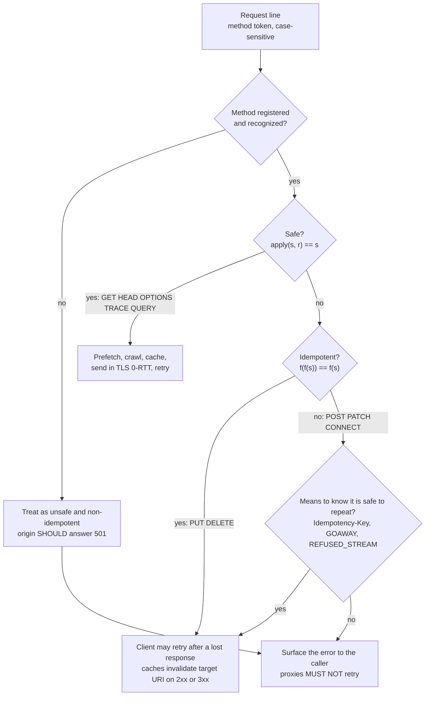

# HTTP Method Semantics, Safety, and Idempotency: GET, HEAD, OPTIONS, PUT, DELETE, POST, and PATCH (RFC 9110)

> [!summary] Claim
> Safety and idempotency are two equations over server state, not properties of handler code: a safe method satisfies `apply(s, r) == s` and an idempotent method satisfies `apply(apply(s, r), r) == apply(s, r)`, and every cache, prefetcher, proxy, and retrying client on the path is entitled to assume them from the method token alone (RFC 9110 Section 9.2).

Part of [REST and Resource Modeling](README.md) in [API Engineering](../README.md).

## TL;DR

- Mechanism: the method token is the primary source of request semantics, and each registered method declares two bits, safe and idempotent, that intermediaries read without understanding the resource (RFC 9110 Section 9.1, Section 16.1.1).
- Contract: `GET`, `HEAD`, `OPTIONS`, and `TRACE` are safe; those four plus `PUT` and `DELETE` are idempotent; `POST`, `PATCH`, and `CONNECT` are neither (RFC 9110 Section 18.2 Table 7, RFC 5789 Section 2).
- Trap: idempotency is about the intended end state, not the response, so a repeated `DELETE` that answers `204` then `404` is correct, while a `PUT` that bumps a revision counter or a `GET` that increments a visible counter silently breaks every retry and prefetch on the path.
- Portability: the semantics are version-independent (HTTP/2 and HTTP/3 carry the same token in `:method`), but frameworks differ: Starlette `1.10.0` adds `HEAD` to every `GET` route and FastAPI `0.162.0` does not, so `HEAD` on a FastAPI `@app.get` route returns `405`.
- When not to rely on it: a non-idempotent operation (`POST` create, increment `PATCH`) is only safe to retry with an application-level guarantee such as an `Idempotency-Key`, or with a protocol signal that the request was never processed (RFC 9113 Section 8.7).

## Mental model



A request enters with a method token that recipients compare byte for byte, because the token is case-sensitive (RFC 9110 Section 9.1).
An unrecognized method falls to the left branch: caches treat a method whose safety is unknown as unsafe (RFC 9111 Section 4.4), and the origin should answer `501 Not Implemented` (RFC 9110 Section 9.1, Section 15.6.2).
A safe method unlocks the most automation: spiders, prefetchers, and caches may issue it without asking the user (RFC 9110 Section 9.2.1), and a TLS 1.3 client may put it in early data (RFC 8470 Section 4).
An unsafe but idempotent method unlocks exactly one thing, automatic repetition after a communication failure (RFC 9110 Section 9.2.2), and its success response invalidates cached responses for the target URI (RFC 9111 Section 4.4).
A method that is neither may be repeated only when something outside the method says it is safe to do so; otherwise the error goes back to the caller, and a proxy must never retry it (RFC 9110 Section 9.2.2).

## How it works

### The two definitions, as written

RFC 9110 Section 9.2.1 defines a method as safe "if their defined semantics are essentially read-only; i.e., the client does not request, and does not expect, any state change on the origin server".
The definition is about what the client requested, not what the server does: access logs and advertising charges triggered by a `GET` are still safe, because "the client did not request that additional behavior and cannot be held accountable for it" (RFC 9110 Section 9.2.1).
RFC 9110 Section 9.2.2 defines idempotent as "the intended effect on the server of multiple identical requests with that method is the same as the effect for a single such request".
The same carve-out applies: "a server is free to log each request separately, retain a revision control history, or implement other non-idempotent side effects for each idempotent request" (RFC 9110 Section 9.2.2).
Safe implies idempotent, because a function that leaves state unchanged is trivially a fixed point (RFC 9110 Section 9.2.2 lists "PUT, DELETE, and safe request methods" as idempotent).

The lab turns both definitions into equations over an immutable `Store` and checks them with Hypothesis over generated stores and requests:

```text
safe:        apply(s, r).store == s
idempotent:  apply(apply(s, r).store, r).store == apply(s, r).store
```

The response is deliberately excluded from the idempotency equation.
RFC 9110 Section 9.2.2 says the client "knows that repeating the request will have the same intended effect, even if the original request succeeded, though the response might differ".
The lab pins this with `DELETE`: the first call returns `204`, the second `404`, and the stores after each call are equal.

### The registry: two bits per method

Every method registration must carry `Safe` and `Idempotent` fields (RFC 9110 Section 16.1.1), and RFC 9110 Section 18.2 Table 7 fixes them for the core methods:

| Method | Safe | Idempotent | Cacheable per definition | Defined in |
|---|---|---|---|---|
| `GET` | yes | yes | yes | RFC 9110 Section 9.3.1 |
| `HEAD` | yes | yes | yes | RFC 9110 Section 9.3.2 |
| `OPTIONS` | yes | yes | no | RFC 9110 Section 9.3.7 |
| `TRACE` | yes | yes | no | RFC 9110 Section 9.3.8 |
| `PUT` | no | yes | no | RFC 9110 Section 9.3.4 |
| `DELETE` | no | yes | no | RFC 9110 Section 9.3.5 |
| `POST` | no | no | only with explicit freshness and matching `Content-Location` | RFC 9110 Section 9.3.3 |
| `CONNECT` | no | no | no | RFC 9110 Section 9.3.6 |
| `PATCH` | no | no | only with explicit freshness and matching `Content-Location` | RFC 5789 Section 2 |
| `QUERY` | yes | yes | yes, see [[The-HTTP-QUERY-Method-Safe-Requests-with-Bodies-RFC-10008\|QUERY]] | RFC 10008 Section 2 |

RFC 9110 Section 9.2.3 adds that "the overwhelming majority of cache implementations only support GET and HEAD", so the `POST` caching rule is mostly theoretical.

### Method by method: the rules an API designer must honor

- `GET` transfers "a current selected representation", and content in a `GET` request "has no generally defined semantics, cannot alter the meaning or target of the request", and may be rejected as a request smuggling vector (RFC 9110 Section 9.3.1).
- `HEAD` is `GET` without content: the server "MUST NOT send content in the response" and "SHOULD send the same header fields" it would send for `GET`, though it may omit fields computed only while generating content (RFC 9110 Section 9.3.2).
- `POST` asks the target to process the enclosed representation "according to the resource's own specific semantics"; a creation should return `201 Created` with a `Location` (RFC 9110 Section 9.3.3).
- `PUT` asks that the target's state "be created or replaced with the state defined by the representation"; the origin "MUST" send `201` on creation and `200` or `204` on replacement, and "A service that selects a proper URI on behalf of the client ... SHOULD be implemented using the POST method rather than PUT" (RFC 9110 Section 9.3.4).
  The full-replacement details are in [[Full-Replacement-PUT-and-Upsert-Semantics]].
- `DELETE` removes "the association between the target resource and its current functionality", like `rm` on the URI mapping; success is `202`, `204`, or `200` (RFC 9110 Section 9.3.5).
- `OPTIONS` describes communication options "without implying a resource action", should advertise `Allow`, and its responses are not cacheable (RFC 9110 Section 9.3.7).
- `PATCH` applies "a set of changes described in the request entity" atomically, and "is neither safe nor idempotent", but "A PATCH request can be issued in such a way as to be idempotent", and clients whose patch format needs a known base "SHOULD use a conditional request" such as `If-Match` (RFC 5789 Section 2).
  Patch formats are compared in [[Partial-Updates-JSON-Merge-Patch-RFC-7396-vs-JSON-Patch-RFC-6902]].

The `PATCH` rule is a property of the patch document, not the method, and the lab proves both halves: a merge patch (`application/merge-patch+json` semantics, set or remove keys) is a fixed point for every generated store, while an increment patch doubles its delta on repetition.
Registries and intermediaries still have to treat every `PATCH` as non-idempotent, because they cannot see the media type's semantics.

### What recognizes an unknown or disallowed method

RFC 9110 Section 9.1 splits rejection in two: an unrecognized method "SHOULD" get `501 Not Implemented`, and a recognized method that the resource does not allow "SHOULD" get `405 Method Not Allowed`.
A `405` "MUST" carry `Allow` listing the currently supported methods (RFC 9110 Section 15.5.6, Section 10.2.1).

Starlette routes by method in two places, shown here as a simplified excerpt (starlette 1.10.0 starlette/routing.py, Route.__init__ and Route.handle):

```python
# simplified excerpt of starlette 1.10.0 starlette/routing.py
self.methods = {method.upper() for method in methods}
if "GET" in self.methods:
    self.methods.add("HEAD")
...
if self.methods and scope["method"] not in self.methods:
    headers = {"Allow": ", ".join(self.methods)}
```

Three consequences follow, each pinned by the lab.
First, a Starlette `GET` route answers `HEAD` automatically.
Second, `Allow` is built by joining a `set` of `str`, whose iteration order depends on string hashing and therefore on `PYTHONHASHSEED`; the lab saw 9 distinct `Allow` orderings across 12 seeds for one route.
Third, `Route.matches` returns `Match.PARTIAL` for any method a route does not list, and `Router.app` hands that partial match to `Route.handle`, which sends `405`, so an unrecognized token such as `BREW` gets `405` with `Allow`, where RFC 9110 suggests `501` (starlette 1.10.0 starlette/routing.py, Route.matches and Router.app).

FastAPI's `APIRoute` sets `route.methods = {method.upper() for method in methods}` without the `HEAD` addition (fastapi 0.162.0 fastapi/routing.py, _populate_api_route_state), and its `405` path joins the set the same way (fastapi 0.162.0 fastapi/routing.py, APIRoute.handle).
So `@app.get("/items/1")` answers `HEAD` with `405` and `Allow: GET` in the lab.

### Where the HEAD body disappears

Starlette's `Response.__call__` sends `http.response.body` with the full body regardless of method (starlette 1.10.0 starlette/responses.py, Response.__call__); `FileResponse` is the exception and checks `HEAD` itself.
The body is dropped one layer down.
Uvicorn writes `b""` instead of the body when the method is `HEAD` (uvicorn 0.54.0 uvicorn/protocols/http/h11_impl.py, RequestResponseCycle.send), and its httptools path sets `expected_content_length = 0` (uvicorn 0.54.0 uvicorn/protocols/http/httptools_impl.py, RequestResponseCycle.send).
Underneath, h11 frames every response to `HEAD` as `Content-Length: 0` regardless of headers (h11 0.16.0 h11/_connection.py, _body_framing), while choosing the advertised headers as if the method were `GET` (h11 0.16.0 h11/_connection.py, Connection._clean_up_response_headers_for_sending).
The lab drives an `h11.Connection` with the raw bytes `HEAD /items/1 HTTP/1.1\r\nHost: test\r\n\r\n`, sends a response with `Content-Length: 7`, and gets `LocalProtocolError("Too much data for declared Content-Length")` on the first body byte.
In-process tests hide this layer: `httpx.ASGITransport` discards body chunks when `request.method == "HEAD"` (httpx 0.28.1 httpx/_transports/asgi.py, ASGITransport.handle_async_request).

### Retries: who is allowed to repeat what

RFC 9110 Section 9.2.2 sets three rules: a client "SHOULD NOT automatically retry a request with a non-idempotent method unless it has some means to know" it is safe, "A proxy MUST NOT automatically retry non-idempotent requests", and "A client SHOULD NOT automatically retry a failed automatic retry".
HTTP/1.1 defers to that section for retrying after a connection close (RFC 9112 Section 9.3.1).
HTTP/2 adds protocol-level proof of non-processing: requests on streams above the `GOAWAY` last-stream identifier are "guaranteed to be safe to retry", a request on a stream reset with `REFUSED_STREAM` "can be safely retried", and clients may retry them "even those with non-idempotent methods" (RFC 9113 Section 8.7).
HTTP/3 repeats the idempotency rule for cancelled streams (RFC 9114 Section 4.1.1).

Python clients encode the rule differently:

- urllib3 `Retry.DEFAULT_ALLOWED_METHODS` is `frozenset(["HEAD", "GET", "PUT", "DELETE", "OPTIONS", "TRACE"])`, exactly the RFC 9110 idempotent set, and `is_retry` returns `False` for a method outside it (urllib3 2.8.0 src/urllib3/util/retry.py, Retry.DEFAULT_ALLOWED_METHODS and Retry.is_retry); `allowed_methods=None` retries any verb.
- httpcore retries only `ConnectError` and `ConnectTimeout` while establishing a connection, `retries=0` by default (httpcore 1.0.9 httpcore/_async/connection.py, AsyncHTTPConnection.__init__ and AsyncHTTPConnection._connect), so a request that reached the server is never repeated by the transport.
- httpx uppercases the method in `Request.__init__` (`self.method = method.upper()`), so an httpx client cannot send a lowercase token (httpx 0.28.1 httpx/_models.py, Request.__init__).

The lab's `LossyTransport` delivers each request to the ASGI app, lets it commit, then raises `httpx.ReadError` in place of the first response, which is the failure RFC 9110 Section 9.2.2 describes.
`PUT` is retried and the store holds one item; the retried response is `200`, not the original `201`, because the first attempt already created it.
`POST` without a key is not retried: the caller sees `ReadError` while the server holds one item it does not know about.
`POST` with blind retry creates two items.
`POST` with an `Idempotency-Key` is retried and replayed to the same `Location`, the pattern Stripe describes for "mutating endpoints (i.e. anything under POST in our case)" ([Stripe, 2017-02-22](https://stripe.com/blog/idempotency)) and that [[Idempotency-Key-Header-Specification-and-State-Machine-Draft-08]] specifies.

### Caches and unsafe methods

A cache "MUST invalidate the target URI" when it receives a `2xx` or `3xx` response to an unsafe method, "including methods whose safety is unknown", and may also invalidate `Location` and `Content-Location` only when they share the target's origin (RFC 9111 Section 4.4).
Responses to `PUT`, `DELETE`, `OPTIONS`, and `TRACE` are not cacheable (RFC 9110 Section 9.3.4, Section 9.3.5, Section 9.3.7, Section 9.3.8).
Purge patterns built on this rule are in [[Cache-Invalidation-Upon-Unsafe-Methods-and-Purge-Patterns]].

### On the wire across versions

HTTP/1.1 carries the token as the first field of the request line, HTTP/2 and HTTP/3 carry it in the `:method` pseudo-header field, and all three point back to RFC 9110 Section 9 for its meaning (RFC 9112 Section 3 and Section 3.1, RFC 9113 Section 8.3.1, RFC 9114 Section 4.3.1).
Safety and idempotency are therefore end-to-end semantics that survive protocol translation by gateways.

## Numbers and limits

| Metric or parameter | Value | Source or measurement | Operational implication |
|---|---|---|---|
| Methods in RFC 9110 Table 7 | `8` plus reserved `*` | RFC 9110 Section 18.2 | `4` safe, `6` idempotent, `2` neither (`POST`, `CONNECT`) |
| IANA HTTP Method Registry entries | `41` including `*`, last updated `2026-06-17` | [IANA http-methods.xml](https://www.iana.org/assignments/http-methods/http-methods.xml) `(as of 2026-11)` | `9` safe; only `CONNECT`, `LOCK`, `PATCH`, `POST`, and `*` are non-idempotent |
| Automatic retries of a failed automatic retry | `0` (client `SHOULD NOT`) | RFC 9110 Section 9.2.2 | One automatic retry per request; anything more belongs in an explicit retry policy with a budget |
| Statuses a cache treats as non-error for invalidation | `2xx` and `3xx` | RFC 9111 Section 4.4 | A `4xx` or `5xx` to `PUT` leaves cached `GET` responses in place |
| urllib3 default retryable methods | `6` (`HEAD`, `GET`, `PUT`, `DELETE`, `OPTIONS`, `TRACE`) | urllib3 2.8.0 src/urllib3/util/retry.py, Retry.DEFAULT_ALLOWED_METHODS | `PATCH` and `QUERY` are not retried by default |
| httpcore default `retries` | `0`, connect errors only | httpcore 1.0.9 httpcore/_async/connection.py, AsyncHTTPConnection._connect | Request-level retries are the application's job |
| Distinct Starlette `Allow` orderings, one route with 4 methods, `PYTHONHASHSEED` `0` to `11` | `9` of `12` | Measured: the lab's `ALLOW_PROBE` script run in 12 subprocesses with `PYTHONHASHSEED=0..11`, CPython `3.14.6`, macOS `27.2` `arm64` | Byte-comparing `Allow` in snapshots or cache keys flakes across worker processes |
| Hypothesis examples per property test | up to `100` (`settings.default.max_examples`) | hypothesis 6.170.14, printed by `settings.default.max_examples` | Each fixed-point property is checked on up to 100 generated stores and requests |
| Lab runtime | `36 passed in 1.69s` (earlier runs of the same lab: `1.80s` to `3.47s`) | `uv run --frozen pytest <lab> -q`, CPython `3.14.6`, macOS `27.2` `arm64`, 2026-11-10 | Cheap enough to run on every commit |

## Portability

| Runtime or component | Version | Behavior and verification |
|---|---|---|
| CPython 3.12 | `3.12.13` (the matrix pin `3.12.16` is not installed here) | Proven by lab: `UV_PROJECT_ENVIRONMENT=<tmp> uv run --frozen --python 3.12 pytest <lab> -q` -> `36 passed in 1.99s` |
| CPython 3.13 | `3.13.18` | Proven by lab: same command with `--python 3.13.18` -> `36 passed in 2.64s` |
| CPython 3.14 | `3.14.6` (workspace `.venv`) and `3.14.10` | Proven by lab: `36 passed in 1.69s` (3.14.6) and `36 passed in 2.87s` (3.14.10, full lock in a separate environment) |
| CPython 3.15 | `3.15.2` | Proven by lab: full lock in a separate environment -> `36 passed in 2.80s` |
| CPython 3.15t free-threaded | `3.15.0b3+freethreaded` (no `3.15.2t` available here) | Not proven: the full lock fails because `psycopg-binary 3.3.8` has no wheel for it, and a minimal environment fails at collection with `ModuleNotFoundError: No module named 'hypothesis._native'`, because this beta accepts `.abi3t.so` but not the wheel's `_native.abi3t-darwin.so` suffix |
| Starlette | `1.10.0` | `GET` routes also answer `HEAD`, `Allow` order is hash-seed dependent, unknown methods get `405`, all proven by lab; `CORSMiddleware` `ALL_METHODS` includes `QUERY` (starlette 1.10.0 starlette/middleware/cors.py, ALL_METHODS) |
| FastAPI | `0.162.0` | `@app.get` does not answer `HEAD` (`405`, `Allow: GET`), proven by lab; declare `methods=["GET", "HEAD"]` with `@app.api_route` to opt in |
| Uvicorn | `0.54.0` | Drops the `HEAD` body in both the h11 and httptools protocol classes (source cited above); also proven over a real socket with `--http h11` (default) and `--http httptools` by the one-off probe below |
| Hypercorn | `0.18.0` | Drops `http.response.body` bytes when `suppress_body` is true, which it is for `HEAD` and for `1xx`, `204`, and `304` (hypercorn 0.18.0 hypercorn/utils.py, suppress_body; hypercorn 0.18.0 hypercorn/protocol/http_stream.py, HTTPStream.app_send); read from source; also proven over a real socket by the one-off probe below |
| Granian | `2.8.7` | Proven over a real socket by the one-off probe below: the `HEAD` response keeps `content-length: 10` and carries `0` body bytes; the suppression is not in Granian's own ASGI sources (no `HEAD` check in `src/asgi/http.rs`, `src/asgi/io.rs`, or `src/http.rs` at tag `v2.8.7`), so it happens below them and was observed, not traced to a source line |
| HTTP/1.1 | RFC 9112 | Method token in the request line; retry rules deferred to RFC 9110 Section 9.2.2 (RFC 9112 Section 9.3.1); h11 `HEAD` framing proven by lab |
| HTTP/2 | RFC 9113 | `:method` pseudo-header (Section 8.3.1); `GOAWAY` and `REFUSED_STREAM` allow retrying even non-idempotent requests that were never processed (Section 8.7) |
| HTTP/3 over QUIC | RFC 9114 | `:method` pseudo-header (Section 4.3.1); only idempotent requests are retried after cancellation unless non-processing is known (Section 4.1.1) |
| Containers (Debian Trixie, Alpine musl) | not run | No container definitions exist in the workspace yet; the lab is pure Python and has no libc-specific path |

The server rows were exercised by a one-off probe that is not part of the lab.
It serves an ASGI app that always sends a 10-byte body with `content-length: 10`, starts each server on `127.0.0.1`, sends raw `GET` and `HEAD` requests with `Connection: close` over a socket, and counts the body bytes after the blank line.
Run on 2026-11-10 from the workspace `.venv` (CPython `3.14.6`, macOS `27.2` `arm64`) with `granian 2.8.7 --interface asgi`, `uvicorn 0.54.0` with `--http h11` (the default) and `--http httptools`, and `hypercorn 0.18.0`:

```text
granian GET status: HTTP/1.1 200 OK content-length: 10 body bytes: 10
granian HEAD status: HTTP/1.1 200 OK content-length: 10 body bytes: 0
uvicorn GET status: HTTP/1.1 200 OK content-length: 10 body bytes: 10
uvicorn HEAD status: HTTP/1.1 200 OK content-length: 10 body bytes: 0
uvicorn-httptools GET status: HTTP/1.1 200 OK content-length: 10 body bytes: 10
uvicorn-httptools HEAD status: HTTP/1.1 200 OK content-length: 10 body bytes: 0
hypercorn GET status: HTTP/1.1 200 content-length: 10 body bytes: 10
hypercorn HEAD status: HTTP/1.1 200 content-length: 10 body bytes: 0
```

All four stacks keep the `GET`-equivalent `content-length` header on `HEAD` and send no body (RFC 9110 Section 9.3.2).
The ASGI app above is not in the lab, so this probe is evidence for the servers named here and not a regression test.

## Worked example

The lab [implementation](../labs/src/api_labs/f04_rest_and_resource_modeling/method_semantics.py) and [test](../labs/tests/f04_rest_and_resource_modeling/test_http_method_semantics_safety_and_idempotency_invariants.py) model a two-level resource (`/items` and `/items/{id}`) as a pure function over an immutable `Store`, check the RFC 9110 Section 9.2 equations with Hypothesis, expose the same model over ASGI, and replay a lost response through a retrying httpx client.

### Implementation (`labs/src/api_labs/f04_rest_and_resource_modeling/method_semantics.py`)

```python
"""HTTP method safety and idempotency (RFC 9110 Section 9.2) as executable invariants.

The resource model is a pure function ``apply(store, request) -> Outcome`` so that the two
method properties become equations over server state:

* safe (RFC 9110 Section 9.2.1): ``apply(s, r).store == s``
* idempotent (RFC 9110 Section 9.2.2): ``apply(apply(s, r).store, r).store == apply(s, r).store``

``MethodSemanticsApp`` exposes the same model over ASGI, and ``send_with_retry`` shows the
client-side consequence: only requests whose repetition is harmless are retried.
"""

from __future__ import annotations

from collections.abc import Callable, Mapping
from dataclasses import dataclass, field, replace
from types import MappingProxyType
from typing import TYPE_CHECKING, Final

import httpx
from starlette.requests import Request as StarletteRequest
from starlette.responses import JSONResponse, Response

if TYPE_CHECKING:
    from starlette.types import Receive, Scope, Send


@dataclass(frozen=True, slots=True)
class MethodProperties:
    """Registry row: the two properties every method registration must declare."""

    safe: bool
    idempotent: bool
    spec: str


# RFC 9110 Section 18.2 Table 7, plus PATCH (RFC 5789 Section 2) and QUERY (RFC 10008 Section 2).
METHOD_REGISTRY: Final[Mapping[str, MethodProperties]] = MappingProxyType(
    {
        "GET": MethodProperties(safe=True, idempotent=True, spec="RFC 9110 Section 9.3.1"),
        "HEAD": MethodProperties(safe=True, idempotent=True, spec="RFC 9110 Section 9.3.2"),
        "POST": MethodProperties(safe=False, idempotent=False, spec="RFC 9110 Section 9.3.3"),
        "PUT": MethodProperties(safe=False, idempotent=True, spec="RFC 9110 Section 9.3.4"),
        "DELETE": MethodProperties(safe=False, idempotent=True, spec="RFC 9110 Section 9.3.5"),
        "CONNECT": MethodProperties(safe=False, idempotent=False, spec="RFC 9110 Section 9.3.6"),
        "OPTIONS": MethodProperties(safe=True, idempotent=True, spec="RFC 9110 Section 9.3.7"),
        "TRACE": MethodProperties(safe=True, idempotent=True, spec="RFC 9110 Section 9.3.8"),
        "PATCH": MethodProperties(safe=False, idempotent=False, spec="RFC 5789 Section 2"),
        "QUERY": MethodProperties(safe=True, idempotent=True, spec="RFC 10008 Section 2"),
    }
)

# A method whose safety is unknown is treated as unsafe (RFC 9111 Section 4.4).
UNKNOWN_METHOD: Final = MethodProperties(safe=False, idempotent=False, spec="RFC 9111 Section 4.4")


def properties(method: str) -> MethodProperties:
    """Look up a method token exactly: tokens are case-sensitive (RFC 9110 Section 9.1)."""
    return METHOD_REGISTRY.get(method, UNKNOWN_METHOD)


def may_retry_automatically(method: str, *, idempotency_key: str | None = None) -> bool:
    """RFC 9110 Section 9.2.2: retry idempotent methods, others only with a means to know."""
    return properties(method).idempotent or idempotency_key is not None


def allow_header(methods: frozenset[str]) -> str:
    """Render an ``Allow`` value in a stable order, independent of ``PYTHONHASHSEED``."""
    return ", ".join(sorted(methods))


Document = Mapping[str, int]
MERGE_PATCH: Final = "application/merge-patch+json"
INCREMENT_PATCH: Final = "application/x-increment+json"
ITEM_METHODS: Final = frozenset({"GET", "HEAD", "OPTIONS", "PUT", "DELETE", "PATCH"})
COLLECTION_METHODS: Final = frozenset({"GET", "HEAD", "OPTIONS", "POST"})


@dataclass(frozen=True, slots=True)
class Store:
    """Immutable server state; every write returns a new ``Store``."""

    docs: Mapping[str, Document] = field(default_factory=dict[str, Document])
    next_id: int = 1
    replayed_keys: Mapping[str, str] = field(default_factory=dict[str, str])


@dataclass(frozen=True, slots=True)
class Call:
    """One HTTP request against ``/items`` or ``/items/{id}``."""

    method: str
    path: str
    body: Mapping[str, int | None] | None = None
    content_type: str | None = None
    idempotency_key: str | None = None


@dataclass(frozen=True, slots=True)
class Outcome:
    store: Store
    status: int
    body: object = None
    headers: Mapping[str, str] = field(default_factory=dict[str, str])


Handler = Callable[[Store, Call], Outcome]


def _with_doc(store: Store, item_id: str, doc: Document | None) -> Store:
    docs = dict(store.docs)
    if doc is None:
        docs.pop(item_id, None)
    else:
        docs[item_id] = doc
    return replace(store, docs=docs)


def _item(store: Store, call: Call, item_id: str) -> Outcome:
    method, current = call.method, store.docs.get(item_id)
    if method in ("GET", "HEAD"):
        if current is None:
            return Outcome(store, 404)
        return Outcome(store, 200, None if method == "HEAD" else dict(current))
    if method == "PUT":
        new_doc = {k: v for k, v in (call.body or {}).items() if v is not None}
        # RFC 9110 Section 9.3.4: 201 when PUT creates, 200 or 204 when it replaces.
        status = 201 if current is None else 200
        return Outcome(_with_doc(store, item_id, new_doc), status, new_doc)
    if method == "DELETE":
        # Same end state on every repetition; only the response differs (204 then 404).
        if current is None:
            return Outcome(store, 404)
        return Outcome(_with_doc(store, item_id, None), 204)
    # PATCH: the method is not idempotent, but one patch format can be (RFC 5789 Section 2).
    if current is None:
        return Outcome(store, 404)
    patched = dict(current)
    if call.content_type == MERGE_PATCH:
        for key, value in (call.body or {}).items():
            if value is None:
                patched.pop(key, None)
            else:
                patched[key] = value
    elif call.content_type == INCREMENT_PATCH:
        for key, delta in (call.body or {}).items():
            patched[key] = patched.get(key, 0) + (delta or 0)
    else:
        return Outcome(store, 415)
    return Outcome(_with_doc(store, item_id, patched), 200, patched)


def _create(store: Store, call: Call) -> Outcome:
    key = call.idempotency_key
    if key is not None and key in store.replayed_keys:
        item_id = store.replayed_keys[key]
        return Outcome(store, 201, dict(store.docs.get(item_id, {})), {"location": item_id})
    item_id = f"/items/{store.next_id}"
    doc = {k: v for k, v in (call.body or {}).items() if v is not None}
    created = replace(_with_doc(store, item_id, doc), next_id=store.next_id + 1)
    if key is not None:
        created = replace(created, replayed_keys={**store.replayed_keys, key: item_id})
    # RFC 9110 Section 9.3.3: 201 with a Location for the resource the server named.
    return Outcome(created, 201, doc, {"location": item_id})


def apply(store: Store, call: Call) -> Outcome:
    """Execute one request; the returned ``Outcome.store`` is the post-request server state."""
    if call.method not in METHOD_REGISTRY:
        # Unrecognized method: 501, not 405 (RFC 9110 Section 9.1 and Section 15.6.2).
        return Outcome(store, 501)
    is_item = call.path.startswith("/items/")
    allowed = ITEM_METHODS if is_item else COLLECTION_METHODS
    if call.method not in allowed:
        # RFC 9110 Section 15.5.6: a 405 MUST carry Allow.
        return Outcome(store, 405, headers={"allow": allow_header(allowed)})
    if call.method == "OPTIONS":
        return Outcome(store, 204, headers={"allow": allow_header(allowed)})
    if is_item:
        return _item(store, call, call.path)
    if call.method == "POST":
        return _create(store, call)
    return Outcome(store, 200, None if call.method == "HEAD" else sorted(store.docs))


def check_method_contract(handler: Handler, store: Store, call: Call) -> tuple[str, ...]:
    """Return every RFC 9110 Section 9.2 property that ``handler`` violates for ``call``."""
    declared = properties(call.method)
    once = handler(store, call)
    twice = handler(once.store, call)
    problems: list[str] = []
    if declared.safe and once.store != store:
        problems.append(f"{call.method} is safe but changed server state")
    if declared.idempotent and twice.store != once.store:
        problems.append(f"{call.method} is idempotent but f(f(s)) != f(s)")
    return tuple(problems)


class MethodSemanticsApp:
    """ASGI adapter over ``apply``; holds the current ``Store`` between requests."""

    def __init__(self, store: Store | None = None) -> None:
        self.store = store if store is not None else Store()

    async def __call__(self, scope: Scope, receive: Receive, send: Send) -> None:
        if scope["type"] != "http":
            raise TypeError(f"unsupported ASGI scope type {scope['type']!r}")
        request = StarletteRequest(scope, receive)
        raw = await request.body()
        body: dict[str, int | None] | None = None
        if raw:
            body = {str(k): v for k, v in (await request.json()).items()}
        call = Call(
            method=scope["method"],
            path=scope["path"],
            body=body,
            content_type=request.headers.get("content-type"),
            idempotency_key=request.headers.get("idempotency-key"),
        )
        outcome = apply(self.store, call)
        self.store = outcome.store
        headers = dict(outcome.headers)
        response: Response
        if outcome.body is None or outcome.status == 204:
            response = Response(status_code=outcome.status, headers=headers)
        else:
            response = JSONResponse(outcome.body, status_code=outcome.status, headers=headers)
        await response(scope, receive, send)


async def send_with_retry(
    client: httpx.AsyncClient,
    method: str,
    url: str,
    *,
    json: Mapping[str, int] | None = None,
    idempotency_key: str | None = None,
    attempts: int = 3,
    retry_any_method: bool = False,
) -> httpx.Response:
    """Retry transport failures only when repeating the request cannot double its effect.

    ``retry_any_method=True`` models the unsafe client the RFC warns about.
    """
    headers = {"idempotency-key": idempotency_key} if idempotency_key else {}
    retryable = retry_any_method or may_retry_automatically(method, idempotency_key=idempotency_key)
    attempt = 1
    while True:
        try:
            return await client.request(method, url, json=json, headers=headers)
        except httpx.TransportError:
            if not retryable or attempt >= attempts:
                raise
            attempt += 1
```

### The contract checker catching two classic bugs

```python
def _get_with_view_counter(store: Store, call: Call) -> Outcome:
    outcome = apply(store, call)
    if call.method == "GET":
        return replace(outcome, store=replace(outcome.store, next_id=outcome.store.next_id + 1))
    return outcome


def _put_with_revision_bump(store: Store, call: Call) -> Outcome:
    outcome = apply(store, call)
    if call.method == "PUT":
        doc = dict(outcome.store.docs[call.path])
        doc["rev"] = store.docs.get(call.path, {}).get("rev", 0) + 1
        docs = {**outcome.store.docs, call.path: doc}
        return replace(outcome, store=replace(outcome.store, docs=docs))
    return outcome


@pytest.mark.unit
@pytest.mark.parametrize(
    ("handler", "call", "expected"),
    [
        (apply, Call("GET", "/items/1"), ()),
        (
            _get_with_view_counter,
            Call("GET", "/items/1"),
            ("GET is safe but changed server state", "GET is idempotent but f(f(s)) != f(s)"),
        ),
        (apply, Call("PUT", "/items/1", body={"a": 2}), ()),
        (
            _put_with_revision_bump,
            Call("PUT", "/items/1", body={"a": 2}),
            ("PUT is idempotent but f(f(s)) != f(s)",),
        ),
    ],
    ids=["get-ok", "get-view-counter", "put-ok", "put-revision-bump"],
)
def test_contract_checker_flags_handlers_that_break_the_rfc(
    handler: Handler, call: Call, expected: tuple[str, ...]
) -> None:
    store = Store(docs={"/items/1": {"a": 1}})
    assert check_method_contract(handler, store, call) == expected
```

`_get_with_view_counter` violates both properties at once: a safe method that changes state also fails the fixed-point equation, because the second call changes it again.
A real view counter is fine under RFC 9110 Section 9.2.1 only while it stays out of the state the API exposes; once a client can read it back, prefetchers and retries change what other clients observe.

### The lost-response retry matrix

```python
class LossyTransport(httpx.AsyncBaseTransport):
    """Delivers the request to the app, then loses the first ``losses`` responses."""

    def __init__(self, app: MethodSemanticsApp, losses: int = 1) -> None:
        self._inner = httpx.ASGITransport(app=app)
        self._losses = losses
        self.attempts = 0

    async def handle_async_request(self, request: httpx.Request) -> httpx.Response:
        self.attempts += 1
        response = await self._inner.handle_async_request(request)
        await response.aread()
        if self._losses > 0:
            self._losses -= 1
            raise httpx.ReadError("connection reset after the server applied it", request=request)
        return response


@pytest.mark.unit
@pytest.mark.asyncio
@pytest.mark.parametrize(
    ("method", "url", "key", "retry_any", "attempts", "status", "items"),
    [
        ("PUT", "/items/1", None, False, 2, 200, 1),
        ("POST", "/items", None, False, 1, None, 1),
        ("POST", "/items", None, True, 2, 201, 2),
        ("POST", "/items", "k-1", False, 2, 201, 1),
    ],
    ids=["put-retried", "post-not-retried", "post-blind-retry-duplicates", "post-key-replayed"],
)
async def test_lost_response_retry_matrix(
    method: str,
    url: str,
    key: str | None,
    retry_any: bool,
    attempts: int,
    status: int | None,
    items: int,
) -> None:
    app = MethodSemanticsApp()
    transport = LossyTransport(app)
    async with httpx.AsyncClient(transport=transport, base_url="http://test") as client:
        if status is None:
            with pytest.raises(httpx.ReadError):
                await send_with_retry(client, method, url, json={"a": 1}, idempotency_key=key)
        else:
            response = await send_with_retry(
                client, method, url, json={"a": 1}, idempotency_key=key, retry_any_method=retry_any
            )
            assert response.status_code == status
    assert transport.attempts == attempts
    assert len(app.store.docs) == items
```

### Captured run

Command: `uv run --frozen pytest tests/f04_rest_and_resource_modeling/test_http_method_semantics_safety_and_idempotency_invariants.py -v -p no:cacheprovider`, run from `labs/` on CPython `3.14.6`, macOS `27.2` `arm64`, pytest `9.2.0`, hypothesis `6.170.14` (output trimmed to the test results and summary; the file path is shortened).

```text
collected 36 items

test_http_method_semantics...py::test_registry_matches_rfc9110_table_7_and_extension_rfcs[GET-True-True] PASSED [  2%]
test_http_method_semantics...py::test_registry_matches_rfc9110_table_7_and_extension_rfcs[HEAD-True-True] PASSED [  5%]
test_http_method_semantics...py::test_registry_matches_rfc9110_table_7_and_extension_rfcs[OPTIONS-True-True] PASSED [  8%]
test_http_method_semantics...py::test_registry_matches_rfc9110_table_7_and_extension_rfcs[TRACE-True-True] PASSED [ 11%]
test_http_method_semantics...py::test_registry_matches_rfc9110_table_7_and_extension_rfcs[PUT-False-True] PASSED [ 13%]
test_http_method_semantics...py::test_registry_matches_rfc9110_table_7_and_extension_rfcs[DELETE-False-True] PASSED [ 16%]
test_http_method_semantics...py::test_registry_matches_rfc9110_table_7_and_extension_rfcs[POST-False-False] PASSED [ 19%]
test_http_method_semantics...py::test_registry_matches_rfc9110_table_7_and_extension_rfcs[CONNECT-False-False] PASSED [ 22%]
test_http_method_semantics...py::test_registry_matches_rfc9110_table_7_and_extension_rfcs[PATCH-False-False] PASSED [ 25%]
test_http_method_semantics...py::test_registry_matches_rfc9110_table_7_and_extension_rfcs[QUERY-True-True] PASSED [ 27%]
test_http_method_semantics...py::test_urllib3_default_retry_methods_are_exactly_the_rfc9110_idempotent_methods PASSED [ 30%]
test_http_method_semantics...py::test_method_tokens_are_case_sensitive_but_httpx_uppercases_them PASSED [ 33%]
test_http_method_semantics...py::test_safe_methods_never_change_server_state PASSED [ 36%]
test_http_method_semantics...py::test_put_and_delete_are_fixed_points PASSED [ 38%]
test_http_method_semantics...py::test_merge_patch_is_idempotent_even_though_patch_is_not PASSED [ 41%]
test_http_method_semantics...py::test_increment_patch_is_not_idempotent PASSED [ 44%]
test_http_method_semantics...py::test_post_without_key_creates_a_new_resource_per_repeat PASSED [ 47%]
test_http_method_semantics...py::test_idempotency_key_turns_a_repeated_post_into_a_replay PASSED [ 50%]
test_http_method_semantics...py::test_delete_repeats_reach_one_state_through_two_different_responses PASSED [ 52%]
test_http_method_semantics...py::test_put_reports_201_on_create_and_200_on_replace PASSED [ 55%]
test_http_method_semantics...py::test_contract_checker_flags_handlers_that_break_the_rfc[get-ok] PASSED [ 58%]
test_http_method_semantics...py::test_contract_checker_flags_handlers_that_break_the_rfc[get-view-counter] PASSED [ 61%]
test_http_method_semantics...py::test_contract_checker_flags_handlers_that_break_the_rfc[put-ok] PASSED [ 63%]
test_http_method_semantics...py::test_contract_checker_flags_handlers_that_break_the_rfc[put-revision-bump] PASSED [ 66%]
test_http_method_semantics...py::test_unknown_method_is_501_and_disallowed_known_method_is_405_with_allow PASSED [ 69%]
test_http_method_semantics...py::test_patch_with_an_unknown_media_type_is_415_and_changes_nothing PASSED [ 72%]
test_http_method_semantics...py::test_h11_frames_a_head_response_as_zero_length_content PASSED [ 75%]
test_http_method_semantics...py::test_starlette_allow_order_varies_with_hash_seed_and_sorted_allow_does_not PASSED [ 77%]
test_http_method_semantics...py::test_starlette_adds_head_to_get_routes_but_fastapi_does_not PASSED [ 80%]
test_http_method_semantics...py::test_frameworks_answer_unknown_methods_with_405_where_the_rfc_suggests_501 PASSED [ 83%]
test_http_method_semantics...py::test_starlette_compares_the_raw_method_token_case_sensitively PASSED [ 86%]
test_http_method_semantics...py::test_lost_response_retry_matrix[put-retried] PASSED [ 88%]
test_http_method_semantics...py::test_lost_response_retry_matrix[post-not-retried] PASSED [ 91%]
test_http_method_semantics...py::test_lost_response_retry_matrix[post-blind-retry-duplicates] PASSED [ 94%]
test_http_method_semantics...py::test_lost_response_retry_matrix[post-key-replayed] PASSED [ 97%]
test_http_method_semantics...py::test_retry_stops_after_the_attempt_cap_even_for_an_idempotent_method PASSED [100%]

============================== 36 passed in 2.32s ==============================
```

## Pitfalls

> [!warning] State-changing links behind `GET`
> Trigger: an admin UI renders "delete this" as a plain link, and a prefetcher follows every link on the page.
> Symptom: data disappears with no user action; on 2005-05-06 37signals reported Backpack pages "disappearing" because Google Web Accelerator was "essentially clicking every link on the page - including links like 'delete this' or 'cancel that'" and ignored JavaScript confirmations ([Signal vs. Noise](https://signalvnoise.com/archives2/google_web_accelerator_hey_not_so_fast_an_alert_for_web_app_designers.php)).
> Fix: RFC 9110 Section 9.2.1 makes this the resource owner's fault: if a URI such as `page?do=delete` selects an unsafe action, the owner "MUST disable or disallow that action when it is accessed using a safe request method"; move it to `POST` or `DELETE`.

> [!warning] Blind retries of `POST` duplicate side effects
> Trigger: a client or a retry library configured with `Retry(allowed_methods=None)` (urllib3 2.8.0 src/urllib3/util/retry.py, Retry docstring: "Set to a ``None`` value to retry on any verb") retries after a read timeout or reset.
> Symptom: the server applied the first attempt, so the retry creates a second order or charge; the lab's `post-blind-retry-duplicates` case ends with two items.
> Fix: retry only methods in the idempotent set, and give non-idempotent creations an `Idempotency-Key` that the server replays ([Stripe, 2017-02-22](https://stripe.com/blog/idempotency)); never let a proxy retry them (RFC 9110 Section 9.2.2).

> [!warning] FastAPI `GET` routes return `405` to `HEAD`
> Trigger: a load balancer health check, uptime monitor, or link checker sends `HEAD` to a FastAPI `0.162.0` `@app.get` route.
> Symptom: `405 Method Not Allowed` with `Allow: GET`, while the same check against a Starlette route returns `200`; proven by `test_starlette_adds_head_to_get_routes_but_fastapi_does_not`.
> Fix: declare `@app.api_route(path, methods=["GET", "HEAD"])` on routes that monitors probe, or point the check at `GET`; RFC 9110 Section 9.1 requires general-purpose servers to support both `GET` and `HEAD`.

> [!warning] `PUT` that is not a fixed point
> Trigger: a `PUT` handler increments a `revision` or appends to a history list inside the stored representation.
> Symptom: a retried `PUT` after a lost response moves the resource two revisions forward, and conditional requests built on the old `ETag` fail with `412`; the lab's `put-revision-bump` handler is flagged by `check_method_contract`.
> Fix: keep server-side history outside the replaced state, as RFC 9110 Section 9.3.4 describes for version resources, or make the revision a function of the content; guard concurrent writers with `If-Match` ([[Optimistic-Concurrency-Control-If-Match-and-412-Precondition-Failed]]).

> [!warning] Hash-ordered `Allow` headers
> Trigger: a test snapshots the `405` response, or a gateway uses the full `Allow` value as part of a cache key.
> Symptom: flaky failures across processes; Starlette `1.10.0` produced 9 different orderings over 12 hash seeds in the lab.
> Fix: compare `Allow` as a set, or emit it sorted as the lab's `allow_header` does.

> [!warning] Content on `GET`, `HEAD`, or `DELETE`
> Trigger: a client sends a JSON search body with `GET` or a filter body with `DELETE`.
> Symptom: some implementations reject the request and close the connection, because such content "has no generally defined semantics" and is a smuggling risk (RFC 9110 Section 9.3.1, Section 9.3.2, Section 9.3.5).
> Fix: use `QUERY` for safe requests with bodies ([[The-HTTP-QUERY-Method-Safe-Requests-with-Bodies-RFC-10008]]) or `POST` to a search resource.

## Security and robustness

- CSRF: a state-changing `GET` is reachable from an `` tag on any site, and OWASP's CSRF guidance says "Do not use GET requests for state changing operations" ([OWASP CSRF Prevention Cheat Sheet](https://cheatsheetseries.owasp.org/cheatsheets/Cross-Site_Request_Forgery_Prevention_Cheat_Sheet.html)); details in [[CSRF-in-Cookie-Authenticated-APIs-SameSite-Double-Submit-and-Fetch-Metadata]].
- Broken function level authorization: OWASP API5:2023 tells testers to ask whether a user can "perform sensitive actions (e.g. creation, modification, or deletion) that they should not have access to by simply changing the HTTP method (e.g. from GET to DELETE)" ([OWASP API5:2023](https://owasp.org/API-Security/editions/2023/en/0xa5-broken-function-level-authorization/)); authorize the pair (method, resource), not the path, as in [[Defeating-BFLA-API5-2023-Function-Level-Guards-and-Deny-By-Default-Routers]].
- Replay in TLS early data: clients "MUST NOT send unsafe methods (or methods whose safety is not known) in early data" (RFC 8470 Section 4), and servers cannot rely on method safety alone because "some resources produce side effects with safe methods" (RFC 8470 Section 3); see [[TLS-Session-Resumption-0-RTT-Early-Data-and-425-Too-Early]].
- `TRACE` reflects the request back, so a client "MUST NOT generate fields in a TRACE request containing sensitive data", and the final recipient "SHOULD exclude any request fields that are likely to contain sensitive data" (RFC 9110 Section 9.3.8); most APIs should not route `TRACE` at all.
- Cache invalidation is bounded to the target's origin: a cache "MUST NOT trigger an invalidation" of a `Location` or `Content-Location` URI on another origin, which "helps prevent denial-of-service attacks" (RFC 9111 Section 4.4).
- Case and token hygiene: tokens are case-sensitive (RFC 9110 Section 9.1), Starlette upper-cases route declarations but compares the incoming `scope["method"]` verbatim, so a raw `get` request gets `405` (proven by `test_starlette_compares_the_raw_method_token_case_sensitively`); policy layers must compare the same bytes the router compares.

## The principal's view

The decision is whether method semantics are a convention or a contract.
At scale, treat them as a contract with three enforcement points: a contract test like `check_method_contract` run against every handler, a platform retry policy that keys on the method plus `Idempotency-Key` and nothing else, and a gateway that refuses unsafe methods in TLS early data and never retries non-idempotent requests.
The organizational cost is that product teams lose the freedom to put convenience side effects (view counts, audit rows, revision bumps) into the resource state that `GET` and `PUT` touch; those move to logs, events, or separate resources, which is what RFC 9110 Section 9.2.1 and Section 9.3.4 already assume.
The payoff is that retries, caches, prefetchers, and crawlers become free infrastructure instead of incident sources.

Prefer `PUT` to a client-chosen identifier for creation when clients can mint IDs safely ([[Resource-Identifiers-UUIDv4-vs-UUIDv7-ULID-and-Public-IDs]]), because idempotent create needs no key store; keep `POST` plus `Idempotency-Key` for server-named resources and for actions ([[Custom-Methods-and-State-Machine-Transitions-AIP-136]]).
When the transport hides HTTP methods, the properties must be declared elsewhere: gRPC sends every call as an HTTP/2 `POST` ([gRPC over HTTP2](https://github.com/grpc/grpc/blob/master/doc/PROTOCOL-HTTP2.md), `:method POST`), and protobuf carries the same two bits as `MethodOptions.idempotency_level` with values `NO_SIDE_EFFECTS` ("implies idempotent") and `IDEMPOTENT` (protobuf v36.2 src/google/protobuf/descriptor.proto, MethodOptions.IdempotencyLevel, the release tag of the pinned Python `protobuf 7.36.2`, whose `descriptor_pb2` exposes the same values).
GraphQL over a single `POST` endpoint loses method-level semantics entirely, so caching and retry policy has to be rebuilt per operation.

## Interview questions

> [!question] L5: Which methods does RFC 9110 define as safe, which as idempotent, and why is every safe method also idempotent?
>
> > [!success]- Answer
> > Safe: `GET`, `HEAD`, `OPTIONS`, `TRACE` (RFC 9110 Section 9.2.1).
> > Idempotent: those four plus `PUT` and `DELETE` (RFC 9110 Section 9.2.2, Table 7).
> > A safe method leaves state unchanged, so applying it twice leaves state unchanged too: `apply(s, r) == s` implies `apply(apply(s, r), r) == apply(s, r)`.
> >
> > Follow-up: Where do `PATCH` and `QUERY` fall, and which RFC says so?

> [!question] L5: A `DELETE /items/1` returns `204`, and a retry of the same request returns `404`. Is the endpoint idempotent?
>
> > [!success]- Answer
> > Yes.
> > Idempotency is defined on the intended effect on server state, and RFC 9110 Section 9.2.2 says the response "might differ".
> > Both calls leave the item absent, which the lab asserts with `first.store == second.store`.
> >
> > Follow-up: Would returning `204` on the second call also be correct, and what does each choice tell a retrying client?

> [!question] L6 (Predict-the-output): With Starlette `1.10.0` and FastAPI `0.162.0`, a Starlette `Route("/items/1", ep, methods=["GET", "PUT"])` and a FastAPI `@app.get("/items/1")` each receive `HEAD /items/1` and then `BREW /items/1`. What four status codes come back?
>
> > [!success]- Answer
> > Starlette: `200` for `HEAD`, because `Route.__init__` adds `HEAD` whenever `GET` is listed; `405` for `BREW`.
> > FastAPI: `405` with `Allow: GET` for `HEAD`, because `APIRoute` does not add `HEAD`; `405` for `BREW`.
> > Neither framework returns the `501` that RFC 9110 Section 9.1 suggests for an unrecognized method, because both routers only know "listed" or "not listed".
> >
> > Follow-up: Over Uvicorn, how many body bytes does the Starlette `HEAD` response carry, and which layer removes them?

> [!question] L6 (Debug-this-API): After a network blip, a payments service shows duplicate charges, yet the client library "only retries idempotent methods". The charge endpoint is `POST /charges`, the client is urllib3-based, and the team recently set `Retry(total=5, allowed_methods=None, status_forcelist=[502, 503])` to "retry everything that fails". What happened and what is the fix?
>
> > [!success]- Answer
> > `allowed_methods=None` disables the method allowlist, so urllib3 retries any verb (urllib3 2.8.0 Retry docstring), including `POST`.
> > A `502` from a gateway, or a read error, can arrive after the origin committed the charge, so the retry charges again.
> > Restore the default allowlist (`HEAD`, `GET`, `PUT`, `DELETE`, `OPTIONS`, `TRACE`), and make `POST /charges` accept an `Idempotency-Key` that the server stores with the result and replays.
> > Only then add `POST` to the retry policy, and only for requests that carry a key.
> >
> > Follow-up: The gateway in front also retries on upstream reset; which RFC 9110 rule does that break, and how do you prove it in a test?

> [!question] L6: Why does RFC 5789 say `PATCH` is not idempotent when a JSON Merge Patch document is?
>
> > [!success]- Answer
> > Idempotency is registered per method, and an intermediary cannot inspect the media type's semantics, so the method must assume the worst (RFC 5789 Section 2).
> > A merge patch sets or removes keys, so applying it twice gives the same document; the lab checks this for every generated store.
> > An increment or append patch is not a fixed point; the lab shows the delta doubling.
> > RFC 5789 Section 2 recommends conditional requests (`If-Match`) for patch formats that need a known base.
> >
> > Follow-up: How would you advertise that a specific `PATCH` endpoint is retry-safe to generated SDKs?

> [!question] L6: A `PUT` lands, the response is lost, and the client retries. The first attempt returned (unseen) `201 Created`. What does the retry return, and is that a contract violation?
>
> > [!success]- Answer
> > The retry finds an existing representation, so RFC 9110 Section 9.3.4 requires `200` or `204`, not `201`.
> > It is not a violation: the state is identical, which is all idempotency promises.
> > Clients must not branch on "created versus replaced" after a retry; the lab's `put-retried` case returns `200` after two attempts with one stored item.
> >
> > Follow-up: How can the server let the client distinguish "I created it" from "it already existed" without breaking idempotency?

> [!question] L7+: HTTP/2 lets a client retry a non-idempotent request in some cases. Which, why are they sound, and why can HTTP/1.1 not offer the same?
>
> > [!success]- Answer
> > RFC 9113 Section 8.7 lets a client retry any request on a stream numbered above the `GOAWAY` last-stream identifier, or reset with `REFUSED_STREAM`, because the server guarantees it was not processed.
> > The server "MUST NOT indicate that a stream has not been processed unless it can guarantee that fact".
> > HTTP/1.1 has no per-request "not processed" signal; a closed connection before any response byte is ambiguous, which is why RFC 9112 Section 9.3.1 defers to the idempotency rules of RFC 9110 Section 9.2.2.
> >
> > Follow-up: What must an ASGI server do internally so that sending `REFUSED_STREAM` is honest?

> [!question] L7+: You own the API platform for 300 services. How do you make method safety and idempotency enforceable rather than aspirational, and what does it cost the product teams?
>
> > [!success]- Answer
> > Put the properties in the contract (OpenAPI operation plus method, protobuf `idempotency_level` for gRPC) and generate a contract test per operation that runs the fixed-point and no-change equations against a test store.
> > Centralize retries in the client SDKs and gateways, keyed only on the registered method properties and the presence of an `Idempotency-Key`, with a retry budget.
> > Enforce at the edge: no retries of non-idempotent requests by proxies, no unsafe methods in TLS early data, and authorization on method plus resource.
> > The cost is that teams must move convenience side effects (counters, audit, revisions) out of the state that safe and idempotent methods touch, and must run a key store for `POST`.
> >
> > Follow-up: Which existing endpoints would you expect to fail the generated contract test first, and how would you phase the rollout?

## Related

Prerequisites: [[Resource-Identifiers-UUIDv4-vs-UUIDv7-ULID-and-Public-IDs]]

Next: [[The-HTTP-QUERY-Method-Safe-Requests-with-Bodies-RFC-10008]]

See also: [[REST-APIs]], [[API-Fundamentals]], [[02-Programming-Languages/Python/Python-Backend-Interview-Prep/05-REST-API-Design]], [[HTTP-Message-Abstraction-RFC-9110]], [[Full-Replacement-PUT-and-Upsert-Semantics]], [[Partial-Updates-JSON-Merge-Patch-RFC-7396-vs-JSON-Patch-RFC-6902]], [[HTTP-Status-Code-Taxonomy-and-Selection-Decision-Trees]], [[Custom-Methods-and-State-Machine-Transitions-AIP-136]], [[Idempotency-Key-Header-Specification-and-State-Machine-Draft-08]], [[Cache-Invalidation-Upon-Unsafe-Methods-and-Purge-Patterns]], [[Optimistic-Concurrency-Control-If-Match-and-412-Precondition-Failed]], [[TLS-Session-Resumption-0-RTT-Early-Data-and-425-Too-Early]], [[HTTP-Request-Smuggling-CL-TE-and-Desync-Mechanics]], [[CSRF-in-Cookie-Authenticated-APIs-SameSite-Double-Submit-and-Fetch-Metadata]], [[Defeating-BFLA-API5-2023-Function-Level-Guards-and-Deny-By-Default-Routers]]

- Lab: `labs/tests/f04_rest_and_resource_modeling/test_http_method_semantics_safety_and_idempotency_invariants.py`

## Further reading

- [RFC 9110 Section 9: Methods](https://www.rfc-editor.org/rfc/rfc9110.html#section-9) - The normative definitions of safe (9.2.1) and idempotent (9.2.2), each core method (9.3), and the retry rules for clients and proxies.
- [RFC 9110 Section 18.2: Method Registration](https://www.rfc-editor.org/rfc/rfc9110.html#section-18.2) - Table 7, the two-bit registry row for every core method.
- [RFC 5789: PATCH Method for HTTP](https://www.rfc-editor.org/rfc/rfc5789.html) - Section 2 defines `PATCH`, its atomicity requirement, and why it is registered as neither safe nor idempotent.
- [RFC 9111 Section 4.4: Invalidating Stored Responses](https://www.rfc-editor.org/rfc/rfc9111.html#section-4.4) - How caches react to unsafe methods and the same-origin limit on invalidation.
- [RFC 9113 Section 8.7: Request Reliability](https://www.rfc-editor.org/rfc/rfc9113.html#section-8.7) - `GOAWAY` and `REFUSED_STREAM` as proof that a request was not processed.
- [RFC 8470: Using Early Data in HTTP](https://www.rfc-editor.org/rfc/rfc8470.html) - Why only safe methods belong in TLS 1.3 0-RTT and why safety alone is not enough for servers.
- [RFC 10008: The HTTP QUERY Method](https://www.rfc-editor.org/rfc/rfc10008.html) - A general-purpose safe and idempotent method with request content, published June 2026; the registry already held three safe and idempotent WebDAV methods with request content, `PROPFIND`, `REPORT`, and `SEARCH` (RFC 10008 Appendix B).
- [IANA HTTP Method Registry](https://www.iana.org/assignments/http-methods/http-methods.xml) - The authoritative safe and idempotent bits for all 40 registered methods.
- [starlette 1.10.0 starlette/routing.py](https://github.com/Kludex/starlette/blob/1.10.0/starlette/routing.py) - `Route.__init__` adds `HEAD` to `GET` routes and `Route.handle` builds `Allow` from a set.
- [urllib3 2.8.0 src/urllib3/util/retry.py](https://github.com/urllib3/urllib3/blob/2.8.0/src/urllib3/util/retry.py) - `Retry.DEFAULT_ALLOWED_METHODS`, a direct encoding of the RFC 9110 idempotent set.
