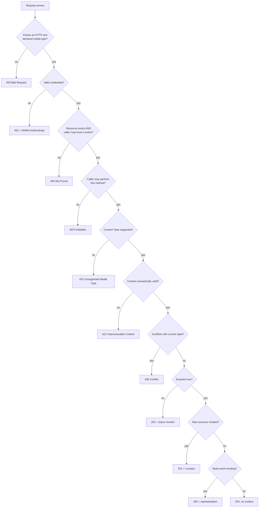

# HTTP Status Code Selection: 200 vs 201 vs 202 vs 204, 3xx Redirects, and 400 vs 401 vs 403 vs 404 vs 409 vs 422

> [!summary] Claim
> A status code is a machine-readable contract that generic HTTP software acts on before any client reads the body, so choose it with a fixed decision tree: `202` if not yet enacted, `201` plus `Location` if created, `200` or `204` otherwise; `307` or `308` for any redirect an API client follows; and for errors run the checks in the order `400` -> `401` -> `404` -> `403` -> `415` -> `422` -> `409`, so that no response tells a caller more than its credentials entitle it to know.

Part of [REST and Resource Modeling](README.md) in [API Engineering](../README.md).

## TL;DR

- Mechanism: the first digit is the class every client MUST understand, and an unrecognized code is treated as the `x00` of its class `(RFC 9110 Section 15)`, so a wrong class breaks retries, caches, and redirect followers even when the body is right.
- Contract rule: `201` names the new resource in `Location` `(RFC 9110 Section 15.3.2)`, `204` and `304` end at the header section `(RFC 9112 Section 6.3)`, `401` MUST carry `WWW-Authenticate` `(RFC 9110 Section 15.5.2)`, and `405` MUST carry `Allow` `(RFC 9110 Section 15.5.6)`.
- Trap: `301` and `302` may turn `POST` into `GET` `(RFC 9110 Section 15.4.2, Section 15.4.3)`, and httpx `0.28.1` turns every non-`HEAD` method into `GET` on `302`, including `PUT` and `DELETE` (lab-proven), so APIs redirect with `307` or `308`.
- Portability: FastAPI `0.162.0` answers malformed JSON and a `text/plain` body with `422`, not `400` or `415`, and CPython `3.12` still names `422` "Unprocessable Entity" while `3.13`+ says "Unprocessable Content" (both lab-proven on every leg).
- When not to use it: do not invent fine-grained status codes for business outcomes; the status code carries the class and generic semantics, and the RFC 9457 problem `type` carries the domain detail.

## Mental model



Read the tree top to bottom as a sequence of gates, each of which may stop the request with exactly one code.
The order is the design: syntax first because nothing else can be evaluated on unparseable bytes, authentication before anything that depends on who is asking, existence and visibility before permission so that a caller who may not know a resource exists receives the same `404` as for a missing one, and permission before body checks so that an unauthorized caller never learns the server's validation rules.
Only after every gate passes does the server pick among the four success codes, and that choice depends on two facts: whether the effect has happened yet (`202` versus the rest) and whether a resource was created (`201`).
The lab encodes this tree as `select_client_error` and `select_success_status` and then shows where FastAPI's real execution order differs from it.

## How it works

### The class digit is the protocol

RFC 9110 defines status codes as three-digit integers in `100..599`, five classes by first digit, and "a client MUST understand the class of any status code ... and treat an unrecognized status code as being equivalent to the x00 status code of that class" `(RFC 9110 Section 15)`.
A client that receives an unrecognized `471` therefore behaves as for `400`, and a value outside `100..599` SHOULD be processed as a `5xx` `(RFC 9110 Section 15)`.
The reason phrase is advisory and may be replaced or omitted `(RFC 9110 Section 15.1)`; httpx `0.28.1` reports an empty `reason_phrase` for `471` and still classifies it with `is_client_error` (lab test `test_unknown_status_is_treated_as_its_class`).
On the HTTP/1.1 wire the code is the second token of the status line, for example `HTTP/1.1 201 Created\r\n`; HTTP/2 carries it in the single `:status` response pseudo-header `(RFC 9113 Section 8.3.2)`, and HTTP/3 does the same and "does not define a way to carry the version or reason phrase" `(RFC 9114 Section 4.3.2)`.

### Success: 200, 201, 202, 204

- `200` means success, and what the content represents depends on the method: the target resource for `GET`, the status or result of the action for `POST`, the status of the action for `PUT` and `DELETE` `(RFC 9110 Section 15.3.1)`.
- `201` means "one or more new resources" were created; the primary one is identified by `Location`, or by the target URI if `Location` is absent `(RFC 9110 Section 15.3.2)`.
  For `POST` that creates resources, the origin SHOULD send `201` with a `Location` field naming the primary resource `(RFC 9110 Section 9.3.3)`; for a `PUT` that creates a resource the server MUST send `201`, and for a `PUT` that replaces one it MUST send `200` or `204` `(RFC 9110 Section 9.3.4)`.
- `202` is "intentionally noncommittal": the request was accepted, processing is not complete, and "there is no facility in HTTP for re-sending a status code from an asynchronous operation", so the representation "ought to describe the request's current status and point to (or embed) a status monitor" `(RFC 9110 Section 15.3.3)`.
  RFC 9110 defines `Location` semantics only for `201` and `3xx` `(RFC 9110 Section 10.2.2)`, so a `Location` on `202` is a convention; the lab puts the monitor URI in the body.
- `204` means success with "no additional content"; header fields such as `ETag` describe the target resource after the action, and a `204` "is terminated by the end of the header section; it cannot contain content or trailers" `(RFC 9110 Section 15.3.5)`.
- `DELETE` gets all three: `202` if the deletion "will likely succeed but has not yet been enacted", `204` if enacted with nothing to add, `200` if enacted with a status representation `(RFC 9110 Section 9.3.5)`.

### Why 204 framing is a wire-level invariant

In HTTP/1.1 the body length rules are ordered, and rule 1 says that any response to `HEAD` and any `1xx`, `204`, or `304` response "is always terminated by the first empty line after the header fields, regardless of the header fields present in the message" `(RFC 9112 Section 6.3)`.
A server also MUST NOT send `Content-Length` in any `1xx` or `204` response `(RFC 9110 Section 8.6)`.
So bytes written after a `204` header block are not a body; on a persistent connection the client parses them as the start of the next response, which is a response-desynchronization primitive (see [[HTTP-Request-Smuggling-CL-TE-and-Desync-Mechanics]]).
The implementations enforce this at different layers:

- h11 `0.16.0` returns `("content-length", (0,))` for any `Response` whose status is `204` or `304`, whose request was `HEAD`, or that is a `2xx` to `CONNECT` `(h11 0.16.0 h11/_connection.py, _body_framing)`, regardless of any `Content-Length` header the application set, so a server that tries to send one byte raises `LocalProtocolError("Too much data for declared Content-Length")` (lab test `test_h11_server_refuses_to_send_a_body_on_204`, whose helper declares `Content-Length: 1` on the `204` and still gets the error).
- As a client, h11 ends the `204` at the blank line and the leftover bytes make the next response unparseable, raising `RemoteProtocolError` (lab test `test_bytes_after_a_204_desynchronize_the_next_response`).
- Starlette `1.10.0` omits `content-length` when `status_code < 200 or status_code in (204, 304)` `(starlette 1.10.0 starlette/responses.py, Response.init_headers)` but still sends `self.body` in `Response.__call__`, so `Response(b"deleted", status_code=204)` delivers the bytes to an in-process client (lab test `test_starlette_sends_explicit_204_body_bytes_without_content_length`).
- FastAPI `0.162.0` asserts at route registration (`_populate_api_route_state`) that a route with a response model does not use a no-body status, failing with `AssertionError: Status code 204 must not have a response body`, and at request time sets `response.body = b""` when `is_body_allowed_for_status_code` is false, which excludes `< 200`, `204`, `205`, and `304` `(fastapi 0.162.0 fastapi/utils.py, is_body_allowed_for_status_code)`.
- Uvicorn `0.54.0` with httptools skips chunked encoding for `204` and `304` and, unless the application sent its own `Content-Length`, leaves `expected_content_length` at `0`, so a body raises `RuntimeError("Response content longer than Content-Length")` `(uvicorn 0.54.0 uvicorn/protocols/http/httptools_impl.py, RequestResponseCycle.send)`; its h11 backend inherits the h11 rule above.
- Over loopback (a probe re-run for this note on 2026-11-10, not part of the hermetic lab), a raw ASGI app that answers `/nobody` with `204` plus the body `hello` and `/ok` with `200` plus `ok`, hit by one pipelined write of `GET /nobody` then `GET /ok`, produced: Uvicorn `0.54.0` with `--http httptools` and with `--http h11` wrote only the `204` header block, logged `RuntimeError: Response content longer than Content-Length` and `h11 LocalProtocolError: Too much data for declared Content-Length` respectively, and answered nothing for `/ok`; Hypercorn `0.18.0` and Granian `2.8.7` wrote the `204` header block, dropped `hello`, and then served `HTTP/1.1 200` with `ok` intact (servers started from the lab `.venv` as `python -m uvicorn app204:app --http <backend>`, `python -m hypercorn app204:app --bind 127.0.0.1:<port>`, and `python -m granian --interface asgi --no-ws app204:app`; macOS `27.2` arm64, CPython `3.14.6`, as of 2026-11).

### Redirects: method rewriting is the whole story

RFC 9110 lists four redirect types and records the history plainly: HTTP/1.0 defined `301` and `302` as method-preserving, user agents split, "prevailing practice eventually converged on changing the method to GET", and `307` and `308` were added "to unambiguously indicate method-preserving redirects" `(RFC 9110 Section 15.4)`.
The resulting rules:

| Code | Permanence | Method on follow | Source |
|---|---|---|---|
| `301` | permanent, heuristically cacheable | user agent MAY change `POST` to `GET` | `(RFC 9110 Section 15.4.2)` |
| `302` | temporary | user agent MAY change `POST` to `GET` | `(RFC 9110 Section 15.4.3)` |
| `303` | indirect response | retrieval with `GET` or `HEAD` | `(RFC 9110 Section 15.4.4)` |
| `307` | temporary | user agent MUST NOT change the method | `(RFC 9110 Section 15.4.8)` |
| `308` | permanent, heuristically cacheable | method preserved; first defined June 2014 by Experimental RFC 7238, standardized April 2015 by RFC 7538, now in RFC 9110 | `(RFC 9110 Section 15.4, Section 15.4.9)`; `(RFC 7538 Section 3)` |

When following, a user agent replaces the target URI, strips generated headers including `Authorization` and `Cookie`, changes the method "according to the redirecting status code's semantics", and, if the method became `GET` or `HEAD`, removes content headers such as `Content-Type` and `Content-Length` `(RFC 9110 Section 15.4)`.
httpx `0.28.1` implements this in `_redirect_method`: `303` -> `GET` unless `HEAD`, `302` -> `GET` unless `HEAD` ("Do what the browsers do, despite standards"), and `301` -> `GET` only for `POST` `(httpx 0.28.1 httpx/_client.py, BaseClient._redirect_method)`.
Its `_redirect_headers` drops `Content-Length` and `Transfer-Encoding` when the method switches to `GET` but keeps `Content-Type`, strips `Authorization` on a cross-origin redirect except a same-host `http` port `80` -> `https` port `443` upgrade (`_is_https_redirect`), and always drops `Cookie` in favor of the client cookie jar `(httpx 0.28.1 httpx/_client.py, BaseClient._redirect_headers)`.
`_redirect_stream` drops the body when the method changes to `GET` `(httpx 0.28.1 httpx/_client.py, BaseClient._redirect_stream)`.
Starlette's `RedirectResponse` defaults to `status_code=307` `(starlette 1.10.0 starlette/responses.py, RedirectResponse.__init__)`.
`303` also has a server-side use worth knowing: if a `POST` would produce a representation equivalent to an existing resource, the origin MAY send `303` with that resource in `Location` `(RFC 9110 Section 9.3.3)`.

### Client errors: what each code promises

- `400`: the server "cannot or will not process the request due to something that is perceived to be a client error (e.g., malformed request syntax, invalid request message framing, or deceptive request routing)" `(RFC 9110 Section 15.5.1)`.
- `401`: no valid credentials; the server "MUST send a WWW-Authenticate header field ... containing at least one challenge" `(RFC 9110 Section 15.5.2)`.
  For OAuth bearer tokens, an expired or invalid token gets `error="invalid_token"` and `401`, insufficient scope gets `error="insufficient_scope"` and `403`, and a request with no token at all "SHOULD NOT include an error code" `(RFC 6750 Section 3.1)`.
- `403`: understood and refused; the client "SHOULD NOT automatically repeat the request with the same credentials", and an origin that wishes to "hide" the existence of a forbidden resource MAY respond with `404` instead `(RFC 9110 Section 15.5.4)`.
- `404`: no current representation "or is not willing to disclose that one exists"; it is heuristically cacheable, and `410` is preferred when the server knows the absence is permanent `(RFC 9110 Section 15.5.5, Section 15.5.11)`.
- `405`: method known but not supported by this resource; the origin "MUST generate an Allow header field" `(RFC 9110 Section 15.5.6)`.
- `409`: conflict "with the current state of the target resource" that the user "might be able to resolve" and resubmit, most often on `PUT` with versioning `(RFC 9110 Section 15.5.10)`; when the client supplied a precondition such as `If-Match`, the right code is `412` instead `(RFC 9110 Section 15.5.13)`, covered in [[Optimistic-Concurrency-Control-If-Match-and-412-Precondition-Failed]].
- `415`: the content "is in a format not supported by this method on the target resource" `(RFC 9110 Section 15.5.16)`.
- `422`: the server understands the content type (so `415` is inappropriate) and "the syntax of the request content is correct, but it was unable to process the contained instructions" `(RFC 9110 Section 15.5.21)`; it originated in WebDAV as "Unprocessable Entity" `(RFC 4918 Section 11.2)` and RFC 9110 renamed it.
- `429`: rate limited, MAY include `Retry-After`, and "MUST NOT be stored by a cache" `(RFC 6585 Section 4)`.

The `400` versus `422` line is therefore syntax versus semantics: `{"name":` is `400`, `{"quantity": -1}` against a schema requiring `quantity >= 0` is `422`.

### Where FastAPI's execution order diverges from the tree

FastAPI `0.162.0` reads and JSON-decodes the body inside the `app` closure that `get_request_handler` returns, before calling `solve_dependencies`, and turns a `json.JSONDecodeError` into a `RequestValidationError` with `"type": "json_invalid"` `(fastapi 0.162.0 fastapi/routing.py, get_request_handler)`, which the default handler serializes as `422` `(fastapi 0.162.0 fastapi/exception_handlers.py, request_validation_exception_handler)`.
Two consequences follow, both proven in the lab:

- Malformed JSON is reported as `422`, not `400`, and it is reported before any authentication dependency runs, so an anonymous caller sending `{` gets a body-parse error instead of `401`.
- A body with `Content-Type: text/plain` is not JSON-decoded at all; it reaches Pydantic as bytes and fails with `model_attributes_type`, so the client sees `422`, not `415`.

Inside `solve_dependencies`, sub-dependencies resolve in declaration order before path, query, header, cookie, and body parameters are validated `(fastapi 0.162.0 fastapi/dependencies/utils.py, solve_dependencies)`, so an authentication dependency that raises `401` does win over a schema `422`.
The lab app restores the tree by mapping `json_invalid` to `400`, declaring `writer` (authentication plus scope) before `require_json` (`415`) in the endpoint signature, and wrapping every error as RFC 9457 problem details whose `status` member equals the HTTP status, which RFC 9457 requires: "Generators MUST use the same status code in the actual HTTP response" `(RFC 9457 Section 3.1.2)`.

### 405 and HEAD in Starlette routing

FastAPI `0.162.0` overrides Starlette's router loop with its own `APIRouter.app`, which keeps the same rule: it returns at the first `Match.FULL`, and otherwise remembers only the first `Match.PARTIAL` route (`if match == Match.PARTIAL and partial is None`) `(fastapi 0.162.0 fastapi/routing.py, APIRouter.app)`, mirroring `elif match is Match.PARTIAL and partial is None` in `(starlette 1.10.0 starlette/routing.py, Router.app)`.
In the lab's plain `FastAPI()` app (no included-router context, confirmed with `sys.settrace`), that route's `APIRoute.handle` delegates to `super().handle`, which builds `Allow` as `", ".join(self.methods)` from its own methods only `(starlette 1.10.0 starlette/routing.py, Route.handle)`, so when `GET /widgets/{id}` and `DELETE /widgets/{id}` are separate routes, `PUT /widgets/w1` returns `405` with `Allow: GET`, not `Allow: DELETE, GET`.
FastAPI's `APIRoute` does not add `HEAD` to a `GET` route, unlike Starlette's own `Route` `(starlette 1.10.0 starlette/routing.py, Route.__init__)`, so `HEAD /widgets/w1` also returns `405`, although RFC 9110 states "All general-purpose servers MUST support the methods GET and HEAD" `(RFC 9110 Section 9.1)`.

## Numbers and limits

| Quantity | Value | Source |
|---|---|---|
| Valid status range | `100`..`599`; outside it, treat as `5xx` | `(RFC 9110 Section 15)` |
| Unknown code handling | treated as `x00` of its class; httpx `0.28.1` `Response(471).is_client_error` is `True` | `(RFC 9110 Section 15)`; lab |
| Heuristically cacheable codes in RFC 9110 | `200`, `203`, `204`, `206`, `300`, `301`, `308`, `404`, `405`, `410`, `414`, `501` | `(RFC 9110 Section 15.1)` |
| `429` storage | MUST NOT be stored by a cache | `(RFC 6585 Section 4)` |
| Body bytes allowed after a `1xx`, `204`, `304`, or `HEAD` response header section | `0` | `(RFC 9112 Section 6.3)` |
| Historical redirect limit recommendation | `5` (RFC 2068, cited as a note) | `(RFC 9110 Section 15.4)` |
| httpx default `max_redirects` | `20` (`DEFAULT_MAX_REDIRECTS`) | `(httpx 0.28.1 httpx/_config.py, DEFAULT_MAX_REDIRECTS)` |
| Requests a self-redirecting `/loop` received before httpx raised `TooManyRedirects` | `21` (1 original + 20 follows), measured | lab `test_httpx_stops_redirect_loop_after_20_hops` |
| Age of `308` | first defined June 2014 (Experimental RFC 7238); Standards Track since April 2015 (RFC 7538) | `(RFC 9110 Section 15.4.9)`; RFC 7238 and RFC 7538 headers |
| Lab runtime | `55 passed in 0.23s` (three warm runs: `0.23s`, `0.24s`, `0.23s`; the first run after a source edit took `1.86s`), CPython `3.14.6`, macOS `27.2` arm64 (`uname -r` `27.2.0`), `uv 0.11.26`, as of 2026-11 | measured, `uv run --frozen pytest tests/f04_rest_and_resource_modeling/test_http_status_code_taxonomy_and_selection_decision_trees.py -q -p no:cacheprovider` |

## Portability

| Runtime / component | Version | Behavior and evidence |
|---|---|---|
| CPython `3.12` | `3.12.13` (uv-managed, macOS arm64); the pinned `3.12.16` is not installed on this machine | `55 passed in 0.45s`; `HTTPStatus(422).phrase == "Unprocessable Entity"`, so the lab's `reason_phrase` override is load-bearing here: emptying `RFC9110_PHRASES` fails three tests on `3.12.13` (`test_malformed_400_semantic_422_conflict_409_media_415`, `test_reason_phrase_is_rfc9110_on_every_cpython`, `test_reason_phrase_override_beats_an_rfc7231_era_stdlib`) and only the last, which stubs `HTTPStatus` with an RFC 7231-era phrase, on `3.14` |
| CPython `3.13` | `3.13.18` (Homebrew) | `55 passed in 0.50s`; RFC 9110 names (`UNPROCESSABLE_CONTENT`, "Content Too Large") arrived in 3.13 per the `http` docs ("Changed in version 3.13: Implemented RFC9110 naming for status constants") and `(CPython v3.13.0 Lib/http/__init__.py, HTTPStatus)` |
| CPython `3.14` | `3.14.6` (workspace `.venv`) and `3.14.10` (Homebrew); the pinned `3.14.10` leg passes | `55 passed in 0.23s` and `55 passed in 0.42s` |
| CPython `3.15` | `3.15.2` (Homebrew) | `55 passed in 0.43s` |
| CPython `3.15t` free-threaded | `3.15.0b3` free-threading build; `sys._is_gil_enabled()` is `False` after importing the lab module under `-W error`; the pinned `3.15.2t` is not installed on this machine | `55 passed in 0.19s` via `PYTHONPATH=src uv run --no-project --python 3.15t --with <pinned fastapi, starlette, httpx, httpcore, h11, anyio, pydantic, pydantic-core, pytest, pytest-asyncio> python -m pytest <test path> -q -p no:cacheprovider` because `psycopg-binary==3.3.8` has no `3.15t` wheel |
| FastAPI | `0.122.0` and later, `0.162.0` tested | security classes raise `401` with `WWW-Authenticate` for missing credentials; earlier releases raised `403` (FastAPI release notes `0.122.0`, dated 2025-11-24, PR `#13786`); `HTTPBearer` sends `WWW-Authenticate: Bearer` `(fastapi 0.162.0 fastapi/security/http.py, HTTPBase.make_not_authenticated_error)` |
| FastAPI | `0.162.0` | malformed JSON and non-JSON media types -> `422` by default (lab) |
| Starlette | `1.10.0` | `RedirectResponse` defaults to `307`; `405` `Allow` comes from the first partial route only (lab) |
| httpx | `0.28.1` | `302` rewrites any non-`HEAD` method to `GET`; `Content-Type` survives the rewrite (lab) |
| Uvicorn | `0.54.0` | httptools backend raises `RuntimeError`, h11 backend raises `LocalProtocolError` on a `204` body; both write only the header block and answer nothing further on that connection (source, plus the loopback probe re-run for this note; not in the hermetic lab) |
| Hypercorn, Granian | `0.18.0`, `2.8.7` | both silently discard a `204` body and keep the connection in sync for the next pipelined response (loopback probe re-run for this note, as of 2026-11; not in the hermetic lab); status selection itself lives in the ASGI app and is server-independent |
| HTTP/1.1 | RFC 9112 | `204`/`304` end at the header section; extra bytes desynchronize the connection (lab, h11) |
| HTTP/2 | RFC 9113 | a message whose `content-length` differs from the DATA length is malformed "unless the message is defined as having no content", and RFC 9113 names `204` and `304` responses as examples `(RFC 9113 Section 8.1.1)` |
| HTTP/3 | RFC 9114 | same rule: a response "defined as never having content" may carry a non-zero `Content-Length` with no DATA `(RFC 9114 Section 4.1.2)` |
| Debian Trixie container | not run | no container leg was run for this note; the lab is pure Python with no native extension beyond the pinned wheels, so a difference is not expected, but none is claimed |
| Alpine (musl libc) container | not run | not run for this note; `pydantic-core` ships musllinux wheels per its release, but this lab did not install or test them, so no musl behavior is claimed |

## Worked example

The [implementation](../labs/src/api_labs/f04_rest_and_resource_modeling/status_code_selection.py) has three parts: the pure decision functions, a multi-tenant widget API that follows them, and a redirect echo app plus h11 helpers that expose client and wire behavior.
The [test](../labs/tests/f04_rest_and_resource_modeling/test_http_status_code_taxonomy_and_selection_decision_trees.py) drives everything in-process through `httpx.ASGITransport` and raw h11 state machines, with no sockets.

### Implementation (`labs/src/api_labs/f04_rest_and_resource_modeling/status_code_selection.py`)

```python
"""HTTP status code selection: success codes, redirect method rewriting, and 4xx precedence."""

import itertools
from collections.abc import Iterator, Mapping
from dataclasses import dataclass, field
from http import HTTPStatus
from typing import Annotated

import h11
from fastapi import Depends, FastAPI, HTTPException, Request
from fastapi.exceptions import RequestValidationError
from fastapi.responses import JSONResponse, RedirectResponse, Response
from fastapi.security import HTTPAuthorizationCredentials, HTTPBearer
from pydantic import BaseModel, Field
from starlette.exceptions import HTTPException as StarletteHTTPException

PROBLEM_JSON = "application/problem+json"
REDIRECT_CODES = (301, 302, 303, 307, 308)
# RFC 9110 reason phrases; CPython 3.12 still reports the RFC 7231 / RFC 4918 wording.
RFC9110_PHRASES = {413: "Content Too Large", 422: "Unprocessable Content"}


@dataclass(frozen=True, slots=True)
class RequestFacts:
    """What the server knows about a request when it must choose a 4xx status."""

    well_formed: bool = True
    authenticated: bool = True
    resource_exists: bool = True
    visible_to_caller: bool = True
    permitted: bool = True
    media_type_supported: bool = True
    semantically_valid: bool = True
    conflicts_with_state: bool = False


def select_client_error(facts: RequestFacts) -> int | None:
    """Return the 4xx code of the first failed check, or None when the request may proceed."""
    if not facts.well_formed:
        return 400
    if not facts.authenticated:
        return 401
    if not (facts.resource_exists and facts.visible_to_caller):
        return 404
    if not facts.permitted:
        return 403
    if not facts.media_type_supported:
        return 415
    if not facts.semantically_valid:
        return 422
    if facts.conflicts_with_state:
        return 409
    return None


def select_success_status(*, enacted: bool, created: bool, returns_body: bool) -> int:
    """Pick 202, 201, 200, or 204 for a request that the server accepted."""
    if not enacted:
        return 202
    if created:
        return 201
    return 200 if returns_body else 204


def rfc9110_redirect_method(method: str, status: int) -> str:
    """Method a user agent sends after following a redirect (RFC 9110 Section 15.4)."""
    if status not in REDIRECT_CODES:
        raise ValueError(f"{status} is not an automatic redirect status")
    if status == 303 and method != "HEAD":
        return "GET"
    if status in (301, 302) and method == "POST":
        return "GET"
    return method


def reason_phrase(status: int) -> str:
    """RFC 9110 reason phrase, independent of the running CPython's http.HTTPStatus table."""
    return RFC9110_PHRASES.get(status, HTTPStatus(status).phrase)


def problem(status: int, detail: str, headers: Mapping[str, str] | None = None) -> JSONResponse:
    """RFC 9457 problem details whose status member always equals the HTTP status."""
    content = {
        "type": "about:blank",
        "title": reason_phrase(status),
        "status": status,
        "detail": detail,
    }
    return JSONResponse(content, status_code=status, headers=headers, media_type=PROBLEM_JSON)


class WidgetIn(BaseModel):
    name: str = Field(min_length=1, max_length=64)
    quantity: int = Field(ge=0)


class Widget(WidgetIn):
    id: str
    tenant: str


@dataclass(frozen=True, slots=True)
class Principal:
    tenant: str
    scopes: frozenset[str]


TOKENS: dict[str, Principal] = {
    "alice-rw": Principal("alice", frozenset({"read", "write"})),
    "alice-ro": Principal("alice", frozenset({"read"})),
    "bob-rw": Principal("bob", frozenset({"read", "write"})),
}


@dataclass
class WidgetStore:
    widgets: dict[str, Widget] = field(default_factory=dict[str, Widget])
    ids: Iterator[int] = field(default_factory=lambda: itertools.count(1))


bearer = HTTPBearer(auto_error=False)


def authenticate(
    creds: Annotated[HTTPAuthorizationCredentials | None, Depends(bearer)],
) -> Principal:
    """401 with a Bearer challenge; RFC 6750 Section 3.1 omits error= when no token was sent."""
    if creds is None:
        challenge = 'Bearer realm="widgets"'
        raise HTTPException(401, "missing bearer token", {"WWW-Authenticate": challenge})
    principal = TOKENS.get(creds.credentials)
    if principal is None:
        challenge = 'Bearer realm="widgets", error="invalid_token"'
        raise HTTPException(401, "invalid bearer token", {"WWW-Authenticate": challenge})
    return principal


def require_scope(principal: Principal, scope: str) -> None:
    if scope not in principal.scopes:
        challenge = f'Bearer realm="widgets", error="insufficient_scope", scope="{scope}"'
        raise HTTPException(403, f"token lacks scope {scope}", {"WWW-Authenticate": challenge})


def writer(principal: Annotated[Principal, Depends(authenticate)]) -> Principal:
    require_scope(principal, "write")
    return principal


def require_json(request: Request) -> None:
    media_type = request.headers.get("content-type", "").split(";")[0].strip().lower()
    if media_type != "application/json":
        raise HTTPException(415, "send application/json")


def build_widget_app(store: WidgetStore | None = None) -> FastAPI:
    """Widget API whose every status code follows the decision tree in select_client_error."""
    db = store if store is not None else WidgetStore()
    app = FastAPI()

    @app.exception_handler(StarletteHTTPException)
    async def http_error(_: Request, exc: StarletteHTTPException) -> Response:
        return problem(exc.status_code, str(exc.detail), exc.headers)

    @app.exception_handler(RequestValidationError)
    async def validation_error(_: Request, exc: RequestValidationError) -> Response:
        if any(error["type"] == "json_invalid" for error in exc.errors()):
            return problem(400, "request body is not valid JSON")
        return problem(422, "request body failed validation")

    def find_visible(widget_id: str, principal: Principal) -> Widget:
        widget = db.widgets.get(widget_id)
        if widget is None or widget.tenant != principal.tenant:
            raise HTTPException(404, "widget not found")
        return widget

    @app.post("/widgets", status_code=201)
    async def create_widget(
        principal: Annotated[Principal, Depends(writer)],
        _json: Annotated[None, Depends(require_json)],
        body: WidgetIn,
        response: Response,
    ) -> Widget:
        if any(w.tenant == principal.tenant and w.name == body.name for w in db.widgets.values()):
            raise HTTPException(409, f"widget {body.name} already exists")
        widget = Widget(id=f"w{next(db.ids)}", tenant=principal.tenant, **body.model_dump())
        db.widgets[widget.id] = widget
        response.headers["Location"] = f"/widgets/{widget.id}"
        return widget

    @app.get("/widgets/{widget_id}")
    async def read_widget(
        widget_id: str, principal: Annotated[Principal, Depends(authenticate)]
    ) -> Widget:
        return find_visible(widget_id, principal)

    @app.delete("/widgets/{widget_id}", status_code=204, response_class=Response)
    async def delete_widget(
        widget_id: str, principal: Annotated[Principal, Depends(authenticate)]
    ) -> Response:
        find_visible(widget_id, principal)
        require_scope(principal, "write")
        del db.widgets[widget_id]
        return Response(status_code=204)

    @app.post("/exports", status_code=202)
    async def start_export(principal: Annotated[Principal, Depends(writer)]) -> dict[str, str]:
        operation = f"operations/op-{next(db.ids)}"
        return {"name": operation, "state": "RUNNING", "monitor": f"/{operation}"}

    @app.get("/v0/widgets/{widget_id}")
    async def moved_widget(widget_id: str) -> RedirectResponse:
        return RedirectResponse(f"/widgets/{widget_id}", status_code=308)

    return app


ALL_METHODS = ["GET", "HEAD", "POST", "PUT", "PATCH", "DELETE"]


def build_redirect_lab_app(hits: list[str] | None = None) -> FastAPI:
    """Redirect to /echo with any status so a client's method rewriting is observable."""
    seen = hits if hits is not None else []
    app = FastAPI()

    @app.api_route("/redirect/{code}", methods=ALL_METHODS)
    async def redirect(code: int, target: str = "/echo") -> RedirectResponse:
        return RedirectResponse(target, status_code=code)

    @app.api_route("/echo", methods=ALL_METHODS)
    async def echo(request: Request) -> dict[str, str | None]:
        body = await request.body()
        return {
            "method": request.method,
            "body": body.decode(),
            "content_type": request.headers.get("content-type"),
            "authorization": request.headers.get("authorization"),
        }

    @app.get("/loop")
    async def loop() -> RedirectResponse:
        seen.append("/loop")
        return RedirectResponse("/loop", status_code=302)

    return app


def h11_server_bytes(status: int, body: bytes) -> bytes:
    """Serialize one response with h11, which enforces RFC 9112 Section 6.3 framing."""
    conn = h11.Connection(our_role=h11.SERVER)
    conn.receive_data(b"GET / HTTP/1.1\r\nHost: test\r\n\r\n")
    conn.next_event()
    conn.next_event()
    headers = [("Content-Length", str(len(body)))]
    out = conn.send(h11.Response(status_code=status, headers=headers)) or b""
    out += conn.send(h11.Data(data=body)) or b""
    return out + (conn.send(h11.EndOfMessage()) or b"")


def h11_client_read(wire: bytes, requests: int) -> list[tuple[int, bytes]]:
    """Parse `requests` sequential responses from one byte stream as an HTTP/1.1 client."""
    conn = h11.Connection(our_role=h11.CLIENT)
    conn.receive_data(wire)
    results: list[tuple[int, bytes]] = []
    for _ in range(requests):
        if results:
            conn.start_next_cycle()
        conn.send(h11.Request(method="GET", target="/", headers=[("Host", "test")]))
        conn.send(h11.EndOfMessage())
        status, body = 0, b""
        while True:
            event = conn.next_event()
            if isinstance(event, h11.Response):
                status = event.status_code
            elif isinstance(event, h11.Data):
                body += bytes(event.data)
            elif isinstance(event, h11.EndOfMessage):
                break
            else:
                raise AssertionError(f"unexpected h11 event {event!r}")
        results.append((status, body))
    return results
```

### Selected tests (each block is a verbatim slice of the test module)

Anti-enumeration: a foreign tenant's widget and a missing widget are indistinguishable.

```python
@pytest.mark.unit
@pytest.mark.asyncio
async def test_other_tenant_gets_404_identical_to_absent(api: httpx.AsyncClient) -> None:
    await api.post("/widgets", json={"name": "gear", "quantity": 3}, headers=RW)
    hidden = await api.get("/widgets/w1", headers=BOB)
    absent = await api.get("/widgets/w999", headers=BOB)
    assert hidden.status_code == absent.status_code == 404
    assert hidden.content == absent.content
    assert hidden.headers.multi_items() == absent.headers.multi_items()
    visible_delete = await api.delete("/widgets/w1", headers=RO)
    assert visible_delete.status_code == 403  # same tenant: visible, so scope decides
```

Check order: authentication beats schema validation, but not JSON parsing.

```python
@pytest.mark.unit
@pytest.mark.asyncio
async def test_auth_dependency_runs_before_body_validation_but_after_json_parse(
    api: httpx.AsyncClient,
) -> None:
    invalid_body = await api.post("/widgets", json={"name": "", "quantity": -1})
    assert invalid_body.status_code == 401
    malformed = await api.post(
        "/widgets", content=b"{", headers={"Content-Type": "application/json"}
    )
    assert malformed.status_code == 400
    read_only = await api.post("/widgets", content=b"x", headers={**RO, "Content-Type": "a/b"})
    assert read_only.status_code == 403
```

Redirect method rewriting in httpx `0.28.1`, observed through an echo endpoint.

```python
@pytest.mark.unit
@pytest.mark.asyncio
@pytest.mark.parametrize(
    ("method", "status", "expected_method", "body_kept"),
    [
        ("POST", 301, "GET", False),
        ("POST", 302, "GET", False),
        ("POST", 303, "GET", False),
        ("POST", 307, "POST", True),
        ("POST", 308, "POST", True),
        ("PUT", 301, "PUT", True),
        ("PUT", 302, "GET", False),
        ("PATCH", 303, "GET", False),
    ],
)
async def test_httpx_redirect_method_rewriting(
    method: str, status: int, expected_method: str, body_kept: bool
) -> None:
    async with client_for(build_redirect_lab_app(), follow=True) as client:
        response = await client.request(
            method,
            f"/redirect/{status}",
            content=b'{"a": 1}',
            headers={"Content-Type": "application/json"},
        )
    echoed = response.json()
    assert echoed["method"] == expected_method
    assert echoed["body"] == ('{"a": 1}' if body_kept else "")
    # httpx 0.28.1 drops Content-Length on a switch to GET but keeps Content-Type.
    assert echoed["content_type"] == "application/json"
```

Wire framing: bytes after a `204` become the next status line.

```python
@pytest.mark.unit
def test_bytes_after_a_204_desynchronize_the_next_response() -> None:
    good = b"HTTP/1.1 200 OK\r\nContent-Length: 2\r\n\r\nok"
    bad_204 = b"HTTP/1.1 204 No Content\r\nContent-Length: 5\r\n\r\nhello"
    with pytest.raises(h11.RemoteProtocolError):
        h11_client_read(bad_204 + good, requests=2)
    framed_200 = b"HTTP/1.1 200 OK\r\nContent-Length: 5\r\n\r\nhello"
    assert h11_client_read(framed_200 + good, requests=2) == [(200, b"hello"), (200, b"ok")]
```

### Captured run

Command run from `labs/` on macOS `27.2` (arm64), CPython `3.14.6`, `uv 0.11.26`:

```text
$ uv run --frozen pytest tests/f04_rest_and_resource_modeling/test_http_status_code_taxonomy_and_selection_decision_trees.py -q -p no:cacheprovider
.......................................................                  [100%]
55 passed in 0.23s
```

What the run proves, test by test:

- `test_client_error_precedence` pins each adjacent pair in the tree, for example a hidden resource that the caller also may not modify is `404`, not `403`.
- `test_other_tenant_gets_404_identical_to_absent` compares the full body and header list of "exists but belongs to bob" against "never existed" and requires byte equality.
- `test_auth_dependency_runs_before_body_validation_but_after_json_parse` shows an anonymous request with a schema-invalid body gets `401`, but an anonymous request with `{` gets `400`, because FastAPI parses JSON before dependencies run.
- `test_httpx_redirect_method_rewriting` and `test_httpx_302_turns_put_into_get_where_rfc9110_does_not` show exactly which methods and bodies survive each redirect code in httpx `0.28.1`.
- `test_starlette_sends_explicit_204_body_bytes_without_content_length` shows that an explicit `Response(b"deleted", status_code=204)` reaches an in-process client with its bytes and no `Content-Length`, so only the server's wire layer can refuse it.
- `test_h11_server_refuses_to_send_a_body_on_204` declares `Content-Length: 1` on the `204` and still requires `LocalProtocolError`, so it proves h11 ignores the application header.
- `test_reason_phrase_override_beats_an_rfc7231_era_stdlib` stubs `HTTPStatus` with the RFC 7231-era phrase, so the `422` override is proven on every CPython rather than only on `3.12`.
- `test_415_check_accepts_json_media_type_parameters_and_case`, `test_409_conflict_is_scoped_to_the_callers_tenant`, and `test_202_export_requires_authentication_then_write_scope` pin the media type parser, the per-tenant `409`, and the `401` then `403` order on `/exports`.
- `test_bytes_after_a_204_desynchronize_the_next_response` feeds `HTTP/1.1 204 No Content\r\nContent-Length: 5\r\n\r\nhello` followed by a valid `200` into an h11 client and gets `RemoteProtocolError` on the second response.

## Pitfalls

> [!warning] Malformed JSON answered with `422`
> Trigger: a FastAPI endpoint with a Pydantic body model receives `{"name":` with `Content-Type: application/json`.
> Symptom: `422` with `"type": "json_invalid"`, and it arrives before authentication runs, so clients cannot distinguish "fix your serializer" from "fix your field values", and anonymous callers learn the endpoint parses bodies (lab).
> Fix: register a `RequestValidationError` handler that maps `json_invalid` to `400`, as `build_widget_app` does, or authenticate in middleware before routing if anonymous parse errors matter.

> [!warning] Wrong media type answered with `422`
> Trigger: `Content-Type: text/plain` on a JSON endpoint in FastAPI `0.162.0`.
> Symptom: `422` `model_attributes_type` instead of `415` (lab), which tells the client its fields are wrong when its header is wrong.
> Fix: a dependency that checks the media type and raises `415`, declared after authentication and authorization dependencies so it cannot leak to unauthorized callers.

> [!warning] `302` silently turns `PUT` and `DELETE` into `GET`
> Trigger: a gateway or legacy endpoint answers an API write with `302` while clients follow redirects.
> Symptom: httpx `0.28.1` re-issues the request as `GET` without the body for any non-`HEAD` method (lab: `PUT` + `302` -> `GET`), so the write never happens and the client sees a `200` from the read.
> Fix: emit `307` or `308` for every API redirect; reserve `303` for deliberately pointing a `POST` at a result resource.

> [!warning] Bytes after a `204` poison a keep-alive connection
> Trigger: application code builds `Response(b"...", status_code=204)` or a proxy forwards a `204` with a body.
> Symptom: Starlette sends the bytes anyway (lab); Uvicorn `0.54.0` raises on both backends and stops answering on that connection, while Hypercorn `0.18.0` and Granian `2.8.7` silently discard them (loopback probe re-run for this note, not in the hermetic lab); if a server or proxy that does not enforce RFC 9112 framing lets them reach the wire, the client parses them as the next status line and fails with a protocol error (lab, h11), which is the same class of desynchronization as request smuggling.
> Fix: build `Response(status_code=204)` with no content, and let a route-level `status_code=204` strip bodies as FastAPI does.

> [!warning] `405` with an incomplete `Allow` header, and `405` for `HEAD`
> Trigger: separate FastAPI routes per method on the same path.
> Symptom: `Allow` lists only the methods of the first partially matching route (`GET`, not `DELETE, GET`), and `HEAD` on a `GET` route is `405` (lab), violating `(RFC 9110 Section 15.5.6)` and `(RFC 9110 Section 9.1)`.
> Fix: register one `api_route` per path with every method, or add a router-level `405` handler that computes `Allow` from all routes matching the path; add `HEAD` explicitly where clients probe with it.

> [!warning] Credentials leaking across redirects
> Trigger: a client follows a redirect to a different host or scheme with an `Authorization` or `Proxy-Authorization` header set.
> Symptom: real CVEs: libcurl 7.1 through 7.57.0 sent custom headers, including authentication, to the host named in `Location` (CVE-2018-1000007); Requests before 2.20.0 sent `Authorization` after a same-host `https` -> `http` redirect (CVE-2018-18074); Requests from 2.3.0 leaked `Proxy-Authorization` to destination servers when redirected to an HTTPS endpoint (CVE-2023-32681).
> Fix: rely on a client that strips credentials per `(RFC 9110 Section 15.4)`; httpx `0.28.1` strips `Authorization` cross-origin (lab), and APIs should avoid redirecting authenticated calls at all.

> [!warning] Missing challenge or wrong code for absent credentials
> Trigger: returning `401` without `WWW-Authenticate`, or `403` when no token was sent.
> Symptom: `401` without a challenge violates a MUST `(RFC 9110 Section 15.5.2)`; FastAPI before `0.122.0` returned `403` from its security classes for missing credentials, and code that matched on `403` broke when PR `#13786` changed it to `401`.
> Fix: `401` plus `WWW-Authenticate: Bearer realm="..."` for absent or invalid tokens, `403` with `error="insufficient_scope"` only for an authenticated caller lacking a permission `(RFC 6750 Section 3.1)`.

> [!warning] Heuristically cached redirects and 404s
> Trigger: a `301`, `308`, or `404` without `Cache-Control`.
> Symptom: these codes are heuristically cacheable `(RFC 9110 Section 15.1)`, so caches may keep serving a redirect or a "not found" after a rollback.
> Fix: send explicit `Cache-Control` on every redirect and error response; treat `308` as a one-way door.

## Security and robustness

- Existence oracle (OWASP API1:2023 Broken Object Level Authorization): OWASP says every endpoint that "receives an ID of an object" should implement object-level authorization checks.
  The status code is part of that check's output: `403` for "exists but not yours" and `404` for "does not exist" lets an attacker enumerate valid IDs, so return `404` for objects outside the caller's visibility and make the body and headers byte-identical to a true miss, as `test_other_tenant_gets_404_identical_to_absent` requires (see [[Defeating-BOLA-API1-2023-Tenant-Scoped-Queries-and-PostgreSQL-RLS]]).
- Use `403` only when the caller is allowed to know the resource exists, for example a read-only member of the owning tenant attempting `DELETE`.
- Timing is a second channel: identical bytes do not equalize latency between a missing row and a row filtered out after loading; this lab did not measure it, and tenant-scoped queries that never load foreign rows remove most of the difference.
- Check order is a disclosure policy: authenticate, then authorize, then validate, so `415` and `422` details are never shown to callers who could not have performed the request.
  In FastAPI, JSON decoding happens before dependencies, so the only body fact an anonymous caller can learn is "this is not valid JSON".
- Problem details are output, not a debug dump: keep `detail` free of stack traces and internal identifiers, and keep the `status` member equal to the HTTP status `(RFC 9457 Section 3.1.2)`.
- `401` with `error="invalid_token"` lets clients refresh tokens automatically; omitting `error` when no token was sent avoids telling scanners which token formats you accept `(RFC 6750 Section 3.1)`.
- `503` and `3xx` with `Retry-After` `(RFC 9110 Section 10.2.3)` and `429` with `Retry-After` `(RFC 6585 Section 4)` shape client retries; detail is in [[Standard-RateLimit-Headers-IETF-Draft-and-429-Retry-After-Semantics]].
- Redirects are an open-redirect and credential-forwarding surface: never put a caller-controlled URL in `Location` without an allow-list, and prefer returning the canonical URL in the body over redirecting an authenticated write.

## The principal's view

The decision a staff-plus engineer owns is not "which code for this endpoint" but a single organization-wide status catalogue: the small set of codes the platform emits, the order of checks, and the mapping from domain errors to problem `type` URIs.
Without it, every team re-litigates `400` versus `422`, gateways and services disagree, and client SDKs grow per-endpoint special cases that make retries and alerts unreliable.
A good catalogue is short: `200`, `201`, `202`, `204`, `307`, `308`, `400`, `401`, `403`, `404`, `405`, `409`, `412`, `415`, `422`, `429`, `500`, `502`, `503`, `504`, each with a one-line rule and an owner layer (gateway, framework, or service).
Encode the catalogue twice: once as a lint over OpenAPI documents (no `302` in an API, every `201` declares `Location`, every `401` declares `WWW-Authenticate`), and once as a contract test like this lab against the running framework, because frameworks have defaults (FastAPI's `422` for malformed JSON, Starlette's partial `Allow`) that no OpenAPI document reveals.
The organizational trade-off is uniformity versus local fidelity: a uniform `404` for anything invisible protects tenants but makes support harder ("is it missing or am I not allowed?"), so pair it with an audit log that records the real reason server-side.
Choose a different paradigm when status codes cannot carry the outcome: a batch endpoint with per-item results returns one status for the envelope and per-item problems inside it ([[Error-Taxonomy-Retryability-and-Client-Contract-Design]]), and long-running work moves from `202` to an operation resource ([[Long-Running-Operations-202-Accepted-and-Operation-Resources-AIP-151]]).

## Interview questions

> [!question] L5: When a `POST /orders` creates an order, which status code and which headers do you return, and why?
>
> > [!success]- Answer
> > Return `201 Created`, because a new resource was created and RFC 9110 Section 9.3.3 says the origin SHOULD send `201` with a `Location` header naming the primary resource.
> > `Location: /orders/{id}` lets the client fetch or delete the order without parsing the body.
> > Include a representation of the order in the body, and optionally an `ETag` for the new representation.
> > If the order is only queued, return `202` with a status monitor instead, because nothing exists yet that `Location` could name.
> >
> > Follow-up: What should a `PUT /orders/{id}` return when the order did not exist before, and is that a SHOULD or a MUST?

> [!question] L5: When do you return `204` instead of `200`, and what must a `204` never contain?
>
> > [!success]- Answer
> > Use `204` when the action succeeded and there is no content worth sending, such as a `DELETE` that has been enacted or a `PUT` whose client already holds the new state.
> > A `204` ends at the header section; it cannot contain content or trailers (RFC 9110 Section 15.3.5), and a server MUST NOT send `Content-Length` on it (RFC 9110 Section 8.6).
> > Headers such as `ETag` on a `204` still describe the resource after the action.
> >
> > Follow-up: What does an HTTP/1.1 client do with bytes that arrive after a `204` header block on a keep-alive connection?

> [!question] L5: What is the difference between `400` and `422`, and what does default FastAPI `0.162.0` do with a request body of `{"name":`?
>
> > [!success]- Answer
> > `400` is for requests the server cannot process because of a client error such as malformed syntax (RFC 9110 Section 15.5.1).
> > `422` is for content that is syntactically correct in a supported media type but semantically invalid (RFC 9110 Section 15.5.21).
> > `{"name":` is malformed JSON, so by the RFC it is `400`.
> > Default FastAPI `0.162.0` returns `422` with error type `json_invalid`, because `get_request_handler` wraps `json.JSONDecodeError` in `RequestValidationError`.
> >
> > Follow-up: How would you change that without touching every endpoint?

> [!question] L6: Predict the output: if an httpx `0.28.1` `AsyncClient(follow_redirects=True)` sends `PUT /a` with body `x` and the server answers `302 Found` with `Location: /b`, what method and body does `/b` receive, and what changes if the server answers `301` instead?
>
> > [!success]- Answer
> > For `302`, `/b` receives `GET` with an empty body, because `_redirect_method` changes any non-`HEAD` method to `GET` on `302`, and `_redirect_stream` drops the body when the method changes to `GET`.
> > RFC 9110 Section 15.4.3 only allows changing `POST` to `GET`, so this is a browser-compatible deviation, and the lab test `test_httpx_302_turns_put_into_get_where_rfc9110_does_not` proves it.
> > For `301`, httpx rewrites only `POST`, so `/b` receives `PUT` with body `x`.
> > `Content-Type` survives the `302` rewrite because `_redirect_headers` removes only `Content-Length` and `Transfer-Encoding`.
> >
> > Follow-up: Which status code would you return to guarantee the `PUT` is replayed as a `PUT`, and does your answer change if the move is permanent?

> [!question] L6: How do you defend the design when a tenant asks why `GET /invoices/123` returns `404` although invoice `123` exists?
>
> > [!success]- Answer
> > Invoice `123` belongs to another tenant, so the caller may not know it exists.
> > RFC 9110 Section 15.5.4 lets an origin that wants to hide a forbidden resource answer `404`, and Section 15.5.5 defines `404` as "not willing to disclose that one exists".
> > Returning `403` would let any caller enumerate valid IDs across tenants, which is the existence oracle behind OWASP API1:2023 BOLA.
> > The response must be byte-identical to a true miss, and the real reason goes to the server-side audit log so support can still answer the question.
> >
> > Follow-up: When is `403` the right answer for the same URL?

> [!question] L6: Debug this API: in a FastAPI `0.162.0` service with separate `@app.get` and `@app.delete` routes for `/widgets/{id}`, why does `PUT /widgets/w1` return `405` with `Allow: GET` even though `DELETE` works, and why does a load balancer probe with `HEAD /widgets/w1` also get `405`?
>
> > [!success]- Answer
> > FastAPI's `APIRouter.app`, like Starlette's `Router.app` that it overrides, remembers only the first `Match.PARTIAL` route for a path, and that route's Starlette `Route.handle` builds `Allow` from its own method set, so the header lists `GET` only.
> > FastAPI's `APIRoute` does not add `HEAD` to a `GET` route, so `HEAD` matches nothing fully and gets the same partial-route `405`.
> > Both violate RFC 9110: `405` MUST list the resource's supported methods (Section 15.5.6), and general-purpose servers MUST support `HEAD` (Section 9.1).
> > Fix it with one `api_route` per path that declares `GET`, `HEAD`, and `DELETE`, or a custom `405` handler that unions methods across all routes matching the path, and pin it with a contract test like the lab's.
> >
> > Follow-up: Why does reordering the route declarations change the `Allow` header, and why is that a bad property?

> [!question] L6: If an anonymous client sends `POST /widgets` once with `{"name": "", "quantity": -1}` and once with `{` to a FastAPI `0.162.0` endpoint whose first dependency authenticates, what does each request get, and why does it matter?
>
> > [!success]- Answer
> > The schema-invalid body gets `401`, because `solve_dependencies` runs the authentication dependency before validating body parameters.
> > The malformed body gets a parse error (`422` by default, `400` with the lab's handler) without any authentication, because `get_request_handler` decodes JSON before `solve_dependencies` is called.
> > It matters because check order is a disclosure policy: anonymous callers can probe parsing, though not validation rules.
> > If even that is unacceptable, authenticate in middleware or at the gateway, before routing.
> >
> > Follow-up: Where would you put a `415` media type check so it never fires for unauthorized callers?

> [!question] L7+: For a 300-service platform with a shared gateway, what status code policy do you standardize, where is each code produced, and how do you keep it from drifting?
>
> > [!success]- Answer
> > Standardize a short catalogue of codes with one-line rules, the check order `400` -> `401` -> `404` -> `403` -> `415` -> `422` -> `409`, the anti-enumeration rule, `307`/`308` only for redirects, and RFC 9457 problem details with stable `type` URIs.
> > Assign each code an owner layer: the gateway owns `401` challenges, `429`, `502`, `503`, and `504`; frameworks own `400`, `405`, and `415`; services own `404`, `403`, `409`, `412`, and `422`.
> > Prevent drift with an OpenAPI lint in CI and a shared contract-test suite that runs against each framework version, because defaults like FastAPI's `422` for malformed JSON change across releases and are invisible in specs.
> > Measure adoption with gateway metrics by status class and by problem `type`, and treat a rise in unclassified `400`s as a contract bug.
> >
> > Follow-up: A team argues that `200` with `{"error": ...}` is simpler for their mobile clients; what breaks, and what would you accept as an exception?

> [!question] L7+: If your edge returned `301` for a domain migration and you now need to roll it back, what happens, and what would you have done differently?
>
> > [!success]- Answer
> > `301` is heuristically cacheable (RFC 9110 Section 15.1), so browsers and shared caches may keep redirecting long after the origin stops sending it, and there is no protocol message that recalls a cached redirect.
> > `301` also lets user agents change `POST` to `GET`, so API writes that followed it may have been silently turned into reads.
> > Start such migrations with `307` (temporary, method-preserving, not heuristically cacheable), then move to `308` with an explicit, short `Cache-Control: max-age` once stable, and lengthen it gradually.
> >
> > Follow-up: How would you detect clients that are still hitting the old host after the migration?

## Related

Prerequisites: [[The-HTTP-QUERY-Method-Safe-Requests-with-Bodies-RFC-10008]]

Next: [[Full-Replacement-PUT-and-Upsert-Semantics]]

See also: [[REST-APIs]], [[02-Programming-Languages/Python/Python-Backend-Interview-Prep/04-FastAPI]], [[02-Programming-Languages/Python/Python-Backend-Interview-Prep/05-REST-API-Design]], [[HTTP-Method-Semantics-Safety-and-Idempotency-Invariants]], [[Custom-Methods-and-State-Machine-Transitions-AIP-136]], [[Problem-Details-for-HTTP-APIs-RFC-9457]], [[Error-Taxonomy-Retryability-and-Client-Contract-Design]], [[Long-Running-Operations-202-Accepted-and-Operation-Resources-AIP-151]], [[Optimistic-Concurrency-Control-If-Match-and-412-Precondition-Failed]], [[Conditional-GET-Revalidation-and-304-Not-Modified]], [[HTTP-1-1-Framing-Keep-Alive-and-Chunked-Encoding]], [[HTTP-Request-Smuggling-CL-TE-and-Desync-Mechanics]], [[Exception-Handling-in-FastAPI-HTTPException-vs-RequestValidationError]], [[Defeating-BOLA-API1-2023-Tenant-Scoped-Queries-and-PostgreSQL-RLS]], [[Standard-RateLimit-Headers-IETF-Draft-and-429-Retry-After-Semantics]]

- Lab: `labs/tests/f04_rest_and_resource_modeling/test_http_status_code_taxonomy_and_selection_decision_trees.py`

## Further reading

- [RFC 9110 Section 15: Status Codes](https://www.rfc-editor.org/rfc/rfc9110.html#section-15) - the normative definition of every code used here, the class rule, and the redirect history note.
- [RFC 9110 Section 9.3: Method Definitions](https://www.rfc-editor.org/rfc/rfc9110.html#section-9.3) - the per-method status requirements for `POST`, `PUT`, and `DELETE`.
- [RFC 9112 Section 6.3: Message Body Length](https://www.rfc-editor.org/rfc/rfc9112.html#section-6.3) - why `204` and `304` end at the header section on the HTTP/1.1 wire.
- [RFC 9113 Section 8.1.1: Malformed Messages](https://www.rfc-editor.org/rfc/rfc9113.html#section-8.1.1) - the HTTP/2 rule for `content-length` on no-content responses.
- [RFC 6750 Section 3.1: Bearer Token Error Codes](https://www.rfc-editor.org/rfc/rfc6750.html#section-3.1) - `invalid_token` with `401` versus `insufficient_scope` with `403`.
- [RFC 6585](https://www.rfc-editor.org/rfc/rfc6585.html) - defines `428`, `429`, `431`, and `511`, including the rule that `429` is never cached.
- [RFC 9457: Problem Details for HTTP APIs](https://www.rfc-editor.org/rfc/rfc9457.html) - the error body format and the requirement that `status` match the real status.
- [RFC 4918 Section 11.2](https://www.rfc-editor.org/rfc/rfc4918.html#section-11.2) - the WebDAV origin of `422`.
- [FastAPI PR #13786](https://github.com/fastapi/fastapi/pull/13786) - the `0.122.0` change from `403` to `401` for missing credentials in security classes.
- [httpx 0.28.1 `httpx/_client.py`](https://github.com/encode/httpx/blob/0.28.1/httpx/_client.py) - `_redirect_method`, `_redirect_headers`, and `_redirect_stream`, the client side of every redirect claim here.
- [OWASP API Security Top 10 2023, API1: Broken Object Level Authorization](https://owasp.org/API-Security/editions/2023/en/0xa1-broken-object-level-authorization/) - why the `403` versus `404` choice is an authorization decision.
