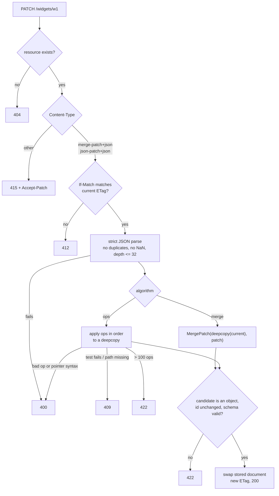

# Partial Updates with PATCH: JSON Merge Patch (RFC 7396) vs JSON Patch Operations (RFC 6902)

> [!summary] Claim
> `application/merge-patch+json` is a diff-by-example that replaces arrays whole and spends `null` on "delete", while `application/json-patch+json` is an ordered list of pointer-addressed operations that can append, guard with `test`, and store `null`; either way the server must apply the whole patch to a private copy, validate the result, and commit it or nothing (RFC 5789 Section 2).

Part of [REST and Resource Modeling](README.md) in [API Engineering](../README.md).

## TL;DR

- Mechanism: Merge Patch recursively overlays a patch object onto the target, deleting members whose patch value is `null` and replacing every non-object value whole (RFC 7396 Section 2); JSON Patch applies `add`, `remove`, `replace`, `move`, `copy`, and `test` operations in array order, each addressed by a JSON Pointer (RFC 6902 Sections 3 and 4).
- Contract rule: the server dispatches on `Content-Type`, answers an unsupported format with `415` plus `Accept-Patch`, and applies all changes atomically or none (RFC 5789 Sections 2, 2.2, and 3.1).
- The trap: a merge patch cannot set a member to `null`, cannot touch one element of an array, and loses concurrent array edits unless the client sends `If-Match`; the lab reproduces the lost update and the `412`.
- Portability fact: the same 62-test lab passed on CPython 3.12.13, 3.12.16, 3.13.18, 3.14.6, 3.14.10, 3.15.2, and 3.15.2 free-threaded (Linux), on Debian Trixie and Alpine musl, and over HTTP/2; `json.loads` stack exhaustion depth differs between 3.14 builds, so the lab bounds depth itself.
- When not to use it: use neither for non-JSON resources or for changes whose effect is not a predictable function of the current representation; use a custom method (`POST :cancel`) or a full `PUT` when the patch would be larger than the resource (RFC 5789 Section 2).

## Mental model



A `PATCH` request first has to name an existing resource, then a patch format the resource accepts, because RFC 9110 Section 13.2.1 says failures that can be detected before significant processing take precedence over preconditions, so `415` wins over `412`.
Only then does the server evaluate `If-Match` with the strong comparison function (RFC 9110 Section 13.1.1), so a client holding a stale representation is refused before any work.
The body is parsed with a strict JSON reader, because a patch body is executable intent and the stdlib defaults silently resolve ambiguity.
The two algorithms then diverge: merge patch overlays the patch onto a copy, while JSON Patch runs its operations in order against a working copy and stops at the first failing operation.
Every candidate document, from either branch, is checked against the resource schema and immutable fields before it replaces the stored document in one assignment, which is how the lab meets the RFC 5789 Section 2 rule that a server "MUST NOT apply any of the changes" when the whole patch cannot be applied.

## How it works

### PATCH itself

RFC 5789 Section 2 defines `PATCH` as a request whose content is "a set of instructions describing how a resource currently residing on the origin server should be modified to produce a new version", in a format identified by a media type.
It is "neither safe nor idempotent" by definition (RFC 5789 Section 2), and RFC 9110 Section 9.2.2 says a client "SHOULD NOT automatically retry a request with a non-idempotent method" unless it knows the semantics are idempotent.
The server "MUST apply the entire set of changes atomically and never provide (e.g., in response to a GET during this operation) a partially modified representation" (RFC 5789 Section 2).
RFC 5789 Section 2.2 suggests `400` for a malformed patch document, `415` for an unsupported format, `422` when the patch is understood but would make the resource invalid, `409` when the structures the patch assumes do not exist, and `412` when an `If-Match` or `If-Unmodified-Since` precondition fails.
`Accept-Patch` (RFC 5789 Section 3.1) lists the accepted patch media types; RFC 9110 Section 12.3 points to it as the request content negotiation mechanism for `PATCH`.
The status codes themselves live in RFC 9110 (`409` Section 15.5.10, `412` Section 15.5.13, `415` Section 15.5.16, `422 Unprocessable Content` Section 15.5.21); error bodies in the lab use `application/problem+json` with the `status` and `detail` members of RFC 9457 Section 3.1.

### JSON Merge Patch (RFC 7396)

The whole algorithm is the `MergePatch(Target, Patch)` pseudocode in RFC 7396 Section 2: if the patch is not an object, the result is the patch; otherwise a non-object target becomes `{}`, every `null` patch member removes that name, and every other member recurses.
The consequences follow directly from that function and are listed in the same section: a non-object patch replaces the entire target, and "it is not possible to patch part of a target that is not an object, such as to replace just some of the values in an array."
The format is "suitable for describing modifications to JSON documents that primarily use objects for their structure and do not make use of explicit null values" (RFC 7396 Section 1).
The operation works on data items, not text, so whitespace, member order, and number precision beyond the implementation's are not preserved, and the result on objects with duplicate names is undefined (RFC 7396 Section 2).
RFC 7396 obsoletes RFC 7386 (RFC 7396 header) and registers `application/merge-patch+json` with the encoding considerations of RFC 7159 Section 8 (RFC 7396 Section 4).
Because `MergePatch(MergePatch(T, P), P) == MergePatch(T, P)` for every `T` and `P`, a merge patch request is idempotent in effect even though `PATCH` is not idempotent by definition; the lab checks this with a Hypothesis property over random JSON values.

### JSON Patch (RFC 6902)

A JSON Patch document is a JSON array of operation objects, applied sequentially, each operation's output being the next one's input, until all succeed or one errors (RFC 6902 Section 3).
Each operation has exactly one `op` from `add`, `remove`, `replace`, `move`, `copy`, `test`, and exactly one `path`; members not defined for that `op` "MUST be ignored" (RFC 6902 Section 4).
`add` on an array index inserts and shifts right, the index "MUST NOT be greater than the number of elements", and `-` appends; `add` on an existing object member replaces it, but the parent container must exist (RFC 6902 Section 4.1).
`remove` and `replace` require the target to exist (RFC 6902 Sections 4.2 and 4.3), and `replace` is "functionally identical to a remove operation for a value, followed immediately by an add operation at the same location".
`move` "MUST NOT" have a `from` that is a proper prefix of `path` (RFC 6902 Section 4.4), and `copy` is an `add` of the value at `from` (RFC 6902 Section 4.5).
`test` compares by JSON type: strings by code points, numbers numerically, arrays element-wise, objects member-wise regardless of order, and `true`, `false`, `null` only to themselves (RFC 6902 Section 4.6).
On any error, "evaluation of the JSON Patch document SHOULD terminate and application of the entire patch document SHALL NOT be deemed successful", and because `PATCH` is atomic a `replace` followed by a failing `test` leaves the document unchanged (RFC 6902 Section 5).

### JSON Pointer (RFC 6901)

A pointer is zero or more `/`-prefixed reference tokens; `~` is escaped as `~0` and `/` as `~1` (RFC 6901 Section 3).
Decoding must transform `~1` to `/` before `~0` to `~`, so that `~01` becomes the member name `~1` and not `/` (RFC 6901 Section 4); RFC 6902 Appendix A.14 is the test vector.
An array token must be `0` or digits without a leading zero, and `-` names the nonexistent element after the last one, which is an error unless the application (here, `add`) defines it (RFC 6901 Section 4).

### What the lab implements

The lab follows each rule above literally; these blocks are the real code from the implementation file:

```python
def merge_patch(target: JSON, patch: JSON) -> JSON:
    """Return MergePatch(target, patch) from RFC 7396 Section 2 without mutating either input."""
    return _merge_in_place(copy.deepcopy(target), patch)


def _merge_in_place(target: JSON, patch: JSON) -> JSON:
    if not isinstance(patch, dict):
        return copy.deepcopy(patch)
    result: dict[str, JSON] = target if isinstance(target, dict) else {}
    for name, value in patch.items():
        if value is None:
            result.pop(name, None)
        else:
            result[name] = _merge_in_place(result.get(name), value)
    return result
```

```python
def apply_json_patch(document: JSON, patch: JSON, *, max_operations: int = MAX_OPERATIONS) -> JSON:
    """Apply an RFC 6902 patch to a private copy: all operations succeed, or nothing changes."""
    if not isinstance(patch, list):
        raise PatchError("malformed", None, "a JSON Patch document is a JSON array")
    if len(patch) > max_operations:
        raise PatchError("limit", None, f"{len(patch)} operations exceed {max_operations}")
    working = copy.deepcopy(document)
    for index, raw in enumerate(patch):
        working = _apply_one(working, parse_operation(raw, index), index)
    return working
```

Atomicity is a property of the data flow, not of a rollback path: every operation mutates `working`, and the handler only assigns the result into the store after schema validation, so an exception at operation `n` discards operations `0..n-1` by never publishing them.
In a database the same shape is "read row, apply in memory, validate, `UPDATE ... WHERE etag = :old`" inside one transaction; see [[Optimistic-Concurrency-Control-If-Match-and-412-Precondition-Failed]].

### How the Python stack parses a patch body

FastAPI decides whether a declared body parameter is JSON by parsing the `Content-Type` with `email.message.Message` and accepting `application/json` or any `application/*+json` subtype; any other type leaves the body as raw bytes, and `strict_content_type` (default `True`) only decides whether a request with no `Content-Type` at all is parsed as JSON (fastapi 0.162.0 fastapi/routing.py, get_request_handler).
So a `Body()` parameter accepts `application/merge-patch+json` and `application/json-patch+json` with no configuration, and a `text/plain` body fails validation with `422`; the lab test `test_fastapi_body_parses_any_plus_json_subtype_but_not_text_plain` pins both.
The JSON decode itself is `json.loads(body)` (starlette 1.10.0 starlette/requests.py, Request.json), which keeps the last of duplicate member names and accepts `NaN` and `Infinity` (both measured below), so the lab reads the raw body and calls `json.loads` with an `object_pairs_hook` that rejects duplicates and a `parse_constant` that rejects the non-standard constants.

## Numbers and limits

| Quantity | Value | Source |
| --- | --- | --- |
| JSON Patch operation kinds | 6 (`add`, `remove`, `replace`, `move`, `copy`, `test`) | RFC 6902 Section 4 |
| Merge patch reserved value | 1 (`null` means remove) | RFC 7396 Section 2 |
| JSON integers all implementations agree on | `[-(2**53)+1, (2**53)-1]` | RFC 8259 Section 6 |
| Lab operation limit | 100 operations, then `422` | lab constant `MAX_OPERATIONS`, chosen for this lab |
| Lab nesting limit | depth 32, then `400` | lab constant `MAX_DEPTH`, chosen for this lab |
| Lab `ETag` width | 128 bits (32 hex chars of SHA-256 over sorted, compact JSON) | lab function `etag_of` |
| CPython default recursion limit | 1000 on every interpreter tested | measured, `sys.getrecursionlimit()`, macOS 27.2 arm64 |
| `json.loads` of 100,000 nested `[` | `RecursionError` on 3.12.13, 3.13.18, 3.14.6, 3.15.0b3t; no error on 3.14.10 and 3.15.2 | measured, macOS 27.2 arm64 |
| `json.loads` of 1,000,000 nested `[` | `RecursionError` on all six interpreters | measured, macOS 27.2 arm64 |
| RFC 7396 Section 3 example as merge patch / JSON Patch / full `PUT` body | 99 / 190 / 135 bytes (compact JSON; the JSON Patch is `replace /title`, `add /phoneNumber`, `remove /author/familyName`, `remove /tags/1`) | measured with the lab functions and `json.dumps(..., separators=(",", ":"))`, CPython 3.14.6, macOS 27.2 arm64 |
| Append `"new"` to a 1000-element `tags` array of `"t0"` to `"t999"` | merge patch 6906 bytes, JSON Patch 45 bytes | measured the same way, CPython 3.14.6, macOS 27.2 arm64; the merge patch size grows with the tag strings |
| Lab suite | 62 tests in 0.24 to 0.32 s over four runs | measured, `uv run --frozen pytest ... -q`, CPython 3.14.6, macOS 27.2 arm64 |

The byte counts make the RFC 5789 Section 2 trade-off concrete: for a small object edit the JSON Patch body (190 bytes) was larger than the whole new resource (135 bytes), where a `PUT` is the better tool, while for an array append it was 153x smaller than the merge patch, which must resend the array.

## Portability

| Leg | Result | Evidence |
| --- | --- | --- |
| CPython 3.12.13 (macOS) | 62 passed | lab run, `UV_PROJECT_ENVIRONMENT=<tmp> uv run --frozen --python 3.12.13 pytest <test> -q` |
| CPython 3.12.16 (Debian Trixie container) | 62 passed | Docker 29.8.2 (OrbStack) on macOS 27.2 arm64, image `python:3.12-slim-trixie` (Linux aarch64), `uv sync --frozen --no-dev` then `uv run --frozen pytest <test> -q` with the locked set |
| CPython 3.13.18 | 62 passed | lab run, same command with `--python 3.13.18` |
| CPython 3.14.6 (workspace `.venv`) | 62 passed | lab run, `uv run --frozen pytest <test> -q` |
| CPython 3.14.10 | 62 passed | lab run, `--python 3.14.10` |
| CPython 3.15.2 | 62 passed | lab run, `--python 3.15.2`, full locked workspace installed |
| CPython 3.15.2t free-threaded (Linux aarch64) | 62 passed, `sys._is_gil_enabled()` is `False` | `python:3.14-slim-trixie` container with `uv 0.13.7` installing `3.15.2+freethreaded`; the locked sync fails (`psycopg-binary==3.3.8` has no wheel for this platform), so a venv with the pinned `pydantic`, `pydantic-core`, `fastapi`, `starlette`, `httpx`, `httpcore`, `h11`, `anyio`, `pytest`, `pytest-asyncio`, and `hypothesis==6.170.14` ran `pytest <test> -q`; not the full locked set |
| CPython 3.15.2t free-threaded on macOS | not run | `uv 0.11.26` on the macOS host offers no 3.15.2 free-threaded download (as of 2026-11) |
| CPython 3.15.0b3t free-threaded (macOS), pinned `hypothesis==6.170.14` | collection error | `ModuleNotFoundError: No module named 'hypothesis._native'`: the wheel ships `_native.abi3t-darwin.so` and this beta's `EXTENSION_SUFFIXES` has `.abi3t.so` but no `.abi3t-darwin.so` entry |
| CPython 3.15.0b3t free-threaded (macOS), unpinned `hypothesis==6.140.0` | 62 passed, `sys._is_gil_enabled()` is `False` | lab run in a separate venv with the pinned `fastapi`, `starlette`, `pydantic`, `httpx`, `pytest`, and `pytest-asyncio`; not the locked set |
| `json.loads` deep-nesting failure point | differs between 3.14.6 and 3.14.10 builds | measured; the lab's iterative `json_depth` check gives `400` on every leg regardless |
| FastAPI 0.162.0 `+json` body parsing | accepts any `application/*+json` | source read and lab test |
| Starlette 1.10.0 `Request.json` | stdlib `json.loads`, duplicates keep last, `NaN` accepted | source read; stdlib behavior measured on all six interpreters |
| Uvicorn 0.54.0, Hypercorn 0.18.0, Granian 2.8.7 | same results on each: JSON Patch append `200`, stale `If-Match` `412`, `text/plain` `415` with `Accept-Patch` | ad hoc loopback run of `build_app` over HTTP/1.1, CPython 3.14.6, macOS 27.2 arm64; the lab test itself is in-process over `httpx.ASGITransport` |
| Debian Trixie container | 62 passed | Docker 29.8.2 (OrbStack), image `python:3.14-slim-trixie` (Debian 13, CPython 3.14.10, Linux aarch64), `uv sync --frozen --no-dev` then `pytest <test> -q` with the locked set |
| Alpine musl container | 62 passed | same, image `python:3.14-alpine` (Alpine 3.24.4, `platform.libc_ver()` = `('musl', '1')`, CPython 3.14.10, aarch64) |
| HTTP/2 | `GET` `200`, JSON Patch append `200`, stale `If-Match` `412`, `text/plain` `415` with `Accept-Patch` | Hypercorn 0.18.0 serving `build_app` over cleartext HTTP/2 (prior knowledge), `httpx==0.28.1` with `h2==4.4.1`, `response.http_version == "HTTP/2"`, CPython 3.14.6, macOS 27.2 arm64 |
| HTTP/1.1 | same results | the Uvicorn, Hypercorn, and Granian row above |
| HTTP/3 over QUIC | same semantics, not run | RFC 9110 defines method semantics and status codes "shared by all versions" (RFC 9110 Abstract); not exercised on the wire here |

## Worked example

The [implementation](../labs/src/api_labs/f04_rest_and_resource_modeling/partial_updates.py) holds the two algorithms, the JSON Pointer parser, the strict body parser, and a FastAPI app with `GET` and `PATCH /widgets/{widget_id}`.
The [test](../labs/tests/f04_rest_and_resource_modeling/test_partial_updates_json_merge_patch_rfc_7396_vs_json_patch_rfc_6902.py) runs every RFC 7396 Appendix A row, the RFC 6902 Appendix A examples, and the HTTP behaviors below through `httpx.AsyncClient(transport=httpx.ASGITransport(app=app), base_url="http://test")`.

The atomicity test is the RFC 6902 Section 5 example extended over HTTP: two operations succeed in the working copy, the third fails, and nothing is published.

```python
async def test_failed_json_patch_changes_nothing_and_returns_409() -> None:
    store = seeded_store()
    async with client_for(store) as client:
        before = await client.get("/widgets/w1")
        # RFC 6902 Section 5: a later failing test aborts the earlier replace.
        response = await client.patch(
            "/widgets/w1",
            content=json.dumps(
                [
                    {"op": "replace", "path": "/name", "value": "sprocket"},
                    {"op": "add", "path": "/tags/-", "value": "steel"},
                    {"op": "test", "path": "/name", "value": "gear"},
                ]
            ),
            headers={"Content-Type": JSON_PATCH},
        )
        after = await client.get("/widgets/w1")
    assert response.status_code == 409
    assert response.headers["content-type"] == "application/problem+json"
    assert "operation 2: test failed" in response.json()["detail"]
    assert after.json() == before.json()
    assert after.headers["etag"] == before.headers["etag"]
    assert store.writes == 0
```

The lost-update test shows why merge patch needs a precondition: two clients each read `tags == ["metal"]` and each send the whole array they want.

```python
async def test_merge_patch_loses_concurrent_array_appends_unless_if_match_is_sent() -> None:
    store = seeded_store()
    async with client_for(store) as client:
        etag = (await client.get("/widgets/w1")).headers["etag"]
        # Two clients read tags == ["metal"] and each send the whole new array.
        await client.patch(
            "/widgets/w1",
            content=b'{"tags": ["metal", "red"]}',
            headers={"Content-Type": MERGE_PATCH},
        )
        await client.patch(
            "/widgets/w1",
            content=b'{"tags": ["metal", "blue"]}',
            headers={"Content-Type": MERGE_PATCH},
        )
        lost = (await client.get("/widgets/w1")).json()["tags"]
    assert lost == ["metal", "blue"]

    guarded = seeded_store()
    async with client_for(guarded) as client:
        first = await client.patch(
            "/widgets/w1",
            content=b'{"tags": ["metal", "red"]}',
            headers={"Content-Type": MERGE_PATCH, "If-Match": etag},
        )
        second = await client.patch(
            "/widgets/w1",
            content=b'{"tags": ["metal", "blue"]}',
            headers={"Content-Type": MERGE_PATCH, "If-Match": etag},
        )
        unsupported = await client.patch(
            "/widgets/w1", content=b"{}", headers={"Content-Type": "text/plain", "If-Match": etag}
        )
    assert (first.status_code, second.status_code) == (200, 412)
    assert unsupported.status_code == 415  # RFC 9110 Section 13.2.1: 415 wins over 412
    assert guarded.documents["w1"]["tags"] == ["metal", "red"]
```

Captured on CPython 3.14.6, macOS 27.2 arm64, from `labs/`:

```text
$ uv run --frozen pytest tests/f04_rest_and_resource_modeling/test_partial_updates_json_merge_patch_rfc_7396_vs_json_patch_rfc_6902.py -q
..............................................................           [100%]
62 passed in 0.28s
```

Each of 16 deliberate source mutations (decode `~0` before `~1`, apply in place without the working copy, `str.isdigit()` for indexes, Python `==` in `test`, store `null` in merge, check `412` before `415`, drop the `move` prefix check, require `value` only for `add`, off-by-one depth and operation limits, accept `Infinity`, compare media types case-sensitively, let a weak `ETag` pass `If-Match`, allow extra members, drop the `RecursionError` catch, drop the `id` check) made at least one test fail, and each was restored afterwards.
A second, independent run of five mutations on CPython 3.14.6 (decode `~0` before `~1`, no working copy, operation limit 101, merge storing `null`, depth limit 33) failed `test_json_patch_matches_rfc_6902_appendix_a[A.14]`, `test_failed_json_patch_changes_nothing_and_returns_409`, `test_operation_count_limit_returns_422_before_any_work`, `test_merge_patch_matches_rfc_7396_appendix_a`, and `test_operation_and_depth_limits_are_inclusive` respectively, and the source was byte-identical after restoring.

## Pitfalls

> [!warning] `null` cannot be stored with merge patch
> Trigger: a schema with a nullable field that distinguishes "absent" from `null`, patched with `application/merge-patch+json`.
> Symptom: `{"note": null}` deletes `note` instead of storing `null` (RFC 7396 Section 2); the lab shows only a JSON Patch `replace` with `"value": null` stores it.
> Fix: model "cleared" as absence, or accept JSON Patch for that resource.

> [!warning] Arrays are replaced whole
> Trigger: two clients add an element to the same array with merge patch, without `If-Match`.
> Symptom: last writer wins; the lab ends with `["metal", "blue"]` and `red` is gone.
> Fix: require `If-Match` on merge patch (RFC 5789 Section 2 says clients of base-point-dependent formats "SHOULD use a conditional request"), or accept JSON Patch `add` at `/tags/-`, or model the array as a sub-collection.

> [!warning] `True == 1` in a hand-written `test`
> Trigger: implementing RFC 6902 `test` with Python `==`.
> Symptom: `{"op": "test", "path": "/count", "value": true}` passes against `1`, and `[1] == [True]`; the lab mutation M4 proves the test catches it.
> Fix: compare by JSON type first, as RFC 6902 Section 4.6 requires; numbers still compare numerically, so `1` equals `1.0`.

> [!warning] `str.isdigit()` for array indexes
> Trigger: validating pointer array tokens with `isdigit()` and `int()`.
> Symptom: `chr(0x0661)` (U+0661 ARABIC-INDIC DIGIT ONE) passes `isdigit()` and `int()` returns `1` on all six interpreters measured, so `/tags/<U+0661>` removes element 1; `01` also passes.
> Fix: match the RFC 6901 Section 4 grammar `0|[1-9][0-9]*` with an ASCII-only pattern.
> The grammar has no length bound, so the lab also rejects a token with more digits than the array limit before calling `int()`: CPython raises `ValueError` for a string longer than `sys.get_int_max_str_digits()` digits (4300 by default), which would otherwise turn a 5 KB patch into a `500` instead of `409`.

> [!warning] Prototype pollution through pointer paths
> Trigger: a JSON Patch library that walks pointer tokens as object properties on language objects.
> Symptom: CVE-2021-4279 in the npm package `fast-json-patch` before 3.1.1: its `__proto__` guard missed `constructor/prototype` paths, which allowed "improperly controlled modification of object prototype attributes" (NVD; GHSA-8gh8-hqwg-xf34); the fix commit `7ad6af4` adds the `constructor` then `prototype` check.
> Fix: apply patches to plain data (`dict`, `list`), never with `setattr` on domain objects, then validate the result into the domain model.

> [!warning] Ambiguous operation objects
> Trigger: `{"op": "add", "path": "/name", "value": "x", "op": "remove"}` (adapted from RFC 6902 Appendix A.13, which uses `/baz` and `"qux"`) parsed with plain `json.loads`.
> Symptom: the stdlib keeps the last name, so it silently becomes a `remove`; the lab asserts `json.loads(...)[0]["op"] == "remove"`.
> Fix: reject duplicate member names at parse time with `400`, since RFC 8259 Section 4 says behavior on duplicates is unpredictable.

## Security and robustness

- Authorization is per field, not per request: RFC 7396 Section 5 makes it "the server's responsibility to determine the appropriateness of any given change", and a patch that reaches `id`, an owner, or a role field is OWASP API3:2023 Broken Object Property Level Authorization; the lab rejects any change to `id` with `422` and validates the whole result with `extra="forbid"`; see [[Field-Behavior-Semantics-Input-Only-Output-Only-and-Immutable-AIP-203]].
- Validate the result, not the patch: a JSON Patch is valid by syntax yet can produce any document, so the lab validates the candidate with a strict Pydantic model and returns `422` (RFC 5789 Section 2.2), which also catches a merge patch body that is an array and would otherwise replace the resource with an array.
- Bound the work: RFC 5789 Section 5 says servers "MUST take adequate precautions" against excessive CPU and disk use, and OWASP API4:2023 is Unrestricted Resource Consumption; the lab caps operations at 100, depth at 32, and converts both `RecursionError` and over-depth input into `400`, never `500`.
- `copy` amplifies: one `copy` of a large subtree doubles the document, so a body-size limit alone does not bound the result size; cap the serialized result too (not implemented in this lab).
- Parse strictly: reject duplicate names, `NaN`, `Infinity`, and invalid UTF-8 (all `400` in the lab), and remember integers outside `[-(2**53)+1, (2**53)-1]` may change value in clients that use IEEE 754 doubles (RFC 8259 Section 6).
- Never trust the patch format to carry metadata: RFC 5789 Section 2 says entity headers on the request apply to the patch document, not the resource, so `Content-Language` on a `PATCH` must not be stored as the resource's language.
- After a lost response, `PATCH` cannot be blindly retried; RFC 5789 Section 5 says the client "might have to issue a GET request to see whether the request was applied", and the lab shows a retried JSON Patch append duplicates `red`.

## The principal's view

The decision is not which RFC is better but which contract the organization can hold for a decade: accept merge patch as the default for object-shaped resources because clients can produce it by sending the fields they changed, and require `If-Match` on it, because its whole-array semantics turns every concurrent edit into a last-writer-wins race.
Accept JSON Patch only on resources that have large arrays or need `null`, and then budget for its cost: client libraries must build pointers, escape `~` and `/`, and handle positional indexes that shift under concurrent edits, so it also needs `If-Match` or a leading `test`.
Prefer one server-side pipeline for both formats (parse, apply to a copy, validate the result, conditional commit) so authorization and validation live in one place regardless of format; a separate code path per format is how field-level authorization drifts.
For APIs generated from protobuf or used across languages, an explicit update mask is often the better contract because it separates "which fields" from "what values"; see [[Field-Masks-and-Update-Masks-AIP-134-and-AIP-161]].
When the change is a state transition with side effects (approve, cancel, refund), a patch format is the wrong tool; use a custom method such as [[Custom-Methods-and-State-Machine-Transitions-AIP-136]], because a generic patch cannot express preconditions and side effects that are not fields.
When clients already hold the full desired state, a `PUT` with `If-Match` is simpler and idempotent; see [[Full-Replacement-PUT-and-Upsert-Semantics]] and, for controllers that reconcile desired state, [[Declarative-Friendly-APIs-and-Reconciliation-Loops-AIP-128]].

## Interview questions

> [!question] L5: What does `{"a": null}` do as a merge patch, and how would you store an explicit `null` instead?
>
> > [!success]- Answer
> > It removes the member `a` from the target if present, because RFC 7396 Section 2 gives `null` the meaning "remove".
> > A merge patch cannot store `null` at all.
> > To store `null`, send `application/json-patch+json` with `{"op": "replace", "path": "/a", "value": null}` or `add`.
> >
> > Follow-up: How would you design the schema so that clients rarely need to store `null`?

> [!question] L5: Predict the output: merge patch `{"a": {"bb": {"ccc": null}}}` applied to `{}`, and merge patch `{"a": "b", "c": null}` applied to `[1, 2]`.
>
> > [!success]- Answer
> > The first gives `{"a": {"bb": {}}}`: each missing level becomes `{}`, and removing an absent `ccc` is a no-op.
> > The second gives `{"a": "b"}`: an object patch on a non-object target first resets the target to `{}`.
> > Both are rows of RFC 7396 Appendix A and are in the lab's parametrized test.
> >
> > Follow-up: What does merge patch `["c"]` do to `{"a": "b"}`?

> [!question] L5: Which status codes should a `PATCH` endpoint return for an unknown patch format, a syntactically broken patch, a failed `test` operation, and a result that violates the schema?
>
> > [!success]- Answer
> > `415` with an `Accept-Patch` header for the unknown format (RFC 5789 Sections 2.2 and 3.1).
> > `400` for a malformed patch document.
> > `409` when the patch assumes state that does not exist, such as a failed `test` or a missing path.
> > `422` when the patch is understood but would make the resource invalid (RFC 5789 Section 2.2, RFC 9110 Section 15.5.21).
> >
> > Follow-up: Why does `415` take precedence over `412` when both apply?

> [!question] L6: How do you make JSON Patch atomic in a service whose storage is a relational row?
>
> > [!success]- Answer
> > Read the row and its version inside a transaction, apply all operations to an in-memory copy, validate the result, then `UPDATE` with `WHERE version = :read_version`.
> > If any operation fails, discard the copy; nothing was written.
> > If the conditional `UPDATE` affects zero rows, another writer won and the request becomes `412` or `409`.
> > The lab expresses the same rule as "mutate a deepcopy, publish with one assignment", and a mutation that applies in place fails the atomicity test.
> >
> > Follow-up: What changes if the document is split across several tables?

> [!question] L6: Debug this API: clients report that adding a tag with `PATCH` sometimes deletes a tag another user added seconds earlier, and no request ever fails.
>
> > [!success]- Answer
> > The endpoint accepts `application/merge-patch+json`, which replaces arrays whole, so each client sends the full array it read and the last writer wins.
> > No request fails because no precondition is required.
> > Fix one: require `If-Match` with the `ETag` from the read and return `412` on mismatch, which the lab shows.
> > Fix two: accept JSON Patch `add` at `/tags/-`, which composes without a read, or expose tags as a sub-collection.
> >
> > Follow-up: Would you require `If-Match` on every `PATCH`, and what does that cost offline-first mobile clients?

> [!question] L6: Why must a JSON Pointer decoder replace `~1` before `~0`, and what does `/~01` address?
>
> > [!success]- Answer
> > Replacing `~0` first would turn `~01` into `~1` and then into `/`, which is wrong.
> > RFC 6901 Section 4 specifies `~1` to `/` first, then `~0` to `~`.
> > `/~01` therefore addresses the member named `~1`, as in RFC 6902 Appendix A.14.
> >
> > Follow-up: Which characters in a pointer need percent-encoding when it is placed in a URI fragment?

> [!question] L6: Is a merge patch request idempotent, and is a JSON Patch request?
>
> > [!success]- Answer
> > `PATCH` as a method is not idempotent (RFC 5789 Section 2).
> > A specific merge patch is idempotent in effect because applying the same patch twice yields the same document, which the lab checks as a property.
> > A JSON Patch with `add` at `/-` is not: the lab's retried append produces `["metal", "red", "blue", "red"]`.
> > A JSON Patch can be made safe to retry with a leading `test` or with `If-Match`.
> >
> > Follow-up: How would an `Idempotency-Key` header change this, and where would you store it?

> [!question] L7+: Your platform has 400 services that variously accept merge patch, JSON Patch, or update masks, and field-level authorization bugs keep appearing, so what do you standardize?
>
> > [!success]- Answer
> > Standardize the server pipeline, not one format: parse strictly, apply to a copy, authorize the diff between old and new per field, validate the result, commit conditionally.
> > Provide that as one library so every format feeds the same authorization and validation step.
> > Pick merge patch as the default format with mandatory `If-Match`, allow JSON Patch where arrays or `null` demand it, and publish `Accept-Patch` on every resource.
> > Gate it with contract tests that send the RFC Appendix A vectors and the A.13 duplicate-`op` body to every service.
> >
> > Follow-up: How do you migrate a service that applies patches with `setattr` on ORM objects without breaking clients?

> [!question] L7+: A security review finds a JSON Patch endpoint that applies operations directly to ORM model instances; what is the risk, and what is the design fix?
>
> > [!success]- Answer
> > Pointer tokens become attribute names, so a client can reach fields the API never exposed, which is OWASP API3:2023 and the same class as the `fast-json-patch` prototype pollution in CVE-2021-4279.
> > It also breaks atomicity, because a failure at operation `n` leaves earlier mutations on a live session object.
> > The fix is to serialize the resource to its public representation, patch plain JSON, validate into a strict input model with forbidden extras and immutable fields, authorize the field diff, then map to the ORM in one transaction.
> >
> > Follow-up: How do you prove with tests that no internal field is reachable?

## Related

Prerequisites: [[Full-Replacement-PUT-and-Upsert-Semantics]]

Next: [[Field-Masks-and-Update-Masks-AIP-134-and-AIP-161]]

See also: [[REST-APIs]], [[02-Programming-Languages/Python/Python-Backend-Interview-Prep/05-REST-API-Design]], [[jq-Language]], [[jq-Paths-and-Updates]], [[HTTP-Method-Semantics-Safety-and-Idempotency-Invariants]], [[HTTP-Status-Code-Taxonomy-and-Selection-Decision-Trees]], [[Optimistic-Concurrency-Control-If-Match-and-412-Precondition-Failed]], [[Strong-vs-Weak-Validators-ETag-and-Last-Modified]], [[Content-Negotiation-Media-Types-and-Charsets]], [[Field-Behavior-Semantics-Input-Only-Output-Only-and-Immutable-AIP-203]], [[Custom-Methods-and-State-Machine-Transitions-AIP-136]], [[Declarative-Friendly-APIs-and-Reconciliation-Loops-AIP-128]]

- Lab: `labs/tests/f04_rest_and_resource_modeling/test_partial_updates_json_merge_patch_rfc_7396_vs_json_patch_rfc_6902.py`

## Further reading

- [RFC 7396: JSON Merge Patch](https://www.rfc-editor.org/rfc/rfc7396.html) - the one-function algorithm in Section 2 and the Appendix A test vectors every implementation should pass.
- [RFC 6902: JSON Patch](https://www.rfc-editor.org/rfc/rfc6902.html) - operation semantics, JSON-type equality for `test`, atomic error handling, and 16 worked examples.
- [RFC 6901: JSON Pointer](https://www.rfc-editor.org/rfc/rfc6901.html) - the path syntax both `path` and `from` use, including escape order and array index grammar.
- [RFC 5789: PATCH Method for HTTP](https://www.rfc-editor.org/rfc/rfc5789.html) - atomicity, conditional requests, `Accept-Patch`, and the error status table.
- [RFC 9110: HTTP Semantics](https://www.rfc-editor.org/rfc/rfc9110.html) - `If-Match` evaluation and precondition order (Section 13), idempotency (Section 9.2.2), and status codes (Section 15).
- [RFC 8259: The JSON Data Interchange Format](https://www.rfc-editor.org/rfc/rfc8259.html) - duplicate member names (Section 4) and the interoperable number range (Section 6).
- [RFC 9457: Problem Details for HTTP APIs](https://www.rfc-editor.org/rfc/rfc9457.html) - the `application/problem+json` error body the lab returns.
- [fast-json-patch fix commit 7ad6af4](https://github.com/Starcounter-Jack/JSON-Patch/commit/7ad6af41eabb2d799f698740a91284d762c955c9) - the CVE-2021-4279 prototype pollution fix, a concrete example of pointer tokens reaching language internals.
