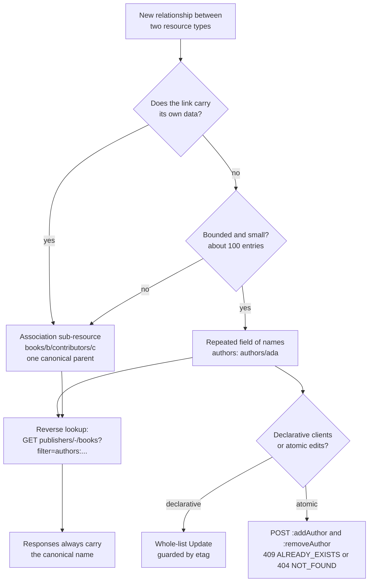

# Modeling Many-to-Many Associations, Sub-Resource Aliasing, and Polymorphic Resources (AIP-124)

> [!summary] Claim
> Give every resource exactly one canonical parent, express every other relationship as resource-name references (a bounded repeated field, or an association sub-resource when the link carries data), answer reverse lookups with a filtered `List` instead of a second URL tree, and make polymorphic payloads carry an explicit `kind` tag so the server dispatches on data rather than on which schema happens to fit.

Part of [REST and Resource Modeling](README.md) in [API Engineering](../README.md).

## TL;DR

Mechanism: a many-to-many link is stored on one side as `authors: ["authors/ada", ...]` (AIP-124, AIP-144), or promoted to its own resource `publishers/{p}/books/{b}/contributors/{c}` under one canonical parent when the link needs fields such as `role`.
Contract rule: a resource has at most one canonical parent, `List` never requires two parents, and every response uses the canonical name even when the request came through `-` or an alias (AIP-124, AIP-159, AIP-122).
Trap: whole-list replacement of a repeated field silently loses concurrent edits unless the write carries `etag` (AIP-154), and an untagged `Union` picks a variant by field count and declaration order, ignoring a client-sent `kind` it does not model.
Portability: the lab's 31 tests pass unchanged on CPython 3.12.13 and 3.12.16, 3.13.18, 3.14.6, 3.14.10, 3.15.2, 3.15.2 free-threaded (GIL off), and 3.15.0b3, on macOS and in Debian Trixie and Alpine containers, and under Uvicorn, Hypercorn, and Granian, with pydantic 2.14.3, pydantic-core 2.50.4, and FastAPI 0.162.0 (as of 2026-11).
When not to use it: when the relationship is the product (a social graph, a permission graph with millions of edges), a repeated field and even a paged association collection are the wrong shape; use a dedicated edge store and query API.

## Mental model



Start at the top with a relationship you need to expose.
If the link itself has attributes (a contributor's `role`, an enrollment's `grade`), or the set can grow without a small bound, the link becomes a resource under exactly one of the two endpoints, and you pick the one that owns its lifecycle.
Otherwise the link is a repeated field of resource names on one side, and you then choose how clients mutate it: a whole-list `Update` with `etag` when declarative tools must converge on a full desired state, or `:add*` and `:remove*` custom methods when clients need atomic single-element edits without read-modify-write.
Either way, the reverse direction ("which books did Ada write?") is not a second URL tree such as `/authors/ada/books`; it is the books collection listed across all parents with `-` and narrowed by a `filter`, and every row it returns names the book by its canonical path.

## How it works

### One canonical parent, other edges by reference

AIP-124 states the root rule: a resource must have at most one canonical parent, and a `List` request must not require two distinct parents to work (AIP-124, Guidance).
For a resource with several many-to-one relationships, the API picks one as the parent in the name pattern (`publishers/{publisher}/books/{book}`) and expresses the rest as fields holding resource names, for example `string author` annotated with `google.api.resource_reference` (AIP-124, Multiple many-to-one associations).
A reference field "must accept the same resource name format that is used in the `name` field of the referenced resource" (AIP-124, note; Changelog 2021-04-07 "Clarified that resource reference fields accept resource names with the same format as the `name` field").
The reason to reference by name rather than embed is spelled out in AIP-122: embedding complicates lifecycle (what happens when the dependency is deleted), bypasses per-resource permissions, and couples the schemas and rollouts of both resources (AIP-122, Disallow embedding of resources).

On the wire, a reference is just a JSON string:

```http
POST /v1/publishers/acme/books?book_id=specs HTTP/1.1
Content-Type: application/json

{"kind": "ebook", "title": "Specs", "file_bytes": 4096, "authors": ["authors/ada"]}
```

```http
HTTP/1.1 201 Created
Location: /v1/publishers/acme/books/specs
Content-Length: 128
Content-Type: application/json

{"name":"publishers/acme/books/specs","etag":"\"1\"","title":"Specs","authors":["authors/ada"],"kind":"ebook","file_bytes":4096}
```

`201 Created` with a `Location` that identifies the new resource is the HTTP contract for creation (RFC 9110 Section 15.3.2, RFC 9110 Section 10.2.2); AIP-133 only requires that the `Create` response message "must be the resource itself" (AIP-133, Guidance), so the lab chooses the HTTP-native status.

### Many-to-many as a repeated field

For many-to-many, AIP-124 says an API "should use a repeated field containing a list of resource names, following the principles described for repeated fields in AIP-144" (AIP-124, Many-to-many associations).
AIP-144 adds the constraints that make this safe: repeated fields "should have an enforced upper bound", with "A good rule of thumb is 100 elements", and if the data may grow beyond that "the API should use a sub-resource instead" (AIP-144, Guidance).
They "must not represent the body of another resource inline"; they hold names (AIP-144, Guidance).

The lab enforces the bound and uniqueness in the type, so FastAPI rejects a bad list with `422` before the handler runs:

```python
AuthorList = Annotated[
    list[AuthorName], Field(max_length=MAX_AUTHORS), AfterValidator(_reject_duplicates)
]
```

Pydantic reports `too_long` for 101 entries, `value_error` for a duplicate, and `string_pattern_mismatch` for `users/a1` (lab test `test_repeated_field_is_bounded_unique_and_well_formed`).

### Two update strategies and their race behavior

AIP-144 gives two ways to change the list (AIP-144, Update strategies).
The standard `Update` replaces the entire list, because "Field masks are unable to address individual entries in a repeated field", so the client must read, modify, and send the whole value back; this is acceptable for small lists when races "can be guarded against with ETags".
Declarative-friendly resources "must use the standard `Update` method, and not introduce `Add` and `Remove` methods" (AIP-144, note), which is why [[Declarative-Friendly-APIs-and-Reconciliation-Loops-AIP-128]] pushes relationship-heavy designs toward sub-resources.
When atomic edits are needed, the API "should define custom methods using the verbs `Add` and `Remove`", over `POST` with a URI ending in `:add*` or `:remove*`, returning the full resource (AIP-144, Update strategies).
Their error contract is strict: if the value being added "is already present, the method must error with `ALREADY_EXISTS`", and if the value being removed "is not present, the method must error with `NOT_FOUND`" (AIP-144).
`google.rpc.Code` maps those to `409 Conflict` and `404 Not Found` (googleapis google/rpc/code.proto, `ALREADY_EXISTS = 6` and `NOT_FOUND = 5`).

The etag rule lives in AIP-154: a mismatching `etag` "must send an `ABORTED` error response", and a missing `etag` "should" be permitted (AIP-154, Guidance); AIP-154's changelog records the 2021-03-05 switch from `FAILED_PRECONDITION` ("which becomes HTTP 400") to `ABORTED` (`409`).
Over plain HTTP the equivalent header-level mechanism is `If-Match` with `412 Precondition Failed` (RFC 9110 Section 13.1.1, RFC 9110 Section 15.5.13), covered in [[Optimistic-Concurrency-Control-If-Match-and-412-Precondition-Failed]].

The lab measures both races in-process.
Two clients read `authors == ["authors/ada"]`, then each sends a full list with one extra author and no `etag`: the second `PATCH` returns `200` and the final list is `["authors/ada", "authors/linus"]`, so `authors/grace` is gone with no error anywhere.
With the `etag` each read returned, the second write gets `409` with `status: "ABORTED"` and the final list keeps `authors/grace`.
Two `:addAuthor` calls compose without any `etag` and leave `["authors/ada", "authors/grace", "authors/linus"]` at `etag` `"3"`.

### Add and Remove are not idempotent in AIP-144, and are in JSON:API

JSON:API 1.1 specifies the opposite retry semantics for to-many relationship links.
A `POST` to a relationship URL "MUST add the specified members to the relationship unless they are already present", and "If all of the specified resources can be added to, or are already present in, the relationship then the server MUST return a successful response"; `DELETE` likewise succeeds when the members are "already missing" (JSON:API 1.1, Updating To-Many Relationships).
The spec's stated reason is that this "helps avoid pointless race conditions caused by multiple clients making the same changes".
The lab exposes both behaviors behind `link_semantics`: after a successful add, a retried `:addAuthor` returns `409` under `"aip144"` and `200` under `"jsonapi"`, a retried `:removeAuthor` returns `404` versus `200`, and in both modes the no-op retry leaves the `etag` at `"3"` because only two real mutations happened.
This matters for clients that retry on timeout: under AIP-144 a client must treat `409 ALREADY_EXISTS` from a retried add as "probably my first attempt succeeded".
RFC 9110 sets the general rule behind this: a client "SHOULD NOT automatically retry a request with a non-idempotent method unless it has some means to know that the request semantics are actually idempotent", or to detect that the original request was never applied (RFC 9110 Section 9.2.2).

### Association sub-resources

When "more metadata is required along with the association", AIP-124 allows "a sub-resource with two one-to-many associations": the link resource has one canonical parent in its name and a reference field to the other side (AIP-124, example `BookAuthor` with pattern `publishers/{publisher}/books/{book}/authors/{book_author}`).
AIP-124 recommends this "only" when metadata is needed or the repeated-field restrictions preclude that approach (AIP-124, note).
The lab names the collection `contributors` and models `{"author": "authors/ada", "role": "editor"}`.
The invariant a database would hold with a unique index on `(book, author, role)` is enforced in the handler: a second `editor` link for the same author is `409`, a `translator` link for the same author is a distinct `201`, and creating under a missing book is `404`.
Note that this is the first place where the API gains a collection that must be paginated and filtered on its own; see [[Structured-Filter-Expressions-and-AST-Compilation-AIP-160]].

### Sub-resource aliasing and the reverse direction

The tempting design publishes the same edge twice: `/v1/books/{b}/authors` and `/v1/authors/{a}/books`.
That gives the edge two names, so caches, audit logs, IAM policies, and client-side identity maps disagree about whether two responses describe the same thing.
AIP-124 forbids the second parent outright and directs reverse queries to a `filter` on the canonical `List` (AIP-124, "The RPC should include a `string filter` field that allows users to filter by other resource associations").
AIP-160 supplies the operator: `:` means "has", and for a repeated field `r:42` is "True if `r` contains 42" (AIP-160, Has Operator).
To search every publisher at once, AIP-159 permits `-` as the parent collection ID, `GET /v1/publishers/-/books?filter=...`, with two hard rules: responses "must use the canonical name of the resource, with the actual parent collection identifiers (instead of `-`)", and a `Get` through `-` is allowed only when "The resource ID must be unique within parent collections" (AIP-159, Guidance and Unique resource lookup).
AIP-122 covers the other alias family, such as `users/me`: APIs "may provide programmatic aliases for common lookup patterns", but "all data returned from the API must use the canonical resource name" (AIP-122, Resource ID aliases).

The lab enforces all of it: `GET /v1/publishers/-/books?filter=authors:"authors/ada"` returns `publishers/acme/books/specs` and `publishers/zeta/books/notes`, `GET /v1/publishers/-/books/specs` returns `"name": "publishers/acme/books/specs"`, creating `zeta/books/specs` is `409` because IDs are kept globally unique to keep the wildcard `Get` unambiguous, any other filter is `400 INVALID_ARGUMENT` (AIP-160 lets a service document further limitations on filters and asks for `INVALID_ARGUMENT` on a non-compliant `filter`; AIP-160, Limitations and Validation), and `POST` to `publishers/-/books` is `400`.
`-` and `:` need no escaping in a path segment: `-` is `unreserved` (RFC 3986 Section 2.3) and `:` is allowed in `pchar` (RFC 3986 Section 3.3).
Starlette's `str` convertor matches `[^/]+` (starlette 1.10.0 starlette/convertors.py, StringConvertor.regex), so `POST .../books/specs:addAuthor` partially matches the `GET .../books/{book}` route and then the `PATCH .../books/{book}` route (path matches, method does not), the router remembers the first partial match and keeps scanning, and the `:addAuthor` route then matches fully (starlette 1.10.0 starlette/routing.py, Router.app); the custom-method routing details are in [[Custom-Methods-and-State-Machine-Transitions-AIP-136]].

### Weak references and deletion

A name in a repeated field is a weak reference: the referencing service validates it at write time and nothing more.
In the lab, creating a book with `authors/nobody` is `400 INVALID_ARGUMENT`, but after `DELETE /v1/authors/ada` returns `204`, the book still lists `authors/ada`, and a later `:addAuthor` for the same name is `409` because the stale name occupies the slot.
That is the lifecycle problem AIP-122 names when it rejects embedding, moved one level down: by-name references avoid duplicated data but make every reader responsible for a `404` when it dereferences.
The alternative designs each cost something: cascading removal turns one delete into a fan-out write across every referencing resource, and blocking the delete (`FAILED_PRECONDITION`, `400` per code.proto) makes deletion order a client concern.
The deletion lifecycle itself belongs to [[Soft-Delete-Undelete-and-Expiration-Lifecycles-AIP-164]].

### Polymorphic resources: tag first, then validate one schema

AIP-146 ranks the options for a field that can take several shapes and tells services to introduce the least generic approach that satisfies the use case; a `oneof` "preserves the largest degree of type safety and semantic meaning for each option", while `google.protobuf.Any` "should not be used unless other options are infeasible" (AIP-146, Oneof and Any).
It also records the evolution rule: adding fields to an existing `oneof` is non-breaking, but moving existing fields into or out of a `oneof` is breaking (AIP-146, note).
In JSON over HTTP, the `oneof` analogue is a discriminated union: each variant has a `kind` with a single literal value.

OpenAPI describes this with the Discriminator Object, which is legal only alongside `oneOf`, `anyOf`, or `allOf`, and which "MUST NOT change the validation outcome of the schema"; in 3.1.1, `propertyName` "SHOULD be required in the payload schema, as the behavior when the property is absent is undefined" (OpenAPI 3.1.1, Discriminator Object).
OpenAPI 3.2.0 closes that hole: an optional discriminating property requires a `defaultMapping` naming the schema to use when the property is absent or unmapped (OpenAPI 3.2.0, Discriminator Object, `defaultMapping`).
FastAPI 0.162.0 emits exactly the 3.1 form for the lab's body, generated by `GenerateJsonSchema.tagged_union_schema` (pydantic 2.14.3 pydantic/json_schema.py, GenerateJsonSchema.tagged_union_schema): `oneOf` with three `$ref`s plus `discriminator: {"propertyName": "kind", "mapping": {"print": "#/components/schemas/PrintBook", ...}}`.

In pydantic, `Field(discriminator="kind")` (or `Body(discriminator="kind")` in FastAPI) makes `apply_discriminator` rewrite the plain union into a `tagged-union` core schema (pydantic 2.14.3 pydantic/_internal/_discriminated_union.py, apply_discriminator and _ApplyInferredDiscriminator).
At runtime, `TaggedUnionValidator.validate` reads the tag from the input, and `find_call_validator` looks the tag up in a `LiteralLookup` and runs exactly one member validator; a tag with no entry raises `UnionTagInvalid`, and a missing tag raises `UnionTagNotFound` (pydantic-core 2.50.4 src/validators/union.rs, TaggedUnionValidator::validate, find_call_validator, tag_not_found).
In the pinned release, pydantic-core's source lives in the pydantic monorepo under `pydantic-core/`, and that tree's `Cargo.toml` at tag `v2.14.3` declares `version = "2.50.4"`.
The plain union path is different: `UnionValidator::validate_smart` tries members in order, returns at once on an exact success that carries no `fields_set_count` (scalars, not models), otherwise tries every member and keeps the success with the greatest `fields_set_count`, breaks ties by exactness with a strict `<` so the earliest member wins a full tie, and on total failure returns the errors of every member (pydantic-core 2.50.4 src/validators/union.rs, UnionValidator::validate_smart).

The lab shows each consequence.
`{"kind": "vinyl"}` fails with one error, `union_tag_invalid` at `loc ["body"]`; `{"title": "T"}` fails with one `union_tag_not_found`; an ebook carrying `page_count` fails with one `extra_forbidden` at `["body", "ebook", "page_count"]`, the tag naming which schema rejected it.
The same bad payload through the untagged union produces 6 errors, two per member, located under `PrintBook`, `EBook`, and `AudioBook`.
A legacy pair of models without a tag, with defaults and `extra="ignore"`, resolves `{"title": "t"}` to `LegacyPrint`, `{"title": "t", "file_bytes": 5}` to `LegacyEBook`, and `{"title": "t", "kind": "ebook"}` to `LegacyPrint`, because the client's `kind` is an ignored extra key and cannot steer the choice.
`kind` is also immutable after create: the authors update model forbids extra keys, so `PATCH {"authors": [], "kind": "print"}` is `422 extra_forbidden` and the stored book stays an ebook; field behavior annotations for this live in [[Field-Behavior-Semantics-Input-Only-Output-Only-and-Immutable-AIP-203]].

## Numbers and limits

| Quantity | Value | Source or measurement |
|---|---|---|
| Repeated field bound | about 100 elements, then use a sub-resource | AIP-144, Guidance ("A good rule of thumb is 100 elements") |
| Lists small enough for whole-list `Update` | "fewer than 10 or so" when races are not an issue or guarded by `etag` | AIP-144, Update strategies |
| User-specified resource ID | `^[a-z]([a-z0-9-]{0,61}[a-z0-9])?$`, at most 63 characters | AIP-122, Resource ID segments; enforced by the lab regex |
| `Add` of a present value | `ALREADY_EXISTS` -> `409 Conflict` | AIP-144; google/rpc/code.proto |
| `Remove` of an absent value | `NOT_FOUND` -> `404 Not Found` | AIP-144; google/rpc/code.proto |
| Stale `etag` | `ABORTED` -> `409 Conflict` (was `FAILED_PRECONDITION` -> `400` before 2021-03-05) | AIP-154, Guidance and Changelog |
| Errors for one bad tag, tagged union of 3 | 1 | lab `test_untagged_union_reports_errors_for_every_member` |
| Errors for the same payload, untagged union of 3 | 6 | same test |
| Validation time, valid `audio` payload (last member), tagged | median 777 ns to 783 ns per call across three runs | measured: `timeit.repeat(lambda: TAGGED_BOOK.validate_python(payload), number=100000, repeat=7)`, median per call, payload `{"kind": "audio", "title": "A", "duration_seconds": 3600}`, under `uv run --frozen python` from `labs/`, CPython 3.14.6, macOS 27.2 arm64 (Darwin 27.2.0), Apple M3 Pro (as of 2026-11) |
| Same payload, untagged smart union | median 1868 ns to 1883 ns per call across three runs, about 2.4x the tagged cost | same command with `UNTAGGED_BOOK` |

The benchmark is a laptop micro-measurement for shape, not a capacity number: the untagged cost grows with the number of members tried before the best match, and the tagged cost is one dictionary lookup plus one model validation.

## Portability

| Runtime, library, server, or protocol | Behavior proven or cited | Evidence |
|---|---|---|
| CPython 3.12.13 | 31 passed | `UV_PROJECT_ENVIRONMENT=<tmp env> uv sync --frozen --python <interpreter>`, then `uv run --frozen --no-sync pytest <lab> -q`, macOS 27.2 arm64 |
| CPython 3.13.18 | 31 passed | same commands with the Homebrew 3.13.18 interpreter |
| CPython 3.14.6 (workspace interpreter) | 31 passed; all ruff, mypy, pyright gates clean | `uv run --frozen pytest <lab> -q` with the workspace `.venv` |
| CPython 3.14.10 | 31 passed | same commands as 3.12.13 with the Homebrew 3.14.10 interpreter |
| CPython 3.15.2 | 31 passed with default plugin autoload (hypothesis 6.170.14 imports cleanly) | same commands with the Homebrew 3.15.2 interpreter |
| CPython 3.15.0b3 | 31 passed with `PYTEST_DISABLE_PLUGIN_AUTOLOAD=1 -p pytest_asyncio.plugin`; default plugin autoload fails with `ModuleNotFoundError: No module named 'hypothesis._native'` from hypothesis 6.170.14 on this beta | re-run 2026-11-10; the lab does not use hypothesis |
| CPython 3.15.0b3 free-threaded | 31 passed with `PYTHON_GIL=0`, `sys._is_gil_enabled()` is `False`; env synced with `--no-install-package` for `psycopg-binary` (no wheel for the platform), `pylsqpack` and `orjson` (wheel build fails), and `aioquic` (depends on `pylsqpack` in `uv.lock`) | re-run 2026-11-10; without `PYTHON_GIL=0`, importing `_brotli` emits a `RuntimeWarning` and re-enables the GIL |
| CPython 3.12.16 (Debian 13 Trixie, `python:3.12.16-trixie`) | 31 passed | container leg, linux aarch64: `uv sync --frozen --python "$(command -v python)"` then `uv run --frozen --no-sync --python "$(command -v python)" pytest <lab> -q -p no:cacheprovider`, on a copy of `labs/` without `.venv`, 2026-11-10 |
| CPython 3.14.10 and 3.15.2 (Debian 13 Trixie) | 31 passed on each | same container commands with `python:3.14.10-trixie` and `python:3.15.2-trixie` |
| CPython 3.12.16, 3.14.10, 3.15.2 (Alpine Linux 3.24, musl libc) | 31 passed on each | same container commands with `python:3.12.16-alpine`, `python:3.14.10-alpine`, `python:3.15.2-alpine`; `uv sync --frozen` succeeded on musl |
| CPython 3.15.2 free-threaded (`3.15.2+freethreaded`, Debian 13 Trixie) | 31 passed with `PYTHON_GIL=0` and also with `PYTHON_GIL=1`; `sys._is_gil_enabled()` is `False` at startup; importing `_brotli` prints a `RuntimeWarning` and re-enables the GIL unless `PYTHON_GIL=0` | container leg, linux aarch64: interpreter from `uv python install 3.15.2+freethreaded`; env synced with `--no-install-package` for `psycopg-binary` (no wheel for the platform), `pylsqpack`, `orjson`, and `aioquic` (depends on `pylsqpack`), as on macOS; the lab imports none of them |
| pydantic 2.14.3 + pydantic-core 2.50.4 | `union_tag_invalid`, `union_tag_not_found`, smart-union tie-break, OpenAPI `discriminator` mapping | lab tests; pydantic-core 2.50.4 src/validators/union.rs |
| FastAPI 0.162.0, Starlette 1.10.0 | `Body(discriminator="kind")` produces a tagged union; `:addAuthor` routes resolve after a partial match | lab tests; starlette 1.10.0 starlette/routing.py, Router.app |
| Uvicorn 0.54.0, Hypercorn 0.18.0, Granian 2.8.7 | identical results over HTTP/1.1 on each: `POST .../books?book_id=specs` -> `201` with `Location: /v1/publishers/acme/books/specs`; `POST .../specs:addAuthor` -> `200` with etag `"2"`; the same call again -> `409`; `GET /v1/publishers/-/books` with the filter `authors:"authors/grace"` -> the one matching book; `GET /v1/publishers/-/books/specs` -> `200` | run 2026-11-10 on CPython 3.14.6, macOS 27.2 arm64: `uv run --frozen --no-sync uvicorn srvapp:app`, `hypercorn srvapp:app -b 127.0.0.1:<port>`, `granian --interface asgi srvapp:app`, probed with `curl`; `srvapp.py` is `create_app(Catalog(authors={...}))`. The lab reads only the decoded ASGI `path` and query, which the ASGI HTTP scope spec requires of every server: `path` is the request target "with percent-encoded sequences and UTF-8 byte sequences decoded into characters" |
| HTTP/1.1, HTTP/2, HTTP/3 | version-independent: method, status, and `Location` semantics come from RFC 9110, which "defines aspects of the protocol that are shared by all versions" | RFC 9110 Abstract |

## Worked example

The [implementation](../labs/src/api_labs/f04_rest_and_resource_modeling/resource_associations.py) is one in-memory FastAPI app with the repeated field, both mutation strategies, the association sub-resource, wildcard reads, and the tagged union.
The [test](../labs/tests/f04_rest_and_resource_modeling/test_resource_associations_many_to_many_links_and_polymorphism_aip_124.py) drives it through `httpx.AsyncClient(transport=httpx.ASGITransport(app=app), base_url="http://test")`, with no sockets.

Full source of `resource_associations.py`:

```python
"""Many-to-many associations, canonical names, and polymorphic resources (AIP-124, AIP-144).

One in-memory catalog shows three modeling choices side by side:

* ``Book.authors`` is a bounded repeated field of ``authors/{author}`` resource names
  (AIP-124, AIP-144), changed either by whole-list replacement guarded by ``etag``
  (AIP-154) or by the ``:addAuthor`` and ``:removeAuthor`` custom methods.
* ``contributors`` is an association sub-resource under the book, its one canonical
  parent, because the link carries metadata (``role``).
* A book is polymorphic: a pydantic tagged union dispatched on ``kind``, the REST/JSON
  analogue of an AIP-146 ``oneof`` and of an OpenAPI ``discriminator``.
"""

import re
from dataclasses import dataclass, field
from typing import Annotated, Any, Final, Literal

from fastapi import Body, FastAPI, Path, Query
from fastapi.responses import JSONResponse, Response
from pydantic import AfterValidator, BaseModel, ConfigDict, Field, TypeAdapter

MAX_AUTHORS: Final = 100
"""AIP-144 rule of thumb: bound a repeated field at about 100 elements."""

RESOURCE_ID: Final = r"[a-z](?:[a-z0-9-]{0,61}[a-z0-9])?"
"""AIP-122 user-specified ID: RFC 1034 label, lower-case, at most 63 characters."""
AUTHOR_NAME_PATTERN: Final = rf"^authors/{RESOURCE_ID}$"
WILDCARD: Final = "-"
_HAS_AUTHOR_FILTER: Final = re.compile(rf'^authors:"(authors/{RESOURCE_ID})"$')

LinkSemantics = Literal["aip144", "jsonapi"]


def _reject_duplicates(names: list[str]) -> list[str]:
    if len(set(names)) != len(names):
        raise ValueError("authors must not repeat a resource name")
    return names


AuthorName = Annotated[str, Field(pattern=AUTHOR_NAME_PATTERN)]
AuthorList = Annotated[
    list[AuthorName], Field(max_length=MAX_AUTHORS), AfterValidator(_reject_duplicates)
]
PublisherId = Annotated[str, Path(pattern=rf"^(-|{RESOURCE_ID})$")]
BookId = Annotated[str, Path(pattern=rf"^{RESOURCE_ID}$")]
AuthorId = Annotated[str, Path(pattern=rf"^{RESOURCE_ID}$")]
NewId = Annotated[str, Query(pattern=rf"^{RESOURCE_ID}$")]


class _BookFields(BaseModel):
    model_config = ConfigDict(extra="forbid")

    title: str = Field(min_length=1, max_length=200)
    authors: AuthorList = Field(default_factory=list[str])


class PrintBook(_BookFields):
    kind: Literal["print"]
    page_count: int = Field(ge=1)


class EBook(_BookFields):
    kind: Literal["ebook"]
    file_bytes: int = Field(ge=1)


class AudioBook(_BookFields):
    kind: Literal["audio"]
    duration_seconds: int = Field(ge=1)


AnyBook = PrintBook | EBook | AudioBook
TAGGED_BOOK: Final = TypeAdapter[AnyBook](Annotated[AnyBook, Field(discriminator="kind")])
UNTAGGED_BOOK: Final = TypeAdapter[AnyBook](AnyBook)


class LegacyPrint(BaseModel):
    """Pre-discriminator model: no ``kind``, extra keys ignored, every field defaulted."""

    title: str
    page_count: int = 0


class LegacyEBook(BaseModel):
    title: str
    file_bytes: int = 0


LEGACY_UNION: Final = TypeAdapter[LegacyPrint | LegacyEBook](LegacyPrint | LegacyEBook)


class AuthorsUpdate(BaseModel):
    """Whole-list replacement of ``authors``; ``kind`` and every other field are not updatable."""

    model_config = ConfigDict(extra="forbid")

    authors: AuthorList
    etag: str | None = None


class AuthorLink(BaseModel):
    model_config = ConfigDict(extra="forbid")

    author: AuthorName


class ContributorCreate(BaseModel):
    model_config = ConfigDict(extra="forbid")

    author: AuthorName
    role: Literal["translator", "illustrator", "editor"]


@dataclass(slots=True)
class StoredBook:
    name: str
    body: AnyBook
    revision: int = 1

    @property
    def etag(self) -> str:
        return f'"{self.revision}"'

    def to_json(self) -> dict[str, Any]:
        return {"name": self.name, "etag": self.etag, **self.body.model_dump(mode="json")}


@dataclass(frozen=True, slots=True)
class Contributor:
    name: str
    author: str
    role: str

    def to_json(self) -> dict[str, str]:
        return {"name": self.name, "author": self.author, "role": self.role}


@dataclass(slots=True)
class Catalog:
    authors: set[str] = field(default_factory=set[str])
    books: dict[str, StoredBook] = field(default_factory=dict[str, StoredBook])
    contributors: dict[str, Contributor] = field(default_factory=dict[str, Contributor])

    def find_book(self, publisher: str, book: str) -> StoredBook | None:
        if publisher == WILDCARD:
            # Book IDs are unique across publishers (enforced on create), so this is unambiguous.
            matches = [b for b in self.books.values() if b.name.rsplit("/", 1)[1] == book]
            return matches[0] if matches else None
        return self.books.get(f"publishers/{publisher}/books/{book}")

    def unknown_authors(self, names: list[str]) -> list[str]:
        return [n for n in names if n not in self.authors]


def _error(code: int, status: str, message: str) -> JSONResponse:
    """A google.rpc.Status-shaped error body (AIP-193) with the HTTP mapping from code.proto."""
    return JSONResponse(
        status_code=code, content={"error": {"code": code, "status": status, "message": message}}
    )


def create_app(catalog: Catalog, *, link_semantics: LinkSemantics = "aip144") -> FastAPI:
    """Build the catalog API; ``link_semantics`` picks AIP-144 or JSON:API add/remove rules."""
    app = FastAPI()

    @app.post("/v1/publishers/{publisher}/books")
    async def create_book(
        publisher: PublisherId,
        book_id: NewId,
        body: Annotated[AnyBook, Body(discriminator="kind")],
    ) -> Response:
        if publisher == WILDCARD:
            return _error(400, "INVALID_ARGUMENT", "the - wildcard is valid only for reads")
        if catalog.find_book(WILDCARD, book_id) is not None:
            return _error(409, "ALREADY_EXISTS", f"book id {book_id} is taken")
        if unknown := catalog.unknown_authors(body.authors):
            return _error(400, "INVALID_ARGUMENT", f"unknown author references: {unknown}")
        stored = StoredBook(name=f"publishers/{publisher}/books/{book_id}", body=body)
        catalog.books[stored.name] = stored
        return JSONResponse(
            status_code=201, content=stored.to_json(), headers={"Location": f"/v1/{stored.name}"}
        )

    @app.get("/v1/publishers/{publisher}/books/{book}")
    async def get_book(publisher: PublisherId, book: BookId) -> Response:
        stored = catalog.find_book(publisher, book)
        if stored is None:
            return _error(404, "NOT_FOUND", f"book {book} not found")
        return JSONResponse(stored.to_json())

    @app.get("/v1/publishers/{publisher}/books")
    async def list_books(
        publisher: PublisherId,
        filter_: Annotated[str | None, Query(alias="filter")] = None,
    ) -> Response:
        author: str | None = None
        if filter_ is not None:
            match = _HAS_AUTHOR_FILTER.fullmatch(filter_)
            if match is None:
                return _error(400, "INVALID_ARGUMENT", 'only authors:"authors/{id}" is supported')
            author = match.group(1)
        prefix = "" if publisher == WILDCARD else f"publishers/{publisher}/books/"
        books = [
            stored.to_json()
            for name, stored in sorted(catalog.books.items())
            if name.startswith(prefix) and (author is None or author in stored.body.authors)
        ]
        return JSONResponse({"books": books})

    @app.patch("/v1/publishers/{publisher}/books/{book}")
    async def update_authors(publisher: PublisherId, book: BookId, body: AuthorsUpdate) -> Response:
        stored = catalog.find_book(publisher, book)
        if stored is None:
            return _error(404, "NOT_FOUND", f"book {book} not found")
        if body.etag is not None and body.etag != stored.etag:
            return _error(409, "ABORTED", f"etag {body.etag} is stale; current is {stored.etag}")
        if unknown := catalog.unknown_authors(body.authors):
            return _error(400, "INVALID_ARGUMENT", f"unknown author references: {unknown}")
        stored.body = stored.body.model_copy(update={"authors": list(body.authors)})
        stored.revision += 1
        return JSONResponse(stored.to_json())

    @app.post("/v1/publishers/{publisher}/books/{book}:addAuthor")
    async def add_author(publisher: PublisherId, book: BookId, body: AuthorLink) -> Response:
        stored = catalog.find_book(publisher, book)
        if stored is None:
            return _error(404, "NOT_FOUND", f"book {book} not found")
        if body.author in stored.body.authors:
            if link_semantics == "jsonapi":
                return JSONResponse(stored.to_json())
            return _error(409, "ALREADY_EXISTS", f"{body.author} is already an author")
        if catalog.unknown_authors([body.author]):
            return _error(400, "INVALID_ARGUMENT", f"unknown author reference: {body.author}")
        if len(stored.body.authors) >= MAX_AUTHORS:
            return _error(400, "FAILED_PRECONDITION", f"a book has at most {MAX_AUTHORS} authors")
        stored.body.authors.append(body.author)
        stored.revision += 1
        return JSONResponse(stored.to_json())

    @app.post("/v1/publishers/{publisher}/books/{book}:removeAuthor")
    async def remove_author(publisher: PublisherId, book: BookId, body: AuthorLink) -> Response:
        stored = catalog.find_book(publisher, book)
        if stored is None:
            return _error(404, "NOT_FOUND", f"book {book} not found")
        if body.author not in stored.body.authors:
            if link_semantics == "jsonapi":
                return JSONResponse(stored.to_json())
            return _error(404, "NOT_FOUND", f"{body.author} is not an author")
        stored.body.authors.remove(body.author)
        stored.revision += 1
        return JSONResponse(stored.to_json())

    @app.post("/v1/publishers/{publisher}/books/{book}/contributors")
    async def create_contributor(
        publisher: PublisherId, book: BookId, contributor_id: NewId, body: ContributorCreate
    ) -> Response:
        if publisher == WILDCARD:
            return _error(400, "INVALID_ARGUMENT", "the - wildcard is valid only for reads")
        stored = catalog.find_book(publisher, book)
        if stored is None:
            return _error(404, "NOT_FOUND", f"book {book} not found")
        if catalog.unknown_authors([body.author]):
            return _error(400, "INVALID_ARGUMENT", f"unknown author reference: {body.author}")
        name = f"{stored.name}/contributors/{contributor_id}"
        siblings = [
            c for c in catalog.contributors.values() if c.name.startswith(stored.name + "/")
        ]
        if name in catalog.contributors or any(
            (c.author, c.role) == (body.author, body.role) for c in siblings
        ):
            return _error(409, "ALREADY_EXISTS", f"{body.author} is already a {body.role}")
        catalog.contributors[name] = Contributor(name=name, author=body.author, role=body.role)
        return JSONResponse(
            status_code=201,
            content=catalog.contributors[name].to_json(),
            headers={"Location": f"/v1/{name}"},
        )

    @app.get("/v1/publishers/{publisher}/books/{book}/contributors")
    async def list_contributors(publisher: PublisherId, book: BookId) -> Response:
        stored = catalog.find_book(publisher, book)
        if stored is None:
            return _error(404, "NOT_FOUND", f"book {book} not found")
        prefix = stored.name + "/contributors/"
        rows = [
            c.to_json() for n, c in sorted(catalog.contributors.items()) if n.startswith(prefix)
        ]
        return JSONResponse({"contributors": rows})

    @app.delete("/v1/authors/{author}")
    async def delete_author(author: AuthorId) -> Response:
        name = f"authors/{author}"
        if name not in catalog.authors:
            return _error(404, "NOT_FOUND", f"{name} not found")
        catalog.authors.remove(name)  # references by name are weak: books keep the string
        return Response(status_code=204)

    return app
```

Simplified excerpt of the test module (two functions copied verbatim; imports and helpers omitted):

```python
@pytest.mark.unit
@pytest.mark.asyncio
async def test_whole_list_replace_with_stale_etag_is_409_aborted() -> None:
    async with _client(Catalog(authors=set(AUTHORS))) as client:
        await _seed(client, "acme", "specs", ["authors/ada"])
        url = "/v1/publishers/acme/books/specs"
        alice = (await client.get(url)).json()
        bob = (await client.get(url)).json()
        first = await client.patch(
            url, json={"authors": [*alice["authors"], "authors/grace"], "etag": alice["etag"]}
        )
        second = await client.patch(
            url, json={"authors": [*bob["authors"], "authors/linus"], "etag": bob["etag"]}
        )
        final = (await client.get(url)).json()
    assert first.status_code == 200
    assert first.json()["etag"] == '"2"'
    assert second.status_code == 409
    assert second.json()["error"]["status"] == "ABORTED"
    assert final["authors"] == ["authors/ada", "authors/grace"]


@pytest.mark.unit
def test_legacy_untagged_union_picks_type_by_field_count_and_order() -> None:
    assert type(LEGACY_UNION.validate_python({"title": "t"})) is LegacyPrint
    assert type(LEGACY_UNION.validate_python({"title": "t", "file_bytes": 5})) is LegacyEBook
    # The client's "kind" is an ignored extra key, so it cannot steer the choice.
    assert type(LEGACY_UNION.validate_python({"title": "t", "kind": "ebook"})) is LegacyPrint
```

Captured output, CPython 3.14.6 on macOS 27.2 arm64 (Apple M3 Pro), run from `labs/`:

```text
$ uv run --frozen pytest tests/f04_rest_and_resource_modeling/test_resource_associations_many_to_many_links_and_polymorphism_aip_124.py -q
...............................                                          [100%]
31 passed in 0.23s
```

## Pitfalls

> [!warning] Whole-list replacement without `etag`
> Trigger: two clients read `authors`, append different names, and each `PATCH` the full list.
> Symptom: both get `200`; one author disappears with no error, which the lab reproduces as `["authors/ada", "authors/linus"]`.
> Fix: require or at least honor `etag` and return `409 ABORTED` on mismatch (AIP-154), or expose `:addAuthor` and `:removeAuthor` (AIP-144).

> [!warning] Retrying a strict `:add*` call
> Trigger: a client times out on `:addAuthor`, retries, and the first attempt had succeeded.
> Symptom: the retry gets `409 ALREADY_EXISTS` and the client reports failure for a change that took effect.
> Fix: document that `409` on a retried add means the target state holds, or adopt JSON:API's "already present is success" semantics deliberately and say so in the API contract.

> [!warning] Publishing the same edge under two parents
> Trigger: adding `/authors/{a}/books` next to `/publishers/{p}/books` for convenience.
> Symptom: two names for one resource, so cache keys, audit trails, and IAM bindings diverge, and `List` effectively needs two parents.
> Fix: one canonical parent, reverse lookup by `filter` with `-`, canonical names in every response (AIP-124, AIP-159, AIP-122).

> [!warning] Untagged unions over evolving schemas
> Trigger: `PrintBook | EBook` with defaulted fields and `extra="ignore"`, or adding a new variant at the front of the union.
> Symptom: payloads silently resolve to the wrong type, and reordering the union changes the type of existing payloads; the lab shows `{"kind": "ebook"}` validating as `LegacyPrint`.
> Fix: a required `Literal` tag per variant, `Field(discriminator=...)`, and `extra="forbid"` on each variant (pydantic-core 2.50.4 src/validators/union.rs).

> [!warning] Association set changed through a hidden foreign key
> Trigger: an update endpoint that binds every request parameter onto the model, including the field that says which owner a record belongs to.
> Symptom: in March 2012 an attacker used GitHub's public key update form to attach a key to the `rails` organization; GitHub's postmortem names the root cause as "a failure to properly check incoming form parameters", a mass-assignment flaw (GitHub blog, "Public Key Security Vulnerability and Mitigation", 2012-03-04).
> Fix: separate input models per method, `extra="forbid"`, and treat any field that changes an association as an authorization decision, not a data field.

## Security and robustness

Linking is an authorization event on both ends.
OWASP API1:2023 (Broken Object Level Authorization) says every endpoint that "receives an ID of an object, and performs any action on the object, should implement object-level authorization checks"; for `:addAuthor` that means checking write permission on the book and at least visibility of the referenced author, or the API becomes an oracle that confirms which `authors/{id}` exist ([[Defeating-BOLA-API1-2023-Tenant-Scoped-Queries-and-PostgreSQL-RLS]]).
The lab distinguishes an unknown reference (`400`) from a missing parent (`404`); in a multi-tenant API return the same response for "does not exist" and "you cannot see it".
AIP-211 does this by checking authorization before validation and answering `PERMISSION_DENIED` (`403`) "(or it might not exist)" whether or not the resource exists (AIP-211, Guidance); code.proto reserves `NOT_FOUND` for requests denied to an entire class of users and requires `PERMISSION_DENIED` for per-user access control, while plain HTTP permits `404` in place of `403` to hide existence (RFC 9110 Section 15.5.5).
OWASP API3:2023 (Broken Object Property Level Authorization) covers the hidden-field case: an endpoint is vulnerable if it lets a user "change, add/or delete the value of a sensitive object's property" they should not reach, which includes `kind`, `owner`, or the parent segment of a name ([[Defeating-BOPLA-and-Mass-Assignment-API3-2023-Strict-Input-Output-Schemas]]).
OWASP API4:2023 (Unrestricted Resource Consumption) lists "maximum number of elements in arrays" among the limits to enforce, which is the 100-element bound plus `400 FAILED_PRECONDITION` when `:addAuthor` would exceed it ([[Unrestricted-Resource-Consumption-API4-2023-Payload-Depth-and-Limit-Guards]]).
Validate reference syntax with an anchored pattern before any lookup, so `authors/../publishers/x` or a 10 MB string never reaches the store.
The wildcard `-` must not widen authorization: a cross-parent `List` returns only rows the caller could have listed parent by parent.
Discriminators are input: an unknown `kind` must fail closed with one clear error, never fall through to a permissive default schema unless the contract says so (OpenAPI 3.2.0 `defaultMapping` makes that choice explicit).

## The principal's view

The decision is where relationship state lives and who owns its consistency.
A repeated field keeps the relationship inside one resource, so one `etag`, one IAM check, and one read give a consistent picture; the cost is a hard size ceiling and a write-contention hot spot on popular resources.
An association sub-resource makes each edge independently addressable, auditable, and paginated, at the cost of more endpoints, more round trips for "show me the book with its contributors", and the N+1 read problem ([[Eliminating-N-Plus-1-Queries-Selectinload-Joinedload-Subqueryload-and-Raiseload]]).
Choosing AIP-144 strict `Add` versus JSON:API idempotent links is an organizational choice about who absorbs retry ambiguity: strict errors push it to every client, idempotent success hides lost intent (two clients both "added" the same author and neither learns it).
Pick one convention per API family and lint for it, because mixed semantics across teams are worse than either.
For polymorphism, prefer a closed tagged union whose tag is immutable after create; when the set of kinds is open-ended or owned by other teams, a generic `Struct` with a published JSON Schema, as AIP-146 describes, may be the honest model.
When relationships are the product, query patterns are graph traversals, and a resource-oriented API is the wrong layer; GraphQL or a dedicated graph query endpoint is a better fit ([[Architectural-Paradigm-Selection-REST-vs-gRPC-vs-GraphQL-vs-JSON-RPC-vs-Events]]).

## Interview questions

> [!question] L5: Why does AIP-124 forbid a `List` that requires two parents, and how do you serve "books by author" instead?
>
> > [!success]- Answer
> > A resource with two required parents has two names, which breaks the one-name-per-resource invariant used by caching, IAM, and client identity maps.
> > Serve the reverse direction from the canonical collection: `GET /v1/publishers/-/books?filter=authors:"authors/ada"`.
> > The response must name each book by its canonical path, never with `-`.
> >
> > Follow-up: When is `GET /v1/publishers/-/books/{book}` allowed, and what invariant must the create path hold?

> [!question] L5: When should a many-to-many relationship be a repeated field, and when a sub-resource?
>
> > [!success]- Answer
> > Use a repeated field of resource names when the set is small and bounded (AIP-144 suggests about 100) and the link has no attributes.
> > Use an association sub-resource when the link carries data such as `role`, when the set can grow large, or when declarative tools need to manage edges individually.
> > The sub-resource still has exactly one canonical parent and a reference field to the other side.
> >
> > Follow-up: What constraint does the sub-resource need that a database would express as a unique index?

> [!question] L6: Predict the output: with pydantic 2.14.3, given `LegacyPrint(title: str, page_count: int = 0)` and `LegacyEBook(title: str, file_bytes: int = 0)` on default config, what type does `TypeAdapter(LegacyPrint | LegacyEBook).validate_python({"title": "t", "kind": "ebook"})` return?
>
> > [!success]- Answer
> > `LegacyPrint`.
> > Both members validate; `kind` is an ignored extra key for both, so each sets one field.
> > Smart mode breaks the tie by exactness with a strict comparison, so the first declared member wins.
> > The lab asserts this in `test_legacy_untagged_union_picks_type_by_field_count_and_order`, and flipping the union order makes it fail.
> >
> > Follow-up: What two changes make the result depend on the tag instead?

> [!question] L6: Debug this API: mobile clients report that `POST /v1/publishers/{p}/books/{b}:addAuthor` "sometimes fails with 409 but the author shows up anyway", so what is happening?
>
> > [!success]- Answer
> > The client retries after a timeout, the first request committed, and AIP-144 requires the retry to return `ALREADY_EXISTS`, which maps to `409`.
> > The behavior is correct per contract; the client is treating a non-idempotent call as if it were idempotent.
> > Fix it in the client by treating `409 ALREADY_EXISTS` on a retried add as success after re-reading, or change the contract to JSON:API-style "already present is success" and document it.
> >
> > Follow-up: What does each choice lose when two different users add the same author at the same time?

> [!question] L6: A team implements author edits as `PATCH` with the whole `authors` list and no `etag`. What failure will production see, and what are the two fixes?
>
> > [!success]- Answer
> > Concurrent read-modify-write cycles lose updates silently: both writes return `200` and the last one wins.
> > Fix one: return `etag` on reads and reject a stale `etag` with `ABORTED` (`409`), per AIP-154, or `If-Match` with `412` at the HTTP layer.
> > Fix two: expose `:addAuthor` and `:removeAuthor`, which touch one element and do not need the full list.
> > Declarative-friendly resources must use the first, per AIP-144.
> >
> > Follow-up: Why does AIP-154 now prefer `ABORTED` over `FAILED_PRECONDITION` for etag mismatch?

> [!question] L6: Why does a tagged union give better errors and performance than a plain union in pydantic 2?
>
> > [!success]- Answer
> > The tagged validator reads `kind`, looks it up, and runs exactly one member validator, so failures carry one error with a location prefixed by the tag.
> > The smart union tries every member and on failure reports all members' errors, 6 instead of 1 for three variants in the lab.
> > In the lab's micro-benchmark the tagged path took roughly 40 percent of the untagged time (about 780 ns versus 1870 ns) for a payload matching the last member.
> >
> > Follow-up: What does OpenAPI 3.2 add for payloads where the discriminating property is optional?

> [!question] L7+: Your platform has 40 teams exposing relationships with a mix of AIP-144 strict `Add`/`Remove`, JSON:API idempotent links, and whole-list `PUT`; what do you standardize and how do you enforce it?
>
> > [!success]- Answer
> > Standardize on one canonical parent per resource, by-name references, a bounded repeated field or an association sub-resource with a stated threshold, and one retry semantic for link mutations.
> > Encode the rules in API linting over the published specs and in shared server libraries, so the default is correct and deviations are explicit exceptions.
> > Require `etag` on any whole-list update of a relationship field.
> > Name the trade-off for teams: strict errors push retry ambiguity to clients; idempotent success hides concurrent intent.
> >
> > Follow-up: How do you migrate an existing whole-list `PUT` API to `:add*` and `:remove*` without breaking declarative clients?

> [!question] L7+: When an author is deleted while six services hold `authors/ada` in repeated fields, how do cascade, block, and leave-dangling compare, and which do you choose for a public API?
>
> > [!success]- Answer
> > Cascade gives clean reads but turns one delete into a distributed fan-out with partial failure and audit complexity.
> > Block (`FAILED_PRECONDITION`) keeps integrity but makes deletion order a client problem and can deadlock workflows across teams.
> > Leave-dangling, which the lab demonstrates, keeps services decoupled and matches by-name referencing, but every reader must handle `404` when dereferencing and writers must decide whether a stale name blocks re-adding.
> > For a public multi-service API, leave-dangling plus soft delete with a retention window is usually the least coupled choice, with an asynchronous cleanup job where stale names hurt.
> >
> > Follow-up: How does soft delete with `undelete` change the analysis?

> [!question] L7+: Product wants `kind` to be changeable so a print book can become an audiobook in place; how do you respond?
>
> > [!success]- Answer
> > Changing the tag changes which schema governs every other field, so clients, caches, and derived data all hold an object of the wrong type.
> > Treat `kind` as immutable and model the change as a new resource linked to the old one, or as a custom method that validates the full new shape and bumps `etag`.
> > If the variants share identity and lifecycle, the polymorphism may be on the wrong level: an `edition` sub-resource with its own `kind` keeps the book stable.
> >
> > Follow-up: What breaks in protobuf if you move existing fields into a new `oneof` to support this?

## Related

Prerequisites: [[Custom-Methods-and-State-Machine-Transitions-AIP-136]]

Next: [[Soft-Delete-Undelete-and-Expiration-Lifecycles-AIP-164]]

See also: [[02-Programming-Languages/Python/Python-Backend-Interview-Prep/05-REST-API-Design]], [[Resource-Oriented-Design-Collections-Resources-and-Subresources]], [[Field-Masks-and-Update-Masks-AIP-134-and-AIP-161]], [[Declarative-Friendly-APIs-and-Reconciliation-Loops-AIP-128]], [[Field-Behavior-Semantics-Input-Only-Output-Only-and-Immutable-AIP-203]], [[Optimistic-Concurrency-Control-If-Match-and-412-Precondition-Failed]], [[Structured-Filter-Expressions-and-AST-Compilation-AIP-160]], [[Subresource-Expansion-and-Include-Directives]], [[Polymorphism-and-Discriminators-in-OpenAPI-and-JSON-Schema]], [[Discriminated-Unions-Tag-and-Callable-Discriminator-Dispatch]], [[Defeating-BOLA-API1-2023-Tenant-Scoped-Queries-and-PostgreSQL-RLS]], [[Defeating-BOPLA-and-Mass-Assignment-API3-2023-Strict-Input-Output-Schemas]]

- Lab: `labs/tests/f04_rest_and_resource_modeling/test_resource_associations_many_to_many_links_and_polymorphism_aip_124.py`

## Further reading

- [AIP-124 Resource association](https://google.aip.dev/124): the one-canonical-parent rule, repeated-field and sub-resource models for many-to-many.
- [AIP-144 Repeated fields](https://google.aip.dev/144): the 100-element bound, whole-list `Update` versus `Add`/`Remove`, and their error codes.
- [AIP-159 Reading across collections](https://google.aip.dev/159): the `-` wildcard and the canonical-name rule for responses.
- [AIP-122 Resource names](https://google.aip.dev/122): resource ID syntax, aliases such as `users/me`, and why resources are referenced rather than embedded.
- [AIP-146 Generic fields](https://google.aip.dev/146): `oneof` versus `map`, `Struct`, and `Any` for polymorphic data.
- [AIP-154 Resource freshness validation](https://google.aip.dev/154): `etag` semantics and the `ABORTED` error.
- [JSON:API 1.1, Updating To-Many Relationships](https://jsonapi.org/format/1.1/#crud-updating-to-many-relationships): idempotent relationship-link semantics, the main alternative to AIP-144.
- [OpenAPI 3.2.0 Discriminator Object](https://spec.openapis.org/oas/v3.2.0.html#discriminator-object): `propertyName`, `mapping`, and the new `defaultMapping`.
- [RFC 9110](https://www.rfc-editor.org/rfc/rfc9110.html): `201 Created`, `Location`, `409 Conflict`, `If-Match`, and idempotency.
- [pydantic-core 2.50.4 union.rs](https://github.com/pydantic/pydantic/blob/v2.14.3/pydantic-core/src/validators/union.rs): the smart and tagged union validators.
