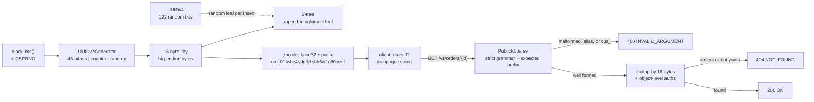

# Resource Identifiers: Sequential Integers vs UUIDv4 vs Time-Ordered UUIDv7 (RFC 9562) and Type-Prefixed IDs

> [!summary] Claim
> Store a 16-byte time-ordered UUIDv7 as the key, because random UUIDv4 keys scatter every insert across the B-tree, and expose it as a strictly parsed, type-prefixed string such as `ord_01fwhe4ydgfk1shh6w1g60eecf`.
> Neither format is an access control: a v7 ID leaks its creation time, and only an object-level authorization check stops enumeration.

Part of [REST and Resource Modeling](README.md) in [API Engineering](../README.md).

## TL;DR

- Mechanism: UUIDv7 puts a 48-bit Unix millisecond timestamp in the most significant bits (RFC 9562 Section 5.7), so byte order is creation order and new keys land on the rightmost B-tree leaf; in the lab, 500 UUIDv4 inserts into a 20,000-row clustered SQLite table dirtied `459` pages against `25` for UUIDv7.
- Contract rule: the public ID is an opaque string with one canonical spelling; parse it strictly (exact length, one alphabet, one case, expected type prefix) and return `400` before any lookup, then `404` for a well-formed unknown ID.
- The trap: a sortable or random ID is not a secret; RFC 9562 Section 8 says UUIDs "MUST NOT be used as security capabilities", a v7 ID hands every holder its creation millisecond, and lenient base32 decoding turns one ID into many cache and audit keys.
- Portability fact: `uuid.uuid7()` exists only from CPython 3.14; on 3.12 and 3.13 `UUID.time` misreads a v7 value as a v1 timestamp (`919712545760027362` for the RFC test vector instead of `1645557742000`), and the lab's own generator passes the same 53 tests on 3.12.13 through 3.15.0b3 free-threaded and in Debian Trixie and Alpine containers.
- When not to use it: keep a `bigint` key for single-node internal tables that never leave the service, use UUIDv4 (or a real secret token) when creation time must not leak, and never use any UUID as a bearer token.

## Mental model



The generator reads a millisecond clock and a CSPRNG and packs them into the RFC 9562 version 7 layout, so the 16 bytes it emits compare in creation order.
Those bytes are the storage key, and because each new key is larger than every earlier one, the B-tree only touches its rightmost leaf, while the dotted UUIDv4 path picks a random leaf for every insert.
At the API boundary the same 128 bits are rendered once, as a type prefix plus 26 base32 symbols, and the client never parses them.
On the way back in, the parser rejects anything that is not the single canonical spelling of an `ord` ID with `400` before touching storage, and only then does the lookup, which must also check that the caller may see the object, decide between `404` and `200`.

## How it works

### Layouts on the wire (RFC 9562)

A UUID is 16 octets, written most significant byte first (RFC 9562 Section 4), with the variant in the top bits of octet 8 (`10` for this RFC, Section 4.1) and the version in the top 4 bits of octet 6 (Section 4.2).

```text
UUIDv4 (Section 5.4)                      UUIDv7 (Section 5.7)
 0-5   random_a (48)                       0-5   unix_ts_ms (48, big-endian)
 6     ver=0100 | random_b (12) ...        6     ver=0111 | rand_a (12) ...
 8     var=10   | random_c (62) ...        8     var=10   | rand_b (62) ...
 122 random bits                           48 time bits + 74 bits of counter and/or random
```

UUIDv4 fills 122 bits from a random source and overwrites the version and variant (Section 5.4); `uuid4_from_bytes` does exactly that, and the lab checks that all-zero input becomes `00000000-0000-4000-8000-000000000000`, the first row of the RFC's Figure 5.
UUIDv7 places the Unix Epoch millisecond count in the top 48 bits, which is why RFC 9562 Section 6.11 says v6 and v7 "sort as opaque raw bytes without the need for parsing or introspection" and are "lexicographically sortable while in the textual representation".
The lab rebuilds the Appendix A.6 test vector `017F22E2-79B0-7CC3-98C4-DC0C0C07398F` from `unix_ts_ms=0x017F22E279B0` (`1645557742000`), `rand_a=0xCC3`, and the 62-bit `rand_b`.

### Monotonicity inside one millisecond (RFC 9562 Section 6.2)

The timestamp alone orders IDs across milliseconds, but a burst inside one millisecond needs extra structure.
Section 6.2 offers three methods: a fixed bit-length dedicated counter right after the timestamp (Method 1), a randomly seeded counter incremented in `rand_b` (Method 2), and sub-millisecond clock bits in `rand_a` (Method 3).
It says the counter "SHOULD be at least 12 bits but no longer than 42 bits", describes reseeding it randomly on every new tick and (as a MAY) leaving its top bit zero as a rollover guard, and, on rollover, recommends freezing until the clock advances while allowing ("MAY") incrementing the timestamp ahead of real time.
For clock regressions, "Monotonic Error Checking" says the application "MAY reuse the previous timestamp and increment the previous counter".

`UUIDv7Generator` implements Method 1 with those rules: the counter occupies the leftmost `counter_bits` of the 74 random bits, a new millisecond reseeds it with `counter_bits - 1` random bits, the same or an earlier clock reading keeps the last timestamp and increments, and an overflow advances the timestamp by exactly one millisecond.
A `threading.Lock` makes the read-modify-write of `_last_ms` and `_counter` atomic, and `test_lock_serializes_the_read_modify_write_across_threads` fails when the lock is removed.

CPython 3.14 ships the same method (cpython v3.14.6 Lib/uuid.py, uuid7): a 42-bit counter split as 12 bits in `rand_a` and 30 bits in `rand_b`, its MSB cleared on reseed, followed by 32 random bits from `os.urandom` per ID.
Two details differ from the lab.
On a clock regression it sets `timestamp_ms = _last_timestamp_v7 + 1` rather than reusing the last value, and issue gh-138862 (open as of 2026-11) reports that after a counter overflow every later call inside the same wall-clock millisecond advances the timestamp again, so IDs drift ahead of real time.
The module-level state `_last_timestamp_v7` and `_last_counter_v7` is updated without a lock; see Portability for what that did on a free-threaded build.
`UUID.time` returns `self.int >> 80` for version 7 in 3.14 and later (cpython v3.14.6 Lib/uuid.py, UUID.time), while 3.13 always applies the version 1 layout (cpython v3.13.18 Lib/uuid.py, UUID.time).

PostgreSQL 18 generates v7 in the server with `uuidv7()`, documented as "UNIX timestamp with millisecond precision + sub-millisecond timestamp + random" (Method 3), and reads the time back with `uuid_extract_timestamp` (PostgreSQL 18 documentation, Section 9.14).

### Why random keys cost more in a B-tree

A B-tree keeps keys sorted, so a new key goes to the one leaf whose range covers it.
Time-ordered keys always map to the rightmost leaf, which stays hot in cache and is written once per commit no matter how many rows land on it.
Random keys map to a uniformly random leaf, so a batch of `B` inserts into a tree with `L` leaves dirties about `min(B, L)` distinct pages, and that count grows with the table.
RFC 9562 Section 2.1 states the problem ("UUID versions that are not time ordered, such as UUIDv4 (described in Section 5.4), have poor database-index locality") and Section 6.11 says the difference "can be one order of magnitude or more".

Page fill is engine-specific.
PostgreSQL's nbtree splits a non-rightmost page to equalize free space between the halves, which for increasing keys would give "the 50% full result", but splits the rightmost leaf to leave the left page `fillfactor`% full so "successively increasing keys" produce pages about 90% full (postgres REL_18_0 src/backend/access/nbtree/nbtsplitloc.c, _bt_findsplitloc; `BTREE_DEFAULT_FILLFACTOR 90` and `BTREE_NONLEAF_FILLFACTOR 70` in src/include/access/nbtree.h).
SQLite only takes its append shortcut, `balance_quick`, for `intKeyLeaf` pages, that is rowid-table leaves; index and `WITHOUT ROWID` B-trees go through `balance_nonroot`, which redistributes cells across up to three siblings (sqlite version-3.53.1 src/btree.c, balance and balance_quick).
That is why the lab measured nearly equal leaf counts for v4 and v7 keys in SQLite (`675` against `683`), while the pages-written gap stayed at 18x.

### Type-prefixed public IDs (TypeID 0.3.0, Crockford base32)

The 128 bits leave the service as text, and the text format is a contract.
Crockford's base32 alphabet `0123456789abcdefghjkmnpqrstvwxyz` drops `i`, `l`, `o`, and `u`, and its symbols are in ascending ASCII order, so string order equals numeric order.
26 symbols carry 130 bits, so the top two are zero and the first symbol is at most `7`; the TypeID specification says implementations "MUST reject any suffix where the first character is greater than `7`", and the ULID specification says larger values "should be rejected by all implementations".
Crockford's own decoding rules are deliberately forgiving: upper and lower case are accepted, `i` and `l` read as `1`, `o` reads as `0`, and hyphens are ignored (crockford.com/base32.html).
The TypeID specification 0.3.0 removes that slack: the suffix is "always in lowercase, no hyphens allowed, and we never decode multiple ambiguous characters to the same value".
Its prefix matches `^([a-z]([a-z_]{0,61}[a-z])?)?$` and may contain underscores; because a prefix cannot end with `_` and the suffix alphabet has none, the separator is necessarily the last `_` (an inference from the grammar, not a sentence in the specification), which is why `PublicId.parse` uses `rpartition`.
All base32 symbols and `_` are RFC 3986 `unreserved` characters (RFC 3986 Section 2.3), so the ID never needs percent-encoding in a path, and Starlette's default `{order_id}` convertor matches it with `[^/]+` (starlette 1.10.0 starlette/convertors.py, StringConvertor).

A ULID is the same idea without a prefix: 48 bits of Unix milliseconds and 80 random bits, rendered as 26 upper-case Crockford symbols.
Because UUIDv7 also starts with 48 bits of Unix milliseconds, the ULID rendering of a v7 value decodes to the same timestamp; v7 spends 6 of the 80 bits on version and variant.

Stripe's prefixes (`pi_`, `cus_`, `acct_`) serve humans and routing: a Stripe engineer describes spotting a `cus_` ID passed where an `acct_` ID belonged "without even looking at the code", and inferring the table for polymorphic parameters such as `payment_method` from the prefix (Stripe, "Designing APIs for humans: Object IDs", 2022-08-30).
The lab encodes the first use as a distinct `WrongTypeError` that the API maps to `400`.

## Numbers and limits

| Quantity | Value | Source |
|---|---|---|
| UUID size | 128 bits, 16 octets | RFC 9562 Section 4 |
| UUIDv4 random bits | 122 | RFC 9562 Section 5.4 |
| UUIDv7 time and random bits | 48-bit Unix ms, 74 bits counter and/or random | RFC 9562 Section 5.7 |
| UUIDv7 and ULID time range | until the year 10889 AD | RFC 9562 Section 6.1; ULID spec |
| Recommended counter length | 12 to 42 bits | RFC 9562 Section 6.2 |
| CPython 3.14 `uuid7` | 42-bit counter (MSB cleared on reseed) + 32 random bits per ID | cpython v3.14.6 Lib/uuid.py, uuid7 |
| Text form cost | 36 characters, 288 bits, against 128 bits binary | RFC 9562 Section 6.13 |
| ULID | 26 characters, 80 random bits (1.21e+24 per ms) | ULID spec |
| TypeID | prefix <= 63 characters, total <= 90 characters | TypeID spec 0.3.0 |
| PostgreSQL nbtree leaf fill | 90% on rightmost splits, about 50% on other splits | postgres REL_18_0 nbtsplitloc.c and nbtree.h |
| Collision probability, 1e9 UUIDv4 total | about `9.4e-20` | computed, `1 - exp(-n^2 / 2^123)` |
| Collision probability, 1e6 IDs in one ms, 74 random bits | about `2.6e-11` | computed, `1 - exp(-n^2 / 2^75)`; a seeded counter lowers this for one generator |
| Pages written by 500 inserts, clustered, 20,000 rows | UUIDv4 `459`, UUIDv7 `25` | lab, `test_random_keys_dirty_far_more_pages_per_batch[clustered]` |
| Pages written by 500 inserts, heap plus index, 20,000 rows | UUIDv4 `147`, UUIDv7 `26` | lab, `[heap_plus_index]` |
| Growth from 2,000 to 20,000 rows, clustered | UUIDv4 `87` -> `471`, UUIDv7 `21` -> `25` | lab, `test_random_key_cost_grows_...` |
| Key leaf pages after the batch, clustered, 20,000 rows | UUIDv4 `675`, UUIDv7 `683` | lab |

The lab numbers are WAL frames after `PRAGMA wal_checkpoint(TRUNCATE)`, so each frame is one 4,096-byte page written by the batch commit, with a 100-byte payload per row.
They come from `uv run --frozen pytest tests/f04_rest_and_resource_modeling/test_resource_identifiers_uuidv4_vs_uuidv7_ulid_and_public_ids.py -q -s -k "dirty or grows"` and were identical on SQLite `3.53.1` (CPython 3.12.13, 3.14.6, 3.15.0b3t) and SQLite `3.54.1` (CPython 3.13.18, 3.14.10, 3.15.2), on macOS 27.2 arm64 (`uname -r` = `27.2.0`) (as of 2026-11).
The same counts came out in Docker on the same host with CPython 3.14.10: `python:3.14-trixie` (Debian 13, glibc 2.41, SQLite `3.46.1`) and `python:3.14-alpine` (Alpine 3.24, musl, SQLite `3.53.4`).
They count pages, not time; this lab does not claim a latency or throughput figure.

## Portability

| Dimension | Version or target | Behavior and evidence |
|---|---|---|
| CPython `3.12` | `3.12.13` | Proven by lab: `uv run --isolated --frozen --python 3.12 pytest ...` -> `53 passed in 0.72s`; no `uuid.uuid7` (asserted); `3.12.16` was not available here |
| CPython `3.13` | `3.13.18` | Proven by lab: `--python 3.13.18` -> `53 passed in 0.78s`; no `uuid.uuid7`, and `UUID.time` of the RFC v7 vector is `919712545760027362` (also on 3.12.13) |
| CPython `3.14` | `3.14.6` (workspace) and `3.14.10` | Proven by lab: `uv run --frozen pytest ...` -> `53 passed in 0.71s`; `--python 3.14.10` -> `53 passed in 0.78s`; `uuid.uuid7()` sorted and unique over 10,000 calls, `UUID.time` -> `1645557742000` |
| CPython `3.15` | `3.15.2` | Proven by lab: `--python 3.15.2` -> `53 passed in 0.77s`; its `uuid7` body is identical to 3.14.6 (diff of the tag sources) |
| CPython `3.15t` free-threaded | `3.15.0b3`, `sys._is_gil_enabled()` -> `False` | Proven by lab with direct dependencies pinned to `uv.lock` versions, because the locked environment has no free-threaded `psycopg-binary==3.3.8` wheel: `PYTHONPATH=src uv run --no-project --isolated --python 3.15t --with starlette==1.10.0 ...` -> `53 passed in 0.65s`; the same way on `3.14.6t` -> `53 passed in 0.71s`; `3.15.2t` was not available here |
| Stdlib `uuid7` under free threading | `3.15.0b3t`, `3.14.6t` | Probe, not a gated test: 8 threads x 50,000 calls gave 400,000 unique IDs, but all 8 threads' own sequences were non-monotonic in 3 of 3 runs on each build; the same probe on `3.15.2` with the GIL and on the lab's locked generator under both free-threaded builds gave monotonic per-thread output in 3 of 3 runs |
| CPython C reimplementation | `main` | PR 139123 reimplements `UUID`, `uuid4()`, and `uuid7()` in C, merged to `main` on 2026-10-21 with a `Doc/whatsnew/3.16.rst` entry; 3.15.2 still runs the pure-Python `uuid7` |
| Containers | Debian Trixie (glibc 2.41), Alpine 3.24 (musl) | Proven by lab in `python:3.14-trixie` and `python:3.14-alpine` (CPython 3.14.10, direct dependencies pinned to `uv.lock` versions via `pip`): `53 passed` on both, same page counts |
| PostgreSQL | `18` | `uuidv7()` and `uuid_extract_timestamp` are built in (PostgreSQL 18 documentation, Section 9.14); not exercised by this lab |
| SQLite | `3.53.1`, `3.54.1` | Same WAL frame and leaf counts on both (rows above); `dbstat` was available in every interpreter used |
| Starlette routing | `1.10.0` | `StringConvertor.regex = "[^/]+"` accepts the ID unchanged; the GitHub tag file is byte-identical to the installed copy |
| Servers and HTTP versions | Uvicorn `0.54.0`, Hypercorn `0.18.0`, Granian `2.8.7` (the `uv.lock` pins), `aioquic 1.7.2`, `h2 4.4.1`, `httpx 0.28.1`; CPython 3.14.6 | Proven by a socket probe (scratch script, not a gated test, removed afterwards): the lab app was started under each server, one order was created with `POST /v1/orders`, then four `GET` requests were sent per protocol, and every cell returned the same statuses: canonical ID `200`, `cus_` plus the same suffix `400`, upper-case suffix `400`, well-formed unknown ID `404`. Uvicorn HTTP/1.1; Hypercorn HTTP/1.1 and HTTP/2 over TLS (ALPN `h2`), HTTP/2 over cleartext with prior knowledge, and HTTP/3 over QUIC (`--quic-bind`, self-signed certificate, an `aioquic` client); Granian `--http 1` and `--http 2` (cleartext prior knowledge). Not run: Uvicorn has no HTTP/2 or HTTP/3, and Granian HTTP/3 was not tried. The result matches the RFC 3986 Section 2.3 argument that the ID is one path segment of `unreserved` characters with nothing to normalize |

## Worked example

The [implementation](../labs/src/api_labs/f04_rest_and_resource_modeling/resource_identifiers.py) builds UUIDv4 and UUIDv7 layouts, a Method 1 generator with an injectable clock and entropy, the strict and lenient base32 decoders, `PublicId`, a Starlette order API, and the SQLite page-write measurement.
The [test](../labs/tests/f04_rest_and_resource_modeling/test_resource_identifiers_uuidv4_vs_uuidv7_ulid_and_public_ids.py) pins each claim in this note.

The generator (simplified excerpt; verbatim lines from the module):

```python
    def __call__(self) -> uuid.UUID:
        with self._lock:
            now = self.clock_ms()
            if now > self._last_ms:
                self._last_ms = now
                self._counter = self._random_bits(self.counter_bits - 1)
            else:
                self._counter += 1
                if self._counter >> self.counter_bits:
                    self._last_ms += 1
                    self._counter = self._random_bits(self.counter_bits - 1)
            tail_bits = RAND_BITS - self.counter_bits
            rand = (self._counter << tail_bits) | self._random_bits(tail_bits)
            return uuid7_from_parts(self._last_ms, rand >> 62, rand & RAND_B_MAX)
```

The strict decoder and the parser (simplified excerpt; verbatim lines from the module):

```python
def decode_base32(text: str) -> int:
    """Strict decode: exactly 26 lowercase alphabet symbols and a first symbol of at most `7`."""
    if len(text) != SUFFIX_LENGTH or any(symbol not in _VALUE for symbol in text):
        raise InvalidIdError(f"suffix must be {SUFFIX_LENGTH} symbols from {ALPHABET!r}")
    if text[0] > "7":
        raise InvalidIdError("suffix encodes more than 128 bits")
    value = 0
    for symbol in text:
        value = (value << 5) | _VALUE[symbol]
    return value
```

```python
    @classmethod
    def parse(cls, text: str, expected_prefix: str | None = None) -> PublicId:
        # The prefix may contain `_`, so the separator is the last one.
        prefix, separator, suffix = text.rpartition("_")
        if separator and not prefix:
            raise InvalidIdError("a separator needs a non-empty prefix")
        parsed = cls(prefix, uuid.UUID(int=decode_base32(suffix)))
        if expected_prefix is not None and parsed.prefix != expected_prefix:
            raise WrongTypeError(f"expected a {expected_prefix!r} ID, got {parsed.prefix!r}")
        return parsed
```

The rollover test proves the generator advances the timestamp once and then holds it, which is the behavior gh-138862 reports CPython 3.14 lacks (simplified excerpt; verbatim lines from the test module):

```python
@pytest.mark.unit
def test_counter_rollover_advances_the_timestamp_instead_of_wrapping() -> None:
    generate = UUIDv7Generator(
        clock_ms=lambda: 1000, entropy=lambda n: b"\xff" * n, counter_bits=12
    )
    ids = [generate() for _ in range(2050)]
    # Seed 0x7ff (top bit guarded), 2048 more values fit in 12 bits, the 2050th overflows.
    assert [uuid7_unix_ts_ms(value) for value in ids[-2:]] == [1000, 1001]
    # The clock still reads 1000: later IDs stay on 1001 instead of drifting further ahead.
    ids += [generate() for _ in range(10)]
    assert {uuid7_unix_ts_ms(value) for value in ids[-10:]} == {1001}
    assert ids == sorted(ids)
    assert len(set(ids)) == 2060
```

Captured from `labs/` on CPython `3.14.6`, SQLite `3.53.1`, macOS `27.2` (`macOS-27.2-arm64-arm-64bit-Mach-O`):

```text
$ uv run --frozen pytest tests/f04_rest_and_resource_modeling/test_resource_identifiers_uuidv4_vs_uuidv7_ulid_and_public_ids.py -q
.....................................................                    [100%]
53 passed in 0.71s
```

The page counts printed by the two SQLite tests with `-s`, from the same run environment:

```text
clustered: v4 BatchCost(wal_frames=459, key_leaf_pages=675) v7 BatchCost(wal_frames=25, key_leaf_pages=683)
heap_plus_index: v4 BatchCost(wal_frames=147, key_leaf_pages=131) v7 BatchCost(wal_frames=26, key_leaf_pages=137)
wal frames for 500 inserts at 2k and 20k rows: {'v4': [87, 471], 'v7': [21, 25]}
```

The API test mints `ord_...` IDs with `Location`, then shows the three rejection paths: `cus_<same suffix>` returns `400` with `expected a 'ord' ID`, the upper-case spelling of the real order's suffix returns `400` instead of serving an alias, and a well-formed unknown `ord_` ID returns `404`.

## Pitfalls

> [!warning] Treating an unguessable ID as authorization
> Trigger: an endpoint looks an object up by the ID in the path and returns it without checking that the caller owns it.
> Symptom: anyone who learns or guesses an ID reads or changes the object; CVE-2026-28230 records SteVe looking up transactions "solely by transactionId (a sequential integer starting from 1)" so any charger could stop any other charger's session (NVD, published 2026-02-26).
> Fix: an object-level check on every access (OWASP API1:2023); random IDs only raise the cost of guessing, and RFC 9562 Section 8 says UUIDs "MUST NOT be used as security capabilities".

> [!warning] Weak or non-cryptographic randomness in UUIDv4
> Trigger: a UUID library or a hand-rolled generator draws from a predictable source, such as Python's `random` module.
> Symptom: IDs become predictable; CVE-2021-3538 records that `github.com/satori/go.uuid` generated "predictable" UUIDs "due to insecure randomness in the g.rand.Read function" (CWE-338).
> Fix: a CSPRNG, as RFC 9562 Section 6.9 recommends ("SHOULD utilize a cryptographically secure pseudorandom number generator"); CPython's `uuid4` reads `os.urandom(16)`; the lab uses seeded `random.Random` only for deterministic tests.

> [!warning] Time-based UUIDs used as secret tokens
> Trigger: password reset links, invitation tokens, or session IDs minted with UUIDv1 or v7.
> Symptom: the token's time and structure narrow the search space; CVE-2024-45719 records that Apache Answer through 1.4.0 used UUID v1 IDs that "can cause the generated token to be predictable" (fixed in 1.4.1).
> Fix: mint secrets with `secrets.token_urlsafe`; RFC 9562 Section 8 says UUIDv4 "SHOULD be utilized" for "any security operation" but in the same section forbids UUIDs as security capabilities, so never use any UUID as the bearer secret itself, and keep identifiers and credentials as separate fields.

> [!warning] Little-endian GUID storage silently undoes UUIDv7
> Trigger: a driver or ORM stores the value with Microsoft GUID byte order (`uuid.UUID.bytes_le` in Python), which RFC 9562 Section 4 calls out as a known little-endian caveat.
> Symptom: the first three fields are byte-swapped, the stored bytes no longer sort by time, and inserts go back to random-leaf behavior; the lab shows `sorted(ids, key=bytes_le)` differs from creation order.
> Fix: store `UUID.bytes` (network order) in a `BLOB`, `bytea`, or PostgreSQL `uuid` column, and verify the index order with a test like `test_bytes_le_storage_destroys_time_order`; SQL Server's `uniqueidentifier` has its own order (last six bytes most significant, Microsoft Learn, `SqlGuid.CompareTo`), so a v7 key there needs a different column type or a measured check.

> [!warning] Lenient decoding makes one resource answer to many IDs
> Trigger: the API decodes base32 IDs with Crockford's rules (any case, `i` and `l` as `1`, `o` as `0`, hyphens ignored) but caches, rate-limits, or audits by the raw string.
> Symptom: `01H455VB...`, `o1h455vb...`, and `01h455vb-4pex...` all reach the same row while counting as different keys; cache hit rates drop and per-ID controls are bypassed.
> Fix: accept only the canonical spelling (TypeID's strict alphabet), return `400` for anything else, and key every downstream system by the decoded 16 bytes or the re-encoded canonical string.

> [!warning] Clock rollback and counter overflow in v7 generators
> Trigger: NTP steps the clock back, or a burst exhausts the counter inside one millisecond.
> Symptom: without monotonic error checking IDs go backwards; with CPython 3.14's overflow handling, gh-138862 (open as of 2026-11) reports that every later call in the same wall-clock millisecond pushes the timestamp one millisecond further ahead.
> Fix: reuse the last timestamp and increment the counter (RFC 9562 Section 6.2), advance the timestamp once on overflow, and test both paths with an injected clock, as the lab does.

## Security and robustness

Threat model: the attacker holds some legitimate IDs, can send arbitrary path segments, and wants other tenants' objects, business metrics, or a denial of service.
Enumeration is the first risk: sequential integers make neighbours trivially guessable, which is the core of Stripe's argument against integer IDs, they also reveal volume, and OWASP API1:2023 lists sequential integers, UUIDs, and strings alike as BOLA vectors, so the only real control is an object-level authorization check bound to the caller ([[Defeating-BOLA-API1-2023-Tenant-Scoped-Queries-and-PostgreSQL-RLS]]).
Information disclosure is the second: a v7 or ULID public ID discloses its creation millisecond to anyone (`uuid7_unix_ts_ms` needs no key), so the gap between two IDs leaks creation rate, and the age of a user's account or order is public; RFC 9562 Section 8 calls this "a very small attack surface", but it is a real product decision.
If creation time is sensitive, expose a UUIDv4 or an encrypted form as the public ID and keep v7 as the internal key, at the cost of a second unique index.
Input validation comes before storage: cap the length (TypeID's maximum is 90 characters), match one grammar, and reject wrong prefixes with `400`, which keeps malformed input away from the database and gives the caller an actionable error without revealing whether an object exists.
Unknown and unauthorized objects should both return `404`, so the status code does not become an existence oracle across tenants.
Defense in depth: treat IDs in logs and URLs as non-secret, never place credentials in an ID, rate-limit `404` bursts per caller to slow scraping, and keep the decoded 16 bytes as the only key for caches and audits so aliases cannot fork state.

## The principal's view

The ID format is a one-way door: once clients store, log, and compare your IDs, changing their shape is a breaking change, so decide it once per platform rather than per team.
The default worth defending is an internal 16-byte time-ordered key, generated in the service or by the database (`uuidv7()` in PostgreSQL 18), and one external representation, a registered type prefix plus a canonical base32 suffix, with a published maximum length and the rule that clients treat it as opaque.
The organizational cost is a prefix registry and one shared parser library, because a second team's lenient parser reintroduces aliases.
Keep `bigint` keys when a table never leaves one database and join width matters: they are half the size of a UUID and the sequence already appends; add a separate public ID column if the rows are ever exposed.
Choose UUIDv4 for the public ID when creation time is confidential, and accept the index cost or keep a v7 internal key beside it.
Client-generated IDs (for idempotent create or offline clients) favor UUIDs of either version because no coordinator is needed, which RFC 9562 Section 2.1 gives as the reason UUIDs are "a good alternative" to auto-increment in distributed systems ("without requiring coordination"); pair them with server-side uniqueness checks ([[Full-Replacement-PUT-and-Upsert-Semantics]]).
If the platform already has a resource-name scheme such as AIP-122 names, the ID is one segment of that name and must still follow these rules, as [[Resource-Oriented-Design-Collections-Resources-and-Subresources]] describes.

## Interview questions

> [!question] L5: What exactly differs between a UUIDv4 and a UUIDv7 at the bit level?
>
> > [!success]- Answer
> > Both are 128 bits with the variant `10` in the top bits of octet 8 and a 4-bit version in the top of octet 6.
> > UUIDv4 fills the other 122 bits with random data (RFC 9562 Section 5.4).
> > UUIDv7 puts a 48-bit big-endian Unix millisecond timestamp in octets 0-5 and fills the remaining 74 bits with random data or a counter (Section 5.7).
> > The timestamp in the most significant bits is what makes v7 values sort by creation time as raw bytes.
> >
> > Follow-up: Which bits would you inspect to reject a v4 value submitted where a v7 is required?

> [!question] L5: Why do random UUID primary keys slow down inserts in a B-tree, and what does the lab measure?
>
> > [!success]- Answer
> > Each random key belongs to a random leaf, so a batch of inserts dirties roughly one page per row once the table has more leaves than the batch has rows.
> > Time-ordered keys all land on the rightmost leaf, which is written once per commit.
> > The lab counts WAL frames for 500 inserts into 20,000 rows: `459` pages for UUIDv4 against `25` for UUIDv7 in a clustered table.
> > The v4 cost grew from `87` to `471` as the table grew tenfold, while v7 stayed at `21` to `25`.
> >
> > Follow-up: Why did SQLite's leaf page count barely differ between the two, when PostgreSQL's would?

> [!question] L5: Why does a TypeID suffix have 26 characters, and why must its first character be at most `7`?
>
> > [!success]- Answer
> > Each base32 symbol carries 5 bits, so 26 symbols carry 130 bits, two more than a UUID.
> > The encoder prepends two zero bits, so the first symbol only ever carries 3 data bits, values 0 to 7.
> > A first symbol above `7` would encode a value over 128 bits; the TypeID specification says implementations MUST reject it, and the ULID specification says it should be rejected.
> >
> > Follow-up: What does your parser do with `8zzzzzzzzzzzzzzzzzzzzzzzzz` if it skips that check and calls `uuid.UUID(int=...)`?

> [!question] L6: Predict the output: on CPython 3.13.18 and on 3.14.10, what does `uuid.UUID("017F22E2-79B0-7CC3-98C4-DC0C0C07398F").time` print?
>
> > [!success]- Answer
> > On 3.14.10 it prints `1645557742000`, because 3.14 returns `self.int >> 80` for version 7.
> > On 3.13.18 it prints `919712545760027362`, because 3.13 always reassembles a version 1 timestamp from `time_hi`, `time_mid`, and `time_low`.
> > Both values were captured in this lab's environment.
> > Code that must run on both versions should read `value.int >> 80` after checking `value.version == 7`, as `uuid7_unix_ts_ms` does.
> >
> > Follow-up: Which other attribute of `UUID` would you distrust for v7 values on 3.12?

> [!question] L6: Debug this API: after moving primary keys from UUIDv4 to UUIDv7, a .NET-backed service still shows random-insert page churn on its clustered index; what do you check?
>
> > [!success]- Answer
> > Check the byte order the driver writes: Microsoft GUID serialization is little-endian for the first three fields, which RFC 9562 Section 4 names as a known caveat.
> > Byte-swapping the timestamp fields means the stored bytes no longer sort by time, so inserts scatter again; the lab proves `sorted(ids, key=bytes_le)` is not creation order.
> > The engine's own comparison order matters too.
> > SQL Server orders `uniqueidentifier` with the last six bytes most significant: Microsoft documents that `SqlGuid.CompareTo` "implements `CompareTo` using SQL Server behavior, in the last six bytes of a value are most significant", and its sorted example places `2aaaaaaa-bbbb-cccc-dddd-1eeeeeeeeeee` before `1aaaaaaa-bbbb-cccc-dddd-3eeeeeeeeeee` (Microsoft Learn, "Comparing GUID and uniqueidentifier Values" and `SqlGuid.CompareTo`, fetched 2026-11-10).
> > A UUIDv7 keeps its timestamp in the first six bytes, which that order compares last, so a `uniqueidentifier` key does not append even when the bytes arrive in network order.
> > PostgreSQL's `uuid` type compares the 16 bytes with `memcmp` (postgres REL_18_0 src/backend/utils/adt/uuid.c, `uuid_internal_cmp`), so there byte order is creation order.
> > The fix is to store the network-order 16 bytes in a column whose documented comparison is byte order, as PostgreSQL's `uuid` is, and to add a test that the stored order matches creation order.
> >
> > Follow-up: How would you migrate existing rows without breaking public IDs already handed to clients?

> [!question] L6: Why is it a bug and not a convenience that an API accepts `ord_01h455vb4pex5vsknk084sn02q`, `ord_01H455VB4PEX5VSKNK084SN02Q`, and `ord_o1h455vb4pex5vsknk084sn02q` as the same order?
>
> > [!success]- Answer
> > Three strings now name one resource, so any system keyed by the raw string, such as a cache, a rate limiter, an audit log, or an allow list, sees three different objects.
> > Crockford's decoding rules allow exactly this aliasing; the TypeID specification forbids it by requiring a lowercase-only alphabet with no ambiguous symbols.
> > The fix is one canonical spelling, `400` for every other spelling, and keying downstream systems on the decoded bytes.
> >
> > Follow-up: Would you return `301` to the canonical URL instead of `400`, and what does that cost?

> [!question] L7+: You are setting the identifier standard for 200 services; what do you mandate, and what do you leave to teams?
>
> > [!success]- Answer
> > Mandate the external contract: a registered type prefix, a canonical base32 suffix of a 128-bit value, a published maximum length, strict parsing with `400` on malformed or wrong-type IDs, and the rule that clients treat IDs as opaque strings.
> > Mandate one shared parser and generator library per language, because divergent parsers are how aliases and overflow bugs return.
> > Mandate object-level authorization on every lookup; the ID format is not a security control.
> > Leave the internal key to teams within guidance: UUIDv7 by default, `bigint` for internal-only tables, UUIDv4 as the public ID where creation time is confidential.
> > Own the prefix registry centrally so `cus_` cannot mean two things.
> >
> > Follow-up: How do you roll the standard out to services that already expose integer IDs?

> [!question] L7+: Your public IDs are UUIDv7 and a product manager asks how competitors can estimate your order volume; explain it and propose options with their costs.
>
> > [!success]- Answer
> > Every UUIDv7 carries its creation millisecond in the top 48 bits, so anyone holding order IDs, for example from receipts or shared links, learns exactly when each order was created.
> > A large enough sample of those timestamps is a time series of order activity, which is an estimate of volume.
> > The Method 1 counter is reseeded randomly every millisecond, so it does not leak a count by itself.
> > With sequential integers the leak is worse, because the difference between two IDs is the exact number of orders created between them.
> > Option one: expose a UUIDv4 public ID and keep v7 as the internal key, at the cost of a second unique index with random inserts.
> > Option two: encrypt the internal 128-bit key with a keyed block cipher for display, which hides time and keeps one index, at the cost of key management and rotation.
> > Option three: accept the leak where creation time is already visible in the product.
> >
> > Follow-up: What breaks if you ever have to rotate the key in option two?

> [!question] L6: Why does `PublicId.parse` split on the last underscore, and what fails if it splits on the first?
>
> > [!success]- Answer
> > TypeID prefixes may contain underscores, such as `pre_fix`, while the suffix never does.
> > Splitting on the first `_` would read `pre` as the prefix and `fix_000...` as the suffix, which fails the 26-symbol check and rejects valid IDs.
> > `str.partition` also returns the whole string as the head when there is no `_`, so every prefix-less ID would be read as a prefix with an empty suffix.
> > The lab's mutation run confirms both: switching to `partition` fails 7 of the 9 TypeID valid vectors.
> >
> > Follow-up: Which TypeID invalid vector checks that an empty prefix has no separator?

## Related

Prerequisites: [[Resource-Oriented-Design-Collections-Resources-and-Subresources]]

Next: [[HTTP-Method-Semantics-Safety-and-Idempotency-Invariants]]

See also: [[02-Programming-Languages/Python/Python-Backend-Interview-Prep/05-REST-API-Design]], [[02-Programming-Languages/Python/Python-Backend-Interview-Prep/06-SQL-and-SQLAlchemy]], [[Defeating-BOLA-API1-2023-Tenant-Scoped-Queries-and-PostgreSQL-RLS]], [[Keyset-Seek-Pagination-and-Composite-Tie-Breaker-Cursors]], [[Full-Replacement-PUT-and-Upsert-Semantics]], [[Idempotency-Key-Header-Specification-and-State-Machine-Draft-08]], [[URI-Syntax-Resolution-and-Templates-RFC-6570]], [[Indexing-and-Access-Paths]], [[Write-Ahead-Log]]

- Lab: `labs/tests/f04_rest_and_resource_modeling/test_resource_identifiers_uuidv4_vs_uuidv7_ulid_and_public_ids.py`

## Further reading

- [RFC 9562: Universally Unique IDentifiers (UUIDs)](https://www.rfc-editor.org/rfc/rfc9562.html) - The v4 and v7 layouts (Sections 5.4, 5.7), monotonic counters (6.2), unguessability (6.9), sorting (6.11), DBMS guidance (6.13), and security (8).
- [RFC 3986: URI Generic Syntax](https://www.rfc-editor.org/rfc/rfc3986.html) - Section 2.3 `unreserved` characters, why base32 and `_` never need percent-encoding.
- [CPython Lib/uuid.py at v3.14.6](https://github.com/python/cpython/blob/v3.14.6/Lib/uuid.py) - The stdlib `uuid7` Method 1 counter and the version-aware `UUID.time`.
- [CPython issue gh-138862](https://github.com/python/cpython/issues/138862) - Timestamp drift after a `uuid7` counter overflow, open as of 2026-11.
- [CPython PR 139123](https://github.com/python/cpython/pull/139123) - The C reimplementation of `UUID`, `uuid4()`, and `uuid7()` on `main`.
- [ULID specification](https://github.com/ulid/spec) - 48-bit time plus 80 random bits, Crockford base32, monotonic increments, and the overflow rule.
- [TypeID specification 0.3.0](https://github.com/jetify-com/typeid/tree/main/spec) - Type prefix grammar, strict base32 suffix, and the valid and invalid vectors the lab embeds.
- [Crockford's Base 32](https://www.crockford.com/base32.html) - The alphabet and the lenient decoding rules that strict formats must reject.
- [PostgreSQL 18 UUID functions](https://www.postgresql.org/docs/18/functions-uuid.html) - Server-side `uuidv7()` and `uuid_extract_timestamp`.
- [PostgreSQL nbtsplitloc.c at REL_18_0](https://github.com/postgres/postgres/blob/REL_18_0/src/backend/access/nbtree/nbtsplitloc.c) - Rightmost-page fillfactor splits versus equal-space splits.
- [SQLite btree.c at 3.53.1](https://github.com/sqlite/sqlite/blob/version-3.53.1/src/btree.c) - `balance_quick` for rowid leaves and three-sibling `balance_nonroot` for index trees.
- [OWASP API1:2023 Broken Object Level Authorization](https://owasp.org/API-Security/editions/2023/en/0xa1-broken-object-level-authorization/) - Why the ID type does not replace an object-level check.
- [Stripe: Designing APIs for humans: Object IDs](https://dev.to/stripe/designing-apis-for-humans-object-ids-3o5a) - The original rationale for type-prefixed IDs from the company that popularized them.
- [Microsoft Learn: Comparing GUID and uniqueidentifier Values](https://learn.microsoft.com/en-us/dotnet/framework/data/adonet/sql/comparing-guid-and-uniqueidentifier-values) - SQL Server's `uniqueidentifier` ordering (last six bytes most significant) versus `System.Guid`.
- [PostgreSQL uuid.c at REL_18_0](https://github.com/postgres/postgres/blob/REL_18_0/src/backend/utils/adt/uuid.c) - `uuid_internal_cmp` is a plain `memcmp` over the 16 bytes.
- [NVD CVE-2021-3538](https://nvd.nist.gov/vuln/detail/CVE-2021-3538), [CVE-2024-45719](https://nvd.nist.gov/vuln/detail/CVE-2024-45719), and [CVE-2026-28230](https://nvd.nist.gov/vuln/detail/CVE-2026-28230) - Predictable v4 randomness, v1 IDs as tokens, and sequential IDs without ownership checks.
