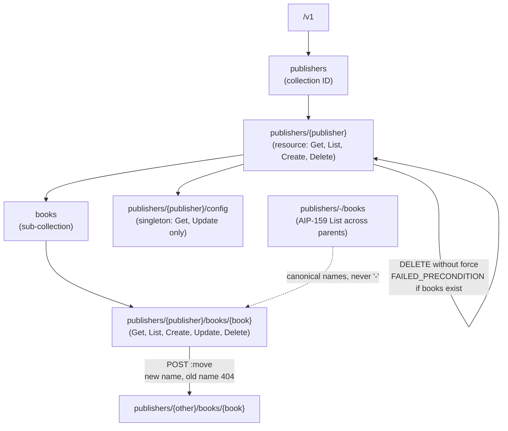

# Resource-Oriented Design: Collections, Singleton Resources, Sub-Resources, and Hierarchy Limits (AIP-121)

> [!summary] Claim
> A resource-oriented API is a tree of alternating collection IDs and resource IDs whose string names are permanent, so every hard rule (one canonical parent, singletons with no `Create` or `Delete`, `-` only where IDs are globally unique, no rename on `Update`) follows from the name being the identity, and the real depth limits come from ID grammar, URI length, and segment parsing, not from the AIPs.

Part of [REST and Resource Modeling](README.md) in [API Engineering](../README.md).

## TL;DR

- Mechanism: AIP-121 models an API as a hierarchy where each node is a resource or a collection of same-typed resources, and AIP-122 turns the path from the root into the resource `name`, for example `publishers/123/books/les-miserables`.
- Contract rule: every resource supports `Get` and (except singletons) `List`, has exactly one canonical parent (AIP-121 "Cyclic References"), and never changes its name (AIP-180 "Changing resource names"), so a move is an imperative custom method that yields a new name.
- The trap: ASGI servers percent-decode `path`, so a resource ID containing `%2F` becomes extra segments and Starlette routes the request to a different resource type; the lab proves a publisher `GET` turning into a book `GET`.
- Portability fact: the routing behavior is identical on CPython 3.12.16, 3.13.18, 3.14.10, 3.15.2, and 3.15.2t free-threaded (44 tests each, Debian Trixie and macOS), and Uvicorn, Hypercorn, and Granian all decode `%2F` over a real socket on HTTP/1.1, HTTP/2, and (Hypercorn) HTTP/3, because the behavior lives in pure-Python Starlette `1.10.0` and the servers' own path decoding, not in the interpreter.
- When not to use it: do not force a deep hierarchy onto many-to-many or multi-parent data (use references per [[Resource-Associations-Many-to-Many-Links-and-Polymorphism-AIP-124]]), and do not nest past about four collections, which Zalando rule #147 says SHOULD stay at three sub-resource levels or fewer.

## Mental model



The root holds one collection, `publishers`, whose members are publisher resources addressed by `publishers/{publisher}`.
Each publisher owns a sub-collection `books` and exactly one `config` singleton, which has no ID segment and exists because its parent exists.
A book's name is the full path from the root, so it encodes its parent; moving a book to another publisher produces a different name, which is why the `:move` arrow points at a new node rather than editing the old one.
The dotted wildcard arrow is a read-only view: `List` with `-` as the parent ID spans all publishers but must report each book under its real parent.
The self-loop on the publisher is the delete guard: a parent with non-singleton children refuses deletion unless the caller opts into a cascade with `force`.

## How it works

### The resource name grammar

AIP-122 defines a resource name as a URI path without the leading slash whose components "should usually alternate between collection identifiers ... and resource IDs" (AIP-122 "Guidance").
Collection identifiers must be plural `camelCase` matching `/[a-z][a-zA-Z0-9]*/` and must be unique within one name, so `people/xyz/people/abc` is invalid (AIP-122 "Collection identifiers").
User-specified resource IDs should follow RFC 1034 labels restricted to lower case, `^[a-z]([a-z0-9-]{0,61}[a-z0-9])?$`, which caps each ID at 63 characters (AIP-122 "Resource ID segments"); RFC 1034 Section 3.5 is the origin of the rule that labels "must be 63 characters or less".
Pattern variables in the `google.api.resource` annotation must match `[a-z][_a-z0-9]*[a-z0-9]`, must be unique within a pattern, and must not use an `_id` suffix (AIP-123).
Two patterns of one resource are the same pattern if they are identical once the ID segments are removed (AIP-123 "Pattern uniqueness").

The lab's `ResourcePattern.parse` enforces exactly these rules plus one depth policy (simplified excerpt; these lines are copied verbatim from the lab):

```python
    @classmethod
    def parse(cls, pattern: str, *, max_collections: int = MAX_COLLECTIONS) -> ResourcePattern:
        if pattern.startswith("/") or not pattern:
            raise PatternError(f"{pattern!r}: resource names have no leading slash")
        segments = tuple(pattern.split("/"))
        collections: set[str] = set()
        variables: set[str] = set()
        for index, segment in enumerate(segments):
            is_variable = segment.startswith("{") and segment.endswith("}")
            if index % 2 == 0:
                if is_variable or not COLLECTION_ID.fullmatch(segment):
                    raise PatternError(f"{pattern!r}: segment {index} must be a collection ID")
                if segment in collections:
                    raise PatternError(f"{pattern!r}: duplicate collection ID {segment!r}")
                collections.add(segment)
            else:
                variable = segment[1:-1]
                if not is_variable or not PATTERN_VARIABLE.fullmatch(variable):
                    raise PatternError(f"{pattern!r}: segment {index} must be a {{variable}}")
                if variable.endswith("_id"):
                    raise PatternError(f"{pattern!r}: variable {variable!r} has an _id suffix")
                if variable in variables:
                    raise PatternError(f"{pattern!r}: duplicate variable {variable!r}")
                variables.add(variable)
        if len(variables) > max_collections:
            raise PatternError(f"{pattern!r}: {len(variables)} collections > {max_collections}")
        return cls(pattern=pattern, segments=segments)
```

Even segment positions are collection IDs and odd positions are `{variables}`; an odd segment count therefore ends in a static segment, which is the singleton shape `users/1234/config` from AIP-156.

### Collections, resources, and the standard method surface

AIP-121 requires every resource to support `Get` so clients can confirm state after a mutation, and to support `List` "except for singleton resources where more than one resource is not possible" (AIP-121 "Methods").
The resource schema must be identical across every standard method that returns or contains it (AIP-121 "Methods").
For management-plane methods, completion means the resource has reached steady state: a `Get` after a successful delete must return `NOT_FOUND` (AIP-121 "Strong Consistency").
Over HTTP, a `Create` that succeeds maps naturally to `201 Created` with a `Location` header identifying the new resource (RFC 9110 Section 15.3.2); the lab returns `Location: /v1/publishers/p1`.
Choosing between `200`, `201`, `204`, and the `4xx` family is owned by [[HTTP-Status-Code-Taxonomy-and-Selection-Decision-Trees]].

### Singleton resources

A singleton "must always exist by virtue of the existence of its parent, with one and exactly one per parent", has no ID segment, and must not define `Create` or `Delete` (AIP-156 "Guidance").
It should define `Get` and `Update`, may define `List` only if it implements it per AIP-159 (a `-` parent lists all singletons, a real parent returns a collection of one), and must declare both `singular` and `plural` in its resource annotation (AIP-156 "Guidance"), because a listed singleton appears in plural form and the pseudo-collection leaves room to grow into a real collection (AIP-156 "Rationale").
Deleting a parent whose only children are singletons must be allowed, because the singleton's lifecycle is the parent's (AIP-135 "Guidance").
In the lab, `POST`, `PUT`, and `DELETE` on `/v1/publishers/p1/config` return `405 Method Not Allowed` with `Allow` listing `GET`, `HEAD`, and `PATCH`, which RFC 9110 Section 15.5.6 requires ("The origin server MUST generate an `Allow` header field in a `405` response").

### Sub-resources, parent deletion, and cascades

AIP-135 says a `Delete` "must fail with a `FAILED_PRECONDITION` error if child resources are present", and offers `bool force` as the explicit opt-in to a cascading delete (AIP-135 "Guidance" and "Cascading delete").
`google/rpc/code.proto` maps `FAILED_PRECONDITION` to `400 Bad Request` and `ALREADY_EXISTS` to `409 Conflict`; the lab uses those mappings and puts the canonical status string in the body so a client can tell `FAILED_PRECONDITION` from `INVALID_ARGUMENT`.
The lab's delete handler (simplified excerpt; verbatim lines):

```python
    async def delete_publisher(request: Request) -> Response:
        name = PUBLISHER.render(publisher=request.path_params["publisher"])
        if name not in store.resources:
            return error(404, "NOT_FOUND", name)
        force = request.query_params.get("force") == "true"
        children = store.children(name)
        blocking = [child for child in children if CONFIG.match(child) is None]
        if blocking and not force:
            # AIP-135: FAILED_PRECONDITION, which code.proto maps to HTTP 400.
            return error(400, "FAILED_PRECONDITION", f"{name} has {len(blocking)} child resources")
        for child in children:
            del store.resources[child]
        del store.resources[name]
        return Response(status_code=204)
```

### One canonical parent, and why a move is not an update

AIP-121 requires the parent-child relationship to be acyclic, with "only one canonical parent resource" per instance (AIP-121 "Cyclic References").
AIP-180 states "A resource **must not** change its name", even across major versions (AIP-180 "Changing resource names").
The `name` field carries `IDENTIFIER` field behavior, which makes it output-only on `Create` and `IMMUTABLE` on `Update` (AIP-203 "Identifier"); see [[Field-Behavior-Semantics-Input-Only-Output-Only-and-Immutable-AIP-203]].
Because the parent is part of the name, re-parenting cannot be an `Update`.
AIP-136 names `Move` and `Rename` as the "rarely-used, fundamentally imperative" operations where a custom method is acceptable even on declarative-friendly resources (AIP-136 "Declarative-friendly resources").
The lab's `:move` endpoint is a design of this lab, not an AIP-specified method: the request field `destination_parent` is the lab's choice, the response is the resource under its new name, and the old name answers `NOT_FOUND` afterwards, which keeps AIP-121 strong consistency.
Whether clients see the result as "the same book" is a `uid` question for [[Declarative-Friendly-APIs-and-Reconciliation-Loops-AIP-128]], and the custom method URI syntax is owned by [[Custom-Methods-and-State-Machine-Transitions-AIP-136]].

### Reading across collections with `-`

AIP-159 lets `List` accept `-` as a wildcard parent ID, `GET /v1/publishers/-/books`, but the URI pattern must still use `*` rather than hard-code `-`, and responses must carry canonical names with the real parent IDs (AIP-159 "Guidance").
`Get` through `-` is allowed only when the child ID is unique across all parents: services "must not support reading across collections on `Get` requests if the child resources might have a collision" (AIP-159 "Guidance").
The lab lets two publishers both own a book `b1`, so it serves `List` across parents and refuses `GET /v1/publishers/-/books/b1` with `400`.

### How Starlette turns the hierarchy into routes

`compile_path` turns each `{param}` into a named group using the convertor regex, and `StringConvertor.regex` is `[^/]+`, so a default parameter never crosses a `/` but does accept `:`, `%`, and `-` (starlette 1.10.0 starlette/routing.py, compile_path) and (starlette 1.10.0 starlette/convertors.py, StringConvertor).
`PathConvertor.regex` is `.*`, so `{name:path}` swallows any depth of hierarchy (starlette 1.10.0 starlette/convertors.py, PathConvertor).
`Route.matches` returns `Match.FULL` when the path and method match and `Match.PARTIAL` when only the path matches (starlette 1.10.0 starlette/routing.py, Route.matches).
`Router.app` dispatches the first `FULL` match; if none exists it hands the request to the *first* `PARTIAL` route only, whose `Route.handle` builds `Allow` as `", ".join(self.methods)` from a Python `set` (starlette 1.10.0 starlette/routing.py, Router.app) and (starlette 1.10.0 starlette/routing.py, Route.handle).
Two consequences follow, both proven in the lab.
First, splitting one resource path across several `Route` objects (one per method) makes a `405` advertise only the first route's methods, which violates RFC 9110 Section 15.5.6; the lab's `method_route` registers one `Route` per path and dispatches by method instead.
Second, the order of tokens in `Allow` changes with `PYTHONHASHSEED` (measured below), so tests must compare sets.
A custom method URL such as `/books/b1:move` is a `FULL` match for the `GET /books/{book}` route when the method is `GET`, because `[^/]+` accepts `b1:move`; only resource ID validation in the handler turns that into a meaningful error.

### The percent-decoding boundary

The ASGI `path` key is the request target "with percent-encoded sequences and UTF-8 byte sequences decoded into characters", while `raw_path` keeps the original bytes (ASGI HTTP connection scope).
Uvicorn's h11 and httptools protocols both call `unquote` on the path (uvicorn 0.54.0 uvicorn/protocols/http/h11_impl.py, H11Protocol.handle_events) and (uvicorn 0.54.0 uvicorn/protocols/http/httptools_impl.py, HttpToolsProtocol.on_headers_complete); Hypercorn does the same in `HTTPStream.handle`, which its h11, h2, and h3 protocol modules share (hypercorn 0.18.0 hypercorn/protocol/http_stream.py, HTTPStream.handle).
Granian does it in Rust: its ASGI scope builder sets `path` to `percent_decode_str(raw_path).decode_utf8_lossy()` and `raw_path` to the undecoded bytes (granian 2.8.7 src/asgi/utils.rs, `build_scope_common!`).
The in-process transport matches: `ASGITransport.handle_async_request` sets `path` to `request.url.path`, which `URL.path` returns after `unquote` (httpx 0.28.1 httpx/_transports/asgi.py, ASGITransport.handle_async_request) and (httpx 0.28.1 httpx/_urls.py, URL.path).
Starlette matches against the decoded `path` via `get_route_path` (starlette 1.10.0 starlette/routing.py, Route.matches), so `GET /v1/publishers/p1%2Fbooks%2Fb1` is routed as the four-segment book name `publishers/p1/books/b1`.
This is why AIP-122 says non-terminal segments "must not contain a `/` character" and resource names "should not use characters that require URL-escaping".
The lab's `RejectEncodedSlash` middleware refuses any `%2F` in `raw_path` before routing (simplified excerpt; verbatim lines):

```python
class RejectEncodedSlash:
    """Pure ASGI guard: ASGI `path` is percent-decoded, so `%2F` would add segments."""

    def __init__(self, app: ASGIApp) -> None:
        self.app = app

    async def __call__(self, scope: Scope, receive: Receive, send: Send) -> None:
        if scope["type"] == "http":
            raw_path: bytes | None = scope.get("raw_path")
            if raw_path is not None and b"%2f" in raw_path.lower():
                response = error(400, "INVALID_ARGUMENT", "encoded '/' in a resource ID")
                await response(scope, receive, send)
                return
        await self.app(scope, receive, send)
```

Dot segments are the other path-shape hazard: RFC 3986 Section 6.2.2.3 tells normalizers to remove `.` and `..` with the `remove_dot_segments` algorithm of Section 5.2.4, and httpx does so client-side in `normalize_path` (httpx 0.28.1 httpx/_urlparse.py, normalize_path), so `/v1/publishers/p2/../p1/books/b1` leaves the client as `/v1/publishers/p1/books/b1`.
The AIP-122 ID grammar rejects `.` and `..` as IDs anyway, which is the server-side defense against clients that do not normalize; URI resolution itself is covered in [[URI-Syntax-Resolution-and-Templates-RFC-6570]].

## Numbers and limits

Lab rows were measured on 2026-11-10 on Apple Silicon (`Darwin 27.2.0 arm64`, macOS `27.2`) with `uv 0.11.26`, Starlette `1.10.0`, and httpx `0.28.1`, under the workspace interpreter CPython `3.14.6`.

| Limit | Value | Source or measurement | Implication |
|---|---:|---|---|
| Resource ID length | `63` characters | AIP-122 "Resource ID segments"; RFC 1034 Section 3.5 | IDs fit a DNS label, so they can double as hostnames and bucket-like names |
| Resource ID grammar | `^[a-z]([a-z0-9-]{0,61}[a-z0-9])?$` | AIP-122 "Resource ID segments" | No `/`, `:`, `%`, `.`, or upper case, which closes the routing and normalization holes below |
| Collection ID grammar | `[a-z][a-zA-Z0-9]*`, unique per name | AIP-122 "Collection identifiers" | `people/{a}/people/{b}` is invalid |
| AIP hierarchy depth limit | none stated | `grep` of AIP-121, 122, 123, 131 to 133, 156, 159, 190 for depth or nesting limits returned no rule (as of 2026-11) | Depth is a guideline-level or infrastructure-level decision |
| Sub-resource nesting | `<= 3` levels | Zalando RESTful API Guidelines rule #147 (as of 2026-11) | The lab policy `MAX_COLLECTIONS = 4` is one root collection plus three nested; this interpretation is the lab's |
| Resource types per API | `4` to `8` | Zalando rule #146, stated as experience, not a hard limit (as of 2026-11) | More types suggests splitting the API by subdomain |
| Worst-case 4-collection name | `285` characters (`289` with `/v1/`) | Lab: `ResourcePattern.max_name_length()` on `orgs/{org}/projects/{project}/datasets/{dataset}/tables/{table}` | Depth is not what exhausts URI budgets; query strings and filters are |
| Minimum URI length to support | `8000` octets, RECOMMENDED | RFC 9110 Section 4.1 | Request targets longer than the server will parse get `414 URI Too Long` (RFC 9112 Section 3) |
| h11 incomplete-event buffer | `16384` bytes (`16 * 1024`) | (h11 0.16.0 h11/_connection.py, DEFAULT_MAX_INCOMPLETE_EVENT_SIZE); Uvicorn uses it when `h11_max_incomplete_event_size` is unset (uvicorn 0.54.0 uvicorn/protocols/http/h11_impl.py, H11Protocol.__init__) | Bounds the request line plus headers that h11 buffers before it gives up |
| `Allow` token order | varied across `PYTHONHASHSEED=0..3`: `PATCH, GET, HEAD` / `GET, HEAD, PATCH` / `GET, PATCH, HEAD` / `HEAD, GET, PATCH` | Lab probe: `DELETE /v1/publishers/p1/config` under each seed | Compare `Allow` as a set; never snapshot the header string |
| Lab suite | `44 passed in 0.13s` | `uv run --frozen pytest tests/f04_rest_and_resource_modeling/test_resource_oriented_design_collections_resources_and_subresources.py -q` | In-process, no sockets; timing is incidental, not a benchmark |

## Portability

| Dimension | Version or target | Behavior and evidence |
|---|---|---|
| CPython `3.12` | `3.12.16` (Debian Trixie container) and `3.12.13` (macOS) | Proven by lab: `uv run --frozen --python 3.12.16 pytest ...` in the container -> `44 passed in 0.15s`; `uv run --isolated --frozen --python 3.12 pytest ...` on macOS (resolves to `3.12.13`) -> `44 passed in 0.21s` |
| CPython `3.13` | `3.13.18` (macOS) | Proven by lab: `uv run --isolated --frozen --python 3.13 pytest ...` -> `44 passed in 0.19s` |
| CPython `3.14` | `3.14.6` (workspace), `3.14.10` | Proven by lab: `uv run --frozen pytest ...` -> `44 passed in 0.13s`; `uv run --isolated --frozen --python 3.14.10 pytest ...` -> `44 passed in 0.36s`; the Debian and Alpine containers ran `3.14.10` (rows below) |
| CPython `3.15` | `3.15.2` | Proven by lab: `uv run --isolated --frozen --python 3.15.2 pytest ...` -> `44 passed in 0.39s` on macOS and `44 passed in 0.52s` in the Debian Trixie container |
| CPython `3.15t` free-threaded | `3.15.2` free-threading build in the Debian Trixie container (`Py_GIL_DISABLED=1`, `sys._is_gil_enabled()` -> `False`); `3.15.0b3` free-threading build on macOS (GIL off) | Proven by lab with the lab's direct dependencies only, because the locked environment has no free-threaded wheel for `psycopg-binary==3.3.8`: `PYTHONPATH=src uv run --no-project --isolated --python 3.15.2+freethreaded --with starlette==1.10.0 --with httpx==0.28.1 --with httpcore==1.0.9 --with anyio==4.16.0 --with h11==0.16.0 --with pytest==9.2.0 --with pytest-asyncio==1.4.1.post1 pytest ... -p no:cacheprovider` -> `44 passed in 0.20s` in the container; the same command with `--python 3.15t` -> `44 passed in 0.31s` on macOS; a macOS `3.15.2t` build was not available (`uv python list` offers only `3.15.0b3` free-threaded there) |
| Debian Trixie container | `ghcr.io/astral-sh/uv:python3.14-trixie`, Debian GNU/Linux 13, `aarch64`, glibc 2.41, CPython `3.14.10` | Proven by lab: `uv sync --frozen` then `pytest ...` -> `44 passed in 0.14s`; run under OrbStack on the same Apple Silicon host, so the CPU architecture is `aarch64`, not `x86_64` |
| Alpine container | `ghcr.io/astral-sh/uv:python3.14-alpine`, Alpine Linux v3.23, `aarch64`, musl libc, CPython `3.14.10` | Proven by lab: `uv sync --frozen` then `pytest ...` -> `44 passed in 0.26s` |
| Starlette routing | `1.10.0` | `StringConvertor` `[^/]+`, first-`PARTIAL` `405` handling, and set-built `Allow` read in (starlette 1.10.0 starlette/routing.py, Router.app); the GitHub tag file is byte-identical to the installed copy (`diff -q`) |
| Uvicorn | `0.54.0`, h11 and httptools (`httptools 0.9.0`) | Proven by run: a probe ASGI app served with `uvicorn --http h11` and `uvicorn --http httptools`, raw `GET /v1/publishers/p1%2Fbooks%2Fb1 HTTP/1.1` over a socket -> `path` `/v1/publishers/p1/books/b1`, `raw_path` `/v1/publishers/p1%2Fbooks%2Fb1`; the same with `%2f` kept `%2f` in `raw_path`; source rows above |
| Hypercorn | `0.18.0`, `aioquic 1.7.2`, `h2 4.4.1` | Proven by run with the same probe app: HTTP/1.1 raw socket, HTTP/2 (`curl --http2-prior-knowledge` cleartext), and HTTP/3 over QUIC (`curl --http3-only` against `--quic-bind` with a throwaway self-signed certificate) all returned the decoded `path` and the undecoded `raw_path`, with `http_version` `1.1`, `2`, and `3` |
| Granian | `2.8.7` | Proven by run: `granian --interface asgi` returned the decoded `path` and undecoded `raw_path` for `%2F` and `%2f` over a raw HTTP/1.1 socket, and for `%2F` over HTTP/2 cleartext (`--http 2`, `http_version` `2`); Rust source read in (granian 2.8.7 src/asgi/utils.rs, `build_scope_common!`); `granian --help` offers `--http [auto|1|2]` only, so Granian `2.8.7` has no HTTP/3 listener to test |
| HTTP versions | HTTP/1.1, HTTP/2, HTTP/3 | Resource names live in the request target, so the hierarchy is version-independent; decoding was observed on HTTP/1.1 (Uvicorn, Hypercorn, Granian), HTTP/2 (Hypercorn, Granian), and HTTP/3 (Hypercorn). `curl` upper-cases percent-encoding hex digits, so the `%2f` probes used a raw socket and only HTTP/1.1 proves lower case; the lab test covers lower case in-process |

The server probes used a 7-line ASGI app that echoes `scope["path"]`, `scope["raw_path"]`, and `scope["http_version"]`, on macOS 27.2 (`Darwin 27.2.0 arm64`) with the workspace CPython `3.14.6`, on 2026-11-10.
They are run observations, not suite tests, because the suite stays in-process and hermetic.

## Worked example

The [implementation](../labs/src/api_labs/f04_rest_and_resource_modeling/resource_hierarchy.py) serves a publisher -> book hierarchy with a `config` singleton, and the [test](../labs/tests/f04_rest_and_resource_modeling/test_resource_oriented_design_collections_resources_and_subresources.py) proves each invariant in-process through `httpx.ASGITransport`.
Routes are registered one per path, so a `405` always lists every method (simplified excerpt; verbatim lines):

```python
def method_route(path: str, handlers: dict[str, Endpoint]) -> Route:
    """One `Route` per path, so a `405` lists every method in `Allow` (RFC 9110 Section 15.5.6).

    `Router.app` hands a method mismatch to the first PARTIAL match only, so splitting one path
    across several `Route` objects makes `Allow` name just the first route's methods.
    """

    async def dispatch(request: Request) -> Response:
        return await handlers["GET" if request.method == "HEAD" else request.method](request)

    return Route(path, dispatch, methods=list(handlers))
```

```python
    routes = [
        method_route("/v1/publishers", {"POST": create_publisher}),
        method_route(
            "/v1/publishers/{publisher}", {"GET": get_publisher, "DELETE": delete_publisher}
        ),
        method_route("/v1/publishers/{publisher}/books", {"GET": list_books, "POST": create_book}),
        method_route(
            "/v1/publishers/{publisher}/books/{book}",
            {"GET": get_book, "PATCH": update_book, "DELETE": delete_book},
        ),
        method_route("/v1/publishers/{publisher}/books/{book}:move", {"POST": move_book}),
        # AIP-156: a singleton has Get and Update, never Create or Delete.
        method_route(
            "/v1/publishers/{publisher}/config", {"GET": get_config, "PATCH": update_config}
        ),
    ]
```

The move handler shows why re-parenting is a name change, not an update (simplified excerpt; verbatim lines):

```python
    async def move_book(request: Request) -> Response:
        name = _book_name(request)
        if isinstance(name, Response):
            return name
        body = await _json_object(request)
        destination = None if body is None else body.get("destination_parent")
        bindings = None if not isinstance(destination, str) else PUBLISHER.match(destination)
        if bindings is None:
            return error(400, "INVALID_ARGUMENT", "destination_parent must be publishers/{id}")
        if PUBLISHER.render(**bindings) not in store.resources:
            return error(404, "NOT_FOUND", str(destination))
        new_name = BOOK.render(publisher=bindings["publisher"], book=request.path_params["book"])
        if new_name in store.resources:
            return error(409, "ALREADY_EXISTS", new_name)
        # The moved book is a different resource name; the old name now answers NOT_FOUND.
        moved = store.resources.pop(name)
        moved["name"] = new_name
        store.resources[new_name] = moved
        return JSONResponse(moved)
```

Twelve further tests cover the validation paths (singleton rename refused, ID grammar on `Create`, missing parents, non-object bodies, `HEAD`); two tests carry the sharpest claims (simplified excerpt; verbatim lines from the test module):

```python
@pytest.mark.unit
@pytest.mark.asyncio
async def test_split_routes_on_one_path_truncate_allow_to_the_first_route() -> None:
    async def endpoint(request: Request) -> Response:
        return Response(request.method)

    path = "/v1/publishers/{publisher}"
    app = Starlette(
        routes=[
            Route(path, endpoint, methods=["GET"]),
            Route(path, endpoint, methods=["DELETE"]),
        ]
    )
    async with client_for(app) as client:
        assert (await client.delete("/v1/publishers/p1")).status_code == 200
        response = await client.put("/v1/publishers/p1")
        assert response.status_code == 405
        # DELETE is supported, yet Allow omits it: Router.app keeps only the first PARTIAL.
        assert allow_set(response) == {"GET", "HEAD"}
```

```python
@pytest.mark.unit
@pytest.mark.asyncio
async def test_percent_encoded_slash_reroutes_unless_guarded() -> None:
    target = "/v1/publishers/p1%2Fbooks%2Fb1"
    async with client_for(build_app(guard_encoded_slash=False)) as client:
        await seed(client)
        # ASGI `path` is percent-decoded: a publisher Get becomes a book Get.
        rerouted = await client.get(target)
        assert rerouted.status_code == 200
        assert rerouted.json()["name"] == "publishers/p1/books/b1"
    async with client_for(build_app()) as client:
        await seed(client)
        guarded = await client.get(target)
        assert guarded.status_code == 400
        assert guarded.json()["error"]["status"] == "INVALID_ARGUMENT"
```

Captured from `labs/` on CPython `3.14.6`, macOS `27.2` (`Darwin 27.2.0 arm64`):

```text
$ uv run --frozen pytest tests/f04_rest_and_resource_modeling/test_resource_oriented_design_collections_resources_and_subresources.py -q
............................................                             [100%]
44 passed in 0.13s
```

Reversing the two routes in the split-route test (a probe run, not part of the suite) changed the response to `405` with `Allow: DELETE`, which confirms that the first `PARTIAL` route alone decides the header.

## Pitfalls

> [!warning] Percent-encoded `/` inside an ID reroutes the request
> Trigger: an API accepts free-form or user-supplied IDs, and a client sends `GET /v1/publishers/p1%2Fbooks%2Fb1`.
> Symptom: the ASGI server decodes `path`, Starlette sees four segments, and the book handler answers instead of the publisher handler; authorization written for publishers never runs for that book.
> Fix: enforce the AIP-122 ID grammar on every path parameter and reject `%2F` in `raw_path` before routing, as `RejectEncodedSlash` does.

> [!warning] Path normalization drift is how traversal bugs ship
> Trigger: two components disagree on how to normalize a path, for example a proxy and an origin, or a router and a file mapper.
> Symptom: CVE-2021-41773 records "a flaw ... in a change made to path normalization in Apache HTTP Server 2.4.49" that let a path traversal attack "map URLs to files outside the directories configured by Alias-like directives", "known to be exploited in the wild", with an incomplete fix tracked as CVE-2021-42013 (NVD record, published 2021-10-05).
> Fix: normalize once at the edge per RFC 3986 Section 5.2.4, then validate each hierarchy segment against a grammar that excludes `.`, `..`, and escapes, so a second normalizer has nothing to reinterpret.

> [!warning] One path split across several routes truncates `Allow`
> Trigger: Starlette or FastAPI code registers `GET /items/{id}` and `DELETE /items/{id}` as separate route objects.
> Symptom: `PUT /items/1` returns `405` with an `Allow` that names only `GET` and `HEAD` (in either order, depending on `PYTHONHASHSEED`), hiding the supported `DELETE`, which breaks RFC 9110 Section 15.5.6 and misleads generated clients.
> Fix: one route object per resource path that dispatches by method, as `method_route` does, and assert `Allow` as a set in tests.

> [!warning] `{name:path}` makes the router blind to hierarchy
> Trigger: a route like `/v1/{name:path}` used to accept any resource name with one handler.
> Symptom: `PathConvertor` matches `.*`, so wrong depths, singleton paths, and custom-method suffixes all reach the handler, and the router can no longer return `404` or `405` for a shape it does not serve.
> Fix: one route per resource pattern, or parse the captured name with a `ResourcePattern`-style validator and reject non-matching shapes before any lookup.

> [!warning] Updating `name` to re-parent a resource
> Trigger: a client sends `PATCH /v1/publishers/p1/books/b1` with `{"name": "publishers/p2/books/b1"}`.
> Symptom: if the server applies it, every stored reference to the old name dangles, and audit logs and IAM bindings keyed by name silently point at nothing.
> Fix: treat `name` as `IDENTIFIER` (immutable on `Update`, AIP-203 "Identifier"), reject the change with `INVALID_ARGUMENT` (`400`) as AIP-203 "Immutable" prescribes, and expose an explicit `:move` whose result is a new name.

> [!warning] Wildcard `Get` across parents when IDs collide
> Trigger: `GET /v1/publishers/-/books/b1` when two publishers each own a `b1`.
> Symptom: the server returns whichever it finds first, which is nondeterministic and may cross a tenant boundary.
> Fix: AIP-159 forbids `-` on `Get` unless the child ID is globally unique; support `-` only on `List`, and always return canonical names.

## Security and robustness

- Threat model: the resource name is attacker-controlled input that selects both the code path (via routing) and the data row (via lookup), so a parsing disagreement between the two is a confused-deputy bug.
- OWASP API1:2023 Broken Object Level Authorization says attackers manipulate "the ID of an object that is sent within the request", and that every endpoint receiving an object ID "should implement object-level authorization checks"; in a hierarchy, authorize the full name, parent included, not just the leaf ID, because `publishers/p1/books/b1` and `publishers/p2/books/b1` are different objects.
- Tenant-scoped enforcement of the same check at the query layer is in [[Defeating-BOLA-API1-2023-Tenant-Scoped-Queries-and-PostgreSQL-RLS]].
- Parent existence leaks: answering `404` for a missing parent and `403` for an existing but forbidden one lets a caller enumerate parents; decide the response per [[HTTP-Status-Code-Taxonomy-and-Selection-Decision-Trees]] and apply it uniformly at every depth.
- Wildcards widen authorization scope: `publishers/-/books` must filter by what the caller may read in every parent, not by what one parent allows.
- Cascades are destructive: `force=true` should require the same or stronger permission than deleting each child, and the lab refuses a non-forced delete with children so an accidental call cannot wipe a subtree.
- Input validation edge cases the ID grammar closes: `%2F` and `%2f` (decoded `/`; hex digits are case-insensitive per RFC 3986 Section 2.1, and the lab proves both reroute and both are rejected), `.` and `..` (dot segments), `:` (custom-method separator), upper case (case-folding mismatches), non-ASCII (normalization forms; AIP-122 requires NFC if Unicode is unavoidable), and lengths over 63.
- Defense in depth: a strict ID regex in the handler, a raw-path guard in middleware, one route per resource pattern, and length limits at the server (`414`, h11's `16384`-byte buffer) each stop a different malformed request.

## The principal's view

The decision is what goes into the name, because AIP-180 makes it permanent: a hierarchy edge is a promise that the child never changes parent without becoming a new resource.
Put an edge in the hierarchy only when it is an ownership and lifecycle edge (delete the parent, the children go), and model every other relationship as a reference field per AIP-122 "Fields representing another resource" and [[Resource-Associations-Many-to-Many-Links-and-Polymorphism-AIP-124]].
The organizational payoff is uniform infrastructure: logging, access control, and long-running operations can all key on one string format, which is the AIP-122 rationale against ID tuples (AIP-122 "Using names instead of IDs").
The cost is rigidity: moves, mergers, and tenant migrations become imperative workflows with new names, so organizations that reorganize data often should keep the hierarchy shallow (one or two collections) and lean on stable `uid` values and references.
Prefer a resource-oriented hierarchy for management-plane CRUD over long-lived entities; prefer [[The-HTTP-QUERY-Method-Safe-Requests-with-Bodies-RFC-10008]] or a search resource for complex reads across the tree, and an event or RPC interface for high-rate data-plane operations where per-resource addressing adds nothing.
Set the depth limit in the API style guide and lint it in CI, because no AIP sets one; the lab's `ResourcePattern.parse` is the shape of such a linter.

## Interview questions

> [!question] L5: What is the difference between a collection, a resource, and a singleton resource in AIP-121 and AIP-156 terms?
>
> > [!success]- Answer
> > A collection is a set of resources of the same type under one parent, named by a plural `camelCase` identifier such as `books`.
> > A resource is one member, addressed by its collection path plus an ID, such as `publishers/p1/books/b1`.
> > A singleton has no ID segment, exists exactly once per parent because the parent exists, and supports `Get` and `Update` but never `Create` or `Delete`.
> >
> > Follow-up: Why must a singleton still declare a `plural` in its resource annotation?

> [!question] L5: Why does AIP-122 restrict user-specified IDs to `^[a-z]([a-z0-9-]{0,61}[a-z0-9])?$`?
>
> > [!success]- Answer
> > The grammar is an RFC 1034 DNS label in lower case, so it is at most 63 characters and never needs URL escaping.
> > It excludes `/`, which would change segment count, `.` and `..`, which normalizers remove, `:`, which separates custom methods, and upper case, which invites case-folding mismatches.
> > One grammar then works in URLs, hostnames, logs, and IAM policies without per-system encoding rules.
> >
> > Follow-up: What breaks if you later relax the grammar to allow upper case?

> [!question] L5: A publisher with three books and a `config` singleton receives `DELETE /v1/publishers/p1`; what should happen, and what changes with `?force=true`?
>
> > [!success]- Answer
> > Without `force`, AIP-135 requires `FAILED_PRECONDITION`, which `code.proto` maps to HTTP `400`, because non-singleton children exist.
> > With `force=true`, the API deletes the books, the singleton, and the publisher, and the lab returns `204`.
> > A publisher whose only child is the `config` singleton deletes without `force`, because the singleton's lifecycle belongs to its parent.
> >
> > Follow-up: What permission check should a cascading delete perform on the children?

> [!question] L6: Predict the output: with `GET /v1/publishers/{publisher}/books/{book}` and `POST /v1/publishers/{publisher}/books/{book}:move` registered in the lab app, what does `GET /v1/publishers/p1/books/b1:move` return, and what would it return without ID validation in the handler?
>
> > [!success]- Answer
> > It returns `400` with `INVALID_ARGUMENT` and a message about an invalid resource ID, not `405`.
> > Starlette's `{book}` compiles to `[^/]+`, which matches `b1:move`, so the `GET` route is a `FULL` match and the request never looks at the `:move` route.
> > Without ID validation the handler looks up `publishers/p1/books/b1:move` and returns `404`; a verification mutation that removes the check makes the lab test fail with `assert 404 == 400`.
> >
> > Follow-up: How would you change routing so a `GET` on a custom-method URL gets `405` with `Allow: POST`?

> [!question] L6: Debug this API: `PUT /v1/publishers/p1` returns `405` with `Allow: GET, HEAD` although `DELETE /v1/publishers/p1` works, and the Starlette app registers the `GET` and `DELETE` handlers as two `Route` objects on the same path; what is wrong?
>
> > [!success]- Answer
> > `Route.matches` returns `PARTIAL` for both routes when the method mismatches, but `Router.app` keeps only the first `PARTIAL` and calls its `handle`, which builds `Allow` from that route's methods alone.
> > The response violates RFC 9110 Section 15.5.6, which requires `Allow` to list the target resource's supported methods.
> > Fix it with one `Route` per path and a method dispatch table, and test `Allow` as a set because Starlette joins a `set` whose order changes with `PYTHONHASHSEED`.
> >
> > Follow-up: Which other generated artifacts, such as OpenAPI or client SDKs, would also see the wrong method set?

> [!question] L6: Why can't a client re-parent a book by sending `PATCH` with a new `name`, and how should the API offer the operation?
>
> > [!success]- Answer
> > The parent is part of the name, and AIP-180 says a resource must not change its name, while AIP-203 makes `name` an `IDENTIFIER` that is immutable on `Update`.
> > Re-parenting therefore creates a resource under a new name, so it belongs in an imperative custom method such as `:move`, which AIP-136 explicitly allows for `Move` and `Rename`.
> > After a move the old name must answer `NOT_FOUND`, a collision at the destination should be `ALREADY_EXISTS` (`409`), and stored references to the old name need a migration plan.
> >
> > Follow-up: How does a stable `uid` field change what a declarative client sees after a move?

> [!question] L7+: An attacker sends `GET /v1/tenants/acme%2Fusers%2Froot`; walk the request through Uvicorn and Starlette and explain the authorization risk.
>
> > [!success]- Answer
> > Uvicorn's protocol decodes the target with `unquote`, so ASGI `path` becomes `/v1/tenants/acme/users/root` while `raw_path` keeps `%2F`.
> > Starlette matches the decoded path, so the request hits the user route with `tenant=acme` and `user=root` instead of the tenant route with one odd ID.
> > Any authorization or rate-limit decision taken on `raw_path` or at a proxy that does not decode sees a tenant read, while the handler performs a user read; the lab proves the same rerouting for publishers and books.
> > Defenses: reject `%2F` before routing, validate every segment against the AIP-122 grammar, and authorize on the parsed canonical name.
> >
> > Follow-up: Where in a gateway, origin, and cache chain would you put the normalization step, and why only once?

> [!question] L7+: Your style guide must set a hierarchy depth limit that no AIP defines; what do you choose, and how do you enforce it?
>
> > [!success]- Answer
> > URI length is not the binding constraint: four collections with 63-character IDs is a 285-character name, far below RFC 9110's 8000-octet recommendation.
> > The binding constraints are ownership semantics and client ergonomics: every level is a lifecycle promise, a permission boundary, and a required parameter on every call.
> > A practical rule is one root plus at most three nested collections, matching Zalando rule #147, with anything deeper modeled as references or a separate API.
> > Enforce it with a linter over resource patterns in CI, like `ResourcePattern.parse` with `max_collections`, so the decision is reviewed once instead of per endpoint.
> >
> > Follow-up: Which existing resource would you flatten first if a reorganization required moving it between parents every week?

> [!question] L7+: When is `GET /v1/publishers/-/books/{book}` allowed, and what must the response contain?
>
> > [!success]- Answer
> > AIP-159 allows `-` on `Get` only when the book ID is unique across all parent collections; otherwise only `List` may use the wildcard.
> > The URI pattern must still use `*`, not a hard-coded `-`, and the method must document the wildcard support.
> > The response must carry the canonical name with the real parent, such as `publishers/123/books/456`, never `publishers/-/books/456`.
> >
> > Follow-up: How do you report partial failure when some parents are unreachable during a cross-parent `List`?

## Related

Prerequisites: [[Richardson-Maturity-Model-HATEOAS-and-Web-Linking-RFC-8288]]

Next: [[Resource-Identifiers-UUIDv4-vs-UUIDv7-ULID-and-Public-IDs]]

See also: [[REST-APIs]], [[02-Programming-Languages/Python/Python-Backend-Interview-Prep/05-REST-API-Design]], [[Resource-Associations-Many-to-Many-Links-and-Polymorphism-AIP-124]], [[Custom-Methods-and-State-Machine-Transitions-AIP-136]], [[Field-Behavior-Semantics-Input-Only-Output-Only-and-Immutable-AIP-203]], [[Declarative-Friendly-APIs-and-Reconciliation-Loops-AIP-128]], [[Soft-Delete-Undelete-and-Expiration-Lifecycles-AIP-164]], [[HTTP-Status-Code-Taxonomy-and-Selection-Decision-Trees]], [[URI-Syntax-Resolution-and-Templates-RFC-6570]], [[Starlette-Routing-Internals-Regex-Compilation-and-Mount-Dispatch]], [[Defeating-BOLA-API1-2023-Tenant-Scoped-Queries-and-PostgreSQL-RLS]]

- Lab: `labs/tests/f04_rest_and_resource_modeling/test_resource_oriented_design_collections_resources_and_subresources.py`

## Further reading

- [AIP-121: Resource-oriented design](https://google.aip.dev/121) - Defines the resource hierarchy, the required `Get` and `List`, strong consistency, and the acyclic single-parent rule.
- [AIP-122: Resource names](https://google.aip.dev/122) - The name grammar, collection and ID rules, the 63-character ID limit, and the rationale for names over ID tuples.
- [AIP-123: Resource types](https://google.aip.dev/123) - Pattern variable grammar, uniqueness, and pattern ordering compatibility.
- [AIP-156: Singleton resources](https://google.aip.dev/156) - Singletons without IDs, `Create`, or `Delete`, and `List` through the wildcard.
- [AIP-159: Reading across collections](https://google.aip.dev/159) - The `-` wildcard, canonical names in responses, and the uniqueness condition for `Get`.
- [AIP-135: Standard methods: Delete](https://google.aip.dev/135) - `FAILED_PRECONDITION` with children, `force` cascades, and the singleton exemption.
- [AIP-180: Backwards compatibility](https://google.aip.dev/180) - "A resource must not change its name", which turns re-parenting into a move.
- [google/rpc/code.proto](https://github.com/googleapis/googleapis/blob/master/google/rpc/code.proto) - Canonical error codes and their HTTP mappings.
- [RFC 3986: URI Generic Syntax](https://www.rfc-editor.org/rfc/rfc3986.html) - Path segments (Section 3.3), dot-segment removal (Section 5.2.4), and normalization (Section 6.2.2.3).
- [RFC 9110: HTTP Semantics](https://www.rfc-editor.org/rfc/rfc9110.html) - URI length guidance (Section 4.1), `201 Created` (Section 15.3.2), `405` with `Allow` (Section 15.5.6), and `414` (Section 15.5.15).
- [ASGI HTTP and WebSocket specification](https://asgi.readthedocs.io/en/latest/specs/www.html) - Defines the decoded `path` and the raw `raw_path` keys.
- [Starlette 1.10.0 routing.py](https://github.com/Kludex/starlette/blob/1.10.0/starlette/routing.py) - `compile_path`, `Route.matches`, `Route.handle`, and `Router.app`.
- [Granian 2.8.7 src/asgi/utils.rs](https://github.com/emmett-framework/granian/blob/v2.8.7/src/asgi/utils.rs) - The Rust ASGI scope builder that percent-decodes `path` and keeps `raw_path`.
- [Zalando RESTful API Guidelines: URLs](https://github.com/zalando/restful-api-guidelines/blob/main/chapters/urls.adoc) - Rules #146 and #147 on resource type counts and nesting depth.
- [OWASP API1:2023 Broken Object Level Authorization](https://owasp.org/API-Security/editions/2023/en/0xa1-broken-object-level-authorization/) - Why every object ID in a path needs an object-level check.
- [NVD CVE-2021-41773](https://nvd.nist.gov/vuln/detail/CVE-2021-41773) - Apache HTTP Server 2.4.49 path normalization traversal, a primary record of normalization drift.
