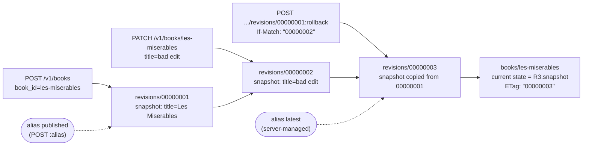

# Immutable Resource Revisions, Snapshot History, and Rollback Operations (Google AIP-162)

> [!summary] Claim
> A revision history is only trustworthy when every revision is an immutable, server-generated snapshot addressed as a child resource (`books/{book}/revisions/{revision}`), and rollback is a forward-only `POST ...:rollback` that appends a new revision under a precondition instead of rewinding or reusing an old ID.

Part of [REST and Resource Modeling](README.md) in [API Engineering](../README.md).

## TL;DR

Mechanism: every qualifying write appends a `BookRevision` whose `snapshot` field is an `OUTPUT_ONLY` copy of the parent at that instant, named `{resource_name}/revisions/{revision_id}`, and listed newest first (AIP-162, as of 2026-11).
Contract rule: `latest` is a read-only server alias for the most recently created revision, user aliases are moved by `POST ...:alias`, `DELETE` on an alias removes only the alias, and the API must document when it creates revisions (AIP-162).
Trap: a rollback that reuses the target revision ID makes one ID describe two disjoint time ranges, and a rollback without a lock or `If-Match` precondition lets two concurrent callers both "win"; the lab kills both mutations.
Portability: the lab passes 23 of 23 tests on CPython 3.12.13, 3.13.18, 3.14.6, 3.14.10, 3.15.2, and the 3.14.6 and 3.15.0b3 free-threaded builds with the GIL disabled; the mechanism is application logic above the ASGI server and HTTP version, which this lab did not vary.
Do not use it when consumers need every intermediate change with causality (use an append-only event log or audit log), when history must be erasable per field on demand, or when the resource changes so often that a snapshot per write costs more than it is worth.

## Mental model



Each solid arrow is an append: creation writes `00000001`, the bad edit writes `00000002`, and the rollback does not move the head pointer back to `00000001` but writes `00000003` whose `snapshot` is a copy of `00000001`, so history reads as a straight line in time.
The dashed arrows are aliases, which are mutable pointers stored beside the immutable revisions: `latest` is recomputed by the server after every append, while `published` moves only when a client calls `:alias` again.
The current resource is the snapshot of the newest revision, and its strong `ETag` is that revision's ID, so a client that read `"00000002"` and then sends `If-Match: "00000002"` with its rollback loses with `412 Precondition Failed` if anyone appended in between.

## How it works

### The resource shape and the 2023 redesign

AIP-162 defines a `{ResourceType}Revision` message that must be annotated as a resource, must contain a `snapshot` field of the parent's message type holding "the configuration of the parent at the point in time the revision was created", must contain `create_time`, and may contain a repeated `alternate_ids` listing other IDs the revision is known by, such as `latest` (AIP-162, Guidance, as of 2026-11).
The subcollection must be named `revisions`, giving names like `publishers/123/books/les-miserables/revisions/c7cfa2a8` (AIP-162, Resource names for revisions).
AIP-162 says revisions should be a collection nested under the parent, and gives revisions that must outlive the parent as an example of an exception where the collection can be top-level (AIP-162, Guidance: "exceptions include").
`snapshot` is `OUTPUT_ONLY` because accepting a client-supplied snapshot "would have allowed users to submit resource configuration for a revision that the resource was never in" (AIP-162, Rationale); field behavior semantics are covered in [[Field-Behavior-Semantics-Input-Only-Output-Only-and-Immutable-AIP-203]].

The current text comes from the 2023-09-01 rewrite (commit `e487231e8e04`, "Update the resource revisions guide using nested collections (take 2)"), followed by editorial commits through `46794fe361bd` (2024-12-11), and its front matter says `state: draft`, while the 2022-10-27 text at commit `905e2e858b89` says `state: approved` (GitHub commit history for `aip/general/0162.md`, as of 2026-11).
The older design put `revision_id` and `revision_create_time` on the parent itself, addressed a revision as `{resource_name}@{revision_id}` (for example `publishers/123/books/les-miserables@c7cfa2a8`), listed revisions through a `:listRevisions` custom method on the resource, and deleted them through `:deleteRevision` (AIP-162 at `905e2e858b89`, Referencing revisions, Listing revisions, Deleting revisions).
The History section of the current AIP lists why it was abandoned: list and delete were custom methods, revisions were not visible in the API discovery document, and resource IDs could not contain `@` (AIP-162, History).
`@` itself is a legal path character, since RFC 3986 defines `pchar = unreserved / pct-encoded / sub-delims / ":" / "@"` (RFC 3986 Section 3.3), so the old design's problem was ambiguity with resource IDs, not URI syntax.

### Revision creation strategy

AIP-162 allows three strategies (revision on every change, on important system state changes, or on explicit request) and requires the API to document which one it uses (AIP-162, Creating Revisions).
The lab documents its choice in the module docstring: a revision on create, on every update that changes the snapshot, and on every rollback.
A no-op `PATCH` therefore does not append a revision and does not change the `ETag`, which `test_noop_update_does_not_create_revision` asserts.
RFC 9110 explicitly allows this kind of side effect on idempotent requests: "a server is free to log each request separately, retain a revision control history, or implement other non-idempotent side effects for each idempotent request" (RFC 9110 Section 9.2.2).
That sentence covers `PUT` and `DELETE`; `PATCH` is not among the methods RFC 9110 defines as idempotent, so the lab's no-op rule is a design choice rather than an HTTP requirement.

### Aliases: `latest`, user aliases, and canonical names

A service may reserve read-only IDs such as `latest`, and if `latest` exists it must be the most recently created revision, which can differ from the current resource state (AIP-162, Server-specified Aliases).
AIP-122 adds that "all data returned from the API must use the canonical resource name" for aliases (AIP-122, Resource ID aliases), so `GET .../revisions/published` returns `"name": "books/les-miserables/revisions/00000001"` and reports `published` in `alternate_ids`.
A user alias is set with `POST /v1/{name=publishers/*/books/*/revisions/*}:alias` and a required `alias_id`; calling it with an existing `alias_id` must succeed and move the alias (AIP-162, User-Specified Aliases).
A `DELETE` addressed at an alias must remove the alias instead of the revision (AIP-162, Standard methods).
The lab rejects an alias equal to an existing revision ID with `409` `ALREADY_EXISTS`, and skips any generated revision ID that equals an existing alias, so the two namespaces never shadow each other (`test_alias_cannot_shadow_a_revision_id` and `test_revision_id_collision_is_retried`); this is a lab design choice, not AIP text.

### Listing: reverse chronological order with keyset tokens

List responses must default to reverse chronological order, and `order_by` may override it (AIP-162, Standard methods).
Page size handling follows AIP-158: `0` or unset selects a documented default, oversized values should be coerced down, and negative values must fail with `INVALID_ARGUMENT` (AIP-158, Guidance).
Page tokens must be opaque and URL-safe, base64 of a transparent token is explicitly "not a sufficient obfuscation mechanism", and tokens must not grant authorization (AIP-158, Opacity).
The lab paginates by keyset on a monotonic sequence number rather than by offset, so revisions appended between page requests cannot shift later pages; the general technique is in [[Keyset-Seek-Pagination-and-Composite-Tie-Breaker-Cursors]] and the offset failure mode in [[Offset-Limit-Pagination-Mechanics-Cost-and-Window-Drift]].
The token is a Fernet token over `"{book_id}\n{seq}"`: `Fernet._encrypt_from_parts` emits `0x80`, an 8-byte big-endian timestamp, a 16-byte random IV, AES-CBC ciphertext with PKCS7 padding, and a 32-byte HMAC-SHA256 over all of that, then URL-safe base64 (cryptography 50.0.2 src/cryptography/fernet.py, Fernet._encrypt_from_parts).
`Fernet.decrypt(token, ttl=...)` rejects a token older than `ttl` seconds or more than `_MAX_CLOCK_SKEW = 60` seconds in the future, and verifies the HMAC before decrypting (cryptography 50.0.2 src/cryptography/fernet.py, Fernet._decrypt_data); the lab test mints correctly keyed tokens 3601 seconds in the past and 120 seconds in the future and requires `400` for both.
After decryption the lab also checks that the embedded book ID matches the request path, so a token minted for `books/alpha` fails on `books/beta`; see [[Opaque-Cursor-Encoding-HMAC-Integrity-and-Filter-Binding]].

### Rollback: forward-only, atomic, preconditioned

Rollback should be a `Rollback` custom method that must use `POST`, should return a resource revision, and takes a required `name` that is the revision to roll back to: `post: "/v1/{name=publishers/*/books/*/revisions/*}:rollback"` (AIP-162, Rollback); custom method rules are in [[Custom-Methods-and-State-Machine-Transitions-AIP-136]].
The current text does not say whether the result reuses the target ID, but the pre-2023 text did: "the API should return a _new_ revision of the resource with a _new_ revision ID, rather than reusing the original ID. This avoids problems with representing the same revision being active for multiple ranges of time" (AIP-162 at `905e2e858b89`, Rollback).
Kubernetes behaves the same way: after `kubectl rollout undo deployment/nginx-deployment --to-revision=2` the documented Deployment shows `deployment.kubernetes.io/revision=4` and a `DeploymentRollback` event "Rolled back deployment ... to revision 2" (kubernetes/website deployment.md, Rolling Back to a Previous Revision, as of 2026-11).
The lab's rollback resolves the target inside the lock, evaluates `If-Match` with strong comparison as RFC 9110 requires for that field (RFC 9110 Section 13.1.1), awaits a simulated storage round trip, and appends; the full concurrency treatment is in [[Optimistic-Concurrency-Control-If-Match-and-412-Precondition-Failed]].
The `ETag` is the head revision ID in quotes, which AIP-154 also recommends (`"foo"`, not `foo`) (AIP-154, Guidance); note that AIP-154 maps an `etag` mismatch carried in a request body to `ABORTED`, which `google.rpc.Code` maps to `409 Conflict`, while an HTTP `If-Match` failure is `412 Precondition Failed` (RFC 9110 Section 13.1.1, code.proto `ABORTED`).

### Errors and routing on the wire

Errors use the AIP-193 HTTP/1.1+JSON shape `{"error": {"code": 404, "status": "NOT_FOUND", "message": ...}}`, where `code` is the HTTP status (AIP-193, HTTP/1.1+JSON representation).
The `HTTP Mapping` comments in `google/rpc/code.proto` map `INVALID_ARGUMENT` and `FAILED_PRECONDITION` to `400`, `NOT_FOUND` to `404`, and `ALREADY_EXISTS` and `ABORTED` to `409` (googleapis code.proto, as of 2026-11).
The lab follows that table for `INVALID_ARGUMENT`, `NOT_FOUND`, `ALREADY_EXISTS`, and `FAILED_PRECONDITION` on deleting the only revision, never emits `ABORTED`, and deliberately departs from it for an `If-Match` failure, which it returns as HTTP `412` with `"status": "FAILED_PRECONDITION"` because RFC 9110 Section 13.1.1 requires `412`.
That pairing is not in code.proto, and AIP-154's changelog records that body `etag` mismatches moved from `FAILED_PRECONDITION` to `ABORTED` on 2021-03-05 (AIP-154, Changelog).
Starlette compiles `/v1/books/{book}/revisions/{revision}:rollback` by `re.escape`-ing the literal text between parameters, so `:rollback` becomes a literal suffix after `(?P<revision>[^/]+)` (starlette 1.10.0 starlette/routing.py, compile_path).
Because `[^/]+` also matches `00000001:rollback`, a `POST` to the rollback URL is a `Match.PARTIAL` for the `GET` and `DELETE` revision routes and a `Match.FULL` for the rollback route, and `Router.app` dispatches the first full match before falling back to a partial one (starlette 1.10.0 starlette/routing.py, Route.matches and Router.app).
The same regex means a `GET .../00000001:rollback` reaches the `GET` handler with `revision="00000001:rollback"`, which the lab rejects with `400` because the ID fails validation.

## Numbers and limits

| Quantity | Value | Source |
| --- | --- | --- |
| User-specified resource ID length | at most 63 characters, `^[a-z]([a-z0-9-]{0,61}[a-z0-9])?$` | AIP-122, Resource ID segments (as of 2026-11) |
| Lab revision ID space | 8 hex characters = 32 bits | lab choice, following the pre-2023 AIP-162 rule of thumb (last 8 characters of a UUIDv4) |
| Revisions per book for a 50 percent chance of one ID collision | about 77,163 | computed: `sqrt(2 * ln 2 * 2**32)` with CPython 3.14.6 `math` |
| Collision probability at 10,000 revisions per book | about 1.16 percent | computed: `1 - exp(-n(n-1) / 2**33)` |
| Kubernetes `revisionHistoryLimit` default | 10 for Deployment, StatefulSet, and DaemonSet | kubernetes/api apps/v1 types.go (as of 2026-11) |
| Fernet token length, 16-byte payload | 120 characters | measured: `Fernet.encrypt`, cryptography 50.0.2, CPython 3.14.6, macOS 27.2 arm64 |
| Fernet token length, 77-byte payload | 184 characters | measured, same environment |
| Fernet future-timestamp tolerance | 60 seconds | cryptography 50.0.2 fernet.py, `_MAX_CLOCK_SKEW` |
| Lab page size default and maximum | 50 and 1000 | lab choice; AIP-158 says the default should be documented and oversized values should be coerced down |
| Lab page token lifetime | 3600 seconds | lab choice (`PAGE_TOKEN_TTL_SECONDS`) |
| Lab suite runtime | 23 tests in 0.26 s to 0.35 s | measured over 8 runs on 2026-11-10: `uv run --frozen pytest tests/f04_rest_and_resource_modeling/test_resource_revisions_and_historical_snapshots_aip_162.py -q`, CPython 3.14.6, macOS 27.2 arm64, `uv 0.11.26` |

The collision rows are why the lab retries ID generation against the set of taken IDs (`test_revision_id_collision_is_retried`): 32 random bits are plenty for tens of revisions and not enough to skip the check.

## Portability

| Leg | Result | Evidence |
| --- | --- | --- |
| CPython 3.12 (matrix pin `3.12.16`) | 23 passed on `3.12.13`, the newest 3.12 `uv python list 3.12 --all-versions` offers here; `3.12.16` not run | `uv run --frozen --python 3.12`, isolated `UV_PROJECT_ENVIRONMENT` |
| CPython 3.13 (`3.13.18`) | 23 passed on `3.13.18` | `uv run --frozen --python 3.13.18`, isolated `UV_PROJECT_ENVIRONMENT` |
| CPython 3.14 (`3.14.10`) | 23 passed on `3.14.10` and on the workspace default `3.14.6` | `uv run --frozen --python 3.14.10`, isolated `UV_PROJECT_ENVIRONMENT`; workspace `.venv` |
| CPython 3.15 (`3.15.2`) | 23 passed on `3.15.2` with the full lock, no plugin workaround | `uv run --frozen --python 3.15.2`, isolated `UV_PROJECT_ENVIRONMENT` |
| CPython free-threaded (matrix pin `3.15.2t`) | 23 passed on the `3.14.6` and `3.15.0b3` free-threading builds, `sys._is_gil_enabled()` is `False` after the run in both; no `3.15.2t` interpreter is available here, so the pin itself was not run | `uv run --frozen` and `uv sync --frozen` cannot build the full lock on these builds (`psycopg-binary==3.3.8` has no wheel; `aioquic` and `pylsqpack` fail to build), so `uv venv --python <build>` plus `uv pip install` of the lock's exact versions of pydantic, pydantic-core, starlette, httpx, httpcore, anyio, cryptography, pytest, pytest-asyncio, and their transitive dependencies (from `uv export --frozen`) was used, with `PYTHONPATH=src` |
| pydantic `2.14.3` | `model_copy(update=...)` applies updates without validation | pydantic 2.14.3 pydantic/main.py, BaseModel.model_copy docstring; lab mutation M19 |
| Starlette `1.10.0` | colon custom verbs route as literal suffixes | starlette 1.10.0 starlette/routing.py, compile_path; lab tests |
| Debian Trixie, Alpine musl libc containers | not run here | all legs above ran on macOS 27.2 arm64 only; no container runtime was used |
| Uvicorn, Hypercorn, Granian | not run here | the lab is in-process ASGI via `httpx.ASGITransport`; no server was bound |
| HTTP/1.1, HTTP/2, HTTP/3 | not run here | `:` and `@` are both `pchar` in the path grammar (RFC 3986 Section 3.3), so the URL shapes need no escaping; no protocol leg was exercised |

## Worked example

The [implementation](../labs/src/api_labs/f04_rest_and_resource_modeling/resource_revisions.py) is a Starlette app over an in-memory `RevisionStore`, and the [test](../labs/tests/f04_rest_and_resource_modeling/test_resource_revisions_and_historical_snapshots_aip_162.py) drives it through `httpx.ASGITransport` with a deterministic ID factory (`00000001`, `00000002`, ...) and a clock that ticks one second per revision.

The append path, ID allocation, keyset listing, token binding, and rollback (exact lines from the module):

```python
    def _fresh_revision_id(self, history: BookHistory) -> str:
        taken = {r.revision_id for r in history.revisions} | set(history.aliases) | {LATEST}
        for _ in range(MAX_ID_ATTEMPTS):
            candidate = self._new_revision_id()
            if candidate not in taken:
                return candidate
        raise ApiError(500, "INTERNAL", "could not allocate a unique revision ID")

    def _append(self, history: BookHistory, snapshot: Book) -> Revision:
        self._seq += 1
        revision = Revision(
            revision_id=self._fresh_revision_id(history),
            seq=self._seq,
            snapshot=snapshot,
            create_time=self._clock(),
        )
        history.revisions.append(revision)
        history.current = snapshot
        return revision
```

```python
    def list_revisions(
        self, book_id: str, page_size: int, page_token: str
    ) -> tuple[list[Revision], str]:
        history = self._history(book_id)
        if page_size < 0:
            raise _invalid("page_size must not be negative")
        size = DEFAULT_PAGE_SIZE if page_size == 0 else min(page_size, MAX_PAGE_SIZE)
        before_seq = self._decode_token(book_id, page_token) if page_token else None
        newest_first = sorted(history.revisions, key=lambda r: r.seq, reverse=True)
        if before_seq is not None:
            newest_first = [r for r in newest_first if r.seq < before_seq]
        page = newest_first[:size]
        more = len(newest_first) > size
        return page, self._encode_token(book_id, page[-1].seq) if more else ""

    def _encode_token(self, book_id: str, seq: int) -> str:
        return self._fernet.encrypt(f"{book_id}\n{seq}".encode()).decode()

    def _decode_token(self, book_id: str, token: str) -> int:
        try:
            raw = self._fernet.decrypt(token, ttl=PAGE_TOKEN_TTL_SECONDS).decode()
        except InvalidToken:
            raise _invalid("invalid page_token") from None
        token_book, _, seq = raw.partition("\n")
        if token_book != book_id:
            raise _invalid("page_token was issued for a different collection")
        return int(seq)

    def get_revision(self, book_id: str, ref: str) -> Revision:
        history = self._history(book_id)
        return self._resolve(book_id, history, ref)

    async def rollback(self, book_id: str, ref: str, if_match: str | None) -> Revision:
        async with self._lock:
            history = self._history(book_id)
            target = self._resolve(book_id, history, ref)
            self._check_precondition(book_id, if_match)
            await self._round_trip()
            return self._append(history, target.snapshot)
```

The race test sends two rollbacks carrying the same `If-Match` concurrently; removing `async with self._lock:` from `rollback` makes it fail with `assert [200, 200] == [200, 412]`, because both requests pass the precondition before either appends (mutation M2 in the report):

```python
async def test_concurrent_rollbacks_with_same_if_match_exactly_one_wins() -> None:
    async with make_client() as client:
        await create(client)
        patched = await client.patch("/v1/books/les-miserables", json={"title": "v2"})
        etag = patched.headers["etag"]
        url = "/v1/books/les-miserables/revisions/00000001:rollback"
        responses = await asyncio.gather(
            client.post(url, json={}, headers={"If-Match": etag}),
            client.post(url, json={}, headers={"If-Match": etag}),
        )
        listed = (await client.get("/v1/books/les-miserables/revisions")).json()
    assert sorted(r.status_code for r in responses) == [200, 412]
    assert ids_of(listed) == ["00000003", "00000002", "00000001"]
```

Output captured from `labs/` with `uv run --frozen pytest tests/f04_rest_and_resource_modeling/test_resource_revisions_and_historical_snapshots_aip_162.py -q` on CPython 3.14.6, macOS 27.2 arm64, `uv 0.11.26`:

```text
.....................                                                    [100%]
23 passed in 0.27s
```

The drafter's report lists 19 mutations, all killed (reused rollback ID, missing lock, ascending order, positional cursor, revision on no-op, unbound token, alias in `name`, no collision retry, weak `If-Match`, alias delete removing the revision, deleting the only revision, alias shadowing an ID, assignable `latest`, no page-size cap, unfrozen snapshot, stale `latest`, cross-book lookup, missing `@` hint, and `model_copy` without revalidation).
An independent fact-check re-ran 14 of them, killed all 14, and found three that first survived (page token TTL not enforced, `If-Match: *` rejected, and a generated ID allowed to equal an alias); `test_page_token_is_bound_to_its_collection_and_tamper_evident`, `test_if_match_uses_strong_comparison`, and `test_revision_id_collision_is_retried` were tightened to kill them.
A final pass applied 12 more mutations one at a time on 2026-11-10 (CPython 3.14.6, macOS 27.2 arm64) and four survived the then-21-test suite: deleting a revision left its aliases dangling, `MAX_PAGE_SIZE = 1001` (the test imported the constant it was checking), `latest` resolving to the oldest revision, and ID-allocation exhaustion returning a colliding ID.
The suite now has 23 tests: `test_deleting_a_revision_drops_its_aliases_for_good` and `test_id_allocation_gives_up_with_500_and_appends_nothing` are new, and the page-size and update tests assert the literal `50` and `1000` and the `latest` name after an update.
All 12 are killed by the 23-test suite, each with the one test named in the failure: skipping the rollback precondition, rollback copying the current state, `DEFAULT_PAGE_SIZE = 51`, `<=` in the keyset filter, alias delete falling through to the revision, dangling aliases, `MAX_PAGE_SIZE = 1001`, ID exhaustion returning the candidate, skipping the update precondition, removing the rollback lock (the `[200, 200]` outcome), ignoring the token TTL, and `latest` resolving to `revisions[0]`.

## Pitfalls

> [!warning] Rollback that rewinds instead of appending
> Trigger: implementing rollback as "set the head pointer back to revision X" or returning X's own ID.
> Symptom: revision X is now current during two disjoint time ranges, `create_time` lies about when the state took effect, and `latest` points at an old revision while newer ones exist.
> Fix: append a new revision whose snapshot is copied from X, as the pre-2023 AIP-162 text required and as Kubernetes does (rollback to revision 2 yields revision 4 in the Deployment docs); lab mutation M1 shows the test catching it.

> [!warning] Validation skipped on the update path
> Trigger: building the next snapshot with pydantic `model_copy(update=patch.model_dump(exclude_unset=True))`.
> Symptom: `PATCH {"title": null}` returned `200` with `"title": null` in this lab before the fix, because `model_copy` documents that "no validation is performed on updated values" (pydantic 2.14.3 pydantic/main.py, BaseModel.model_copy), and the invalid state was frozen into history.
> Fix: merge into a dict and run `Book.model_validate(merged)` before appending; `test_invalid_patch_is_rejected_before_it_becomes_a_revision` and mutation M19 pin it.

> [!warning] Offset pagination over a growing history
> Trigger: `page_token` encodes "skip N" while writes keep appending at the head of a newest-first list.
> Symptom: every revision appended between page requests pushes an already-seen revision onto the next page, so clients see duplicates.
> Fix: encode the last seen sequence number and filter `seq < cursor`; `test_keyset_pages_do_not_repeat_when_revisions_arrive_mid_scan` appends two revisions mid-scan and requires the exact page contents.

> [!warning] Retention set to zero silently removes rollback
> Trigger: Kubernetes `.spec.revisionHistoryLimit: 0` to save `etcd` space.
> Symptom: "cleaning up all the history of your Deployment thus that Deployment will not be able to roll back" (kubernetes/website deployment.md, Clean up Policy); the same docs warn that a crash-looping Deployment can exceed the limit because cleanup waits for a complete state.
> Fix: treat retention as part of the API contract, document it, and make the rollback target window an explicit SLO.

> [!warning] Deleted history leaking through side channels
> Trigger: permission checks on revision lookups that differ from those on the live resource.
> Symptom: CVE-2023-45364 in MediaWiki 1.36.x through 1.39.x before 1.39.5 and 1.40.x before 1.40.1: "Deleted revision existence is leaked due to incorrect permissions being checked", revealing a revision ID's page title and timestamp (NVD, published 2023-10-09).
> Fix: authorize every revision read through its parent with the same policy, return `404` for revisions of other parents (`test_revision_of_another_book_is_not_found`), and make deletion purge snapshots rather than hide them.

## Security and robustness

- `API1:2023 - Broken Object Level Authorization`: a revision must be resolved only inside its parent's history; the lab's `_resolve` searches `history.revisions` of the addressed book, and mutation M17 (a global lookup) lets `books/beta/revisions/00000001` return another book's snapshot, see [[Defeating-BOLA-API1-2023-Tenant-Scoped-Queries-and-PostgreSQL-RLS]].
- `API3:2023 - Broken Object Property Level Authorization`: `snapshot`, `create_time`, and `alternate_ids` are server-written, and the lab's request models use `extra="forbid"`, so a client cannot forge history; see [[Defeating-BOPLA-and-Mass-Assignment-API3-2023-Strict-Input-Output-Schemas]].
- `API4:2023 - Unrestricted Resource Consumption`: a snapshot per write grows storage without bound; cap `page_size` (the lab coerces to 1000), cap retained revisions, and rate-limit writes that each create a revision.
- Page tokens: Fernet gives confidentiality and integrity, the TTL bounds replay, and the book binding stops cross-collection reuse; AIP-158 still requires authorization on every request regardless of the token (AIP-158, Opacity).
- Revision IDs are 32 random bits, which is enough to avoid accidental collision at small scale and is not an access control; never rely on unguessability.
- Erasure: history is a second copy of every field ever written, so a field removed from the live resource for privacy reasons still exists in old snapshots until those revisions are deleted or rewritten; design the purge path with the history, and see [[Soft-Delete-Undelete-and-Expiration-Lifecycles-AIP-164]] for retention windows.
- Concurrency: a single `asyncio.Lock` serializes read-check-append in one process only; a multi-process deployment needs the same atomicity from the database, such as a conditional insert on the parent's version, see [[Optimistic-vs-Pessimistic-Locking-Version-ID-Col-and-FOR-UPDATE-SKIP-LOCKED]].

## The principal's view

The decision is not "should we version this resource" but "what is the unit of history, who may read it, and how long does it live", and the answer is an API contract, not a storage detail.
AIP-162 revisions fit configuration-like resources where a human wants to see, compare, pin (`published`), and restore whole states: deployment specs, policies, prompts, pricing tables, documents.
They are a poor fit when consumers need every change with intent and causality, where an append-only event stream or audit log ([[Audit-Logging-for-Regulated-APIs-Tamper-Evident-Hash-Chains-and-Who-Did-What]]) is the primary record and snapshots are a cache over it.
The organizational trade-off is cost against recoverability: snapshot-per-write is simple and makes rollback trivial, but storage, retention policy, privacy erasure, and cross-team readers of old states all become obligations the owning team carries forever.
Choose the nested `revisions` collection by default, and a top-level collection only for an exception such as revisions that must outlive the parent (AIP-162); expose aliases for human workflows; make rollback forward-only and preconditioned; and write the revision creation strategy into the API reference before the first client depends on an accidental one.
For declarative clients that reconcile desired state, pair revisions with the `etag` and `uid` contract in [[Declarative-Friendly-APIs-and-Reconciliation-Loops-AIP-128]], because a reconciler that rolls back by re-applying an old spec must not fight a human-initiated rollback.

## Interview questions

> [!question] L5: Why does AIP-162 make `snapshot` an `OUTPUT_ONLY` field instead of letting clients create revisions with a body?
>
> > [!success]- Answer
> > A client-supplied snapshot could record a configuration the resource was never in, which breaks the meaning of history.
> > AIP-162 states this in its Rationale and requires that a revision represent the resource at the point in time it was created.
> > The server therefore copies the parent's current state at creation time.
> >
> > Follow-up: How would you support "save a named checkpoint now" without accepting a snapshot body?

> [!question] L5: What must `GET .../revisions/latest` return in its `name` field, and why?
>
> > [!success]- Answer
> > It returns the canonical name with the concrete revision ID, for example `books/les-miserables/revisions/00000003`, and lists `latest` in `alternate_ids`.
> > AIP-122 requires all returned data to use canonical resource names for aliases.
> > A client that stored the alias form would otherwise silently point at a different revision after the next write.
> >
> > Follow-up: What should `DELETE .../revisions/latest` do?

> [!question] L5: Predict the output: with the lab app, a client sends `GET /v1/books/les-miserables/revisions/00000001:rollback`.
>
> > [!success]- Answer
> > The response is `400` with `INVALID_ARGUMENT`.
> > Starlette's `GET` route `/v1/books/{book}/revisions/{revision}` compiles `{revision}` to `[^/]+`, which matches `00000001:rollback`, so the request is a full match for the `GET` handler.
> > The rollback route only accepts `POST`, so it is not a full match for this request.
> > The handler then rejects `00000001:rollback` because it is neither an 8-hex revision ID nor a valid alias.
> >
> > Follow-up: What does a `POST` to the same URL match, and why does route order not matter?

> [!question] L6: What breaks when a teammate implements rollback by moving the head pointer back to the target revision?
>
> > [!success]- Answer
> > The same revision ID becomes current for two disjoint time ranges, so `create_time` no longer says when the state took effect.
> > `latest` must be the most recently created revision, which is now ambiguous or wrong.
> > Audit and diff tools that walk history linearly show the bad edit as if it never happened.
> > The fix is to append a new revision copying the target snapshot, as the pre-2023 AIP-162 text and Kubernetes rollouts do.
> >
> > Follow-up: Should a rollback to the revision that is already current create a revision?

> [!question] L6: Why paginate a revision list by keyset rather than offset, and what goes in the token?
>
> > [!success]- Answer
> > The list is newest first and writes append at the head, so an offset shifts by one for every write between page requests and repeats items.
> > A keyset cursor on a monotonic sequence number returns `seq < cursor` and is unaffected by new appends.
> > The token carries the last seen sequence and the collection it belongs to, encrypted and authenticated so it is opaque per AIP-158 and cannot be replayed on another collection.
> >
> > Follow-up: How does the cursor change if the client supplies `order_by` other than the default?

> [!question] L6: Debug this API: why does a revision with `"title": null` appear although `Book.title` has `min_length=1`, when the `PATCH` handler builds the next snapshot with `current.model_copy(update=patch.model_dump(exclude_unset=True))`?
>
> > [!success]- Answer
> > The client sent `{"title": null}`, which `BookPatch` accepts because its fields are optional, and `exclude_unset=True` keeps the explicit `None`.
> > `model_copy(update=...)` applies updates without validation (pydantic 2.14.3 `BaseModel.model_copy`), so the invalid value lands in a frozen model.
> > Because the store snapshots it, the bad state is now permanent history.
> > Fix it by merging into a dict and calling `Book.model_validate`, and add a test that a `null` patch returns `400` and appends nothing.
> >
> > Follow-up: How would you clean up the invalid revision that already exists without violating immutability?

> [!question] L7+: How do you design rollback so that exactly one of two operators who click "roll back to v1" at the same moment succeeds, and which status codes result?
>
> > [!success]- Answer
> > The resource `ETag` is the head revision ID, and the rollback accepts `If-Match` with that value.
> > The server must resolve the target, evaluate the precondition, and append in one atomic step, in a lock or a conditional database write.
> > The loser gets `412 Precondition Failed` (RFC 9110 Section 13.1.1); if the `etag` travels in the request body under AIP-154 it is `ABORTED`, which maps to `409`.
> > Without atomicity both pass the check and both append, which the lab reproduces as `[200, 200]`.
> >
> > Follow-up: How do you make the same guarantee across replicas without a global lock?

> [!question] L7+: When would you choose an event log over AIP-162 revisions for a regulated resource?
>
> > [!success]- Answer
> > Choose the event log when auditors need who changed what and why for every change, including changes that were later reverted, with tamper evidence.
> > Revisions capture states, may be created only on some changes, and may be deleted or garbage-collected under retention.
> > Many systems keep both: the event log is the source of truth and revisions are materialized snapshots for fast reads and rollback.
> > The cost is two retention and erasure policies that must agree.
> >
> > Follow-up: How do you honor a data-erasure request when the field appears in hundreds of immutable snapshots?

> [!question] L7+: What is your plan for migrating an organization from the pre-2023 `books/x@rev` syntax to the `revisions` subcollection?
>
> > [!success]- Answer
> > Ship the subcollection alongside the old forms, and keep `@` references readable while every response emits the canonical new names.
> > Return a `400` with a pointer to `books/{book}/revisions/{revision}` once the old form is retired, as the lab does, instead of a bare `404`.
> > Track usage of `:listRevisions` and `@` per client, publish a deprecation timeline, and remove them only when telemetry is flat.
> > Resource references stored by clients in other resources need a data migration, which is the expensive part.
> >
> > Follow-up: What breaks for a client that persisted `name` values returned by the old `Get` with a revision suffix?

## Related

Prerequisites: [[Soft-Delete-Undelete-and-Expiration-Lifecycles-AIP-164]]

Next: [[Declarative-Friendly-APIs-and-Reconciliation-Loops-AIP-128]]

See also: [[Custom-Methods-and-State-Machine-Transitions-AIP-136]], [[Field-Behavior-Semantics-Input-Only-Output-Only-and-Immutable-AIP-203]], [[Resource-Oriented-Design-Collections-Resources-and-Subresources]], [[Optimistic-Concurrency-Control-If-Match-and-412-Precondition-Failed]], [[Strong-vs-Weak-Validators-ETag-and-Last-Modified]], [[Keyset-Seek-Pagination-and-Composite-Tie-Breaker-Cursors]], [[Opaque-Cursor-Encoding-HMAC-Integrity-and-Filter-Binding]], [[Defeating-BOLA-API1-2023-Tenant-Scoped-Queries-and-PostgreSQL-RLS]], [[Audit-Logging-for-Regulated-APIs-Tamper-Evident-Hash-Chains-and-Who-Did-What]]

- Lab: `labs/tests/f04_rest_and_resource_modeling/test_resource_revisions_and_historical_snapshots_aip_162.py`

## Further reading

- [AIP-162 Resource Revisions](https://google.aip.dev/162): the current subcollection design, aliases, rollback, and the History section explaining the 2023 change.
- [AIP-162 at commit 905e2e858b89](https://github.com/aip-dev/google.aip.dev/blob/905e2e858b89/aip/general/0162.md): the earlier `@` design, including the rule that rollback mints a new revision ID.
- [AIP-122 Resource names](https://google.aip.dev/122): resource ID syntax and the canonical-name rule for aliases.
- [AIP-158 Pagination](https://google.aip.dev/158): page size rules and why page tokens must be opaque.
- [AIP-154 Resource freshness validation](https://google.aip.dev/154): `etag` semantics and the `ABORTED` mismatch rule.
- [RFC 9110](https://www.rfc-editor.org/rfc/rfc9110.html): Section 9.2.2 on idempotency with revision history and Section 13.1.1 on `If-Match`.
- [RFC 5829](https://www.rfc-editor.org/rfc/rfc5829.html): `version-history`, `latest-version`, and `predecessor-version` link relations for hypermedia navigation of revisions.
- [RFC 7089](https://www.rfc-editor.org/rfc/rfc7089.html): Memento `Accept-Datetime` and `Memento-Datetime`, the HTTP-native way to ask for a past state by time.
- [google/rpc/code.proto](https://github.com/googleapis/googleapis/blob/master/google/rpc/code.proto): the canonical gRPC status to HTTP status mapping used by AIP errors.
- [Kubernetes Deployments](https://kubernetes.io/docs/concepts/workloads/controllers/deployment/): a production forward-only rollback and the `revisionHistoryLimit` retention trade-off.
