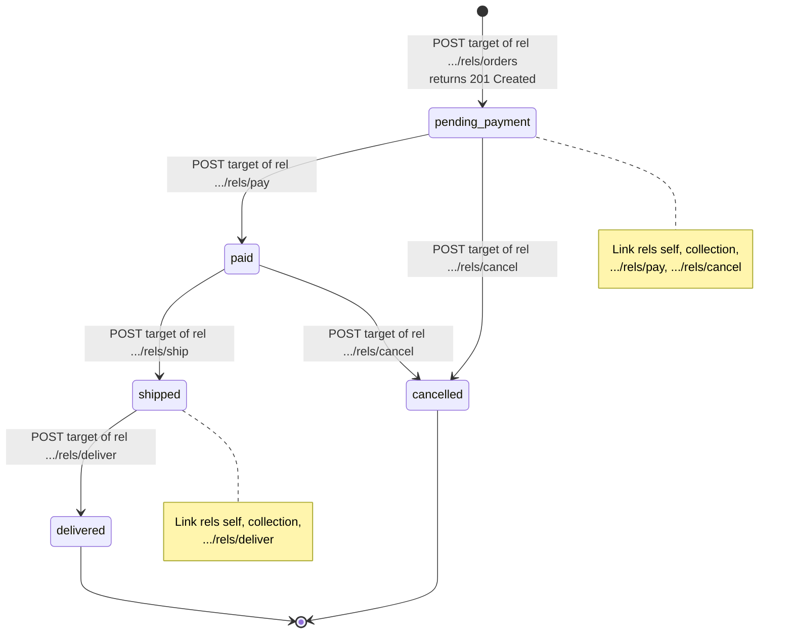

# The Richardson Maturity Model, HATEOAS State Transitions, and Web Linking (RFC 8288)

> [!summary] Claim
> A Level 3 API publishes each legal state transition as a typed link (context, relation type, target) in the representation of the current state, so a client that selects links by relation type and never builds URLs keeps working when the server changes its URL layout; the `Link` header field of RFC 8288 is the format-independent wire form of those links, and parsing it correctly takes a real quoted-string parser, not a string split.

Part of [REST and Resource Modeling](README.md) in [API Engineering](../README.md).

## TL;DR

- Mechanism: the server computes the links from the resource state (a `pending_payment` order carries `pay` and `cancel` links, a `shipped` order carries only `deliver`), and the client follows a link by relation type, so the URL namespace stays private to the server (Fielding 2008, "REST APIs must be hypertext-driven").
- Contract rule: the contract is the media type plus the relation vocabulary; each extension relation type is an absolute, lowercase URI (RFC 8288 Section 2.1.2) whose definition fixes the method and body to use, because a link alone does not say whether to `GET`, `POST`, or `DELETE` it.
- The trap: links are a snapshot, not a capability; a stale `cancel` link must still be re-validated by the server (`409 Conflict`), and a `POST` response without `Content-Location` has an anonymous link context (RFC 9110 Section 6.4.2 rule 7, RFC 8288 Section 3.2).
- Portability fact: the lab's RFC 8288 Appendix B parser and Level 3 app behave identically on CPython `3.12.16`, `3.13.18`, `3.14.10`, `3.15.2`, and free-threaded `3.15.2t` (macOS and Debian Trixie glibc and Alpine musl legs), and over real Uvicorn, Hypercorn, and Granian sockets on HTTP/1.1 and (Hypercorn, Granian) cleartext HTTP/2, while `httpx 0.28.1` `Response.links` collapses duplicate relations, does not split or case-fold `rel`, does not resolve relative targets, and can be fooled into a phantom link by a quoted `title`.
- When not to use it: if every client is generated from an OpenAPI document and ships with your release train, full hypermedia buys little; keep Level 2 plus `Link` headers for pagination and state-dependent actions, and choose gRPC or GraphQL when the consumer is a typed RPC client rather than a long-lived independent agent.

## Mental model



Each state of the order resource is also the application state of the client, and every arrow out of a state exists on the wire only as a link in the representation of that state.
The client enters with one URI (`/`), finds the `https://api.example.com/rels/orders` link, and `POST`s to its target to reach `pending_payment`, receiving `201 Created` with `Location` and `Content-Location`.
From then on the client never computes a URL: it reads the `Link` field lines (or the identical HAL `_links` or JSON:API `links`), picks the relation type it wants, and `POST`s to that link's target.
The two notes show the server-side rule the diagram encodes: the advertised set is exactly the outgoing arrows, so `pay` disappears after payment and terminal states advertise only `self` and `collection`.
Because the arrows are drawn by the server from the current state, renaming `/orders/{id}/pay` to `/api/v2/po/{id}/transitions/pay` changes no client code, and that is the decoupling Level 3 buys.

## How it works

### The four levels, as their authors stated them

Leonard Richardson introduced the model in his QCon 2008 talk as a "maturity heuristic": services are judged crudely "by seeing whether they pick zero, one, two, or three technologies" from the web stack, namely URIs, HTTP, and HTML as the carrier of hypermedia, the talk's "Level three: hypermedia" (Richardson 2008, "Act Three: The Maturity Heuristic").
Martin Fowler's 18 March 2010 article named the levels that most engineers now quote:

| Level | What it adds | Wire symptom | What it buys |
|---|---|---|---|
| 0 | HTTP as a tunnel for remote procedure invocation | every call is `POST /appointmentService`, failures are `200 OK` with an error body | nothing from the web; one opaque endpoint |
| 1 | Resources | `POST /slots/1234`, still one method | divide and conquer: each thing has an identifier |
| 2 | HTTP methods and status codes | safe `GET` for reads, `201 Created` plus `Location`, `409 Conflict` | caching, retries of safe requests, generic error handling |
| 3 | Hypermedia controls | responses carry `<link rel=... uri=...>` controls | discoverability; it "allows the server to change its URI scheme without breaking clients" |

Fowler is explicit that the model "is not a definition of levels of REST itself" and that "Roy Fielding has made it clear that level 3 RMM is a pre-condition of REST" (Fowler 2010, "The Meaning of the Levels").
The constraint behind Level 3 is the fourth uniform-interface constraint of Fielding's dissertation: "identification of resources; manipulation of resources through representations; self-descriptive messages; and, hypermedia as the engine of application state" (Fielding 2000, Section 5.1.5).
In 2008 Fielding stated the operational rules: "A REST API should be entered with no prior knowledge beyond the initial URI (bookmark) and set of standardized media types", "A REST API must not define fixed resource names or hierarchies", and a REST API "should spend almost all of its descriptive effort in defining the media type(s) ... or in defining extended relation names" (Fielding 2008).
The lab's `LAYOUT_V1` and `LAYOUT_V2` are those rules made executable: the same `HypermediaClient` completes `pay -> ship -> deliver` against both layouts, while a `HardcodedClient` that copied `/orders` and `/orders/{id}/pay` from documentation gets `404 Not Found` on the second, already at its first hard-coded `POST /orders`.
See [[Fieldings-Dissertation-and-the-Six-Constraints-of-REST]] for the derivation of the constraints; this note stays with the hypermedia constraint and its wire format.

### The link model of RFC 8288

A link "is a typed connection between two resources and is comprised of: a link context, a link relation type, a link target, and optionally, target attributes" (RFC 8288 Section 2).
It reads as a sentence: "link context has a link relation type resource at link target, which has target attributes".
The relative order of links is "not specified or significant", and there is no cardinality limit, so two `item` links from one context are both meaningful (RFC 8288 Section 2).

Relation types come in two kinds (RFC 8288 Section 2.1):

- Registered relation types are lowercase tokens from the IANA "Link Relations" registry, compared case-insensitively (RFC 8288 Section 2.1.1); the registry CSV fetched on 2026-11-10 lists 134 relation names, including `self`, `collection`, `item`, `next`, `prev`, `edit`, `payment`, `describedby`, and `profile` (as of 2026-11).
- Extension relation types are URIs that the defining party controls, compared "as strings ... in a case-insensitive fashion", so "all-lowercase URIs SHOULD be used" (RFC 8288 Section 2.1.2); clients "SHOULD NOT automatically access" the URI to learn its meaning.

The sentence that makes Level 3 workable for writes is in Section 2.1.1: registered relation types "MUST NOT constrain the media type of the link context ... However, they can specify the behaviours and properties of the target resource (e.g., allowable HTTP methods, and request and response media types that are required be supported)".
That is where the method comes from: HAL deliberately has no forms (draft-kelly-json-hal-11 Appendix B.5), and Fowler's own Level 3 example notes that `self` and `cancel` "point to the same URI - they need to figure out that one is a GET and the other a DELETE" (Fowler 2010).
The lab therefore defines a closed vocabulary in code comments and in the relation documentation: `https://api.example.com/rels/orders` means "`POST` `{"sku", "quantity"}` here to create", and `.../pay`, `.../cancel`, `.../ship`, `.../deliver` mean "`POST` with an empty body here to perform the transition".
For forms (the method and fields travel in the representation), you need a richer media type; see [[Custom-Methods-and-State-Machine-Transitions-AIP-136]] for the action-endpoint side of the same design.

### The `Link` header field on the wire

The field grammar is short (RFC 8288 Section 3):

```text
Link       = #link-value
link-value = "<" URI-Reference ">" *( OWS ";" OWS link-param )
link-param = token BWS [ "=" BWS ( token / quoted-string ) ]
```

Five rules from Section 3 drive every parser bug in the Pitfalls section:

1. Token and quoted forms are equivalent, `x=y` equals `x="y"`, and "recipients MUST be able to parse both forms" (RFC 8288 Section 3).
2. A relative target is resolved per RFC 3986 Section 5, and "any base IRI appearing in the message's content is not applied" (RFC 8288 Section 3.1).
3. `rel` "MUST be present but MUST NOT appear more than once", "occurrences after the first MUST be ignored", and a `rel` value with several space-separated types "establishes multiple links that share the same context, target, and target attributes" (RFC 8288 Section 3.3).
4. Extension relation types "are REQUIRED to be absolute URIs in Link header fields and MUST be quoted when they contain characters not allowed in tokens", which `:` and `/` already are (RFC 8288 Section 3.3, RFC 9110 Section 5.6.2 delimiters `"(),/:;<=>?@[\]{}`).
5. `media`, `title`, `title*`, and `type` keep their first occurrence, and when both `title` and `title*` (RFC 8187 encoding) appear, applications SHOULD use `title*` (RFC 8288 Section 3.4.1).

Because `Link` is a `#rule` list, one field line with two comma-separated link-values is equivalent to two field lines (RFC 8288 Section 3.5), and a recipient may combine field lines "separated by a comma" without changing semantics (RFC 9110 Section 5.3).
The lab server emits one field line per link with Starlette's `MutableHeaders.append` `(starlette 1.10.0 starlette/datastructures.py, MutableHeaders.append)`; these are the exact response header bytes captured from the lab app for `POST /orders` on CPython `3.14.6`:

```http
HTTP/1.1 201 Created
content-length: 283
content-type: application/hal+json
link: </orders/o1>; rel="self"
link: </orders>; rel="collection"
link: </orders/o1/pay>; rel="https://api.example.com/rels/pay"
link: </orders/o1/cancel>; rel="https://api.example.com/rels/cancel"
content-location: /orders/o1
location: /orders/o1
vary: Accept
```

The status line is written for readability; the lab runs in-process through `httpx.ASGITransport`, so no HTTP/1.1 bytes were framed.

### Parsing: Appendix B and its two defects

RFC 8288 Appendix B gives an advisory parsing algorithm: B.1 collects every `Link` field line, B.2 walks link-values, B.3 parses parameters, and B.4 unquotes a quoted-string by treating `\` as escaping the next character.
The lab implements it with an index-based scanner, and two places needed care:

- Verified erratum 5878 (Technical, verified 2019-10-24) corrects steps 15 and 16: the `*`-parameter replacement must operate on `target_attributes`, not on `link_parameters`, because the modified `link_parameters` is never read again (RFC 8288 errata, ID 5878).
- B.3 step 12 stops at the `,` that separates link-values without consuming it, and B.2 step 2.2 then returns because the next character is not `<`; read literally, the algorithm never parses a second link-value on the same line.
  The lab consumes exactly one `,` there; this gap is not among the six errata listed for RFC 8288 (two verified, three reported, one rejected, as of 2026-11), so treat it as this note's reading of the text.

Relation types are split on RWS (RFC 8288 Appendix B.2 step 10), which is only SP and HTAB (RFC 9110 Section 5.6.3), while the Section 3.3 ABNF `relation-type *( 1*SP relation-type )` lets senders use only SP; Python's `str.split()` would also split on `\u00a0` (NBSP) and other Unicode whitespace, while `h11` accepts byte `0xA0` in field values `(h11 0.16.0 h11/_abnf.py, vchar_or_obs_text)`, so one bogus relation type could become `.../rels/pay`; `test_rel_splits_only_on_space_and_tab` fails if `str.split()` is used (mutation re-run 2026-11-10).
The context of a header link is "the URL of the representation it is associated with" unless `anchor` overrides it (RFC 8288 Section 3.2), and RFC 9110 Section 6.4.2 decides which URL that is: a `200` response to `GET` represents the target URI (rule 2), a response with `Content-Location` represents that URI (rules 5 and 6), and otherwise "the content is unidentified by HTTP" (rule 7).
So a `POST /orders/o1/pay` that returns the updated order with links but no `Content-Location` has an anonymous link context, and a strict client cannot say which resource those links are about.
The lab's `representation_url` implements rules 2 to 7 and also treats `HEAD` like `GET`, because a `HEAD` response carries the header fields of the `GET` representation (RFC 9110 Section 9.3.2) even though rule 1 says it has no content; that extension is the lab's reading, not RFC text.
The server sets `Content-Location` on every non-`GET` representation (and on `201`, where `Location` names the created resource per RFC 9110 Section 15.3.2), and `HypermediaClient` raises `HypermediaError("anonymous link context")` on a successful response without one.

### Two body serialisations of the same links

The lab negotiates the body format on `Accept` and sends `Vary: Accept` (RFC 9110 Section 12.5.5); the header links are identical in both, and the test asserts the three serialisations yield the same `(rel, target)` set in every state.

- HAL (`application/hal+json`) puts links in `_links`, "an object whose property names are link relation types ... and values are either a Link Object or an array of Link Objects", with `href` required (draft-kelly-json-hal-11 Sections 4.1.1 and 5.1).
  HAL is an individual Internet-Draft, Intended status Informational, dated 19 October 2023 and expired 21 April 2024; it is not an RFC (as of 2026-11).
- JSON:API 1.1 (`application/vnd.api+json`) puts links in a `links` object where "a link's relation type SHOULD be inferred from the name of the link unless the link is a link object and the link object has a `rel` member" (JSON:API 1.1, Links).
  Member names may not contain `:` or `/` (JSON:API 1.1, Member Names, Reserved Characters), so an extension relation URI cannot be a member name: the lab emits `"pay": {"href": "/orders/o1/pay", "rel": "https://api.example.com/rels/pay"}`.

```json
{"_links": {"self": {"href": "/orders/o1"}, "collection": {"href": "/orders"}, "https://api.example.com/rels/pay": {"href": "/orders/o1/pay"}, "https://api.example.com/rels/cancel": {"href": "/orders/o1/cancel"}}, "id": "o1", "sku": "kb-1", "quantity": 2, "state": "pending_payment"}
```

```json
{"data": {"type": "orders", "id": "o1", "attributes": {"sku": "kb-1", "quantity": 2, "state": "pending_payment"}, "links": {"self": "/orders/o1", "collection": "/orders", "pay": {"href": "/orders/o1/pay", "rel": "https://api.example.com/rels/pay"}, "cancel": {"href": "/orders/o1/cancel", "rel": "https://api.example.com/rels/cancel"}}}}
```

Both bodies above were captured from the lab app.
Content negotiation in the lab is a substring check on `Accept`, not the full RFC 9110 Section 12.5.1 algorithm; see [[Content-Negotiation-Media-Types-and-Charsets]].

### What the Python client stack actually does with `Link`

`httpx 0.28.1` exposes `Response.links`, which reads `self.headers.get("link")` and returns a `dict` keyed by `link.get("rel") or link.get("url")` `(httpx 0.28.1 httpx/_models.py, Response.links)`.
`Headers.__getitem__` joins repeated field lines with `", "`, which is legal per RFC 9110 Section 5.3 `(httpx 0.28.1 httpx/_models.py, Headers.__getitem__)`.
The parser underneath splits the value with `re.split(", *<", value)`, then splits parameters with `params.split(";")` and each parameter with `param.split("=")`, breaking out of the loop on the first `ValueError` `(httpx 0.28.1 httpx/_models.py, _parse_header_links)`.
The lab proves five consequences on `httpx 0.28.1`: two `item` links collapse to one key; `rel="next last"` becomes the single key `"next last"`; `rel="NEXT"` is not case-folded; `</TheBook/chapter4>` stays relative; and a `title="a=b"` placed before `rel` aborts parameter parsing so `rel` is lost and the link is keyed by URL.
Worse, a quoted `title` that contains `, <https://evil.example/steal>; rel=next` produces a phantom `next` link to `https://evil.example/steal`, while the Appendix B parser yields only the one real `item` link.
The source excerpt (simplified excerpt from `(httpx 0.28.1 httpx/_models.py, _parse_header_links)`, docstring removed):

```python
links: list[dict[str, str]] = []
replace_chars = " '\""
value = value.strip(replace_chars)
if not value:
    return links
for val in re.split(", *<", value):
    try:
        url, params = val.split(";", 1)
    except ValueError:
        url, params = val, ""
    link = {"url": url.strip("<> '\"")}
    for param in params.split(";"):
        try:
            key, value = param.split("=")
        except ValueError:
            break
        link[key.strip(replace_chars)] = value.strip(replace_chars)
    links.append(link)
return links
```

On the receive side, `httpcore 1.0.9` builds its `h11.Connection` with `MAX_INCOMPLETE_EVENT_SIZE = 100 * 1024` `(httpcore 1.0.9 httpcore/_async/http11.py, AsyncHTTP11Connection)`, and `h11` raises `RemoteProtocolError("Receive buffer too long", error_status_hint=431)` once an unfinished event exceeds it `(h11 0.16.0 h11/_connection.py, Connection.next_event)`; the lab feeds 99 KiB and 101 KiB of `Link` header to an `h11` client connection and observes `NEED_DATA` and that error respectively.

## Numbers and limits

Lab measurements were taken on macOS `27.2` (`Darwin 27.2.0`, `arm64`) with CPython `3.14.6` from the workspace `.venv` (`uv run --frozen`), `starlette 1.10.0`, `httpx 0.28.1`, `httpcore 1.0.9`, `h11 0.16.0`.

| Quantity | Value | Source or measurement | Implication |
|---|---:|---|---|
| Limit on a field line or header section in HTTP | none defined | RFC 9110 Section 5.4 ("HTTP does not place a predefined limit") | every limit below is an implementation choice |
| `httpcore` HTTP/1.1 client cap on an unfinished event | `102400` bytes | `(httpcore 1.0.9 httpcore/_async/http11.py, AsyncHTTP11Connection)`; lab: 99 KiB -> `NEED_DATA`, 101 KiB -> `Receive buffer too long` | a response whose header block (all `Link` lines included) exceeds 100 KiB fails in `httpx` |
| `h11` default `max_incomplete_event_size` | `16384` bytes | `(h11 0.16.0 h11/_connection.py, DEFAULT_MAX_INCOMPLETE_EVENT_SIZE)`; used by Uvicorn unless `h11_max_incomplete_event_size` is set `(uvicorn 0.54.0 uvicorn/protocols/http/h11_impl.py, H11Protocol.__init__)` | bounds request headers on a Uvicorn `h11` server, not response `Link` headers |
| `parse-link-header` input cap after CVE-2021-23490 | `2000` characters (`PARSE_LINK_HEADER_MAXLEN`) | fix commit `72f05c7` in `thlorenz/parse-link-header` | the ReDoS fix was a length cap, so longer legitimate headers return `null` |
| CVE-2021-23490 severity | CVSS 3.1 `7.5` (`AV:N/AC:L/PR:N/UI:N/S:U/C:N/I:N/A:H`), CWE-1333 | NVD record | a header-only input can exhaust a regex-based parser |
| IANA registered relation names | `134` | `link-relations-1.csv` fetched 2026-11-10 (as of 2026-11) | check the registry before minting an extension URI |
| `Link` bytes for an order, joined with `", "` | `175` (`pending_payment`), `177` (`paid`), `119` (`shipped`), `53` (`delivered`) | lab test `test_link_header_bytes_per_state_track_the_advertised_transitions` | hypermedia overhead is O(number of legal transitions), here under 200 bytes |
| HAL body for the same `pending_payment` order | `283` bytes (`content-length`) | captured from `POST /orders` in the lab | sending links in both header and body roughly doubles link bytes |
| Mutations of the lab implementation caught | `44` runs, all caught | two independent rounds on 2026-11-10, one source edit at a time, `uv run --frozen pytest <this test>`, source restored and sha256-checked: round one `28` of `28` after five survivors (empty `rel`, non-token parameter name, space in target, space inside one extension `rel`, trailing OWS) got new assertions; round two `16` mutations (drop `Vary`, accept every transition, drop `Content-Location`, unescaped backslash, `HEAD` not like `GET`, allow non-ASCII, no `rel` case-fold, `follow` ignoring link context, `409` -> `400`, extra `pay` transition from `paid`, `LAYOUT_V2` equal to V1, URI as JSON:API member name, no `Location` on `201`, cross-origin targets trusted, non-problem media type, Level 0 tunnel returning `409`) killed `15` first time and `follow` ignoring link context survived until `test_client_follows_only_links_whose_context_is_the_representation_it_holds` was added | each named behavior is enforced by at least one failing test |

## Portability

macOS legs ran on `Darwin 27.2.0` `arm64`; Linux legs ran in Docker `29.8.2` (OrbStack) on the same machine, so they are `aarch64` Linux.
Each leg ran `tests/f04_rest_and_resource_modeling/test_richardson_maturity_model_hateoas_and_web_linking_rfc_8288.py -q` on 2026-11-10 against the locked dependency set (`uv run --frozen`), so every leg ran `starlette 1.10.0`, `httpx 0.28.1`, `httpcore 1.0.9`, and `h11 0.16.0`, except the free-threaded legs below.

| Dimension | Version or target | Behavior and evidence |
|---|---|---|
| CPython `3.12` | `3.12.16` (container `ghcr.io/astral-sh/uv:python3.12-trixie`, Debian 13, glibc `2.41`) and `3.12.13` (macOS, uv-managed) | `36 passed in 0.35s` and `36 passed in 0.18s` |
| CPython `3.13` | `3.13.18` (macOS, Homebrew) | `36 passed in 0.20s` |
| CPython `3.14` | `3.14.6` (workspace `.venv`), `3.14.10` (macOS, Homebrew; container Debian 13 glibc `2.41`; container Alpine musl) | `36 passed in 0.14s`, `36 passed in 0.19s`, `36 passed in 0.15s`, and `36 passed in 0.15s`; `enum.StrEnum` and `str.removeprefix` used by the lab exist on every leg |
| CPython `3.15` | `3.15.2` (macOS, Homebrew; container Debian 13 glibc `2.41`) | `36 passed in 0.21s` and `36 passed in 0.16s`; the uv-managed `3.15.0b3` project leg fails at plugin import (`ModuleNotFoundError: No module named 'hypothesis._native'`) before collecting any test, so it is not a result for this lab |
| CPython `3.15.2t` free-threaded | `3.15.2+freethreaded` (container `uv python install 3.15t`, Debian 13, glibc `2.41`), `sys._is_gil_enabled()` -> `False` | `36 passed in 0.21s` with only `starlette 1.10.0`, `httpx 0.28.1`, `httpcore 1.0.9`, `h11 0.16.0`, `anyio 4.16.0`, `pytest 9.2.0`, `pytest-asyncio 1.4.1.post1` installed (`uv run --no-project`), because `psycopg-binary 3.3.8` ships only `cp310` to `cp315` wheels, no free-threaded one (PyPI file list, 2026-11-10); also macOS `3.14.6t` with the same pins: `36 passed in 0.29s`, GIL off |
| Containers | Debian Trixie (glibc `2.41`), Alpine (musl, `ghcr.io/astral-sh/uv:python3.14-alpine`) | `3.14.10` `36 passed` on both, full locked environment (`194` packages) installed with `uv run --frozen` inside the container; Alpine reports `platform.libc_ver()` -> `('musl', '1')` |
| `httpx` `Response.links` | `0.28.1` | Lab-proven lossy behavior (five cases above); the test pins `httpx.__version__ == "0.28.1"` so an upgrade forces a re-check |
| Starlette | `1.10.0` | `MutableHeaders.append` emits one field line per link; `Route(methods=["POST"])` answers `GET` with `405` and `Allow: POST` `(starlette 1.10.0 starlette/routing.py, Route.handle)`, lab-asserted |
| Uvicorn | `0.54.0` (macOS, CPython `3.14.6`, `--http auto`, which selects `httptools 0.9.0` because it is importable `(uvicorn 0.54.0 uvicorn/protocols/http/auto.py, AutoHTTPProtocol)`) | Real socket, `httpx` client: full `place_order -> pay -> ship -> deliver` flow ends in `delivered`; `POST /orders` -> `HTTP/1.1` `201`, `4` separate `link` field lines, `content-length: 283`, same four `(rel, target)` pairs as in-process; `HTTP_PROTOCOLS` offers only `auto`, `h11`, `httptools`, `zttp`, so there is no HTTP/2 leg `(uvicorn 0.54.0 uvicorn/config.py, HTTP_PROTOCOLS)` |
| Hypercorn | `0.18.0` (macOS, CPython `3.14.6`) | Same flow and same `283`-byte, four-line result over `HTTP/1.1` and over cleartext `HTTP/2` (`h2` prior knowledge, `httpx` `http1=False, http2=True`, reported `http_version=HTTP/2`) |
| Granian | `2.8.7` (macOS, CPython `3.14.6`, `--interface asgi`) | Same flow and same result over `--http 1` (`HTTP/1.1`) and `--http 2` (`HTTP/2` cleartext) |
| HTTP/1.1, HTTP/2, HTTP/3 | all | `Link` semantics are version-independent because RFC 9110 defines fields in an abstract message model "independent of the HTTP version" (RFC 9110 Section 6); HTTP/1.1 and HTTP/2 (cleartext) were run above; HTTP/2 requires validating field values and treating CR, LF, or NUL as malformed (RFC 9113 Section 8.2.1); HTTP/3 was not run, and RFC 9114 Section 4.2 adds rules for field-name case, connection-specific fields, and pseudo-header fields, none of which a lowercase `link` field line breaks |
| `103 Early Hints` | RFC 8297 (Experimental) | a client "might recognize a Link header field value containing the relation type `preload`" in a `103` response (RFC 8297 Section 2); see [[103-Early-Hints-and-Informational-Responses]] |

The server legs ran the lab app through `uvicorn app_mod:app`, `hypercorn --bind`, and `granian --interface asgi` on loopback with a throwaway module `app_mod.py` containing `app = build_order_app()`; they used real sockets on `127.0.0.1`, no TLS, so ALPN-negotiated HTTP/2 over TLS was not exercised.

## Worked example

The [implementation](../labs/src/api_labs/f04_rest_and_resource_modeling/hypermedia_links.py) contains the Appendix B parser, a validating serializer, the RFC 9110 Section 6.4.2 context rule, the Level 3 order app with two URL layouts and a Level 0 tunnel, and the link-following client; the [test](../labs/tests/f04_rest_and_resource_modeling/test_richardson_maturity_model_hateoas_and_web_linking_rfc_8288.py) has 36 cases.

The parser loop, verbatim from the implementation:

```python
def parse_link_value(field_value: str, *, base: str, context: str | None) -> list[Link]:
    """RFC 8288 Appendix B.2: parse one Link field value into links.

    `base` resolves relative references (RFC 8288 Section 3.1); `context` is the URL the
    representation identifies (RFC 9110 Section 6.4.2), or None when it is anonymous.
    """
    links: list[Link] = []
    s, i = field_value, 0
    while i < len(s):
        i = _skip_ows(s, i)
        if i >= len(s) or s[i] != "<":
            return links
        end = s.find(">", i + 1)
        if end == -1:
            return links
        target = urljoin(base, s[i + 1 : end])
        params, i = _parse_parameters(s, end + 1)
        anchor = _first(params, "anchor")
        link_context = urljoin(base, anchor) if anchor is not None else context
        attrs: list[tuple[str, str]] = []
        for name, value in params:
            if name in ("rel", "anchor"):
                continue
            if name in _SINGLETON_ATTRS and any(key == name for key, _ in attrs):
                continue
            attrs.append((name, value))
        for star in sorted({key for key, _ in attrs if key.endswith("*")}):
            plain = star[:-1]
            attrs = [(plain if k == star else k, v) for k, v in attrs if k != plain]
        for rel in _RWS_RE.split((_first(params, "rel") or "").strip(_OWS)):
            if not rel:
                continue
            links.append(Link(target, rel.lower(), link_context, tuple(attrs)))
    return links
```

The server builds links from state, so the advertised set is exactly the legal transitions:

```python
def order_links(layout: UrlLayout, order: Order) -> list[tuple[str, str]]:
    """(rel, target) pairs for an order: exactly the transitions legal in its current state."""
    url = layout.order_url(order.order_id)
    pairs = [("self", url), ("collection", layout.collection)]
    pairs += [(rel, layout.action_url(order.order_id, rel)) for rel in TRANSITIONS[order.state]]
    return pairs
```

The client never builds a URL; it can only follow a link whose context is the representation it holds:

```python
    def follow(self, rep: Representation, rel: str) -> str:
        for link in rep.links:
            if rep.url is not None and link.rel == rel.lower() and link.context == rep.url:
                return link.target
        raise HypermediaError(f"no {rel!r} link from {rep.url}; available: {sorted(rep.rels())}")
```

The decoupling claim, verbatim from the test:

```python
@pytest.mark.unit
@pytest.mark.asyncio
@pytest.mark.parametrize("layout", [LAYOUT_V1, LAYOUT_V2], ids=["v1", "v2"])
async def test_link_driven_client_survives_a_url_layout_change(layout: UrlLayout) -> None:
    async with _client(layout) as http:
        client = HypermediaClient(http, "/")
        rep = await client.place_order("kb-1", 1)
        assert rep.status == 201
        for rel in (REL_PAY, REL_SHIP, REL_DELIVER):
            rep = await client.transition(rep, rel)
            assert rep.status == 200
        assert rep.body["state"] == "delivered"
        assert rep.rels() == {"self", "collection"}
        assert rep.url == BASE + layout.order_url("o1")
        with pytest.raises(HypermediaError, match=re.escape(f"no {REL_CANCEL!r} link")):
            client.follow(rep, REL_CANCEL)
```

Captured run (`uv run --frozen pytest tests/f04_rest_and_resource_modeling/test_richardson_maturity_model_hateoas_and_web_linking_rfc_8288.py -v -p no:cacheprovider --no-cov` in `labs/`, CPython `3.14.6`, macOS `27.2` `arm64`, run 2026-11-10; node ids shortened to the test name, and the interpreter path, rootdir, and plugin lines of the session header omitted):

```text
platform darwin -- Python 3.14.6, pytest-9.2.0, pluggy-1.7.0
collected 36 items
test_parser_matches_rfc_8288_section_3_5_examples PASSED [  2%]
test_parameter_rules_token_equals_quoted_first_singleton_wins_star_wins PASSED [  5%]
test_quoted_comma_and_angle_bracket_cannot_inject_a_phantom_link PASSED [  8%]
test_httpx_0_28_1_links_property_loses_information[same-rel-collapses] PASSED [ 11%]
test_httpx_0_28_1_links_property_loses_information[multi-rel-unsplit] PASSED [ 13%]
test_httpx_0_28_1_links_property_loses_information[rel-not-case-folded] PASSED [ 16%]
test_httpx_0_28_1_links_property_loses_information[equals-in-title-drops-rel] PASSED [ 19%]
test_httpx_0_28_1_does_not_resolve_relative_targets PASSED [ 22%]
test_serializer_quotes_hostile_titles_so_they_round_trip PASSED [ 25%]
test_serializer_rejects_links_that_would_break_the_field_grammar[crlf-in-target] PASSED [ 27%]
test_serializer_rejects_links_that_would_break_the_field_grammar[angle-bracket-in-target] PASSED [ 30%]
test_serializer_rejects_links_that_would_break_the_field_grammar[space-in-target] PASSED [ 33%]
test_serializer_rejects_links_that_would_break_the_field_grammar[iri-not-converted-to-uri] PASSED [ 36%]
test_serializer_rejects_links_that_would_break_the_field_grammar[relative-extension-rel] PASSED [ 38%]
test_serializer_rejects_links_that_would_break_the_field_grammar[uppercase-extension-rel] PASSED [ 41%]
test_serializer_rejects_links_that_would_break_the_field_grammar[space-inside-one-extension-rel] PASSED [ 44%]
test_serializer_rejects_links_that_would_break_the_field_grammar[no-rel] PASSED [ 47%]
test_serializer_rejects_links_that_would_break_the_field_grammar[param-name-not-a-token] PASSED [ 50%]
test_serializer_rejects_links_that_would_break_the_field_grammar[lf-in-title] PASSED [ 52%]
test_serializer_rejects_links_that_would_break_the_field_grammar[anchor-param] PASSED [ 55%]
test_serializer_rejects_links_that_would_break_the_field_grammar[anchor-param-mixed-case] PASSED [ 58%]
test_serializer_rejects_links_that_would_break_the_field_grammar[rel-param-uppercase] PASSED [ 61%]
test_anchor_keyword_sets_the_link_context_explicitly PASSED [ 63%]
test_rel_splits_only_on_space_and_tab PASSED [ 66%]
test_representation_url_applies_rfc_9110_section_6_4_2 PASSED [ 69%]
test_links_advertise_exactly_the_legal_transitions_in_three_serialisations PASSED [ 72%]
test_link_driven_client_survives_a_url_layout_change[v1] PASSED [ 75%]
test_link_driven_client_survives_a_url_layout_change[v2] PASSED [ 77%]
test_hardcoded_client_breaks_on_the_same_layout_change PASSED [ 80%]
test_stale_link_gets_409_problem_with_self_link_and_refresh_drops_it PASSED [ 83%]
test_level_0_tunnel_reports_failure_as_200_while_level_3_returns_409 PASSED [ 86%]
test_client_refuses_anonymous_context_and_cross_origin_links PASSED [ 88%]
test_client_never_follows_links_from_an_anonymous_error_response PASSED [ 91%]
test_client_follows_only_links_whose_context_is_the_representation_it_holds PASSED [ 94%]
test_httpcore_h11_client_caps_an_unfinished_header_block_at_100_kib PASSED [ 97%]
test_link_header_bytes_per_state_track_the_advertised_transitions PASSED [100%]
============================== 36 passed in 0.14s ==============================
```

The stale-link test is the one to read twice: Alice holds a `pending_payment` representation with a `cancel` link, another actor pays and ships, and Alice's `POST` to the stale `cancel` target returns `409 Conflict` as `application/problem+json` (RFC 9457) with `detail` `"cancel is not available in state shipped"`; the refreshed representation offers only `deliver`.
The recovery link on that `409` is `Link: </orders/o1>; rel="self"; anchor="/orders/o1"`: a `409` to `POST` does not represent the order, so without `anchor` its context would be anonymous (RFC 9110 Section 6.4.2 rule 7, RFC 8288 Section 3.2), and the client refuses to follow any link from an anonymous representation (`test_client_never_follows_links_from_an_anonymous_error_response`).

## Pitfalls

> [!warning] Splitting `Link` on `,` and `;`
> Trigger: a hand-rolled or library parser that splits the field value before honouring quoted-strings, such as `httpx 0.28.1` `_parse_header_links`.
> Symptom: titles containing `;` or `=` drop the `rel`; a title containing `, <...>` creates a phantom link; the lab shows `httpx` returning `next` -> `https://evil.example/steal` from a single `item` link.
> Fix: parse with the RFC 8288 Appendix B state machine (lab `parse_link_value`), or never let attacker-influenced text into `title`.

> [!warning] Keying parsed links by `rel`
> Trigger: `dict` keyed by relation type, as in `httpx` `Response.links`.
> Symptom: the second `item` link silently replaces the first, and `rel="next last"` is a single unknown key, although RFC 8288 Section 2 allows any cardinality and Section 3.3 defines multi-type `rel`.
> Fix: model links as a list of `(context, rel, target, attributes)` and filter.

> [!warning] Regex parsers and unbounded headers (CVE-2021-23490)
> Trigger: `parse-link-header` before `2.0.0` ran backtracking regexes such as `/\s*(.+)\s*=\s*"?([^"]+)"?/` (`createObjects`) and `/<?([^>]*)>(.*)/` (`parseLink`) over attacker-supplied `Link` values of any length (`index.js` at the parent of `72f05c7`).
> Symptom: Regular Expression Denial of Service, CVSS 3.1 `7.5`, CWE-1333 (NVD); NVD's description says "via the checkHeader function", but `checkHeader` is the length guard that the fix commit itself added.
> Fix: the upstream fix capped input at `2000` characters (commit `72f05c7`); prefer a linear scanner and an explicit header budget, and remember `httpcore` already fails above 100 KiB.

> [!warning] Relative or uppercase extension relation types
> Trigger: copying Fowler's illustrative `rel = "/linkrels/slot/book"` or minting `https://API.example.com/Rels/Pay`.
> Symptom: RFC 8288 Section 3.3 requires absolute URIs in the `Link` field, and case-insensitive comparison (Section 2.1.2) means two spellings of one relation type in docs and code drift apart.
> Fix: absolute, lowercase URIs under a domain you control; the lab serializer raises `LinkSyntaxError` for both.

> [!warning] Links on a `POST` response without `Content-Location`
> Trigger: a transition endpoint returns the updated resource with `Link` headers but no `Content-Location`.
> Symptom: by RFC 9110 Section 6.4.2 rule 7 the content is unidentified, so the link context is anonymous (RFC 8288 Section 3.2) and a strict client cannot attach the links to the order; the lab mutation that stops the server sending `Content-Location` makes four tests fail.
> Fix: send `Content-Location` naming the resource the body represents, or answer `303 See Other` with `Location` set to the resource (RFC 9110 Section 15.4.4).

> [!warning] Following links from an error response
> Trigger: a client matches links by relation type only, and a `404` or `409` without `Content-Location` carries `Link: </orders/o1/pay>; rel=".../rels/pay"`.
> Symptom: the representation URL and every link context are both null, so a naive `context == rep.url` check compares `None == None` and the client `POST`s a payment from an error page; `test_client_never_follows_links_from_an_anonymous_error_response` pins the refusal.
> Fix: never follow a link whose context is anonymous; servers that want to offer recovery links on errors set `anchor` explicitly.

> [!warning] Treating an advertised link as authorization
> Trigger: the server hides `cancel` for shipped orders and skips the state check on `POST .../cancel` because "the client cannot see the link".
> Symptom: any client with a stale or guessed URL performs an illegal transition; the lab mutation that makes the state machine accept every transition fails both `409` tests.
> Fix: re-validate state (and ownership, see Security) on every transition request; the link is a hint about the snapshot, the server is the authority.
> Use `If-Match` to make the precondition explicit: [[Optimistic-Concurrency-Control-If-Match-and-412-Precondition-Failed]].

> [!warning] Flipping a HAL link between object and array
> Trigger: one `item` is serialised as an object, two as an array.
> Symptom: clients coupled to one shape break; HAL says servers "SHOULD NOT change the property between a Link Object and array of Link Objects" for a given relation (draft-kelly-json-hal-11 Section 4.1.1).
> Fix: decide per relation, document it, and keep it; JSON:API has the same issue with string versus link object.

## Security and robustness

- Untrusted `anchor` (RFC 8288 Section 5): header links with `anchor` "are effectively assertions by a third party that could be incorrect or malicious", and the mitigation is to discard it "unless some relationship between the resources is established (e.g., they share the same authority)"; `HypermediaClient` drops any link whose context origin differs from the entry point (removing that check fails `test_client_refuses_anonymous_context_and_cross_origin_links`) and `follow` accepts only links whose context equals the representation URL it holds (removing that comparison fails `test_client_follows_only_links_whose_context_is_the_representation_it_holds`), and its serializer accepts `anchor` only through a dedicated keyword, rejecting `anchor` or `Anchor` smuggled in the generic parameter list (a case-sensitive check fails two cases), because parameter names are case-insensitive and the parser lower-cases them (RFC 8288 Appendix B.3 step 9).
- Following links is outbound fetching: a client that dereferences any `Link` target is an SSRF and credential-leak vector; when that client runs inside your API this is OWASP API7:2023 Server Side Request Forgery, and trusting what an upstream API returns, links included, is OWASP API10:2023 Unsafe Consumption of APIs; RFC 8288 Section 5 names `Referer` and cookies as the leaks.
  The lab client refuses cross-origin targets (removing the target-origin check fails a test); production clients also need redirect, scheme, and private-address controls, see [[Preventing-SSRF-API7-2023-DNS-Pinning-and-Private-CIDR-Socket-Guards]] and [[Improper-Inventory-Management-API9-2023-and-Unsafe-Consumption-of-APIs-API10-2023]].
- Header injection on the way out: a target or `title` containing CR or LF splits the response; the lab serializer rejects controls and non-ASCII (IRIs must be converted to URIs, RFC 8288 Section 6), and on HTTP/2 a field value with CR, LF, or NUL is malformed (RFC 9113 Section 8.2.1); see [[HTTP-Request-Smuggling-CL-TE-and-Desync-Mechanics]].
- Parser differentials: if a gateway parses `Link` with an Appendix B parser and the client with `httpx`, they disagree on which links exist (lab phantom-link test); pick one parser per trust boundary.
- Object-level authorization: hypermedia does not change OWASP API1:2023 Broken Object Level Authorization; a link to `/orders/o2` is not permission to read `o2`, so every handler checks ownership; see [[Defeating-BOLA-API1-2023-Tenant-Scoped-Queries-and-PostgreSQL-RLS]].
- Resource consumption: bound the number of links per representation (the lab's links are O(legal transitions)) and the header size, because no HTTP limit exists (RFC 9110 Section 5.4) and the first limit hit may be a client's.
- `Vary`: when link sets or formats depend on `Accept` or on the caller's identity, the response must say so (`Vary: Accept`, RFC 9110 Section 12.5.5) or be `private`, or a shared cache can serve one user's transitions to another.

## The principal's view

The decision is not "Level 2 or Level 3" for the whole API; it is which state machines the server must be free to change without a client release.
Pagination is the canonical case where everyone already ships Level 3: GitHub's REST API returns `link: <...page=2>; rel="prev", <...page=4>; rel="next", ...` and documents that "you can use the link header from the response to request additional pages of data" (GitHub Docs, "Using pagination in the REST API"), see [[Offset-Limit-Pagination-Mechanics-Cost-and-Window-Drift]].
Workflow resources (orders, payments, approvals, provisioning) are the second case: advertising legal transitions moves the state machine to one place, lets UIs render buttons from links, and lets the server add a `refund` transition that old clients ignore and new clients discover.
The organizational cost is real: you must govern a relation vocabulary (names, methods, bodies, deprecation via [[Deprecation-Header-RFC-9745-and-Sunset-Header-RFC-8594]]), keep link generation centralized so the three serialisations cannot drift, and test that clients really ignore URL structure, which generated SDKs rarely do.
OpenAPI-first organizations typically get the benefits more cheaply with Level 2 plus targeted `Link` headers and OpenAPI `links` for documentation and stateful testing; see [[Stateful-API-State-Machine-Testing-with-OpenAPI-Links-and-Schemathesis]].
Choose full hypermedia when clients are long-lived and independently deployed (partner integrations, devices, agents) and the server needs to evolve URLs and workflows unilaterally.
Choose gRPC or GraphQL when consumers are typed, co-deployed internal callers whose contract is a schema, not a navigable graph, and accept that you have traded discoverability for codegen; see [[Architectural-Paradigm-Selection-REST-vs-gRPC-vs-GraphQL-vs-JSON-RPC-vs-Events]].
In design reviews, ask three questions: where is the relation vocabulary documented, what proves a client never builds URLs, and does every transition handler re-check state and ownership regardless of links.

## Interview questions

> [!question] L5: What does each Richardson level add, and which one is a precondition of REST according to Fielding?
>
> > [!success]- Answer
> > Level 0 tunnels procedure calls through one URI, Level 1 adds addressable resources, Level 2 uses HTTP methods and status codes as defined, and Level 3 adds hypermedia controls.
> > Fowler notes that Fielding treats Level 3 as a precondition of REST, because hypermedia as the engine of application state is one of the four uniform-interface constraints (Fielding 2000, Section 5.1.5).
> > The model is a learning heuristic, not a certification.
> >
> > Follow-up: Which Level 2 property does a Level 0 API lose for intermediaries, concretely?

> [!question] L5: In `Link: </orders/o1/pay>; rel="https://api.example.com/rels/pay"`, what are the context, relation type, and target?
>
> > [!success]- Answer
> > The target is `/orders/o1/pay` resolved against the request URI (RFC 8288 Section 3.1).
> > The relation type is the extension URI, compared case-insensitively (RFC 8288 Section 2.1.2).
> > The context is the URL of the representation the header belongs to (RFC 8288 Section 3.2), which RFC 9110 Section 6.4.2 decides: the target URI for `GET` `200`, the `Content-Location` value otherwise, or anonymous.
> >
> > Follow-up: Why must that relation type be quoted, while `rel=next` need not be?

> [!question] L5: Why is the `rel` value quoted in the lab serializer even for `self`?
>
> > [!success]- Answer
> > Token and quoted forms are equivalent for recipients (RFC 8288 Section 3), so quoting is always safe.
> > Extension relation types contain `:` and `/`, which are delimiters outside `tchar` (RFC 9110 Section 5.6.2), so they must be quoted, and a multi-type `rel` contains spaces.
> > Always quoting removes a branch where a later edit could emit an invalid token.
> >
> > Follow-up: Which parameter did RFC 8288 Appendix C say "now needs to be quoted" and why?

> [!question] L6: Predict the output of this snippet on `httpx 0.28.1`.
>
> ```python
> import httpx
> r = httpx.Response(200, request=httpx.Request("GET", "https://example.org/a"),
>     headers={"link": '<https://example.org/1>; rel="item"; title="x, <https://evil.example/s>; rel=next"'})
> print(sorted(r.links))
> ```
>
> > [!success]- Answer
> > It prints `['item', 'next']`, and `r.links["next"]["url"]` is `https://evil.example/s`.
> > `_parse_header_links` splits on `", *<"` before honouring the quoted-string, so the title's contents become a second link-value.
> > An RFC 8288 Appendix B parser yields one `item` link whose `title` is the whole quoted string; the lab test `test_quoted_comma_and_angle_bracket_cannot_inject_a_phantom_link` asserts both behaviors.
> >
> > Follow-up: Where in your stack could attacker-controlled text reach a `title`, and what would a pagination client do with the phantom `next`?

> [!question] L6: Debug this API: after `POST /orders/o1/pay` returns `200` with correct `Link` headers, the strict client raises "anonymous link context"; what is wrong, and what are the fixes?
>
> > [!success]- Answer
> > A `200` response to `POST` without `Content-Location` carries unidentified content (RFC 9110 Section 6.4.2 rule 7), so its header links have no context (RFC 8288 Section 3.2).
> > The client cannot know the links are about `/orders/o1` rather than about the `pay` action result.
> > Fix one: send `Content-Location: /orders/o1`; fix two: return `303 See Other` with `Location: /orders/o1`, an "indirect response to the original request" that the client retrieves with `GET` (RFC 9110 Section 15.4.4); the lab mutation that drops `Content-Location` reproduces the failure.
> >
> > Follow-up: Does `201 Created` with `Location` alone give the body's links a context?

> [!question] L6: A client follows a stale `cancel` link after the order has shipped; what should happen, and why?
>
> > [!success]- Answer
> > The server must re-check the state machine and answer `409 Conflict`, which RFC 9110 Section 15.5.10 defines for a request that conflicts with the current state of the target resource.
> > The body should be problem details (RFC 9457) explaining the conflict, and a `self` link anchored to the order (`anchor="/orders/o1"`, because a `409` has an anonymous link context) lets the client re-fetch and see that only `deliver` is offered.
> > Links describe a snapshot; they are not capabilities, so hiding a link is never a substitute for the check.
> >
> > Follow-up: How would `If-Match` with an `ETag` change the status code and the race window?

> [!question] L6: Why can a JSON:API document not use `https://api.example.com/rels/pay` as a `links` member name, and what do you do instead?
>
> > [!success]- Answer
> > JSON:API 1.1 reserves `:` and `/` in member names, so a URI cannot be a member name.
> > Use a short member name such as `pay` with a link object whose `rel` member carries the full relation URI, because "a link's relation type SHOULD be inferred from the name of the link unless the link is a link object and the link object has a `rel` member".
> > HAL has no such restriction, which is why the lab's HAL and JSON:API bodies differ in shape but yield the same `(rel, target)` set.
> >
> > Follow-up: Which of HAL's link object members has no JSON:API equivalent, and does it matter for clients?

> [!question] L7+: Your organization wants "HATEOAS everywhere" across 300 services; what do you mandate, and what do you refuse?
>
> > [!success]- Answer
> > Mandate a governed relation vocabulary (absolute lowercase URIs, each with method, body, and response documented), one shared link-generation library per language, and `Link` headers for pagination and state-dependent actions.
> > Mandate server-side re-validation of every transition and ownership, plus contract tests that run a link-only client against a server with randomized URL layouts, which is what the lab's `LAYOUT_V2` does in miniature.
> > Refuse full hypermedia for co-deployed internal RPC where codegen from a schema is the real contract, and refuse to treat link presence as authorization.
> >
> > Follow-up: How do you detect clients that build URLs anyway, before you change a URL layout?

> [!question] L7+: Where do HTTP header size limits interact with hypermedia, and how do you keep a representation within budget?
>
> > [!success]- Answer
> > HTTP defines no size limit (RFC 9110 Section 5.4), so the first limit is whichever implementation is smallest: `httpcore 1.0.9` fails above `102400` bytes of unfinished header block, and proxies have their own limits.
> > Keep links O(legal transitions) in headers, move large or collection-sized link sets into the body (HAL `_links` or JSON:API `links`) or into paginated subresources, and budget-check in the serializer.
> > The lab's order needs at most `177` bytes of `Link` header, which is why per-resource transition links are cheap while per-item collection links in headers are not.
> >
> > Follow-up: What does a client do if `Link` and the body disagree?

> [!question] L7+: Is the Appendix B algorithm in RFC 8288 normative, and what did you find when implementing it literally?
>
> > [!success]- Answer
> > No: Appendix B says the algorithms are "advisory only" and the body of the specification defines correct behavior.
> > Taken literally, steps 15 and 16 edit `link_parameters` after `target_attributes` was built, which verified erratum 5878 corrects.
> > B.3 step 12 also stops at the separating `,` without consuming it, so B.2 step 2 would stop after the first link-value; an implementation must consume it.
> >
> > Follow-up: How would you get such a fix into the specification, and what does an errata status of Verified versus Reported mean for implementers?

## Related

Prerequisites: [[Fieldings-Dissertation-and-the-Six-Constraints-of-REST]]

Next: [[Resource-Oriented-Design-Collections-Resources-and-Subresources]]

See also: [[REST-APIs]], [[02-Programming-Languages/Python/Python-Backend-Interview-Prep/05-REST-API-Design]], [[Reading-Fieldings-2000-Dissertation-Why-REST-Was-Written-for-the-Web-and-Where-JSON-APIs-Diverged]], [[Custom-Methods-and-State-Machine-Transitions-AIP-136]], [[HTTP-Method-Semantics-Safety-and-Idempotency-Invariants]], [[HTTP-Status-Code-Taxonomy-and-Selection-Decision-Trees]], [[URI-Syntax-Resolution-and-Templates-RFC-6570]], [[Structured-Field-Values-for-HTTP-RFC-9651]], [[Content-Negotiation-Media-Types-and-Charsets]], [[HTTP-Message-Abstraction-RFC-9110]], [[103-Early-Hints-and-Informational-Responses]], [[Offset-Limit-Pagination-Mechanics-Cost-and-Window-Drift]], [[Stateful-API-State-Machine-Testing-with-OpenAPI-Links-and-Schemathesis]], [[API-Discovery-and-Well-Known-API-Catalog-RFC-9727]], [[Optimistic-Concurrency-Control-If-Match-and-412-Precondition-Failed]], [[Architectural-Paradigm-Selection-REST-vs-gRPC-vs-GraphQL-vs-JSON-RPC-vs-Events]]

- Lab: `labs/tests/f04_rest_and_resource_modeling/test_richardson_maturity_model_hateoas_and_web_linking_rfc_8288.py`

## Further reading

- RFC 8288, Web Linking (October 2017, obsoletes RFC 5988): the link model, the `Link` field grammar, and the Appendix B parsing algorithm.
- RFC 8288 errata: erratum 5878 (Verified) fixes the `*`-parameter steps of Appendix B.2.
- RFC 9110, HTTP Semantics: Section 6.4.2 decides the link context, Section 5.3 and 5.4 govern field combination and limits, Section 15.5.10 defines `409`.
- RFC 8187, Indicating Character Encoding and Language for HTTP Header Field Parameters: the `title*` encoding; producers must use UTF-8.
- RFC 9457, Problem Details for HTTP APIs: the error body format for a refused transition.
- IANA Link Relation Types registry: check here before inventing a relation name.
- Fielding 2000, Chapter 5 of "Architectural Styles and the Design of Network-based Software Architectures": the four uniform-interface constraints, including hypermedia as the engine of application state.
- Fielding 2008, "REST APIs must be hypertext-driven": the author's operational rules for what a REST API must not do.
- Richardson 2008, "Justice Will Take Us Millions Of Intricate Moves", Act Three: the original maturity heuristic and "links and forms".
- Fowler 2010, "Richardson Maturity Model": the canonical four-level write-up and its caveat about what the levels do not mean.
- draft-kelly-json-hal-11: the HAL media type, `_links`, curies, and why it has no forms.
- JSON:API 1.1: links, link objects, and member name rules.
