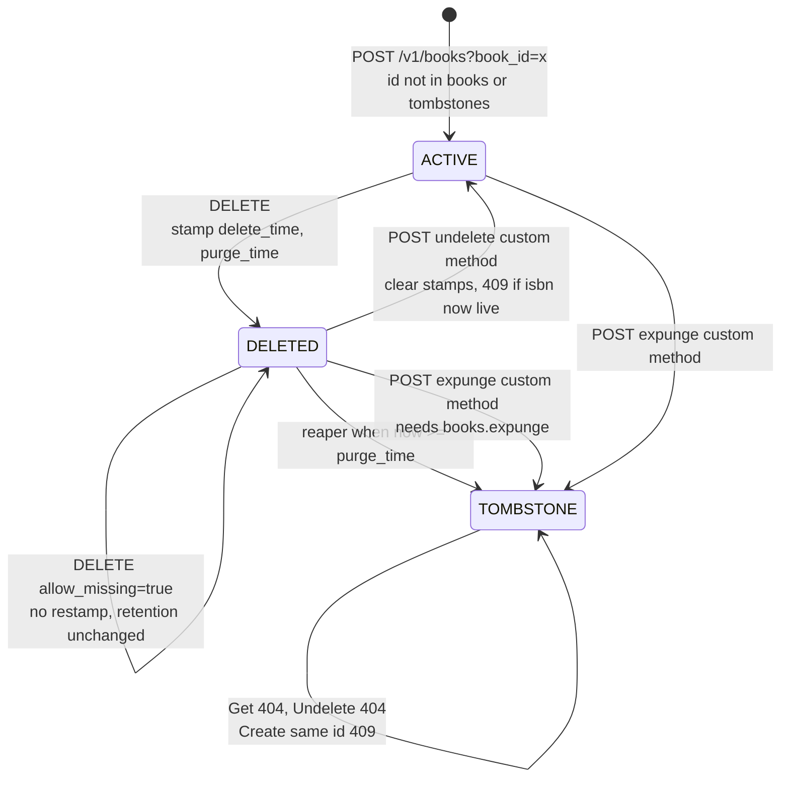

# Soft Delete, Undelete, Tombstones, and Purge Retention Windows (Google AIP-164)

> [!summary] Claim
> Under AIP-164 a soft `DELETE` is a state transition, not a removal: it stamps `delete_time` and `purge_time`, keeps `Get` answering `200`, hides the row from `List` unless `show_deleted=true`, and leaves `POST :undelete` able to restore it until a reaper honors `purge_time`, so correctness lives in three places most teams forget: a partial unique index, a compare-and-set that never extends retention, and a tombstone that keeps the ID from being reborn.

Part of [REST and Resource Modeling](README.md) in [API Engineering](../README.md).

## TL;DR

- Mechanism: `DELETE /v1/books/{id}` runs `UPDATE ... SET delete_time, purge_time WHERE delete_time IS NULL` and returns the resource with `state: DELETED`; `POST /v1/books/{id}:undelete` clears both stamps; a reaper (or `POST :expunge`) removes the row and writes a tombstone.
- Contract rule: `Get` on a soft-deleted resource returns it rather than `NOT_FOUND`, `List` hides it unless `show_deleted` is true, `Undelete` on a live resource is `ALREADY_EXISTS` (`409`), and permission is checked before existence so `PERMISSION_DENIED` (`403`) never leaks whether an ID exists (AIP-164 Errors).
- The trap: `UNIQUE (isbn, deleted_at)` does not enforce uniqueness among live rows, because SQLite and PostgreSQL treat `NULL`s as distinct in a unique index; use a partial unique index `WHERE delete_time IS NULL` instead (proven in the lab).
- Portability fact: the 22 lab tests passed on CPython `3.12.13` to `3.15.2` and `3.15.0b3` (also free-threaded), in Debian Trixie and Alpine containers for `3.12.16`, `3.13.18`, `3.14.10`, and `3.15.2`, and the same API sequence passed behind Uvicorn, Hypercorn, and Granian over HTTP/1.1, HTTP/2, and (Hypercorn) HTTP/3; partial indexes need SQLite `>= 3.8.0` and PostgreSQL `UNIQUE NULLS NOT DISTINCT` needs PostgreSQL `>= 15`.
- When not to use it: skip soft delete for high-churn ephemeral resources, for resources managed by declarative clients that expect a freed ID (AIP-164 Declarative-friendly resources), and for personal data whose erasure deadline is shorter than your retention window plus backup lifetime.

## Mental model



A resource is born `ACTIVE` only if its ID appears in neither the live table nor the tombstone table.
`DELETE` moves it to `DELETED` by stamping `delete_time = now` and `purge_time = now + retention` in one conditional `UPDATE`, and a repeated `DELETE` cannot move it again, so the purge clock is set exactly once.
From `DELETED` there are two exits: `POST :undelete` returns it to `ACTIVE` (unless another live row has since claimed its business key, which the partial unique index turns into `409`), or the reaper and `POST :expunge` remove the payload and leave a `TOMBSTONE`.
The tombstone carries no data, so `Get` and `Undelete` answer `404`, yet `Create` with the same ID still answers `409`, which is what stops a recycled name from inheriting stale references, grants, and caches.

## How it works

### The contract: what AIP-164 actually requires

AIP-164 (approved, created 2020-10-06, last changelog entry 2026-04-28, fetched 2026-11-10) says a soft `Delete` "must simply mark the resource as having been deleted" and "should return the updated resource instead of `google.protobuf.Empty`" (AIP-164 Guidance).
Resources that support soft delete "should have both a `delete_time` and `purge_time` field as described in AIP-148" and a `DELETED` state value when they have a `state` field (AIP-164 Guidance).
AIP-148 defines `delete_time` as output only and says that if a resource "is not soft deleted, the `delete_time` field must be empty" (AIP-148 delete_time).
AIP-148 defines `purge_time` as the time a soft-deleted resource "will be purged", allows it to be inexact, and says "the resource must not be purged from the system before that time" (AIP-148 purge_time).
Before 2023-07 the same field was called `expire_time`; AIP-148 renamed it to `purge_time` "to reduce user confusion", leaving `expire_time` for the AIP-214 meaning of "no longer useful or valid" (AIP-148 History, AIP-214 Guidance).

The `Undelete` method is `POST /v1/{name=publishers/*/books/*}:undelete` with `body: "*"`, and the response "must be the resource itself", or a `google.longrunning.Operation` resolving to it when long-running (AIP-164 Undelete).
The optional `Expunge` method is `POST ...:expunge`, returns `google.protobuf.Empty` (or an `Operation`), and "Services must require an explicit expunge permission that is separate from standard delete permissions" (AIP-164 Expunge, Errors).
Soft-deleted resources "should not be returned in `List` ... by default (unless `bool show_deleted` is true)", while `Get` "should return the resource (rather than a `NOT_FOUND` error)" (AIP-164 List and Get; AIP-132 Soft-deleted resources).
The purge strategy is the service's choice, "including automatic purging after a reasonable time (such as 30 days)", user-set expiry (AIP-214), or indefinite retention, but the API "should document when soft deleted resources will be completely removed" (AIP-164 List and Get).

The error table, with HTTP codes from the `google.rpc.Code` mapping comments (googleapis `google/rpc/code.proto`, `NOT_FOUND = 5`, `ALREADY_EXISTS = 6`, `PERMISSION_DENIED = 7`, `FAILED_PRECONDITION = 9`):

| Situation (caller has permission unless stated) | AIP-164 rule | `google.rpc.Code` | HTTP |
|---|---|---|---|
| Caller lacks permission, resource exists or not | must, checked before existence | `PERMISSION_DENIED` | `403` |
| Resource never existed or already expunged | must | `NOT_FOUND` | `404` |
| Soft `Delete` of an already deleted resource, `allow_missing=false` | should | `NOT_FOUND` | `404` |
| Soft `Delete` of an already deleted resource, `allow_missing=true` | must succeed | `OK` | `200` |
| `Undelete` of a resource that is not deleted | must | `ALREADY_EXISTS` | `409` |
| `Expunge` of a resource not in a ready or soft-deleted state | must | `FAILED_PRECONDITION` | `400` |

### The HTTP layer: why a mark is a legal `DELETE`

RFC 9110 defines `DELETE` as removing "the association between the target resource and its current functionality", and says representations "might or might not be destroyed" and storage "might or might not be reclaimed" (RFC 9110 Section 9.3.5).
A soft delete is therefore conformant HTTP; what changes is only what `GET` on the same URI returns afterwards, which AIP-164 chooses to keep at `200`.
For a successful `DELETE` the origin "SHOULD send" `200 (OK)` when the response "includes a representation describing the status", `204 (No Content)` when there is no further information, and `202 (Accepted)` when not yet enacted (RFC 9110 Section 9.3.5); AIP-164 returning the updated resource is the `200` branch.
`DELETE` is idempotent: "the intended effect on the server of multiple identical requests ... is the same", "though the response might differ" (RFC 9110 Section 9.2.2).
That sentence licenses the AIP-164 behavior where the first `DELETE` answers `200` and a strict retry answers `404`, and it means a retry must not change the intended effect; a retry that pushes `purge_time` later changes the effect (a longer retention), which is why the lab enforces "never restamp" (RFC 9110 constrains intended effect, not every server-side write such as logging).
`404` "does not indicate whether this lack of representation is temporary or permanent", while `410 (Gone)` is "preferred over 404 if the origin server knows ... that the condition is likely to be permanent" (RFC 9110 Section 15.5.5, Section 15.5.11); AIP-164 nonetheless mandates `NOT_FOUND` for expunged resources, and both are heuristically cacheable, so a purged-then-recreated name can be masked by a cached `404` or `410` unless responses carry explicit `Cache-Control`.

### Routing a colon custom method in Starlette

`POST /v1/books/{book_id}:undelete` relies on RFC 3986 allowing `:` inside a path segment, since `pchar = unreserved / pct-encoded / sub-delims / ":" / "@"` (RFC 3986 Section 3.3).
Starlette compiles `{book_id}` with `StringConvertor.regex = "[^/]+"`, which also matches `:` (starlette 1.10.0 starlette/convertors.py, StringConvertor) by appending `(?P<book_id>[^/]+)` to the route regex (starlette 1.10.0 starlette/routing.py, compile_path).
`Route.matches` returns `Match.FULL` when path and method match and `Match.PARTIAL` when only the path matches, and `Router.app` dispatches the first `FULL` match, falling back to the first `PARTIAL` (which yields `405`) (starlette 1.10.0 starlette/routing.py, Route.matches and Router.app).
So `POST /v1/books/sicp:undelete` reaches the `:undelete` route because the `GET` and `DELETE` routes only match it partially, but `GET /v1/books/sicp:undelete` is a full match for `GET /v1/books/{book_id}` with `book_id == "sicp:undelete"`.
The lab closes that hole by validating IDs against the AIP-122 pattern `^[a-z]([a-z0-9-]{0,61}[a-z0-9])?$` (AIP-122 Resource ID segments) before touching storage, so the captured segment returns `400 INVALID_ARGUMENT` instead of a misleading `404`.
On the client side, RFC 3986 warns that a segment containing a colon "cannot be used as the first segment of a relative-path reference, as it would be mistaken for a scheme name" (RFC 3986 Section 4.2); the lab shows `httpx.URL("http://test/v1/books/").join("sicp:undelete")` returns `URL('sicp:undelete')`, whose scheme is `sicp`, host is empty, and path is `undelete` (httpx `0.28.1`, checked with `uv run`), while `./sicp:undelete` resolves correctly.

### Storage: partial unique index, NULL semantics, and integer time

A soft-deleted row still occupies every unique index it belongs to, so a naive `UNIQUE (isbn)` blocks re-creating a book with the same ISBN for the whole retention window.
The common fix, `UNIQUE (isbn, deleted_at)`, is broken: SQLite documents that "NULLs are still distinct in a UNIQUE column" (SQLite NULL Handling), and PostgreSQL says that by default "two null values are not considered equal", so a unique constraint can store "duplicate rows that contain a null value in at least one of the constrained columns" (PostgreSQL 18 Section 5.5.3).
Every live row has `deleted_at IS NULL`, so the composite key never collides among live rows, which is the one place it must; the lab inserts two live rows with the same ISBN under `NAIVE_SCHEMA` and both succeed.
PostgreSQL 15 (released 2022-10-13) added `UNIQUE NULLS NOT DISTINCT` (PostgreSQL 15 release notes), which repairs live uniqueness but, like any composite key, still rejects two deleted rows with the same ISBN and an identical `deleted_at`, which happens when one transaction deletes a row, re-creates the key, and deletes it again under a single stamped time.
The precise tool is a partial unique index: "Only rows of the table for which the WHERE clause evaluates to true are included in the index" (SQLite Partial Indexes Section 2), and a `UNIQUE` partial index enforces "uniqueness across some subset of the rows" (SQLite Partial Indexes Section 2.1; PostgreSQL 18 Section 11.8, Example 11.3).
The lab declares `CREATE UNIQUE INDEX books_isbn_live ON books (isbn) WHERE delete_us IS NULL`, so a soft-deleted row leaves the index and frees its ISBN, and `Undelete` re-enters the index, which raises `sqlite3.IntegrityError` if a live row has since taken the ISBN; the store maps that to `409 ALREADY_EXISTS`.
For the planner to use such an index on `List`, the query predicate must imply the index predicate; SQLite only proves this with two syntactic rules, so `WHERE delete_us IS NULL` must appear literally in the query (SQLite Partial Indexes Section 3).

Times are stored as integer microseconds since the Unix epoch (`to_us`, `from_us`), so the reaper predicate `purge_us <= now` is an exact integer comparison with no string-format or time-zone collation risk.
That makes the AIP-148 rule "must not be purged ... before that time" testable to one microsecond: the lab runs the reaper at `purge_time - 1us` (nothing purged) and at `purge_time` (purged).
Pydantic `2.14.3` serializes the UTC datetimes as `"2026-11-10T12:00:00Z"` in the captured responses (UTC with a `Z` suffix); `response_model_exclude_none=True` drops `delete_time` and `purge_time` from live resources so the AIP-148 "must be empty" rule holds on the wire.

### Concurrency: compare-and-set transitions and the tombstone

Every transition is a single conditional `UPDATE` whose `WHERE` clause states the precondition, and the store inspects `rowcount` afterwards instead of reading first.
`DELETE` is `UPDATE books SET delete_us = ?, purge_us = ? WHERE id = ? AND delete_us IS NULL`: when `rowcount == 0` the row was absent or already deleted, so a retry neither restamps `delete_time` nor pushes `purge_time` out by another 30 days.
`Undelete` is `UPDATE ... SET delete_us = NULL, purge_us = NULL WHERE id = ? AND delete_us IS NOT NULL`; `rowcount == 0` on an existing row means it is live, hence `409`.
Within a single SQLite statement the check and the write are atomic, which is the property that removes the read-then-write race.
`_remove` (shared by the reaper and `Expunge`) runs inside `BEGIN IMMEDIATE ... COMMIT`, deletes the row, and writes the tombstone only if that `DELETE` removed exactly one row; it returns `False` otherwise, and rolls back on any exception, so a crash cannot leave a purged ID without a tombstone (`test_failed_tombstone_insert_rolls_back_the_row_removal` forces the tombstone insert to fail and asserts the row survives and no transaction is left open).
The reaper passes `due_us`, which adds `AND purge_us IS NOT NULL AND purge_us <= ?` to that `DELETE`, so a row that an `Undelete` restored, or that was deleted again with a later `purge_time`, after the reaper listed it is left alone (AIP-148: "the resource must not be purged from the system before that time").
`Expunge` calls `_remove` without `due_us` and answers `404` when it returns `False`.
Cross-connection behavior was measured with a scratch driver written for this run (not part of the lab and not kept in the repository): 16 threads, each with its own connection and `SoftDeleteStore` on one file-backed SQLite database (rollback journal, `timeout=30`), CPython `3.14.6`, SQLite `3.53.1`, `Darwin 27.2.0 arm64`, three runs with the same outcomes except the exact reaper-versus-`Undelete` split.
Sixteen concurrent `DELETE`s gave one `200` and fifteen `404`, with one distinct `delete_time`; sixteen `Undelete`s gave one `200` and fifteen `409`; sixteen `Expunge`s gave one `200`, fifteen `404`, and exactly one tombstone; sixteen `create`s with one ISBN gave one `200` and fifteen `409`; sixteen `create`s with one ID gave one `200` and fifteen `409`; sixteen reapers over 40 due rows returned each ID exactly once and wrote 40 tombstones; and 4 reapers racing 4 `Undelete`s over 60 rows ended in 35, 38, and 39 live rows (the rest purged) across the three runs, with zero rows that were both live and tombstoned.
That driver found two defects in the first version of `_remove`, which deleted by ID and inserted the tombstone unconditionally: 15 of 16 concurrent `Expunge`s raised a raw `sqlite3.IntegrityError` on `tombstones.id` (a `500` through the API), and a reaper could delete a row that `Undelete` had just restored.
Each is now pinned by a deterministic test that forces the interleaving on one connection: `test_expunge_losing_a_race_answers_404_and_writes_no_tombstone`, `test_reaper_reports_only_the_rows_it_removed_when_another_reaper_wins`, and `test_reaper_never_removes_a_row_that_was_restored_after_it_listed_it` (two cases: restored, and restored then deleted again).
`create` checks both tables with one `SELECT ... UNION ALL SELECT ...` before inserting; those are two statements outside a transaction, so a `create` that interleaves with an `Expunge` of the same ID is not excluded by the lab (the interleaving was not run), and a production schema should keep tombstones as payload-free rows in the same table under one primary key, letting the constraint itself reject the reused ID.
AIP-164 does not require tombstones; the lab adds them because Google Cloud states for projects that "Once a project is fully deleted, its ID can't be reused" (Google Cloud Resource Manager, delete and restore projects, as of 2026-11), and because AIP-164 notes that "an ID on a soft-deleted resource is not re-usable unless a custom method (undelete) is called" (AIP-164 Declarative-friendly resources).

## Numbers and limits

Lab measurements were taken on `Darwin 27.2.0 arm64` (macOS `27.2`) with `uv run`, on the workspace interpreter CPython `3.14.6` unless the row names another; container measurements ran under OrbStack on `linux/arm64`; all other rows cite their source.

| Quantity | Value | Source | Implication |
|---|---:|---|---|
| Example auto-purge window | `30` days | AIP-164 List and Get ("such as 30 days") | A default, not a rule; the API must document its own |
| Google Cloud project restore window | `30` days in `DELETE_REQUESTED` | Google Cloud Resource Manager docs (as of 2026-11) | Same order as the AIP example; IDs never reused after full deletion |
| Cloud Storage soft-delete retention | default `7` days, configurable `7` to `90` days, `0` disables | Cloud Storage soft delete docs (as of 2026-11) | Soft-deleted objects "continue to accrue storage charges" until retention expires |
| AIP-122 user-specified resource ID | `1` to `63` characters, `^[a-z]([a-z0-9-]{0,61}[a-z0-9])?$` | AIP-122 Resource ID segments | Excludes `:`, so IDs cannot collide with custom-method suffixes |
| `PERMISSION_DENIED` / `NOT_FOUND` / `ALREADY_EXISTS` / `FAILED_PRECONDITION` | `403` / `404` / `409` / `400` | googleapis `google/rpc/code.proto` mapping comments | `FAILED_PRECONDITION` maps to `400`, not `409` or `412` |
| Atlassian April 2022 deletion | `883` sites, `775` customers, outage up to `14` days | Atlassian post-incident review | Hard delete by script; backup retention was `30` days |
| GCVE default fixed term (UniSuper, 2024) | `1` year, then automatic deletion | Google Cloud blog, 2024-05-24 | An implicit expiration with no customer notification |
| SQLite partial index support | `>= 3.8.0` (2013-08-26) | SQLite Partial Indexes Section 4 | Files with partial indexes are unreadable by older SQLite |
| PostgreSQL `UNIQUE NULLS NOT DISTINCT` | `>= 15` (2022-10-13) | PostgreSQL 15 release notes | Not available on 14 and earlier |
| GDPR deadline to inform the data subject of action taken on an erasure request | `1` month, extendable by `2` further months | GDPR Article 12(3) | Erasure itself is due "without undue delay" (Article 17(1)); a retention window plus backup lifetime longer than the month needs a documented justification |
| Lab purge boundary resolution | `1` us (integer microseconds) | Measured: `test_reaper_honors_purge_time_boundary_and_leaves_a_tombstone` | Reaper at `purge_time - 1us` purges `0` rows, at `purge_time` purges `1` |
| Bundled SQLite per interpreter or image | `3.53.1` (macOS 3.12.13, 3.14.6, 3.15.0b3, 3.15.0b3t), `3.54.1` (macOS 3.13.18, 3.14.10, 3.15.2), `3.46.1` (Debian Trixie images), `3.53.4` (Alpine 3.24 images) | Measured: `sqlite3.sqlite_version` under each `uv run --python` and `docker run python:<version>-trixie` or `-alpine` | Far above the `3.8.0` floor on every leg |
| Concurrent writers on one database | `16` threads: `1` winner and `15` losers for `DELETE`, `Undelete`, `Expunge`, and `create`; `0` live-and-tombstoned rows in `60` reaper-versus-`Undelete` races | Measured: scratch race driver, CPython `3.14.6`, SQLite `3.53.1`, three runs (see Concurrency) | Compare-and-set on `rowcount` is enough for these transitions on one SQLite file |

## Portability

Every cell below was run on the final lab code (22 tests) or cites a source; commands are from `labs/`.

| Leg | Version run | Result and evidence |
|---|---|---|
| CPython `3.12` | `3.12.13` (macOS) and `3.12.16` (`python:3.12.16-trixie` and `-alpine`) | `22 passed` on each; macOS via `UV_PROJECT_ENVIRONMENT=<tmp> uv run --frozen --python 3.12 pytest ...` (SQLite `3.53.1`); containers via `pip install` of the lab's pinned `fastapi`, `starlette`, `pydantic`, `pydantic-core`, `httpx`, `httpcore`, `anyio`, `pytest`, `pytest-asyncio` and `pytest -c /lab/pyproject.toml` |
| CPython `3.13` | `3.13.18` (macOS, Trixie, Alpine) | `22 passed` on each; macOS locked workspace, SQLite `3.54.1` |
| CPython `3.14` | `3.14.6` (workspace `.venv`), `3.14.10` (macOS via `--python /opt/homebrew/bin/python3.14`, Trixie, Alpine) | `22 passed` on each; SQLite `3.53.1` on `3.14.6`, `3.54.1` on macOS `3.14.10` |
| CPython `3.15` | `3.15.2` (macOS locked workspace, Trixie, Alpine) and `3.15.0b3` (macOS) | `22 passed` on each `3.15.2` run; the locked workspace fails on `3.15.0b3` at import (`ModuleNotFoundError: No module named 'hypothesis._native'`), and `22 passed` on `3.15.0b3` with `uv run --no-project` and the lab's pinned dependencies |
| CPython `3.15t` free-threaded | `3.15.0b3` free-threading build (`Py_GIL_DISABLED=1`, `sys._is_gil_enabled()` is `False`) | `22 passed` with `uv run --no-project`; not run on the matrix target `3.15.2t`: no `uv` build, no Docker official image tag (`docker pull python:3.15.2t-trixie` and `python:3.15t-trixie` return not found), and Homebrew ships only the default build; the locked workspace cannot install `psycopg-binary==3.3.8` for it (no wheel); the single-connection tests do not exercise free-threaded `sqlite3` contention, which the scratch race driver covered only on the GIL build |
| Debian Trixie (glibc) | Debian GNU/Linux 13, `linux/aarch64`, Python `3.12.16`, `3.13.18`, `3.14.10`, `3.15.2` | `22 passed` on each; system SQLite `3.46.1` |
| Alpine (musl libc) | Alpine Linux v3.24, `linux/aarch64`, same four Pythons | `22 passed` on each; SQLite `3.53.4`; `pydantic-core` and the other dependencies installed as musllinux wheels |
| SQLite | `3.46.1`, `3.53.1`, `3.53.4`, `3.54.1` | Partial unique index and `NULL`-distinct behavior proven on all four; floor `3.8.0` per SQLite docs |
| PostgreSQL | not run | Partial unique indexes per PostgreSQL 18 Section 11.8; `NULLS NOT DISTINCT` needs `>= 15` per release notes |
| MySQL | not run | MySQL 8.4 `CREATE INDEX` syntax has no `WHERE` clause (no partial indexes); "A `UNIQUE` index permits multiple `NULL` values"; InnoDB supports secondary indexes on virtual generated columns, which "may be defined as `UNIQUE`" (MySQL 8.4 reference manual, CREATE INDEX and Secondary Indexes and Generated Columns, as of 2026-11) |
| FastAPI / Starlette / Pydantic | `0.162.0` / `1.10.0` / `2.14.3` | Proven by the lab on every leg above; colon capture by `StringConvertor` cited from starlette `1.10.0` source |
| Uvicorn `0.54.0` | HTTP/1.1; HTTP/2 | a scratch HTTP driver (12 requests: create, delete, get, list, `GET .../sicp:undelete`, undelete, repeat undelete, delete, repeat delete, expunge, get, re-create) all returned the expected status over HTTP/1.1 (`uvicorn appmod:app`); HTTP/2 passed only with the optional `zttp 0.0.35` (`--http zttp --http2` over TLS, client `http1=False, http2=True`), and a prior-knowledge HTTP/2 client against the default cleartext server failed with `httpx.WriteError` while the server logged `Invalid HTTP request received.`; no QUIC or HTTP/3 option exists in the installed package |
| Hypercorn `0.18.0` | HTTP/1.1; HTTP/2; HTTP/3 | Same 12 requests: HTTP/1.1 cleartext and TLS, HTTP/2 over TLS (ALPN) and cleartext prior knowledge, all `0` mismatches; HTTP/3 over QUIC (`--quic-bind`, a minimal scratch `aioquic 1.7.2` client, 10 requests) `0` mismatches |
| Granian `2.8.7` | HTTP/1.1; HTTP/2 | Same 12 requests with `--interface asgi --http 1`, and with `--http 2` over TLS and cleartext prior knowledge, `0` mismatches each; its `--http` option accepts `auto`, `1`, or `2` and `granian --help` lists no QUIC or HTTP/3 option |
| HTTP/1.1, HTTP/2, HTTP/3 | as above | The colon-bearing path `/v1/books/sicp:undelete` reached the `:undelete` route over all three versions (`httpx 0.28.1` `response.http_version` `HTTP/1.1` and `HTTP/2`; `aioquic` for HTTP/3); `:` is a valid `pchar` in every version because all use RFC 3986 URIs (RFC 3986 Section 3.3); the servers ran on `127.0.0.1` with a self-signed certificate created for the run, so no public-internet middlebox behavior is claimed |

## Worked example

The [implementation](../labs/src/api_labs/f04_rest_and_resource_modeling/soft_delete.py) is a FastAPI app over an in-memory SQLite store with an injected clock, and the [test](../labs/tests/f04_rest_and_resource_modeling/test_soft_delete_undelete_and_expiration_lifecycles_aip_164.py) drives it through `httpx.ASGITransport`.
Each test was proven discriminating by mutation: 17 mutations in the verification pass (13 killed at first, 4 survivors closed by tightened tests) and the 14 below in the finishing pass, run against the final `soft_delete.py`; every one made at least one test fail.

### Implementation (`labs/src/api_labs/f04_rest_and_resource_modeling/soft_delete.py`)

```python
"""AIP-164 soft delete, undelete, expunge, purge windows, and tombstones over SQLite."""

import re
import sqlite3
from collections.abc import Callable
from dataclasses import dataclass, field
from datetime import UTC, datetime, timedelta
from typing import Annotated, Literal

from fastapi import FastAPI, Header, Query, Request
from fastapi.responses import JSONResponse, Response
from pydantic import BaseModel

RESOURCE_ID = re.compile(r"^[a-z]([a-z0-9-]{0,61}[a-z0-9])?$")  # AIP-122, RFC 1034
DEFAULT_RETENTION = timedelta(days=30)
Auth = Annotated[str | None, Header()]

# Partial unique index: the business key is unique among live rows only.
SCHEMA = """
CREATE TABLE books (
    id TEXT PRIMARY KEY,
    title TEXT NOT NULL,
    isbn TEXT NOT NULL,
    create_us INTEGER NOT NULL,
    delete_us INTEGER,
    purge_us INTEGER
);
CREATE UNIQUE INDEX books_isbn_live ON books (isbn) WHERE delete_us IS NULL;
CREATE TABLE tombstones (id TEXT PRIMARY KEY, purged_us INTEGER NOT NULL);
"""

# The trap: NULLs are distinct in a UNIQUE index, so live rows never collide.
NAIVE_SCHEMA = """
CREATE TABLE books (
    id TEXT PRIMARY KEY,
    isbn TEXT NOT NULL,
    delete_us INTEGER,
    UNIQUE (isbn, delete_us)
);
"""


def to_us(moment: datetime) -> int:
    """Encode an aware datetime as integer microseconds since the Unix epoch."""
    delta = moment - datetime(1970, 1, 1, tzinfo=UTC)
    return (delta.days * 86_400 + delta.seconds) * 1_000_000 + delta.microseconds


def from_us(micros: int) -> datetime:
    return datetime(1970, 1, 1, tzinfo=UTC) + timedelta(microseconds=micros)


class ApiError(Exception):
    """A google.rpc.Status error rendered in the AIP-193 HTTP/JSON shape."""

    def __init__(self, code: int, status: str, message: str) -> None:
        super().__init__(message)
        self.code = code
        self.status = status
        self.message = message


class BookIn(BaseModel):
    title: str
    isbn: str


class Book(BaseModel):
    name: str
    title: str
    isbn: str
    state: Literal["ACTIVE", "DELETED"]
    create_time: datetime
    delete_time: datetime | None = None
    purge_time: datetime | None = None


class ListBooksResponse(BaseModel):
    books: list[Book]


@dataclass
class SoftDeleteStore:
    """Book storage where Delete marks, Expunge and the reaper remove, and IDs stay reserved."""

    clock: Callable[[], datetime]
    retention: timedelta = DEFAULT_RETENTION
    conn: sqlite3.Connection = field(init=False)

    def __post_init__(self) -> None:
        self.conn = sqlite3.connect(":memory:", isolation_level=None)
        self.conn.executescript(SCHEMA)

    def _row(self, book_id: str) -> Book | None:
        row: tuple[str, str, str, int, int | None, int | None] | None = self.conn.execute(
            "SELECT id, title, isbn, create_us, delete_us, purge_us FROM books WHERE id = ?",
            (book_id,),
        ).fetchone()
        if row is None:
            return None
        rid, title, isbn, create_us, delete_us, purge_us = row
        return Book(
            name=f"books/{rid}",
            title=title,
            isbn=isbn,
            state="ACTIVE" if delete_us is None else "DELETED",
            create_time=from_us(create_us),
            delete_time=None if delete_us is None else from_us(delete_us),
            purge_time=None if purge_us is None else from_us(purge_us),
        )

    def _require(self, book_id: str) -> Book:
        book = self._row(book_id)
        if book is None:
            raise ApiError(404, "NOT_FOUND", f"books/{book_id} not found")
        return book

    def create(self, book_id: str, body: BookIn) -> Book:
        reserved = self.conn.execute(
            "SELECT 1 FROM books WHERE id = ? UNION ALL SELECT 1 FROM tombstones WHERE id = ?",
            (book_id, book_id),
        ).fetchone()
        if reserved is not None:
            raise ApiError(409, "ALREADY_EXISTS", f"books/{book_id} is taken or tombstoned")
        try:
            self.conn.execute(
                "INSERT INTO books (id, title, isbn, create_us) VALUES (?, ?, ?, ?)",
                (book_id, body.title, body.isbn, to_us(self.clock())),
            )
        except sqlite3.IntegrityError as exc:
            raise ApiError(409, "ALREADY_EXISTS", f"isbn {body.isbn} is live") from exc
        return self._require(book_id)

    def get(self, book_id: str) -> Book:
        return self._require(book_id)

    def list_books(self, *, show_deleted: bool) -> list[Book]:
        sql = "SELECT id FROM books"
        if not show_deleted:
            sql += " WHERE delete_us IS NULL"
        ids: list[tuple[str]] = self.conn.execute(sql + " ORDER BY id").fetchall()
        return [self._require(rid) for (rid,) in ids]

    def delete(self, book_id: str, *, allow_missing: bool) -> Book | None:
        now = self.clock()
        # Compare-and-set: only a live row is stamped, so a retry cannot extend retention.
        stamped = self.conn.execute(
            "UPDATE books SET delete_us = ?, purge_us = ? WHERE id = ? AND delete_us IS NULL",
            (to_us(now), to_us(now + self.retention), book_id),
        ).rowcount
        if stamped == 1:
            return self._require(book_id)
        current = self._row(book_id)
        if allow_missing:
            return current
        raise ApiError(404, "NOT_FOUND", f"books/{book_id} not found or already deleted")

    def undelete(self, book_id: str) -> Book:
        try:
            restored = self.conn.execute(
                "UPDATE books SET delete_us = NULL, purge_us = NULL "
                "WHERE id = ? AND delete_us IS NOT NULL",
                (book_id,),
            ).rowcount
        except sqlite3.IntegrityError as exc:
            raise ApiError(409, "ALREADY_EXISTS", "a live book now holds this isbn") from exc
        if restored == 0:
            book = self._require(book_id)
            raise ApiError(409, "ALREADY_EXISTS", f"{book.name} is not deleted")
        return self._require(book_id)

    def _remove(self, book_id: str, *, due_us: int | None = None) -> bool:
        """Remove the row and tombstone it atomically; False if nothing was removed.

        With `due_us`, only a row still soft-deleted and due is removed (the reaper); without it
        any row goes (Expunge). A concurrent Undelete or Expunge therefore makes this a no-op.
        """
        sql = "DELETE FROM books WHERE id = ?"
        args: tuple[str | int, ...] = (book_id,)
        if due_us is not None:
            sql += " AND purge_us IS NOT NULL AND purge_us <= ?"
            args = (book_id, due_us)
        self.conn.execute("BEGIN IMMEDIATE")
        try:
            removed = self.conn.execute(sql, args).rowcount
            if removed == 1:
                self.conn.execute(
                    "INSERT INTO tombstones (id, purged_us) VALUES (?, ?)",
                    (book_id, to_us(self.clock())),
                )
        except BaseException:
            self.conn.execute("ROLLBACK")
            raise
        self.conn.execute("COMMIT")
        return removed == 1

    def expunge(self, book_id: str) -> None:
        self._require(book_id)
        if not self._remove(book_id):
            raise ApiError(404, "NOT_FOUND", f"books/{book_id} not found")

    def purge_expired(self) -> list[str]:
        """Reaper: remove rows whose purge_time has been reached, never earlier."""
        now = to_us(self.clock())
        due: list[tuple[str]] = self.conn.execute(
            "SELECT id FROM books WHERE purge_us IS NOT NULL AND purge_us <= ? ORDER BY id",
            (now,),
        ).fetchall()
        return [rid for (rid,) in due if self._remove(rid, due_us=now)]


def build_app(store: SoftDeleteStore, grants: dict[str, frozenset[str]]) -> FastAPI:
    """Build the AIP-164 Book API; `grants` maps a bearer principal to its permissions."""
    app = FastAPI()

    @app.exception_handler(ApiError)
    async def render_error(_request: Request, exc: Exception) -> JSONResponse:
        if not isinstance(exc, ApiError):
            raise exc
        body = {"error": {"code": exc.code, "message": exc.message, "status": exc.status}}
        return JSONResponse(body, status_code=exc.code)

    def authorize(authorization: str | None, permission: str, book_id: str | None) -> None:
        # Syntax first, then permission, then existence (AIP-164 Errors, AIP-193).
        if book_id is not None and not RESOURCE_ID.fullmatch(book_id):
            raise ApiError(400, "INVALID_ARGUMENT", "book id must follow AIP-122 (RFC 1034)")
        principal = (authorization or "").removeprefix("Bearer ")
        if permission not in grants.get(principal, frozenset()):
            raise ApiError(403, "PERMISSION_DENIED", f"missing {permission}")

    @app.post("/v1/books", response_model_exclude_none=True)
    async def create_book(
        book_id: Annotated[str, Query()], body: BookIn, authorization: Auth = None
    ) -> Book:
        authorize(authorization, "books.create", book_id)
        return store.create(book_id, body)

    @app.get("/v1/books", response_model_exclude_none=True)
    async def list_books(
        show_deleted: bool = False, authorization: Auth = None
    ) -> ListBooksResponse:
        authorize(authorization, "books.list", None)
        return ListBooksResponse(books=store.list_books(show_deleted=show_deleted))

    @app.get("/v1/books/{book_id}", response_model_exclude_none=True)
    async def get_book(book_id: str, authorization: Auth = None) -> Book:
        authorize(authorization, "books.get", book_id)
        return store.get(book_id)

    @app.delete("/v1/books/{book_id}", response_model=None)
    async def delete_book(
        book_id: str, allow_missing: bool = False, authorization: Auth = None
    ) -> Response:
        authorize(authorization, "books.delete", book_id)
        book = store.delete(book_id, allow_missing=allow_missing)
        if book is None:
            return Response(status_code=204)
        return Response(book.model_dump_json(exclude_none=True), media_type="application/json")

    @app.post("/v1/books/{book_id}:undelete", response_model_exclude_none=True)
    async def undelete_book(book_id: str, authorization: Auth = None) -> Book:
        authorize(authorization, "books.undelete", book_id)
        return store.undelete(book_id)

    @app.post("/v1/books/{book_id}:expunge")
    async def expunge_book(book_id: str, authorization: Auth = None) -> dict[str, str]:
        authorize(authorization, "books.expunge", book_id)
        store.expunge(book_id)
        return {}

    return app
```

### Test (`labs/tests/f04_rest_and_resource_modeling/test_soft_delete_undelete_and_expiration_lifecycles_aip_164.py`)

```python
"""AIP-164 soft delete lab: Delete marks, Get still reads, List hides, Undelete restores."""

import sqlite3
from collections.abc import AsyncIterator
from dataclasses import dataclass
from datetime import UTC, datetime, timedelta

import httpx
import pytest
import pytest_asyncio

from api_labs.f04_rest_and_resource_modeling.soft_delete import (
    NAIVE_SCHEMA,
    BookIn,
    SoftDeleteStore,
    build_app,
)

T0 = datetime(2026, 11, 10, 12, 0, tzinfo=UTC)
ADMIN = {"authorization": "Bearer admin"}
EDITOR = {"authorization": "Bearer editor"}
OUTSIDER = {"authorization": "Bearer outsider"}
BOOK = {"title": "SICP", "isbn": "978-0262510875"}

GRANTS: dict[str, frozenset[str]] = {
    "admin": frozenset(
        {
            "books.create",
            "books.get",
            "books.list",
            "books.delete",
            "books.undelete",
            "books.expunge",
        }
    ),
    "editor": frozenset({"books.create", "books.get", "books.list", "books.delete"}),
    "outsider": frozenset[str](),
}


@dataclass
class FakeClock:
    now: datetime = T0

    def __call__(self) -> datetime:
        return self.now


@dataclass
class Env:
    client: httpx.AsyncClient
    store: SoftDeleteStore
    clock: FakeClock


@pytest_asyncio.fixture
async def env() -> AsyncIterator[Env]:
    clock = FakeClock()
    store = SoftDeleteStore(clock=clock)
    app = build_app(store, GRANTS)
    async with httpx.AsyncClient(
        transport=httpx.ASGITransport(app=app), base_url="http://test"
    ) as client:
        yield Env(client, store, clock)
    store.conn.close()


async def create(env: Env, book_id: str, body: dict[str, str] = BOOK) -> httpx.Response:
    return await env.client.post("/v1/books", params={"book_id": book_id}, json=body, headers=ADMIN)


def stored_ids(store: SoftDeleteStore) -> list[str]:
    return [rid for (rid,) in store.conn.execute("SELECT id FROM books ORDER BY id")]


@pytest.mark.unit
@pytest.mark.asyncio
async def test_delete_marks_row_and_returns_resource_with_delete_and_purge_time(env: Env) -> None:
    assert (await create(env, "sicp")).status_code == 200
    env.clock.now = T0 + timedelta(hours=1)

    response = await env.client.delete("/v1/books/sicp", headers=EDITOR)

    assert response.status_code == 200
    assert response.json() == {
        "name": "books/sicp",
        "title": "SICP",
        "isbn": "978-0262510875",
        "state": "DELETED",
        "create_time": "2026-11-10T12:00:00Z",
        "delete_time": "2026-11-10T13:00:00Z",
        "purge_time": "2026-12-10T13:00:00Z",
    }
    assert stored_ids(env.store) == ["sicp"]


@pytest.mark.unit
@pytest.mark.asyncio
async def test_get_reads_soft_deleted_resource_and_list_hides_it_unless_show_deleted(
    env: Env,
) -> None:
    await create(env, "keep", {"title": "Keep", "isbn": "1"})
    await create(env, "gone", {"title": "Gone", "isbn": "2"})
    await env.client.delete("/v1/books/gone", headers=ADMIN)

    got = await env.client.get("/v1/books/gone", headers=ADMIN)
    live = await env.client.get("/v1/books/keep", headers=ADMIN)
    default = await env.client.get("/v1/books", headers=ADMIN)
    everything = await env.client.get("/v1/books?show_deleted=true", headers=ADMIN)

    assert got.status_code == 200
    assert got.json()["state"] == "DELETED"
    assert "delete_time" not in live.json()
    assert "purge_time" not in live.json()
    assert [b["name"] for b in default.json()["books"]] == ["books/keep"]
    assert "delete_time" not in default.json()["books"][0]
    assert [b["name"] for b in everything.json()["books"]] == ["books/gone", "books/keep"]


@pytest.mark.unit
@pytest.mark.asyncio
async def test_repeat_delete_never_extends_retention_and_errors_without_allow_missing(
    env: Env,
) -> None:
    await create(env, "sicp")
    first = await env.client.delete("/v1/books/sicp", headers=ADMIN)
    env.clock.now = T0 + timedelta(days=29)

    strict = await env.client.delete("/v1/books/sicp", headers=ADMIN)
    lenient = await env.client.delete("/v1/books/sicp?allow_missing=true", headers=ADMIN)
    absent = await env.client.delete("/v1/books/never?allow_missing=true", headers=ADMIN)

    assert strict.status_code == 404
    assert strict.json()["error"]["status"] == "NOT_FOUND"
    assert lenient.status_code == 200
    assert lenient.json()["purge_time"] == first.json()["purge_time"] == "2026-12-10T12:00:00Z"
    assert absent.status_code == 204
    assert absent.content == b""


@pytest.mark.unit
@pytest.mark.asyncio
async def test_undelete_restores_live_resource_and_rejects_a_live_target_with_409(
    env: Env,
) -> None:
    await create(env, "sicp")
    await env.client.delete("/v1/books/sicp", headers=ADMIN)

    denied = await env.client.post("/v1/books/sicp:undelete", json={}, headers=EDITOR)
    restored = await env.client.post("/v1/books/sicp:undelete", json={}, headers=ADMIN)
    again = await env.client.post("/v1/books/sicp:undelete", json={}, headers=ADMIN)
    missing = await env.client.post("/v1/books/never:undelete", json={}, headers=ADMIN)

    assert denied.status_code == 403
    assert denied.json()["error"]["message"] == "missing books.undelete"
    assert restored.status_code == 200
    assert restored.json()["state"] == "ACTIVE"
    assert "delete_time" not in restored.json()
    assert "purge_time" not in restored.json()
    assert again.status_code == 409
    assert again.json()["error"]["status"] == "ALREADY_EXISTS"
    assert missing.status_code == 404


@pytest.mark.unit
@pytest.mark.asyncio
async def test_partial_unique_index_frees_business_key_and_blocks_colliding_undelete(
    env: Env,
) -> None:
    await create(env, "first")
    duplicate = await create(env, "second")
    await env.client.delete("/v1/books/first", headers=ADMIN)

    reused = await create(env, "second")
    collision = await env.client.post("/v1/books/first:undelete", json={}, headers=ADMIN)

    assert duplicate.status_code == 409
    assert reused.status_code == 200
    assert collision.status_code == 409
    assert collision.json()["error"]["message"] == "a live book now holds this isbn"
    still_deleted = await env.client.get("/v1/books/first", headers=ADMIN)
    assert still_deleted.json()["state"] == "DELETED"


@pytest.mark.unit
def test_composite_unique_with_nullable_delete_column_lets_live_duplicates_in() -> None:
    conn = sqlite3.connect(":memory:")
    conn.executescript(NAIVE_SCHEMA)

    conn.execute("INSERT INTO books VALUES ('a', '978-0262510875', NULL)")
    conn.execute("INSERT INTO books VALUES ('b', '978-0262510875', NULL)")

    live = conn.execute("SELECT count(*) FROM books WHERE delete_us IS NULL").fetchone()
    conn.close()
    assert live == (2,)


@pytest.mark.unit
@pytest.mark.asyncio
async def test_reaper_honors_purge_time_boundary_and_leaves_a_tombstone(env: Env) -> None:
    await create(env, "sicp")
    await env.client.delete("/v1/books/sicp", headers=ADMIN)
    purge_at = T0 + timedelta(days=30)

    env.clock.now = purge_at - timedelta(microseconds=1)
    early = env.store.purge_expired()
    env.clock.now = purge_at
    due = env.store.purge_expired()

    assert early == []
    assert due == ["sicp"]
    assert (await env.client.get("/v1/books/sicp", headers=ADMIN)).status_code == 404
    undelete = await env.client.post("/v1/books/sicp:undelete", json={}, headers=ADMIN)
    assert undelete.status_code == 404
    recreate = await create(env, "sicp")
    assert recreate.status_code == 409
    assert recreate.json()["error"]["status"] == "ALREADY_EXISTS"


@pytest.mark.unit
@pytest.mark.asyncio
async def test_soft_deleted_id_is_not_reusable_by_create(env: Env) -> None:
    await create(env, "sicp")
    await env.client.delete("/v1/books/sicp", headers=ADMIN)

    response = await create(env, "sicp", {"title": "Other", "isbn": "9"})

    assert response.status_code == 409
    assert response.json()["error"]["message"] == "books/sicp is taken or tombstoned"


@pytest.mark.unit
@pytest.mark.asyncio
async def test_permission_is_checked_before_existence_so_403_leaks_nothing(env: Env) -> None:
    await create(env, "sicp")

    existing = await env.client.get("/v1/books/sicp", headers=OUTSIDER)
    nonexistent = await env.client.get("/v1/books/never", headers=OUTSIDER)
    authorized_missing = await env.client.get("/v1/books/never", headers=EDITOR)

    assert existing.status_code == nonexistent.status_code == 403
    assert existing.json() == nonexistent.json()
    assert authorized_missing.status_code == 404


@pytest.mark.unit
@pytest.mark.asyncio
async def test_expunge_needs_its_own_permission_and_removes_immediately(env: Env) -> None:
    await create(env, "sicp")
    await env.client.delete("/v1/books/sicp", headers=EDITOR)

    denied = await env.client.post("/v1/books/sicp:expunge", json={}, headers=EDITOR)
    expunged = await env.client.post("/v1/books/sicp:expunge", json={}, headers=ADMIN)
    gone = await env.client.post("/v1/books/sicp:expunge", json={}, headers=ADMIN)

    assert denied.status_code == 403
    assert denied.json()["error"]["message"] == "missing books.expunge"
    assert expunged.status_code == 200
    assert expunged.json() == {}
    assert gone.status_code == 404
    assert stored_ids(env.store) == []


@pytest.mark.unit
@pytest.mark.asyncio
async def test_failed_tombstone_insert_rolls_back_the_row_removal(env: Env) -> None:
    await create(env, "sicp")
    env.store.conn.execute("INSERT INTO tombstones (id, purged_us) VALUES ('sicp', 0)")

    with pytest.raises(sqlite3.IntegrityError):
        env.store.expunge("sicp")

    assert not env.store.conn.in_transaction
    assert stored_ids(env.store) == ["sicp"]


@pytest.mark.unit
@pytest.mark.asyncio
async def test_expunge_losing_a_race_answers_404_and_writes_no_tombstone(
    env: Env, monkeypatch: pytest.MonkeyPatch
) -> None:
    # Simulate another connection removing the row between the existence check and the removal.
    def vanished(book_id: str) -> None:
        return None

    monkeypatch.setattr(env.store, "_require", vanished)

    response = await env.client.post("/v1/books/ghost:expunge", json={}, headers=ADMIN)

    assert response.status_code == 404
    assert response.json()["error"]["status"] == "NOT_FOUND"
    assert env.store.conn.execute("SELECT count(*) FROM tombstones").fetchone() == (0,)


@pytest.mark.unit
@pytest.mark.asyncio
async def test_reaper_reports_only_the_rows_it_removed_when_another_reaper_wins(
    env: Env, monkeypatch: pytest.MonkeyPatch
) -> None:
    await create(env, "a", {"title": "A", "isbn": "1"})
    await create(env, "b", {"title": "B", "isbn": "2"})
    await env.client.delete("/v1/books/a", headers=ADMIN)
    await env.client.delete("/v1/books/b", headers=ADMIN)
    env.clock.now = T0 + timedelta(days=31)

    # Another reaper already removed "a" after this one listed it as due.
    def remove_unless_a(book_id: str, *, due_us: int | None = None) -> bool:
        return book_id != "a"

    monkeypatch.setattr(env.store, "_remove", remove_unless_a)

    assert env.store.purge_expired() == ["b"]


class UndeleteBeforeRemove(SoftDeleteStore):
    """A store where Undelete, and optionally a new Delete, lands between list and remove."""

    redelete = False

    def _remove(self, book_id: str, *, due_us: int | None = None) -> bool:
        if due_us is not None:
            self.undelete(book_id)
            if self.redelete:
                self.delete(book_id, allow_missing=False)
        return super()._remove(book_id, due_us=due_us)


@pytest.mark.unit
@pytest.mark.parametrize(
    ("redelete", "state", "purge_time"),
    [(False, "ACTIVE", None), (True, "DELETED", datetime(2027, 1, 10, 12, tzinfo=UTC))],
    ids=["undeleted", "undeleted-then-deleted-again"],
)
def test_reaper_never_removes_a_row_that_was_restored_after_it_listed_it(
    redelete: bool, state: str, purge_time: datetime | None
) -> None:
    clock = FakeClock()
    store = UndeleteBeforeRemove(clock=clock)
    store.redelete = redelete
    store.create("sicp", BookIn(title="SICP", isbn="1"))
    store.delete("sicp", allow_missing=False)
    clock.now = T0 + timedelta(days=31)

    purged = store.purge_expired()

    book = store.get("sicp")
    assert purged == []
    assert (book.state, book.purge_time) == (state, purge_time)
    assert store.conn.execute("SELECT count(*) FROM tombstones").fetchone() == (0,)
    store.conn.close()


@pytest.mark.unit
@pytest.mark.asyncio
@pytest.mark.parametrize(
    "book_id",
    ["sicp:undelete", "Upper", "9lead", "trailing-", "a" * 64, "sicp\n"],
    ids=["colon", "uppercase", "digit-first", "trailing-hyphen", "too-long", "trailing-newline"],
)
async def test_resource_id_outside_the_aip_122_alphabet_is_rejected(env: Env, book_id: str) -> None:
    response = await create(env, book_id)

    assert response.status_code == 400
    assert response.json()["error"]["status"] == "INVALID_ARGUMENT"
    assert stored_ids(env.store) == []


@pytest.mark.unit
@pytest.mark.asyncio
async def test_colon_custom_method_segment_is_captured_by_get_route_and_breaks_relative_join(
    env: Env,
) -> None:
    await create(env, "sicp")

    captured = await env.client.get("/v1/books/sicp:undelete", headers=ADMIN)
    base = httpx.URL("http://test/v1/books/")

    assert captured.status_code == 400
    assert captured.json()["error"]["status"] == "INVALID_ARGUMENT"
    assert base.join("sicp:undelete") == httpx.URL("sicp:undelete")
    assert base.join("./sicp:undelete").path == "/v1/books/sicp:undelete"
```

### Mutation record

Each row edits one mechanism in `soft_delete.py`, runs `uv run --frozen pytest <test path> -q` from `labs/` (CPython `3.14.6`, `Darwin 27.2.0 arm64`), and restores the file (sha256 prefix `0016b2548877` verified before and after).

| Mutation | Result |
|---|---|
| No `ROLLBACK` in `_remove` | `1 failed` |
| Reaper `SELECT` uses `<` instead of `<=` | `1 failed` |
| `DELETE` loses `AND delete_us IS NULL` (restamps) | `1 failed` |
| Unique index on `isbn` without `WHERE delete_us IS NULL` | `1 failed` |
| Retention `30` days changed to `7` | `4 failed` |
| `Undelete` keeps `purge_us` | `2 failed` |
| Tombstone `INSERT` replaced by a no-op `SELECT` | `2 failed` |
| `List` ignores `show_deleted` | `1 failed` |
| Reaper `DELETE` not conditional on `purge_us` | `3 failed` |
| Reaper `DELETE` drops only the `purge_us <= now` bound | `1 failed` (the undeleted-then-deleted-again case; the first version of the suite let this survive) |
| Tombstone written even when no row was removed | `3 failed` |
| Reaper reports every due ID instead of the removed ones | `3 failed` |
| `Expunge` ignores a lost race | `1 failed` |
| ID checked with `re.match` instead of `re.fullmatch` | `1 failed` |

### Captured output

Run from `labs/` on `Darwin 27.2.0 arm64` (macOS `27.2`) under the workspace interpreter, CPython `3.14.6`, with `uv run --frozen pytest tests/f04_rest_and_resource_modeling/test_soft_delete_undelete_and_expiration_lifecycles_aip_164.py -v -p no:cacheprovider` (absolute paths shortened to `<job>` and the module prefix removed from test IDs):

```text
============================= test session starts ==============================
platform darwin -- Python 3.14.6, pytest-9.2.0, pluggy-1.7.0 -- <job>/labs/.venv/bin/python
hypothesis profile 'default'
rootdir: <job>/labs
configfile: pyproject.toml
plugins: platformdirs-4.14.5, schemathesis-4.33.1, cov-7.1.0, hypothesis-6.170.14, inline-snapshot-0.36.1, Faker-40.44.0, locust-2.47.0, typeguard-4.6.0, anyio-4.16.0, asyncio-1.4.1.post1, respx-0.23.1
asyncio: mode=Mode.STRICT, debug=False, asyncio_default_fixture_loop_scope=function, asyncio_default_test_loop_scope=function
collecting ... collected 22 items

test_delete_marks_row_and_returns_resource_with_delete_and_purge_time PASSED [  4%]
test_get_reads_soft_deleted_resource_and_list_hides_it_unless_show_deleted PASSED [  9%]
test_repeat_delete_never_extends_retention_and_errors_without_allow_missing PASSED [ 13%]
test_undelete_restores_live_resource_and_rejects_a_live_target_with_409 PASSED [ 18%]
test_partial_unique_index_frees_business_key_and_blocks_colliding_undelete PASSED [ 22%]
test_composite_unique_with_nullable_delete_column_lets_live_duplicates_in PASSED [ 27%]
test_reaper_honors_purge_time_boundary_and_leaves_a_tombstone PASSED [ 31%]
test_soft_deleted_id_is_not_reusable_by_create PASSED [ 36%]
test_permission_is_checked_before_existence_so_403_leaks_nothing PASSED [ 40%]
test_expunge_needs_its_own_permission_and_removes_immediately PASSED [ 45%]
test_failed_tombstone_insert_rolls_back_the_row_removal PASSED [ 50%]
test_expunge_losing_a_race_answers_404_and_writes_no_tombstone PASSED [ 54%]
test_reaper_reports_only_the_rows_it_removed_when_another_reaper_wins PASSED [ 59%]
test_reaper_never_removes_a_row_that_was_restored_after_it_listed_it[undeleted] PASSED [ 63%]
test_reaper_never_removes_a_row_that_was_restored_after_it_listed_it[undeleted-then-deleted-again] PASSED [ 68%]
test_resource_id_outside_the_aip_122_alphabet_is_rejected[colon] PASSED [ 72%]
test_resource_id_outside_the_aip_122_alphabet_is_rejected[uppercase] PASSED [ 77%]
test_resource_id_outside_the_aip_122_alphabet_is_rejected[digit-first] PASSED [ 81%]
test_resource_id_outside_the_aip_122_alphabet_is_rejected[trailing-hyphen] PASSED [ 86%]
test_resource_id_outside_the_aip_122_alphabet_is_rejected[too-long] PASSED [ 90%]
test_resource_id_outside_the_aip_122_alphabet_is_rejected[trailing-newline] PASSED [ 95%]
test_colon_custom_method_segment_is_captured_by_get_route_and_breaks_relative_join PASSED [100%]

============================== 22 passed in 0.18s ==============================
```

## Pitfalls

> [!warning] Hard delete reachable from an operator script
> - Trigger: a maintenance script calls a deletion API that "accepts both site and app identifiers and assumes the input is correct", and the requesting team supplied "the IDs of the entire cloud site" instead of app IDs (Atlassian post-incident review, April 2022).
> - Symptom: "an immediate deletion of 883 sites (representing 775 customers)" between 07:38 and 08:01 UTC on 2022-04-05, and an outage that "spanned up to 14 days for a subset of these customers" while sites were restored from backups.
> - Fix: Atlassian's first remediation was to establish universal soft deletes across all systems and to "globally prevent the deletion of customer data and metadata that has not gone through a soft-delete process"; make soft delete the only externally reachable path, and gate purge behind a separate permission and a retention window, as AIP-164 `Expunge` requires.

> [!warning] Implicit expiration from a blank parameter
> - Trigger: operators provisioning a Google Cloud VMware Engine private cloud left a parameter blank, and "the system assigned a then unknown default fixed 1 year term value" (Google Cloud blog, "Details of Google Cloud GCVE incident", 2024-05-24).
> - Symptom: "After the end of the system-assigned 1 year period, the customer's GCVE Private Cloud was deleted. No customer notification was sent" (same source; customer UniSuper).
> - Fix: never default an `expire_time` silently; AIP-214 requires the expiration to be returned in `expire_time` on every read, so surface it, alert before it fires, and route expiration through the same soft-delete window as a user `DELETE`.

> [!warning] `UNIQUE (key, deleted_at)` does not protect live rows
> - Trigger: adding the soft-delete column to an existing unique constraint so deleted rows stop blocking new ones.
> - Symptom: two live rows with the same business key are both accepted, because `NULL`s are distinct in unique indexes in SQLite and in PostgreSQL by default; proven by `test_composite_unique_with_nullable_delete_column_lets_live_duplicates_in`.
> - Fix: `CREATE UNIQUE INDEX ... ON books (isbn) WHERE delete_time IS NULL`; MySQL 8.4 has no partial indexes, but a `UNIQUE` index permits multiple `NULL` values and InnoDB supports `UNIQUE` secondary indexes on virtual generated columns, so a column such as `live_isbn VARCHAR(20) AS (IF(delete_time IS NULL, isbn, NULL)) VIRTUAL` with `UNIQUE (live_isbn)` constrains only live rows (MySQL 8.4 reference manual; the column definition is derived from those documented rules and was not executed here).

> [!warning] A retried `DELETE` restarts the purge clock
> - Trigger: the soft-delete `UPDATE` lacks `AND delete_time IS NULL`, so a client retry (legal, since `DELETE` is idempotent per RFC 9110 Section 9.2.2) restamps the row.
> - Symptom: `purge_time` moves 30 days later on every retry, so data meant to be gone survives indefinitely and erasure commitments slip; the lab mutation that drops `AND delete_us IS NULL` makes the strict retry return `200` instead of `404`, and `test_repeat_delete_never_extends_retention_and_errors_without_allow_missing` fails.
> - Fix: make the precondition part of the `WHERE` clause and read `rowcount`; return the unchanged resource for `allow_missing=true` and `404` otherwise.

> [!warning] A reaper that deletes by ID after listing due rows
> - Trigger: the purge job runs `SELECT id ... WHERE purge_time <= now` and then `DELETE ... WHERE id = ?` per row, while `Undelete`, a second reaper, or `Expunge` runs on another connection.
> - Symptom: a row that `Undelete` just restored is deleted and tombstoned, or a row deleted again with a later `purge_time` is purged early (violating AIP-148), and concurrent removals of one ID raise `sqlite3.IntegrityError` on the tombstone key; the scratch race driver produced the `IntegrityError` in 15 of 16 concurrent `Expunge`s before the fix.
> - Fix: repeat the precondition in the `DELETE` (`AND purge_us IS NOT NULL AND purge_us <= ?`), write the tombstone only if `rowcount == 1`, and treat `0` as "someone else won"; the lab pins this with `test_reaper_never_removes_a_row_that_was_restored_after_it_listed_it`.

> [!warning] One read path forgets the filter
> - Trigger: soft delete is implemented as a column, and some query (an export, a search index, a count, a join from another table) does not add `WHERE delete_time IS NULL`.
> - Symptom: deleted data reappears in reports, search results, or another tenant-visible aggregate even though `List` hides it; the lab mutation that ignores `show_deleted` makes `test_get_reads_soft_deleted_resource_and_list_hides_it_unless_show_deleted` fail.
> - Fix: centralize the predicate in a view, a repository method, or row-level security, and add a test per read path, the way the lab asserts both default and `show_deleted=true` listings.

> [!warning] A custom-method suffix captured as part of the ID
> - Trigger: `GET /v1/books/{book_id}` with Starlette's default `str` convertor (`[^/]+`), and a client that sends `GET` to `.../sicp:undelete` or joins the relative reference `sicp:undelete`.
> - Symptom: the server looks up a book literally named `sicp:undelete`, and `httpx.URL.join("sicp:undelete")` yields a URL whose scheme is `sicp` (RFC 3986 Section 4.2); proven by `test_colon_custom_method_segment_is_captured_by_get_route_and_breaks_relative_join`.
> - Fix: validate IDs against the AIP-122 alphabet (no `:`) before any lookup, and build custom-method URLs from absolute paths or `./`-prefixed relative references.

## Security and robustness

- Existence oracle: AIP-164 requires permission checks "prior to checking if the resource exists", so a caller without `books.get` receives identical `403` bodies for an existing and a nonexistent ID; the lab mutation that looks the row up first turns the nonexistent case into `404` and leaks existence; see [[Defeating-BOLA-API1-2023-Tenant-Scoped-Queries-and-PostgreSQL-RLS]] for object-level authorization (`API1:2023 Broken Object Level Authorization`).
- Function-level authorization: `Expunge` destroys the recovery path, so AIP-164 demands a separate permission (`<service>.<resource>.expunge`); the lab's editor role can `DELETE` but receives `403 missing books.expunge`, which is the `API5:2023 Broken Function Level Authorization` control; see [[Defeating-BFLA-API5-2023-Function-Level-Guards-and-Deny-By-Default-Routers]].
- `show_deleted` is a read of data the owner believes is gone; gate it behind the same or a stricter permission than `List`, and never let it cross tenant boundaries, because a soft-deleted row still holds its full payload.
- `Undelete` is a write that restores grants and references attached to the resource; authorize it as a write with its own permission (`books.undelete`; the lab's editor role holds `books.delete` yet receives `403 missing books.undelete`), not as a read, and re-run any validation that may have changed during the retention window (the lab re-checks the ISBN uniqueness through the partial index).
- Unrestricted resource consumption (`API4:2023`): soft-deleted rows keep consuming storage and index space (Cloud Storage bills them until retention expires), so a create-delete loop can exhaust quota; count soft-deleted resources against the caller's quota or cap retention per tenant.
- Name resurrection: without a tombstone, a purged ID can be re-created by a different principal and inherit stale ACL entries, cache entries, and foreign references keyed by name; the tombstone and AIP-122 ID validation together make the name a one-time allocation.
- Legal deadlines: GDPR Article 17(1) gives a data subject the right to erasure "without undue delay", and Article 12(3) requires the controller to provide information on action taken on such a request "without undue delay and in any event within one month of receipt of the request", extendable by two further months; a 30-day soft-delete window plus backup retention must be designed against that budget (this is an engineering constraint to raise with counsel, not legal advice).

## The principal's view

The architectural decision is not "soft or hard delete" but who owns the deletion lifecycle and which clock governs it.
A staff-plus engineer makes three calls.
First, put soft delete in the platform, not in each service: Atlassian's post-incident action was to make soft delete universal and to "globally prevent the deletion of customer data and metadata that has not gone through a soft-delete process", because a single unguarded path is enough to delete 883 sites.
Second, publish the lifecycle as an SLO with numbers: retention window (AIP-164 says the API "should document when soft deleted resources will be completely removed"), purge lag (how far after `purge_time` the reaper runs), and the erasure deadline it must satisfy; then measure purge lag in production, since AIP-148 only forbids purging early, not late.
Third, choose the representation deliberately: a `delete_time` column with partial unique indexes keeps `Undelete` a one-row `UPDATE` but taxes every query with a predicate; moving deleted rows to an archive table keeps live queries and constraints clean but makes `Undelete` a cross-table move that can fail on conflicts; history tables or revisions ([[Resource-Revisions-and-Historical-Snapshots-AIP-162]]) answer "what did it look like" but not "bring it back".
The organizational trade-off is that soft delete converts accidents into support tickets but also converts deletions into retained data, which privacy, security, and finance teams each pay for.
Choose a different design when the resource is ephemeral or high-churn (sessions, short-lived tokens), when declarative tooling expects the ID to be free immediately (AIP-164 Declarative-friendly resources; see [[Declarative-Friendly-APIs-and-Reconciliation-Loops-AIP-128]]), or when erasure must be immediate, in which case `Expunge` with strong authorization and audit replaces the window.

## Interview questions

> [!question] L5: What does AIP-164 require `GET /v1/books/x` and `GET /v1/books` to return after a soft `DELETE` of `books/x`?
>
> > [!success]- Answer
> > `Get` should return the resource with `200`, including a populated `delete_time`, `purge_time`, and `state: DELETED`, rather than `NOT_FOUND`.
> > `List` should omit it unless the request sets `show_deleted=true` (AIP-164 List and Get, AIP-132).
> > Only after purge or `Expunge` does `Get` return `404`.
> >
> > Follow-up: Why is `410 Gone` not used for the purged case even though RFC 9110 prefers it for permanent absence?

> [!question] L5: Which status does `POST /v1/books/x:undelete` return when `books/x` is live, and which when it never existed?
>
> > [!success]- Answer
> > A live target is `ALREADY_EXISTS`, which `google/rpc/code.proto` maps to `409 Conflict` (AIP-164 Errors).
> > A target that never existed or was expunged is `NOT_FOUND`, `404`.
> > A caller without the undelete permission gets `PERMISSION_DENIED`, `403`, in both cases, because permission is checked first.
> >
> > Follow-up: What should `Undelete` return when a different live book now holds the deleted book's unique business key?

> [!question] L5: Why is a soft delete still a correct implementation of HTTP `DELETE`?
>
> > [!success]- Answer
> > RFC 9110 Section 9.3.5 defines `DELETE` as removing the association between the target URI and its functionality, and says storage "might or might not be reclaimed".
> > Nothing in HTTP requires the bytes to disappear, only that the server's intended effect is a deletion.
> > Returning `200` with the updated resource is the RFC's "representation describing the status" branch.
> >
> > Follow-up: How does RFC 9110 Section 9.2.2 constrain what a retried `DELETE` may change?

> [!question] L6 (Predict-the-output): A table has `UNIQUE (isbn, deleted_at)` and `deleted_at` is `NULL` for live rows; you run `INSERT ... ('a', '978-0262510875', NULL)` then `INSERT ... ('b', '978-0262510875', NULL)` in SQLite; what happens, and what does `SELECT count(*) FROM books WHERE deleted_at IS NULL` return?
>
> > [!success]- Answer
> > Both inserts succeed and the count is `2`.
> > SQLite (and PostgreSQL by default) treat `NULL`s as distinct in a unique index, so `('978-0262510875', NULL)` never equals another `('978-0262510875', NULL)`.
> > The lab test `test_composite_unique_with_nullable_delete_column_lets_live_duplicates_in` asserts exactly `(2,)`.
> > The fix is a partial unique index on `(isbn) WHERE deleted_at IS NULL`.
> >
> > Follow-up: Which failure remains with PostgreSQL `UNIQUE NULLS NOT DISTINCT (isbn, deleted_at)` when one transaction deletes, re-creates, and deletes the same key?

> [!question] L6 (Debug-this-API): Support reports that a customer's deleted projects are never purged, although the reaper runs hourly and `purge_time` is 30 days, and logs show the customer's automation sends `DELETE` every night; what is wrong?
>
> > [!success]- Answer
> > The soft-delete `UPDATE` restamps already deleted rows, so each nightly `DELETE` sets `purge_time = now + 30 days` again and the reaper's `purge_time <= now` predicate never becomes true.
> > The retry is legal because `DELETE` is idempotent (RFC 9110 Section 9.2.2), so the bug is the server changing state on a retry.
> > Add `AND delete_time IS NULL` to the `UPDATE`, inspect `rowcount`, and return the unchanged resource for `allow_missing=true` or `404` otherwise; backfill by recomputing `purge_time` from the original `delete_time` if it was preserved.
> >
> > Follow-up: If `delete_time` was also overwritten, how would you reconstruct the true deletion time?

> [!question] L6: Why does AIP-164 require permission to be checked before existence, and how would you test it?
>
> > [!success]- Answer
> > If existence is checked first, an unauthorized caller sees `404` for missing IDs and `403` for present ones, which turns the API into an existence oracle for names it should not learn.
> > Checking permission first makes both cases `403` with an identical body.
> > The lab asserts equal status and equal JSON for an existing and a nonexistent ID with an unprivileged principal, and a mutation that looks up the row first makes the test fail.
> >
> > Follow-up: How does this interact with `show_deleted=true` in a multi-tenant `List`?

> [!question] L7+: Design the storage for a soft-deletable resource with a unique business key, an `Undelete` that must not violate that key, and IDs that are never reused; where do races remain?
>
> > [!success]- Answer
> > Store `delete_time` and `purge_time` as exact integer or timestamp columns, enforce the business key with a partial unique index `WHERE delete_time IS NULL`, and perform every transition as a conditional `UPDATE` checked by `rowcount`.
> > `Undelete` re-enters the partial index, so the database rejects a conflicting restore atomically and the API maps it to `409`.
> > Keep tombstones as payload-free rows under the same primary key so the constraint, not an application `SELECT`, rejects a reused ID; a separate tombstone table checked by `SELECT` leaves a check-then-insert race across connections.
> > The remaining race is purge versus `Undelete` near `purge_time`: the reaper's `DELETE` must repeat the precondition (`... WHERE id = ? AND purge_us IS NOT NULL AND purge_us <= ?`) and write the tombstone only when `rowcount == 1`, so a concurrent `Undelete` either wins (the reaper removes nothing) or finds the row gone; the lab pins both outcomes and a 60-round, 8-thread race left no row that was both live and tombstoned.
> >
> > Follow-up: How would you make purge of a parent with millions of soft-deleted children incremental without holding long locks?

> [!question] L7+: Your organization must honor erasure requests within one month, offers a 30-day undelete window, and keeps 35-day database backups; is that consistent, and what would you change?
>
> > [!success]- Answer
> > GDPR Article 12(3) gives one month to inform the data subject of the action taken on an erasure request, extendable by two further months, and Article 17(1) says erasure is "without undue delay".
> > A 30-day soft-delete window already consumes most of that month, and 35-day backups keep the data longer still, so the combination does not fit without an explicit policy.
> > Options are an `Expunge` path that skips the window for erasure requests (behind a separate permission, as AIP-164 requires), shorter retention for personal data, and a documented backup-expiry or restore-time re-deletion process; confirm the interpretation with counsel.
> >
> > Follow-up: How would you prove to an auditor that a specific record is gone from every replica, index, cache, and backup?

> [!question] L7+: When would you reject soft delete for a new API?
>
> > [!success]- Answer
> > When resources are ephemeral and high-churn, because retained rows inflate indexes and queries for no recovery value.
> > When declarative clients manage the resource, because AIP-164 notes a soft-deleted ID is not reusable without the imperative `Undelete`, which breaks delete-and-recreate plans.
> > When erasure must be immediate, and when a revision history or event log already provides recovery, in which case hard delete plus `Expunge`-grade authorization and audit is simpler.
> >
> > Follow-up: How would you migrate an existing hard-delete API to AIP-164 without breaking clients that expect `204` from `DELETE`?

## Related

Prerequisites: [[Resource-Associations-Many-to-Many-Links-and-Polymorphism-AIP-124]]

Next: [[Resource-Revisions-and-Historical-Snapshots-AIP-162]]

See also: [[02-Programming-Languages/Python/Python-Backend-Interview-Prep/05-REST-API-Design]], [[02-Programming-Languages/Python/Python-Backend-Interview-Prep/06-SQL-and-SQLAlchemy]], [[Custom-Methods-and-State-Machine-Transitions-AIP-136]], [[Declarative-Friendly-APIs-and-Reconciliation-Loops-AIP-128]], [[HTTP-Method-Semantics-Safety-and-Idempotency-Invariants]], [[HTTP-Status-Code-Taxonomy-and-Selection-Decision-Trees]], [[Field-Behavior-Semantics-Input-Only-Output-Only-and-Immutable-AIP-203]], [[Resource-Identifiers-UUIDv4-vs-UUIDv7-ULID-and-Public-IDs]], [[Criteria-Based-Bulk-Delete-and-Purge-Operations-AIP-165]], [[Google-AIP-193-Error-Model-and-Rich-Error-Details]], [[Long-Running-Operations-202-Accepted-and-Operation-Resources-AIP-151]], [[Optimistic-Concurrency-Control-If-Match-and-412-Precondition-Failed]], [[Defeating-BOLA-API1-2023-Tenant-Scoped-Queries-and-PostgreSQL-RLS]], [[Defeating-BFLA-API5-2023-Function-Level-Guards-and-Deny-By-Default-Routers]], [[Zero-Downtime-Schema-Migrations-Expand-Contract-and-Lock-Timeouts]]

- Lab: `labs/tests/f04_rest_and_resource_modeling/test_soft_delete_undelete_and_expiration_lifecycles_aip_164.py`

## Further reading

- [AIP-164: Soft delete](https://google.aip.dev/164) - The normative contract for soft `Delete`, `Undelete`, `Expunge`, `show_deleted`, and the error table.
- [AIP-148: Standard fields](https://google.aip.dev/148) - Defines `delete_time`, `purge_time`, and `expire_time`, including the rule that a resource must not be purged before `purge_time`.
- [AIP-135: Standard methods: Delete](https://google.aip.dev/135) - The `allow_missing`, `etag`, and `force` semantics a soft `Delete` inherits.
- [AIP-214: Resource expiration](https://google.aip.dev/214) - Why expiration is an absolute `expire_time` with an input-only `ttl`, and why a counting-down `ttl` field was rejected.
- [RFC 9110 Section 9.3.5: DELETE](https://www.rfc-editor.org/rfc/rfc9110.html#section-9.3.5) - Shows that HTTP deletion removes a URI association, not necessarily storage, and lists the `200`, `202`, and `204` outcomes.
- [RFC 3986 Section 4.2: Relative Reference](https://www.rfc-editor.org/rfc/rfc3986.html#section-4.2) - Why a first segment like `x:undelete` is parsed as a scheme in relative references.
- [SQLite: Partial Indexes](https://www.sqlite.org/partialindex.html) - Unique partial indexes and the two rules SQLite uses to decide when a query can use one.
- [PostgreSQL: Partial Indexes](https://www.postgresql.org/docs/current/indexes-partial.html) - Example 11.3, the canonical partial unique index pattern.
- [MySQL 8.4: CREATE INDEX](https://dev.mysql.com/doc/refman/8.4/en/create-index.html) - The index syntax has no `WHERE` clause, and a `UNIQUE` index permits multiple `NULL` values, which frames the generated-column workaround.
- [Atlassian: Post-Incident Review on the April 2022 outage](https://www.atlassian.com/engineering/post-incident-review-april-2022-outage) - Primary postmortem whose first remediation is universal soft delete.
- [Google Cloud: Details of Google Cloud GCVE incident](https://cloud.google.com/blog/products/infrastructure/details-of-google-cloud-gcve-incident) - Primary account of a silent default expiration that deleted a customer's private cloud.
