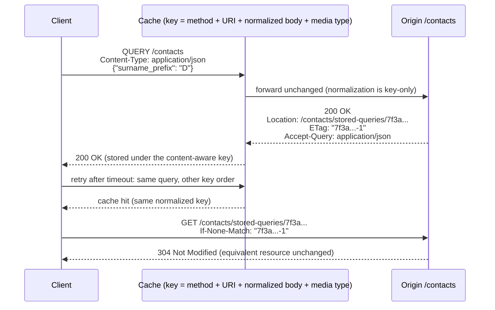

# The HTTP QUERY Method: Safe, Idempotent, Cacheable Requests with a Request Body (RFC 10008)

> [!summary] Claim
> `QUERY` is `GET` with a body that means something: the request content plus its `Content-Type` define a safe, idempotent query, so retries and caches may act on it, but only if every hop (cache key, retry allowlist, CORS list, OpenAPI export) is taught that the body is part of the request's identity.

Part of [REST and Resource Modeling](README.md) in [API Engineering](../README.md).

## TL;DR

- Mechanism: `QUERY /contacts` carries the query as request content; the server processes it without changing the target's state, and a `200 OK` encloses the results (RFC 10008 Section 2).
- Contract: a missing or inconsistent `Content-Type` MUST fail with a `4xx`; `415` plus `Accept-Query` for unsupported types, `422` for a well-formed but unprocessable query (RFC 10008 Sections 2 and 2.1).
- Trap: a cache key that omits the content serves one query's results to another, because RFC 10008 Section 2.7 says the key MUST incorporate the request content and related metadata.
- Portability: the method token travels through `h11 0.16.0`, `httptools 0.9.0` (llhttp 9.4.3), and `h2 4.4.1` unchanged, but `urllib3 2.8.0` does not retry it, `http.HTTPMethod` has no member for it on CPython 3.12 through 3.15.2, and `fastapi 0.162.0` drops its `requestBody` from OpenAPI.
- When not to use it: if the query fits in a URI under the RFC 9110 Section 4.1 recommended 8000 octets and logging the URI is harmless, `GET` with a query string is cached by every deployed cache today; use `QUERY` when the query is large, structured, or sensitive.

## Mental model



The client sends the query as JSON content, and the cache builds its key from the method, the target URI, the media type, and a normalized form of the body, while forwarding the original bytes untouched.
The origin runs the query, changes nothing in the target's state, and names an equivalent resource in `Location`, a URI that answers `GET` with a fresh run of the same query.
A retry with the same query in a different key order produces the same normalized key, so it is a cache hit and, at the origin, it lands on the same stored-query URI.
Later the client drops the body entirely and revalidates the equivalent resource with a conditional `GET`, which every existing cache already understands.

## How it works

### The method contract

RFC 10008 Section 2 defines `QUERY` as asking the target resource "to perform a query operation within the scope of that target resource", where "the content of the request and its media type define the query".
It is safe in the RFC 9110 Section 9.2.1 sense, which means the client neither requests nor expects a state change, and it is idempotent in the RFC 9110 Section 9.2.2 sense, so it "can be retried or repeated when needed, for instance, after a connection failure" (RFC 10008 Section 2).
Safety does not forbid side resources: the same section says it "does not prevent the server from creating additional HTTP resources", which is what `Location` and `Content-Location` rely on.
IANA registers `QUERY` as `Safe: yes`, `Idempotent: yes` (RFC 10008 Section 5.1), and `Accept-Query` as a permanent field of Structured Type `List` (RFC 10008 Section 5.2).

On the wire, `QUERY` is an ordinary request with ordinary framing; HTTP/1.1 delimits the content with `Content-Length` or chunked coding as for `POST`:

```text
QUERY /contacts HTTP/1.1
Host: example.org
Content-Type: application/json
Content-Length: 23

{"surname_prefix": "D"}
```

Contrast this with a body on `GET`: RFC 9110 Section 9.3.1 says such content "has no generally defined semantics, cannot alter the meaning or target of the request", and might make implementations reject the request "because of its potential as a request smuggling attack".
`QUERY` gives the body defined semantics instead of reinterpreting `GET`.

### Media types and the error ladder

RFC 10008 Section 2 says "Servers MUST fail the request if the `Content-Type` request field ... is missing or is inconsistent with the request content", and Section 2.1 forbids content sniffing: a server "is not allowed to infer a media type from the request content".
Section 2.1 then recommends a status per failure:

| Failure | Status | Extra response field |
|---|---|---|
| No media type | `400` (any `4xx`) | - (the RFC names `Accept-Query` only for `415`; the lab sends it here too) |
| Media type not supported for `QUERY` on this resource | `415` | `Accept-Query`, and `Accept` per Appendix A.3 |
| Declared type inconsistent with the bytes | `400` | - |
| Valid type and syntax, but the query cannot run (unknown table) | `422` | - |
| `Accept` names no producible response type | `406` | - |

### Equivalent resource, `Location`, and `Content-Location`

The equivalent resource of a `QUERY` is a resource that "responds to `GET` requests, represents that `QUERY` request and its target, and takes both message content and metadata into account" (RFC 10008 Section 2.2).
`Location` on a `2xx` names it, a claim that a client can `GET` that URI "to repeat the query operation just performed without resending the query content" (RFC 10008 Section 2.4).
`Content-Location` names something different: a resource holding the results of the run just performed, which "might be temporary" (RFC 10008 Section 2.3).
So `Location` is the query (re-evaluated on each `GET`), and `Content-Location` is one answer (a snapshot).

### Redirects and conditionals

`301`, `302`, `307`, and `308` tell the client to resend a similar `QUERY` to the new target, and "the exceptions for redirecting a `POST` as a `GET` request after a `301` or `302` response do not apply to `QUERY` requests" (RFC 10008 Section 2.5).
Only `303 See Other` switches to `GET` on the `Location` URI (RFC 10008 Section 2.5, Appendix A.4.3).
The selected representation of a `QUERY` is the one a `GET` to the equivalent resource would select, so `If-None-Match` and `If-Modified-Since` work as in RFC 9110 Section 13 (RFC 10008 Section 2.6).

### Caching

RFC 9111 Section 2 defines the cache key as composed "at a minimum, [of] the request method and target URI", and notes that "many HTTP caches in common use today only cache `GET` responses and therefore only use the URI as the cache key".
RFC 10008 Section 2.7 adds the rule that breaks that assumption: "The cache key for a `QUERY` request ... MUST incorporate the request content ... and related metadata".
Caches MAY normalize before hashing, by removing content codings and by format-aware normalization keyed off the media type or a structured suffix such as `+json`, but "any such transformation is performed solely for the purpose of generating a cache key; it does not change the request itself" (RFC 10008 Section 2.7).
A client can ask for no normalization with `Cache-Control: no-transform`, which the same section calls "just advisory".
The section also states the cost: a cache must read the whole request content before it can compute the key, which is why it suggests clients switch to `GET` on the `Location` URI when one is offered.

### `Accept-Query` is a Structured Field

`Accept-Query` is "a List Structured Header Field of either Tokens or Strings", media type parameters become Structured Field Parameters, and the choice of Token versus String is insignificant: recipients "MUST NOT process them differently based on the received type" (RFC 10008 Section 3).
It "MUST be processed as specified in Section 4 of [STRUCTURED-FIELDS]", not with an `Accept` parser (RFC 10008 Section 3).
An `sf-token` must start with `ALPHA` or `*` (RFC 9651 Section 3.3.4 in prose; the ABNF `sf-token = ( ALPHA / "*" ) *( tchar / ":" / "/" )` is in RFC 9651 Appendix C), so `application/json` and `*/*` serialize bare, while a range starting with a digit must be an `sf-string` (RFC 10008 Section 3, RFC 9651 Section 3.3.3).
The value applies to every URI sharing the path, ignoring the query component (RFC 10008 Section 3).

### The Python stack, by source

- `h11 0.16.0` matches any method token: `method = token`, where `token` is the RFC 9110 `tchar` character class (h11 0.16.0 h11/_abnf.py, method); the lab parses a `QUERY` with a `Content-Length` body.
- `httptools 0.9.0` vendors llhttp at commit `0e815792b167a9bd8ace259b95b7da953776c288`, which is llhttp 9.4.3 and defines `HTTP_QUERY = 46` in `HTTP_METHOD_MAP` (llhttp 9.4.3 include/llhttp.h, llhttp_method); llhttp rejects methods outside its table, and Uvicorn turns any `httptools.HttpParserError` into a `400` with "Invalid HTTP request received." (uvicorn 0.54.0 uvicorn/protocols/http/httptools_impl.py, HttpToolsProtocol.data_received).
- `starlette 1.10.0` stores route methods as an uppercased set and answers a non-member with `405` and `Allow` (starlette 1.10.0 starlette/routing.py, Route.__init__ builds the set and Route.handle sends the `405`); its CORS middleware's wildcard expansion `ALL_METHODS` includes `"QUERY"` (starlette 1.10.0 starlette/middleware/cors.py, ALL_METHODS), but an explicit `allow_methods` list does not.
- `fastapi 0.162.0` reads and validates the body for any method whose route has a body field (fastapi 0.162.0 fastapi/routing.py, get_request_handler), but emits `requestBody` into OpenAPI only for `METHODS_WITH_BODY = {"GET", "HEAD", "POST", "PUT", "DELETE", "PATCH"}` (fastapi 0.162.0 fastapi/openapi/constants.py, METHODS_WITH_BODY; fastapi/openapi/utils.py, get_openapi_path), and writes the operation under `path[method.lower()]`, giving a `query` key in a document labelled `3.1.0`.
- OpenAPI 3.2.0 (19 September 2025) added the Path Item fixed field `query`, citing the IETF draft; OpenAPI 3.2.1 (10 September 2026) points the same field at RFC 10008 (OpenAPI 3.2.1, Path Item Object).
- `urllib3 2.8.0` retries only `Retry.DEFAULT_ALLOWED_METHODS = frozenset(["HEAD", "GET", "PUT", "DELETE", "OPTIONS", "TRACE"])` and checks membership in `Retry._is_method_retryable` (urllib3 2.8.0 src/urllib3/util/retry.py, Retry).

## Numbers and limits

| Quantity | Value | Source |
|---|---|---|
| Recommended minimum URI length support | 8000 octets | RFC 9110 Section 4.1 |
| `h11` default limit on an incomplete event (request line plus headers) | `16 * 1024` bytes | h11 0.16.0 h11/_connection.py, DEFAULT_MAX_INCOMPLETE_EVENT_SIZE |
| `Request.body()` size cap in Starlette | none; it joins every chunk of `self.stream()` | starlette 1.10.0 starlette/requests.py, Request.body |
| llhttp method code for `QUERY` | `46` | llhttp 9.4.3 include/llhttp.h, llhttp_method |
| CORS-safelisted methods | `GET`, `HEAD`, `POST` (so `QUERY` always preflights) | WHATWG Fetch, CORS-safelisted method (as of 2026-11) |
| Lab stored-query id | 16 hex chars = 64 bits of `HMAC-SHA256` output | `query_method.py`, `ContactStore.remember` |
| Lab run, 36 tests | `36 passed in 0.69s` | `uv run --frozen pytest ... -q` from `labs/`, CPython 3.14.6, macOS 27.2 arm64 (Darwin 27.2.0), measured 2026-11-10; three consecutive runs gave 0.67s to 0.69s, earlier runs without the live-server tests gave 0.24s to 0.53s |

The 8000-octet figure is a floor that senders and recipients SHOULD support, not a ceiling; real limits depend on every intermediary in the path, which is the first motivation RFC 10008 Section 1 gives for moving the query into the body.

## Portability

| Leg | Behavior | Proof |
|---|---|---|
| CPython 3.12.16 (Debian Trixie, glibc 2.41, aarch64) | 36 lab tests pass; `QUERY` is not in `http.HTTPMethod` | `docker run` of `ghcr.io/astral-sh/uv:python3.12-trixie`, `uv sync --frozen` then `pytest <test> -q` on a copy of `labs/`, 2026-11-10 |
| CPython 3.12.13 (macOS) | 36 lab tests pass | `UV_PROJECT_ENVIRONMENT=<isolated venv> uv run --frozen --python <interpreter> pytest <test> -q`, macOS 27.2 arm64, 2026-11-10 |
| CPython 3.13.18 (macOS) | 36 lab tests pass | same, Homebrew `python3.13` |
| CPython 3.14.6 (workspace, macOS) | 36 lab tests pass | `uv run --frozen pytest ... -q` from `labs/`, macOS 27.2 arm64 |
| CPython 3.14.10 (Debian Trixie, glibc 2.41, aarch64) | 36 lab tests pass | `ghcr.io/astral-sh/uv:python3.14-trixie`, same procedure as the 3.12.16 row |
| CPython 3.14.10 (Alpine, musl 1, aarch64) | 36 lab tests pass | `ghcr.io/astral-sh/uv:python3.14-alpine`, same procedure |
| CPython 3.15.2 (Debian Trixie, glibc 2.41, aarch64) | 36 lab tests pass | `ghcr.io/astral-sh/uv:python3.15-trixie`, same procedure |
| CPython 3.15.2 (macOS) | 36 lab tests pass | same, `/opt/homebrew/bin/python3.15` |
| CPython 3.15.2t free-threaded | not run: only 3.15.0b3t is installed, and its workspace sync fails (`psycopg-binary==3.3.8` has no wheel for the platform; with that package skipped, the `pylsqpack==1.0.0` source build that `aioquic` needs fails) | `uv sync --frozen --python python3.15t` rerun by the verifier, 2026-11-10; no 3.15.2t build was available locally or in the Docker images used |
| `http.HTTPMethod` (stdlib) | no `QUERY` member on 3.12.13, 3.13.18, 3.14.6, 3.14.10, 3.15.2, 3.15.0b3t | lab test plus `'QUERY' in http.HTTPMethod.__members__` on each interpreter |
| `starlette 1.10.0` | `Route(..., methods=["QUERY"])` dispatches; other methods get `405` with `Allow: QUERY` | lab tests |
| `fastapi 0.162.0` | body validated at runtime; OpenAPI export puts `query` in a `3.1.0` document without `requestBody`, which the OAS 3.1 schema rejects | lab test with `openapi-spec-validator 0.9.0` |
| Uvicorn 0.54.0 with `httptools 0.9.0` | llhttp accepts `QUERY`, rejects unregistered methods (`HttpParserInvalidMethodError` -> `400`) | lab tests: parser in-process, and a live `uvicorn.Server` on `127.0.0.1:0` serving the lab app (`QUERY` -> `200 OK`, `FROBNICATE` -> `400 Bad Request`); Uvicorn source |
| Uvicorn and Hypercorn 0.18.0 with `h11 0.16.0` | any token method accepted, body framed by `Content-Length` | lab tests: h11 in-process, and live `uvicorn.Server(http="h11")` and `hypercorn.asyncio.serve` on loopback ports (`QUERY` -> `200`, `FROBNICATE` reaches Starlette -> `405`); hypercorn 0.18.0 hypercorn/protocol/h11.py imports `h11` |
| Granian 2.8.7 | accepts `QUERY` and passes unregistered methods to the app (`FROBNICATE` -> Starlette `405`) | probe, not a lab test: `granian --interface asgi --port <p> papp:app` serving `build_app` from a one-line module, driven by `httpx`, CPython 3.14.6, macOS 27.2 arm64; run by the verifier and rerun in the finish pass, 2026-11-10 |
| HTTP/1.1 | method is a request-line token | lab test (`h11`, `httptools`) |
| HTTP/2 (`h2 4.4.1`) | `:method` pseudo-header carries `QUERY`; body in `DATA` frames | lab test (in-process `H2Connection` pair) |
| HTTP/3 (`aioquic 1.7.2`) | `:method` `QUERY` with a `DATA` body over QUIC reaches the app and returns `200` with results; `FROBNICATE` -> `405` | probe, not a lab test: `hypercorn papp:app --quic-bind 127.0.0.1:<p>` with a self-signed certificate and an `aioquic 1.7.2` `H3Connection` client (certificate verification off), CPython 3.14.6, macOS 27.2 arm64; run by the verifier and rerun in the finish pass, 2026-11-10 |
| `urllib3 2.8.0` `Retry` | default does not retry `QUERY` on `503`; adding it to `allowed_methods` does | lab test |
| `httpx 0.28.1` | `client.request("QUERY", ...)` works; there is no `query()` helper | lab tests; `hasattr(httpx.AsyncClient, "query")` is `False` (probe run on 3.14.6) |
| Browsers (Fetch) | `QUERY` is not CORS-safelisted, so cross-origin calls preflight; method normalization uppercases only `DELETE`, `GET`, `HEAD`, `OPTIONS`, `POST`, `PUT`, so `fetch(url, {method: "query"})` sends lowercase `query` | WHATWG Fetch, "normalize" a method (as of 2026-11) |

## Worked example

The lab is [implementation](../labs/src/api_labs/f04_rest_and_resource_modeling/query_method.py) and [test](../labs/tests/f04_rest_and_resource_modeling/test_the_http_query_method_safe_requests_with_bodies_rfc_10008.py).
It serves `QUERY /contacts` from Starlette, keys stored queries by an HMAC of a content-aware cache key, and checks the FastAPI OpenAPI export against the OAS 3.1 and 3.2 schemas.

The cache key, verbatim from `query_method.py`:

```python
def query_cache_key(
    *, target: str, content_type: str | None, content_encoding: str | None, body: bytes
) -> str:
    """Build a QUERY cache key that incorporates the content (RFC 10008 Section 2.7).

    Normalization only affects the key, never the forwarded request: content coding is
    removed, and JSON is re-serialized with sorted keys and no insignificant whitespace.
    """
    media_type = media_type_of(content_type) or ""
    if content_encoding is not None and content_encoding.strip().lower() == "gzip":
        body = gzip.decompress(body)
    if _is_json(media_type):
        body = json.dumps(
            json.loads(body), sort_keys=True, separators=(",", ":"), ensure_ascii=False
        ).encode()
    digest = hashlib.sha256()
    for part in (b"QUERY", target.encode(), media_type.encode(), body):
        digest.update(len(part).to_bytes(8, "big"))
        digest.update(part)
    return digest.hexdigest()
```

Each part is length-prefixed, so `("/a", "b/c")` and `("/ab", "/c")` cannot hash the same.
Normalizing before hashing makes a retried query with a different key order hit the same stored query, which the test `test_retried_query_is_safe_and_lands_on_the_same_stored_query` proves at the HTTP level.

The handler's validation ladder, a simplified excerpt of `build_app` (the store, headers, and conditional branch are omitted):

```python
media_type = media_type_of(request.headers.get("content-type"))
if media_type is None:
    return _error(400, "QUERY requires a Content-Type", {"Accept-Query": accept_query})
if media_type != QUERY_MEDIA_TYPE:
    headers = {"Accept-Query": accept_query, "Accept": QUERY_MEDIA_TYPE}
    return _error(415, f"unsupported query type {media_type}", headers)
if not _accepts_json(request.headers.get("accept")):
    return _error(406, f"results are only available as {QUERY_MEDIA_TYPE}")
body = await request.body()
try:
    document: Any = json.loads(body)
except ValueError:
    return _error(400, "content is not valid JSON despite Content-Type")
try:
    query = ContactQuery.model_validate(document)
except ValidationError as exc:
    return _error(422, f"{exc.error_count()} invalid query field(s)")
```

The stored-query id is `hmac.new(self.secret, cache_key.encode(), hashlib.sha256).hexdigest()[:16]` and is inserted with `setdefault`, which makes the side resource idempotent and keeps query content out of the URI.

Output captured verbatim with this command from `labs/`, on CPython 3.14.6 (the workspace interpreter), macOS 27.2 arm64:

```text
$ uv run --frozen pytest tests/f04_rest_and_resource_modeling/test_the_http_query_method_safe_requests_with_bodies_rfc_10008.py -q
....................................                                     [100%]
36 passed in 0.69s
```

The 36 tests are 24 test functions, with the Section 2.1 error ladder parametrized six ways, the `Accept-Query` serializer four ways, the accepted `Accept` ranges three ways, and the live-server test across three servers (`uvicorn-httptools`, `uvicorn-h11`, `hypercorn-h11`; marker `socket`, loopback only).

Mutation check (finish pass, 2026-11-10, CPython 3.14.6, macOS 27.2): 16 single-line mutations were applied one at a time and each turned at least one test red.
They are: key without `sort_keys`, retry allowlist without `QUERY`, `415` changed to `400`, the route also accepting `FROBNICATE`, the route also accepting `POST`, stored id truncated to 8 hex chars, `ETag` ignoring the data version, the OpenAPI fix keeping `3.1.0`, no `gzip` removal in the key, `q=0` ignored, `QUERY` ignoring `If-None-Match`, an unknown stored query answering `200`, a missing `Content-Type` sniffed as JSON, a key that drops the body, and two mutations of the live-server test (always `h11`, a `POST` instead of the unknown method).
The earlier independent pass found five survivors (no length prefix on key parts, a bare `sha256` id with no secret, `200` for an unknown stored query, `application/*` refused, a case-sensitive `gzip` match); the tests added for them still kill those mutations.

## Pitfalls

> [!warning] Content-blind cache key
> Trigger: a CDN or in-house cache treats `QUERY` like `GET` and keys on method plus URI.
> Symptom: every query to `/contacts` returns the first cached result, across users if the cache is shared.
> Fix: incorporate the normalized content and media type in the key, as RFC 10008 Section 2.7 requires; until the cache supports that, mark `QUERY` responses uncacheable and offer a `Location` for `GET`.
> No public incident or CVE for this exact failure with `QUERY` was found (as of 2026-11); the closest published case is GHSA-39r7-wfcx-99xg (nitropack < 2.13.6, published 2026-11-02), where a route cache keyed only on the path ignored the method, so a `POST` response was stored under the key a later `GET` read and served to every user.
> Dropping the body from the lab's key makes `test_cache_key_incorporates_content_and_normalizes_insignificant_differences` fail.

> [!warning] Retry libraries do not know the method is idempotent
> Trigger: a client wraps calls in `urllib3` `Retry` (directly or through `requests`) with default `allowed_methods`.
> Symptom: `QUERY` fails on the first `503` while `GET` to the same service recovers; teams then misread `QUERY` as flaky.
> Fix: `Retry(allowed_methods=Retry.DEFAULT_ALLOWED_METHODS | {"QUERY"})`; the allowlist is a frozenset in urllib3 2.8.0 src/urllib3/util/retry.py, Retry.DEFAULT_ALLOWED_METHODS.

> [!warning] FastAPI's OpenAPI silently drops the body
> Trigger: `@app.api_route("/x", methods=["QUERY"])` with a Pydantic body parameter in fastapi 0.162.0.
> Symptom: the generated document has `paths["/x"]["query"]` without `requestBody` and still says `"openapi": "3.1.0"`, which fails OAS 3.1 validation (`'query' was unexpected`); generated clients send no body.
> Fix: post-process the document to `3.2.x` and add `requestBody`, as `openapi_32_with_query_body` does, or file and track an upstream change to `METHODS_WITH_BODY`.

> [!warning] A temporary result URI that embeds the query
> Trigger: `Location: /stored-queries?q=<the query>` or a reversible encoding of it.
> Symptom: the sensitive content that motivated moving the query out of the URI reappears in access logs, `Referer`, and history.
> Fix: RFC 10008 Section 4 says such a URI "SHOULD be chosen such that it does not include any sensitive portions of the original request content"; use a keyed MAC or random id.

> [!warning] Normalization that disagrees with the origin's parser
> Trigger: the cache normalizes JSON with a last-duplicate-wins parser while the origin, or a WAF in front of it, takes the first duplicate.
> Symptom: `{"a": 1, "a": 2}` and `{"a": 2}` share a cache entry but mean different queries to the origin; RFC 10008 Section 4 warns that wrong normalization yields "an incorrect response if normalization results in a false positive".
> Fix: normalize with the same parser the origin uses, reject duplicate keys at both ends, or hash raw bytes; the lab test `test_json_normalization_collapses_duplicate_keys_a_false_positive_risk` pins the collision.

> [!warning] Treating a `302` like the `POST` exception
> Trigger: a client library that rewrites `POST` to `GET` on `301` or `302` applies the same rule to `QUERY`.
> Symptom: the redirected request has no body and returns an unfiltered collection.
> Fix: RFC 10008 Section 2.5 says the `POST` exceptions "do not apply to `QUERY` requests"; only `303` switches to `GET`.

## Security and robustness

- Request size is now a body problem, not a URI problem: Starlette 1.10.0 `Request.body()` joins the whole stream with no cap, so enforce a byte limit at the proxy or in middleware before parsing; see [[Unrestricted-Resource-Consumption-API4-2023-Payload-Depth-and-Limit-Guards]] for depth and size guards (OWASP API4:2023).
- A cache that removes content coding to compute keys inflates attacker-supplied `gzip` before it has decided anything; bound the decompressed size, because the lab's `gzip.decompress(body)` is unbounded by design to stay small.
- Stored queries are server-created resources driven by unauthenticated input; bound their count and lifetime, or a client can mint one per distinct query; the lab's dict is unbounded and is not production code.
- The stored-query id is a keyed MAC of the normalized query, so it is stable across retries yet not reversible or guessable without the secret; a bare `sha256` would let an attacker confirm a guessed low-entropy query from a leaked URI.
- Authorization must bind to the equivalent resource: a `GET` on `/contacts/stored-queries/{id}` re-runs the query and must apply the caller's permissions at that time, not the creator's.
- `Accept-Query` is a Structured Field; parse it with an RFC 9651 parser and fail closed on syntax errors rather than splitting on commas (RFC 10008 Section 3).
- CORS: `QUERY` always preflights (Fetch, CORS-safelisted method), and Starlette's explicit `allow_methods=["GET"]` rejects that preflight with `400`; add `QUERY` deliberately, not via `"*"` on a credentialed API ([[CORS-Protocol-Internals-Preflight-Caching-and-Origin-Reflection-Exploits]]).
- A body on `GET` is a smuggling and desync hazard per RFC 9110 Section 9.3.1; migrating "GET with body" endpoints to `QUERY` removes an ambiguity that intermediaries resolve differently ([[HTTP-Request-Smuggling-CL-TE-and-Desync-Mechanics]]).

## The principal's view

The decision is not "`QUERY` or `POST /search`" in isolation; it is whether the organization's edge (CDN, gateway, WAF, client SDKs, OpenAPI tooling) can carry a method whose cache identity lives in the body.
Adopting `QUERY` is cheap at the origin, where Starlette, h11, llhttp, and h2 already pass it through, and expensive at the edges, where each component needs an explicit allowlist or key change, as the urllib3, FastAPI, and CORS legs above show.
A staff-plus engineer should sequence it: first ship `POST /search` semantics behind `QUERY` with `Location` pointing to a `GET`-able stored query, so caches that do not understand `QUERY` still get a cacheable `GET`; then turn on content-aware caching where the CDN supports it.
The organizational trade-off is standardization against compatibility: `QUERY` makes safety visible to generic infrastructure, but until every hop knows it, the `POST` fallback must stay, and that dual path is a maintenance cost to budget.
Choose something else when the query is small and public (use `GET` with a query string), when it is a long-running computation (use an operation resource and `202`, see [[Custom-Methods-and-State-Machine-Transitions-AIP-136]]), or when clients need field selection over a graph of types (GraphQL or a typed RPC may fit better, at the cost of HTTP caching).

## Interview questions

> [!question] L5: Why can a client automatically retry a timed-out `QUERY` but not a timed-out `POST /search`, when both carry the same JSON body?
>
> > [!success]- Answer
> > `QUERY` is registered as idempotent (RFC 10008 Section 5.1), so by RFC 9110 Section 9.2.2 a repeat has the same intended effect as one request.
> > `POST` makes no such promise, so generic infrastructure must assume a retry could duplicate a side effect.
> > The body is the same; what differs is the method's declared contract, which is the only signal intermediaries can read.
> >
> > Follow-up: what must a client library change before that retry actually happens?

> [!question] L5: What status code should a `QUERY` endpoint return when the client sends JSON but omits `Content-Type`, and why not just parse it as JSON?
>
> > [!success]- Answer
> > A `4xx`, with `400` recommended (RFC 10008 Section 2.1).
> > The media type is part of the query's meaning, and Section 2.1 says a server "is not allowed to infer a media type from the request content".
> > Sniffing would also make the cache key ambiguous, since the metadata is part of the key.
> >
> > Follow-up: which header helps the client fix the request?

> [!question] L6: Predict the output: using the lab's `query_cache_key` with `target="/contacts"` and `content_type="application/json"`, are the keys for `b'{"surname_prefix":"D","limit":2}'` and `gzip.compress(b'{"limit": 2, "surname_prefix": "D"}')` with `content_encoding="gzip"` equal, and what about `{"limit": 2.0}` versus `{"limit": 2}`?
>
> > [!success]- Answer
> > The first pair is equal: the gzip coding is removed, then both bodies normalize to `{"limit":2,"surname_prefix":"D"}`.
> > The second pair differs: `json.loads` keeps `2.0` as a float and `2` as an int, so the normalized text is `2.0` versus `2`.
> > That is a false negative (a missed hit), which costs efficiency but never correctness.
> >
> > Follow-up: which normalization error is worse, a false negative or a false positive, and why?

> [!question] L6: Debug this API: a team ships `QUERY /orders` in FastAPI 0.162.0, the endpoint works with `curl`, but the generated TypeScript client sends no body and their OpenAPI linter fails with `'query' was unexpected`; what happened?
>
> > [!success]- Answer
> > FastAPI writes the operation under `paths["/orders"]["query"]` but labels the document `3.1.0`, whose Path Item schema has no `query` field, so validation fails.
> > It also emits `requestBody` only for methods in `METHODS_WITH_BODY`, which lacks `QUERY`, so the generator sees a body-less operation.
> > Runtime parsing is unaffected because the request handler reads the body whenever the route has a body field.
> > Fix: emit OAS 3.2.x and inject `requestBody`, as the lab's `openapi_32_with_query_body` does.
> >
> > Follow-up: how would you stop this regression from reaching clients again?

> [!question] L6: A response to `QUERY` carries both `Location: /contacts/stored-queries/42` and `Content-Location: /contacts/stored-results/17`. What does a `GET` to each return a day later?
>
> > [!success]- Answer
> > `Location` names the equivalent resource, so `GET` re-runs the query against current data and may return different rows (RFC 10008 Section 2.4).
> > `Content-Location` names the result of that one run, which may have expired, so the client must be ready for an error and to resend the `QUERY` (RFC 10008 Section 2.3, Appendix A.4.1).
> >
> > Follow-up: which of the two can be revalidated with `If-None-Match` and a `304`?

> [!question] L6: A server answers `QUERY /contacts` with `302 Found` and a `Location`. What does a conforming client send next?
>
> > [!success]- Answer
> > A similar `QUERY`, with the same content, to the new `Location` (RFC 10008 Section 2.5).
> > The historical exception that lets user agents turn `POST` into `GET` after `301` or `302` does not apply to `QUERY`.
> > Only `303 See Other` means "do a `GET` on the `Location`".
> >
> > Follow-up: why would a server prefer `303` over `200` with `Location`?

> [!question] L7+: Your CDN keys only on method and URI. Design a rollout of `QUERY` for a high-traffic search API without serving wrong results.
>
> > [!success]- Answer
> > Phase one: serve `QUERY` at the origin with `Cache-Control: no-store` at the CDN for that method, and return `Location` to a stored query so repeat traffic moves to cacheable `GET`.
> > Phase two: implement a content-aware key at the edge (method, URI, media type, normalized body) with normalization matched to the origin parser and a decompressed-size cap.
> > Phase three: turn on `QUERY` caching per route behind a flag, comparing hit rate and a shadow-verified sample of responses.
> > Keep `POST /search` until client SDK telemetry shows the retry and CORS allowlists are updated.
> >
> > Follow-up: what metric would tell you normalization is producing false positives in production?

> [!question] L7+: If the stored-query id is an HMAC of the normalized query, what breaks when you rotate the HMAC secret, and how do you rotate safely?
>
> > [!success]- Answer
> > Every outstanding `Location` URI stops resolving, so clients get `404` and must resend the original `QUERY`, which RFC 10008 Section 2.4 allows ("the client can retry using the original `QUERY` request target and the previously submitted content").
> > Rotate with a key ring: verify ids against current and previous secrets, mint with the current one, and retire the old key after the longest URI lifetime you promise.
> > Also re-check that authorization is evaluated at `GET` time, since ids outlive sessions.
> >
> > Follow-up: should stored-query ids be per-tenant, and what would that cost in cache hit rate?

> [!question] L7+: When would you refuse to adopt `QUERY` even though the query is large?
>
> > [!success]- Answer
> > When the edge path (CDN, WAF, API gateway, corporate proxies) cannot be updated to pass or cache it, since an unknown method may be rejected, as llhttp does for methods outside its table.
> > When the operation is long-running or not actually safe, for example it writes an audit row the business treats as state, where `POST` to an operation resource is honest.
> > When clients are browsers on many origins and preflight latency on every call is unacceptable.
> >
> > Follow-up: how would you measure whether intermediaries in your path accept `QUERY` before committing?

## Related

Prerequisites: [[HTTP-Method-Semantics-Safety-and-Idempotency-Invariants]]

Next: [[HTTP-Status-Code-Taxonomy-and-Selection-Decision-Trees]]

See also: [[02-Programming-Languages/Python/Python-Backend-Interview-Prep/05-REST-API-Design]], [[OpenAPI-3-2-Additions-QUERY-Method-Streaming-and-Tag-Hierarchies]], [[Structured-Field-Values-for-HTTP-RFC-9651]], [[Vary-Header-Mechanics-and-Cache-Hit-Collapse]], [[Web-Cache-Poisoning-and-Cache-Deception-Attacks]], [[Conditional-GET-Revalidation-and-304-Not-Modified]], [[CORS-Protocol-Internals-Preflight-Caching-and-Origin-Reflection-Exploits]], [[Search-Endpoints-vs-List-Endpoints-and-Full-Text-Ranking]], [[Retry-Budgets-and-Preventing-Cascading-Retry-Amplification-Storms]], [[HTTP-Request-Smuggling-CL-TE-and-Desync-Mechanics]], [[Unrestricted-Resource-Consumption-API4-2023-Payload-Depth-and-Limit-Guards]], [[Custom-Methods-and-State-Machine-Transitions-AIP-136]]

- Lab: `labs/tests/f04_rest_and_resource_modeling/test_the_http_query_method_safe_requests_with_bodies_rfc_10008.py`

## Further reading

- [RFC 10008: The HTTP QUERY Method](https://www.rfc-editor.org/rfc/rfc10008.html) - the normative definition: Section 2 semantics, Section 2.7 cache key rule, Section 3 `Accept-Query`, Section 4 security.
- [RFC 9110: HTTP Semantics](https://www.rfc-editor.org/rfc/rfc9110.html) - Sections 9.2.1 and 9.2.2 define safe and idempotent; Section 9.3.1 explains why a body on `GET` has no defined semantics.
- [RFC 9111: HTTP Caching](https://www.rfc-editor.org/rfc/rfc9111.html) - Section 2 defines the cache key that `QUERY` extends with request content.
- [RFC 9651: Structured Field Values for HTTP](https://www.rfc-editor.org/rfc/rfc9651.html) - Sections 3.3.3 and 3.3.4 define the String and Token grammar `Accept-Query` uses.
- [OpenAPI Specification 3.2.1](https://spec.openapis.org/oas/v3.2.1.html) - the Path Item `query` field, now referencing RFC 10008.
- [WHATWG Fetch: CORS-safelisted method](https://fetch.spec.whatwg.org/#cors-safelisted-method) - why every cross-origin `QUERY` preflights, and which methods Fetch uppercases.
- [llhttp include/llhttp.h at the commit vendored by httptools 0.9.0](https://github.com/nodejs/llhttp/blob/0e815792b167a9bd8ace259b95b7da953776c288/include/llhttp.h) - the method table that decides whether Uvicorn's default parser accepts `QUERY`.
