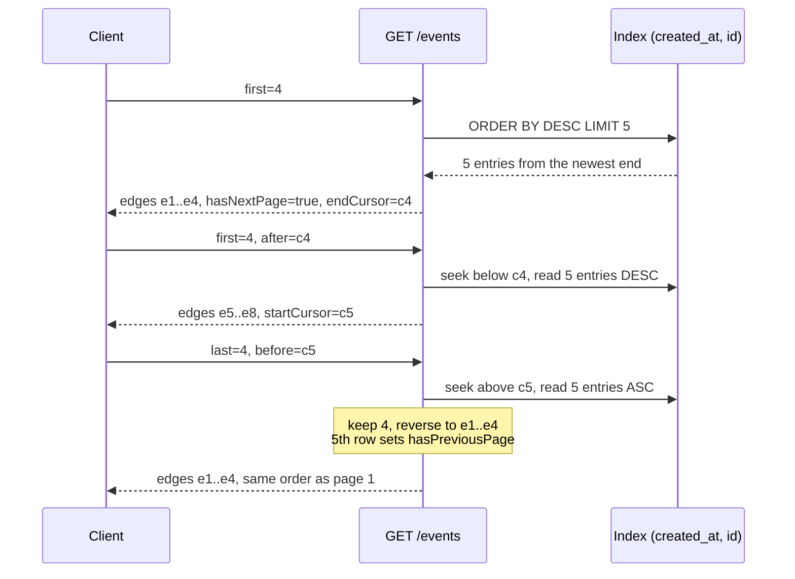

# Bidirectional Pagination: Forward/Backward Cursors (first/after, last/before) and Relay Connection Envelopes

> [!summary] Claim
> A backward keyset page is the forward query with the comparison flipped, the `ORDER BY` reversed, `LIMIT last + 1`, and the rows reversed again in memory, so both directions cost one index seek plus `size + 1` entries (301 to 309 SQLite VM instructions at any depth in the lab, SQLite 3.53.1 and 3.54.1), while the offset cursors that strawberry 0.340.0 and graphql-relay-js v0.11.0 put behind the same Relay envelope repeat rows after an insert and, for `last` without `before`, read the whole collection.

Part of [Pagination Filtering and Query Patterns](README.md) in [API Engineering](../README.md).

## TL;DR

- Mechanism: `first`/`after` is `WHERE (created_at, id) < cursor ORDER BY created_at DESC, id DESC LIMIT first + 1`; `last`/`before` is `WHERE (created_at, id) > cursor ORDER BY created_at ASC, id ASC LIMIT last + 1` followed by reversing the page, and the extra row sets the "must" flag (`hasNextPage` forward, `hasPreviousPage` backward).
- Contract rule: edges come back in the same order in both directions, with the edge nearest `before` last (GraphQL Cursor Connections Section 4.3), and a cursor names a position, so one edge cursor is valid as `after` and as `before`.
- Trap: flipping only the comparison returns the first page instead of the previous one; offset cursors (`base64("arrayconnection:<n>")`) shift when rows are inserted; and strawberry 0.340.0 answers `last: 0` with every edge, past its own `relay_max_results` cap of 100.
- Portability: the lab passes 59 tests on CPython 3.12.13, 3.12.16, 3.13.18, 3.14.6, 3.14.10, 3.15.2, and free-threaded 3.14.6t, 3.15.0b3t, and 3.15.2t, on macOS arm64 and in Debian Trixie and Alpine musl containers, with SQLite 3.46.1 to 3.54.1 and the same exact plan strings; REST APIs expose the same idea as Stripe's `starting_after`/`ending_before`, while AIP-158 defines only `next_page_token`.
- When not to use it: jump-to-page-N UIs, relevance-ranked search whose sort key moves, and full exports that need a snapshot; and do not offer `last` at all if no client will page backward, because each direction is an index access path you must keep aligned.

## Mental model



The first two requests are ordinary keyset pages: the index already holds rows in `created_at DESC, id DESC` order when read from its newest end, and the fifth entry only proves that a next page exists.
The third request walks back: the server seeks to the position `c5` and reads the index in the opposite direction, which yields `e4, e3, e2, e1` and possibly one more row.
The extra row answers `hasPreviousPage`, and reversing the four kept rows restores collection order, so the client sees exactly the edges of page 1 in the same order it saw them first.
No step depends on how many pages came before, because every request is one descent to a key plus `size + 1` entries.

## How it works

### The Relay contract, read literally

The GraphQL Cursor Connections Specification requires a connection field to accept forward arguments (`first`, a non-negative integer, and `after`), backward arguments (`last` and `before`), or both (Section 4, with the arguments defined in Sections 4.1 and 4.2).
It fixes the order: "The ordering of edges should be the same when using first/after as when using last/before", and "When before: cursor is used, the edge closest to cursor must come last in the result edges" (Section 4.3).
`EdgesToReturn` applies the cursors, then slices with `first` from the end, then with `last` from the start, and including both `first` and `last` "is strongly discouraged" (Section 4.4).
`PageInfo` has `hasPreviousPage`, `hasNextPage`, `startCursor`, and `endCursor` (Section 5.1).
The flags are asymmetric: with `last`/`before` the server "must return true if prior edges exist", but with `first`/`after` it "may return true if edges prior to after exist, if it can do so efficiently, otherwise may return false", and the mirror rule holds for `hasNextPage` (Section 5.1).
The envelope is `edges[]` of `{cursor, node}` plus a non-null `pageInfo` (Sections 2.1, 3.1).

The spec's `ApplyCursorsToEdges` is written in terms of identity: it looks for "the edge in edges whose cursor is equal to the after argument" and removes edges only "If afterEdge exists" (Section 4.4).
Two consequences follow for a literal implementation, and the lab checks both against a transcription of the algorithm.
If the row behind `after` has been deleted, nothing is removed, so the next page restarts at the top of the collection.
If `before` names an edge that lies on the near side of `after`, it is not found in the already-filtered list and is ignored.
A keyset implementation treats the cursor as a position in the sort order instead, so a deleted row's key still bounds the range, and crossed cursors name an empty range.

### Translating the four arguments to SQL

The lab's collection is `events`, newest first, keyed by the unique pair `(created_at, id)` with an index on exactly those columns, which [[Keyset-Seek-Pagination-and-Composite-Tie-Breaker-Cursors]] explains.
Row-value comparison is lexicographic, "from left to right" (SQLite rowvalue.html Section 2.1), so `(created_at, id) < (t, i)` means "after the cursor" in this order and `>` means "before it".
`after` and `before` are independent range bounds, so `first` with both cursors and `last` with both cursors are each one range read; the lab plans `last` with both cursors as `SEARCH events USING INDEX ix_events_created_id ((created_at,id)>(?,?) AND (created_at,id)<(?,?))`.
`last` reads that range from the end nearest `before`, which is the opposite index direction.
PostgreSQL documents that a B-tree "can also be scanned backward", so an index on `(x, y)` serves both `ORDER BY x, y` and `ORDER BY x DESC, y DESC` (PostgreSQL 18 Section 11.4); SQLite 3.53.1 and 3.54.1 in the lab plan both directions as a single `SEARCH ... USING INDEX` line with no `USE TEMP B-TREE` step.
Run here on PostgreSQL 18.6 (a throwaway local server, 8000 rows, an index on `(created_at, id)`), `EXPLAIN (COSTS OFF)` plans the forward page as `Index Scan Backward using ix_events_created_id` with `Index Cond: (ROW(created_at, id) < ROW(1000, 3000))` and the backward page as a forward `Index Scan` with the `>` condition and no sort node.
A mixed order, `ORDER BY created_at ASC, id DESC`, planned an `Incremental Sort` on the same index, so a reversed query must flip every column, not one.
Reversing the page afterwards in Python costs `O(last)` and no I/O; wrapping the backward query in `SELECT * FROM (...) ORDER BY created_at DESC, id DESC` instead makes SQLite add `USE TEMP B-TREE FOR ORDER BY`, a sort of the page.

Each direction learns its "must" flag from the lookahead row.
The lab answers each "may" flag with one probe, `SELECT 1 FROM events WHERE (created_at, id) >= (?, ?) LIMIT 1` for `hasPreviousPage` on a forward page and the `<=` mirror for `hasNextPage` on a backward page, which costs 23 VM instructions in SQLite.
The probe's plan is the engine's choice: on PostgreSQL 18.6 with 100000 rows, `EXPLAIN (ANALYZE, BUFFERS)` of the `>=` probe at `(1000, 3000)` chose a `Seq Scan` that removed 2999 rows by filter (21 shared buffer hits), while the `<=` mirror used an `Index Only Scan` with `Index Searches: 1` (3 hits), and `SET enable_seqscan = off` gave the index plan for `>=` too.
The probe is `>=`, not `>`, because the row at the cursor itself is part of the previous page; the mutation to `>` fails the exhaustive test.
Without the probe, the honest answer allowed by Section 5.1 is `false`, never "`after` was supplied, so `true`": once every row at or before the cursor is deleted, that shortcut claims a previous page that does not exist, which one lab test proves.

### The cursor is position-only and canonical

The lab encodes a cursor as base64url of `v1:<created_at>:<id>` without padding.
The base64url alphabet replaces `+` and `/` with `-` and `_` (RFC 4648 Section 5), all of which are `unreserved` (RFC 3986 Section 2.3), and RFC 4648 lets a referring specification drop `=` padding (Section 3.2).
The decoder accepts only the bytes the encoder produces: strict alphabet, a `fullmatch` grammar without leading zeros, an int64 bound, and a re-encode equality check.
The re-encode check matters because a base64 symbol can carry unused pad bits, and RFC 4648 Section 3.5 says that without zeroed pad bits "multiple base-encoded strings can be decoded to the same binary data", and that decoders "MAY chose to reject" such input.
The cursor carries no direction, so `startCursor` of one page is the `before` of the previous request and `endCursor` is the `after` of the next.
It is not signed: AIP-158 warns that "Base-64 encoding an otherwise-transparent page token is not a sufficient obfuscation mechanism", and integrity and filter binding are the subject of [[Opaque-Cursor-Encoding-HMAC-Integrity-and-Filter-Binding]].

### What the common libraries put behind the envelope

strawberry 0.340.0 builds each `ListConnection` edge cursor with `to_base64(cls.CURSOR_PREFIX, cursor)` where `PREFIX = "arrayconnection"` and the cursor is `slice_metadata.start + i` (strawberry 0.340.0 strawberry/relay/types.py, `Edge.resolve_edge` and `ListConnection.resolve_connection`).
`SliceMetadata.from_arguments` turns `after` into `start = int(after_parsed) + 1` and `before` into `end = int(before_parsed)`, so the cursor is an array offset (strawberry 0.340.0 strawberry/relay/utils.py, `SliceMetadata.from_arguments`).
When `last` is given without `before`, the same function sets `end = sys.maxsize`, and `resolve_connection` slices the whole remaining sequence and then keeps `edges[-last:]`.
For `last = 0` that is `edges[-0:]`, the full list, which is the bug filed upstream as strawberry PR #4646, open and unmerged, and the latest release, 0.341.2, still slices `edges[-last:]` (strawberry 0.341.2 strawberry/relay/types.py, `ListConnection.resolve_connection`) (as of 2026-11).
graphql-relay-js v0.11.0 uses the same format, `const PREFIX = 'arrayconnection:'` with `offsetToCursor` and `cursorToOffset`, and computes `startOffset = Math.max(startOffset, endOffset - last)` in `connectionFromArraySlice`, which has no `-0` problem (graphql-relay-js v0.11.0 src/connection/arrayConnection.ts).
Executed here with graphql-relay 0.11.0 and graphql 16.11.0 on Node v26.13.0 (macOS 27.2 arm64, 2026-11-10), `connectionFromArray` over 500 items returns 0 edges for `last: 0` and the last three for `last: 3`, whose first cursor decodes to `arrayconnection:497`.
The same run shows `first: 4, after: offsetToCursor(1)` returning items 2 to 5 with `hasPreviousPage: false` although two items precede them, and one item inserted at the head moving the page after the cursor `arrayconnection:3` from `[4, 5, 6, 7]` to `[3, 4, 5, 6]`, which repeats item 3.
Both libraries are correct for a static array; the problem is serving a live table through them, which is offset pagination with an opaque-looking token ([[Offset-Limit-Pagination-Mechanics-Cost-and-Window-Drift]]).
To get keyset behavior in strawberry, the resolver has to build the connection itself, as this lab's `fetch_connection` does, rather than return an iterable to `ListConnection`.

### The same idea outside GraphQL

Stripe's list endpoints take `starting_after` and `ending_before`, each "an existing object ID", and they "are mutually exclusive"; `limit` ranges "between 1 and 100" with a default of 10, and the response carries one `has_more` boolean (Stripe API reference, Pagination, as of 2026-11).
AIP-158 defines only `page_token` and `next_page_token` as tokens (beside `page_size`, an optional `total_size`, and an optional `skip`), says an empty `next_page_token` is "the only way to communicate end-of-collection", and has no previous-page token, so a Google-style API that wants backward paging must add its own field.
In HTTP, the IANA link relation registry lists `next` and `prev` ("Indicates that the link's context is a part of a series, and that the previous in the series is the link target"), with `previous` registered as a synonym for `prev`, and RFC 8288 Section 3 defines the `Link` header field that carries them; [[Richardson-Maturity-Model-HATEOAS-and-Web-Linking-RFC-8288]] covers that serialization.
On every HTTP version the cursor rides in the query component: the HTTP/2 `:path` pseudo-header "includes the path and query parts of the target URI" (RFC 9113 Section 8.3.1), and the HTTP/3 `:path` pseudo-header "Contains the path and query parts of the target URI" (RFC 9114 Section 4.3.1).

## Numbers and limits

| Quantity | Value | Source |
| --- | --- | --- |
| `first`, `last` domain in the spec | non-negative integers; negative is an error | GraphQL Cursor Connections Sections 4.1, 4.2, 4.4 |
| GitHub GraphQL `first`/`last` | required on every connection, 1 to 100; at most 500,000 total nodes per call | GitHub docs, rate and query limits (as of 2026-11) |
| Stripe list `limit` | 1 to 100, default 10 | Stripe API reference, Pagination (as of 2026-11) |
| AIP-158 example `page_size` | default 50, maximum 1000, larger values coerced to 1000 | AIP-158, `ListBooksRequest` comment |
| strawberry `relay_max_results` default | 100; a larger `first` raises `Argument 'first' cannot be higher than 100.` and a larger `last` raises `Argument 'last' cannot be higher than 100.` | strawberry 0.340.0 strawberry/schema/config.py, `StrawberryConfig`; lab run |
| strawberry `last: 0`, 500 nodes | 500 edges returned | lab, `test_list_connection_last_zero_returns_everything_past_max_results` |
| strawberry `last: 3` without `before` | pulls 1000 of 1000 and 4000 of 4000 nodes from the resolver's iterable | lab, `CountingSource` |
| Backward page `last=20`, 8000 rows, cursor 100 vs 7900 rows deep | 307 vs 303 VM instructions (SQLite 3.53.1); 305 vs 301 (3.54.1) | lab `vm_steps`, driven by the verifier script described below |
| Forward page `first=20`, same two depths | 309 vs 305 (3.53.1); 307 vs 303 (3.54.1) | same run |
| `hasPreviousPage` existence probe | 23 VM instructions (both releases) | same run |
| `last=20`, no cursor, 1000 vs 16000 rows | 176 vs 176 VM instructions (both releases) | same run |
| Offset "previous page", `LIMIT 21 OFFSET 7880` | 31720 VM instructions (both releases) | same run |
| Windows checked against the spec transcription | 1210 (`first` and `last` 0 to 10, every non-crossed cursor pair, 9 rows) | lab, `test_every_window_matches_the_spec_algorithm_and_page_info_rules` |
| Lab `DEFAULT_PAGE_SIZE`, `MAX_PAGE_SIZE`, `MAX_CURSOR_LENGTH` | 20, 100, 64 characters | lab constants, a choice, not a standard |
| Backward page `last=20`, PostgreSQL 18.6, 100000 rows, cursor near the start vs near the end | 4 vs 3 shared buffer hits, `Index Searches: 1` | `EXPLAIN (ANALYZE, BUFFERS)` on a throwaway local server, macOS 27.2 arm64, 2026-11-10 |
| `connectionFromArray`, 500 items, `last: 0` | 0 edges (strawberry 0.340.0 returns 500) | graphql-relay 0.11.0 executed on Node v26.13.0, same date |
| Lab test module | `59 passed in 0.24s` | `uv run --frozen pytest ... -q`, CPython 3.14.6, SQLite 3.53.1, macOS 27.2 arm64 |

The measurements ran on macOS 27.2 arm64 (`uname -r` = `27.2.0`) on 2026-11-10, by a script that calls the lab's `vm_steps` around `fetch_connection`, the `EXISTS_AT_OR_NEWER` probe, and the offset query, under CPython 3.14.6 and 3.12.13 with SQLite 3.53.1 and CPython 3.13.18, 3.14.10, and 3.15.2 with SQLite 3.54.1, through `sqlite3.Connection.set_progress_handler` with `N = 1`; every interpreter on the same SQLite release gave identical counts.
A VM instruction count is deterministic for one SQLite build and data set, which is why the tests compare ratios, but it is not CPU time and not comparable across engines.

## Portability

| Dimension | Result | Evidence |
| --- | --- | --- |
| CPython 3.12.13, SQLite 3.53.1 | 59 passed, also with `-W error` | lab run, full `uv.lock` env, macOS 27.2 arm64 |
| CPython 3.13.18, SQLite 3.54.1 | 59 passed, also with `-W error` | same, Homebrew interpreter |
| CPython 3.14.6 (workspace), SQLite 3.53.1 | 59 passed, also with `-W error`; the `f05` test folder 321 passed | lab run, workspace `.venv` |
| CPython 3.14.10, SQLite 3.54.1 | 59 passed, also with `-W error` | lab run, full `uv.lock` env, Homebrew interpreter |
| CPython 3.15.2, SQLite 3.54.1 | 59 passed, also with `-W error` | lab run, full `uv.lock` env, Homebrew interpreter |
| CPython 3.14.6t and 3.15.0b3t free-threaded (macOS), SQLite 3.53.1 | 59 passed, also with `-W error`; `sys._is_gil_enabled()` is `False` after importing strawberry; the full `uv.lock` env cannot install on 3.14.6t (`psycopg-binary==3.3.8` has no wheel), so these ran in a venv of the locked `starlette`, `httpx`, `strawberry-graphql`, `graphql-core`, `pytest`, `pytest-asyncio` and their dependencies | lab runs |
| CPython 3.15.2t free-threaded (Linux aarch64, `python:3.15.2-trixie` plus `uv python install 3.15.2+freethreaded`), SQLite 3.53.1 | 59 passed, also with `-W error`; GIL `False` after importing strawberry; same minimal locked venv, because the full lock fails (`psycopg-binary==3.3.8`, then `pylsqpack` via `aioquic` fails to build) | container run |
| CPython 3.12.16, 3.13.18, 3.14.10, 3.15.2 on Debian Trixie (glibc 2.41), SQLite 3.46.1 | 59 passed, also with `-W error`, on each | container runs of `python:<version>-trixie`, `uv sync --frozen`, aarch64, 2026-11-10 |
| The same four CPython releases on Alpine 3.24 (musl libc), SQLite 3.53.4 | 59 passed, also with `-W error`, on each | container runs of `python:<version>-alpine`, same method |
| SQLite 3.46.1, 3.53.1, 3.53.4, 3.54.1 | the exact-plan tests pass on all four; VM counts on 3.53.1 and 3.54.1 differ by at most 2 | plan tests; measurement run |
| PostgreSQL 18.6 | backward and forward pages use one index scan each, no sort; the `>=` probe may choose a `Seq Scan` (see How it works); MySQL not run | `EXPLAIN` runs here; PostgreSQL 18 Section 11.4 |
| strawberry-graphql 0.340.0 | offset cursors; `last` without `before` slices to `sys.maxsize`; `last: 0` returns everything | installed source, identical to the tag on GitHub; lab tests |
| graphql-relay 0.11.0 (graphql-relay-js v0.11.0) | offset cursors; `last: 0` returns 0 edges; forward pages report `hasPreviousPage: false` | executed on Node v26.13.0 |
| Uvicorn 0.54.0, Hypercorn 0.18.0, Granian 2.8.7 | each served the lab app; page 1, page 2, and the backward page matched page 1 over HTTP/1.1; the mechanism lives in the query and the cursor is an ordinary query parameter | throwaway script, CPython 3.14.6, `httpx` 0.28.1 |
| HTTP/1.1 and HTTP/2 | HTTP/2 cleartext with prior knowledge (`httpx` with `h2` 4.4.1) gave the same pages from Hypercorn and Granian; the cursor travels in the target URI query | script above; RFC 9113 Section 8.3.1 |
| HTTP/3 over QUIC | not run; cursor travels in the `:path` pseudo-header | RFC 9114 Section 4.3.1 |

## Worked example

The [implementation](../labs/src/api_labs/f05_pagination_filtering_and_query_patterns/relay_connection.py) holds the schema, the SQL fragments, the cursor codec, `Window` validation, `fetch_connection`, a plan reader, a VM-instruction counter, a Starlette `GET /events` endpoint that returns the Relay envelope as JSON, and a strawberry `ListConnection` schema for contrast.
The [test](../labs/tests/f05_pagination_filtering_and_query_patterns/test_bidirectional_keyset_pagination_and_relay_cursor_connections.py) compares every window against a literal transcription of the spec's algorithm, walks both directions over HTTP, pins the plans of the pages and of both existence probes, compares costs by ratio, and runs the strawberry contrasts.

The SQL fragments, verbatim from the lab:

```python
SELECT: Final = "SELECT created_at, id, title FROM events"
OLDER_THAN_AFTER: Final = "(created_at, id) < (?, ?)"
NEWER_THAN_BEFORE: Final = "(created_at, id) > (?, ?)"
NEWEST_FIRST: Final = "ORDER BY created_at DESC, id DESC"
OLDEST_FIRST: Final = "ORDER BY created_at ASC, id ASC"
# One index probe each: is there any row at or beyond the cursor on the other side?
EXISTS_AT_OR_NEWER: Final = "SELECT 1 FROM events WHERE (created_at, id) >= (?, ?) LIMIT 1"
EXISTS_AT_OR_OLDER: Final = "SELECT 1 FROM events WHERE (created_at, id) <= (?, ?) LIMIT 1"
# The classic backward bug: flip the comparison but keep the forward ORDER BY.
NAIVE_BEFORE_SQL: Final = f"{SELECT} WHERE {NEWER_THAN_BEFORE} {NEWEST_FIRST} LIMIT ?"
```

The query builder and the page fetcher, verbatim:

```python
def page_sql(window: Window) -> tuple[str, tuple[int, ...]]:
    """Both cursors bound the range; ``last`` reads the range from its newest end."""
    clauses: list[str] = []
    params: list[int] = []
    if window.after is not None:
        clauses.append(OLDER_THAN_AFTER)
        params.extend(window.after)
    if window.before is not None:
        clauses.append(NEWER_THAN_BEFORE)
        params.extend(window.before)
    where = f" WHERE {' AND '.join(clauses)}" if clauses else ""
    order = OLDEST_FIRST if window.backward else NEWEST_FIRST
    # Every fragment is a module constant; values travel only as ? binds.
    sql = f"{SELECT}{where} {order} LIMIT ?"
    return sql, (*params, window.size + 1)


def _exists(conn: sqlite3.Connection, sql: str, key: Key) -> bool:
    return conn.execute(sql, key).fetchone() is not None


def fetch_connection(conn: sqlite3.Connection, window: Window) -> Connection:
    """One range read of ``size + 1`` rows, plus at most one ``LIMIT 1`` probe."""
    sql, params = page_sql(window)
    rows = cast("list[tuple[int, int, str]]", conn.execute(sql, params).fetchall())
    overflow = len(rows) > window.size
    nodes = [Event(*row) for row in rows[: window.size]]
    if window.backward:
        # Rows arrive nearest-to-before first; Section 4.3 wants that edge last.
        nodes.reverse()
        has_previous = overflow
        has_next = window.before is not None and _exists(conn, EXISTS_AT_OR_OLDER, window.before)
    else:
        has_next = overflow
        has_previous = window.after is not None and _exists(conn, EXISTS_AT_OR_NEWER, window.after)
    return Connection(
        nodes=tuple(nodes),
        page_info=PageInfo(
            has_previous_page=has_previous,
            has_next_page=has_next,
            start_cursor=encode_cursor(nodes[0].key) if nodes else None,
            end_cursor=encode_cursor(nodes[-1].key) if nodes else None,
        ),
    )
```

The spec transcription the tests compare against, and the deleted-cursor test, verbatim from the test module:

```python
def spec_apply_cursors(all_edges: list[Key], *, after: Key | None, before: Key | None) -> list[Key]:
    edges = list(all_edges)
    if after is not None and after in edges:
        edges = edges[edges.index(after) + 1 :]
    if before is not None and before in edges:
        edges = edges[: edges.index(before)]
    return edges


def spec_edges_to_return(all_edges: list[Key], w: Window) -> list[Key]:
    edges = spec_apply_cursors(all_edges, after=w.after, before=w.before)
    if w.first is not None and len(edges) > w.first:
        edges = edges[: w.first]
    if w.last is not None and len(edges) > w.last:
        edges = edges[len(edges) - w.last :]  # not edges[-last:], which is everything for 0
    return edges
```

```python
@pytest.mark.unit
def test_cursor_of_a_deleted_row_still_names_its_position(db: Db) -> None:
    rows = events(12)
    conn = db(rows)
    all_edges = newest_first(rows)
    page1 = fetch_connection(conn, Window(first=4))
    after = decode_cursor(cast("str", page1.page_info.end_cursor))
    conn.execute("DELETE FROM events WHERE created_at = ? AND id = ?", after)
    remaining = [k for k in all_edges if k != after]
    assert keys(conn, Window(first=4, after=after)) == all_edges[4:8]
    # A literal ApplyCursorsToEdges finds no afterEdge, keeps every edge, and restarts.
    assert spec_edges_to_return(remaining, Window(first=4, after=after)) == remaining[:4]
```

Captured from `labs/` on CPython 3.14.6, SQLite 3.53.1, macOS 27.2 arm64:

```text
$ uv run --frozen pytest tests/f05_pagination_filtering_and_query_patterns/test_bidirectional_keyset_pagination_and_relay_cursor_connections.py -q
...........................................................              [100%]
59 passed in 0.24s
```

The direction and contrast subset, run with `-v -p no:cacheprovider -k "every_window or nearest_edge_last or flipping_only or deleted_row or crossed_cursors or list_connection or offset_cursor_repeats"` and the module path trimmed:

```text
collecting ... collected 59 items / 49 deselected / 10 selected
test_every_window_matches_the_spec_algorithm_and_page_info_rules PASSED [ 10%]
test_backward_page_keeps_collection_order_with_the_nearest_edge_last PASSED [ 20%]
test_flipping_only_the_comparison_returns_the_first_page_not_the_previous_one PASSED [ 30%]
test_cursor_of_a_deleted_row_still_names_its_position PASSED [ 40%]
test_crossed_cursors_name_an_empty_range_where_the_literal_spec_ignores_before PASSED [ 50%]
test_list_connection_cursor_is_base64_of_an_array_offset PASSED [ 60%]
test_offset_cursor_repeats_an_edge_after_a_head_insert_while_keyset_does_not PASSED [ 70%]
test_list_connection_last_without_before_pulls_every_node[1000] PASSED [ 80%]
test_list_connection_last_without_before_pulls_every_node[4000] PASSED [ 90%]
test_list_connection_last_zero_returns_everything_past_max_results PASSED [100%]
====================== 10 passed, 49 deselected in 0.16s =======================
```

## Pitfalls

No CVE and no postmortem exists for these failures as far as could be found: the GitHub advisory database lists nine `strawberry-graphql` advisories (subscriptions, authorization, GraphiQL, query limits, CSRF, node resolution; none about Relay connections or paging), none for `graphql-relay` on npm, and an NVD keyword search for graphql relay cursor pagination returned 0 results (2026-11-10).
Each pitfall below is reproduced by the lab or run here, and the upstream issue and pull request reports are the primary sources.

> [!warning] Flipping only the comparison
> Trigger: `before` is implemented as `WHERE (created_at, id) > ?` while keeping `ORDER BY created_at DESC, id DESC LIMIT n + 1`.
> Symptom: the "previous page" is always the first page of the collection, because a descending read starts at the newest row and stops after `n + 1` rows long before it reaches the cursor; in the lab, `before` at row 9 returns rows 1 to 4 instead of rows 5 to 8.
> Fix: reverse the `ORDER BY` for `last`, read `last + 1` rows, then reverse the kept rows; pin the plan so the reversed scan stays an index read.

> [!warning] Forgetting to reverse the backward page
> Trigger: the ascending backward query's rows are returned as read.
> Symptom: every `last` page is upside down, so a UI that prepends pages shows an order that changes at every page boundary; Section 4.3 requires the edge closest to `before` to come last.
> Fix: reverse in memory, which is `O(last)`; nine lab tests fail when the reversal is removed.

> [!warning] Offset cursors behind a Relay envelope
> Trigger: returning a list or queryset from a strawberry `ListConnection` resolver (or graphql-relay-js `connectionFromArray`) for a table that changes.
> Symptom: cursors are `base64("arrayconnection:<offset>")`; one insert at the head between requests makes the next page repeat the previous page's last edge, as the lab shows with strawberry 0.340.0 and a run of graphql-relay 0.11.0 shows (`[4, 5, 6, 7]` became `[3, 4, 5, 6]`), and `last` without `before` reads every row (1000 of 1000, 4000 of 4000 in the lab).
> Fix: build the connection from a keyset query, as `fetch_connection` does, and keep offset connections for static, small arrays.

> [!warning] `last: 0` returns everything
> Trigger: strawberry 0.340.0 `ListConnection` with `last: 0` and no `before`.
> Symptom: `edges[-0:]` is the whole list, so the response holds every node and bypasses `relay_max_results`; the lab gets 500 edges from a 500-node list with the cap at 100.
> Fix: upgrade once strawberry PR #4646 ships (open as of 2026-11), slice with `edges[len(edges) - last:]`, or reject `last` without `before` in a custom resolver; graphql-relay 0.11.0 does not have the bug (0 edges, executed).

> [!warning] Lying `hasPreviousPage`
> Trigger: setting `hasPreviousPage = after is not None` on forward pages.
> Symptom: after the rows at or before the cursor are deleted, the client shows a Previous button that leads to an empty page.
> Fix: return `false`, which Section 5.1 permits, or answer with a `LIMIT 1` existence probe on the same index (23 VM instructions in the lab), and pin the probe's plan on the production engine because PostgreSQL 18.6 chose a `Seq Scan` for the `>=` probe in the run above.
> The inverse, always `false`, is spec-legal but breaks bidirectional UIs: graphql-relay-js issue 58 (open since 2016-01-07) reports it, pull request 400 to change it was closed unmerged on 2026-04-23, and v0.11.0 still returns `hasPreviousPage: false` for `first: 4, after: offsetToCursor(1)` when run here.

> [!warning] Tie order supplied by the plan, not by `ORDER BY`
> Trigger: `ORDER BY created_at DESC` without the `id` tie-breaker, on an engine that happens to read ties in `id` order through the index.
> Symptom: tests pass; when the index is dropped or the planner picks a heap scan plus sort, ties come out in storage order and pages skip or repeat rows in both directions.
> Fix: put the full key in both `ORDER BY` clauses; an earlier mutation run showed this mutant surviving every test until a test on an unindexed, scrambled heap table was added.

## Security and robustness

- OWASP API4:2023 lists a missing limit on "Number of records per page to return in a single request-response" as a cause of unrestricted resource consumption; cap `first` and `last` on the server, and test the `0` and missing-`before` edges, because that is where strawberry's cap fails open ([[Unrestricted-Resource-Consumption-API4-2023-Payload-Depth-and-Limit-Guards]]).
- Reject `first` together with `last`: the spec discourages it and its `PageInfo` meaning "becomes unclear" (Section 5.1 note); the lab returns `400` with `{"error": "exactly one of first and last is required"}`.
- Parse counts with a strict grammar: the lab's `0|[1-9][0-9]{0,8}` rejects `-1`, `1.5`, and `007` before any range check, and a malformed value is a client error, `400`, never a `500`.
- Decode cursors strictly and canonically: strict base64url, an exact grammar, an int64 bound, and a re-encode equality check that rejects padded and non-zero-pad-bit spellings (RFC 4648 Section 3.5); foreign cursors such as `arrayconnection:0` and an injection string both get `400`.
- Never splice cursor values into SQL; every statement is assembled from module constants and the key travels only as `?` binds.
- A position-only cursor grants nothing: AIP-158 says page tokens "must not provide any form of authorization to the underlying resources", so re-check tenant scope on every page in both directions.
- An unsigned `created_at:id` cursor leaks creation times and id density and can be forged to any position; sign it and bind it to filters and ordering ([[Opaque-Cursor-Encoding-HMAC-Integrity-and-Filter-Binding]]).
- GraphQL multiplies pages: GitHub caps each connection at 100 and a call at 500,000 nodes, so nested connections need cost analysis, not only per-field caps ([[GraphQL-Security-Query-Depth-Complexity-Cost-Analysis-and-Batch-Limits]]).

## The principal's view

Bidirectional paging is a product decision disguised as a protocol detail: offer `last`/`before` only for clients that really scroll back (chat history, timelines, log viewers), because each direction is an index access path and a `PageInfo` contract you must keep correct forever.
Decide once, platform-wide, what a cursor is: a position in a declared sort key, versioned and signed, valid as both `after` and `before`, and valid after its row is deleted, and write that into the API guidelines so every team does not invent a different meaning.
Do not let a framework's default connection decide it; strawberry's and graphql-relay-js's array connections are offset pagination, and choosing them for a live table is choosing [[Offset-Limit-Pagination-Mechanics-Cost-and-Window-Drift]] with an opaque token on top.
Treat the "may" flags as part of the contract: either always answer them with a cheap probe or always return `false`, and document which, because clients render Previous and Next buttons from them.
For REST, the Stripe shape (`starting_after`, `ending_before`, `has_more`) or `Link` relations `next` and `prev` carry the same semantics with less schema; for gRPC under AIP-158 you would add a backward token field yourself, which is a sign that most Google-style list APIs deliberately page forward only.
When users need a consistent view across many pages in both directions, keyset positions are not enough; move to [[Snapshot-Consistent-Pagination-Across-Point-in-Time-Reads]], and for whole-collection consumers to [[Streaming-Exports-and-NDJSON-for-Unbounded-Collections]].

## Interview questions

> [!question] L5: Why must a `last`/`before` query reverse its `ORDER BY`, and why does it then reverse the rows again?
>
> > [!success]- Answer
> > `LIMIT` keeps the first rows in read order, so to get the `last` rows nearest `before` the query must read away from the cursor in the opposite direction.
> > That read returns them nearest-first, while Section 4.3 requires collection order with the edge closest to `before` last.
> > Reversing `last` rows in memory restores that order without another sort.
> >
> > Follow-up: What does SQLite add to the plan if you reverse in SQL with an outer `ORDER BY` instead?

> [!question] L5: Which `PageInfo` flag can a server always compute from an `N + 1` read, and which one does the spec let it skip?
>
> > [!success]- Answer
> > The flag in the direction of travel: `hasNextPage` for `first` and `hasPreviousPage` for `last`, which the spec says the server "must" return correctly.
> > The opposite flag is a "may": the server returns `true` only "if it can do so efficiently", otherwise `false`.
> > A `LIMIT 1` existence probe on the same index makes it cheap, 23 VM instructions in the lab.
> >
> > Follow-up: Why is `hasPreviousPage = after is not None` wrong?

> [!question] L5: Predict the output: in Python, `edges = list(range(500)); last = 0; print(len(edges[-last:]))`.
>
> > [!success]- Answer
> > `500`.
> > `-0` is `0`, so `edges[-0:]` is `edges[0:]`, the whole list.
> > strawberry 0.340.0 uses exactly this slice for `last` without `before`, so `events(last: 0)` returns every node, past `relay_max_results`; the lab shows 500 edges.
> >
> > Follow-up: How would you write the slice so that `0` returns nothing?

> [!question] L6: Debug this API: users report that the Previous button in a timeline always jumps to the newest events, no matter how far they scrolled; the server handles `before` as `WHERE (created_at, id) > (?, ?) ORDER BY created_at DESC, id DESC LIMIT 21`.
>
> > [!success]- Answer
> > The comparison was flipped but the order was not, so the database reads from the newest row downward and stops after 21 rows, all far newer than the cursor.
> > Rewrite it as `ORDER BY created_at ASC, id ASC LIMIT 21` from the cursor, keep 20, and reverse them.
> > Add a test that walks forward three pages and back one, and assert the plan is a single index `SEARCH` with no temp B-tree.
> >
> > Follow-up: Which `PageInfo` flag would the broken query also get wrong?

> [!question] L6: Your GraphQL server uses strawberry's `ListConnection` over a Django queryset of 50 million rows; what happens on `events(last: 10)` and on a page after a burst of inserts?
>
> > [!success]- Answer
> > With `last` and no `before`, `SliceMetadata.from_arguments` sets `end = sys.maxsize`, so the resolver slices everything from `start` and keeps the tail; the lab's counting iterable is pulled to the end every time.
> > Cursors are `arrayconnection:<offset>`, so inserts at the head shift every offset and the next page repeats edges.
> > Replace it with a resolver that builds the connection from a keyset query and returns position cursors.
> >
> > Follow-up: How would you migrate clients that have stored offset cursors?

> [!question] L6: A client holds `endCursor` for a row that was deleted before it asked for the next page; what should happen, and what does a literal reading of the spec's algorithm do?
>
> > [!success]- Answer
> > A keyset server still knows the position, because the cursor is the deleted row's sort key, so it returns the rows after that key with no gap and no repeat.
> > `ApplyCursorsToEdges` removes edges only "If afterEdge exists", so a literal implementation keeps every edge and restarts at the top, repeating rows.
> > Document that cursors are positions and stay valid after deletion.
> >
> > Follow-up: What does the same literal algorithm do with crossed `after` and `before` cursors?

> [!question] L6: Should a REST list API return `prev` links, and how would you encode the backward cursor?
>
> > [!success]- Answer
> > Only if clients really page backward; the IANA registry defines `next` and `prev`, and RFC 8288 Section 3 carries them in the `Link` header.
> > Use one position-only cursor and a direction parameter, the way Stripe uses `starting_after` and `ending_before`, rather than separate token formats per direction.
> > Note that AIP-158 has no previous-page token, so a Google-style API has to add and document one.
> >
> > Follow-up: What does `has_more` mean on a Stripe response fetched with `ending_before`?

> [!question] L7+: Set the platform-wide pagination contract for 300 services that expose both GraphQL connections and REST lists.
>
> > [!success]- Answer
> > A cursor is a signed, versioned position in a declared, unique sort key, valid as `after` and `before` and after its row is deleted, with filters and ordering bound into it.
> > Both directions are keyset reads backed by one index per allowed ordering, `first` and `last` are capped and mutually exclusive, and the "may" flags are either probed or always `false`, documented per API.
> > Framework array connections are banned for live tables, and CI pins the backward plan and a per-page cost budget.
> >
> > Follow-up: How do you roll out a cursor format change without breaking clients that hold old cursors?

> [!question] L7+: When is bidirectional cursor pagination the wrong design?
>
> > [!success]- Answer
> > When users need page numbers or a total, when the sort key is a relevance score that moves, and when a consumer needs every row exactly once from a fixed point in time.
> > Positions are stable but the set is not, so rows that move behind the cursor can be seen twice or missed in either direction.
> > Use bounded offset UIs, search-engine cursors, snapshot reads, or streaming exports instead.
> >
> > Follow-up: What would you tell a mobile team that wants "jump to the oldest message" in a chat?

## Related

Prerequisites: [[Opaque-Cursor-Encoding-HMAC-Integrity-and-Filter-Binding]]

Next: [[Snapshot-Consistent-Pagination-Across-Point-in-Time-Reads]]

See also: [[Pagination-Strategies]], [[GraphQL]], [[Keyset-Seek-Pagination-and-Composite-Tie-Breaker-Cursors]], [[Offset-Limit-Pagination-Mechanics-Cost-and-Window-Drift]], [[Multi-Column-Sorting-Order-By-Whitelisting-and-Index-Coverage]], [[Total-Count-Antipattern-and-Estimated-Counts]], [[Streaming-Exports-and-NDJSON-for-Unbounded-Collections]], [[Richardson-Maturity-Model-HATEOAS-and-Web-Linking-RFC-8288]], [[GraphQL-Specification-September-2025-SDL-AST-and-Execution-Engine]], [[Strawberry-GraphQL-with-FastAPI-Types-Context-Mutations-and-Subscriptions]], [[GraphQL-Security-Query-Depth-Complexity-Cost-Analysis-and-Batch-Limits]], [[Unrestricted-Resource-Consumption-API4-2023-Payload-Depth-and-Limit-Guards]], [[Indexing-and-Access-Paths]]

- Lab: `labs/tests/f05_pagination_filtering_and_query_patterns/test_bidirectional_keyset_pagination_and_relay_cursor_connections.py`

## Further reading

- [GraphQL Cursor Connections Specification](https://relay.dev/graphql/connections.htm): the arguments, edge order, `EdgesToReturn`, and the must and may rules for `PageInfo`.
- [Google AIP-158, Pagination](https://google.aip.dev/158): the forward-only `page_token` contract and the warning that base64 is not obfuscation.
- [Stripe API, Pagination](https://docs.stripe.com/api/pagination): `starting_after`, `ending_before`, and `has_more`, the REST form of bidirectional cursors.
- [GitHub, Using pagination in the GraphQL API](https://docs.github.com/en/graphql/guides/using-pagination-in-the-graphql-api): a large public Relay-style API and its 1 to 100 limits.
- [strawberry 0.340.0 strawberry/relay/utils.py](https://github.com/strawberry-graphql/strawberry/blob/0.340.0/strawberry/relay/utils.py): `SliceMetadata.from_arguments`, where Relay arguments become array offsets.
- [strawberry PR #4646](https://github.com/strawberry-graphql/strawberry/pull/4646): the upstream report and fix for `last: 0` returning every item.
- [graphql-relay-js v0.11.0 arrayConnection.ts](https://github.com/graphql/graphql-relay-js/blob/v0.11.0/src/connection/arrayConnection.ts): the reference `arrayconnection:` offset cursor.
- [graphql-relay-js issue 58](https://github.com/graphql/graphql-relay-js/issues/58): the standing report that forward pages never set `hasPreviousPage`, the "may" flag in practice.
- [RFC 4648](https://www.rfc-editor.org/rfc/rfc4648.html): Section 5 base64url, Section 3.2 padding, Section 3.5 canonical encoding.
- [PostgreSQL 18, Indexes and ORDER BY](https://www.postgresql.org/docs/18/indexes-ordering.html): why one B-tree serves both directions and when it cannot.
- [SQLite, Row Values](https://www.sqlite.org/rowvalue.html): the left-to-right comparison that makes `<` and `>` the two directions of one key.
