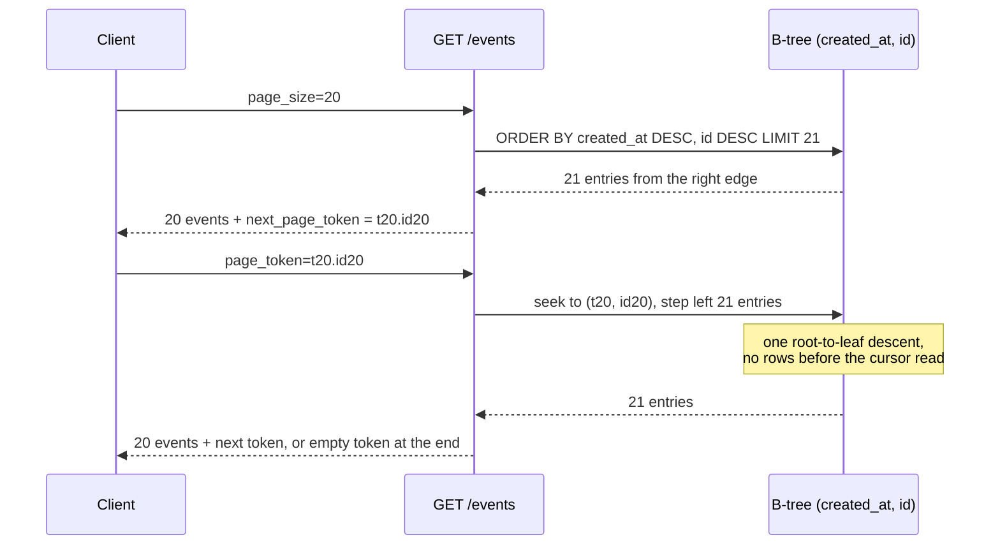

# Keyset (Seek) Pagination: Row-Value Comparisons (created_at, id) and Composite B-Tree Index Alignment

> [!summary] Claim
> A keyset page is one B-tree seek to the last key the client saw plus a read of `limit + 1` index entries, so its cost stays flat with depth only when the sort key is unique (`(created_at, id)`), the predicate is the row value `(created_at, id) < (?, ?)`, and the index's own key order is exactly that sort, which the lab shows SQLite 3.53.1 and 3.54.1 lose for an `INTEGER PRIMARY KEY` rowid alias.

Part of [Pagination Filtering and Query Patterns](README.md) in [API Engineering](../README.md).

## TL;DR

- Mechanism: remember the last row's full sort key, then `WHERE (created_at, id) < (:t, :id) ORDER BY created_at DESC, id DESC LIMIT :n + 1`; an index on `(created_at, id)` turns that into one descent plus a short backward scan, and the extra row tells you whether a next page exists.
- Contract: the cursor is the complete, unique sort key of the last row served, and an end of collection is an empty `next_page_token` (AIP-158).
- Trap: `created_at < ?` silently drops the rest of a tie group, `created_at <= ?` never leaves it, the expanded `OR` form makes PostgreSQL 18.6 filter 59001 rows for a 21-row page, and in SQLite a rowid-alias `id` makes the seek walk the whole tie group (40183 VM instructions against 306).
- Portability: row-value comparison is standard SQL (SQL:92 Section 7.1 `<row value constructor>`, as cited by Winand; SQLite since 3.15.0, PostgreSQL), but plan quality differs by engine and release, and MySQL 8.4 documents that row constructors mixed with `AND` may use less of an index; the lab passes on CPython 3.12.13 through 3.15.2, free-threaded included.
- When not to use it: jump-to-page-N UIs, sort orders the client can change to anything unindexed, and relevance-ranked search, where the key is unstable or not indexable.

## Mental model



The first request reads the right edge of the index, which already holds rows in `created_at DESC, id DESC` order, so there is no sort.
The API returns 20 rows and turns the 20th row's `(created_at, id)` into the token; the 21st row only proves there is more.
The second request descends the B-tree once to the token's key and steps left, so the work is the descent plus 21 entries no matter how many pages came before.
Because `id` breaks every `created_at` tie, the token names exactly one position, and rows inserted before that position never shift what comes after it.

## How it works

### The predicate is a lexicographic comparison

SQLite compares two row values "by looking at the constituent scalar values from left to right" (SQLite rowvalue.html Section 2.1).
PostgreSQL defines the same rule: for `<`, `<=`, `>`, `>=` "the row elements are compared left-to-right, stopping as soon as an unequal or null pair of elements is found" (PostgreSQL 18 Section 9.25.5).
So `(created_at, id) < (t, i)` means exactly `created_at < t OR (created_at = t AND id < i)`, which is "sorts after the cursor" under `ORDER BY created_at DESC, id DESC`.
SQLite's own documentation uses this as its Scrolling Window Queries example, and states that `LIMIT x OFFSET y` is computed as `LIMIT x+y` with the first `y` rows discarded (SQLite rowvalue.html Section 3.1).
PostgreSQL says the same of `OFFSET`: "The rows skipped by an OFFSET clause still have to be computed inside the server" (PostgreSQL 18 Section 7.6).

Row values were added in SQLite 3.15.0 (2016-10-14), and older releases raise a syntax error (SQLite rowvalue.html Section 4).

### NULL makes rows vanish, not sort

A row comparison is `NULL` when a `NULL` pair decides it: SQLite's example table gives `(1,2,3) < (1,2,NULL)` as `NULL` and `(1,3,5) < (1,2,NULL)` as `0` (SQLite rowvalue.html Section 2.1).
PostgreSQL 18.6 in this lab returned `NULL` for `(NULL, 1) < (5, 2)` and for `(1, NULL) < (1, 2)`, and `true` for `(1, NULL) < (2, 2)`, matching Section 9.25.5.
`WHERE` treats `NULL` as false, so a row whose sort key is `NULL` is never returned by any seek page.
SQLite sorts `NULL` first in a record (SQLite fileformat2.html Section 2.2), so `DESC` puts `NULL` rows last, after the final seek; the lab walk of 10 rows with 2 `NULL` timestamps serves 8.

### The index key is the sort key plus the row key

SQLite stores each index entry as "the columns that are being indexed followed by the key of the corresponding table row", the rowid for ordinary tables and the PRIMARY KEY for WITHOUT ROWID tables (SQLite fileformat2.html Section 2.5).
In a rowid table "the index entry always ends with the rowid even if the INTEGER PRIMARY KEY column is one of the columns being indexed" (SQLite fileformat2.html Section 2.5.1).
A column declared exactly `INTEGER PRIMARY KEY` is an alias for the rowid, while `INT` or `BIGINT PRIMARY KEY` is an ordinary column with a unique index (SQLite lang_createtable.html Section 5).
InnoDB does the same as a WITHOUT ROWID table: "each record in a secondary index contains the primary key columns for the row" (MySQL 8.4 Section 17.6.2.1).
In PostgreSQL B-tree indexes "table TID is treated as a tiebreaker column among otherwise equal entries" (PostgreSQL 18 Section 11.4), and a TID is a physical location, not a key an API can put in a cursor, so PostgreSQL needs `id` in the index explicitly.

### What the planner does with each predicate

These plans are `EXPLAIN QUERY PLAN` output captured by the lab on SQLite 3.53.1 and 3.54.1 (identical on both), for the WITHOUT ROWID `events` table with `ix_events_created_id ON events (created_at, id)`:

| Predicate | SQLite plan `detail` |
| --- | --- |
| `(created_at, id) < (?, ?)` | `SEARCH events USING INDEX ix_events_created_id ((created_at,id)<(?,?))` |
| same, no index | `SCAN events`, `USE TEMP B-TREE FOR ORDER BY` |
| `created_at < ? OR (created_at = ? AND id < ?)` | `SCAN events USING INDEX ix_events_created_id` |
| `created_at <= ? AND (created_at < ? OR id < ?)` | `SEARCH events USING INDEX ix_events_created_id (created_at<?)` |
| row value with `ORDER BY created_at DESC, id ASC` | `SEARCH ...`, then `USE TEMP B-TREE FOR LAST TERM OF ORDER BY` |

`((created_at,id)<(?,?))` is the full row value used as the range bound; the expanded `OR` form gets no bound at all and scans from the top of the index.
SQLite warns that this output "is intended for interactive debugging only" and that its format "may change between SQLite releases" (SQLite eqp.html Section 1), which is why the lab also measures cost directly.

PostgreSQL 18.6 (Homebrew, macOS 27.2 arm64), run by hand outside pytest on a fresh throwaway cluster, reproduced identically by the independent fact-check on 2026-11-10: `events (id bigint PRIMARY KEY, created_at bigint NOT NULL, title text NOT NULL)` with 80000 rows, `created_at = 1000` for ids 20001 to 60000 and `created_at = id` otherwise, `title = 'e' || id`, the `(created_at, id)` index, `VACUUM ANALYZE`, cursor `(1000, 40000)`, `EXPLAIN (ANALYZE, BUFFERS)`, `LIMIT 21`.
Simplified excerpt of the captured plans, with the `Limit` node, `Index Searches`, and planning lines trimmed and each plan joined onto two or three lines:

```text
ROW VALUE    Index Scan Backward using ix_events_created_id
             Index Cond: (ROW(created_at, id) < ROW(1000, 40000))      Buffers: shared hit=1 read=3
EXPANDED OR  Index Scan Backward using ix_events_created_id
             Filter: ((created_at < 1000) OR ((created_at = 1000) AND (id < 40000)))
             Rows Removed by Filter: 59001                             Buffers: shared hit=381 read=227
BOUNDED OR   Index Cond: (created_at <= 1000)
             Filter: ((created_at < 1000) OR (id < 40000))
             Rows Removed by Filter: 20001                             Buffers: shared hit=209
OFFSET 60000 Index Scan Backward ... (actual rows=60021.00)           Buffers: shared hit=614 read=4
```

Markus Winand describes the same split: the bounded form "selects more rows as needed" through the index and filters the excess, and no database factors `SALE_DATE <= ?` out of the `OR` branches on its own ([Use The Index, Luke, fetch next page](https://use-the-index-luke.com/sql/partial-results/fetch-next-page)).

### The rowid-alias trap, measured

With the same `(created_at, id)` index but `id INTEGER PRIMARY KEY` (a rowid alias), both SQLite releases plan `SEARCH events USING INDEX ix_events_created_id (created_at<?)`: only `created_at` bounds the seek, and the rest of the row value is a filter.
Inside a 4000-row tie group, a cursor 3990 rows deep then costs 40183 VM instructions against 419 for a cursor 10 rows deep, while the WITHOUT ROWID table costs 306 and 342 for the same two cursors.
On 3.53.1 only, an index on `(created_at)` alone over the rowid table does get `((created_at,rowid)<(?,?))`, because the implicit rowid suffix is the second key column; 3.54.1 drops that to `(created_at<?)`.
The SQLite change log for 3.53.2 through 3.54.1 does not mention a change to this plan, and its 3.54.0 query planner items cover other topics (SQLite changes.html, read 2026-11-10), so the note claims the observed plans only and no cause; they were reproduced on CPython 3.13.18 and 3.14.10 with SQLite 3.54.1, and plans can change between releases (SQLite eqp.html Section 1).
The fix that holds on both releases is a tie-breaker that is a real index column: a WITHOUT ROWID table, a non-alias key such as `TEXT` public ids, or an `INT PRIMARY KEY`.

### The API layer

The token is the last row's key; the lab writes it as `<created_at>.<id>` in decimal, which is all RFC 3986 `unreserved` characters (RFC 3986 Section 2.3), so it travels in the query component unescaped (RFC 3986 Section 3.4).
AIP-158 requires real tokens to be opaque and not user-parseable, since a parseable token makes the pagination internals part of the API surface; that encoding is [[Opaque-Cursor-Encoding-HMAC-Integrity-and-Filter-Binding]].
`page_size` follows AIP-158: absent or `0` gets a documented default, above the maximum is coerced down, and a negative value is `INVALID_ARGUMENT`, which the lab maps to `400`.
Reading `limit + 1` rows is the Slack pattern, described as fetching "one more result than the count specified by the client" to know when the last page has been reached ([Slack Engineering, 2017-08-15](https://slack.engineering/evolving-api-pagination-at-slack/)).

## Numbers and limits

| Quantity | Value | Source |
| --- | --- | --- |
| SQLite release that added row values | 3.15.0, 2016-10-14 | SQLite rowvalue.html Section 4 |
| SQLite rowid width | 64-bit signed integer | SQLite lang_createtable.html Section 5 |
| Row-value page, 21 rows, 100 vs 7900 rows deep, 8000 rows | 279 vs 279 VM instructions (3.53.1); 277 vs 277 (3.54.1) | lab, `vm_steps` |
| `OFFSET 100` vs `OFFSET 7900`, same page | 600 vs 31800 VM instructions (both releases) | lab, `vm_steps` |
| Expanded `OR`, 100 vs 7900 rows deep | 940 vs 55540 (3.53.1); 930 vs 55530 (3.54.1) | lab, `vm_steps` |
| Bounded `OR`, 10 vs 3990 rows into a 4000-row tie group | 353 vs 28189 (3.53.1); 342 vs 28178 (3.54.1) | lab, `vm_steps` |
| Row value, same two tie-group cursors, WITHOUT ROWID | 342 vs 306 (3.53.1); 340 vs 304 (3.54.1) | lab, `vm_steps` |
| Row value, same cursors, rowid-alias `id` | 419 vs 40183 (3.53.1); 417 vs 40181 (3.54.1) | lab, `vm_steps` |
| PostgreSQL 18.6, 21-row page, cursor 20000 rows into a 40001-row tie group (ids 20001 to 60000 plus id 1000) | row value 4 buffers; bounded `OR` 209 buffers, 20001 rows filtered; expanded `OR` 608 buffers, 59001 rows filtered | `EXPLAIN (ANALYZE, BUFFERS)`, macOS 27.2 arm64, run 2026-11-10 |
| PostgreSQL 18.6, `OFFSET 60000 LIMIT 21` | 60021 index rows read, 618 buffers | same run |
| AIP-158 example maximum `page_size` | 1000, larger values coerced to 1000 | AIP-158, `ListBooksRequest` comment |
| Lab `DEFAULT_PAGE_SIZE`, `MAX_PAGE_SIZE` | 20, 100 | lab constants, a choice, not a standard |
| Lab test module | `65 passed`, 0.15 s to 0.17 s over five runs | `uv run --frozen pytest ... -q`, CPython 3.14.6, SQLite 3.53.1, macOS 27.2 arm64 |

A VM instruction is one tick of `sqlite3_progress_handler` with `N = 1`, documented as "the approximate number of virtual machine instructions" between callbacks (SQLite c3ref/progress_handler.html), and Python exposes it as `Connection.set_progress_handler` (Python `sqlite3` docs).
It is deterministic for one SQLite build and data set, which makes it a better regression signal than wall-clock time, but it is not CPU time and not comparable across engines.
The `vm_steps` values above are steady state: each is the count for a repeat execution of the same statement on a fresh `store_with(cost_events())` connection, because the first execution on a connection costs 2 to 22 more instructions on these builds.
They were re-measured by calling `page_cost` and `vm_steps` four times per cursor on CPython 3.14.6 with SQLite 3.53.1 and on CPython 3.13.18 and 3.14.10 with SQLite 3.54.1, macOS 27.2 arm64, 2026-11-10.

## Portability

| Dimension | Result | Evidence |
| --- | --- | --- |
| CPython 3.12.13, SQLite 3.53.1 | 65 passed | lab run, full `uv.lock` env, macOS 27.2 arm64 |
| CPython 3.13.18, SQLite 3.54.1 | 65 passed | lab run, full `uv.lock` env |
| CPython 3.14.6 (workspace), SQLite 3.53.1 | 65 passed | lab run, workspace `.venv` |
| CPython 3.14.10, SQLite 3.54.1 | 65 passed | lab run, full `uv.lock` env |
| CPython 3.15.2, SQLite 3.54.1 | 65 passed | lab run, full `uv.lock` env |
| CPython 3.15.0b3 (what `uv run --python 3.15` picks first) | collection error in the pinned hypothesis wheel, `No module named 'hypothesis._native'`; 65 passed in a minimal venv (SQLite 3.53.1) | lab runs; environment failure, not lab behavior |
| CPython 3.14.6t and 3.15.0b3t free-threaded, `sys._is_gil_enabled()` is `False` | 65 passed on each (SQLite 3.53.1), minimal venv with the pinned `starlette`, `httpx`, `httpcore`, `h11`, `anyio`, `pytest`, `pytest-asyncio` | lab runs |
| CPython 3.12.16 and 3.15.2t named in the matrix | not run | `uv` 0.11.26 here offers 3.12.13 and 3.15.0b3t only |
| Debian Trixie and Alpine musl containers | not run | no container leg was executed for this note |
| SQLite 3.53.1 vs 3.54.1 | identical plans and flat costs for the WITHOUT ROWID table; the rowid-alias plan differs for a single-column index | lab, both releases |
| PostgreSQL 18.6 | row value is an `Index Cond`; mixed `DESC, ASC` adds an `Incremental Sort` | manual `EXPLAIN` run, outside pytest |
| MySQL 8.4 | row constructors that do not cover an index prefix may use fewer key parts; the manual recommends the non-constructor form there | MySQL 8.4 Section 10.2.1.22 (quoted from the manual, example `c1=1 AND (c2,c3) > (1,1)` uses `key_len=4` against `key_len=12` for the rewrite); MySQL was not run here |
| Uvicorn, Hypercorn, Granian | not applicable: the mechanism lives in the query, and the token is an ordinary query parameter | lab uses in-process ASGI only |
| HTTP/1.1, HTTP/2, HTTP/3 | the token rides in the target URI query; HTTP/2 `:path` and HTTP/3 `:path` carry "the path and query parts" | RFC 9113 Section 8.3.1, RFC 9114 Section 4.3.1 |

## Worked example

The [implementation](../labs/src/api_labs/f05_pagination_filtering_and_query_patterns/keyset.py) holds the schema, five predicates, the page fetcher, a plan reader, a VM-instruction counter, the token codec, and a Starlette `GET /events` endpoint.
The [test](../labs/tests/f05_pagination_filtering_and_query_patterns/test_keyset_seek_pagination_and_composite_tie_breaker_cursors.py) checks every walk against a pure-Python reference model, pins the plans, and compares instruction counts by ratio, so it holds on both SQLite releases.

The predicates, verbatim from the lab:

```python
class Predicate(Enum):
    """WHERE clauses that claim to mean "rows after the cursor" in DESC order."""

    ROW_VALUE = "(created_at, id) < (?, ?)"
    EXPANDED_OR = "(created_at < ? OR (created_at = ? AND id < ?))"
    BOUNDED_OR = "created_at <= ? AND (created_at < ? OR id < ?)"
    TIMESTAMP_LT = "created_at < ?"
    TIMESTAMP_LE = "created_at <= ?"
```

One page reads one row past the limit, and a walk refuses a cursor that does not move (verbatim):

```python
def fetch_page(
    conn: sqlite3.Connection,
    *,
    after: SeekKey | None,
    limit: int,
    predicate: Predicate = Predicate.ROW_VALUE,
) -> Page:
    """Return up to *limit* rows after *after*, reading one extra row to detect the end."""
    if limit < 1:
        raise ValueError(f"limit must be >= 1, got {limit}")
    keys: tuple[int, ...] = ()
    if after is None:
        sql = page_sql(None)
    else:
        sql, keys = page_sql(predicate), bind(predicate, after)
    params = (*keys, limit + 1)
    rows = cast("list[tuple[int, int, str]]", conn.execute(sql, params).fetchall())
    items = tuple(Event(*row) for row in rows[:limit])
    has_more = len(rows) > limit
    return Page(items, items[-1].key if has_more else None)


def walk(
    conn: sqlite3.Connection, *, limit: int, predicate: Predicate = Predicate.ROW_VALUE
) -> list[int]:
    """Follow next_key to the end and return every id served, in order."""
    served: list[int] = []
    after: SeekKey | None = None
    while True:
        page = fetch_page(conn, after=after, limit=limit, predicate=predicate)
        served.extend(e.id for e in page.items)
        if page.next_key is None:
            return served
        # DESC order: every next cursor must sort strictly below the previous one.
        if after is not None and page.next_key >= after:
            raise CursorDidNotAdvanceError(f"{page.next_key} does not precede {after}")
        after = page.next_key
```

The rowid-alias test (verbatim); `TIE_SHALLOW` and `TIE_DEEP` are cursors 10 and 3990 rows into a 4000-row tie group:

```python
def test_rowid_alias_tie_breaker_loses_the_tight_seek_inside_a_tie_group() -> None:
    conn = store_with(cost_events(), ROWID_ALIAS_TABLE_DDL)  # same (created_at, id) index
    plan = query_plan(conn, page_sql(Predicate.ROW_VALUE), (0, 0, 21))
    assert "(created_at,id)<(?,?)" not in plan[0]
    assert page_cost(conn, Predicate.ROW_VALUE, TIE_DEEP) >= 20 * page_cost(
        conn, Predicate.ROW_VALUE, TIE_SHALLOW
    )
    # Same rows, same index, WITHOUT ROWID table: the seek is tight again.
    tight = store_with(cost_events())
    assert page_cost(tight, Predicate.ROW_VALUE, TIE_DEEP) <= 1.2 * page_cost(
        tight, Predicate.ROW_VALUE, TIE_SHALLOW
    )
```

Captured from `labs/` on CPython 3.14.6, SQLite 3.53.1, macOS 27.2 arm64:

```text
$ uv run --frozen pytest tests/f05_pagination_filtering_and_query_patterns/test_keyset_seek_pagination_and_composite_tie_breaker_cursors.py -q
..............................................................           [100%]
65 passed in 0.17s
```

The plan and cost subset, run with `-v -p no:cacheprovider -k "..."` and the module path trimmed:

```text
collecting ... collected 65 items / 54 deselected / 11 selected

test_timestamp_only_le_cursor_never_advances_inside_a_tie_group PASSED [  9%]
test_millisecond_truncated_cursor_skips_rows_inside_the_truncated_interval PASSED [ 18%]
test_keyset_walk_is_stable_under_head_inserts_while_offset_repeats_rows PASSED [ 27%]
test_composite_index_serves_the_row_value_seek_with_no_sort_step PASSED [ 36%]
test_without_the_index_sqlite_scans_the_table_and_sorts_it PASSED [ 45%]
test_expanded_or_form_scans_the_index_instead_of_seeking_into_it PASSED [ 54%]
test_mixed_direction_order_by_cannot_ride_the_index_order PASSED [ 63%]
test_row_value_page_cost_is_flat_while_offset_cost_grows_with_depth PASSED [ 72%]
test_expanded_or_page_cost_grows_with_the_rows_already_served PASSED [ 81%]
test_bounded_or_pays_for_the_tie_group_rows_ahead_of_the_cursor PASSED [ 90%]
test_rowid_alias_tie_breaker_loses_the_tight_seek_inside_a_tie_group PASSED [100%]

====================== 11 passed, 54 deselected in 0.11s =======================
```

## Pitfalls

No CVE or public postmortem was verified for these failures; each one below is reproduced by the lab or shown in a vendor manual, and the tie-breaker rule matches Slack's production requirement that the cursor "must be based on a unique, sequential column (or columns)" ([Slack Engineering, 2017-08-15](https://slack.engineering/evolving-api-pagination-at-slack/)).

> [!warning] Timestamp-only cursor
> Trigger: the cursor carries only `created_at`, and the page query is `created_at < ?`.
> Symptom: whenever a page ends inside a tie group, the rest of that group is never served; the lab walk of 50 rows with 7-row tie groups at `limit=5` loses 15 rows, and switching to `<=` makes the walk repeat the group until `CursorDidNotAdvanceError` stops it.
> Fix: put a unique tie-breaker in both `ORDER BY` and the cursor; Winand's rule is that paging "requires a deterministic sort order".

> [!warning] Cursor precision lower than column precision
> Trigger: the database stores microseconds and a client, a JSON serializer, or a JavaScript `Date` round-trips the cursor timestamp in milliseconds.
> Symptom: rows between the truncated cursor and the true last row are skipped without any error; in the lab, 4 rows per millisecond and `limit=6` lose 10 of 40 rows.
> Fix: put the exact stored integer into the token, never a re-formatted timestamp, and sign the token so clients cannot edit it.

> [!warning] Expanded `OR` written for portability
> Trigger: replacing the row value with `created_at < ? OR (created_at = ? AND id < ?)`.
> Symptom: correct rows, but PostgreSQL 18.6 filtered 59001 rows for a 21-row page, and SQLite scans from the top of the index, so page cost grows with every page already served (940 to 55540 instructions on SQLite 3.53.1).
> Fix: use the row value, or, where the engine needs a non-constructor form (the MySQL 8.4 manual case, which rewrites `(c2,c3) > (1,1)` next to `c1=1` as `c2 > 1 OR ((c2 = 1) AND (c3 > 1))`), add Winand's redundant `created_at <= ?` bound and accept that rows in the cursor's tie group ahead of it are still filtered.

> [!warning] Index that looks aligned but is not
> Trigger: `id INTEGER PRIMARY KEY` in a SQLite rowid table plus `INDEX (created_at, id)`; or a mixed-direction `ORDER BY created_at DESC, id ASC`; or `INDEX (id, created_at)`.
> Symptom: `(created_at<?)` instead of `((created_at,id)<(?,?))`, a `USE TEMP B-TREE` line, or a PostgreSQL `Incremental Sort` node, and latency that grows with tie-group size or depth.
> Fix: assert the plan in CI the way this lab does, and match index column order and direction to the `ORDER BY` (PostgreSQL 18 Section 11.4 shows `(x ASC, y DESC)` for mixed order).

> [!warning] Nullable sort column
> Trigger: `created_at` or the tie-breaker can be `NULL`.
> Symptom: `NULL`-keyed rows are never returned, because the row comparison is `NULL` (SQLite rowvalue.html Section 2.1, PostgreSQL 18 Section 9.25.5).
> Fix: declare sort columns `NOT NULL`, or sort on `COALESCE` of an indexed expression and put the same expression in the cursor.

## Security and robustness

- OWASP API4:2023 calls an API vulnerable when a limit is missing, and its list includes "Number of records per page to return in a single request-response"; cap `page_size` on the server (the lab coerces to 100) instead of trusting the client.
- Parse the token strictly: the lab's grammar is `(0|[1-9][0-9]{0,18})\.(0|[1-9][0-9]{0,18})` plus an int64 check, so leading zeros, signs, whitespace, and non-ASCII digits are rejected; a `\d` pattern would accept `1\u0661`, and Python's `int()` turns it into `11` (checked on CPython 3.14.6), which is why the test includes `1\u0661.2` and `1.2\uff11`.
- A malformed token is the client's fault, so it is a `400`, never a `500`; the lab test sends `1.2' OR 1=1 --` and gets `{"error": "malformed cursor"}`.
- Never splice cursor values into SQL; every statement in the lab is built from module constants and the key travels only as `?` binds.
- AIP-158: tokens "must not provide any form of authorization to the underlying resources", so re-check tenant scope and filters on every page, and bind the token to the filters it was minted for ([[Opaque-Cursor-Encoding-HMAC-Integrity-and-Filter-Binding]]).
- A transparent `created_at.id` token leaks creation times and id density, which is an enumeration signal; that is one more reason for opaque tokens.
- Bound every server-side or client-side page loop and detect a cursor that does not advance; in mutation runs, removing the guard and never emitting an empty token each made a walk hang until a 60 s kill, so the tests now bound both loops (a page budget on the HTTP walk, a SQLite progress-handler instruction budget on the `<=` walk) and each of those mutations fails in under a second.

## The principal's view

Keyset pagination is a contract that the sort order is a key: once you ship it, every sortable field you add needs a unique tie-breaker and an index whose order matches, and that cost is permanent.
The decision a staff-plus engineer owns is which orderings a list endpoint supports, because each one is an index, write amplification on every insert, and a plan that must stay aligned across database upgrades; the lab's own SQLite 3.53.1 to 3.54.1 plan change is the argument for plan assertions in CI.
Offer one or two fixed orderings with keyset tokens for machine clients and feeds, and keep `OFFSET` only for small, bounded, human page-number UIs ([[Offset-Limit-Pagination-Mechanics-Cost-and-Window-Drift]]).
Choose UUIDv7 or another time-ordered id as the tie-breaker when you can, since it makes `(created_at, id)` nearly monotone and keeps the index append-mostly ([[Resource-Identifiers-UUIDv4-vs-UUIDv7-ULID-and-Public-IDs]]).
Keyset tokens give a stable position, not a snapshot: rows updated or deleted behind the cursor still change what a full walk sees, so exports and reconciliations need [[Snapshot-Consistent-Pagination-Across-Point-in-Time-Reads]] or [[Streaming-Exports-and-NDJSON-for-Unbounded-Collections]].
For relevance-ranked search the "key" is a score that changes with the index, so use the search engine's own cursor or point-in-time API ([[Search-Endpoints-vs-List-Endpoints-and-Full-Text-Ranking]]).

## Interview questions

> [!question] L5: Why does `ORDER BY created_at DESC` with a cursor of `created_at` alone lose rows, and what is the minimal fix?
>
> > [!success]- Answer
> > Rows sharing a timestamp have no defined order, and `created_at < ?` skips every row in the last row's tie group that was not on the page.
> > The fix is a unique tie-breaker in both the sort and the cursor: `ORDER BY created_at DESC, id DESC` with `(created_at, id) < (?, ?)`.
> > The lab loses 15 of 50 rows without it and none with it.
> >
> > Follow-up: What happens if you "fix" it with `<=` instead?

> [!question] L5: Predict the output in SQLite of `SELECT (1,2,3) < (1,2,NULL), (1,3,5) < (1,2,NULL), (1,2,3) < (1,3,NULL);`
>
> > [!success]- Answer
> > `NULL`, `0`, `1`.
> > The first is undecided because only the `NULL` pair differs; the second is decided false at the second element; the third is decided true at the second element before the `NULL` is reached.
> > These are rows from SQLite rowvalue.html Section 2.1, and PostgreSQL 18 Section 9.25.5 states the same left-to-right rule.
> >
> > Follow-up: What does that mean for a row whose `created_at` is `NULL` in a seek page?

> [!question] L5: Why does a keyset page read `limit + 1` rows?
>
> > [!success]- Answer
> > The extra row proves a next page exists, so the last full page can return an empty `next_page_token` instead of making the client fetch an empty page.
> > The token is still the key of the last row served, not of the extra row.
> > Slack's API uses the extra row's id as the cursor with `<=`, which is equivalent when the key is unique.
> >
> > Follow-up: Why is AIP-158 explicit that an empty token is the only end-of-collection signal?

> [!question] L6: Your PostgreSQL list endpoint uses `WHERE created_at < $1 OR (created_at = $1 AND id < $2)` with an index on `(created_at, id)`, and p99 grows with how far clients have paged; why?
>
> > [!success]- Answer
> > PostgreSQL does not turn that `OR` into an index bound, so it scans backward from the top of the index and filters every row the client has already seen.
> > In the lab's PostgreSQL 18.6 run that was 59001 rows removed by filter and 608 buffers for a 21-row page, against 4 buffers for `(created_at, id) < ($1, $2)`, which appears as an `Index Cond`.
> > Rewrite it as a row value, or at least add the redundant `created_at <= $1` bound.
> >
> > Follow-up: When would you still keep the bounded `OR` form?

> [!question] L6: Debug this API: a mobile client paging `GET /events?page_token=...` reports a few events missing per page, with no errors, and only on iOS; server logs show tokens like `1794268800001000.35`, whose microsecond timestamps always end in `000`.
>
> > [!success]- Answer
> > The server stores microseconds but the client rebuilt the token from a millisecond timestamp, zeroing the last three digits, so the cursor sorts below the last row served and every row in between is skipped.
> > Keyset never errors on this, because any key is a valid position.
> > Fix it by making the token opaque and signed so clients cannot reconstruct it, and keep the exact stored integer in it; the lab reproduces the loss as 10 of 40 rows.
> >
> > Follow-up: How would you detect this class of bug in production metrics?

> [!question] L6: In SQLite you have `id INTEGER PRIMARY KEY` and `CREATE INDEX ix ON events (created_at, id)`; is the row-value seek tight?
>
> > [!success]- Answer
> > No: on SQLite 3.53.1 and 3.54.1 the plan is `(created_at<?)`, so a cursor deep in a tie group walks the group, 40183 instructions against 306 for a WITHOUT ROWID table in the lab.
> > `INTEGER PRIMARY KEY` aliases the rowid, and every rowid-table index entry already ends with the rowid (SQLite fileformat2.html Section 2.5.1).
> > Use a WITHOUT ROWID table or a non-alias key, and assert the plan in tests because the behavior shifted between releases.
> >
> > Follow-up: Why does InnoDB not need the `id` column declared in the secondary index for the same effect?

> [!question] L6: The product wants `ORDER BY created_at DESC, id ASC`; what changes?
>
> > [!success]- Answer
> > A single row-value comparison cannot express mixed directions, so the predicate becomes `created_at < ? OR (created_at = ? AND id > ?)`.
> > A plain `(created_at, id)` index cannot deliver that order, which is why SQLite adds `USE TEMP B-TREE FOR LAST TERM OF ORDER BY` and PostgreSQL 18.6 adds an `Incremental Sort`.
> > Build the index as `(created_at DESC, id ASC)` or `(created_at ASC, id DESC)` (PostgreSQL 18 Section 11.4).
> >
> > Follow-up: How does that interact with an allowlist of client-selectable sort fields?

> [!question] L7+: You own the list API for a 2-billion-row multi-tenant table; design the pagination contract and the guardrails that keep it O(page) for the next five years.
>
> > [!success]- Answer
> > Offer a small allowlist of orderings, each ending in a unique id and each backed by an index whose leading columns are the tenant key and then the sort key, for example `(tenant_id, created_at, id)`.
> > Tokens are opaque, signed, versioned, and bound to tenant, filters, and ordering, and every page re-checks authorization (AIP-158).
> > Cap `page_size` (OWASP API4:2023), return an empty token at the end, and refuse non-advancing cursors.
> > Keep plan assertions and an instruction or buffer budget per page in CI so a database upgrade that changes the plan fails a build, not a pager.
> >
> > Follow-up: How do you migrate clients if you must add a new tie-breaker column to an existing ordering?

> [!question] L7+: When is keyset pagination the wrong tool, even with perfect indexes?
>
> > [!success]- Answer
> > When users need random access to page N, when the sort key is unstable (relevance scores, mutable counters), or when a caller needs a consistent snapshot of the whole collection.
> > Keyset gives a stable position, not a stable set, so a full walk can still see a row twice if its sort key moves behind the cursor.
> > Use offset for small human UIs, search-engine cursors for ranking, and point-in-time reads or streaming exports for complete scans.
> >
> > Follow-up: What would you put in the API docs so clients do not treat a keyset walk as a snapshot?

## Related

Prerequisites: [[Offset-Limit-Pagination-Mechanics-Cost-and-Window-Drift]]

Next: [[Opaque-Cursor-Encoding-HMAC-Integrity-and-Filter-Binding]]

See also: [[Pagination-Strategies]], [[02-Programming-Languages/Python/Python-Backend-Interview-Prep/05-REST-API-Design]], [[02-Programming-Languages/Python/Python-Backend-Interview-Prep/06-SQL-and-SQLAlchemy]], [[Bidirectional-Keyset-Pagination-and-Relay-Cursor-Connections]], [[Multi-Column-Sorting-Order-By-Whitelisting-and-Index-Coverage]], [[Snapshot-Consistent-Pagination-Across-Point-in-Time-Reads]], [[Total-Count-Antipattern-and-Estimated-Counts]], [[Resource-Identifiers-UUIDv4-vs-UUIDv7-ULID-and-Public-IDs]], [[Indexing-and-Access-Paths]], [[Unrestricted-Resource-Consumption-API4-2023-Payload-Depth-and-Limit-Guards]], [[SQL-Injection-NoSQL-Injection-and-Order-By-Identifier-Escaping]]

- Lab: `labs/tests/f05_pagination_filtering_and_query_patterns/test_keyset_seek_pagination_and_composite_tie_breaker_cursors.py`

## Further reading

- [SQLite, Row Values](https://www.sqlite.org/rowvalue.html): the comparison and `NULL` rules, and the Scrolling Window Queries example this pattern is built on.
- [SQLite, Database File Format](https://www.sqlite.org/fileformat2.html): Section 2.5 shows that every index key ends with the row key, which is why the rowid alias matters.
- [SQLite, CREATE TABLE](https://www.sqlite.org/lang_createtable.html): Section 5 defines when `INTEGER PRIMARY KEY` aliases the rowid.
- [SQLite, EXPLAIN QUERY PLAN](https://www.sqlite.org/eqp.html): how to read `SEARCH`, `SCAN`, and `USE TEMP B-TREE`, and why the format is unstable.
- [PostgreSQL 18, Row Constructor Comparison](https://www.postgresql.org/docs/18/functions-comparisons.html): Section 9.25.5, the left-to-right and `NULL` semantics.
- [PostgreSQL 18, Indexes and ORDER BY](https://www.postgresql.org/docs/18/indexes-ordering.html): backward scans, TID tie-breaking, and mixed-direction indexes.
- [MySQL 8.4, Row Constructor Expression Optimization](https://dev.mysql.com/doc/refman/8.4/en/row-constructor-optimization.html): the case where MySQL prefers the non-constructor form.
- [Markus Winand, Use The Index, Luke: fetch next page](https://use-the-index-luke.com/sql/partial-results/fetch-next-page): the seek method, row values, and the bounded `OR` approximation.
- [Google AIP-158, Pagination](https://google.aip.dev/158): the `page_size`, `page_token`, and `next_page_token` contract.
