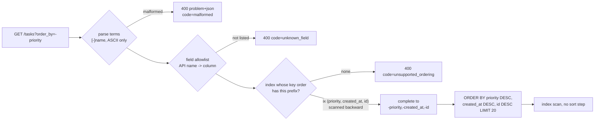

# Multi-Column Sorting (order_by), Nulls Ordering, Allowlist Validation, and Index-Sort Alignment

> [!summary] Claim
> A client-chosen `order_by` is safe and cheap only when the server accepts orderings, not fields: each accepted request must be a prefix of a declared index scanned in one direction, completed with that index's remaining columns so it ends in the unique key, with NULL placement written as an explicit sort key, because anything else is a full sort per request (7633 -> 56657 SQLite VM instructions as the table grows 8x, against a flat 197) and a plan-dependent order that lost 504 of 2000 rows in the lab.

Part of [Pagination Filtering and Query Patterns](README.md) in [API Engineering](../README.md).

## TL;DR

- Mechanism: parse `order_by=-created_at,priority` into keys, map each key to an application-owned column, then find an index whose key order equals the request as a prefix (forward or fully reversed) and sort by that whole index key, which ends in `id`.
- Contract: JSON:API says an unsupported `sort` MUST return `400 Bad Request`, AIP-132 makes `order_by` a comma list with a ` desc` suffix, and the server echoes the effective ordering, for example `priority,created_at,id`.
- Trap: appending only `id` to `priority` breaks index alignment (`USE TEMP B-TREE FOR LAST TERM OF ORDER BY` in SQLite, `Incremental Sort` over 20001 rows in PostgreSQL 18.6), and leaving ties unbroken makes rows depend on the plan.
- Portability: NULLs sort first ascending in SQLite and MySQL but last in PostgreSQL, MySQL has no `NULLS LAST` syntax, so the portable form is an explicit `col IS NULL` key; the lab passes on CPython 3.12.13 to 3.15.2 on macOS, in Debian trixie and Alpine containers, and on free-threaded 3.14.6t and 3.15.0b3t.
- When not to use it: arbitrary sorting on any field, relevance ranking, and ad hoc analytics belong in a search engine or a warehouse, not in an OLTP list endpoint.

## Mental model



The request is parsed with a strict grammar, so anything that is not `-?[a-z][a-z0-9_]*` per term is a `400` before any SQL exists.
Each name is looked up in the field allowlist, which is where a column such as `api_key` that exists in the table but must never be sortable is refused.
The keys are then matched against the declared indexes: the request must be a prefix of one index's key order, either as written or with every direction flipped, because a B-tree can be read in one direction at a time.
The matched index supplies the rest of the ordering, so `-priority` becomes `-priority,-created_at,-id`, which is both deterministic (it ends in the unique `id`) and exactly the index order, so the database reads 20 entries and stops.

## How it works

### The wire syntax

AIP-132 says list methods "may allow clients to specify sorting order"; values "should be a comma separated list of fields", "The default sorting order is ascending", descending is a `" desc"` suffix, and "Redundant space characters in the syntax are insignificant" (AIP-132, Ordering).
JSON:API v1.1 uses `sort` with comma-separated fields, where a field "MUST be ascending unless it is prefixed with a minus (U+002D HYPHEN-MINUS, "-"), in which case it MUST be descending" (JSON:API v1.1, Sorting).
JSON:API also fixes the error: "If the server does not support sorting as specified in the query parameter sort, it MUST return 400 Bad Request."
The lab implements both grammars, `parse_order_by` for `-created_at,priority` and `parse_aip132` for `created_at desc, priority`, and the test proves they produce the same keys.

Both characters that matter are URI `sub-delims`: `,` and `+` are reserved (RFC 3986 Section 2.2) and legal unescaped in the query component (RFC 3986 Section 3.4).
Servers do not parse the query with RFC 3986, though; they use `application/x-www-form-urlencoded`, whose parser says "Replace any 0x2B (+) in name and value with 0x20 (SP)" (WHATWG URL Standard Section 5.1).
Starlette builds `request.query_params` as `QueryParams(self.scope["query_string"])` (starlette 1.10.0 starlette/requests.py, HTTPConnection.query_params), and `QueryParams.__init__` calls `parse_qsl(value.decode("latin-1"), keep_blank_values=True)` (starlette 1.10.0 starlette/datastructures.py, QueryParams.__init__).
So `order_by=+created_at` arrives as `" created_at"`, `order_by=created_at+desc` arrives as `"created_at desc"`, and only `%2B` delivers a literal `+`; the lab test pins all three.
`ImmutableMultiDict.__init__` builds `self._dict = {k: v for k, v in _items}` (starlette 1.10.0 starlette/datastructures.py, ImmutableMultiDict.__init__), so `query_params["order_by"]` silently returns the last of two repeats; the lab endpoint reads `getlist` and rejects a repeat.

### Allowlist fields, then allowlist orderings

An `ORDER BY` column cannot be a bind parameter: "Parameter markers represent data values, not table names, column names, or SQL keywords such as ASC and DESC" (OWASP SQL Injection Prevention Cheat Sheet, Allow-List Input Validation), and the cheat sheet's defense for such structural parts is to "map user choices to a strict allow-list of fixed, application-owned values" (OWASP SQL Injection Prevention Cheat Sheet, Primary Defenses).
The lab has two allowlists.
`TASK_FIELDS` maps API names to columns and decides what a client may name at all; `api_key` is absent, so `order_by=api_key` is `unknown_field`.
`TASK_INDEXES` decides which orderings are cheap; `title` is a legal field with no index, so `order_by=title` is `unsupported_ordering`.
Every `Term.expr` that reaches SQL is a `SortField.column` constant, so the `ORDER BY` text is built from module constants only.
A key after the unique `id` can never change the order, so the lab refuses it as `keys_after_tie_breaker` instead of dropping it; dropping it would make `id,title` legal while `title` alone is not.
The policy also validates its own default at construction, so a default that no index serves is a startup `ValueError`, never a `400` blamed on a client that sent no `order_by`.

### Why the ordering must match an index, term for term

PostgreSQL states the cost model directly: with `ORDER BY` and `LIMIT n`, "an explicit sort will have to process all the data to identify the first n rows, but if there is an index matching the ORDER BY, the first n rows can be retrieved directly, without scanning the remainder at all" (PostgreSQL 18 Section 11.4).
SQLite says the same: without an index the sort is "proportional to KlogK" and "the entire output is accumulated in temporary storage" (SQLite queryplanner.html Section 2).
A two-column index on `(x, y)` "can satisfy ORDER BY x, y if we scan forward, or ORDER BY x DESC, y DESC if we scan backward", but for `ORDER BY x ASC, y DESC` "There is no way to get that ordering from a plain index", only from `(x ASC, y DESC)` or `(x DESC, y ASC)` (PostgreSQL 18 Section 11.4).
MySQL 8.4 honors `DESC` in index definitions so that "the optimizer can perform a forward index scan" for each of the four mixed combinations (MySQL 8.4 Section 10.3.13).
When only a prefix of the `ORDER BY` matches, SQLite does "block sorting" on the remaining terms (SQLite optoverview.html Section 10.1).
`EXPLAIN QUERY PLAN` documents a sort as a line of the form "USE TEMP B-TREE FOR xxx", where xxx is `ORDER BY`, `GROUP BY`, or `DISTINCT` (SQLite eqp.html Section 1.2); the block-sort form `USE TEMP B-TREE FOR LAST TERM OF ORDER BY` is not in that page and is observed output on SQLite 3.53.1 and 3.54.1, so the lab's `needs_sort` matches the `USE TEMP B-TREE` prefix.

That gives the matching rule the lab implements in `SortPolicy.match`: the requested keys must equal the first `len(keys)` keys of an index, either as declared or with every direction flipped.
The test `test_alignment_model_agrees_with_the_sqlite_planner_on_every_candidate` checks this model against SQLite's planner for all 74 one- and two-key requests over five fields that do not put `id` before another key: the 14 accepted orderings have no `USE TEMP B-TREE` line, and the 60 rejected ones do.

### Ties: complete from the index, do not just append the key

Without a unique final key the order of tied rows is unspecified: "The order in which two rows for which all ORDER BY expressions evaluate to equal values are returned is undefined" (SQLite lang_select.html Section 4), PostgreSQL warns "A particular output ordering can only be guaranteed if the sort step is explicitly chosen" (PostgreSQL 18 Section 7.5), and MySQL says the server "is free to return those rows in any order, and may do so differently depending on the overall execution plan" (MySQL 8.4 Section 10.2.1.19).
In the lab, `ORDER BY priority LIMIT 5` returns ids `2000, 395, 790, 1185, 1580` through `ix_tasks_priority_created` and `5, 10, 15, 20, 25` with `NOT INDEXED`; an `OFFSET` walk that alternates the two plans serves 2000 rows of which only 1496 are distinct, so 504 rows are never seen.

The usual fix, "append the primary key", is correct but often unindexed.
`priority` plus `id` is `ORDER BY priority, id`, and the only index that starts with `priority` is `(priority, created_at, id)`, so SQLite plans `SCAN tasks USING INDEX ix_tasks_priority_created` plus `USE TEMP B-TREE FOR LAST TERM OF ORDER BY`, and PostgreSQL 18.6 runs an `Incremental Sort` with `Presorted Key: priority` over 20001 index rows for a 21-row page.
The lab instead completes the request from the matched index: `priority` becomes `priority,created_at,id`, which is total because every declared index must end in `id` (`SortPolicy.__post_init__` enforces it) and needs no sort step (PostgreSQL 18.6: 21 rows, 4 buffers).

### NULL placement is an explicit key

The engines disagree by default.
SQLite "considers NULL values to be smaller than any other values for sorting purposes", so NULLs come first in `ASC` and last in `DESC` (SQLite lang_select.html Section 4), and MySQL 8.4 documents the same placement (MySQL 8.4 Section 5.3.4.6).
PostgreSQL does the opposite: "null values sort as if larger than any non-null value; that is, NULLS FIRST is the default for DESC order, and NULLS LAST otherwise" (PostgreSQL 18 Section 7.5).
SQLite accepts `NULLS FIRST` and `NULLS LAST` since 3.30.0 (2019-10-04) (SQLite changes.html), PostgreSQL also accepts them in index definitions (PostgreSQL 18 Section 11.4), while the MySQL 8.4 `SELECT` syntax is `ORDER BY { col_name | expr | position } [ASC | DESC]` with no `NULLS` modifier (MySQL 8.4 Section 15.2.13), and MySQL 26.10.0 answers `ORDER BY v NULLS LAST` with error 1064 in the manual run below.

The lab's contract is "tasks without a due date go last in both directions", and it writes that as a sort key instead of a modifier: `due_at` expands to `due_at IS NULL ASC, due_at <dir>`.
`IS NULL` is `0` for values and `1` for NULLs, so NULLs form their own trailing group whatever the engine's NULL rule is, and the index is declared on the same expression, `(due_at IS NULL ASC, due_at ASC, id ASC)`.
SQLite matches an expression index only when the `ORDER BY` uses the expression "exactly as it is written in the CREATE INDEX statement" because "The query planner does not do algebra" (SQLite expridx.html Section 1), and PostgreSQL 18.6 planned the same expression index as an `Index Only Scan` in the manual run.
Reversing such an index would scan `due_at IS NULL DESC`, which moves NULLs first, so the lab marks any index holding a `Nulls.LAST` field as forward-only, and "NULLs last in both directions" costs two indexes; the test that drops `ix_tasks_due_desc` shows `-due_at` becomes `unsupported_ordering` and the planner adds a temp B-tree.

SQLite 3.53.1 and 3.54.1 have one extra that neither the change log nor the `EXPLAIN QUERY PLAN` page describes: `ORDER BY due_at ASC NULLS LAST, id ASC` on a plain `(due_at, id)` index shows no temp B-tree in `EXPLAIN QUERY PLAN`, and the bytecode has a `SeekGT` past the NULLs followed by a `Rewind` to serve them afterwards.
The change log entry for 3.30.0 only says it added the syntax, but the SQLite source repository dates the mechanism to that work.
Its `nulls-last` branch added "support for using indexes for some ORDER BY clauses that use non-default NULL handling" on 2019-08-16 (check-in 81069d7196), added "Extra VDBE comments in the NULLS LAST logic" for the NULL-scan pass on 2019-08-23 (check-in 649b08ead5), and was merged to trunk on 2019-08-27 by the check-in that adds support for `ORDER BY ... NULLS FIRST` and `ORDER BY ... NULLS LAST` (check-in 94085fb3e7, which changes `src/where.c` and `src/wherecode.c`), before the 3.30.0 release of 2019-10-04.
SQLite 3.30.0 itself was not run; the opcodes were observed on SQLite 3.46.1 (Debian trixie container), 3.53.1, 3.53.4 (Alpine container), and 3.54.1, because the lab test passes on all of them.
The lab pins the behavior instead of relying on it, and SQLite warns that query plan output "may change between SQLite releases" (SQLite eqp.html Section 1).

### An ORM is not an allowlist

CVE-2019-7164 records that "SQLAlchemy through 1.2.17 and 1.3.x through 1.3.0b2 allows SQL Injection via the order_by parameter" (NVD).
In SQLAlchemy 2.1.8, a plain string in `order_by()` becomes a textual label reference (sqlalchemy 2.1.8 sqlalchemy/sql/coercions.py, ByOfImpl._text_coercion), and when the string is not a known name `SQLCompiler.visit_textual_label_reference` calls `coercions._no_text_coercion` with `exc_cls=exc.CompileError` (sqlalchemy 2.1.8 sqlalchemy/sql/compiler.py, SQLCompiler.visit_textual_label_reference), which raises "Can't resolve label reference for ORDER BY / GROUP BY / DISTINCT etc. Textual SQL expression ... should be explicitly declared as text(...)" (sqlalchemy 2.1.8 sqlalchemy/sql/coercions.py, _no_text_coercion).
The names it does know come from `SelectState._memoized_attr__label_resolve_dict`, which fills `with_cols` from the selected columns and then calls `with_cols.setdefault(key, value)` for every column of every FROM table (sqlalchemy 2.1.8 sqlalchemy/sql/selectable.py, SelectState._memoized_attr__label_resolve_dict).
So `select(tasks.c.id).order_by("api_key")` compiles to `ORDER BY tasks.api_key` although `api_key` is not selected; the lab test shows both behaviors, and the same `setdefault` loop and error path are in 2.0.57 (sqlalchemy 2.0.57 lib/sqlalchemy/sql/selectable.py at tag `rel_2_0_57`, SelectState._memoized_attr__label_resolve_dict).

## Numbers and limits

| Quantity | Value | Source |
| --- | --- | --- |
| SQLite release with `NULLS FIRST` and `NULLS LAST` | 3.30.0, 2019-10-04 | SQLite changes.html |
| PostgreSQL `work_mem` default, the memory a sort uses before spilling | 4MB | PostgreSQL 18 Section 19.4.1 |
| Aligned page, `ORDER BY created_at DESC, id DESC LIMIT 21` | 197 VM instructions at 1000 rows and at 8000 rows | lab, `vm_steps`, SQLite 3.53.1 and 3.54.1 identical |
| Unaligned page, `ORDER BY title ASC, id ASC LIMIT 21` | 7633 at 1000 rows, 56657 at 8000 rows | same |
| Candidate requests checked against the planner | 74, of which 14 accepted and 60 rejected, all agreeing | lab, `test_alignment_model_agrees_with_the_sqlite_planner_on_every_candidate` |
| Accepted `order_by` values from 4 indexes plus the primary key | 16 | lab, `SortPolicy.supported` |
| `OFFSET` walk with `ORDER BY priority`, plan flips each page, 2000 rows, pages of 50 | 2000 served, 1496 distinct, 504 never served | lab |
| Same walk with the completed ordering `priority, created_at, id` | 2000 served, 2000 distinct | lab |
| PostgreSQL 18.6, 100000 rows, `ORDER BY due_at DESC NULLS LAST, id DESC LIMIT 21`, index `(due_at, id)` | `Sort` (top-N heapsort, 26kB) under `Gather Merge` over a `Parallel Index Only Scan` of all 100000 entries, 380 buffers | `EXPLAIN (ANALYZE, BUFFERS)` of `SELECT id`, `make_tasks(100000)` rows after `VACUUM ANALYZE`, warm cache, re-run 2026-11-10, macOS 27.2 arm64 |
| Same query with index `(due_at DESC NULLS LAST, id DESC)` | `Index Only Scan`, 21 rows, 4 buffers | same run |
| PostgreSQL 18.6, `ORDER BY priority, id LIMIT 21` vs `ORDER BY priority, created_at, id LIMIT 21` | `Incremental Sort` over 20001 index rows, 80 buffers vs `Index Only Scan`, 21 rows, 4 buffers | same run |
| PostgreSQL 18.6, `ORDER BY title, id LIMIT 21`, no index | `Seq Scan` of 100000 rows, top-N heapsort in 25kB, 840 buffers | same run |
| MySQL 26.10.0, 100000 rows, `ORDER BY priority, id LIMIT 21` vs `ORDER BY priority, created_at, id LIMIT 21` | `Sort ... limit input to 21 row(s) per chunk` over a covering index scan estimated at 99722 rows vs `Covering index scan`, estimated 21 rows | `EXPLAIN`, `make_tasks(100000)` after `ANALYZE TABLE`, throwaway Homebrew server on 127.0.0.1:54332, 2026-11-10, macOS 27.2 arm64 |
| Lab limits `MAX_ORDER_BY_LENGTH`, `MAX_SORT_KEYS`, `PAGE_SIZE` | 128 characters, 3 keys, 20 rows | lab constants, a choice, not a standard |
| Lab test module | `79 passed in 0.42s` | `uv run --frozen pytest ... -q`, CPython 3.14.6, SQLite 3.53.1, macOS 27.2 arm64 |

A VM instruction is one tick of `sqlite3_progress_handler` with `N = 1`, documented as "the approximate number of virtual machine instructions" between callbacks (SQLite c3ref/progress_handler.html); it is deterministic for one SQLite build and data set, which makes it a better test signal than wall time, but it is not CPU time.
The PostgreSQL numbers come from manual runs on a throwaway local cluster, not from pytest; an independent re-run reproduced every plan and buffer count except the unindexed `title` query, whose buffer count in the table is from the re-run; the unindexed query used only 25kB of sort memory because a `LIMIT` sort keeps a top-N heap, so the cost of an unindexed ordering is the full scan of every row, not memory.

## Portability

| Dimension | Result | Evidence |
| --- | --- | --- |
| CPython 3.12.13, SQLite 3.53.1 | 79 passed, also with `-W error` | lab run, full `uv.lock` env, macOS 27.2 arm64 |
| CPython 3.13.18, SQLite 3.54.1 | 79 passed, also with `-W error` | lab run, full `uv.lock` env |
| CPython 3.14.6 (workspace), SQLite 3.53.1 | 79 passed, also with `-W error` | lab run, workspace `.venv` |
| CPython 3.14.10, SQLite 3.54.1 | 79 passed, also with `-W error` | lab run, full `uv.lock` env |
| CPython 3.15.2, SQLite 3.54.1 | 79 passed, also with `-W error` | lab run, full `uv.lock` env |
| CPython 3.15.0b3 (what `uv run --python 3.15` picks) | full lock fails at collection, `No module named 'hypothesis._native'`; 79 passed in a minimal venv | lab runs; environment failure, not lab behavior |
| CPython 3.14.6t and 3.15.0b3t free-threaded, `sys._is_gil_enabled()` is `False` | full lock cannot install (`psycopg-binary==3.3.8` has no wheel); 79 passed on each in a minimal venv with lock-pinned `starlette`, `httpx`, `sqlalchemy`, `pytest`, `pytest-asyncio` | lab runs |
| CPython 3.12.16, Debian 13 trixie container, glibc 2.41, SQLite 3.46.1, aarch64 | 79 passed with `-W error`, full `uv.lock` env | `docker run python:3.12-slim-trixie` on OrbStack, `pip install uv`, `uv sync --frozen`, `python -W error -m pytest <module> -q`, 2026-11-10 |
| CPython 3.14.10, Debian 13 trixie container, glibc 2.41, SQLite 3.46.1, aarch64 | 79 passed with `-W error`, full `uv.lock` env | same command with `python:3.14-slim-trixie` |
| CPython 3.14.10, Alpine Linux container, musl libc, SQLite 3.53.4, aarch64 | 79 passed with `-W error`, full `uv.lock` env | same command with `python:3.14-alpine` |
| CPython 3.15.2t named in the matrix | not run | `uv` here offers only 3.15.0b3t, and the official `python:3.15-slim-trixie` image is a GIL build (`Py_GIL_DISABLED` is `0`); the 3.14.6t and 3.15.0b3t rows are the free-threaded evidence |
| SQLAlchemy 2.0.57 vs 2.1.8 | 79 passed on both; the string `order_by` resolution code is the same in the installed 2.1.8 source and the 2.0.57 source at tag `rel_2_0_57` | lab runs, `--group sqlalchemy20` |
| SQLite 3.53.1 vs 3.54.1 | identical plans, identical VM instruction counts | lab |
| PostgreSQL 18.6 | default NULLs last ascending; `DESC NULLS LAST` needs a matching index; expression index on `due_at IS NULL` is used; mixed `DESC, ASC` gets an `Incremental Sort` | manual `EXPLAIN` run, outside pytest |
| MySQL 8.4 | NULLs first in `ASC` and last in `DESC` (Section 5.3.4.6), descending indexes serve mixed orders with a forward scan (Section 10.3.13), `ORDER BY` syntax has no `NULLS` modifier (Section 15.2.13) | documentation only; no 8.4 server was run |
| MySQL 26.10.0 (the Homebrew release here, not 8.4) | NULLs first ascending and last descending; `ORDER BY v NULLS LAST` is error 1064; `v IS NULL, v` works; `created_at DESC, id DESC` is a reverse `Covering index scan` with no `Sort`; `priority, id` and `title, id` each add a `Sort`; `priority, created_at, id` has none; `priority DESC, created_at, id` sorts until an index `(priority DESC, created_at ASC, id ASC)` exists, then it does not; the functional index `((due_at IS NULL) ASC, due_at ASC, id ASC)` serves the ASC form with no `Sort`; the DESC form had no `Sort` only with `IGNORE INDEX (ix_tasks_due_asc)` or `FORCE INDEX (ix_tasks_due_desc)`, and the unhinted plan sorted | manual `EXPLAIN` and queries on a throwaway server (127.0.0.1:54332, InnoDB, `make_tasks(100000)`, `ANALYZE TABLE`), macOS 27.2 arm64, 2026-11-10; stopped and deleted afterwards |
| Uvicorn, Hypercorn, Granian | not applicable: parsing happens in Starlette and the cost in the database | lab uses in-process ASGI only |
| HTTP/1.1, HTTP/2, HTTP/3 | `order_by` rides in the query; the HTTP/2 `:path` pseudo-header "includes the path and query parts of the target URI", and HTTP/3 `:path` "Contains the path and query parts of the target URI" | RFC 9113 Section 8.3.1, RFC 9114 Section 4.3.1 |

## Worked example

The [implementation](../labs/src/api_labs/f05_pagination_filtering_and_query_patterns/sort_allowlist.py) holds both parsers, the `SortPolicy` with its field allowlist and declared indexes, the SQL builder, plan and cost helpers, and a Starlette `GET /tasks` endpoint that answers errors as `application/problem+json` (RFC 9457 Section 3).
The [test](../labs/tests/f05_pagination_filtering_and_query_patterns/test_multi_column_sorting_order_by_whitelisting_and_index_coverage.py) checks every accepted ordering against a pure-Python reference sort, checks the alignment model against SQLite's planner, and measures cost by ratio so it holds on every SQLite release in the matrix (3.46.1, 3.53.1, 3.53.4, 3.54.1).

The sort contract, verbatim from the lab; the `due_at` indexes are generated as `(due_at IS NULL ASC, due_at ASC, id ASC)` and `(due_at IS NULL ASC, due_at DESC, id DESC)`:

```python
TASK_FIELDS: Final[Mapping[str, SortField]] = {
    "id": SortField("id"),
    "created_at": SortField("created_at"),
    "priority": SortField("priority"),
    "due_at": SortField("due_at", Nulls.LAST),
    "title": SortField("title"),  # readable and filterable, but no index: not sortable
}

TASK_INDEXES: Final = (
    Index("pk", (SortKey("id"),), primary=True),
    Index("ix_tasks_created", (SortKey("created_at"), SortKey("id"))),
    Index("ix_tasks_priority_created", (SortKey("priority"), SortKey("created_at"), SortKey("id"))),
    Index("ix_tasks_due_asc", (SortKey("due_at"), SortKey("id"))),
    Index("ix_tasks_due_desc", (SortKey("due_at", DESC), SortKey("id", DESC))),
)
```

NULL expansion, orientation, and index completion (verbatim):

```python
    def expand(self, keys: Iterable[SortKey]) -> tuple[Term, ...]:
        """Map API keys to SQL terms; a NULLS LAST field sorts on `col IS NULL` first."""
        terms: list[Term] = []
        for key in keys:
            field = self.fields[key.field]
            if field.nulls is Nulls.LAST:
                terms.append(Term(f"{field.column} IS NULL", Direction.ASC))
            terms.append(Term(field.column, key.direction))
        return tuple(terms)

    def _orientations(self, index: Index) -> list[tuple[SortKey, ...]]:
        # Scanning backward flips every term, including `col IS NULL`, which would
        # move NULLs first; so an index holding a NULLS LAST field is forward-only.
        if any(self.fields[k.field].nulls is Nulls.LAST for k in index.keys):
            return [index.keys]
        return [index.keys, tuple(k.flipped() for k in index.keys)]

    def match(self, keys: tuple[SortKey, ...]) -> Ordering | None:
        """Return the ordering an index can deliver with no sort step, or None."""
        for index in self.indexes:
            for oriented in self._orientations(index):
                if oriented[: len(keys)] == keys:
                    return Ordering(keys, oriented, self.expand(oriented), index.name)
        return None
```

The model-versus-planner test (verbatim); `naive` appends `id` in the last key's direction, the fix most code reviews suggest:

```python
@pytest.mark.unit
def test_alignment_model_agrees_with_the_sqlite_planner_on_every_candidate(
    store: sqlite3.Connection,
) -> None:
    accepted = rejected = 0
    for keys in candidate_requests():
        ordering = TASK_POLICY.match(TASK_POLICY.check(keys))
        if ordering is not None:
            accepted += 1
            assert not needs_sort(query_plan(store, list_sql(ordering.terms), (21,))), keys
        else:
            rejected += 1
            assert needs_sort(query_plan(store, list_sql(TASK_POLICY.naive(keys)), (21,))), keys
    assert (accepted, rejected) == (14, 60)
```

Captured from `labs/` on CPython 3.14.6, SQLite 3.53.1, macOS 27.2 arm64:

```text
$ uv run --frozen pytest tests/f05_pagination_filtering_and_query_patterns/test_multi_column_sorting_order_by_whitelisting_and_index_coverage.py -q
........................................................................ [ 91%]
.......                                                                  [100%]
79 passed in 0.42s
```

The planner, cost, and security subset, run with `-v -p no:cacheprovider -k "..."` and the module path trimmed:

```text
collecting ... collected 79 items / 70 deselected / 9 selected
test_alignment_model_agrees_with_the_sqlite_planner_on_every_candidate PASSED [ 11%]
test_appending_only_the_primary_key_breaks_alignment_that_index_completion_keeps PASSED [ 22%]
test_mixed_direction_ordering_is_served_once_a_matching_index_exists PASSED [ 33%]
test_sqlite_serves_leading_nulls_last_with_a_two_segment_scan_hidden_from_eqp PASSED [ 44%]
test_non_unique_sort_returns_plan_dependent_rows PASSED [ 55%]
test_completed_ordering_is_plan_independent PASSED [ 66%]
test_unaligned_sort_cost_grows_with_the_table_while_aligned_cost_is_flat PASSED [ 77%]
test_sqlalchemy_string_order_by_blocks_injection_but_resolves_unselected_columns PASSED [ 88%]
test_sorting_on_a_hidden_column_is_an_oracle_for_its_value PASSED [100%]
======================= 9 passed, 70 deselected in 0.19s =======================
```

## Pitfalls

> [!warning] Sort field spliced into SQL
> Trigger: the `order_by` value, or a field name parsed from it, is formatted into the statement, or passed to an ORM API that interprets strings.
> Symptom: SQL injection through a parameter no one thinks of as input; NVD records CVE-2021-35042, where "Django 3.1.x before 3.1.13 and 3.2.x before 3.2.5 allows QuerySet.order_by SQL injection if order_by is untrusted input", and CVE-2019-7164 for SQLAlchemy's `order_by`, both CVSS 3.1 base 9.8.
> Fix: map each name through a server-side dictionary to a constant column and write `ASC` or `DESC` from an enum, as the OWASP cheat sheet says; Django's advisory shows a framework-side validation can regress ("This regression appeared in 3.1 as a side effect of fixing #31426").

> [!warning] The ORM's name check treated as the allowlist
> Trigger: `select(...).order_by(request_value)` in SQLAlchemy 2.x.
> Symptom: injection is blocked, but any column of any table in the FROM clause is sortable, including unselected secrets; the lab compiles `select(tasks.c.id).order_by("api_key")` to `ORDER BY tasks.api_key`.
> Fix: an explicit field allowlist in the API layer; NVD CVE-2023-22894 (Strapi) is the same oracle class through filters, where attackers "filter users by columns that contain sensitive information and infer a value from API responses".

> [!warning] Ties left to the plan
> Trigger: `ORDER BY priority` or `ORDER BY created_at` on a non-unique column, paged with `OFFSET` or cached per page.
> Symptom: rows repeat and vanish across pages after a new index, fresh statistics, or a replica with a different plan; the lab walk loses 504 of 2000 rows, and MySQL documents that `LIMIT` alone can change the order of ties (MySQL 8.4 Section 10.2.1.19).
> Fix: every accepted ordering ends in a unique key, and the cursor carries that full key ([[Keyset-Seek-Pagination-and-Composite-Tie-Breaker-Cursors]]).

> [!warning] Appending the primary key that the index does not have next
> Trigger: `order_by=priority` with index `(priority, created_at, id)` turned into `ORDER BY priority, id`.
> Symptom: deterministic results with a sort on every request: `USE TEMP B-TREE FOR LAST TERM OF ORDER BY` in SQLite and `Incremental Sort` over 20001 rows in PostgreSQL 18.6.
> Fix: complete the ordering from the matched index (`priority, created_at, id`) and echo it back, or add an index that really is `(priority, id)`.

> [!warning] NULL placement that changes with the database
> Trigger: a nullable sort column, no explicit placement, and a migration from SQLite or MySQL to PostgreSQL, or the reverse.
> Symptom: the NULL rows jump from the first page to the last, and `DESC NULLS LAST` on a default PostgreSQL index adds a full `Sort` (380 buffers against 4 in the manual run).
> Fix: decide placement in the API contract, write it as `col IS NULL` or as an index with matching `NULLS` options, and accept that "always last" needs one index per direction.

> [!warning] Query-string decoding surprises
> Trigger: clients send `order_by=+created_at` for ascending, or repeat `order_by`.
> Symptom: `+` becomes a space, so the value means something else than the client wrote, and Starlette's `query_params["order_by"]` keeps only the last repeat.
> Fix: document `-` as the only prefix, reject a literal `+` (`%2B`), and treat repeated sort parameters as `400`.

## Security and robustness

- OWASP API4:2023 lists a missing "Number of records per page to return in a single request-response" limit as a vulnerability; an unindexed ordering defeats that limit, because `LIMIT 20` still reads every row (PostgreSQL 18 Section 11.4), so refusing unaligned orderings is a resource-consumption control, not a style rule.
- OWASP API3:2023 calls an endpoint vulnerable when it "exposes properties of an object that are considered sensitive and should not be read by the user"; sorting is a read, and the lab's oracle test recovers exactly which of 200 rows have a smaller `api_key` than an attacker-controlled row without ever returning `api_key`.
- Validate before any SQL runs: the lab's error test installs `set_trace_callback` and asserts that no statement executes for any rejected request.
- Bound everything: at most 128 characters and 3 keys in the lab, ASCII-only names, no subfield dots unless they map to a declared join, and strip only the space character, so `\t` and fullwidth letters such as U+FF43 are `400`.
- A malformed or unsupported ordering is the client's error, `400 Bad Request` (RFC 9110 Section 15.5.1, JSON:API Sorting), returned as problem details (RFC 9457 Section 3) with a stable `code` extension member (RFC 9457 Section 3.2).
- RFC 9457 Section 4 warns about "exposing implementation internals through error messages"; the lab's `detail` lists the supported API values but never SQL, index DDL, or column names that are not API fields.
- Bind the effective ordering into the page token, so a client cannot keep a cursor and change `order_by` mid-walk ([[Opaque-Cursor-Encoding-HMAC-Integrity-and-Filter-Binding]]).

## The principal's view

The decision is that sorting is an index contract, not a parsing feature: each ordering you accept is an index you maintain on every write and must keep aligned through every migration, and AIP-132 notes that adding ordering later is easy but "removing it is a breaking change".
Declare the contract once, as the lab's `TASK_INDEXES` does, and generate three things from it: the index migrations, the OpenAPI `enum` of accepted values (`SortPolicy.supported`), and a CI test that asserts each accepted ordering has no sort node on the pinned database version.
Choose NULL semantics with the index budget in mind: "NULL sorts as the largest value" lets one index serve both directions by backward scan, while "NULL always last" needs two; product teams rarely know they are choosing an index when they ask for the second.
Keep the allowlist small and close to the screens that need it (newest first, priority, due date), and send "sort by anything" requests to a search index or a warehouse ([[Search-Endpoints-vs-List-Endpoints-and-Full-Text-Ranking]]), where arbitrary ordering is the product and the cost is isolated.
In multi-tenant tables every index in the contract starts with the tenant key, so the true index is `(tenant_id, priority, created_at, id)`, and the API matching rule ignores the equality-bound prefix; that is the same rule MySQL documents as "all unused portions of the index and all extra ORDER BY columns are constants in the WHERE clause" (MySQL 8.4 Section 10.2.1.16).

## Interview questions

> [!question] L5: Why can you not pass the sort column as a bind parameter, and what do you do instead?
>
> > [!success]- Answer
> > Bind parameters carry values, and a column name or `ASC`/`DESC` is part of the statement's structure, so `ORDER BY ?` sorts by a constant.
> > Map each client name through a server-side dictionary to a constant column and the direction through an enum, as the OWASP cheat sheet prescribes.
> > Reject anything not in the map with `400`.
> >
> > Follow-up: Why is quoting the identifier, for example with PostgreSQL `format('%I', ...)`, still not enough?

> [!question] L5: Predict the output: a `tasks` table has `due_at` values `3`, `NULL`, `1`; what do SQLite and PostgreSQL return for `SELECT due_at FROM tasks ORDER BY due_at`?
>
> > [!success]- Answer
> > SQLite returns `NULL, 1, 3`, because it treats NULL as smaller than any value (SQLite lang_select.html Section 4); MySQL 8.4 does the same.
> > PostgreSQL returns `1, 3, NULL`, because NULL sorts as larger than any value and `NULLS LAST` is the default for `ASC` (PostgreSQL 18 Section 7.5).
> > With `DESC` both flip, so the API must state its own placement.
> >
> > Follow-up: How do you get the same order on both engines without `NULLS LAST`, which MySQL lacks?

> [!question] L5: `GET /people?sort=-age,name` with JSON:API; what does each part mean, and what must the server do if it cannot sort by `name`?
>
> > [!success]- Answer
> > Fields apply in order: `age` descending because of the `-` prefix, then `name` ascending among equal ages.
> > If the server does not support that sorting it MUST return `400 Bad Request` (JSON:API v1.1, Sorting), not ignore the parameter.
> > The server should still append a unique key internally so equal `(age, name)` pairs page deterministically.
> >
> > Follow-up: Why is silently ignoring an unsupported `sort` worse than a `400`?

> [!question] L6: Debug this API: after a deploy that only added an index, users report that page 3 of `GET /tasks?order_by=priority&offset=40` shows tasks already seen on page 2, and some tasks never appear; no code changed.
>
> > [!success]- Answer
> > `priority` is not unique, so the order of tied rows is whatever the plan produces, and the new index changed the plan for some pages but not others.
> > The lab reproduces it: alternating an index scan and a table sort per page serves 2000 rows with only 1496 distinct.
> > Fix it by making every ordering total, ideally by completing it from the index (`priority, created_at, id`), and move off `OFFSET` to keyset cursors.
> >
> > Follow-up: Which metric or log would have caught this before users did?

> [!question] L6: A reviewer says "just append `id` to every `order_by` for determinism"; when is that wrong?
>
> > [!success]- Answer
> > It is wrong whenever the index that starts with the client's keys continues with another column before `id`, for example `(priority, created_at, id)`.
> > `ORDER BY priority, id` then needs a sort step: SQLite reports `USE TEMP B-TREE FOR LAST TERM OF ORDER BY` and PostgreSQL 18.6 an `Incremental Sort` over 20001 rows for 21 returned.
> > Completing the ordering from the index gives the same determinism with a pure index scan.
> >
> > Follow-up: What direction should the appended key take when the last client key is descending, and why?

> [!question] L6: Product wants "tasks with no due date always last", in both sort directions; what does that cost on PostgreSQL and on SQLite?
>
> > [!success]- Answer
> > An index scanned backward flips NULL placement too, so one index cannot give NULLs last in both directions.
> > On PostgreSQL that is `(due_at ASC NULLS LAST, id)` plus `(due_at DESC NULLS LAST, id DESC)`; without the second the manual run sorted all 100000 entries (380 buffers against 4).
> > A portable alternative is the explicit key `due_at IS NULL` in both the index and the `ORDER BY`, still one index per direction.
> >
> > Follow-up: What NULL rule would let one index serve both directions, and how would you sell it to the product owner?

> [!question] L7+: Design the sorting contract for a 50-team public API so that no team can ship an ordering that causes a full sort in production.
>
> > [!success]- Answer
> > Make orderings declarative per collection: a list of index key sequences, from which the platform generates migrations, the OpenAPI `enum` for `order_by`, and the server-side allowlist.
> > CI runs `EXPLAIN` for every declared ordering on the pinned database version and fails on any sort node, because plan text and planner behavior change across releases.
> > The linter rejects declarations that do not end in a unique key or that include fields marked sensitive, and the gateway enforces length and key-count limits before the service sees the request.
> >
> > Follow-up: How do you retire an ordering that clients already use, given AIP-132 calls removal a breaking change?

> [!question] L7+: When should a list API refuse client-chosen sorting entirely?
>
> > [!success]- Answer
> > When the collection is large and write-heavy, every extra index taxes every insert, and the only honest answer to "sort by any field" is a full scan per page.
> > Offer one or two fixed orderings with keyset cursors, and route arbitrary sorting and relevance to a search or analytics system that is built for it.
> > Also refuse it when sort order would leak data the caller cannot read, which is the OWASP API3:2023 property problem in another form.
> >
> > Follow-up: How would you migrate an existing endpoint that already accepts any column in `order_by`?

## Related

Prerequisites: [[Structured-Filter-Expressions-and-AST-Compilation-AIP-160]]

Next: [[Sparse-Fieldsets-Partial-Responses-and-Read-Masks-AIP-157]]

See also: [[Pagination-Strategies]], [[02-Programming-Languages/Python/Python-Backend-Interview-Prep/05-REST-API-Design]], [[02-Programming-Languages/Python/Python-Backend-Interview-Prep/06-SQL-and-SQLAlchemy]], [[Keyset-Seek-Pagination-and-Composite-Tie-Breaker-Cursors]], [[Offset-Limit-Pagination-Mechanics-Cost-and-Window-Drift]], [[Opaque-Cursor-Encoding-HMAC-Integrity-and-Filter-Binding]], [[Query-Parameter-Filtering-Brackets-RHS-Colon-and-Validation]], [[Search-Endpoints-vs-List-Endpoints-and-Full-Text-Ranking]], [[SQL-Injection-NoSQL-Injection-and-Order-By-Identifier-Escaping]], [[Unrestricted-Resource-Consumption-API4-2023-Payload-Depth-and-Limit-Guards]], [[Defeating-BOPLA-and-Mass-Assignment-API3-2023-Strict-Input-Output-Schemas]], [[Zero-Downtime-Schema-Migrations-Expand-Contract-and-Lock-Timeouts]], [[Indexing-and-Access-Paths]]

- Lab: `labs/tests/f05_pagination_filtering_and_query_patterns/test_multi_column_sorting_order_by_whitelisting_and_index_coverage.py`

## Further reading

- [Google AIP-132, Standard methods: List](https://google.aip.dev/132): the `order_by` syntax, the ` desc` suffix, and why removing ordering is a breaking change.
- [JSON:API v1.1, Sorting](https://jsonapi.org/format/): the `-` prefix convention and the `400 Bad Request` rule for unsupported sorts.
- [PostgreSQL 18, Sorting Rows](https://www.postgresql.org/docs/18/queries-order.html): Section 7.5, the default NULL placement and why an order is only guaranteed by an explicit sort.
- [PostgreSQL 18, Indexes and ORDER BY](https://www.postgresql.org/docs/18/indexes-ordering.html): Section 11.4, the `LIMIT` cost argument, backward scans, and mixed-direction and `NULLS` index options.
- [SQLite, SELECT](https://www.sqlite.org/lang_select.html): Section 4, undefined tie order and NULL as the smallest value.
- [SQLite, Indexes On Expressions](https://www.sqlite.org/expridx.html): why the `ORDER BY` expression must match the index text exactly.
- [SQLite, EXPLAIN QUERY PLAN](https://www.sqlite.org/eqp.html): how to read `USE TEMP B-TREE`, and why the format is unstable.
- [MySQL 8.4, LIMIT Query Optimization](https://dev.mysql.com/doc/refman/8.4/en/limit-optimization.html): Section 10.2.1.19, ties returned in plan-dependent order.
- [MySQL 8.4, Descending Indexes](https://dev.mysql.com/doc/refman/8.4/en/descending-indexes.html): Section 10.3.13, forward scans for mixed-direction orderings.
- [OWASP SQL Injection Prevention Cheat Sheet](https://cheatsheetseries.owasp.org/cheatsheets/SQL_Injection_Prevention_Cheat_Sheet.html): allowlisting structural parts that cannot be parameterized.
- [NVD, CVE-2021-35042](https://services.nvd.nist.gov/rest/json/cves/2.0?cveId=CVE-2021-35042): Django `QuerySet.order_by` SQL injection from untrusted input.
- [RFC 9457, Problem Details for HTTP APIs](https://www.rfc-editor.org/rfc/rfc9457.html): the error body format and its warning about exposing internals.
