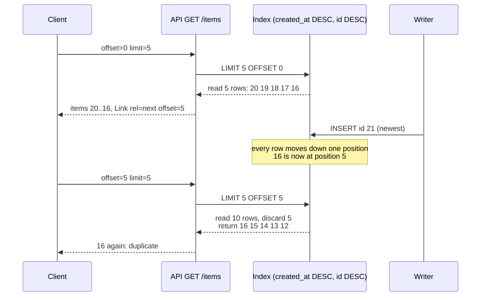

# Offset/Limit Pagination: Linear Index Scan Degradation and the Concurrent Insert Window-Drift Bug

> [!summary] Claim
> `LIMIT n OFFSET k` makes the database read and throw away `k` rows on every request, so page cost grows linearly with depth and a full walk grows quadratically, and because the offset is a row count rather than a position in the data, every insert or delete that lands ahead of the window between two requests shifts it, so the client sees duplicates or silently misses rows.

Part of [Pagination Filtering and Query Patterns](README.md) in [API Engineering](../README.md).

## TL;DR

Mechanism: SQLite and PostgreSQL both implement `OFFSET` as a counter that is decremented once per produced row, so `OFFSET 50000 LIMIT 20` reads 50,020 rows from the index; the lab counts exactly `offset + limit` rows visited at every tested depth and 2 SQLite VM instructions per skipped row.
Contract rule: an offset page is only well defined over a total order, so `ORDER BY` must end in a unique column (`created_at DESC, id DESC`), and `offset` and `limit` must be bounded server-side before they reach SQL (`422` above `MAX_OFFSET`).
The trap: the server keeps no state between page requests, so an insert ahead of the window repeats the last row of the previous page, a delete skips the first row of the next page, and a writer that inserts a full page per read stops the walk from ever ending.
Portability fact: the lab passes on CPython 3.12.13, 3.13.18, 3.14.6, 3.14.10, and 3.15.2 with SQLite 3.53.1 and 3.54.1, but engines disagree on bad input: SQLite treats `LIMIT -1` as no limit and a negative `OFFSET` as zero, while PostgreSQL 18.6 raises `LIMIT must not be negative`.
When not to use it: on any collection that is large, append-heavy, or exported by machines; use [[Keyset-Seek-Pagination-and-Composite-Tie-Breaker-Cursors]] there, and keep offset for small, slowly changing lists where a human jumps to page 7.

## Mental model



The client asks for the first five rows and the database walks the index from the newest entry, reading exactly five rows.
Between the two requests a writer inserts a row that sorts before everything already served, which pushes every existing row one position down.
The second request carries only the number 5, so the database again walks from the top, reads and discards five rows (now `21, 20, 19, 18, 17`), and returns the next five, starting with `16`, which the client has already seen.
A delete ahead of the window does the mirror image: rows move up one position and the first row of the intended page is never returned.
Each request costs `offset + limit` row reads because the database has no way to jump to "position 5" in a B-tree; it can only count rows from the start.

## How it works

### What the standard and the engines promise

PostgreSQL defines `OFFSET` as "skip that many rows before beginning to return rows" and warns that "the rows skipped by an `OFFSET` clause still have to be computed inside the server; therefore a large `OFFSET` might be inefficient" (PostgreSQL 18 documentation, Section 7.6 LIMIT and OFFSET).
The same section explains why a unique order is part of the contract: the planner "takes `LIMIT` into account when generating query plans, so you are very likely to get different plans (yielding different row orders) depending on what you give for `LIMIT` and `OFFSET`", and "This is not a bug".
SQLite documents the same semantics: "the first M rows are omitted from the result set ... and the next N rows are returned", and a negative `OFFSET` gives "the same as if it had evaluated to zero" (SQLite `lang_select.html`, The LIMIT clause).
Its row-value page is explicit about the cost: "OFFSET requires time proportional to the offset value", because "SQLite computes the query as `LIMIT x+y` and discards the first y values" (SQLite `rowvalue.html`, Section 3.1 Scrolling Window Queries).
The PostgreSQL `SELECT` reference says the same about order: "`start` rows are skipped before starting to count the `count` rows to be returned", and "it is a good idea to use an `ORDER BY` clause that constrains the result rows into a unique order" (PostgreSQL 18 documentation, `SELECT`, LIMIT Clause).
The point of those sentences is that `OFFSET` carries one integer and no context, so no engine can do better than count.

### SQLite: an `IfPos` counter inside the scan loop

`computeLimitRegisters` evaluates the limit and offset expressions into registers and, when an `OFFSET` is present, emits `OP_OffsetLimit`; the comment above the `LIMIT` branch reads `"LIMIT -1" always shows all rows` (sqlite 3.53.1 src/select.c, computeLimitRegisters).
The opcode's own documentation says the combined `LIMIT + OFFSET` value it stores "is the total number of rows that will need to be visited in order to complete the query" (sqlite 3.53.1 src/vdbe.c, OP_OffsetLimit).
`codeOffset` emits a single `OP_IfPos iOffset, iContinue, 1` (sqlite 3.53.1 src/select.c, codeOffset), whose synopsis is `if r[P1]>0 then r[P1]-=P3, goto P2` (sqlite 3.53.1 src/vdbe.c, OP_IfPos): while the offset counter is positive, decrement it and jump to `iContinue`, the next iteration of the scan.
`selectInnerLoop` calls `codeOffset` before "Pull the requested columns" when no sorter or `DISTINCT` is involved, so a skipped row is fetched from the index and passes the `WHERE` clause before it is discarded (sqlite 3.53.1 src/select.c, selectInnerLoop).
The lab's `EXPLAIN` of `OFFSET_SQL` lists `OffsetLimit`, then `Last`, `IfPos`, and `Prev` in that order: a backward covering-index scan whose loop body starts with the offset test, where `IfPos` jumps to `Prev` and `Prev` jumps back to `IfPos`.
Two facts in the lab follow from this code path.
A user function placed in `WHERE` runs once per row the scan reads, and `visit(id)` is called exactly `offset + limit` times at each tested depth (0, 1,000, 10,000, 50,000, and 99,980).
The progress handler counts exactly 2.00 VM instructions per skipped row on SQLite 3.53.1 and 3.54.1 (`IfPos` taking its jump to `Prev`, then `Prev` jumping back to `IfPos`, as the `EXPLAIN` listing shows on both versions), so the per-row cost is a tight loop, and it is the multiplier `k`, not the constant, that hurts.

### PostgreSQL: `ExecLimit` pulls and drops tuples

The `Limit` executor node is a state machine; on its first call it runs `recompute_limits`, then in `LIMIT_RESCAN` it loops "Fetch rows from subplan until we reach position > offset", calling `ExecProcNode` on the child once per skipped tuple (postgres REL_18_6 src/backend/executor/nodeLimit.c, ExecLimit).
`recompute_limits` raises `OFFSET must not be negative` and `LIMIT must not be negative`, and then calls `ExecSetTupleBound(compute_tuples_needed(node), ...)`, where `compute_tuples_needed` returns `node->count + node->offset`, or `-1` when there is no `LIMIT` or the clause is `WITH TIES` (same file, recompute_limits and compute_tuples_needed).
That bound is what a `Sort` child receives as its bounded-sort size, so even a top-N sort must keep `offset + limit` tuples, not `limit` (postgres REL_18_6 src/backend/executor/execProcnode.c, ExecSetTupleBound).
Measured on PostgreSQL 18.6 (Homebrew, temporary local cluster, macOS 27.2 arm64, 2026-11-10) with one million `bigint` rows, an index on `(created_at, id)`, and `VACUUM ANALYZE`, `EXPLAIN (ANALYZE, BUFFERS, COSTS OFF, TIMING OFF)` shows the `Index Only Scan Backward` under `Limit (actual rows=20.00)` producing `actual rows=20.00` and 4 buffers at `OFFSET 0`, and `actual rows=500020.00` and 1,920 buffers at `OFFSET 500000`; the keyset query with `Index Cond: (ROW(created_at, id) < ROW(500000, 500000))` reads 20 rows and 4 buffers.

### Window drift: a row count is not a position

Offset pagination is stateless on the server, which is what HTTP asks for: "a request can be considered in isolation rather than being associated with a specific type of client or a predetermined sequence of application steps" `(RFC 9110 Section 1.1)`.
The price is that page `p` means "positions `[p*L, p*L + L)` of the order as it is at the instant page `p` is read", and the order changes between requests.
Let `d` be the net number of rows inserted minus rows deleted at positions before the next offset since the previous page was read.
If `d > 0` the next page starts `d` rows earlier and repeats the last `d` rows already served; if `d < 0` it starts `|d|` rows later and those rows are never served; writes at or after the next offset have no effect.
The lab checks each case: one newest insert makes page 2 start with `16`, the last row of page 1; deleting `18` (already served) makes page 2 start with `14`, so `15` is skipped; inserting a row with `created_at = 0` and deleting the oldest row leaves pages 1 and 2 an exact partition.
Over a full walk of 100 rows with `limit=10`, one newest insert per page produces 11 duplicates for 11 inserts, and one delete of an already-served row per page skips 9 surviving rows for 9 deletes; the keyset walk under the same writers has zero duplicates and zero skips.
If the writer inserts `L` or more rows ahead of the window per page interval, `d >= L` on every step and the walk never reaches a short page; the lab's offset walk raises after 50 requests while the keyset walk over the same writer ends after 4.
Slack describes the same failure on channel history: after the first page of 10 messages, "10 messages are added to the channel", and the second page then returns "the same results from the first page" (Slack Engineering, "Evolving API Pagination at Slack", 2017-08-15).

### Ties make drift happen without any writes

When the `ORDER BY` columns are not unique, the order of tied rows is whatever the chosen plan produces.
In the lab, eight rows share `created_at = 100`; page 1 served through `INDEXED BY t_created_at` returns `8, 7, 6, 5`, and page 2 served through `NOT INDEXED` (a temp B-tree sort) returns `5, 6, 7, 8`, so four rows are duplicated and four are never served.
Adding `id DESC` as the final sort key makes both plans agree, and the two pages become `8..1`; the lab's own `OFFSET_SQL` and `COUNTED_OFFSET_SQL` return the same `8..1` over eight tied rows under an index scan and under a temp B-tree sort.
This is the plan instability PostgreSQL warns about in Section 7.6; a plan can change between two page requests after `ANALYZE`, an index build, or a different `LIMIT`.

### The HTTP surface

The lab's `GET /items` declares `offset: Annotated[int, Query(ge=0, le=MAX_OFFSET)]` and `limit: Annotated[int, Query(ge=1, le=MAX_LIMIT)]`; FastAPI turns a violation into `RequestValidationError`, which its default handler renders as `422` with a `detail` list (fastapi 0.162.0 fastapi/exception_handlers.py, request_validation_exception_handler).
The endpoint is a plain `def`, so FastAPI runs it with `run_in_threadpool` (fastapi 0.162.0 fastapi/routing.py, run_endpoint_function); the shared `sqlite3` connection is therefore opened with `check_same_thread=False` and serialized by a `threading.Lock`.
The next page is advertised as `Link: </items?offset=10&limit=10>; rel="next"`; the target is a URI-Reference and a relative one "MUST" be resolved per RFC 3986 Section 5 `(RFC 8288 Section 3.1)`.
The response stops advertising `next` when the page is short or when `offset + limit` would exceed `MAX_OFFSET`, so a well-behaved client never builds a request the server will reject.

## Numbers and limits

Lab measurements come from a throwaway script that drives the lab's `ItemStore` (one million rows `(id, created_at = id)`, `LIMIT 20`, median of 21 runs of the uninstrumented `OFFSET_SQL` and of the same keyset query without the `visit()` probe), run by the verifier on 2026-11-10 with `uv run --frozen python` on an Apple M3 Pro, macOS 27.2 (Darwin 27.2.0) arm64, on CPython 3.14.6 / SQLite 3.53.1 (workspace `.venv`) and CPython 3.13.18 / SQLite 3.54.1.

| Quantity | Value | Source |
|---|---|---|
| Rows read for `LIMIT 20 OFFSET k`, SQLite | exactly `k + 20` for `k` in 0, 1,000, 10,000, 50,000, 99,980 | lab `test_offset_page_reads_and_discards_every_skipped_row` |
| SQLite VM instructions per skipped row | 2.00 (130 at `OFFSET 0`, 2,000,090 at `OFFSET 999980`) | measurement run, CPython 3.14.6 / SQLite 3.53.1 and CPython 3.13.18 / SQLite 3.54.1 |
| Median page latency, offset 0 / 10,000 / 100,000 / 500,000 / 999,980 | 6.0 / 40.4 / 358.8 / 1,782.7 / 3,572.5 us | measurement run, CPython 3.14.6, SQLite 3.53.1 |
| Same, keyset page at the same depths | 6.6 to 6.9 us at every depth | same run |
| Same on CPython 3.13.18, SQLite 3.54.1 | offset 4.9 / 50.3 / 450.0 / 2,230.8 / 4,641.6 us; keyset 5.2 to 6.3 us | measurement run |
| Full walk, 100,000 rows, `limit=100` | offset: 1,001 requests, 50,150,000 rows read, 4.43 s; keyset: 1,001 requests, 100,000 rows read, 0.03 s | measurement run, CPython 3.14.6 |
| Full walk formula | `L * P * (P + 1) / 2 + N` rows for `P = N / L` full pages plus the final empty page; 515,000 for `N = 10,000`, `L = 100` | lab `test_a_full_offset_walk_reads_quadratically_many_rows_and_keyset_reads_each_once` |
| PostgreSQL 18.6, 1M rows, `OFFSET 500000 LIMIT 20` | index scan `actual rows=500020.00`, 1,920 buffers; `OFFSET 0`: 20 rows, 4 buffers; keyset: 20 rows, 4 buffers | `EXPLAIN (ANALYZE, BUFFERS)` on a temporary local cluster, 2026-11-10 |
| PostgreSQL 18.6 single-run `psql` `\timing`, offsets 0 / 500,000 / 999,980 / keyset | 0.5 / 19.4 / 46.3 / 0.2 ms (one run each, warm shared buffers after the `EXPLAIN` runs, includes the client round trip over `127.0.0.1`) | same session |
| Shopify, 14 million products, average of five runs | offset 10,000: 79.82 ms; offset 100,000: 2,221.60 ms vs 5.24 ms by last id; offsets >= 1,000,000 "consistently timed out" | Shopify Engineering, "Pagination with Relative Cursors", 2019-08-12 |
| Elasticsearch `index.max_result_window` | default `10000`; "Search requests take heap memory and time proportional to `from + size`" | Elastic index settings documentation (as of 2026-11) |
| GitHub REST search | "up to 1,000 results for each search"; `per_page` maximum 100 for most endpoints, silently reduced if exceeded | GitHub REST docs (as of 2026-11) |
| AIP-158 `page_size` | negative must be `INVALID_ARGUMENT`; above maximum should be coerced down; example maximum 1000 | AIP-158 (as of 2026-11) |

The lab latency numbers are in-memory SQLite on one machine, so they show shape (linear in `k`, flat for keyset), not production magnitudes; the row and instruction counts are exact and machine-independent for a given SQLite version.

## Portability

| Runtime, engine, or layer | Behavior | Evidence |
|---|---|---|
| CPython 3.12.13, SQLite 3.53.1 | 28 passed | lab, `UV_PROJECT_ENVIRONMENT=../_venv-3.12 uv run --frozen --python 3.12 pytest ...`; the matrix pin 3.12.16 is not installed here |
| CPython 3.13.18, SQLite 3.54.1 | 28 passed | lab, `--python 3.13` |
| CPython 3.14.6, SQLite 3.53.1 (workspace `.venv`) | 28 passed | lab, `uv run --frozen pytest ...` |
| CPython 3.14.10, SQLite 3.54.1 | 28 passed | lab, `--python 3.14.10` |
| CPython 3.15.2, SQLite 3.54.1 | 28 passed | lab, `--python 3.15.2` |
| CPython 3.15t free-threaded | lab not run: `uv sync` fails because `psycopg-binary==3.3.8` has no wheel for the free-threaded ABI; a stdlib-only probe on 3.15.0b3t and 3.14.6t (GIL disabled, SQLite 3.53.1) reproduced 50,020 rows visited at `OFFSET 50000`, the insert duplicate, and `LIMIT -1` returning every row | verification run 2026-11-10; 3.15.2t is not available here |
| SQLite 3.53.1 vs 3.54.1 | same plan strings, same opcode order, same 2.00 instructions per skipped row, same tie order under both plans | lab on both versions; measurement run |
| SQLite negative `LIMIT` / `OFFSET` | `LIMIT -1` returns all rows; negative `OFFSET` acts as 0 | `test_sqlite_treats_negative_limit_as_unbounded_and_negative_offset_as_zero`; SQLite `lang_select.html`; sqlite 3.53.1 src/select.c, computeLimitRegisters |
| PostgreSQL 18.6 negative `LIMIT` / `OFFSET` | `ERROR: LIMIT must not be negative`, `ERROR: OFFSET must not be negative` | local run 2026-11-10; postgres REL_18_6 src/backend/executor/nodeLimit.c, recompute_limits |
| Tie order without a unique key | plan-dependent in both engines | PostgreSQL 18 docs Section 7.6; lab `test_ties_without_a_tie_breaker_are_not_a_partition_when_the_plan_changes` on SQLite |
| FastAPI 0.162.0, Starlette 1.10.0, httpx 0.28.1 `ASGITransport` | `ge`/`le` violations -> `422`; sync endpoint runs in the threadpool | lab API tests; fastapi 0.162.0 routing.py `run_endpoint_function`, exception_handlers.py `request_validation_exception_handler` |
| Debian Trixie and Alpine (musl) containers | not run: no container runtime leg was executed for this note | not run |
| Uvicorn, Hypercorn, Granian | not exercised; the cost and the drift live in the database query, below the server | not run |
| HTTP/1.1, HTTP/2, HTTP/3 | `Link` and query parameters are version-independent semantics | "All three major versions of HTTP rely on the semantics defined by this document" `(RFC 9110 Section 1.2)`; not exercised on the wire |
| Elasticsearch `from`/`size` | same model and the same cap: `from + size <= 10000` by default; `search_after` is the keyset equivalent | Elastic pagination documentation (as of 2026-11) |

## Worked example

The lab is [implementation](../labs/src/api_labs/f05_pagination_filtering_and_query_patterns/offset_pagination.py) and [test](../labs/tests/f05_pagination_filtering_and_query_patterns/test_offset_limit_pagination_mechanics_cost_and_window_drift.py).
It builds an in-memory SQLite table indexed on `(created_at, id)`, counts the rows each page reads through a `visit()` probe in `WHERE`, counts VM instructions with a progress handler, replays writers between page requests, and serves the same store through FastAPI.

Full byte-identical source of `offset_pagination.py`:

```python
"""Offset/limit pagination on SQLite: linear skip cost and window drift under concurrent writes."""

from __future__ import annotations

import sqlite3
import threading
from collections import Counter
from dataclasses import dataclass
from typing import TYPE_CHECKING, Annotated

from fastapi import FastAPI, Query, Response
from pydantic import BaseModel

if TYPE_CHECKING:
    from collections.abc import Callable, Iterable

MAX_LIMIT = 100
MAX_OFFSET = 10_000

SCHEMA = (
    "CREATE TABLE items (id INTEGER PRIMARY KEY, created_at INTEGER NOT NULL)",
    "CREATE INDEX items_created_at_id ON items (created_at, id)",
)
# Newest first; `id` breaks ties so the order is total and every row has one position.
OFFSET_SQL = "SELECT id, created_at FROM items ORDER BY created_at DESC, id DESC LIMIT ? OFFSET ?"
# The same query with a probe in WHERE: SQLite calls visit() once for every row the scan reads,
# including the OFFSET rows it then discards.
COUNTED_OFFSET_SQL = (
    "SELECT id, created_at FROM items WHERE visit(id) "
    "ORDER BY created_at DESC, id DESC LIMIT ? OFFSET ?"
)
# Keyset contrast: seek past the last row seen instead of counting rows to skip.
COUNTED_KEYSET_SQL = (
    "SELECT id, created_at FROM items WHERE (created_at, id) < (?, ?) AND visit(id) "
    "ORDER BY created_at DESC, id DESC LIMIT ?"
)

type SortKey = tuple[int, int]


@dataclass(frozen=True, slots=True)
class Page:
    """One page of ids, the sort key of its last row, and how many rows the scan read."""

    ids: tuple[int, ...]
    last_key: SortKey | None
    rows_visited: int


class ItemStore:
    """An in-memory SQLite table of items ordered by (created_at DESC, id DESC)."""

    def __init__(self) -> None:
        # One connection shared by FastAPI's threadpool, serialized by self._lock.
        self._conn = sqlite3.connect(":memory:", check_same_thread=False)
        self._lock = threading.Lock()
        self._visited = 0
        self._conn.create_function("visit", 1, self._visit, deterministic=False)
        for statement in SCHEMA:
            self._conn.execute(statement)

    def _visit(self, _item_id: int) -> int:
        self._visited += 1
        return 1

    def insert_many(self, rows: Iterable[SortKey]) -> None:
        """Insert (id, created_at) rows."""
        with self._lock:
            self._conn.executemany("INSERT INTO items (id, created_at) VALUES (?, ?)", rows)

    def delete(self, item_id: int) -> None:
        with self._lock:
            self._conn.execute("DELETE FROM items WHERE id = ?", (item_id,))

    def all_ids(self) -> tuple[int, ...]:
        with self._lock:
            rows = self._conn.execute("SELECT id FROM items ORDER BY created_at DESC, id DESC")
            return tuple(item_id for (item_id,) in rows)

    def _counted(self, sql: str, params: tuple[int, ...]) -> Page:
        with self._lock:
            self._visited = 0
            rows: list[SortKey] = self._conn.execute(sql, params).fetchall()
            visited = self._visited
        last_key = (rows[-1][1], rows[-1][0]) if rows else None
        return Page(tuple(item_id for item_id, _ in rows), last_key, visited)

    def offset_page(self, offset: int, limit: int) -> Page:
        return self._counted(COUNTED_OFFSET_SQL, (limit, offset))

    def keyset_page(self, after: SortKey | None, limit: int) -> Page:
        # (created_at, id) of the last row seen; None starts above every real key.
        created_at, item_id = after if after is not None else (2**62, 2**62)
        return self._counted(COUNTED_KEYSET_SQL, (created_at, item_id, limit))

    def vm_steps(self, offset: int, limit: int) -> int:
        """Count SQLite virtual machine instructions for the uninstrumented OFFSET_SQL."""
        steps = 0

        def tick() -> int:
            nonlocal steps
            steps += 1
            return 0  # nonzero would interrupt the query

        with self._lock:
            self._conn.set_progress_handler(tick, 1)
            try:
                self._conn.execute(OFFSET_SQL, (limit, offset)).fetchall()
            finally:
                self._conn.set_progress_handler(None, 1)
        return steps

    def query_plan(self, sql: str, params: tuple[int, ...]) -> list[str]:
        with self._lock:
            return [row[3] for row in self._conn.execute(f"EXPLAIN QUERY PLAN {sql}", params)]

    def opcodes(self, sql: str, params: tuple[int, ...]) -> list[str]:
        with self._lock:
            return [row[1] for row in self._conn.execute(f"EXPLAIN {sql}", params)]


@dataclass(frozen=True, slots=True)
class Walk:
    """Every id a client saw while paging to the end, and the total rows the database read."""

    seen: tuple[int, ...]
    rows_visited: int
    requests: int

    @property
    def duplicates(self) -> tuple[int, ...]:
        return tuple(sorted(i for i, n in Counter(self.seen).items() if n > 1))


def walk_offset(
    store: ItemStore, limit: int, between: Callable[[int], None], max_requests: int = 1_000
) -> Walk:
    """Page with offset += limit until a short page; call between(n) after the n-th page."""
    seen: list[int] = []
    offset = visited = requests = 0
    while True:
        if requests == max_requests:
            raise RuntimeError(f"pagination did not terminate after {max_requests} requests")
        page = store.offset_page(offset, limit)
        requests += 1
        visited += page.rows_visited
        seen.extend(page.ids)
        if len(page.ids) < limit:
            return Walk(tuple(seen), visited, requests)
        offset += limit
        between(requests)


def walk_keyset(
    store: ItemStore, limit: int, between: Callable[[int], None], max_requests: int = 1_000
) -> Walk:
    """Page by seeking past the last sort key; same stopping rule and mutation hook."""
    seen: list[int] = []
    after: SortKey | None = None
    visited = requests = 0
    while True:
        if requests == max_requests:
            raise RuntimeError(f"pagination did not terminate after {max_requests} requests")
        page = store.keyset_page(after, limit)
        requests += 1
        visited += page.rows_visited
        seen.extend(page.ids)
        if len(page.ids) < limit:
            return Walk(tuple(seen), visited, requests)
        after = page.last_key
        between(requests)


class ItemPage(BaseModel):
    items: list[int]
    next_offset: int | None


def create_app(store: ItemStore) -> FastAPI:
    """`GET /items?offset=&limit=` with bounded parameters and an RFC 8288 `next` link."""
    app = FastAPI()

    @app.get("/items")
    def list_items(  # pyright: ignore[reportUnusedFunction]
        response: Response,
        offset: Annotated[int, Query(ge=0, le=MAX_OFFSET)] = 0,
        limit: Annotated[int, Query(ge=1, le=MAX_LIMIT)] = 20,
    ) -> ItemPage:
        page = store.offset_page(offset, limit)
        next_offset = offset + limit
        if len(page.ids) < limit or next_offset > MAX_OFFSET:
            return ItemPage(items=list(page.ids), next_offset=None)
        response.headers["Link"] = f'</items?offset={next_offset}&limit={limit}>; rel="next"'
        return ItemPage(items=list(page.ids), next_offset=next_offset)

    return app
```

Two of the tests (simplified excerpt; the module imports, fixtures, and remaining 15 tests (22 of the 28 collected cases) are in the test file):

```python
@pytest.mark.unit
@pytest.mark.parametrize("offset", [0, 1_000, 10_000, 50_000, 99_980])
def test_offset_page_reads_and_discards_every_skipped_row(
    big_store: ItemStore, offset: int
) -> None:
    page = big_store.offset_page(offset, LIMIT)
    assert page.ids == tuple(range(N_ROWS - offset, N_ROWS - offset - LIMIT, -1))
    assert page.rows_visited == offset + LIMIT


@pytest.mark.unit
def test_insert_ahead_of_the_window_repeats_the_last_row_of_the_previous_page() -> None:
    store = make_store(20)
    page1 = store.offset_page(0, 5)
    store.insert_many([(21, 21)])  # newest row: sorts before everything already served
    page2 = store.offset_page(5, 5)
    assert page1.ids == (20, 19, 18, 17, 16)
    assert page2.ids == (16, 15, 14, 13, 12)
```

Captured run from `labs/` on CPython 3.14.6, Darwin 27.2.0 arm64:

```text
$ uv run --frozen pytest tests/f05_pagination_filtering_and_query_patterns/test_offset_limit_pagination_mechanics_cost_and_window_drift.py -q
............................                                             [100%]
28 passed in 0.30s
```

Every test was mutation-checked: removing the `visit()` probe, the index, the cursor in `keyset_page`, the writer hook, the `delete`, the `Query` bounds, the offset cap (including the `next_offset == MAX_OFFSET` boundary, tightened on 2026-11-10 after `>=` survived), the `Link` header, or the `id DESC` tie-breaker in either offset query each fails at least one named test, and removing the `max_requests` guard makes the livelock test hang (re-run by the verifier on 2026-11-10).

## Pitfalls

> [!warning] Deep offsets on a shared database become everyone's latency
> Trigger: third-party clients walk a whole collection with `?page=N` on a multi-tenant database.
> Symptom: Shopify measured 2,221.60 ms at offset 100,000 against 5.24 ms by last id on a 14 million product shop, and reports that slow large-offset queries held all the database connections so that "unrelated, quick queries" timed out, including queries "from shops that happen to share the same database instance" (Shopify Engineering, "Pagination with Relative Cursors", 2019-08-12).
> Fix: cap the offset (`le=MAX_OFFSET`), move bulk consumers to keyset cursors or an export endpoint, and budget database time per client ([[Multi-Tier-Rate-Limiting-Quotas-Concurrency-Limits-and-Cost-Budgets]]).

> [!warning] An append-heavy feed repeats rows on every page
> Trigger: newest-first offset pagination over messages, events, or logs that are written while clients read.
> Symptom: each page begins with rows from the previous page; Slack's example is 10 new messages making page 2 identical to page 1 (Slack Engineering, 2017-08-15); the lab shows one duplicate per insert ahead of the window and an endless walk when a page's worth arrives per read.
> Fix: seek past the last key ([[Keyset-Seek-Pagination-and-Composite-Tie-Breaker-Cursors]]) or read from a snapshot ([[Snapshot-Consistent-Pagination-Across-Point-in-Time-Reads]]); client-side de-duplication hides duplicates but cannot recover the rows that deletes cause it to skip.

> [!warning] `ORDER BY created_at` without a tie-breaker
> Trigger: a non-unique sort key and a plan that changes between page requests.
> Symptom: rows that share a timestamp are duplicated and skipped across the page boundary even with no writes; the lab's eight tied rows lose four and repeat four.
> Fix: end every `ORDER BY` with a unique column and back it with a composite index ([[Multi-Column-Sorting-Order-By-Whitelisting-and-Index-Coverage]]).

> [!warning] Passing `limit` straight to SQLite
> Trigger: `limit=-1` or `offset=-5` forwarded unvalidated, as in the lab's raw `OFFSET_SQL` call.
> Symptom: SQLite returns the whole table for `LIMIT -1` and treats the negative offset as 0, so one request dumps the collection; the same request on PostgreSQL fails with `LIMIT must not be negative`, so the bug hides in tests that run on one engine only.
> Fix: validate at the API boundary with `ge`/`le` and reject with `422`, as AIP-158 requires `INVALID_ARGUMENT` for a negative `page_size`.

> [!warning] Silent coercion surprises clients
> Trigger: a server that clamps `per_page` above its maximum instead of rejecting it.
> Symptom: GitHub documents that "you may receive fewer results than you expect without any indication that the `per_page` value was reduced" (GitHub REST docs, Using pagination in the REST API), so a client that stops on a short page stops early.
> Fix: either reject with `422` or coerce and always advertise `next` explicitly; tell clients to stop on a missing `next` link, never on `len(items) < limit`.

## Security and robustness

- Asymmetric cost (OWASP API4:2023 Unrestricted Resource Consumption): one cheap request with `offset=10000000` costs the server ten million row reads; OWASP's guidance is to "Add proper server-side validation for query string and request body parameters, specifically the one that controls the number of records to be returned in the response", and "number of records per page" is one of its listed limits ([[Unrestricted-Resource-Consumption-API4-2023-Payload-Depth-and-Limit-Guards]]).
- Bound both parameters: `limit` caps response size and `offset` caps work; Elasticsearch enforces `from + size <= 10000` by default and GitHub search stops at 1,000 results, which are product decisions that trade deep access for predictable cost.
- Rate-limit by cost, not by request: a deep page costs `offset + limit` row reads, so a token bucket that charges one token per request lets a scraper spend 1,000 times the database time of a normal client.
- Engine-specific input semantics: negative and `NULL` limits mean "no limit" in different engines (SQLite `LIMIT -1`; PostgreSQL treats a `NULL` count as `LIMIT ALL`, PostgreSQL 18 `SELECT` reference, LIMIT Clause), so validate in the API layer instead of relying on the database to reject.
- Integer range: `compute_tuples_needed` notes that `count + offset` can overflow to a negative value, which PostgreSQL treats as "no bound" (postgres REL_18_6 src/backend/executor/nodeLimit.c, compute_tuples_needed); a `le=` bound keeps request values far from that edge.
- Authorization before pagination: filter by tenant and permission in the `WHERE` clause so `offset` counts only visible rows; AIP-158 states that page tokens "must not provide any form of authorization", and the same holds for an offset ([[Defeating-BOLA-API1-2023-Tenant-Scoped-Queries-and-PostgreSQL-RLS]]).
- Enumeration: a predictable `offset` makes complete scraping trivial; caps, per-client budgets, and opaque cursors ([[Opaque-Cursor-Encoding-HMAC-Integrity-and-Filter-Binding]]) raise the cost of bulk extraction.
- Client loops: a pagination client must bound its request count, because a server or writer that keeps pages full can keep it looping forever; the lab's `max_requests` guard turns that into an explicit error.

## The principal's view

The decision is whether a collection's page position is a number or a place in the data.
Offset makes it a number, which buys random access ("go to page 7"), a trivial implementation, and stateless servers, and costs linear work per page, quadratic work per walk, and drift under writes.
For human-facing lists that are small, slowly changing, and genuinely navigated by page number, offset with a hard `MAX_OFFSET` and a unique sort key is a defensible choice, and the cap should be a documented part of the contract.
For anything machines walk end to end, or anything appended to while it is read, choose keyset cursors, and for exports that must see a consistent set, choose a snapshot or a streaming export ([[Streaming-Exports-and-NDJSON-for-Unbounded-Collections]]).
Make the choice before the first client ships: AIP-158 points out that even adding pagination to an existing method is "a backwards-incompatible change", and switching from page numbers to cursors is a second breaking change.
The cheapest migration path is the one Slack describes: return an opaque cursor from day one and let the first implementation encode `offset:10` inside it, so the server can later change the cursor to a key without touching clients.
Organizationally, put pagination in a shared library and the API style guide (bounded `limit`, mandatory tie-breaker, `next` link or token, stop on missing `next`), because every team that writes it by hand rediscovers the same three bugs.
Choose a different tool entirely when the client needs aggregate answers rather than rows: a count, a facet, or a search ranking belongs in [[Total-Count-Antipattern-and-Estimated-Counts]] or [[Search-Endpoints-vs-List-Endpoints-and-Full-Text-Ranking]], not in a loop over pages.

## Interview questions

> [!question] L5: Why is `LIMIT 20 OFFSET 50000` slow even when the `ORDER BY` columns are indexed?
>
> > [!success]- Answer
> > The index gives the rows in order, but `OFFSET` is only a count, so the engine must walk the index from the start and discard rows until the counter reaches zero.
> > In SQLite that is an `IfPos` test inside the scan loop, and in PostgreSQL the `Limit` node pulls tuples from its child until `position > offset`.
> > The lab measures exactly 50,020 rows read, and PostgreSQL 18.6 shows `actual rows=500020.00` under `Limit` for `OFFSET 500000`.
> >
> > Follow-up: Why can a B-tree not jump to the 50,000th entry directly?

> [!question] L5: Predict the output: ids 1 to 20 sorted by `(created_at DESC, id DESC)` with `created_at = id`, a client reads `LIMIT 5 OFFSET 0`, id 21 is inserted with `created_at = 21`, and the client reads `LIMIT 5 OFFSET 5`; what are the two pages?
>
> > [!success]- Answer
> > Page 1 is `20, 19, 18, 17, 16`.
> > The insert puts 21 at position 0 and pushes every row down one place, so page 2 is `16, 15, 14, 13, 12`.
> > Row 16 appears twice, which is exactly `test_insert_ahead_of_the_window_repeats_the_last_row_of_the_previous_page`.
> >
> > Follow-up: What would page 2 be if id 18 had been deleted instead of 21 inserted?

> [!question] L5: What does SQLite return for `LIMIT -1`, and what does PostgreSQL do?
>
> > [!success]- Answer
> > SQLite treats a negative `LIMIT` as no upper bound and returns every row, and treats a negative `OFFSET` as zero.
> > PostgreSQL rejects both with `LIMIT must not be negative` and `OFFSET must not be negative`, raised in `recompute_limits`.
> > An API must therefore validate `limit >= 1` itself, or one engine dumps the table while the other returns `500`.
> >
> > Follow-up: Which status code should the API return, and why not clamp silently?

> [!question] L6: Debug this API: a nightly job exports orders newest first with `GET /orders?offset=N&limit=500`, nothing errors, yet finance finds some orders twice in the export and a similar number missing; what is happening and how do you fix it?
>
> > [!success]- Answer
> > New orders are inserted ahead of the window while the job runs, so each insert shifts later pages down and repeats a row, and cancelled orders that are deleted ahead of the window shift pages up and skip a row.
> > De-duplicating by id would hide the duplicates but cannot recover the skipped orders.
> > Fix it by paging with a keyset cursor on `(created_at, id)` or by exporting from a consistent snapshot, and add a reconciliation count against the source.
> > Also check that the sort ends in a unique key, because ties on `created_at` cause the same symptom without writes.
> >
> > Follow-up: Why does sorting oldest first reduce but not eliminate the problem?

> [!question] L6: How many rows does the database read to walk a 100,000-row collection with `limit=100` by offset, and by keyset?
>
> > [!success]- Answer
> > Page `k` reads `100 * (k + 1)` rows, so 1,000 full pages read `100 * 1000 * 1001 / 2 = 50,050,000`, and the final empty page at offset 100,000 reads another 100,000, for 50,150,000.
> > Keyset reads each row once, 100,000 in total.
> > The lab measured 4.43 s against 0.03 s for the two walks on in-memory SQLite (CPython 3.14.6, SQLite 3.53.1).
> >
> > Follow-up: How does the ratio change if the page size doubles?

> [!question] L6: Why does a team that adds `ORDER BY created_at DESC` still see duplicate rows across pages with no concurrent writes?
>
> > [!success]- Answer
> > `created_at` is not unique, so the order among tied rows is whatever the plan produces, and PostgreSQL's documentation warns that different `LIMIT` and `OFFSET` values can produce different plans.
> > In the lab, eight tied rows come back `8, 7, 6, 5` through the index and `5, 6, 7, 8` through a sort, so two pages repeat four rows and miss four.
> > Append a unique column, `ORDER BY created_at DESC, id DESC`, and index `(created_at, id)`.
> >
> > Follow-up: Which plan changes can happen between two requests a few seconds apart?

> [!question] L6: When is offset pagination the right choice?
>
> > [!success]- Answer
> > When users need to jump to an arbitrary page number, the collection is small or the offset is capped, writes during reading are rare or harmless, and the sort key is total.
> > Admin tables with a few thousand rows fit; activity feeds, exports, and sync clients do not.
> > The cap should be explicit in the contract, as Elasticsearch does with `index.max_result_window` and GitHub does with 1,000 search results.
> >
> > Follow-up: How would you offer "jump to page" on top of keyset cursors?

> [!question] L7+: How do you migrate a public API that has used `?page=` for five years, on a shared database that suffers from deep-page scrapers?
>
> > [!success]- Answer
> > First cap the damage without breaking anyone: a documented maximum page depth, cost-based rate limits, and dashboards of offset depth per client.
> > Then add an opaque cursor alongside `page`, implemented first as an encoded offset as Slack did, so clients move to "follow the `next` token" before the server changes what the token means.
> > Switch the cursor to a keyset on `(sort_key, id)` per endpoint once the sort is total and indexed, keep `page` for shallow human navigation, and announce a sunset for deep `page` values.
> > Treat each step as a contract change, because AIP-158 notes that pagination changes are behaviorally incompatible even when the schema is not.
> >
> > Follow-up: How do you prove that no client depends on page numbers before the sunset?

> [!question] L7+: A product manager insists on exact page numbers and a stable list during a 30-minute review session on a fast-changing collection; what do you offer and what does it cost?
>
> > [!success]- Answer
> > Page numbers need positions, and stable positions need a fixed set, so the honest options are a snapshot (a materialized result set or a point-in-time read token) or a cursor that gives up page numbers.
> > A snapshot costs storage or retained MVCC versions for 30 minutes per session, plus an expiry policy, and its offset scans still cost `offset + limit` within the snapshot.
> > Keyset with a "jump to date" control usually meets the real need at constant cost; [[Snapshot-Consistent-Pagination-Across-Point-in-Time-Reads]] covers the snapshot path.
> >
> > Follow-up: How would you bound the database cost of many concurrent 30-minute snapshots?

> [!question] L7+: Why is offset pagination worse for a multi-tenant platform than for a single-tenant service with the same data size?
>
> > [!success]- Answer
> > The cost of a deep page lands on a shared database, so one tenant's scraper consumes connections and I/O that other tenants' fast queries need, which is the effect Shopify reported.
> > Per-tenant rate limits by request count do not help because one deep request costs as much as thousands of shallow ones.
> > The fix is a structural limit on work per request (capped offset or keyset), cost-based budgets, and isolation of bulk export traffic onto replicas or a separate path.
> >
> > Follow-up: Where would you enforce the cost budget: gateway, application, or database?

## Related

Prerequisites: [[Field-Behavior-Semantics-Input-Only-Output-Only-and-Immutable-AIP-203]]

Next: [[Keyset-Seek-Pagination-and-Composite-Tie-Breaker-Cursors]]

See also: [[Pagination-Strategies]], [[02-Programming-Languages/Python/Python-Backend-Interview-Prep/05-REST-API-Design]], [[02-Programming-Languages/Python/Python-Backend-Interview-Prep/06-SQL-and-SQLAlchemy]], [[sqlite3-from-the-Shell]], [[DuckDB-from-the-Shell]], [[Snapshot-Consistent-Pagination-Across-Point-in-Time-Reads]], [[Total-Count-Antipattern-and-Estimated-Counts]], [[Multi-Column-Sorting-Order-By-Whitelisting-and-Index-Coverage]], [[Opaque-Cursor-Encoding-HMAC-Integrity-and-Filter-Binding]], [[Streaming-Exports-and-NDJSON-for-Unbounded-Collections]], [[Richardson-Maturity-Model-HATEOAS-and-Web-Linking-RFC-8288]], [[Transaction-Isolation-Levels-and-Concurrency-Anomalies-in-APIs]], [[Unrestricted-Resource-Consumption-API4-2023-Payload-Depth-and-Limit-Guards]], [[Multi-Tier-Rate-Limiting-Quotas-Concurrency-Limits-and-Cost-Budgets]]

- Lab: `labs/tests/f05_pagination_filtering_and_query_patterns/test_offset_limit_pagination_mechanics_cost_and_window_drift.py`

## Further reading

- [PostgreSQL 18 documentation, Section 7.6 LIMIT and OFFSET](https://www.postgresql.org/docs/current/queries-limit.html): the semantics, the unique-order requirement, and the warning that skipped rows are still computed.
- [PostgreSQL REL_18_6 src/backend/executor/nodeLimit.c](https://github.com/postgres/postgres/blob/REL_18_6/src/backend/executor/nodeLimit.c): `ExecLimit` pulling and dropping tuples, `recompute_limits` errors, and the `offset + count` tuple bound.
- [SQLite Row Values, Section 3.1 Scrolling Window Queries](https://www.sqlite.org/rowvalue.html): the maintainers' statement that `OFFSET` costs time proportional to the offset, and the row-value alternative.
- [SQLite version-3.53.1 src/select.c](https://github.com/sqlite/sqlite/blob/version-3.53.1/src/select.c): `computeLimitRegisters` and `codeOffset`, the bytecode behind `LIMIT` and `OFFSET`; the matching `OP_OffsetLimit` and `OP_IfPos` definitions are in `src/vdbe.c` at the same tag.
- [SQLite SELECT, The LIMIT clause](https://www.sqlite.org/lang_select.html): negative `LIMIT` and `OFFSET` semantics.
- [Markus Winand, "We need tool support for keyset pagination"](https://use-the-index-luke.com/no-offset): the insert-between-pages duplicate and why offset carries no context.
- [Slack Engineering, "Evolving API Pagination at Slack"](https://slack.engineering/evolving-api-pagination-at-slack/): a production API's move from offset to cursors, including the encoded-offset migration trick.
- [Shopify Engineering, "Pagination with Relative Cursors"](https://shopify.engineering/pagination-relative-cursors): measured offset latency on 14 million rows and the multi-tenant impact.
- [Google AIP-158 Pagination](https://google.aip.dev/158): `page_size` validation, `skip`, opaque tokens, and why adding pagination later breaks clients.
- [Elasticsearch, Paginate search results](https://www.elastic.co/docs/reference/elasticsearch/rest-apis/paginate-search-results): `from`/`size`, the 10,000 hit cap, and `search_after`.
- [OWASP API Security Top 10 2023, API4 Unrestricted Resource Consumption](https://owasp.org/API-Security/editions/2023/en/0xa4-unrestricted-resource-consumption/): page size as a resource limit that must be validated server-side.
- [RFC 8288 Section 3](https://www.rfc-editor.org/rfc/rfc8288.html#section-3): the `Link` header field syntax used for `rel="next"`.
