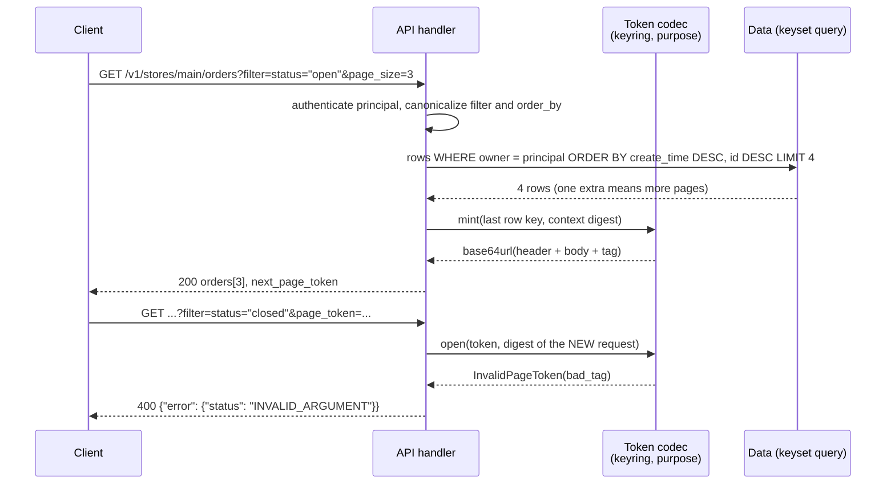

# Opaque Page Tokens: Base64URL Encoding, HMAC/AEAD Signing, and Binding Cursors to Query Filters (AIP-158)

> [!summary] Claim
> A page token is a server-minted, authenticated capsule of the keyset position whose MAC or AEAD tag also covers the purpose and a canonical digest of every request parameter that must not change between pages, so a forged, edited, cross-endpoint, cross-user, or re-filtered token fails with `400 INVALID_ARGUMENT` instead of silently returning the wrong rows.

Part of [Pagination Filtering and Query Patterns](README.md) in [API Engineering](../README.md).

## TL;DR

- Mechanism: pack `version | key_id | issued_at | create_time | row_id`, authenticate it with HMAC-SHA-256-128 or seal it with AES-256-GCM-SIV, put `purpose || SHA-256(principal, parent, filter, order_by)` into the MAC input or AAD without transmitting it, and encode as unpadded base64url (RFC 4648 Section 5); the lab tokens are 56 and 72 characters.
- Contract rule: AIP-158 says tokens "must be opaque (but URL-safe)", "must not be user-parseable", "must not provide any form of authorization", and that changed arguments other than `page_size` should get `INVALID_ARGUMENT`, which maps to `400 Bad Request` (`google/rpc/code.proto`, `INVALID_ARGUMENT`).
- Trap: base64 is not opacity (AIP-158 warns about exactly this), HMAC alone is not opacity either (the lab decodes the position out of an HMAC token), and Python's `base64.urlsafe_b64decode` accepts `+`, `/`, `=`, junk characters, and non-zero pad bits, so one token has many valid spellings unless you decode strictly.
- Portability fact: CPython 3.15 changed `urlsafe_b64decode` to not require padding, deprecated `+` and `/` in it with a `FutureWarning`, and added `canonical=` to `b64decode` (What's New in Python 3.15); the lab's strict decoder behaves identically on 3.12.13 through 3.15.2 and on free-threaded 3.14.6t and 3.15.0b3t (83 passed on each).
- When not to use it: if you need a stable snapshot, revocation, or tokens that survive key loss, store server-side cursor state ([[Snapshot-Consistent-Pagination-Across-Point-in-Time-Reads]]); for unbounded exports, stream instead ([[Streaming-Exports-and-NDJSON-for-Unbounded-Collections]]).

## Mental model



The handler authenticates the caller and canonicalizes the query before it touches the token, because the token is verified against the request it arrives with, not against what it claims about itself.
The first page runs the keyset query with authorization applied, reads one extra row to learn whether a next page exists, and asks the codec to mint a token over the last served row's full sort key.
The codec authenticates that position together with a purpose label and a digest of `principal`, `parent`, `filter`, and `order_by`, and only the position and header travel to the client.
When the client comes back with a changed filter, the server recomputes the digest from the new request, the tag no longer matches, and the request fails with `400` before any data query runs.
Authorization is applied again on every page, so even a valid token only moves a position inside rows the caller could already see.

## How it works

### What AIP-158 requires

AIP-158 fixes the contract surface: `page_size` and `page_token` must not be required, `page_size` of 0 means a documented default, values above the maximum should be coerced down, negative values must get `INVALID_ARGUMENT`, and "If the user changes the page_size in a request for subsequent pages, the service must honor the new page size" (AIP-158, Guidance).
"The user is expected to keep all other arguments to the RPC the same; if any arguments are different, the API should send an INVALID_ARGUMENT error" (AIP-158, Guidance).
An empty `next_page_token` "is the only way to communicate 'end-of-collection' to users" (AIP-158, Guidance).
Under Opacity, tokens "must be opaque (but URL-safe) strings, and must not be user-parseable", with the warning that "Base-64 encoding an otherwise-transparent page token is not a sufficient obfuscation mechanism", and tokens "must not provide any form of authorization to the underlying resources" (AIP-158, Opacity).
Under Expiring page tokens, AIP-158 lets APIs that store page tokens in a database expire them and gives "three days" as a rule of thumb (AIP-158, Expiring page tokens); the lab reuses that figure as the TTL of its stateless tokens.
`INVALID_ARGUMENT` carries "HTTP Mapping: 400 Bad Request" (`googleapis google/rpc/code.proto`, `INVALID_ARGUMENT`), and AIP-193 puts the HTTP status in `error.code` and the enum name in `error.status` of the JSON body (AIP-193, HTTP/1.1+JSON representation).

### Wire layout

```text
HMAC-SHA-256-128 token, 42 bytes -> 56 base64url characters
  offset  0  u8   version = 0x01
  offset  1  u8   key_id
  offset  2  u64  issued_at (Unix seconds, big-endian)
  offset 10  i64  create_time
  offset 18  i64  row_id
  offset 26  16B  tag = HMAC-SHA-256(key, len(purpose) || purpose || SHA-256(context) || header || body)[:16]

AES-256-GCM-SIV token, 54 bytes -> 72 base64url characters
  offset  0  u8   version = 0x02
  offset  1  u8   key_id
  offset  2  12B  nonce (random)
  offset 14  24B  ciphertext of issued_at || create_time || row_id
  offset 38  16B  tag; AAD = len(purpose) || purpose || SHA-256(context) || header
```

The position is the complete, unique sort key of the last served row, which is what [[Keyset-Seek-Pagination-and-Composite-Tie-Breaker-Cursors]] requires; dropping `row_id` from it (mutation M19 in the lab) loses rows inside timestamp ties.
The version byte lets you change the layout later without breaking outstanding tokens, and the key id byte selects the verification key during rotation.
The context digest is `SHA-256` over a JSON array of the four bound fields, because a JSON array is an unambiguous encoding where a delimiter join is not: `"users/a|b" + "|" + "stores/x"` equals `"users/a" + "|" + "b|stores/x"`, and the lab asserts the two digests differ.
The purpose label is length-prefixed and goes into every tag, so a token minted for `orders.list` cannot be replayed against `invoices.list` under the same key.
The context and purpose are authenticated but not sent, which keeps the token short and means a re-filtered request and a forgery are indistinguishable to the server; both are `bad_tag`.

### Base64url, strictly

Base64url replaces `+` and `/` with `-` and `_` (RFC 4648 Section 5), and since `-`, `_`, letters, and digits are all URI `unreserved` characters (RFC 3986 Section 2.3), an unpadded token needs no percent-encoding anywhere in a URL; RFC 4648 Section 5 notes the pad character "=" "is typically percent-encoded when used in an URI" and can be skipped "if the data length is known implicitly".
RFC 4648 Section 3.3 says implementations "MUST reject the encoded data if it contains characters outside the base alphabet" unless the referring specification says otherwise, and Section 3.5 says pad bits "MUST be set to zero by conforming encoders" and decoders "MAY chose to reject an encoding if the pad bits have not been set to zero".
CPython's `urlsafe_b64decode` takes the lenient path: on 3.14.10 it translates `-_` to `+/` and calls `b64decode(s)` with `validate=False`, which discards non-alphabet characters (`cpython v3.14.10 Lib/base64.py, urlsafe_b64decode`).
On 3.15.2 it calls `binascii.a2b_base64(s, strict_mode=False, padded=padded)` with `padded=False` by default and warns with `FutureWarning` when `+` or `/` appear (`cpython v3.15.2 Lib/base64.py, urlsafe_b64decode`).
The lab test `test_strict_decoder_rejects_spellings_the_python_lenient_decoder_accepts` shows the canonical `-_-_AAE` and seven other spellings (`+_-_AAE`, `-/-_AAE`, `-_-_AAE....`, `-_-_AAE=`, `-_-_\r\n\r\nAAE`, `-_-_AAF`, `-_-_AAG`) that the lenient path all decodes to the same five bytes.
`b64url_decode_strict` caps the length at 512 characters, requires `[A-Za-z0-9_-]*` and a length that is not `1 mod 4`, decodes with `b64decode(..., altchars=b"-_", validate=True)`, and then re-encodes and compares, which is the portable way to reject non-zero pad bits on 3.12 through 3.15; 3.15 also adds `b64decode(..., canonical=True)` for the same check (What's New in Python 3.15, base64), which the lab does not use because it does not exist on 3.12 to 3.14.
The MAC already protects the decoded bytes, so leniency does not enable forgery; what it breaks is uniqueness of the string, which matters wherever a token string is a cache key, a replay or idempotency key, a rate-limit key, or a log search term.

### HMAC: integrity, not opacity

HMAC output may be truncated to `t` bits with `t` "not less than half the length of the hash output" and "not less than 80 bits" (RFC 2104 Section 5), and RFC 4868 Section 2.3 defines HMAC-SHA-256-128 as the first 128 bits; the lab uses that 16-byte tag.
RFC 2104 Section 3 says keys shorter than the hash output length `L` are "strongly discouraged", so the lab refuses HMAC-SHA-256 keys under 32 bytes.
The tag comparison is `hmac.compare_digest`, which in CPython 3.14.6 is `_hashlib.compare_digest` when OpenSSL is present (`cpython v3.14.6 Lib/hmac.py, compare_digest`), implemented with `CRYPTO_memcmp` (`cpython v3.14.6 Modules/_hashopenssl.c, _tscmp`); the fallback `_operator._compare_digest` uses a `volatile` loop whose length depends only on the second argument (`cpython v3.14.6 Modules/_operator.c, _tscmp`).
Expiry is checked only after the tag verifies, so an attacker cannot learn anything from `issued_at` handling on unauthenticated input.
An HMAC token is still user-parseable: `test_hmac_token_is_56_chars_and_its_position_is_readable` unpacks `(issued_at, create_time, row_id)` straight out of the decoded bytes, and AIP-158 says tokens "must not be user-parseable" because users who can deconstruct them "will do so" (AIP-158, Opacity).
AIP-158 does permit a base64-encoded serialized proto for tokens that are not stored in a database and do not contain sensitive data, which is no less parseable, so an HMAC token over a non-sensitive position fits that allowance, while only the AEAD token meets the "must not be user-parseable" rule outright (AIP-158, Opacity).

### AEAD: confidentiality plus integrity

An AEAD takes a key, a nonce, a plaintext, and associated data `A` "to be authenticated, but not encrypted" (RFC 5116 Section 2.1), which is exactly the shape of the query binding.
Each nonce "MUST be distinct" per key (RFC 5116 Section 2.1), and for AES-GCM a reused nonce "undermines all of the authenticity and integrity protection provided by that key" (RFC 5116 Section 5.1.1).
With random 96-bit IVs, NIST caps AES-GCM at `2^32` invocations of authenticated encryption per key (NIST SP 800-38D Section 8.3), which a fleet minting tokens on every list call can reach.
AES-GCM-SIV is nonce-misuse resistant: a repeated nonce only reveals that "identical plaintexts will produce identical ciphertexts", and with random nonces RFC 8452 gives a bound of `2^64` messages of at most 128 KiB at adversary advantage `2^-32`, assuming AAD shorter than 64 bytes (RFC 8452 Section 9); the lab's AAD is 47 bytes (2-byte length, 11-byte `orders.list`, 32-byte digest, 2-byte header).
The lab therefore seals with `AESGCMSIV` from `cryptography 50.0.2`, whose Rust binding raises `InvalidTag` on authentication failure (`cryptography 50.0.2 src/rust/src/backend/aead.rs, AesGcmSiv`); the lab maps that to `bad_tag` and never releases unauthenticated plaintext, which RFC 8452 Section 9 requires.
`test_aead_random_nonces_unlink_tokens_and_a_fixed_nonce_links_them` shows the property both ways: two mints of one position under random nonces differ and both open, while a fixed nonce makes them byte-identical.

### Binding and authorization in the handler

`build_app` canonicalizes `filter` before binding (`status="open"` and ` status = "open" ` bind the same `status = "open"`), rejects unknown `order_by` values, and parses `page_size` with `-?[0-9]{1,6}` so `1_0` and Unicode digits that `int()` accepts are `400`.
`page_size` is deliberately not in the context, because AIP-158 says the new page size must be honored.
`select_page` filters by `owner == principal` and `store` on every page, token or not, which is AIP-158's "authorization must be performed on the request as with any other regardless of the presence of a page token" (AIP-158, Opacity).

## Numbers and limits

| Quantity | Value | Source or measurement |
|---|---|---|
| HMAC token size | 42 bytes, 56 characters | lab, `test_hmac_token_is_56_chars_and_its_position_is_readable` |
| AEAD token size | 54 bytes, 72 characters | lab, `test_aead_token_is_72_chars_and_hides_the_position` |
| Base64url expansion | `ceil(4n/3)` characters, no padding | RFC 4648 Section 5; lab asserts `(4n + 2) // 3` for `n` in 0..64 |
| HMAC truncation floor | `t >= L/2` and `t >= 80` bits; HMAC-SHA-256-128 keeps 128 bits | RFC 2104 Section 5; RFC 4868 Section 2.3 |
| HMAC key length | `>= L` = 32 bytes for SHA-256 | RFC 2104 Section 3 |
| AES-256-GCM parameters | key 32 bytes, nonce 12 bytes, tag 16 bytes | RFC 5116 Sections 5.1 and 5.2 |
| AES-GCM with random IVs | `<= 2^32` encryptions per key | NIST SP 800-38D Section 8.3 |
| Same limit at 50000 tokens/s | `2^32 / 50000` = 85899 s, about 23.9 hours | arithmetic on the NIST limit, not measured |
| AES-GCM-SIV with random nonces | `2^64` messages of `<= 128 KiB` at advantage `2^-32` | RFC 8452 Section 9 |
| URI length every sender and recipient should support | 8000 octets | RFC 9110 Section 4.1 |
| Token expiry rule of thumb | three days | AIP-158, Expiring page tokens (stated for tokens stored in a database); lab `DEFAULT_TTL_SECONDS = 3 * 24 * 60 * 60` = 259200 |
| Lab token length cap | 512 characters, checked before decoding | lab, `MAX_TOKEN_CHARS`; reason `too_long` |
| DRF cursor offset cap | `offset_cutoff = 1000` | `django-rest-framework 3.16.0 rest_framework/pagination.py, CursorPagination` |
| HMAC mint / open | 3.04 us / 4.17 us median (three runs: 3.03 to 3.09 / 4.10 to 4.17) | `uv run --frozen python` from `labs/` on a script calling `timeit.repeat(fn, number=20000, repeat=7)` for `mint` and `open` with the test's 32-byte key, `CONTEXT`, `POSITION`, and a fixed clock, median per call, three runs, CPython 3.14.6, macOS 27.2 (Darwin 27.2.0) arm64, Apple M3 Pro, 2026-11-10 |
| AES-GCM-SIV mint / open | 5.33 us / 5.35 us median (three runs: 5.33 to 5.35 / 5.35 to 5.40) | same runs |

The measured costs are per call on one core and include strict decoding and a fresh `AESGCMSIV` object per call; they are small next to any database round trip, so the choice between HMAC and AEAD is about what the token reveals, not speed.

## Portability

| Leg | Result | Evidence |
|---|---|---|
| CPython 3.12.16 | 83 passed on Debian Trixie (glibc 2.41) and Alpine 3.24 (musl); `3.12.13` on macOS also 83 passed with the full `uv.lock` environment | containers below; `UV_PROJECT_ENVIRONMENT=<dir> uv run --frozen --python 3.12 pytest <module> -q` |
| CPython 3.13.18 | 83 passed on macOS (full `uv.lock`) and on Debian Trixie; the Alpine 3.13 image was not run | same commands |
| CPython 3.14.6 (workspace) and 3.14.10 | 83 passed on each on macOS (full `uv.lock`; 3.14.10 from Homebrew), on Debian Trixie and on Alpine for 3.14.10; `urlsafe_b64decode` still requires padding | `cpython v3.14.10 Lib/base64.py` |
| CPython 3.14.6t free-threaded | 83 passed; `sys._is_gil_enabled()` is `False` before and after running `AESGCMSIV` | minimal venv pinned to `uv.lock` versions without `hypothesis` (`psycopg-binary 3.3.8` has no `t` wheel, so the full lock does not install) |
| CPython 3.15.2 | 83 passed on macOS (full `uv.lock`, also with `python -W error -m pytest`), on Debian Trixie and on Alpine; `urlsafe_b64decode("QUI")` returns `b"AB"`; `+` and `/` emit `FutureWarning`; `b64decode(..., canonical=True)` raises `Non-zero padding bits` | `cpython v3.15.2 Lib/base64.py`; What's New in Python 3.15 |
| CPython 3.15.0b3 (uv's pick for `--python 3.15`) | full lock: collection error `No module named 'hypothesis._native'`; minimal venv without `hypothesis`: 83 passed | `report.md` |
| CPython 3.15.0b3t free-threaded | 83 passed, GIL stays disabled | minimal venv without `hypothesis` |
| CPython 3.15.2t free-threaded | not run: no 3.15.2t build was available here (`uv python list --all-versions` offers only 3.15.0b3t; none of the Docker `python` free-threaded tag names I tried exists), so 3.15.0b3t is the nearest proxy | none |
| Containers | `python:<version>-trixie` (3.12.16, 3.13.18, 3.14.10, 3.15.2) and `python:<version>-alpine` (3.12.16, 3.14.10, 3.15.2), Docker 29.8.2 on OrbStack, linux/arm64; each pip-installed the `uv.lock` versions of the lab's runtime and test packages and ran the module; the `cryptography` wheel reports OpenSSL 4.0.3 on every one | runner: `docker run --rm -v <copy>:/src:ro python:<tag> sh -c 'cp -R /src /work && cd /work && pip install -r req.txt && PYTHONPATH=src python -m pytest tests/... -q'`; x86_64 not run |
| `cryptography 50.0.2` | `AESGCMSIV` available on macOS arm64, Debian and Alpine wheels | lab run; `src/rust/src/backend/aead.rs, AesGcmSiv` |
| `itsdangerous 2.2.0` | accepts a second spelling of its own signature | `test_itsdangerous_accepts_a_non_canonical_signature_spelling` |
| Uvicorn 0.54.0, Hypercorn 0.18.0, Granian 2.8.7 | each served the lab app on `127.0.0.1` over HTTP/1.1 with the same results: page 1 `200` with a 56-character token, page 2 with the token `200`, the token under a changed `filter` `400 INVALID_ARGUMENT`, a re-spelled `filter` (`' status = "open" '`) `200`, the token plus `%3D` `400`; `httpx` 0.28.1 client, `uv.lock` environment, CPython 3.14.6, macOS 27.2, 2026-11-10 | probe run here; ASGI `query_string` is the "URL portion after the `?`, percent-encoded" (`asgiref specs/www.rst`) |
| HTTP/1.1 | run, see the server row | above |
| HTTP/2 | the same five results over cleartext HTTP/2 with prior knowledge on Hypercorn and on Granian started with `--http 2`; Uvicorn does not speak HTTP/2 (connection reset) and Granian with `--http 1` closes the connection; TLS ALPN was not exercised | probe run here; RFC 9113 Section 8.3.1 for `:path` |
| HTTP/3 over QUIC | not run; the token travels in `:path` | RFC 9114 Section 4.3.1; RFC 9110 Section 4.1 for the 8000-octet floor |

## Worked example

The [implementation](../labs/src/api_labs/f05_pagination_filtering_and_query_patterns/opaque_page_token.py) holds both codecs, the strict decoder, the keyset selection, and a Starlette `GET /v1/stores/{store}/orders` handler; the [test](../labs/tests/f05_pagination_filtering_and_query_patterns/test_opaque_cursor_encoding_hmac_integrity_and_filter_binding.py) has 83 cases, all `@pytest.mark.unit`, HTTP ones through `httpx.ASGITransport`.

The strict decoder (verbatim):

```python
def b64url_decode_strict(text: str) -> bytes:
    """Decode unpadded base64url, rejecting every spelling but the canonical one."""
    if len(text) > MAX_TOKEN_CHARS:
        raise InvalidPageToken("too_long")
    if _B64URL.fullmatch(text) is None or len(text) % 4 == 1:
        raise InvalidPageToken("not_base64url")
    raw = base64.b64decode(text + "=" * (-len(text) % 4), altchars=b"-_", validate=True)
    if b64url_encode(raw) != text:  # non-zero pad bits, RFC 4648 Section 3.5
        raise InvalidPageToken("non_canonical")
    return raw
```

The binding digest and the HMAC open path (verbatim):

```python
    def digest(self) -> bytes:
        fields = [self.principal, self.parent, self.filter, self.order_by]
        canonical = json.dumps(fields, ensure_ascii=True, separators=(",", ":"))
        return hashlib.sha256(canonical.encode("ascii")).digest()
```

```python
    def open(self, token: str, context: QueryContext) -> Position:
        raw = b64url_decode_strict(token)
        header, key = _split_header(raw, self.VERSION, self.LENGTH, self.keyring)
        body, tag = raw[_HEADER.size : -HMAC_TAG_BYTES], raw[-HMAC_TAG_BYTES:]
        if not hmac.compare_digest(tag, self._tag(key, context, header, body)):
            raise InvalidPageToken("bad_tag")
        issued_at, create_time, row_id = _POSITION.unpack(body)
        _check_age(issued_at, self.clock(), self.ttl_seconds)
        return Position(create_time, row_id)
```

Two of the tests (verbatim): every one of the 336 single-bit flips of an HMAC token and the 432 of an AEAD token is rejected, and changing any bound field turns a valid token into `bad_tag`.

```python
def test_every_single_bit_flip_is_rejected(kind: str) -> None:
    codec = _codec(kind)
    raw = b64url_decode_strict(codec.mint(POSITION, CONTEXT))
    reasons: set[str] = set()
    for index in range(len(raw)):
        for bit in range(8):
            mutated = bytearray(raw)
            mutated[index] ^= 1 << bit
            with pytest.raises(InvalidPageToken) as caught:
                codec.open(b64url_encode(bytes(mutated)), CONTEXT)
            reasons.add(caught.value.reason)
    assert reasons == {"unsupported_version", "unknown_key", "bad_tag"}
```

```python
def test_token_is_bound_to_every_query_field(kind: str, changed: dict[str, str]) -> None:
    codec = _codec(kind)
    token = codec.mint(POSITION, CONTEXT)
    with pytest.raises(InvalidPageToken) as caught:
        codec.open(token, replace(CONTEXT, **changed))
    assert caught.value.reason == "bad_tag"
```

Why the binding matters, at the data layer with no token at all (verbatim): a cursor taken from page 1 of `status = "open"` and reused with `status = "closed"` returns `200`-shaped data that silently omits the two newest closed rows.

```python
def test_unbound_cursor_reused_with_a_new_filter_silently_skips_rows() -> None:
    rows = _rows()
    scope: dict[str, Any] = {"principal": "users/alice", "store": "main", "descending": True}
    _, cursor = select_page(rows, status="open", after=None, page_size=3, **scope)
    assert cursor == Position(create_time=1_700_000_008, row_id=17)
    every_closed, _ = select_page(rows, status="closed", after=None, page_size=99, **scope)
    reused, _ = select_page(rows, status="closed", after=cursor, page_size=99, **scope)
    never_served = [row.row_id for row in every_closed if row not in reused]
    assert never_served == [22, 20]  # newer closed rows, no error, no gap marker
```

Captured on CPython 3.14.6, macOS 27.2 arm64, from `labs/`:

```text
$ uv run --frozen pytest tests/f05_pagination_filtering_and_query_patterns/test_opaque_cursor_encoding_hmac_integrity_and_filter_binding.py -q -p no:cacheprovider
........................................................................ [ 86%]
...........                                                              [100%]
83 passed in 0.19s
```

`test_walk_splits_timestamp_ties_across_pages_without_loss` walks every page size from 1 to 8 in both directions over rows that share timestamps in pairs, so some page boundaries fall inside a tie.
Every mechanism the tests name was broken on purpose and the module rerun; all 22 mutations of the drafting pass failed at least one test, and a finishing pass ran 12 more (one-line each in `report.md`): 11 failed a test, including a length-cap mutation (512 -> 4096) that survived until `test_token_length_cap_is_the_documented_512_characters` pinned the literal, and one (`validate=False` in the final `b64decode`) is an equivalent mutant because the `[A-Za-z0-9_-]*` full match already rejects every non-alphabet character before the decode, so `validate=True` is defense in depth, not the only barrier.

## Pitfalls

> [!warning] Base64 mistaken for opacity
> Trigger: the cursor is a readable string run through base64, as in `django-rest-framework 3.16.0` `CursorPagination.encode_cursor`, which base64-encodes the query string `o=<offset>&r=<reverse>&p=<position>` (each key only when it differs from the default) with the standard alphabet and no signature, or `graphql-relay-js v0.11.0` `offsetToCursor`, which is `base64("arrayconnection:" + offset)`.
> Symptom: clients decode, edit, and mint their own cursors, and the encoding becomes API surface; DRF has to defend against forged offsets with `offset_cutoff = 1000` ("We guard against malicious users attempting to cause expensive database queries") and answers invalid cursors with `NotFound`, a `404` (`rest_framework/pagination.py, CursorPagination.decode_cursor`).
> Fix: authenticate the token (HMAC) at minimum, encrypt it (AEAD) when its position fields are sensitive, and answer bad tokens with `400 INVALID_ARGUMENT` per AIP-158.

> [!warning] Client-supplied cursor fields parsed and spliced into a query
> Trigger: Cap-go before 12.128.12 split a plaintext `timestamp|device_id` cursor with `params.cursor.split('|')` and interpolated both parts into the analytics query text inside `readDevicesCF()` (GHSA-8p6w-x7jg-v4xq, published 2026-05-08).
> Symptom: the advisory reports that replaying the returned `nextCursor` "can return the same row again, keep `hasMore=true`, and prevent later rows from being reached"; CVE-2026-56307, CWE-670, CVSS 4.0 base 5.3 (VulnCheck score on NVD, NVD status Deferred, as of 2026-11).
> Fix: the advisory's root cause is a cursor that does not advance, which an HMAC does not fix by itself; authenticating the token makes every cursor value server-chosen, bind values as parameters rather than text, and keep the advancement guard from [[Keyset-Seek-Pagination-and-Composite-Tie-Breaker-Cursors]].

> [!warning] Token reused with a different filter or sort
> Trigger: the token carries only the position, and the server trusts it under whatever `filter` and `order_by` arrive.
> Symptom: `200 OK` with rows missing and no error; in the lab, rows 22 and 20 disappear after a filter change.
> Fix: bind a canonical digest of every non-`page_size` parameter into the tag and reject mismatches with `400`, as AIP-158 asks.

> [!warning] Binding raw parameter strings
> Trigger: the digest covers `filter` exactly as typed.
> Symptom: a client library that re-serializes `status="open"` as `status = "open"` breaks pagination midway with `400`, which looks like a flaky API.
> Fix: bind the parsed, canonical form; mutation M2 in the lab (bind the raw string) fails `test_equivalent_filter_spelling_keeps_the_token_valid`.

> [!warning] Lenient base64 decoding
> Trigger: `urlsafe_b64decode`, or a helper built on it such as `itsdangerous 2.2.0` `base64_decode`, which pads with `"=" * (-len(string) % 4)` and then calls `base64.urlsafe_b64decode` (`itsdangerous/encoding.py, base64_decode`).
> Symptom: one token has many accepted spellings, so per-token caches, replay or idempotency stores, and rate limits keyed on the string can be bypassed by re-spelling; in the lab, flipping the low bit of the last character of an `itsdangerous.Signer` signature still unsigns.
> Fix: allow only `[A-Za-z0-9_-]`, reject `len % 4 == 1`, decode with `validate=True`, and re-encode and compare, or use `canonical=True` once 3.15 is your floor.

> [!warning] Random-nonce AES-GCM at list-endpoint volume
> Trigger: every list response mints a token with `AESGCM` and `os.urandom(12)` under one long-lived key.
> Symptom: past `2^32` encryptions per key (NIST SP 800-38D Section 8.3), nonce collisions become a real risk, and one collision gives away "the internal hash key used to provide data integrity" so forgeries become "trivial" (RFC 5116 Section 5.1.1).
> Fix: use HMAC when you only need integrity, AES-GCM-SIV (RFC 8452) when you need confidentiality, and rotate keys on a schedule either way.

> [!warning] Malformed token becomes `500`
> Trigger: `binascii.Error`, `struct.error`, or `InvalidTag` escapes the handler.
> Symptom: client mistakes become server errors, pages alert, and error rates leak which inputs reach which code path.
> Fix: one exception type (`InvalidPageToken`) with an internal reason for logs and one external `400` message; `test_hostile_tokens_are_400_never_500` sends spaces, a wrong-version token, an oversized token, `%2B`, and Arabic-Indic digits, and mutation M15 shows those become exceptions without the mapping.

## Security and robustness

- Forgery and tampering: a 128-bit tag over every byte; the lab flips every bit of both token formats and all flips are rejected.
- Cross-user replay and BOLA: the principal is bound, so a leaked token is `400` for anyone else, and authorization is still applied on every page because AIP-158 says tokens grant nothing; OWASP API1:2023 asks for an authorization check "in every function that uses an input from the client to access a record in the database" ([[Defeating-BOLA-API1-2023-Tenant-Scoped-Queries-and-PostgreSQL-RLS]]).
- Cross-endpoint replay: a length-prefixed purpose label in every tag.
- Information disclosure: HMAC tokens expose `create_time`, `row_id`, and `issued_at` to anyone who base64-decodes them; if a sort key is an email address, a salary, or a tenant-scoped counter, use the AEAD codec.
- Resource consumption: cap the token length before decoding, coerce `page_size` down, reject negatives, and never let a token carry a client-controllable offset; OWASP API4:2023 asks for "server-side validation for query string and request body parameters, specifically the one that controls the number of records to be returned".
- Timing: compare tags with `hmac.compare_digest`; the lab spies on it and mutation M5 (plain `!=`) fails that test.
- Error oracle: return one message for every token failure, keep the precise reason (`bad_tag`, `expired`, `unknown_key`) in logs only.
- Key management: one-byte key ids, verify with every listed key and mint with the current one, remove a key only after the longest token lifetime has passed; `test_rotated_key_verifies_until_removed` covers the three phases.
- Key validation: `Keyring` copies its keys into a `MappingProxyType`, so a caller that later edits the dict it passed in cannot slip a short key past the codec's construction-time checks and turn `400` into `500`.
- Logs: page tokens sit in URLs, so they land in access logs and `Referer` headers; they are not credentials, but redact them anyway where logs are widely readable ([[Structured-Log-Redaction-and-Preventing-PII-and-Token-Leaks]]).
- Do not use a general-purpose JWT for this: the token needs no algorithm agility, no claims parser, and no header the client can influence ([[JWT-Cryptographic-Pitfalls-and-RFC-8725-Best-Current-Practices]]).

## The principal's view

The decision is not "HMAC or AEAD"; it is that page tokens are a versioned wire format owned by one shared library, with a key-rotation runbook, rather than something every team hand-rolls in a list handler.
Default to stateless HMAC tokens when the sort keys are not sensitive, because they need no storage, survive restarts, and verify in microseconds; move to AES-GCM-SIV when the position would reveal data, and accept the larger token and the dependency on `cryptography`.
Choose server-side cursor state, which AIP-158 explicitly allows to expire, when you need snapshot reads, revocation, or cursors over a search engine's own point-in-time context; the trade-off is a storage tier and a cleanup job ([[Snapshot-Consistent-Pagination-Across-Point-in-Time-Reads]]).
Bind every parameter that changes the result set, and treat the canonicalization function as part of the contract: changing it invalidates every outstanding token, so ship it behind the version byte.
Organizationally, the costly failure is not a forged token but silent data loss when a cursor is reused with changed filters, because it shows up as reconciliation bugs weeks later; make `400` on mismatch a platform guarantee that API review checks.
GraphQL Relay connections expose per-edge cursors and `before`/`after` arguments ([[Bidirectional-Keyset-Pagination-and-Relay-Cursor-Connections]]), and gRPC services follow the same AIP-158 fields, but the encoding and binding rules here apply unchanged; for complete exports, a single streamed response avoids tokens entirely ([[Streaming-Exports-and-NDJSON-for-Unbounded-Collections]]).

## Interview questions

> [!question] L5: Why is base64-encoding `created_at,id` not enough for an AIP-158 page token?
>
> > [!success]- Answer
> > Base64 is a reversible encoding with no key, so any client can decode, edit, and re-encode the cursor.
> > AIP-158 says tokens must not be user-parseable and warns that base64 of a transparent token is not sufficient obfuscation.
> > The minimum fix is a MAC over the position and the bound query, and an AEAD if the position itself is sensitive.
> >
> > Follow-up: What does an HMAC-only token still reveal, and when does that matter?

> [!question] L5: Predict the output of `base64.urlsafe_b64decode("QUI")` on CPython 3.14.10 and on 3.15.2.
>
> > [!success]- Answer
> > On 3.14.10 it raises `binascii.Error: Incorrect padding`, because the function calls `b64decode` which requires padding.
> > On 3.15.2 it returns `b'AB'`, because `urlsafe_b64decode` now defaults to `padded=False` (gh-73613 in What's New in Python 3.15).
> > Both runs are in this note's probe; code that relied on the exception to reject unpadded tokens changes behavior on upgrade.
> >
> > Follow-up: Which call keeps padding required on every version from 3.12 to 3.15?

> [!question] L5: The MAC already covers the decoded bytes, so why bother rejecting non-canonical base64?
>
> > [!success]- Answer
> > The MAC proves the bytes are authentic, not that the string is the only spelling of them.
> > Lenient decoders discard junk characters, accept the other alphabet, and ignore pad bits, so one token has many valid strings.
> > Anything keyed on the token string (caches, replay or idempotency stores, rate limits, log searches) can then be bypassed by re-spelling.
> >
> > Follow-up: How does `itsdangerous 2.2.0` behave here, and does it matter for session cookies?

> [!question] L6: Which request fields do you bind into the token, and why is `page_size` excluded?
>
> > [!success]- Answer
> > Bind everything that changes the result set or its order: the principal, the parent or tenant, the canonical filter, and `order_by`, plus a purpose label for the endpoint.
> > AIP-158 asks for `INVALID_ARGUMENT` when other arguments change, but says the service must honor a new `page_size`.
> > Binding the canonical parsed form rather than the raw string keeps cosmetic re-serialization from breaking pagination.
> >
> > Follow-up: How do you ship a change to the canonicalization function without breaking tokens in flight?

> [!question] L6: Debug this API: after a UI change, users report that switching the status filter "loses" recent orders, and every response is `200 OK`.
>
> > [!success]- Answer
> > The UI kept `next_page_token` when the filter changed, and the server applied the old position under the new filter.
> > Keyset selection returns only rows past the old position, so newer rows that match the new filter are skipped; in the lab, rows 22 and 20 vanish.
> > Fix it on the server by binding the filter digest into the tag and returning `400 INVALID_ARGUMENT`, and in the UI by dropping the token whenever a bound parameter changes.
> >
> > Follow-up: What metric would have caught this before users did?

> [!question] L6: Why is AES-GCM with random nonces a risky choice for page tokens, and what would you use instead?
>
> > [!success]- Answer
> > With random 96-bit IVs NIST SP 800-38D Section 8.3 limits a key to `2^32` encryptions, about 23.9 hours at 50000 tokens per second.
> > A nonce collision under GCM leaks the XOR of plaintexts and the authentication key, so forgeries follow (RFC 5116 Section 5.1.1).
> > Use HMAC if you only need integrity, or AES-GCM-SIV, whose random-nonce bound is `2^64` short messages (RFC 8452 Section 9), and rotate keys.
> >
> > Follow-up: What does AES-GCM-SIV still leak if a nonce repeats?

> [!question] L7+: Design key rotation for page tokens across three regions with a three-day token lifetime.
>
> > [!success]- Answer
> > Put a key id in every token, distribute a keyring where every region verifies with all listed keys and mints with one current key.
> > Roll out a new key as verify-only everywhere first, then flip `current`, then remove the old key only after the maximum token lifetime has elapsed.
> > The lab's rotation test covers the three phases, and an emergency revocation simply removes the key, failing outstanding tokens with `400`, which clients handle by restarting from page one.
> >
> > Follow-up: What breaks if one region flips `current` before the others have the new key?

> [!question] L7+: When would you store cursor state server-side instead of minting stateless tokens?
>
> > [!success]- Answer
> > When the walk needs a snapshot, when tokens must be revocable individually, or when the position is a search engine's point-in-time context rather than a sort key.
> > The cost is a storage tier, expiry and cleanup (AIP-158 suggests about three days), and a lookup on every page.
> > Stateless HMAC tokens win when the sort key is enough to resume and you want zero storage and region independence.
> >
> > Follow-up: How do you keep a stored-cursor design from becoming an unbounded-memory problem under abuse?

> [!question] L7+: A reviewer says the token is signed and bound to the principal, so the second-page query can skip the tenant filter; do you agree?
>
> > [!success]- Answer
> > No: AIP-158 says tokens must not provide any form of authorization and authorization must run on every request regardless of the token.
> > Binding limits replay, but key compromise, a canonicalization bug, or a permission revoked mid-walk would all leak rows if the query trusted the token.
> > In the lab, mutation M10 (skip the owner filter when a token is present) fails 23 tests.
> >
> > Follow-up: Where should that authorization predicate live so no list handler can forget it?

## Related

Prerequisites: [[Keyset-Seek-Pagination-and-Composite-Tie-Breaker-Cursors]]

Next: [[Bidirectional-Keyset-Pagination-and-Relay-Cursor-Connections]]

See also: [[Pagination-Strategies]], [[02-Programming-Languages/Python/Python-Backend-Interview-Prep/05-REST-API-Design]], [[Snapshot-Consistent-Pagination-Across-Point-in-Time-Reads]], [[Structured-Filter-Expressions-and-AST-Compilation-AIP-160]], [[Multi-Column-Sorting-Order-By-Whitelisting-and-Index-Coverage]], [[Streaming-Exports-and-NDJSON-for-Unbounded-Collections]], [[Defeating-BOLA-API1-2023-Tenant-Scoped-Queries-and-PostgreSQL-RLS]], [[Unrestricted-Resource-Consumption-API4-2023-Payload-Depth-and-Limit-Guards]], [[JWT-Cryptographic-Pitfalls-and-RFC-8725-Best-Current-Practices]], [[Structured-Log-Redaction-and-Preventing-PII-and-Token-Leaks]]

- Lab: `labs/tests/f05_pagination_filtering_and_query_patterns/test_opaque_cursor_encoding_hmac_integrity_and_filter_binding.py`

## Further reading

- [AIP-158 Pagination](https://google.aip.dev/158): the `page_size`, `page_token`, and `next_page_token` contract, opacity, authorization, and expiry rules this note implements.
- [AIP-193 Errors](https://google.aip.dev/193) and [google/rpc/code.proto](https://github.com/googleapis/googleapis/blob/master/google/rpc/code.proto): the JSON error shape and the `INVALID_ARGUMENT` to `400` mapping.
- [RFC 4648](https://www.rfc-editor.org/rfc/rfc4648.html): base64url (Section 5), padding (3.2), non-alphabet characters (3.3), and canonical encoding (3.5).
- [RFC 2104](https://www.rfc-editor.org/rfc/rfc2104.html) and [RFC 4868](https://www.rfc-editor.org/rfc/rfc4868.html): HMAC, key length, and truncation to HMAC-SHA-256-128.
- [RFC 5116](https://www.rfc-editor.org/rfc/rfc5116.html): the AEAD interface, associated data, and the AES-GCM nonce-reuse consequences.
- [RFC 8452](https://www.rfc-editor.org/rfc/rfc8452.html): AES-GCM-SIV and its random-nonce usage bounds.
- [NIST SP 800-38D](https://nvlpubs.nist.gov/nistpubs/Legacy/SP/nistspecialpublication800-38d.pdf): GCM, including the `2^32` invocation limit for random IVs (Section 8.3).
- [What's New in Python 3.15](https://docs.python.org/3.15/whatsnew/3.15.html): the `base64` padding, `canonical=`, and `+`/`/` deprecation changes.
- [CPython v3.15.2 Lib/base64.py](https://github.com/python/cpython/blob/v3.15.2/Lib/base64.py): the lenient decoder this note's strict decoder replaces.
- [GHSA-8p6w-x7jg-v4xq](https://github.com/Cap-go/capgo/security/advisories/GHSA-8p6w-x7jg-v4xq): a 2026 advisory for a transparent, non-advancing cursor in a production API.
- [django-rest-framework 3.16.0 pagination.py](https://github.com/encode/django-rest-framework/blob/3.16.0/rest_framework/pagination.py): an unsigned base64 cursor and its `offset_cutoff` defense.
