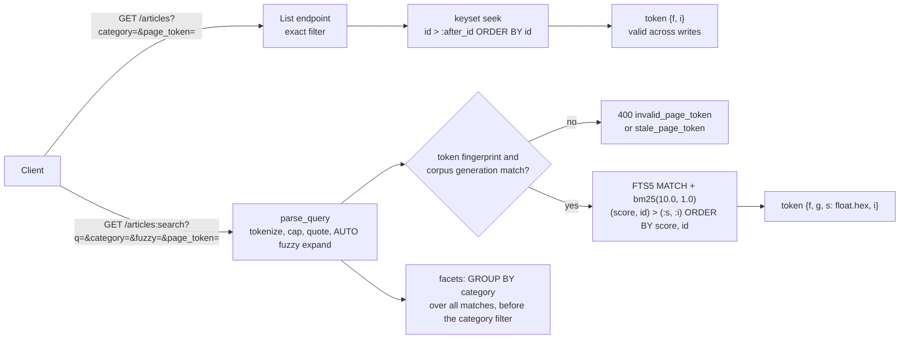

# Search vs List Endpoints: Relevance Ranking, Facets, Fuzzy Matching, and Cursor Tie-Breaking on Score

> [!summary] Claim
> A search endpoint orders by a relevance score that is a function of the whole corpus, so unlike a list endpoint's immutable keyset its `(score, id)` cursor is valid only for the corpus generation that produced it: bind the token to that generation (or to a point-in-time snapshot), break score ties on a unique key, and compute facets before the facet filter is applied.

Part of [Pagination Filtering and Query Patterns](README.md) in [API Engineering](../README.md).

## TL;DR

- Mechanism: SQLite FTS5 `bm25()` returns `-1 x sum(IDF(qi) x f(qi,D) x (k1 + 1) / (f(qi,D) + k1 x (1 - b + b x |D| / avgdl)))` with `k1 = 1.2`, `b = 0.75`, and `IDF` floored at `1e-6`, where `N`, `n(qi)`, and `avgdl` are statistics of the entire table `(SQLite 3.53.1 ext/fts5/fts5_aux.c, fts5Bm25GetData)`.
- Contract rule: page a ranked result with a row-value seek `(score, id) > (:after_score, :after_id)` and `ORDER BY score, id`, carry the score bit-exact (`float.hex()`), and bind the page token to the query fingerprint and the corpus generation, answering `400` with `stale_page_token` when either changes.
- The trap: one unrelated `INSERT` moved every `cursor` score in the lab (`-0.7209 -> -0.9981`), so a stale page-1 cursor silently skipped a hit, and one `DELETE` of three unrelated rows floored the IDF and re-served page 1.
- Portability fact: the lab passes unchanged on CPython 3.12.13, 3.13.18, 3.14.10, 3.15.2, and free-threaded 3.15.0b3t on macOS arm64, with bundled SQLite 3.53.1 or 3.54.1, because FTS5 is compiled into those builds and row values are core SQLite since 3.15.0.
- When not to use it: do not put relevance search behind a list endpoint, and do not use a search endpoint for read-after-write or exhaustive export; Stripe says search data is "searchable in under 1 minute" and directs read-after-write flows to list APIs (as of 2026-11).

## Mental model



Both requests enter the same collection, but they diverge at the ordering key.
The list path seeks on `id`, a value that no other write can change, so its token needs only the filter fingerprint and the last `id`, and it stays correct across inserts.
The search path first turns untrusted `q` into a closed FTS5 expression of quoted terms, then checks the token's fingerprint and the corpus generation, because the `bm25()` value it seeks on is recomputed from table-wide statistics on every query.
Facets branch off the parsed match before the category filter, so the counts describe every match while the hits respect the selected facet.

## How it works

### What a search endpoint is, contractually

A list endpoint is an enumeration: AIP-132 says list methods "should return the same results for any user that has permission to make a successful List request on the collection", and then adds that "Search methods are more relaxed on this" (AIP-132, Request message).
AIP-136 names the pattern: instead of a property-specific `GetBookByAuthor`, "consider a `SearchBooks` with an author field as a search dimension" (AIP-136, Disallowing prepositions).
The lab models the split as two routes, `GET /articles` and the custom-method style `GET /articles:search`; Starlette builds each route regex with `re.escape` on the literal path segments, so the colon is a literal character, not a parameter marker `(starlette 1.10.0 starlette/routing.py, compile_path)`.
Production search APIs publish weaker guarantees than their list siblings, and the guarantees are part of the contract:

- GitHub REST search returns "up to 1,000 results for each search", sorts by "best match" by default, rejects with `Validation failed` queries longer than 256 characters (not including operators or qualifiers) or with more than five `AND`, `OR`, or `NOT` operators, and on timeout returns partial matches with `incomplete_results` set to `true` (GitHub REST API docs, Search, as of 2026-11).
- Stripe search uses `page` and `next_page` cursors, is "searchable in under 1 minute" under normal conditions, is rate limited to 20 read operations per second, and warns that "paginating through a result set can reorder some records, causing them to be missing or duplicated on a page" (Stripe docs, Search, as of 2026-11).
- Elasticsearch caps `from + size` at 10,000 hits through `index.max_result_window` and refreshes shards every `index.refresh_interval`, default `1s` (`5s` in Elastic Cloud Serverless), so a write is invisible to search until the next refresh (Elasticsearch docs, Paginate search results and refresh parameter, as of 2026-11).

### BM25 in FTS5, down to the C source

FTS5 exposes ranking through the auxiliary function `bm25()`, which "may only be used within full-text queries (those that use the MATCH operator, or LIKE/GLOB with the trigram tokenizer)" (sqlite.org fts5.html Section 5).
"The better the match, the numerically smaller the value returned", because FTS5 multiplies the classic score by `-1` so that the default ascending `ORDER BY bm25(ft)` returns best matches first (fts5.html Section 5.1.1).
Extra arguments are per-column weights: `bm25(articles_fts, 10.0, 1.0)` makes one title hit worth ten body hits (fts5.html Section 5.1.1).
The hidden `rank` column equals `bm25()` with no arguments, and `ORDER BY rank` "may be faster" than `ORDER BY bm25(ft)` when the caller stops early or uses `LIMIT` (fts5.html Section 5.2).

The implementation is two functions in `ext/fts5/fts5_aux.c`.
`fts5Bm25GetData` runs once per query (cached with `xSetAuxdata`) and computes `avgdl = nToken / nRow` from `xRowCount` and `xColumnTotalSize`, then for each phrase counts matching rows `nHit` with `xQueryPhrase` and sets `idf = log((nRow - nHit + 0.5) / (nHit + 0.5))`, replaced by `1e-6` when `idf <= 0.0` `(SQLite 3.53.1 ext/fts5/fts5_aux.c, fts5Bm25GetData)`.
The source comment explains the floor: when `N < 2 x nHit` the classic IDF is negative, "Which is undesirable"; at `N = 2 x nHit` it is exactly `0`, which the `idf<=0.0` test also floors.
`fts5Bm25Function` hard-codes `k1 = 1.2` and `b = 0.75`, accumulates the weighted phrase frequency `aFreq[ip] += w` over `xInst` hits, reads the row length `D` with `xColumnSize(pFts, -1, ...)`, and returns `-1.0 * score` `(SQLite 3.53.1 ext/fts5/fts5_aux.c, fts5Bm25Function)`.

The lab reimplements that formula independently from the `fts5vocab` `row` and `instance` tables (term document counts and every token occurrence) and asserts equality with SQLite's `bm25()` to `rel_tol=1e-12` for four queries.
That test is the proof that a document's score depends on `nRow`, `nHit`, and `avgdl`, so writes to rows that do not match the query still change the score of rows that do.
In the lab corpus `cursor` appears in 4 of 10 rows, so `IDF = log(6.5 / 4.5) = 0.3677`; one unrelated insert makes it `log(7.5 / 4.5) = 0.5108`, and deleting three unrelated rows makes it `log(3.5 / 4.5) < 0`, which FTS5 floors to `1e-6`.

### Seeking on a score: the row-value cursor

The ranked query materializes the matches with their score and then seeks past the cursor with a row-value comparison, which SQLite supports since 3.15.0 (sqlite.org rowvalue.html):

```sql
WITH hits AS MATERIALIZED (
  SELECT a.id AS id, a.title AS title, a.category AS category,
         bm25(articles_fts, 10.0, 1.0) AS score
  FROM articles_fts JOIN articles AS a ON a.id = articles_fts.rowid
  WHERE articles_fts MATCH :match
)
SELECT id, title, category, score FROM hits
WHERE (:category IS NULL OR category = :category)
  AND (score, id) > (:after_score, :after_id)
ORDER BY score, id
LIMIT :limit
```

The `id` component is not optional: rows 3 and 4 in the lab are identical documents with the identical score `-0.720942629861753`, and the mutation that reduced the predicate to `score > :after_score` lost row 4 at a page boundary, while `>=` re-served the boundary row forever (the walk test caps itself at 100 pages so this mutant fails instead of hanging).
Elasticsearch documents the same rule for `search_after`: without a PIT, "include a tiebreaker field in your sort", because "If you don't include a tiebreaker field, your paged results could miss or duplicate hits", and Lucene's internal doc IDs used as default tie-breakers "can be completely different across replicas" (Elasticsearch docs, Paginate search results).

The score must round-trip exactly.
The token stores `last.score.hex()` and decodes with `float.fromhex`, which is exact for every finite binary64 value; Python's `repr` also round-trips (`eval(repr(x)) == x`, Python tutorial Section 15), but a cursor that rounds the score moves the boundary, and the `round(score, 3)` mutant failed five tests.
The token is base64url JSON without padding (RFC 4648 Section 5), decoded with `validate=True`, so a token with injected non-alphabet characters is rejected instead of silently decoding to the same cursor.
Integrity (an HMAC over the payload) belongs to [[Opaque-Cursor-Encoding-HMAC-Integrity-and-Filter-Binding]]; this lab only binds the token to a fingerprint and validates every field.

### Why the cursor must also carry the corpus generation

A keyset cursor on `id` is stable because no write changes an existing row's `id`.
A cursor on `bm25()` is stable only while `nRow`, `avgdl`, and every `nHit` stay fixed, and any write changes at least one of them.
The lab shows both failure directions with `fetch_ranked` called directly:

- Insert one row that does not contain `cursor`: every `cursor` score drops (row 7 goes from `-0.2958` to `-0.4025`), row 7 now sorts before the stale cursor `(-0.3106, 1)`, and page 2 is empty, so row 7 is silently skipped.
- Delete three rows that do not contain `cursor`: `IDF` floors to `1e-6`, every score rises above the stale cursor `(-0.7209, 4)`, and page 2 returns `[3, 4, 1, 7]`, re-serving page 1.

The fix in the lab is a generation counter in `index_meta`, bumped by the same `AFTER INSERT`, `AFTER DELETE`, and `AFTER UPDATE` triggers that keep the external-content FTS5 index in sync (the trigger pattern of fts5.html Section 4.4.3).
`search_page` rejects a token whose generation differs with `400` and code `stale_page_token`, and the client restarts at page 1; AIP-158 already says the API should send `INVALID_ARGUMENT` when "any arguments are different" between page requests (AIP-158, Guidance).
The stronger alternative is a snapshot: Elasticsearch's point in time (PIT) preserves "the current index state over your searches" and adds the implicit `_shard_doc` tie-breaker, "unique per document and constant within a PIT" (Elasticsearch docs, Paginate search results); see [[Snapshot-Consistent-Pagination-Across-Point-in-Time-Reads]].

### Facets are computed before the facet filter

A facet answers "how many matches would I get if I picked this value", so its counts must ignore the filter on the same field.
Elasticsearch implements this with `post_filter`: "Search requests apply post filters only to search hits, not aggregations" (Elasticsearch docs, Filter search results).
The lab's `FACET_SQL` groups every `MATCH` row by `category` with a deterministic `ORDER BY n DESC, a.category`, while `RANKED_SQL` applies `:category`; with `category=search` the response returns hit `[7]` and still reports `pagination: 3, search: 1`.
Facets are computed over all matches, not the page, so a facet query is a full scan of the match set on every page request; that is the cost a search engine's aggregation framework exists to amortize.

### Fuzzy matching as bounded query expansion

FTS5 has no edit-distance operator, so the lab expands each term against the index vocabulary from an `fts5vocab` `row` table (fts5.html Section 8).
The edit budget follows Elasticsearch `fuzziness: AUTO` (equivalent to `AUTO:3,6`): lengths `0..2` must match exactly, `3..5` allow one edit, `>5` allow two (Elasticsearch docs, Common options, Fuzziness).
Distance is optimal string alignment, so an adjacent transposition (`cusror` -> `cursor`) costs one edit, matching Elasticsearch's default `transpositions: true` (Elasticsearch docs, Fuzzy query).
Candidates are length-prefiltered in SQL, sorted by distance and then by document frequency, and capped at 50, the Elasticsearch `max_expansions` default, whose docs warn that high values "can cause poor performance" (Elasticsearch docs, Fuzzy query).
The expansion becomes `("cursor" OR "cursors")` per term, joined with `AND`; substring matching is a different tool, the `trigram` tokenizer, where "Substrings consisting of fewer than 3 unicode characters do not match any rows" (fts5.html Section 4.3.4).

### Untrusted `q` is a query language

FTS5 `MATCH` accepts a grammar with phrases, prefix `*`, `NEAR`, column filters `col:`, and `AND`/`OR`/`NOT` (fts5.html Section 3).
Passing raw user input into it turns ordinary text into syntax errors: in the lab `cursor"`, `AND`, `cursor OR`, `NEAR(cursor`, and `*` each raise `sqlite3.OperationalError`, which an unguarded handler turns into `500`.
`parse_query` instead extracts letters and digits, lowercases them, caps the input at 256 characters and 8 terms, and quotes every term as an FTS5 string with embedded `"` doubled (fts5.html Section 3.1), so `AND` becomes the word `"and"` (it matches row 8, "validators and freshness") and `title:cursor` becomes the two terms `"title" AND "cursor"`.

## Numbers and limits

| Quantity | Value | Source |
|---|---|---|
| BM25 `k1`, `b` in FTS5 | `1.2`, `0.75`, hard-coded | SQLite 3.53.1 `ext/fts5/fts5_aux.c`, `fts5Bm25Function` |
| FTS5 IDF floor | `1e-6` when `log((N - n + 0.5) / (n + 0.5)) <= 0`, that is when `N <= 2n` | SQLite 3.53.1 `ext/fts5/fts5_aux.c`, `fts5Bm25GetData` |
| Lab: `cursor` scores, rows 3/4, 1, 7 (N = 10) | `-0.720942629861753`, `-0.31063228504743`, `-0.2958167547589993` | Lab, CPython 3.14.6, SQLite 3.53.1, macOS 27.2 arm64 |
| Lab: same scores after one unrelated insert (N = 11) | `-0.9981468277237024`, `-0.42309744804960353`, `-0.40254462795298385` | Lab, same machine |
| Lab: fuzzy `expand_term("cursor")` vs exact `MATCH` top 10, 58,500-term vocabulary | median `108 ms` vs `0.035 ms` (30 runs each, `time.perf_counter`, three repeats within 1 ms) | ad hoc timing script outside the lab (6,000 rows of 10 random lowercase words of length 3 to 10, `random.Random(0)`), run with `uv run --frozen python -I`, CPython 3.14.6, SQLite 3.53.1, Apple M3 Pro, macOS 27.2 arm64 |
| Elasticsearch `from + size` cap | 10,000 hits (`index.max_result_window`) | Elasticsearch docs, as of 2026-11 |
| Elasticsearch refresh interval | `1s` default, `5s` in Serverless | Elasticsearch docs, refresh parameter, as of 2026-11 |
| Elasticsearch `fuzziness: AUTO` | `AUTO:3,6`: 0, 1, 2 edits | Elasticsearch docs, common options, as of 2026-11 |
| Elasticsearch `max_expansions` | 50 default | Elasticsearch docs, fuzzy query, as of 2026-11 |
| GitHub REST search | up to 1,000 results per search; query <= 256 characters (not including operators or qualifiers) and <= 5 boolean operators; 30 requests per minute authenticated (10 for code search and for unauthenticated requests) | GitHub docs, as of 2026-11 |
| Stripe search | searchable "in under 1 minute"; 20 read operations per second; up to 10 clauses | Stripe docs, as of 2026-11 |
| URI length senders and recipients should support | at least 8000 octets | RFC 9110 Section 4.1 |
| FTS5 trigram minimum substring | 3 unicode characters | fts5.html Section 4.3.4 |
| Lab limits | `q` <= 256 characters, <= 8 terms, `page_size` default 10, max 50, <= 50 expansions per term | `fts5_search.py` constants |

The benchmark is a single-machine median on a synthetic corpus of random lowercase words; treat it as an order of magnitude (a linear vocabulary scan in Python is about three to four orders slower than an indexed match, here about 3,100 times), not as a capacity number.

## Portability

| Runtime / component | Version | Behavior and verification status |
|---|---|---|
| CPython 3.12 | `3.12.13` (uv-managed), bundled SQLite `3.53.1`, macOS 27.2 arm64; `3.12.16` is not offered by uv here and was not run | Proven: `UV_PROJECT_ENVIRONMENT=<tmp venv> uv run --frozen --python 3.12.13 pytest <lab> -q -W error -p no:cacheprovider --no-cov`: `69 passed in 0.19s` |
| CPython 3.13 | `3.13.18` (Homebrew), SQLite `3.54.1` | Proven: same command with `--python /opt/homebrew/bin/python3.13`: `69 passed in 0.21s` |
| CPython 3.14 | `3.14.10` (Homebrew), SQLite `3.54.1`; workspace `3.14.6`, SQLite `3.53.1` | Proven: `--python /opt/homebrew/bin/python3.14`: `69 passed in 0.19s`; workspace `uv run --frozen pytest <lab> -q`: `69 passed in 0.14s` |
| CPython 3.15 | `3.15.2` (Homebrew), SQLite `3.54.1` | Proven: `--python /opt/homebrew/bin/python3.15`: `69 passed in 0.21s`; the uv-managed `3.15.0b3` with the full lock failed at collection with `ModuleNotFoundError: No module named 'hypothesis._native'` from the locked `hypothesis` plugin, not from this lab |
| CPython 3.15t free-threaded | `3.15.0b3+freethreaded` (3.15.2t is not offered by uv here), SQLite `3.53.1` | Proven in a minimal `uv venv` of locked pins (`starlette`, `anyio`, `httpx`, `httpcore`, `h11`, `idna`, `certifi`, `sniffio`, `pytest`, `pytest-asyncio`, `iniconfig`, `packaging`, `pluggy`, `pygments`, `typing-extensions`) with `PYTHONPATH=src python -W error -m pytest <lab> -q`: `69 passed in 0.12s`, `sys._is_gil_enabled()` is `False` after importing `starlette` and `httpx`; `uv sync --frozen` fails because `psycopg-binary==3.3.8` has no wheel for this interpreter. Also `3.14.6+freethreaded` (same environment recipe): `69 passed in 0.12s` |
| SQLite FTS5 | compile-time option | Present in every interpreter above (`ENABLE_FTS5` in `PRAGMA compile_options` on the workspace build); FTS5 is in the amalgamation since 3.9.0 but needs `SQLITE_ENABLE_FTS5` or `--enable-fts5` in other builds (fts5.html Section 2.1), so a distro Python may lack it |
| SQLite row values | `>= 3.15.0` | Required by `(score, id) > (?, ?)` (sqlite.org rowvalue.html); every tested build is 3.53.1 or newer |
| Uvicorn, Hypercorn, Granian | `0.54.0`, `0.18.0`, `2.8.7` pinned | Not exercised: the lab runs in-process through `httpx.ASGITransport`; the mechanism lives in SQL and the query string, so no server-specific behavior is claimed |
| HTTP/1.1, HTTP/2, HTTP/3 | - | Not exercised; the only version-relevant fact is URI length, for which RFC 9110 Section 4.1 recommends supporting at least 8000 octets on any version, and long structured queries are the use case for `QUERY` (RFC 10008) |
| Containers (Debian Trixie, Alpine musl) | - | Not run |

## Worked example

The [implementation](../labs/src/api_labs/f05_pagination_filtering_and_query_patterns/fts5_search.py) builds an external-content FTS5 index with triggers, and the [test](../labs/tests/f05_pagination_filtering_and_query_patterns/test_search_endpoints_vs_list_endpoints_and_full_text_ranking.py) proves each claim above with 69 test cases.
The core of the search endpoint, verbatim from `fts5_search.py`:

```python
    parsed = parse_query(conn, q, fuzzy=fuzzy)
    query_fp = fingerprint("search", parsed.terms, category, fuzzy)
    generation = corpus_generation(conn)
    after: tuple[float, int] | None = None
    if page_token is not None:
        payload = decode_token(page_token, query_fp)
        if _int_field(payload, "g") != generation:
            raise StalePageTokenError("corpus changed since page_token was issued; restart")
        after = (_score_field(payload), _int_field(payload, "i"))
    rows = fetch_ranked(conn, parsed.match, category=category, after=after, limit=page_size + 1)
    hits, more = rows[:page_size], len(rows) > page_size
    next_token = None
    if more:
        last = hits[-1]
        next_token = encode_token(
            {"v": 1, "f": query_fp, "g": generation, "s": last.score.hex(), "i": last.id}
        )
```

The query parser, verbatim:

```python
def parse_query(conn: sqlite3.Connection, q: str, *, fuzzy: bool) -> ParsedQuery:
    """Turn untrusted `q` into an FTS5 expression of quoted terms joined by `AND`."""
    if len(q) > MAX_QUERY_CHARS:
        raise SearchError(f"q is longer than {MAX_QUERY_CHARS} characters")
    terms = tuple(t.lower() for t in TOKEN_RE.findall(q))
    if not terms:
        raise SearchError("q has no searchable terms")
    if len(terms) > MAX_TERMS:
        raise SearchError(f"q has more than {MAX_TERMS} terms")
    groups: list[str] = []
    for term in terms:
        alternatives = expand_term(conn, term) if fuzzy else [term]
        quoted = [quote_fts5(t) for t in alternatives]
        groups.append(quoted[0] if len(quoted) == 1 else "(" + " OR ".join(quoted) + ")")
    return ParsedQuery(terms=terms, match=" AND ".join(groups))
```

The stale-cursor skip, from the test module (simplified excerpt: fixture and decorator lines omitted):

```python
    match = '"cursor"'
    page1 = fetch_ranked(db, match, category=None, after=None, limit=3)
    assert [h.id for h in page1] == [3, 4, 1]
    before = {h.id: h.score for h in fetch_ranked(db, match, category=None, after=None, limit=10)}
    add_articles(db, [Article(11, "Unrelated", "nothing to see", "http")])
    after = {h.id: h.score for h in fetch_ranked(db, match, category=None, after=None, limit=10)}
    assert all(after[i] < before[i] for i in before)  # N grew, IDF grew, every score moved
    cursor = (page1[-1].score, page1[-1].id)
    page2 = fetch_ranked(db, match, category=None, after=cursor, limit=10)
    assert [h.id for h in page2] == []  # row 7 (-0.40 now < -0.31) is silently skipped
```

A real exchange through `httpx.ASGITransport`, captured with a throwaway driver script that imports `create_app` and `CORPUS` (CPython 3.14.6, SQLite 3.53.1, macOS 27.2 arm64), with the JSON reformatted onto fewer lines:

```text
GET /articles:search?q=cursor&page_size=3 -> 200
{"results": [
   {"id": 3, "title": "Cursor tokens", "category": "pagination", "score": -0.720942629861753},
   {"id": 4, "title": "Cursor tokens", "category": "pagination", "score": -0.720942629861753},
   {"id": 1, "title": "Keyset pagination", "category": "pagination", "score": -0.31063228504743}],
 "facets": {"category": [{"value": "pagination", "count": 3}, {"value": "search", "count": 1}]},
 "next_page_token": "eyJmIjoiZjVlZTljMTk4ZGYwNWI1MiIsImciOjEwLCJpIjoxLCJzIjoiLTB4MS4zZTE2NjNjNTcxMWNlcC0yIiwidiI6MX0"}
same token after one unrelated INSERT -> 400 {'error': {'code': 'stale_page_token', 'message': 'corpus changed since page_token was issued; restart'}}
```

The lab gate, run from `labs/` on the workspace interpreter (CPython 3.14.6, macOS 27.2 arm64):

```text
$ uv run --frozen pytest tests/f05_pagination_filtering_and_query_patterns/test_search_endpoints_vs_list_endpoints_and_full_text_ranking.py -q
.....................................................................    [100%]
69 passed in 0.14s
```

Branch coverage of `fts5_search.py` from this module alone is 100% (214 statements, 56 branches, `--cov-branch`).
Mutation checks, each applied to `fts5_search.py` alone, run against this module, and restored (the file hash was unchanged afterwards), on CPython 3.14.6, SQLite 3.53.1, macOS 27.2 arm64:
the fact-check pass ran 15 (14 killed), and the finish pass ran 24 more (seek predicate `>=`, seek on `score` only, no generation check, no generation bump on `INSERT`, title weight `1.0`, no lookahead row, rounded token score, fingerprint ignoring `fuzzy` or `category`, lenient base64, no term cap, no page-size cap, no transposition edit, category-filtered facets, `bool` accepted as `id`, list seek `>=`, list fingerprint ignoring `category`, no query length cap, no expansion cap, short terms made fuzzy, non-finite score accepted, token version unchecked, `ORDER BY score` without `id`, and facet order without the category tie-break).
Of those 24, 21 were killed by the existing suite and 2 survived (the list token was not bound to `category`, and the facet tie-break was untested); the two cases added in the finish pass kill both.
The one surviving mutant, dropping `id` from `ORDER BY score, id`, is equivalent on this engine and is discussed under Pitfalls.

## Pitfalls

> [!warning] Score cursor without a generation or snapshot
> Trigger: a search endpoint pages with `search_after`-style `(score, id)` cursors while the index takes writes.
> Symptom: hits are skipped or repeated across pages even though every page is individually correct; Stripe documents that "paginating through a result set can reorder some records, causing them to be missing or duplicated on a page", and Elasticsearch warns that "If a refresh occurs between these requests, the order of your results may change, causing inconsistent results across pages".
> Fix: bind the token to a corpus generation and return `400 stale_page_token`, or pin a snapshot (Elasticsearch PIT), and document which one the API provides.

> [!warning] No unique tie-breaker after the score
> Trigger: `ORDER BY score` alone, or a cursor predicate `score > :s`.
> Symptom: duplicate documents (the lab's rows 3 and 4) straddle a page boundary and one disappears; with `>=` the boundary row repeats forever.
> Fix: append a unique, immutable key to both `ORDER BY` and the seek predicate; Elasticsearch adds `_shard_doc` automatically under a PIT and otherwise tells you to add a tie-breaker field because Lucene doc IDs differ across replicas.
> Note that on SQLite the `ORDER BY score` mutant survived because FTS5 emits rows in rowid order and the sorter kept that order for ties; correctness by accident on one engine is not portable.

> [!warning] Facet counts that collapse to the selected value
> Trigger: computing facets with the same `WHERE` as the hits.
> Symptom: after the user clicks `category=search`, every other category's count disappears, so the user cannot switch facets; this is the exact scenario Elasticsearch's `post_filter` docs walk through with colors of shirts.
> Fix: compute facet counts over the query without the facet's own filter, then filter hits.

> [!warning] Raw user text in the match grammar
> Trigger: `WHERE ft MATCH :q` with `q` straight from the query string.
> Symptom: `cursor"` raises `unterminated string`, `AND` raises `fts5: syntax error near "AND"`, and `*` raises `unknown special query`, all as `sqlite3.OperationalError`, which becomes `500 Internal Server Error`; column filters and `NEAR` let callers reshape the query.
> Fix: tokenize, cap, and quote every term (fts5.html Section 3.1), or expose a separate, documented query language with its own parser.

> [!warning] Search used for read-after-write
> Trigger: a client creates an object and immediately searches for it.
> Symptom: the object is missing until the next refresh (Elasticsearch `1s` default) or index propagation (Stripe: under 1 minute normally, longer during an outage).
> Fix: Stripe's documented rule applies generally: use the list or get endpoint for read-after-write, and search for discovery.

No CVE specific to score-cursor drift exists in NVD: keyword searches for `search_after`, `pagination relevance score`, and `fts5 bm25` against the NVD CVE API 2.0 returned `totalResults` 0 on 2026-11-10, and a web search found no advisory or postmortem.
The evidence above is therefore vendor documentation that acknowledges the behavior, not an incident report.

## Security and robustness

- OWASP API4:2023 Unrestricted Resource Consumption names "Number of records per page to return in a single request-response" among the limits an API must set; the lab coerces `page_size` above 50 down to 50 and rejects negatives, as AIP-158 prescribes.
- Fuzzy expansion is an amplifier: one term becomes up to 50 phrases, each with its own `xQueryPhrase` pass in `fts5Bm25GetData`, and the vocabulary scan itself measured about 108 ms on 58,500 terms; cap terms (8), expansions (50), and query length (256 characters, GitHub's limit), and rate limit search separately from list, as GitHub (30 per minute authenticated) and Stripe (20 read operations per second) do.
- Facets and `bm25()` both touch every match, so a broad term (`the`) costs a full scan per page; consider a minimum term length, stop terms, or a cap on scored matches, and see [[Unrestricted-Resource-Consumption-API4-2023-Payload-Depth-and-Limit-Guards]].
- The match grammar is an injection surface even though it is a bound parameter: SQL injection is prevented by binding, but FTS5 syntax injection is not, so quote at the FTS5 layer as well (compare [[SQL-Injection-NoSQL-Injection-and-Order-By-Identifier-Escaping]]).
- Page tokens are inputs: the lab validates base64url strictly, requires a JSON object with `v == 1`, an integer (not `bool`) `id` and generation, a hex-encoded finite score, and a matching fingerprint, and maps every failure to `400 invalid_page_token`; AIP-158 adds that tokens "must not provide any form of authorization", so authorization runs on every page.
- Relevance leaks information: `bm25()` is computed from table-wide `N`, `n(qi)`, and `avgdl` (`fts5Bm25GetData`), and the lab shows that a write to an unrelated row moves every matching score, so in a shared index a returned score reflects other tenants' documents.
  Wang, Grubbs, Lu, Bindschaedler, Cash, and Ristenpart published the resulting document-frequency side channel as the STRESS attack (IEEE S&P 2017, DOI 10.1109/SP.2017.50); the authors' project page reports it in Elasticsearch, four hosted Elasticsearch services, Swiftype, and MySQL full-text search, and says it is exploitable when relevance scores are returned (stressattack.github.io, as of 2026-11).
  Partition the index (or at least the statistics) per tenant, and do not return scores across a tenant boundary; facet counts over unauthorized rows are a direct leak and need no side channel.
- Score values in responses are implementation details; returning them (as the lab and Elasticsearch `_score` do) invites clients to threshold on numbers that change with every write.

## The principal's view

The decision is not "which ranking function" but which consistency contract the search surface publishes.
A list endpoint can promise exact filters, stable order, read-after-write, and exhaustive iteration, because its key is immutable and its source of truth is the primary store.
A search endpoint ranks by corpus statistics, usually reads an asynchronously refreshed index, and at scale caps depth (GitHub's 1,000, Elasticsearch's 10,000), so it should promise only "best matches for this query, now".
The staff-plus move is to ship both, name them differently (`List` and `Search` in AIP terms), and route each workload to the one whose contract fits: discovery to search, sync and export to list or to [[Streaming-Exports-and-NDJSON-for-Unbounded-Collections]].
For deep or stable search paging, choose between invalidating tokens on every write (cheap, correct, but cursors break under steady writes; the lab's per-row generation would make that constant on a busy index, so real systems bump it per refresh or per segment), pinning snapshots (correct and stable, but the engine must hold old segments open, which is why PITs expire), or freezing the ranked id list per query in a result cache (stable and simple, but memory scales with query count and results go stale).
The organizational trade-off is ownership: once search runs on a dedicated engine, its availability, freshness, and relevance tuning belong to a team separate from the system of record, and the API must say which system answered.
Choose a different tool when the "search" is really structured filtering on indexed fields: an AIP-160 filter on a list endpoint ([[Structured-Filter-Expressions-and-AST-Compilation-AIP-160]]) is exact, cacheable, and keyset-pageable, with none of the drift above.
When the query body is too large or too structured for a URI, use `QUERY` (RFC 10008), which is safe and idempotent and whose response is cacheable with a cache key that "MUST incorporate the request content" (RFC 10008 Section 2.7), rather than `POST`.

## Interview questions

> [!question] L5: Why does SQLite FTS5 return negative `bm25()` values, and how do you get best matches first?
>
> > [!success]- Answer
> > FTS5 multiplies the classic BM25 sum by `-1` so that better matches are numerically lower.
> > The default ascending `ORDER BY bm25(ft)` or `ORDER BY rank` therefore returns best matches first, with no `DESC`.
> > `ORDER BY rank` is logically equivalent and "may be faster", particularly when the caller abandons the query early or adds `LIMIT` (fts5.html Section 5.2).
> >
> > Follow-up: How do you weight a hit in `title` ten times a hit in `body`?

> [!question] L5: What is the difference between a list endpoint and a search endpoint, contractually?
>
> > [!success]- Answer
> > A list endpoint enumerates a collection in a stable, documented order with exact filters, and supports read-after-write and full iteration.
> > A search endpoint returns matches ranked by relevance, often from an asynchronously refreshed index, with depth caps and weaker consistency.
> > AIP-132 makes the distinction explicit: list results should be the same for any permitted user, and "Search methods are more relaxed on this".
> >
> > Follow-up: Which one should a client use right after creating an object, and why?

> [!question] L6: Predict the output of page 2 after an unrelated insert.
>
> Corpus of 10 rows; `cursor` is in rows 3 and 4 (title, identical), 1, and 7 (body).
> Page 1 with `page_size=3` returns `[3, 4, 1]` and the cursor `(score_1, 1)`.
> One row without `cursor` is inserted.
> The client sends the old `(score, id)` cursor to an endpoint that does not check generations.
> What does page 2 contain?
>
> > [!success]- Answer
> > An empty page: row 7 is skipped.
> > `N` grows from 10 to 11, so `IDF = log((N - 4 + 0.5) / 4.5)` rises from `0.368` to `0.511`, and every `cursor` score becomes more negative.
> > Row 7 moves from `-0.296` to `-0.403`, which is now less than the stale cursor score `-0.311`, so `(score, id) > (-0.311, 1)` excludes it.
> >
> > Follow-up: What happens instead if three non-matching rows are deleted?

> [!question] L6: Why must a search cursor include `id`, and why must the score round-trip exactly?
>
> > [!success]- Answer
> > Identical or equally relevant documents share a score, so `score` alone does not define a total order and a page boundary between ties loses or repeats rows.
> > The seek predicate `(score, id) > (:s, :i)` plus `ORDER BY score, id` makes the order total.
> > If the token rounds the score, the boundary moves relative to the real values, which in the lab failed five tests; `float.hex()` or `repr` are exact.
> >
> > Follow-up: Elasticsearch already breaks ties on Lucene doc IDs; why is that not enough without a PIT?

> [!question] L6: Debug this API: facet counts vanish after a facet is selected.
>
> Users report that after they click the `Books` facet, all other facet counts show `0` and they cannot switch to `Music` without clearing the search.
> The handler runs `SELECT category, count(*) ... WHERE MATCH :q AND category = :cat GROUP BY category`.
> What is wrong?
>
> > [!success]- Answer
> > The facet query applies the facet's own filter, so it only counts the selected value.
> > Facet counts must be computed over the match set before that filter, and the filter applied only to hits, which is Elasticsearch's `post_filter` pattern.
> > With several facet fields, each field's counts exclude only its own filter and keep the others.
> >
> > Follow-up: What does this cost per page, and how would you cache it?

> [!question] L6: A user types `C++ AND "fast`. What does a naive `MATCH :q` do, and how should the endpoint handle it?
>
> > [!success]- Answer
> > FTS5 parses `q` as its own grammar, where `+` is the phrase-concatenation operator, so on SQLite 3.53.1 it raises `sqlite3.OperationalError: fts5: syntax error near "+"`, and the unbalanced quote alone would raise `unterminated string`; unhandled, either surfaces as a `500`.
> > Binding the parameter prevents SQL injection but not FTS5 syntax injection.
> > Tokenize to letters and digits, cap length and term count, quote each term with embedded quotes doubled, and join with `AND`; `AND` then becomes the literal word `"and"`.
> >
> > Follow-up: When would you expose a real query language instead, and what must its error contract be?

> [!question] L7+: Design a stable infinite-scroll contract over relevance-ranked results on a busy index.
>
> Your search index takes 2,000 writes per second.
> Product wants infinite scroll that never skips or repeats a hit.
>
> > [!success]- Answer
> > Invalidating tokens on every write would break every cursor within milliseconds, so the generation must advance per index refresh or segment publication, not per row, and even that fails most deep scrolls.
> > The robust options are a snapshot (Elasticsearch PIT with `_shard_doc` tie-breaker and a keep-alive) or a per-query result cache of ranked ids, each with an explicit expiry returned as `400` or a documented restart code.
> > Cap depth (as GitHub caps at 1,000) because relevance beyond a few pages has little value and deep pages are the expensive ones.
> >
> > Follow-up: How do you bound the memory a PIT or result cache can hold under adversarial clients?

> [!question] L7+: When should "search" be a filter on the list endpoint instead of a separate search endpoint?
>
> > [!success]- Answer
> > When the predicate is exact on indexed fields (status, owner, date ranges), a structured filter such as AIP-160 on the list endpoint keeps exact semantics, stable keyset paging, cacheability, and read-after-write.
> > Relevance ranking, fuzzy matching, and facets justify a separate search endpoint, because they bring corpus-dependent order, refresh lag, and different capacity limits.
> > Mixing them in one endpoint forces the weaker contract on every caller.
> >
> > Follow-up: How do you migrate clients who currently use search for sync jobs?

> [!question] L7+: Fuzzy search with `AUTO` fuzziness is consuming most of the search cluster's CPU. Where does the cost come from and what do you change?
>
> > [!success]- Answer
> > Each fuzzy term expands into up to `max_expansions` exact terms, each scored as its own phrase, and short or prefix-free terms match many candidates.
> > Bound it with `prefix_length` (no edits in the first characters), lower `max_expansions`, `AUTO` thresholds so short terms are exact, a term count cap, and fuzzy only as a fallback when the exact query returns too few hits.
> > Measure first: in the lab a Python vocabulary scan cost about 108 ms versus 0.035 ms for an exact match, the shape (not the magnitude) that justifies a fallback design.
> >
> > Follow-up: Why does an FST or Levenshtein automaton beat a linear vocabulary scan?

## Related

Prerequisites: [[Subresource-Expansion-and-Include-Directives]]

Next: [[Streaming-Exports-and-NDJSON-for-Unbounded-Collections]]

See also: [[02-Programming-Languages/Python/Python-Backend-Interview-Prep/05-REST-API-Design]], [[Keyset-Seek-Pagination-and-Composite-Tie-Breaker-Cursors]], [[Opaque-Cursor-Encoding-HMAC-Integrity-and-Filter-Binding]], [[Snapshot-Consistent-Pagination-Across-Point-in-Time-Reads]], [[Structured-Filter-Expressions-and-AST-Compilation-AIP-160]], [[Total-Count-Antipattern-and-Estimated-Counts]], [[Unrestricted-Resource-Consumption-API4-2023-Payload-Depth-and-Limit-Guards]], [[SQL-Injection-NoSQL-Injection-and-Order-By-Identifier-Escaping]], [[Elasticsearch-and-Apache-Solr]], [[04-System-Design/02-Case-Studies/12-Typeahead-Search/design|Typeahead search design]]

- Lab: `labs/tests/f05_pagination_filtering_and_query_patterns/test_search_endpoints_vs_list_endpoints_and_full_text_ranking.py`

## Further reading

- [SQLite FTS5](https://www.sqlite.org/fts5.html): query grammar, tokenizers, `bm25()`, `rank`, external-content triggers, and `fts5vocab`, the whole surface this lab uses.
- [SQLite fts5_aux.c at version-3.53.1](https://github.com/sqlite/sqlite/blob/version-3.53.1/ext/fts5/fts5_aux.c): the exact BM25 constants, IDF floor, and per-query statistics.
- [SQLite row values](https://www.sqlite.org/rowvalue.html): the `(a, b) > (?, ?)` comparison that makes a composite seek one predicate.
- [Robertson and Zaragoza, The Probabilistic Relevance Framework: BM25 and Beyond (2009)](https://www.staff.city.ac.uk/~sbrp622/papers/foundations_bm25_review.pdf): the derivation of BM25 from the probabilistic relevance model, by its authors.
- [Wang et al., Side-Channel Attacks on Shared Search Indexes (IEEE S&P 2017)](https://doi.org/10.1109/SP.2017.50): the published document-frequency side channel in shared search indexes; project page at [stressattack.github.io](https://stressattack.github.io).
- [Elasticsearch: Paginate search results](https://www.elastic.co/docs/reference/elasticsearch/rest-apis/paginate-search-results): `search_after`, PIT, `_shard_doc`, and the 10,000-hit window.
- [Elasticsearch: Filter search results](https://www.elastic.co/docs/reference/elasticsearch/rest-apis/filter-search-results): `post_filter` and why facets ignore their own filter.
- [Elasticsearch: Fuzzy query](https://www.elastic.co/docs/reference/query-languages/query-dsl/query-dsl-fuzzy-query): `fuzziness`, `max_expansions`, `prefix_length`, and `transpositions`.
- [Google AIP-158 Pagination](https://google.aip.dev/158): `page_size` coercion, `INVALID_ARGUMENT` on changed arguments, and opaque tokens.
- [Google AIP-132 Standard methods: List](https://google.aip.dev/132): the list contract and its explicit relaxation for search methods.
- [Stripe Search](https://docs.stripe.com/search): a production search API that documents freshness, rate limits, and reorder-on-paging.
- [GitHub REST API search](https://docs.github.com/en/rest/search/search): result caps, query limits, and `incomplete_results`.
- [RFC 10008 The HTTP QUERY Method](https://www.rfc-editor.org/rfc/rfc10008.html): safe, idempotent queries with a request body.
- [OWASP API4:2023 Unrestricted Resource Consumption](https://owasp.org/API-Security/editions/2023/en/0xa4-unrestricted-resource-consumption/): why page size and query cost limits are security controls.
