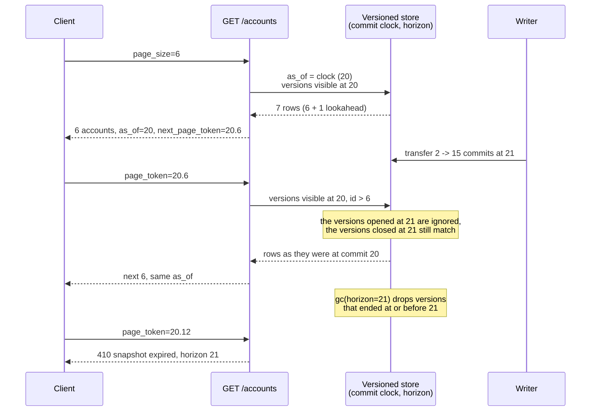

# Snapshot-Consistent Pagination Across Multi-Page Scans and Point-in-Time Read Tokens

> [!summary] Claim
> A multi-page scan is a snapshot only if every page reads the versions visible at one commit point pinned on page 1, which takes a commit-ordered bound plus retained history: a `max(id)` or `max(created_at)` high-water mark admits late commits and still serves updated and deleted rows at their current state, and in the lab it diverged from the page-1 snapshot in 225 of 300 seeded interleavings while the as-of read diverged in 0.

Part of [Pagination Filtering and Query Patterns](README.md) in [API Engineering](../README.md).

## TL;DR

- Mechanism: page 1 pins a read point (a commit sequence, an MVCC snapshot, or a database read timestamp) into the cursor, and every later page evaluates visibility as of that point, `valid_from <= as_of AND (valid_to IS NULL OR valid_to > as_of)`, while the keyset predicate only moves the position.
- Contract rule: the token carries the read point unchanged across pages, a read point older than the retention horizon fails loudly (the lab returns `410` with the horizon), and a read point from the future is rejected as `400`.
- The trap: a high-water mark on an id or timestamp assigned before commit is not a visibility bound; PostgreSQL 18.6 served the late-committing id 11 below `max(id) = 12` on page 2, and no id or timestamp bound can bring back a row that was updated or deleted after page 1.
- Portability fact: the lab passes on CPython 3.12.13, 3.12.16, 3.13.18, 3.14.6, 3.14.10, 3.15.0b3, 3.15.2, and free-threaded 3.14.6t and 3.15.0b3t, on macOS and in Debian Trixie and Alpine containers, with SQLite 3.46.1 to 3.54.1; engines differ in where the snapshot lives (Spanner and CockroachDB read at a timestamp inside a GC window, PostgreSQL and SQLite only inside an open transaction, Elasticsearch inside a `keep_alive` PIT).
- When not to use it: ordinary list endpoints for humans and feeds, where keyset's stable position is enough and the retention cost buys nothing; reserve snapshots for exports, reconciliations, and invariant-bearing aggregates.

## Mental model



The diagram replays the lab app with 20 accounts, so the 20 inserts put the clock at 20; every value in it is what the lab returned.
Page 1 reads the commit clock and stamps it into the token as `as_of`, so the read point is chosen once, by the server, at the moment the first page is computed.
The writer's transfer creates new versions that start at commit 21 and closes the old ones at 21; a page read as of 20 still matches the old versions because their interval `[valid_from, 21)` contains 20, and it ignores the new ones because they start after 20.
The keyset part of the token (`6`, then `12`) only says where to resume; it never decides what is visible.
Garbage collection moves the horizon forward, and a token whose `as_of` falls behind it can no longer be answered exactly, so the API refuses it instead of silently serving a page with rows missing.

## How it works

### Three bounds that look alike and are not

A cursor can pin three different things on page 1, and the lab implements each as the visibility predicate of `Strategy`:

| Strategy | Pinned on page 1 | Predicate every page applies | Excludes later inserts | Excludes late commits | Serves updated and deleted rows as of page 1 |
| --- | --- | --- | --- | --- | --- |
| `LIVE` | nothing | `valid_to IS NULL` | no | no | no |
| `HIGH_WATER_MARK` | `max(id)` of committed rows | live rows with `id <= :bound` | yes | no | no |
| `VISIBILITY_BOUND` | commit sequence | live rows with `valid_from <= :bound` | yes | yes | no, an updated row vanishes |
| `AS_OF` | commit sequence | `valid_from <= :bound AND (valid_to IS NULL OR valid_to > :bound)` | yes | yes | yes |

The high-water mark fails on late commits because ids, like PostgreSQL sequence values, are handed out when a writer starts, not when it commits.
PostgreSQL documents that "the value obtained by `nextval` is not reclaimed for re-use if the calling transaction later aborts", so sequence objects cannot provide gapless sequences (PostgreSQL 18 Section 9.17); the same non-transactional allocation lets id 11 become visible after id 12.
The PostgreSQL 18.6 run for this note reproduced it: a writer took id 11 and did not commit, another committed id 12, the reader's page 1 saw 11 rows and `max(id) = 12`, id 13 and then id 11 committed, and page 2 with `id <= 12` returned `[5, 6, 7, 8, 9, 10, 11, 12]`.
That result equals no committed state: any state that contains 11 also contains 13, which the lab test `test_high_water_mark_admits_a_late_commit_and_matches_no_snapshot` asserts against an independent model of every commit.

A commit-ordered bound fixes late commits.
PostgreSQL exposes one as `pg_current_snapshot()`, whose text form is `xmin:xmax:xip_list`, where every transaction id at or above `xmax` "had not yet completed as of the time of the snapshot, and thus are invisible", and ids in `xip_list` were in progress (PostgreSQL 18 Section 9.27.8, Table 9.85).
In the run, page 1's snapshot was `754:756:754`, so the slow writer's transaction 754 was in progress; filtering page 2 with `pg_visible_in_snapshot(xmin::text::xid8, snapshot)` returned `[5, 6, 7, 8, 9, 10, 12]`, without the late id 11.
`xmin` is a 32-bit `xid` that "wraps around every 4 billion transactions" while `xid8` does not (PostgreSQL 18 Section 9.27.8), so the `xmin::text::xid8` cast assumes epoch 0 and is only correct before the first transaction id wraparound; it is a demonstration, not a production predicate.

A visibility bound over live rows still fails on updates.
An update replaces the row with a version written after the bound, so the row disappears from the scan: in the lab transfer test the `VISIBILITY_BOUND` walk served 19 of 20 accounts and a total of 1900 instead of 2000.
Only reading the old version fixes that, which means the old version must still exist when page 2 runs.

### Where the old versions live

There are two ways to keep them, and they cost different things.

A server-held snapshot keeps a database transaction open between pages.
A PostgreSQL `REPEATABLE READ` transaction "sees a snapshot as of the start of the first non-transaction-control statement in the transaction" (PostgreSQL 18 Section 13.2.2).
`pg_export_snapshot()` lets another session import it with `SET TRANSACTION SNAPSHOT`, but "the snapshot is available for import only until the end of the transaction that exported it" (PostgreSQL 18 Section 9.28.5), and the importer must already be `REPEATABLE READ` or `SERIALIZABLE` (PostgreSQL 18 `SET TRANSACTION`).
In the run, a second session imported `00000005-00000002-1` and saw sum `1300` over 13 rows while live data was `1200` over 12; after the exporter committed, the same import failed with `snapshot "00000005-00000002-1" does not exist`, and a `READ COMMITTED` importer failed with `a snapshot-importing transaction must have isolation level SERIALIZABLE or REPEATABLE READ`.
The snapshot identifier depends on the exporting backend, so it differs between runs.
So a stateless fleet cannot resume such a snapshot on any instance: page 2 must reach a session whose exporter is still open.
SQLite in WAL mode behaves the same way inside one connection: a reader's "end mark is unchanged for the duration of the transaction" (SQLite wal.html Section 2.2), which SQLite calls snapshot isolation (SQLite isolation.html).

A read-timestamp snapshot keeps the versions in storage and lets any request read at a past point.
Spanner's exact-staleness reads "observe modifications done by all transactions with a commit timestamp less than or equal to the read timestamp", and they "block until all conflicting transactions that may be assigned commit timestamps less than or equal to the read timestamp have finished", which is the database solving the late-commit problem for you (Spanner Timestamp bounds, Exact staleness).
CockroachDB's `AS OF SYSTEM TIME` reads historical data "only within the garbage collection window, which is determined by the `ttlseconds` field in the replication zone configuration" (CockroachDB v26.4 docs, as of 2026-11).
The lab implements this second model in SQLite with an explicit commit clock and `[valid_from, valid_to)` intervals, because neither SQLite nor PostgreSQL exposes reads at an arbitrary past commit.

### The lab store

Each write runs `BEGIN IMMEDIATE`, closes the current version with `UPDATE versions SET valid_to = :seq WHERE id = :id AND valid_to IS NULL`, inserts the new version with `valid_from = seq`, commits, and only then advances `clock` to `seq`, which `test_clock_advances_only_after_the_commit_succeeds` pins by failing the `COMMIT`.
A delete closes the version without opening a new one.
The table is `WITHOUT ROWID` with `PRIMARY KEY (id, valid_from)`, so all versions of one id are adjacent, and the as-of page plan on SQLite 3.53.1 and 3.54.1 is exactly `SEARCH versions USING PRIMARY KEY (id>?)` with no sort step.
`gc(horizon)` runs `DELETE FROM versions WHERE valid_to IS NOT NULL AND valid_to <= ?`: a version that ended at or before the horizon is invisible to every read point at or after it, so read points `>= horizon` stay exact and read points `< horizon` raise `SnapshotExpiredError`.

### The HTTP layer

`GET /accounts` reads `page_size` and `page_token` through `request.query_params`, a property `Request` inherits from `HTTPConnection` that builds a `QueryParams` from `scope["query_string"]` (starlette 1.10.0 starlette/requests.py, HTTPConnection.query_params) by decoding the bytes as latin-1 and running `parse_qsl(..., keep_blank_values=True)` (starlette 1.10.0 starlette/datastructures.py, QueryParams.__init__).
The lab token is `<as_of>.<last id>` in decimal, which uses only RFC 3986 `unreserved` characters (RFC 3986 Section 2.3), and it rides in the query part of the target URI, which HTTP/2 and HTTP/3 carry in `:path` (RFC 9113 Section 8.3.1, RFC 9114 Section 4.3.1).
The token is deliberately transparent to keep the lab small; AIP-158 requires real tokens to be opaque and "not user-parseable", and [[Opaque-Cursor-Encoding-HMAC-Integrity-and-Filter-Binding]] covers sealing it.
`page_size` follows AIP-158: absent or `0` takes the documented default (20 here), larger values are coerced to the maximum (100 here), and a negative value is an error, which the lab maps to `400`.
The response body is rendered by `JSONResponse.render` as `json.dumps(content, ensure_ascii=False, allow_nan=False, indent=None, separators=(",", ":")).encode("utf-8")` (starlette 1.10.0 starlette/responses.py, JSONResponse.render), and it includes `as_of` so a client can record which point its export represents.

### Which status for an expired snapshot

AIP-158 says APIs "may expire page tokens a reasonable time after they have been sent" and gives three days as a rule of thumb, but it does not name the error.
Spanner fails too-old reads with `FAILED_PRECONDITION` (Spanner Timestamp bounds, Maximum timestamp staleness), and `google.rpc.Code` maps `FAILED_PRECONDITION` to `400 Bad Request` (googleapis google/rpc/code.proto, FAILED_PRECONDITION).
The lab instead returns `410 Gone`, defined as "access to the target resource is no longer available at the origin server and that this condition is likely to be permanent" (RFC 9110 Section 15.5.11); the target URI includes the token, and a snapshot behind the horizon never comes back.
This is a design choice, not a standard: what matters is that the code differs from the malformed-token `400`, so a client knows to restart from page 1 rather than fix its request.

## Numbers and limits

| Quantity | Value | Source |
| --- | --- | --- |
| Seeded interleavings that did not reproduce the page-1 snapshot, 300 per strategy | `LIVE` 246, `HIGH_WATER_MARK` 225, `VISIBILITY_BOUND` 219, `AS_OF` 0 | lab, `test_seeded_interleavings_as_of_always_equals_the_page_one_snapshot`, counts printed from a scratch copy, CPython 3.14.6 |
| Transfer of 50 from account 2 to 15 after page 1, 20 accounts of 100 | total 2050 (`LIVE`, `HIGH_WATER_MARK`), 1900 over 19 rows (`VISIBILITY_BOUND`), 2000 (`AS_OF`) | lab, `test_transfer_during_export_breaks_the_total_unless_read_as_of` |
| 20-row as-of page, 400 accounts, 1 version per row | 239 VM instructions; `LIVE` 184 | lab, `sqlite3_progress_handler(N=1)`, SQLite 3.53.1 and 3.54.1 |
| Same page with 21 versions per row (8400 versions) | 3170 (3.53.1), 3161 (3.54.1); `LIVE` 1441 and 1438 | same |
| Same page after `gc(clock)` removed 8000 versions | 230 (3.53.1), 221 (3.54.1) | same |
| SQLite WAL with one reader holding a snapshot, 200 inserts committed | `wal_checkpoint(TRUNCATE)` returned `(1, 212, 0)`; WAL 873472 bytes | lab script, page size 4096, CPython 3.14.6 and 3.14.10 |
| Same, after 1000 more autocommit inserts | `(1, 1266, 0)`; WAL 5215952 bytes | same |
| Same, after the reader commits | `(0, 0, 0)`; WAL 0 bytes | same |
| SQLite automatic checkpoint threshold | 1000 pages, all automatic checkpoints are `PASSIVE` | SQLite pragma.html, `wal_autocheckpoint` |
| `LIVE` walk, `limit=1`, 2 inserts after every page | not finished after 1000 pages, collection grew to 2008 rows; `AS_OF` ended after 10 rows | lab, `test_live_walk_chases_inserts_that_outpace_it_while_as_of_ends` |
| PostgreSQL 18.6, 10000 rows updated while a `REPEATABLE READ` reader is open | `VACUUM (VERBOSE)`: `0 removed, 20000 remain, 10000 are dead but not yet removable`; after the reader commits: `10000 removed` | manual run (throwaway Homebrew cluster, `autovacuum=off`, psycopg 3.3.8 on CPython 3.14.6), macOS 27.2 arm64, 2026-11-10, reproduced by the fact-check |
| PostgreSQL 18.6, `idle_in_transaction_session_timeout = '500ms'`, 1.5 s idle between pages | next query fails: `terminating connection due to idle-in-transaction timeout` | same run |
| Spanner `version_retention_period` | default 1 hour, configurable up to 1 week | Spanner Timestamp bounds, as of 2026-11 |
| AIP-158 page token expiry rule of thumb | three days | AIP-158, Expiring page tokens |
| Elasticsearch PIT `keep_alive` in the documented example | `1m`, extendable through the `keep_alive` of each search request | Elasticsearch paginate-search-results, as of 2026-11 |
| Lab test module | `58 passed in 0.60s` | `uv run --frozen pytest ... -q -p no:cacheprovider`, CPython 3.14.6, SQLite 3.53.1, macOS 27.2 arm64 |

A VM instruction is one callback of `sqlite3_progress_handler` with `N = 1`; it is deterministic for one SQLite build and data set, and it is not CPU time.
The history cost is the price of the lab's single-table layout: live and historical versions share one B-tree, so even `LIVE` pages scan dead versions until GC; a separate current table and history table moves that cost onto as-of reads only.

## Portability

| Dimension | Result | Evidence |
| --- | --- | --- |
| CPython 3.12.13, SQLite 3.53.1 | 58 passed | lab run, full `uv.lock` env, macOS 27.2 arm64 |
| CPython 3.13.18, SQLite 3.54.1 | 58 passed | lab run, full `uv.lock` env, macOS 27.2 arm64 |
| CPython 3.14.6 (workspace), SQLite 3.53.1 | 58 passed, also with `-W error` | lab run, workspace `.venv`, macOS 27.2 arm64 |
| CPython 3.14.10, SQLite 3.54.1 | 58 passed | lab run, full `uv.lock` env, macOS 27.2 arm64 |
| CPython 3.15.2, SQLite 3.54.1 | 58 passed | lab run, full `uv.lock` env, macOS 27.2 arm64 |
| CPython 3.15.0b3 (what `uv run --python 3.15` picks) | full env fails collection, `No module named 'hypothesis._native'`; 58 passed in a minimal venv | lab runs; environment failure in a pinned wheel, not lab behavior |
| CPython 3.14.6t and 3.15.0b3t free-threaded, `sys._is_gil_enabled()` is `False` after importing the lab and its dependencies | 58 passed on each in a minimal venv (starlette, httpx, httpcore, h11, anyio, idna, certifi, sniffio, pytest, pytest-asyncio and their dependencies at `uv.lock` versions, repo pytest config bypassed); the full env cannot install, `psycopg-binary==3.3.8` has no wheel | lab runs, `uv sync --frozen` error reproduced |
| CPython 3.12.16, SQLite 3.46.1, Debian GNU/Linux 13 (trixie) aarch64 glibc | 58 passed in the full `uv.lock` env | `docker run python:3.12-trixie`, OrbStack on macOS 27.2 arm64 |
| CPython 3.13.18 and 3.15.2, Debian Trixie, SQLite 3.46.1 | 58 passed on each | `python:3.13-trixie`, `python:3.15-trixie`, same host |
| CPython 3.14.10, Debian Trixie, SQLite 3.46.1 | 58 passed | `python:3.14-trixie`, same host |
| CPython 3.14.10, Alpine Linux v3.24 aarch64 musl, SQLite 3.53.4 | 58 passed in the full `uv.lock` env | `python:3.14-alpine`, same host |
| CPython 3.15.2t named in the matrix | not run | no 3.15.2 free-threaded build is offered by `uv` 0.11.26 here and no `python:3.15t` image exists; 3.15.0b3t was run instead |
| SQLite 3.46.1, 3.53.1, 3.53.4, 3.54.1 | same pass on all four; the as-of plan test passes on each; VM counts within 9 instructions between 3.53.1 and 3.54.1 | lab, all four releases |
| PostgreSQL 18.6 | late commit served under a sequence high-water mark; `pg_visible_in_snapshot` bound excludes it; exported snapshot importable only while the exporter is open | manual run outside pytest |
| PostgreSQL 17 and later | `old_snapshot_threshold` removed, so a held snapshot can no longer be cut short by "snapshot too old" | PostgreSQL 17 release notes, E.12.2 |
| Spanner, CockroachDB, Elasticsearch | read timestamp inside a GC window; PIT with `keep_alive` | vendor docs only, not run |
| Uvicorn 0.54.0 | 20 rows over 4 pages of `page_size=6`, `as_of` 20 on every page, total 2000 although a transfer of 50 committed between pages 1 and 2 | scratch script outside pytest (a server subprocess, an `httpx` 0.28.1 client, a scratch `POST /transfer` route), CPython 3.14.6, macOS 27.2 arm64, HTTP/1.1 |
| Hypercorn 0.18.0 | same result over HTTP/1.1 and over HTTP/2 cleartext with prior knowledge (`h2` 4.4.1) | same script |
| Granian 2.8.7 | same result with `--http 1` and `--http 2` | same script |
| HTTP/1.1 and HTTP/2 | the token rides in the target URI query on both; the walks above were served as `HTTP/1.1` and `HTTP/2` per `httpx` `http_version` | same script, RFC 9113 Section 8.3.1 |
| HTTP/3 over QUIC | the token is in the target URI query, carried in `:path`; no HTTP/3 run | RFC 9114 Section 4.3.1, not run |

## Worked example

The [implementation](../labs/src/api_labs/f05_pagination_filtering_and_query_patterns/snapshot_pagination.py) is a versioned SQLite store with a commit clock and an id allocator, four cursor strategies, a page walker with a non-advancing-cursor guard, WAL helpers, and a Starlette `GET /accounts` endpoint.
The [test](../labs/tests/f05_pagination_filtering_and_query_patterns/test_snapshot_consistent_pagination_across_point_in_time_reads.py) drives every write through a `Ledger` that also records the state after each commit in a plain dict, so every walk is checked against an oracle that shares no SQL with the store.

The four strategies, verbatim:

```python
class Strategy(Enum):
    """What the cursor pins, written as the visibility predicate every page applies."""

    LIVE = "valid_to IS NULL"
    HIGH_WATER_MARK = "valid_to IS NULL AND id <= :bound"
    VISIBILITY_BOUND = "valid_to IS NULL AND valid_from <= :bound"
    AS_OF = "valid_from <= :bound AND (valid_to IS NULL OR valid_to > :bound)"
```

One page, verbatim: page 1 pins the bound, later pages carry it, and an as-of bound is checked against the clock and the horizon before any SQL runs:

```python
def fetch_page(
    store: Store,
    cursor: Cursor | None,
    *,
    limit: int,
    strategy: Strategy = Strategy.AS_OF,
    order: Order = Order.ID,
) -> Page:
    """Serve one page; page 1 pins the bound, later pages reuse the cursor's bound."""
    if limit < 1:
        raise ValueError(f"limit must be >= 1, got {limit}")
    if cursor is None:
        cursor = Cursor(strategy, order, store.snapshot_bound(strategy), None)
    bound = cursor.bound
    if cursor.strategy is Strategy.AS_OF and bound is not None:
        if bound > store.clock:
            raise InvalidCursorError(f"snapshot {bound} is in the future")
        if bound < store.horizon:
            raise SnapshotExpiredError(bound, store.horizon)
    params: dict[str, int | None] = {"bound": bound, "limit": limit + 1}
    if cursor.after is not None:
        params |= {f"k{i}": k for i, k in enumerate(cursor.after)}
    sql = page_sql(cursor.strategy, cursor.order, after=cursor.after is not None)
    rows = cast("list[tuple[int, int, int]]", store.conn.execute(sql, params).fetchall())
    items = tuple(Account(*row) for row in rows[:limit])
    if len(rows) <= limit:
        return Page(items, None)
    last = items[-1]
    key = (last.id,) if cursor.order is Order.ID else (last.version, last.id)
    return Page(items, Cursor(cursor.strategy, cursor.order, bound, key))
```

The late-commit test, verbatim:

```python
def test_high_water_mark_admits_a_late_commit_and_matches_no_snapshot() -> None:
    ledger = Ledger(accounts=10)
    slow = ledger.allocate()  # id 11 is fixed now and committed later
    ledger.insert()  # id 12 commits first, so max(id) = 12 on page 1
    as_of = ledger.store.clock

    def interleave(page: int) -> None:
        if page == 1:
            ledger.insert()  # id 13, excluded by id <= 12
            ledger.commit_insert(slow)  # id 11 commits last, but 11 <= 12

    served = walk(
        ledger.store, limit=4, strategy=Strategy.HIGH_WATER_MARK, between_pages=interleave
    )
    assert ids(served) == list(range(1, 13))
    assert 11 not in ledger.states[as_of]
    # Every snapshot that contains 11 also contains 13: the walk equals no commit state.
    assert not matches_some_snapshot(ledger, served)
```

Captured from `labs/` on CPython 3.14.6, SQLite 3.53.1, macOS 27.2 arm64:

```text
$ uv run --frozen pytest tests/f05_pagination_filtering_and_query_patterns/test_snapshot_consistent_pagination_across_point_in_time_reads.py -q -p no:cacheprovider
..........................................................               [100%]
58 passed in 0.60s
```

A subset, run with `-v -p no:cacheprovider -k "late_commit or transfer_during or held_wal or chases"`, with the module path trimmed:

```text
collecting ... collected 58 items / 48 deselected / 10 selected

test_high_water_mark_admits_a_late_commit_and_matches_no_snapshot PASSED [ 10%]
test_commit_sequence_bound_excludes_the_late_commit[Strategy.VISIBILITY_BOUND] PASSED [ 20%]
test_commit_sequence_bound_excludes_the_late_commit[Strategy.AS_OF] PASSED [ 30%]
test_transfer_during_export_breaks_the_total_unless_read_as_of[live-mixes-times] PASSED [ 40%]
test_transfer_during_export_breaks_the_total_unless_read_as_of[hwm-mixes-times] PASSED [ 50%]
test_transfer_during_export_breaks_the_total_unless_read_as_of[visibility-drops-row] PASSED [ 60%]
test_transfer_during_export_breaks_the_total_unless_read_as_of[as-of-exact] PASSED [ 70%]
test_live_walk_chases_inserts_that_outpace_it_while_as_of_ends[Strategy.LIVE-None] PASSED [ 80%]
test_live_walk_chases_inserts_that_outpace_it_while_as_of_ends[Strategy.AS_OF-10] PASSED [ 90%]
test_held_wal_read_transaction_is_a_snapshot_and_pins_the_checkpoint PASSED [100%]

====================== 10 passed, 48 deselected in 0.15s =======================
```

The lab was checked by mutation: each of 24 single-point breaks of the module in the fact-check pass (for example `valid_to > :bound` to `>=`, re-reading the bound on every page instead of carrying the page-1 bound, garbage collecting by `valid_from`, mapping expiry to `400`, advancing the clock before `COMMIT`) made at least one test fail, each run with a fresh `PYTHONPYCACHEPREFIX`.
The finish pass ran 20 more breaks, among them closing every version of an id instead of only the open one, `>=` in the keyset predicate, a one-sided transfer, switching WAL off, and removing the `ROLLBACK`; 19 failed at once, and changing the default page size from 20 to 21 survived because the page-size test compared against the constant itself, so `test_documented_page_size_limits_are_20_and_100` now pins the quoted literals and kills it.
The clock-ordering break passed the original 56 tests, which is why `test_clock_advances_only_after_the_commit_succeeds` exists.
A same-length mutant restored within the same second can be served from a stale `.pyc`, because CPython checks bytecode by source mtime and size, so isolate the bytecode cache when mutation testing.

## Pitfalls

No CVE was found for these failure modes.
Each pitfall below is reproduced by the lab or by the PostgreSQL run for this note, and the two that have a published counterpart cite it with exactly what that source does and does not show.

> [!warning] High-water mark on an id or `created_at`
> Trigger: the cursor pins `max(id)` or `max(created_at)` on page 1 and later pages filter `id <= :hwm`.
> Symptom: rows committed after page 1 with an id or timestamp below the mark appear on later pages, so the export equals no committed state; PostgreSQL 18.6 served late id 11 below `max(id) = 12`.
> Fix: pin a commit-ordered bound (an MVCC snapshot, a commit timestamp the database guarantees, or a commit sequence assigned under the write lock), never a value assigned at insert time.

> [!warning] Visibility bound over live rows
> Trigger: the cursor pins a snapshot or commit sequence, but pages read only the current version of each row.
> Symptom: rows updated after page 1 vanish from the export, rows deleted after page 1 are missing, and totals drift (1900 instead of 2000 in the lab).
> Fix: read old versions as well: hold the snapshot open, read at a database timestamp, or keep `[valid_from, valid_to)` history and filter on it.

> [!warning] Mutable sort key under a live walk
> Trigger: ordering by `updated_at` (`Order.LAST_MODIFIED` in the lab) while rows are updated during the walk.
> Symptom: in ascending order an already-served row that is updated jumps past the cursor and is served again, and in descending order an unserved row that is updated jumps behind the cursor and is skipped; the lab, which only sorts ascending, serves account 3 twice under `LIVE` and `HIGH_WATER_MARK`.
> Fix: sort on the version visible at the pinned point, which cannot change, or sort on an immutable key.
> Field report: an Elastic maintainer told the author of an export that returned duplicate records that "`search_after` can give duplicate entries while indexing/updating of documents is happening" (Elastic Discuss, "Scroll API or search_after giving duplicate records", 2020-02-13).
> The thread is a forum answer, not a postmortem, and the poster's sort was on a `date` field.

> [!warning] Held snapshot without a deadline
> Trigger: one database transaction per export kept open across client round trips.
> Symptom: PostgreSQL cannot vacuum versions the snapshot may see (`10000 are dead but not yet removable` in the run), and SQLite cannot finish a checkpoint, so the WAL grew to 5215952 bytes behind one reader.
> Fix: set `idle_in_transaction_session_timeout`, which PostgreSQL documents exists because "an open transaction prevents vacuuming away recently-dead tuples" (PostgreSQL 18 Section 19.11), cap concurrent exports, and prefer a timestamp read with a GC window.
> Incident: Trigger.dev's postmortem of 2024-08-15 reports the primary at "95+% CPU usage" from 1:45pm to 7:25pm UTC with "600,000 dead tuples (and growing)" in one table because the "xmin horizon was stuck"; they tried terminating long-running transactions, `hot_standby_feedback = off`, unused replication slots, and prepared transactions, and only a failover to a replica cleared it, so what held their horizon was never identified and the incident shows the cost of a pinned horizon, not that a snapshot export caused it (Trigger.dev, "How we stopped xmin horizon blocking Postgres vacuuming", 2024-08-16).
> GitLab's runbook for the same condition says "Autovacuum cannot delete tuples that became dead during the ongoing `pg_txid_xmin_age` spike" (GitLab runbooks, `pg_xid_xmin_age_alert`, as of 2026-11), and it names long-running transactions and standby replication slots as causes.

> [!warning] Expired token answered as if it were fine
> Trigger: history was garbage collected past the token's read point, and the server runs the page anyway.
> Symptom: the page silently lacks rows whose versions were collected; with the expiry check removed, page 2 of an expired lab walk returned ids `[6, 7, 8, 9]`, without account 5, whose as-of version GC had deleted.
> Fix: compare the read point with the horizon before running the query and return a distinct, documented error that tells the client to restart.

> [!warning] Live export that never ends
> Trigger: a `LIVE` walk over a collection whose insert rate exceeds the reader's page rate.
> Symptom: the walk keeps finding new rows; at `limit=1` with 2 inserts per page the lab walk had not finished after 1000 pages.
> Fix: pin a read point so the export has a fixed end, and bound every page loop.

## Security and robustness

- Time travel is a read of deleted data: an as-of token can return rows that were deleted after page 1, including rows deleted for privacy or legal reasons, so purge obligations must reach the history store and GC horizon, not only the live row.
- Authorization is evaluated now, not as of the token: AIP-158 says tokens "must not provide any form of authorization to the underlying resources", so re-check tenant scope on every page even though the data is read as of the past.
- A transparent `as_of` lets a client pick any read point inside `[horizon, clock]`; seal it ([[Opaque-Cursor-Encoding-HMAC-Integrity-and-Filter-Binding]]) so only server-minted points are accepted, and bind it to the filters it was minted for.
- Reject read points in the future (`400` in the lab): without that check, a forged token reads commits as they land, which is a live walk wearing a snapshot's label.
- Held snapshots are a resource-exhaustion vector: OWASP API4:2023 lists "Execution timeouts" and "Number of records per page to return in a single request-response" among the limits whose absence makes an API vulnerable, and a held snapshot also pins vacuum or checkpoint progress, so cap concurrent exports per tenant and give each a deadline.
- Parse the token strictly: the lab accepts only `(0|[1-9][0-9]{0,18})\.(0|[1-9][0-9]{0,18})`, so signs, leading zeros, whitespace, Arabic-Indic digits, and SQL fragments get `400 {"error": "malformed page_token"}`; a `\d` pattern would accept `1\u0661.4`, and the `\d` mutation of `TOKEN_RE` fails the malformed-token test on exactly that input.
- Starlette's `QueryParams` keeps the last value of a repeated key in its dict view (starlette 1.10.0 starlette/datastructures.py, ImmutableMultiDict.__init__), so `.get("page_token")` on `page_token=a&page_token=b` returns `b`; reject repeated pagination parameters if your gateway and application might disagree about which one counts.

## The principal's view

Snapshot consistency is a storage commitment presented as a pagination feature: every promise of "the export reflects one moment" is paid for in retained versions, a GC horizon that clients can observe, and an error contract for when the horizon passes them.
The decision a staff-plus engineer owns is which endpoints carry that promise, and the default answer is few: list endpoints for UIs and feeds get keyset's stable position ([[Keyset-Seek-Pagination-and-Composite-Tie-Breaker-Cursors]]), and only exports, reconciliations, and invariant-bearing aggregates get a read point.
Pick the mechanism by where the data lives.
On Spanner or CockroachDB, put the read timestamp in the token and size its lifetime to the GC window; it is stateless and survives instance failover.
On PostgreSQL, a held `REPEATABLE READ` snapshot is exact but pins one session and blocks vacuum, so use it only for short, server-driven scans; for long client-paced exports, materialize the result once (a long-running operation that writes a file, [[Long-Running-Operations-202-Accepted-and-Operation-Resources-AIP-151]]) or stream it ([[Streaming-Exports-and-NDJSON-for-Unbounded-Collections]]).
On Elasticsearch, use a PIT with `search_after`, which the vendor now recommends over `scroll` for deep pagination.
Application-level history, as in the lab, is the right tool when the business already needs revisions ([[Resource-Revisions-and-Historical-Snapshots-AIP-162]]), and the wrong one when it is built only to make paging consistent, because every write and every page pays for it.
Whatever you choose, document the guarantee in the API contract, return the read point (`as_of`) in the response so consumers can reconcile against it, and test the guarantee with an oracle as the lab does, because "looks consistent in staging" proves nothing about interleavings.

## Interview questions

> [!question] L5: What is the difference between a stable position and a snapshot in pagination?
>
> > [!success]- Answer
> > A stable position means rows inserted before the cursor do not shift what comes after it, which keyset gives you.
> > A snapshot means the whole walk returns exactly the rows and values visible at one commit point, which keyset alone does not give you.
> > Updates, deletes, and inserts ahead of the cursor still change a keyset walk.
> >
> > Follow-up: Which kinds of client break when they assume the second but get the first?

> [!question] L5: Predict the output: 20 accounts of 100, a walk with `limit=5` ordered by `id`, and after page 1 the server transfers 50 from account 2 to account 15; what total does each strategy return?
>
> > [!success]- Answer
> > `LIVE`: 2050, because account 2 was served before the debit and account 15 after the credit.
> > `HIGH_WATER_MARK`: 2050 as well, since no new ids were involved.
> > `VISIBILITY_BOUND`: 1900 over 19 rows, because account 15's new version started after the bound, so the row vanished.
> > `AS_OF`: 2000, the page-1 state.
> >
> > Follow-up: Which result would a reconciliation job flag, and which one would it miss?

> [!question] L5: Why does a page token for a snapshot read need an expiry error that differs from a malformed-token error?
>
> > [!success]- Answer
> > A malformed token is a client bug, and retrying the same request can never succeed.
> > An expired snapshot is a normal outcome of garbage collection, and the right reaction is to restart from page 1 and get a new read point.
> > The lab uses `400` for the first and `410` with the horizon for the second; Spanner reports too-old reads as `FAILED_PRECONDITION`.
> >
> > Follow-up: How would you size the token lifetime against the GC window?

> [!question] L6: Your export pins `max(id)` on page 1 and filters `id <= :hwm` afterwards; how can it still return a set of rows that never existed together?
>
> > [!success]- Answer
> > Ids come from a sequence when a writer starts, so a slow writer can commit id 11 after id 12 and 13 have committed.
> > If page 1 saw `max(id) = 12` before 11 committed, page 2 includes 11 but excludes 13, and every committed state that contains 11 also contains 13.
> > PostgreSQL 18.6 reproduced it, and the fix is a commit-ordered bound such as `pg_current_snapshot()` with `pg_visible_in_snapshot`, or a database read timestamp.
> >
> > Follow-up: Does the same problem exist if the mark is `max(created_at)` set by `now()` in the inserting transaction?

> [!question] L6: Debug this API: finance reports that the nightly balance export sums to a different total than the ledger at midnight, by a different small amount each night, and the export uses keyset tokens with no errors logged.
>
> > [!success]- Answer
> > Transfers commit while the export pages through accounts, so some accounts are read before and some after a transfer, and the total reflects no single moment.
> > Keyset never errors on this because every page is internally correct.
> > Fix it by pinning a read point on page 1 (an exported snapshot for a short server-side scan, a timestamp read, or versioned history) and by returning `as_of` so the ledger can be compared at the same point.
> >
> > Follow-up: What test would have caught this before production?

> [!question] L6: Why can a stateless fleet not resume a PostgreSQL exported snapshot on whichever instance gets page 2?
>
> > [!success]- Answer
> > `pg_export_snapshot()` makes the snapshot importable only until the exporting transaction ends, so the exporter must stay open in some session.
> > Any instance can import it while that session lives, but the session pins vacuum and needs a deadline; once it ends, the import fails with `snapshot ... does not exist`.
> > So the design needs session affinity or a dedicated holder, which is why long client-paced exports usually materialize their result instead.
> >
> > Follow-up: What PostgreSQL setting bounds the damage of a forgotten holder session?

> [!question] L6: In the lab's single-table versioned store, why does a page get slower as history grows, and what reverses it?
>
> > [!success]- Answer
> > All versions of an id sit next to each other in the `(id, valid_from)` primary key, so a 20-row page scans every retained version of those 20 ids.
> > At 21 versions per row the page cost 3170 VM instructions against 239, and even `LIVE` pages went from 184 to 1441.
> > Garbage collection to the horizon brought it back to 230, and a separate current table would keep live reads flat.
> >
> > Follow-up: What does PostgreSQL's equivalent of this cost look like, and what monitors it?

> [!question] L7+: Design the export API for a multi-tenant ledger with 5 billion rows, where auditors need totals that match one instant and the primary store is PostgreSQL.
>
> > [!success]- Answer
> > Make the export a long-running operation, not a client-paced page walk: the server takes one snapshot, scans it at its own pace, writes a file, and the client downloads the result.
> > Keep the scan short or parallel by exporting the snapshot to several workers with `pg_export_snapshot()`, and bound it with `idle_in_transaction_session_timeout` and a per-tenant concurrency cap.
> > Return the read point in the operation result so auditors can reconcile, and keep the paged list endpoint for humans with keyset semantics only.
> > If client-paced paging is a hard requirement, move the data to a store with timestamp reads or add revision history, and publish the token lifetime as part of the contract.
> >
> > Follow-up: How do deletions for privacy compliance interact with retained history and exports already delivered?

> [!question] L7+: A team proposes holding a `REPEATABLE READ` transaction per API client for snapshot paging, with a 24-hour token lifetime; what do you tell them?
>
> > [!success]- Answer
> > Each held transaction stops vacuum from removing any version it might see, so one forgotten client can bloat every hot table for a day; the run for this note showed 10000 dead rows unremovable behind one reader.
> > PostgreSQL 17 removed `old_snapshot_threshold`, so there is no server-side cut-off short of terminating the session.
> > It also turns a stateless API into a session-affine one and multiplies connections by clients.
> > Offer a short server-side snapshot with a materialized result, or timestamp reads in a store designed for them.
> >
> > Follow-up: What metrics would you alarm on if they shipped it anyway?

## Related

Prerequisites: [[Bidirectional-Keyset-Pagination-and-Relay-Cursor-Connections]]

Next: [[Total-Count-Antipattern-and-Estimated-Counts]]

See also: [[Pagination-Strategies]]

See also: [[Keyset-Seek-Pagination-and-Composite-Tie-Breaker-Cursors]], [[Opaque-Cursor-Encoding-HMAC-Integrity-and-Filter-Binding]], [[Offset-Limit-Pagination-Mechanics-Cost-and-Window-Drift]], [[Streaming-Exports-and-NDJSON-for-Unbounded-Collections]], [[Transaction-Isolation-Levels-and-Concurrency-Anomalies-in-APIs]], [[Resource-Revisions-and-Historical-Snapshots-AIP-162]], [[Long-Running-Operations-202-Accepted-and-Operation-Resources-AIP-151]], [[Soft-Delete-Undelete-and-Expiration-Lifecycles-AIP-164]]

- Lab: `labs/tests/f05_pagination_filtering_and_query_patterns/test_snapshot_consistent_pagination_across_point_in_time_reads.py`

## Further reading

- [AIP-158 Pagination](https://google.aip.dev/158): the `page_size` and `next_page_token` contract, token opacity, and the three-day expiry rule of thumb.
- [PostgreSQL 18 Section 13.2.2, Repeatable Read](https://www.postgresql.org/docs/18/transaction-iso.html): the snapshot a held transaction gives every later statement.
- [PostgreSQL 18 Section 9.28.5, Snapshot Synchronization Functions](https://www.postgresql.org/docs/18/functions-admin.html): `pg_export_snapshot()` and its lifetime rule.
- [PostgreSQL 18 Section 9.27.8, Transaction ID and Snapshot Information Functions](https://www.postgresql.org/docs/18/functions-info.html): the `xmin:xmax:xip_list` snapshot and `pg_visible_in_snapshot`.
- [PostgreSQL 18 Section 9.17, Sequence Manipulation Functions](https://www.postgresql.org/docs/18/functions-sequence.html): why sequence values are allocated outside the transaction and leave gaps.
- [PostgreSQL 17 release notes](https://www.postgresql.org/docs/17/release-17.html): removal of `old_snapshot_threshold`.
- [SQLite Write-Ahead Logging](https://www.sqlite.org/wal.html): reader end marks, checkpoints, and checkpoint starvation.
- [Spanner timestamp bounds](https://cloud.google.com/spanner/docs/timestamp-bounds): exact-staleness reads, version GC, and `FAILED_PRECONDITION` for too-old reads.
- [CockroachDB AS OF SYSTEM TIME](https://www.cockroachlabs.com/docs/stable/as-of-system-time): historical reads bounded by the GC window.
- [Elasticsearch paginate search results](https://www.elastic.co/docs/reference/elasticsearch/rest-apis/paginate-search-results): point in time plus `search_after`, and why `scroll` is no longer recommended.
- [RFC 9110 Section 15.5.11](https://www.rfc-editor.org/rfc/rfc9110.html#section-15.5.11): the definition of `410 Gone` the lab uses for expired snapshots.
- [Trigger.dev, How we stopped xmin horizon blocking Postgres vacuuming](https://trigger.dev/blog/stopping-xmin-horizon-blocking-postgres-vacuuming): a first-hand 2024 postmortem of a stuck xmin horizon, the cost a held snapshot imposes.
- [OWASP API4:2023 Unrestricted Resource Consumption](https://owasp.org/API-Security/editions/2023/en/0xa4-unrestricted-resource-consumption/): the limits whose absence turns held snapshots into a denial-of-service vector.
