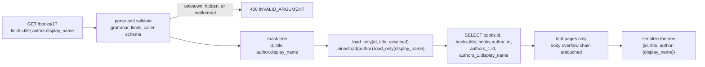

# Sparse Fieldsets and Partial Responses (fields / read_mask, AIP-157): Pushing Projections Down to SQL

> [!summary] Claim
> A read mask saves work only when it is resolved against the caller's schema and compiled into the `SELECT` list, because a large value that is never projected stays in pages the database never reads: in the lab, `fields=title` emits `SELECT books.id, books.title`, still answers after every overflow page of `body` is corrupted on disk, and the default list view is 286 bytes where the full view is 180,364, while filtering after a full load saves only wire bytes.

Part of [Pagination Filtering and Query Patterns](README.md) in [API Engineering](../README.md).

## TL;DR

- Mechanism: parse `fields=title,author.display_name` into a field-mask tree, validate every path against a per-caller schema, compile it to SQLAlchemy `load_only(..., raiseload=True)` plus `joinedload(...).load_only(...)`, and serialize only the selected attributes.
- Contract rule: the mask is optional and an omitted or empty mask means the documented default view (AIP-157); since 2026-10-08 AIP-157 makes a `view` enum (`BASIC`, `FULL`) the primary pattern and a field mask the alternative, carried as the `fields` system parameter or `X-Goog-FieldMask` header rather than a `read_mask` request field.
- Trap: `load_only` without `raiseload` turns one query into `1 + N` when a serializer touches an unrequested column (4 statements for 3 rows in the lab), and filtering the JSON after `SELECT *` (for example Pydantic `include`) still reads every heavy column.
- Portability: the lab's 39 tests pass on CPython 3.12.13, 3.12.16 (container), 3.13.18, 3.14.6, 3.14.10, 3.15.2, and free-threaded 3.14.6t, in Debian Trixie and Alpine musl containers, and on SQLAlchemy 2.1.8 and 2.0.57; the 3.15.0b3 beta (GIL and free-threaded) segfaults in SQLAlchemy 2.1.8's compiled `sql/_cache_key_cy` module and passes without that extension, and 3.15.2t was not run.
- When not to use it: small, uniform resources (the mask costs more than it saves), cache-heavy public reads (each mask is another cache key), and clients that need arbitrary graph shapes, where GraphQL's selection sets are the native tool.

## Mental model



The request carries a comma-separated list of dot paths, which the server first checks for syntax, size, and visibility to this caller, rejecting anything it cannot map before any SQL is built.
The surviving paths form a tree, in which a parent path such as `author` covers and replaces any of its sub-paths, exactly as protobuf canonicalizes a `FieldMask`.
The tree compiles to loader options, so the database receives a `SELECT` list with only the requested columns plus the keys the ORM needs for identity and the join.
Because the large `body` value is not in that list, the storage engine never follows its overflow pages, and the serializer walks the same tree, so the JSON contains exactly the selected fields and any accidental access to another attribute raises instead of querying.

## How it works

### The contract: AIP-157, the system parameter, and FieldMask

AIP-157 says APIs "may support partial responses", and its changelog entry of 2026-10-08 elevates "View enumeration to the primary recommendation", with field masks as the alternative (AIP-157, Guidance and Changelog, as of 2026-11).
A view enum is named `*View`, has at least `BASIC` and `FULL`, treats `UNSPECIFIED` as valid with documented behavior, defaults to `BASIC` for List methods, and "must not remove a field from a given view" because that is a breaking change (AIP-157, View enumeration).
For field masks, AIP-157 says the API "should support the mask in a side channel" such as a query parameter, header, or gRPC metadata, that the parameter "must be optional", that omitting it must return all fields "or the default view documented for the method", and that "An empty field mask should generally be treated as requesting all fields (or the default view)" (AIP-157, Field masks parameter).
A `google.protobuf.FieldMask read_mask` field on the request message is now "DEPRECATED for Google APIs" because the infrastructure already filters responses service-wide (AIP-157, Read masks as a request field and Rationale).
Google's system parameter table lists the query names `$fields` and `fields` and the header `X-Goog-FieldMask`, described as a "FieldMask used for response filtering", with the rule "If empty, all fields should be returned unless documented otherwise" (Google Cloud, System parameters, as of 2026-11).
AIP-132 adds that a List response "should usually include fully-populated resources unless there is a reason to return a partial response" (AIP-132, Response message).

The wire type is `message FieldMask { repeated string paths = 1; }`, and in a REST list operation "the mask instead applies to each individual message in the returned resource list" (protobuf v36.2 src/google/protobuf/field_mask.proto).
In JSON a mask is "a single string where paths are separated by a comma" with each name converted to lowerCamelCase, so `user.display_name,photo` travels as `user.displayName,photo` (same file, JSON Encoding of Field Masks); the lab pins that round trip with `FieldMask.FromJsonString` and `ToJsonString` (protobuf 7.36.2 google/protobuf/internal/field_mask.py, identical to the v36.2 tag).
"A repeated field is not allowed except at the last position of a paths string" (field_mask.proto), and AIP-161 forbids indexing such as `authors.0`, demanding `INVALID_ARGUMENT` (AIP-161, Repeated fields).
`*` is a convention, not a path: field_mask.proto says AIP-157 methods "SHOULD support the special value "*" to mean "get all"", while AIP-157 warns that "standard Protocol Buffer runtime libraries do not recognize * as a valid field path"; the lab confirms `FieldMask(paths=["*"]).IsValidForDescriptor(...)` is `False`, because `_IsValidPath` requires the last segment to be a name in `fields_by_name`, and that `message_type.name` on `FileDescriptorProto` is `False`, because `_IsValidPath` rejects a repeated or non-message field before the last segment (protobuf 7.36.2 google/protobuf/internal/field_mask.py, `_IsValidPath`).
Unknown paths are a deliberate choice point: field_mask.proto says an implementation "should verify the included field paths, and return an `INVALID_ARGUMENT` error if any path is unmappable", while AIP-161 says that when reading, masks "may ignore entries that point to a value that can not exist" (AIP-161, Invalid field mask entries).
The lab rejects them, so a typo fails loudly; the cost is that a new client sending a field an older server does not know gets `400` instead of a smaller response.

JSON:API spells the same idea per type: `fields[articles]=title,body`, where "an endpoint MUST NOT include additional fields", and "An empty value indicates that no fields should be returned" (JSON:API 1.1, Fetching Data, Sparse Fieldsets), the opposite of AIP-157's empty-means-default rule.
Its `[` and `]` are URI gen-delims and `,` is a sub-delim (RFC 3986 Section 2.2), and the query grammar `query = *( pchar / "/" / "?" )` admits sub-delims but not `[` or `]` (RFC 3986 Section 3.4), so a comma-joined mask needs no escaping while a compliant client percent-encodes the brackets; JSON:API still tells servers they "SHOULD accept requests in which these square brackets are left unencoded", because browsers do not always encode them (JSON:API 1.1, Square Brackets in Parameter Names).

### Parsing: grammar, limits, visibility, canonical form

The lab's grammar is one segment pattern, `[a-z][a-z0-9_]{0,63}`, joined by `.`, with paths joined by `,`; it rejects empty paths, whitespace, uppercase, digits-first segments such as `labels.0`, and wildcards inside a path, while the whole mask `*` is accepted as "every field this caller may see".
Size is bounded before any work: at most 512 characters and 32 paths, and nesting is bounded by the schema itself.
Each path is resolved against a per-caller schema, and a field the caller may not see raises the same `unknown field path` error as a field that does not exist.
The tree insertion is the algorithm of protobuf's `_FieldMaskTree.AddPath`: a path already covered by a leaf adds nothing, and a path that covers existing sub-paths clears them (protobuf 7.36.2 google/protobuf/internal/field_mask.py, `_FieldMaskTree.AddPath`), so the lab compares its canonical form with `CanonicalFormFromMask` on five masks.
The lab always returns `id`, the way JSON:API never treats `type` and `id` as fields, so a client can always correlate a partial resource.

### Push-down: what `load_only` and `raiseload` actually do

`load_only(*attrs, raiseload=False)` sets the named column attributes to `{"deferred": False, "instrument": True}` and then sets the wildcard `"*"` to `{"deferred": True, "instrument": True}`, adding `"raiseload": True` when asked (sqlalchemy 2.1.8 lib/sqlalchemy/orm/strategy_options.py, `_AbstractLoad.load_only`).
The documentation adds that primary key columns are always fetched because "these are required to establish the identity for the row", and that by default a deferred attribute lazy-loads on first access with a `SELECT` "within the current transaction" (SQLAlchemy 2.1 ORM Querying Guide, Column Loading Options).
With `raiseload=True`, `_DeferredColumnLoader._load_for_state` calls `self._invoke_raise_load(...)` before it would call `loading._load_scalar_attributes`, and `_invoke_raise_load` raises `InvalidRequestError` with `"'%s' is not available due to raiseload=True"` (sqlalchemy 2.1.8 lib/sqlalchemy/orm/strategies.py, `_DeferredColumnLoader._load_for_state` and `_DeferredColumnLoader._invoke_raise_load`).
For a nested path the lab adds `joinedload(Book.author).load_only(Author.display_name, raiseload=True)`, and SQLAlchemy itself adds `books.author_id` and `authors_1.id` to the column list, because the join and the identity map need them.
The child's `raiseload` is pinned separately: `test_nested_entity_also_raises_on_unrequested_attributes` reads `book.author.bio` after `fields=title,author.display_name` and expects `InvalidRequestError` with no extra statement.
The relationship is mapped with `lazy="raise"`, so a serializer that touches `book.author` when the mask did not ask for it fails instead of emitting a query.

### Why "never read from disk" holds: SQLite overflow pages and PostgreSQL TOAST

SQLite stores a table row as one record, a header of serial types followed by the column values (SQLite file format Section 2.1), and "The order of values in the record is the same as the order of columns in the SQL table definition" (SQLite file format Section 2.3).
When the record is larger than `X = U - 35` bytes on a table leaf page, only `K` or `M` bytes stay on the leaf, with `M = ((U-12)*32/255)-23` and `K = M + ((P-M) % (U-4))`, and the rest spills to overflow pages (SQLite file format Section 1.6); with `U = 4096`, `X = 4061` and `M = 489`.
Overflow pages "form a linked list", each beginning with "a big-endian integer which is the page number of the next page in the chain" (SQLite file format Section 1.7), so reaching byte `n` of a spilled payload means following the chain from its first page.
The lab checks the formula against the `dbstat` virtual table for seven sizes, including the two branch boundaries: a 4,058-byte blob (record 4,061 bytes) stays on the leaf, 4,059 bytes keeps only `M = 489` bytes local, and a 200,000-byte blob keeps 3,588 bytes local and uses 48 overflow pages.
The proof of the I/O claim is destructive and deterministic: the lab zeroes the next-page pointer of every overflow page holding `books` payload, then serves requests from a fresh engine.
`GET /books` (the `BASIC` view) and `GET /books/1?fields=title,rating,author` still return `200`, while `fields=body` and the default `FULL` view raise `database disk image is malformed`, so the masked requests never touched the chain.
Column order matters: in a table declared `(id, body, title)`, `SELECT title` fails on the same damage because `title` sits after the spilled value in the record, while `(id, title, body)` answers it; `SELECT length(body)` succeeds in both, because the length is encoded in the header's serial type.
The lab pins `PRAGMA page_size = 4096` and `PRAGMA auto_vacuum = NONE`; pointer-map pages, which record child-to-parent links to support `auto_vacuum` and `incremental_vacuum` (SQLite file format Section 1.8), are therefore absent, and the lab makes no claim about chain walking when they exist.
Every SQLite build used here (3.53.1 and 3.54.1) lists `DIRECT_OVERFLOW_READ` in `PRAGMA compile_options`, which reads overflow content "directly from disk, bypassing the page cache" during read transactions and is on by default since 3.45.0 (SQLite compile-time options), so when a large value is selected its overflow pages are read from the file rather than served from the page cache.

PostgreSQL gets the same effect from TOAST: once a row is wider than `TOAST_TUPLE_THRESHOLD` ("normally 2 kB"), large values are compressed or moved out of line in chunks of about 2000 bytes behind an 18-byte pointer, and "The big values of TOASTed attributes will only be pulled out (if selected at all) at the time the result set is sent to the client" (PostgreSQL 18 Section 66.2); this note did not run PostgreSQL.

### The response side and HTTP semantics

The serializer walks the same resolved tree and reads only those attributes, so the response cannot contain more than the mask, which is the JSON:API `MUST NOT include additional fields` rule enforced structurally.
Errors use the AIP-193 HTTP/JSON shape, `{"error": {"code": 400, "message": "...", "status": "INVALID_ARGUMENT"}}` (AIP-193, the fully populated HTTP/1.1+JSON error example).
A partial response is a different representation of the same resource, and an `ETag` is "an opaque validator for differentiating between multiple representations of the same resource" (RFC 9110 Section 8.8.3), so derive it from the masked bytes, never from the row version alone.
A mask in the query string is part of the target URI and so of the cache key (RFC 9111 Section 2); a mask carried in a header such as `X-Goog-FieldMask` must be listed in `Vary`, which describes what parts of a request message, "aside from the method and target URI, might have influenced the origin server's process for selecting the content of this response" (RFC 9110 Section 12.5.5).
Partial responses are not range requests: `206 Partial Content` returns byte ranges of one representation (RFC 9110 Section 15.3.7), while a field mask selects a different representation, served with `200`.

## Numbers and limits

| Quantity | Value | Source |
| --- | --- | --- |
| AIP-157 primary pattern | view enum; field mask as alternative; `read_mask` request field deprecated for Google APIs | AIP-157, changelog 2026-10-08 (as of 2026-11) |
| Google system parameter | `$fields` or `fields` query, `X-Goog-FieldMask` header; empty means all fields unless documented | Google Cloud System parameters (as of 2026-11) |
| Lab mask limits | 512 characters, 32 paths, 64 characters per segment | lab constants, a choice, not a standard |
| SQLite leaf thresholds at `U = 4096` | `X = 4061`, `M = 489`, 4092 content bytes per overflow page | SQLite file format Sections 1.6, 1.7; lab formula test |
| 200,000-byte blob | 3,588 bytes on the leaf, 48 overflow pages | lab, `dbstat`, SQLite 3.53.1 and 3.54.1 |
| 1,000,000-byte blob | 1,556 bytes on the leaf, 244 overflow pages | same test |
| Lab seed, 3 books with a 50,000-character `body` | 36 overflow pages for `books`, 4 for `authors` (10,000-character `bio`) | lab test `test_basic_view_is_a_fraction_of_full_on_the_wire` |
| `GET /books`, `BOOK_VIEW_BASIC` vs `BOOK_VIEW_FULL` | 286 vs 180,364 response bytes; 7 vs 9 selected columns; 1 statement each | same test |
| `GET /books/1?fields=title` vs default `FULL` | 25 vs 60,116 bytes; 2 vs 9 columns | same test |
| `load_only(Book.title)` then reading `body` on 3 rows | 4 statements (1 + N) | lab test `test_load_only_without_raiseload_turns_one_query_into_n_plus_one` |
| PostgreSQL TOAST | threshold normally 2 kB, chunks about 2000 bytes, 18-byte pointer, 1 GB value cap | PostgreSQL 18 Section 66.2 |
| Lab test module | `39 passed in 0.25s` (0.23s to 0.28s over eight warm runs; 0.41s on the first run of the session) | `uv run --frozen pytest ... -q`, CPython 3.14.6, SQLite 3.53.1, macOS 27.2 (Darwin 27.2.0) arm64 |

The measurement was re-run on 2026-11-10 on macOS 27.2 (Darwin 27.2.0) arm64 with CPython 3.14.6 and SQLite 3.53.1, using `uv run --frozen pytest tests/f05_pagination_filtering_and_query_patterns/test_sparse_fieldsets_partial_responses_and_read_masks_aip_157.py -q` from `labs/`; the test pins every count in this table, so a changed value fails the test.
Byte counts are deterministic for this seed; no timings were taken, because the claim is about which pages and columns are touched, not about one machine's latency.

## Portability

| Dimension | Result | Evidence |
| --- | --- | --- |
| CPython 3.12.13, SQLite 3.53.1 | 39 passed with `-W error` | lab run in a minimal venv of the locked pins (22 packages pinned to their `uv.lock` versions: the module's imports plus their dependencies), 2026-11-10 |
| CPython 3.13.18, SQLite 3.54.1 | 39 passed with `-W error` | same |
| CPython 3.14.6 (workspace), SQLite 3.53.1 | 39 passed, also with `-W error`; module coverage 100% (199 statements, 58 branches) | workspace `.venv`, full `uv.lock` |
| CPython 3.14.10, SQLite 3.54.1 | 39 passed with `-W error` | minimal venv of locked pins |
| CPython 3.15.2, SQLite 3.54.1 | 39 passed with `-W error` | minimal venv of locked pins |
| CPython 3.14.6t free-threaded | the full lock cannot install (`psycopg-binary==3.3.8` has no wheel); 39 passed with `-W error` in the minimal venv; `sys._is_gil_enabled()` is `False` after importing sqlalchemy, pydantic, starlette, httpx, and protobuf | lab run |
| CPython 3.15.0b3 (GIL) and 3.15.0b3t | the SQLAlchemy 2.1.8 `cp315-cp315-macosx_11_0_arm64` wheel (built with Cython 3.3.1) dies with `Fatal Python error: Segmentation fault` on `Connection.execute(table.insert().values(id=1))`; `faulthandler` puts the C frame in `sql/_cache_key_cy.cpython-315-darwin.so`, `BaseHasCacheKey._gen_cache_key`; the same wheel passes on 3.15.2; deleting only that `.so` makes the script pass on 3.15.0b3; SQLAlchemy built from sdist with `DISABLE_SQLALCHEMY_CEXT=1` passes 39 with `-W error` on 3.15.0b3t, GIL off | lab runs 2026-11-10; the root cause inside the extension was not determined and no upstream report was found (GitHub issue searches in the SQLAlchemy and Cython repositories for the 3.15 crash returned 0 results), so treat 3.15 betas as unsupported for compiled SQLAlchemy wheels |
| CPython 3.12.16 (Debian Trixie container `python:3.12.16-trixie`, SQLite 3.46.1, glibc) | 39 passed with `-W error` | container run, venv of the locked pins, copy of `labs/` without `.venv`; Docker on macOS (OrbStack), native `aarch64` |
| CPython 3.12.16 (Alpine container `python:3.12.16-alpine`, SQLite 3.53.4, musl) | 39 passed with `-W error` | same |
| CPython 3.13.18, 3.14.10, 3.15.2 in `python:<version>-trixie` and `python:<version>-alpine` | 39 passed with `-W error` on all six (SQLite 3.46.1 on Trixie, 3.53.4 on Alpine) | same; the `dbstat` formula and corrupted-chain tests also pass on SQLite 3.46.1 and 3.53.4 |
| CPython 3.15.2t free-threaded | not run | `uv python list --all-versions` offers no 3.15.2t build, and the official `python:3.15.2-trixie` image is a GIL build (`Py_GIL_DISABLED` is `0`, no `python3.15t`) |
| SQLAlchemy 2.1.8 vs 2.0.57 | 39 passed with `-W error` on both (2.0.57 in a minimal venv with `sqlalchemy==2.0.57`, CPython 3.14.6) | lab runs |
| protobuf 7.36.2 | canonical form, `*` and non-terminal repeated rejection, JSON camelCase pinned by tests | installed `field_mask.py` identical to the v36.2 tag |
| SQLite 3.53.1 vs 3.54.1 | identical overflow layout and corruption behavior, also on SQLite 3.46.1 (Debian Trixie) and 3.53.4 (Alpine) | formula and corruption tests pass on all four |
| PostgreSQL 18 | TOAST keeps unselected large values out of the result path; not run | PostgreSQL 18 Section 66.2 |
| Uvicorn, Hypercorn, Granian | not applicable: the mask is an ordinary query parameter and the work happens in the ORM and storage engine | lab uses in-process ASGI only |
| HTTP/1.1, HTTP/2, HTTP/3 | the mask rides in the query; in HTTP/2 `:path` "includes the path and query parts of the target URI", and in HTTP/3 it "Contains the path and query parts of the target URI" | RFC 9113 Section 8.3.1, RFC 9114 Section 4.3.1 |

## Worked example

The [implementation](../labs/src/api_labs/f05_pagination_filtering_and_query_patterns/read_mask.py) holds the ORM model, the public schema with per-field roles, the mask parser, the loader-option compiler, the serializer, a Starlette app with `GET /books` and `GET /books/{book_id}`, and the SQLite overflow helpers.
The [test](../labs/tests/f05_pagination_filtering_and_query_patterns/test_sparse_fieldsets_partial_responses_and_read_masks_aip_157.py), 39 tests, compares the canonical form with protobuf, pins the emitted SQL, proves the I/O claim by corrupting overflow chains, checks the overflow formula against `dbstat`, and checks the HTTP error contract.

The public schema and views, verbatim:

```python
BOOK_FIELDS: Final[Mapping[str, FieldSpec]] = {
    "id": FieldSpec(Book.id),
    "title": FieldSpec(Book.title),
    "rating": FieldSpec(Book.rating),
    "labels": FieldSpec(Book.labels, repeated=True),
    "author": FieldSpec(Book.author, children=AUTHOR_FIELDS),
    "internal_notes": FieldSpec(Book.internal_notes, roles=frozenset({"admin"})),
    "body": FieldSpec(Book.body),
}
ALWAYS_RETURNED: Final = "id"  # identity, like JSON:API's id; not subject to the mask

# AIP-157 view enum: UNSPECIFIED is valid and means the method's documented default.
VIEW_MASKS: Final[Mapping[str, str]] = {
    "BOOK_VIEW_BASIC": "id,title,rating,labels,author.display_name",
    "BOOK_VIEW_FULL": "*",
}
```

Path validation and tree insertion, verbatim:

```python
def _add_path(
    tree: _Tree, path: str, schema: Mapping[str, FieldSpec], roles: frozenset[str]
) -> None:
    segments = path.split(".")
    if not all(SEGMENT.fullmatch(s) for s in segments):
        raise MaskError(f"invalid field path {path!r}")
    level: Mapping[str, FieldSpec] | None = schema
    for i, name in enumerate(segments):
        spec = level.get(name) if level is not None else None
        if spec is None or not _visible(spec, roles):
            # Hidden fields get the same answer as missing ones, so the error leaks nothing.
            raise MaskError(f"unknown field path {path!r}")
        if i < len(segments) - 1 and spec.children is None:
            what = "repeated" if spec.repeated else "not a message"
            raise MaskError(f"field {name!r} in {path!r} is {what}; it must be the last segment")
        level = spec.children
    # Same algorithm as protobuf's _FieldMaskTree.AddPath: a covered path adds nothing,
    # and a path that covers existing sub-paths replaces them.
    node = tree
    for name in segments:
        if name not in node:
            node[name] = {}
        elif not node[name]:
            return
        node = node[name]
    node.clear()
```

The push-down and the serializer, verbatim:

```python
def loader_options(sel: Selection) -> list[ORMOption]:
    """``load_only`` per entity; ``raiseload`` turns any unrequested access into an error.

    Supports message fields one level deep, which is all ``BOOK_FIELDS`` declares.
    """
    options: list[ORMOption] = [load_only(*_columns(sel, BOOK_FIELDS), raiseload=True)]
    for name, sub in sel.items():
        spec = BOOK_FIELDS[name]
        if spec.children is not None and sub is not None:
            child_columns = _columns(sub, spec.children)
            options.append(joinedload(spec.attr).load_only(*child_columns, raiseload=True))
    return options


def fetch_books(session: Session, sel: Selection, *, book_id: int | None = None) -> Sequence[Book]:
    stmt = select(Book).options(*loader_options(sel)).order_by(Book.id).limit(LIST_LIMIT)
    if book_id is not None:
        stmt = stmt.where(Book.id == book_id)
    return session.scalars(stmt).all()


def serialize(
    obj: object, sel: Selection, schema: Mapping[str, FieldSpec] = BOOK_FIELDS
) -> dict[str, Any]:
    """Read only the selected attributes; anything else would raise via raiseload."""
    out: dict[str, Any] = {}
    for name, sub in sel.items():
        spec = schema[name]
        value: object = getattr(obj, spec.attr.key)
        if sub is not None and spec.children is not None:
            out[name] = None if value is None else serialize(value, sub, spec.children)
        else:
            out[name] = value
    return out
```

The SQL emitted for two masks on `GET /books/1`, captured from `fetch_books` with a `before_cursor_execute` listener (SQLAlchemy 2.1.8, CPython 3.14.6):

```text
-- fields=title
SELECT books.id, books.title 
FROM books 
WHERE books.id = ? ORDER BY books.id
 LIMIT ? OFFSET ?
-- fields=title,author.display_name
SELECT books.id, books.title, books.author_id, authors_1.id AS id_1, authors_1.display_name 
FROM books LEFT OUTER JOIN authors AS authors_1 ON authors_1.id = books.author_id 
WHERE books.id = ? ORDER BY books.id
 LIMIT ? OFFSET ?
```

The storage proof, verbatim from the test module:

```python
@pytest.mark.unit
@pytest.mark.asyncio
async def test_broken_overflow_chains_prove_masked_reads_never_touch_body(db_path: Path) -> None:
    pages = overflow_pages(db_path, "books")
    assert len(pages) == 3 * (BODY_LEN // 4092)  # each body spills to 12 overflow pages
    break_overflow_chains(db_path, pages)
    fresh = create_engine(f"sqlite:///{db_path}")  # no page cache from before the damage
    try:
        async with _client(create_app(fresh)) as client:
            listed = await client.get("/books")
            one = await client.get("/books/1", params={"fields": "title,rating,author"})
            assert listed.status_code == 200
            assert len(listed.json()["books"]) == 3
            assert one.json()["author"]["bio"] == "i" * BIO_LEN  # authors table is intact
            with pytest.raises(DatabaseError, match="malformed"):
                await client.get("/books/1", params={"fields": "body"})
            with pytest.raises(DatabaseError, match="malformed"):
                await client.get("/books/1")  # FULL view is the Get default
    finally:
        fresh.dispose()
```

Captured from `labs/` on CPython 3.14.6, SQLite 3.53.1, macOS 27.2 (Darwin 27.2.0) arm64:

```text
$ uv run --frozen pytest tests/f05_pagination_filtering_and_query_patterns/test_sparse_fieldsets_partial_responses_and_read_masks_aip_157.py -q
.......................................                                  [100%]
39 passed in 0.25s
```

The push-down and storage subset, run with `-v -p no:cacheprovider -k "broken or walks or title_mask or nested or lazy or pydantic"` and the module path trimmed:

```text
collecting ... collected 39 items / 32 deselected / 7 selected

test_title_mask_selects_only_id_and_title PASSED [ 14%]
test_nested_mask_joins_author_and_projects_one_column PASSED [ 28%]
test_unrequested_attributes_raise_instead_of_lazy_loading PASSED [ 42%]
test_nested_entity_also_raises_on_unrequested_attributes PASSED [ 57%]
test_pydantic_from_attributes_cannot_filter_after_a_projected_load PASSED [ 71%]
test_broken_overflow_chains_prove_masked_reads_never_touch_body PASSED [ 85%]
test_a_column_stored_after_a_large_value_walks_its_overflow_chain PASSED [100%]

======================= 7 passed, 32 deselected in 0.21s =======================
```

## Pitfalls

> [!warning] Filtering after the load
> Trigger: the handler runs `SELECT *` (or loads the full ORM object) and trims the output with Pydantic `model_dump(include=...)` or a dict comprehension.
> Symptom: response bytes shrink but database reads, page-cache pressure, and driver decoding do not, because every heavy column was already fetched; in the lab one `FULL` book is 60,116 bytes, almost all of it `body`, and a post-load filter still reads all of it.
> Fix: compile the mask into the `SELECT` list (`load_only` or explicit columns) and serialize from the same tree; pin the emitted columns in a test.

> [!warning] Deferred columns that lazy-load
> Trigger: `load_only(Book.title)` without `raiseload`, followed by a serializer, template, or `from_attributes` model that touches `body`.
> Symptom: one extra `SELECT books.body FROM books WHERE books.id = ?` per row, 4 statements for 3 rows in the lab, and under asyncio a failure because lazy loading is not available there (SQLAlchemy 2.1 Column Loading Options).
> Fix: `load_only(..., raiseload=True)` and `lazy="raise"` on relationships, so an unplanned access fails in tests; Pydantic `from_attributes` then reports `get_attribute_error` for the field, which the lab pins.

> [!warning] Redaction keyed on output names
> Trigger: a field-selection or aliasing parameter is applied after a redaction step that matches on the output field name.
> Symptom: Directus before 10.11.0 returned the raw password hash for `/users/me?alias[hash]=password`, where `/users/me` returned the redacted value (CVE-2024-34708, GHSA-p8v3-m643-4xqx); Ghost before 5.46.1 let the public `filter` parameter reveal private fields by brute force (CVE-2023-31133, GHSA-r97q-ghch-82j9).
> Fix: authorize each requested path against the caller's schema before projection, as `_add_path` does, and share that one schema between masks, filters, sorts, and aliases.

> [!warning] Heavy column in the middle of the row
> Trigger: a large `TEXT` or `BLOB` column declared before small columns that list views read.
> Symptom: in SQLite, `SELECT title` must follow the overflow chain of the earlier value, so the projection saves nothing; the lab's `(id, body, title)` table fails on a damaged chain where `(id, title, body)` answers.
> Fix: declare large columns last, or move them to a side table keyed by the resource id, so the mask maps to a table that is not read at all.

> [!warning] Empty mask semantics copied across standards
> Trigger: a team implements JSON:API's `fields[TYPE]=` (empty means no fields) on an AIP-style API, or the reverse.
> Symptom: `fields=` returns only `id` to clients that expect the default view, or returns everything to JSON:API clients that asked for nothing.
> Fix: pick one standard per API, document the empty and omitted cases, and test both; the lab maps empty and omitted to the method's default view.

> [!warning] One cache entry per mask
> Trigger: a CDN-cached public `GET` that accepts free-form masks.
> Symptom: every permutation of paths is a separate cache key, so the hit rate collapses, and header-carried masks without `Vary` serve one client's shape to another.
> Fix: offer a few views for cacheable reads, canonicalize the mask (sorted, covered paths removed) before it reaches the cache key, and list any mask header in `Vary`.

## Security and robustness

- OWASP API3:2023 Broken Object Property Level Authorization calls an endpoint vulnerable when it "exposes properties of an object that are considered sensitive and should not be read by the user"; a mask is a property selector, so authorize per property before projection ([[Defeating-BOPLA-and-Mass-Assignment-API3-2023-Strict-Input-Output-Schemas]]).
- Make hidden and unknown fields indistinguishable: the lab answers both with `400` and `unknown field path '<path>'`, so a mask cannot probe for the existence of `internal_notes`, and `*` expands only to fields the caller may see.
- Never pass a user path to `getattr` or into SQL text: paths resolve through a static schema to ORM attributes, so a path cannot name `__class__`, a private column, or a SQL fragment.
- Bound the parser before it allocates: length (512), path count (32), segment length (64), and nesting by schema; reject whitespace, uppercase, empty segments, indexes, and mid-path wildcards with `400 INVALID_ARGUMENT`.
- Keep masks and filters on one visibility schema, because a filter on a field the caller cannot read leaks it by inference, the Ghost failure mode ([[Query-Parameter-Filtering-Brackets-RHS-Colon-and-Validation]], [[Structured-Filter-Expressions-and-AST-Compilation-AIP-160]]).
- A mask reduces cost but is not a quota: `FULL` remains available, so the List default should stay `BASIC` (AIP-157) and page sizes stay capped ([[Unrestricted-Resource-Consumption-API4-2023-Payload-Depth-and-Limit-Guards]]).
- Defense in depth: projection limits what is read, `raiseload` makes accidental reads fail, and the tree-driven serializer limits what is written; any one of them alone can be bypassed by a later code change.

## The principal's view

The decision is not whether to support partial responses but which shape: a small, versioned set of views, or free-form masks.
Views are the AIP-157 default since 2026-10 for good reasons: each view is a stable contract you can index, cache, test, and document, and adding a field to a view is compatible while removing one is breaking.
Free-form masks move the choice to clients, which is valuable for mobile and bandwidth-bound consumers but multiplies cache keys, query shapes, and the authorization surface, and it makes every column a potential hot path.
Make the mask a platform feature, not a per-team parser: one grammar, one canonicalization, one visibility schema shared with filters and sorts, and one compiler to the data layer, as Google does by handling `fields` in infrastructure rather than per method.
Design storage for it: large or rarely read attributes go last in the row or into side tables, so a `BASIC` view maps to pages that never contain them; otherwise the mask is cosmetic.
Choose GraphQL when clients need arbitrary graph shapes across many resources, and accept its cost analysis burden ([[GraphQL-Security-Query-Depth-Complexity-Cost-Analysis-and-Batch-Limits]]); choose separate endpoints or subresources when one field (a document body, a blob) dominates size, because a dedicated `GET /books/1/body` is cacheable, range-requestable, and authorizable on its own.

## Interview questions

> [!question] L5: A client sends `GET /books/1?fields=title`; what should change between the request and the database compared with no mask?
>
> > [!success]- Answer
> > The server validates `title` against the caller's schema and compiles it into the column list, so the statement becomes `SELECT books.id, books.title ... WHERE books.id = ?`.
> > The primary key is still loaded because the ORM needs it for identity, and the response is `{"id": 1, "title": ...}`.
> > If the statement still lists `body`, the mask is only a response filter and saves no database work.
> >
> > Follow-up: Which columns does SQLAlchemy add on its own for `fields=title,author.display_name`?

> [!question] L5: Predict the output: `FieldMask.CanonicalFormFromMask` on the paths `author.display_name`, `author`, `title`, `title` in protobuf 7.36.2.
>
> > [!success]- Answer
> > `["author", "title"]`.
> > `author` covers `author.display_name`, so the tree replaces the sub-path with a leaf, and the duplicate `title` adds nothing.
> > The canonical form is then sorted alphabetically, and the lab's `canonical_paths` matches it on five masks.
> >
> > Follow-up: What does `FieldMask.FromJsonString("")` produce, and how does that differ from JSON:API's `fields[books]=`?

> [!question] L5: What is the difference between a partial response and `206 Partial Content`?
>
> > [!success]- Answer
> > `206` returns byte ranges of one selected representation in reply to a `Range` request (RFC 9110 Section 15.3.7).
> > A field mask selects a different representation of the resource, a subset of its fields, and is served with `200`.
> > The two compose: a client could range-read a large body exposed as its own subresource.
> >
> > Follow-up: Why must the `ETag` differ between `fields=title` and the full representation?

> [!question] L6: Debug this API: after adding `fields=` support, response sizes dropped 99 percent but database CPU and p99 latency for `GET /books` did not move; the handler does `rows = session.scalars(select(Book)).all()` and returns `[BookOut.model_validate(r).model_dump(include=mask) for r in rows]`.
>
> > [!success]- Answer
> > The mask is applied after a full load, so every row still reads `body` from storage and the driver still decodes it.
> > Compile the mask into `load_only(..., raiseload=True)` and serialize from the mask tree instead of a full Pydantic model.
> > With the projection in place, `from_attributes` on a full model raises `get_attribute_error` for unloaded fields, which shows where the serializer still reads too much.
> >
> > Follow-up: What would you see in the SQL log if you used `load_only` without `raiseload` and kept the full Pydantic model?

> [!question] L6: Why does `load_only` alone not guarantee that unrequested columns stay unread?
>
> > [!success]- Answer
> > Deferred attributes lazy-load on first access with a per-row `SELECT`, so any code that touches them turns one query into `1 + N`; the lab measures 4 statements for 3 rows.
> > `raiseload=True` makes `_DeferredColumnLoader._load_for_state` raise `InvalidRequestError` instead, and `lazy="raise"` does the same for relationships.
> > Under asyncio, lazy loading is not available at all, so the failure would surface in production instead of tests.
> >
> > Follow-up: How would you enforce this across 200 endpoints without reviewing each one?

> [!question] L6: Your list view excludes `body`, yet SQLite still reads its overflow pages for `SELECT title`; what is wrong with the table?
>
> > [!success]- Answer
> > `title` is declared after `body`, and SQLite stores the row as one record in column order, so reaching `title` means following the overflow chain of the spilled `body`.
> > Overflow pages are a linked list whose next pointer is the first four bytes of each page (SQLite file format Section 1.7).
> > Declare large columns last or move them to a side table; the lab proves the difference by corrupting the chain.
> >
> > Follow-up: Why does `SELECT length(body)` not need the chain?

> [!question] L6: A non-admin sends `fields=internal_notes`; should the server return `403`, `400`, or the resource without that field?
>
> > [!success]- Answer
> > Returning `403` confirms the field exists, and silently dropping it hides a client bug and differs from how unknown fields are treated.
> > The lab returns the same `400 INVALID_ARGUMENT` and message as for a field that does not exist, because the caller's schema simply has no such field.
> > Whatever you choose, apply it identically to masks, filters, sorts, and aliases, which is where Directus and Ghost leaked.
> >
> > Follow-up: How does `*` interact with this rule?

> [!question] L7+: You own API guidelines for 300 services; do you standardize on view enums, free-form field masks, or GraphQL for partial responses?
>
> > [!success]- Answer
> > Views as the default contract, because they are few, cacheable, indexable, testable, and AIP-157 now recommends them first; `BASIC` is the List default.
> > Field masks as an infrastructure-level option for bandwidth-bound clients, implemented once in the platform with one grammar, canonicalization, visibility schema, and data-layer compiler.
> > GraphQL only where clients compose graphs across resources and the organization will run cost analysis and field-level authorization.
> >
> > Follow-up: How do you evolve a view without breaking clients that depend on it?

> [!question] L7+: A product team wants a mask to cut the latency of a list endpoint whose rows include a 200 KB document; what do you require before approving it?
>
> > [!success]- Answer
> > Evidence that the mask reaches storage: the emitted `SELECT` list, a test that fails if the heavy column is read, and a schema where the document is last or in a side table.
> > A `BASIC` default that excludes the document, canonicalized masks for caching, `Vary` for any header-carried mask, and per-property authorization.
> > If clients usually want the document alone, a `GET /documents/{id}/content` subresource may be the better design, since it can be cached and range-read independently.
> >
> > Follow-up: How would PostgreSQL TOAST change your storage requirement?

## Related

Prerequisites: [[Multi-Column-Sorting-Order-By-Whitelisting-and-Index-Coverage]]

Next: [[Subresource-Expansion-and-Include-Directives]]

See also: [[02-Programming-Languages/Python/Python-Backend-Interview-Prep/05-REST-API-Design]], [[02-Programming-Languages/Python/Python-Backend-Interview-Prep/06-SQL-and-SQLAlchemy]], [[Field-Masks-and-Update-Masks-AIP-134-and-AIP-161]], [[Field-Behavior-Semantics-Input-Only-Output-Only-and-Immutable-AIP-203]], [[Google-AIP-193-Error-Model-and-Rich-Error-Details]], [[Eliminating-N-Plus-1-Queries-Selectinload-Joinedload-Subqueryload-and-Raiseload]], [[Defeating-BOPLA-and-Mass-Assignment-API3-2023-Strict-Input-Output-Schemas]], [[Query-Parameter-Filtering-Brackets-RHS-Colon-and-Validation]], [[Structured-Filter-Expressions-and-AST-Compilation-AIP-160]], [[Vary-Header-Mechanics-and-Cache-Hit-Collapse]], [[Strong-vs-Weak-Validators-ETag-and-Last-Modified]], [[Range-Requests-Partial-Content-and-206-Semantics]], [[GraphQL-Field-Level-Authorization-and-Partial-Error-Null-Bubbling]], [[GraphQL-Security-Query-Depth-Complexity-Cost-Analysis-and-Batch-Limits]], [[Unrestricted-Resource-Consumption-API4-2023-Payload-Depth-and-Limit-Guards]]

- Lab: `labs/tests/f05_pagination_filtering_and_query_patterns/test_sparse_fieldsets_partial_responses_and_read_masks_aip_157.py`

## Further reading

- [Google AIP-157, Partial responses](https://google.aip.dev/157): view enums as the primary pattern, field masks as the side-channel alternative, and the deprecation of `read_mask` request fields.
- [Google AIP-161, Field masks](https://google.aip.dev/161): path syntax, repeated-field rules, read-write consistency, and the non-standard map and wildcard extensions.
- [Google Cloud, System parameters](https://cloud.google.com/apis/docs/system-parameters): the `fields` query parameter and `X-Goog-FieldMask` header that carry masks in Google infrastructure.
- [protobuf v36.2 field_mask.proto](https://github.com/protocolbuffers/protobuf/blob/v36.2/src/google/protobuf/field_mask.proto): the normative comments on get, list, update, JSON encoding, and verification of masks.
- [protobuf v36.2 python field_mask.py](https://github.com/protocolbuffers/protobuf/blob/v36.2/python/google/protobuf/internal/field_mask.py): `_FieldMaskTree`, `CanonicalFormFromMask`, and `_IsValidPath`, the reference behavior the lab matches.
- [JSON:API 1.1, Sparse Fieldsets](https://jsonapi.org/format/): the per-type `fields[TYPE]` form and its empty-means-nothing rule.
- [SQLAlchemy 2.1, Column Loading Options](https://docs.sqlalchemy.org/en/21/orm/queryguide/columns.html): `load_only`, `defer`, and `raiseload`, with the lazy-load behavior they change.
- [SQLite Database File Format](https://www.sqlite.org/fileformat2.html): Sections 1.6, 1.7, 2.1, and 2.3, the record layout and overflow chains that make projection an I/O decision.
- [PostgreSQL 18, TOAST](https://www.postgresql.org/docs/18/storage-toast.html): why unselected large values stay out of the result path in PostgreSQL.
- [OWASP API3:2023 Broken Object Property Level Authorization](https://owasp.org/API-Security/editions/2023/en/0xa3-broken-object-property-level-authorization/): the threat model for property-level reads.
- [GHSA-p8v3-m643-4xqx, Directus CVE-2024-34708](https://github.com/advisories/GHSA-p8v3-m643-4xqx): a projection alias that bypassed output redaction.
