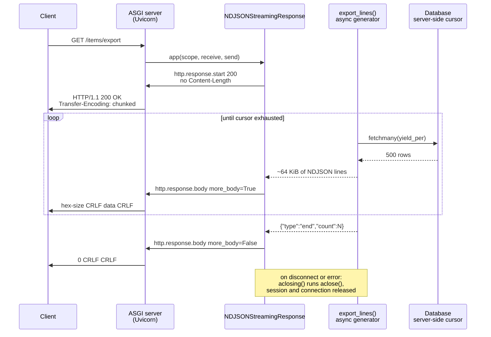

# When Pagination Is the Wrong Tool: Streaming Large Collections with application/x-ndjson and Server-Side Cursors

> [!summary] Claim
> When a client needs the whole collection, one `GET` that streams `application/x-ndjson` from a server-side cursor beats N page requests, but only if the database read stays lazy, the generator is closed on disconnect, and completeness is proven by an in-band `end` record because the `200 OK` is already on the wire.

Part of [Pagination Filtering and Query Patterns](README.md) in [API Engineering](../README.md).

## TL;DR

- Mechanism: an async generator pulls `yield_per` rows at a time from `AsyncSession.stream_scalars()`, encodes each as one JSON text plus `\n`, coalesces about 64 KiB per ASGI `http.response.body` message, and the server frames the unknown-length body as `Transfer-Encoding: chunked` on HTTP/1.1 or `DATA` frames on HTTP/2.
- Contract rule: the status line is committed before row 1, so a failure at row 30,000 cannot become a `500`; end every export with an `{"type":"end","count":N}` record and treat its absence as truncation, as RFC 7464 Section 2.1 itself warns that "There is no end of sequence indicator."
- Trap: `starlette 1.10.0` never calls `aclose()` on the body iterator, so a client that disconnects mid-export leaves the generator suspended and its session and pooled connection checked out until garbage collection; the lab proves it and fixes it with `contextlib.aclosing`.
- Portability: the lab passes on CPython `3.12.13`, `3.12.16`, `3.13.18`, `3.14.6`, `3.14.10`, `3.15.2`, `3.15.2t` free-threaded (Linux), and `3.14.6t` free-threaded, including Debian Trixie and Alpine containers; on the `3.15.0b3t` free-threaded beta, `greenlet 3.5.6` (SQLAlchemy's asyncio bridge) imports but segfaults on its first switch, so only that beta build is red.
- When not to use it: interactive UIs that show page 1, clients that cannot hold a connection for minutes, and exports large enough that a dropped connection is likely; there an asynchronous job that writes a file to object storage and returns a `202 Accepted` is the better contract.

## Mental model



The client sends one request and the server commits `200 OK` immediately, before it knows how many rows exist, which is why there is no `Content-Length` and the server chooses chunked framing.
The generator then alternates between the database and the wire: it asks the cursor for one `yield_per` batch, encodes rows into a buffer, and hands the buffer to `send()` once it crosses the batch size, so at any moment the process holds one database batch plus one wire batch, not the collection.
`send()` is where backpressure arrives: when the client reads slowly, the server's transport buffer fills, `send()` stops returning, the generator stops pulling rows, and the cursor stops advancing.
The final `end` record carries the row count, and the zero-size chunk tells HTTP the message is complete; both are needed because the first proves the export is complete and the second only proves the HTTP message is.
The note on the right of the diagram is the part Starlette does not do for you: if the client vanishes, something must call `aclose()` on the generator so its `async with` block returns the database connection now rather than at an arbitrary garbage-collection point.

## How it works

### The NDJSON line format

The NDJSON specification (version `1.0.0`, last updated 2014-10-19) Section 3.1 requires each JSON text to conform to RFC 8259, to be followed by `\n` (0x0A), to contain no raw newlines or carriage returns, and to be UTF-8.
Its Section 3.2 makes parsers accept both `\n` and `\r\n` and says they MAY ignore empty lines, and its Section 3.3 says the media type SHOULD be `application/x-ndjson`.
JSON Lines describes the same format with `.jsonl` files and says "MIME type may be application/jsonl, but this is not yet standardized" (as of 2026-11).
The IANA media types registry lists neither `application/x-ndjson` nor `application/jsonl`; it does list `application/json-seq` from RFC 7464 (as of 2026-11).

A compact encoder satisfies the no-newline rule for free.
RFC 8259 Section 2 allows `%x0A` and `%x0D` only as insignificant whitespace around structural characters, so a serializer that emits no whitespace emits no raw LF between tokens.
RFC 8259 Section 7 requires the control characters U+0000 through U+001F to be escaped inside strings, so a string value `"line\nbreak"` is written as the six bytes `line\n` with a backslash, never a raw 0x0A.
U+2028 LINE SEPARATOR is not a control character, so `json.dumps(..., ensure_ascii=False)` writes it raw as the three UTF-8 bytes `E2 80 A8`; that is legal NDJSON, but a line-splitter that uses Python `str.splitlines()` instead of splitting bytes on 0x0A will cut such a record in half.
CPython's `json.dumps` writes `NaN` and `Infinity` by default, which RFC 8259 Section 6 does not permit as numbers, so the lab passes `allow_nan=False` and the test proves a `ValueError` (`Out of range float values are not JSON compliant`).
RFC 8259 Section 8.1 forbids a byte order mark on networked JSON text.

RFC 7464 `application/json-seq` is the registered alternative: each text is preceded by RS (0x1E) and followed by LF (RFC 7464 Section 2.2), and a parser that hits a malformed element SHOULD skip to the next RS and continue (RFC 7464 Section 2.1 and Section 2.3).
Its explicit statement that "There is no end of sequence indicator" (Section 2.1) applies equally to NDJSON, which is why completeness must be an application-level record.

### HTTP framing of an unknown-length body

RFC 9112 Section 7.1 defines chunked coding as `chunk-size [ chunk-ext ] CRLF chunk-data CRLF`, repeated, then `last-chunk` (`0`), an optional trailer section, and a final CRLF, and says it "enables content streams of unknown size to be transferred as a sequence of length-delimited buffers."
RFC 9112 Section 6.3 rule 8 says a response with neither `Transfer-Encoding` nor `Content-Length` is delimited by connection close, and the same section warns that such a response cannot be distinguished from one interrupted by a network failure, so a server SHOULD use chunked or length framing whenever possible.
RFC 9112 Section 8 says a chunked body is incomplete if the zero-sized chunk has not been received.
`h11 0.16.0` implements exactly this choice: `Connection._clean_up_response_headers_for_sending` (h11 0.16.0 h11/_connection.py, Connection._clean_up_response_headers_for_sending) handles a response whose framing is unknown-length (no `Content-Length` from the application): it removes any `Content-Length`, sets `Transfer-Encoding: chunked` when the peer speaks HTTP/1.1, and for an HTTP/1.0 peer removes `Transfer-Encoding` and forces `Connection: close`.
`ChunkedWriter.send_data` (h11 0.16.0 h11/_writers.py, ChunkedWriter.send_data) writes `b"%x\r\n" % len(data)`, the data, and `b"\r\n"`, and silently skips zero-length data because an empty chunk would read as end-of-message.
Uvicorn's default HTTP/1.1 implementation (`--http auto` picks `httptools` when it is importable, as it is in this workspace, per uvicorn 0.54.0 uvicorn/protocols/http/auto.py, AutoHTTPProtocol) does the same in its own writer: `RequestResponseCycle.send` adds `transfer-encoding: chunked` when the app sent neither `content-length` nor `transfer-encoding`, the method is not `HEAD`, and the status is not `204` or `304`, and writes `0\r\n\r\n` when `more_body` is false (uvicorn 0.54.0 uvicorn/protocols/http/httptools_impl.py, RequestResponseCycle.send).

HTTP/2 has no chunked coding.
RFC 9113 Section 8.1 frames a message as one `HEADERS` frame, zero or more `DATA` frames, and an optional trailer `HEADERS` frame, with `END_STREAM` on the last frame, and RFC 9113 Section 8.2.2 makes a message containing `Transfer-Encoding` malformed.
The same ASGI messages therefore become `DATA` frames on HTTP/2 without any change in application code.

HTTP trailers look like the natural place to report "export failed at row 30,000", but RFC 9110 Section 6.5.1 says that "in most cases, the trailers are simply discarded" by intermediaries and that a server "SHOULD NOT generate trailer fields that it believes are necessary for the user agent to receive."
That is the specification-level reason the lab reports completion and failure in the body.

### Starlette StreamingResponse, step by step

`StreamingResponse.__init__` stores an async iterable as `body_iterator`, and wraps a sync iterable with `iterate_in_threadpool` (starlette 1.10.0 starlette/responses.py, StreamingResponse.__init__).
`Response.init_headers` adds `content-length` only when the response has a `body` attribute, which `StreamingResponse` does not, and appends `; charset=utf-8` only to media types that start with `text/`, so `application/x-ndjson` goes out unchanged (starlette 1.10.0 starlette/responses.py, Response.init_headers).
`StreamingResponse.stream_response` sends `http.response.start`, then one `http.response.body` with `more_body: True` per item the iterator yields, then an empty body with `more_body: False` (starlette 1.10.0 starlette/responses.py, StreamingResponse.stream_response).
That makes the generator's yield size the chunk size on the wire; yielding per row means one ASGI message, one `send()` await, and one chunk header per row.

`StreamingResponse.__call__` branches on the ASGI `spec_version` the server advertises (starlette 1.10.0 starlette/responses.py, StreamingResponse.__call__).
At `>= 2.4` it calls `stream_response` directly and converts an `OSError` from `send()` into `ClientDisconnect`, matching the ASGI HTTP specification's rule that, since spec version `2.4`, `send()` on a closed connection should raise a server-specific subclass of `OSError`.
Below `2.4` it runs `stream_response` and `listen_for_disconnect` in a task group, and cancels the stream when `receive()` returns `http.disconnect`.
In neither branch does it call `aclose()` on `body_iterator`.
Uvicorn 0.54.0 advertises `"spec_version": "2.3"` (uvicorn 0.54.0 uvicorn/protocols/http/httptools_impl.py, HttpToolsProtocol.on_message_begin), and its `send()` returns silently once the connection is gone (uvicorn 0.54.0 uvicorn/protocols/http/httptools_impl.py, RequestResponseCycle.send), so under Uvicorn the disconnect path is task-group cancellation.

Why the missing `aclose()` matters: PEP 525 (Finalization) defines `aclose()` and the `sys.set_asyncgen_hooks()` finalizer, and asyncio's `BaseEventLoop._asyncgen_finalizer_hook` schedules `agen.aclose()` only when the generator is about to be garbage collected (CPython 3.14.6 Lib/asyncio/base_events.py, BaseEventLoop._asyncgen_finalizer_hook).
If cancellation lands while the stream is awaiting `send()` (the slow-client case), the generator is suspended at a `yield`, its `finally` and `async with` exits have not run, and the database session inside it stays open.
The lab drives both server behaviors in-process and asserts `checked_out == 1` and `inspect.getasyncgenstate(gen) == inspect.AGEN_SUSPENDED` immediately after the app returns.
An exploratory probe on CPython `3.14.6` (the lab's fixture and scripted server, a bare `StreamingResponse`, `stalled-send-then-disconnect`, then `gc.collect()` three times) reproduced that the generator and connection are collected together: SQLAlchemy logged `The garbage collector is trying to clean up non-checked-in connection ... which will be terminated` at `ERROR` and the pool `checkin` event never fired (`checked_out` stayed `1`), so the GC path is not even a clean return to the pool.
`NDJSONStreamingResponse.__call__` wraps `super().__call__` in `async with aclosing(self._generator)`, which closes the generator on normal completion, on `ClientDisconnect`, and after task-group cancellation.

### The database side: what "server-side cursor" means in SQLAlchemy 2.1 async

`AsyncSession.stream()` merges `{"stream_results": True}` into the execution options, and `stream_scalars()` is `stream()` plus `.scalars()` (sqlalchemy 2.1.8 lib/sqlalchemy/ext/asyncio/session.py, AsyncSession.stream).
For every async driver adapter, a cursor that is not server-side drains the whole result during `execute()`: `AsyncAdapt_dbapi_cursor._execute_async` runs `self._rows = collections.deque(await self._cursor.fetchall())` when `not self.server_side` (sqlalchemy 2.1.8 lib/sqlalchemy/connectors/asyncio.py, AsyncAdapt_dbapi_cursor._execute_async), while `AsyncAdapt_dbapi_ss_cursor.fetchmany` forwards to the driver's `fetchmany(size=size)` (sqlalchemy 2.1.8 lib/sqlalchemy/connectors/asyncio.py, AsyncAdapt_dbapi_ss_cursor.fetchmany).
So `await session.scalars(stmt)` reads all rows before returning the first, regardless of how the caller iterates.
Passing `yield_per` to the non-streaming `AsyncSession.scalars()` does not help: `_ensure_sync_result` raises `AsyncMethodRequired: Can't use the AsyncSession.execute() method with a server-side cursor. Use the AsyncSession.stream() method for an async streaming result set.` (sqlalchemy 2.1.8 lib/sqlalchemy/ext/asyncio/result.py, _ensure_sync_result); the lab's exploratory probe hit exactly this error.
Without `yield_per`, a streamed result uses `BufferedRowCursorFetchStrategy`, which fetches 1 row, then grows its buffer by a factor of 5 up to `max_row_buffer`, default 1000 (sqlalchemy 2.1.8 lib/sqlalchemy/engine/cursor.py, BufferedRowCursorFetchStrategy); `yield_per` fixes the batch size and disables growth (`BufferedRowCursorFetchStrategy.yield_per`).
The SQLAlchemy ORM querying guide adds that `yield_per` also batches ORM object construction and that calling `Result.all()` "will defeat the purpose of using yield_per".

On PostgreSQL with asyncpg, a server-side cursor is a real portal inside a transaction: `AsyncAdapt_asyncpg_cursor._prepare_and_execute` starts a transaction if none is open and then calls `prepared_stmt.cursor(...)` for server-side cursors or `prepared_stmt.fetch(...)` (all rows) otherwise (sqlalchemy 2.1.8 lib/sqlalchemy/dialects/postgresql/asyncpg.py, AsyncAdapt_asyncpg_cursor._prepare_and_execute).
The PostgreSQL `DECLARE` documentation says a cursor declared `WITHOUT HOLD` (the default) "can only be used within the current transaction", so a streamed export holds one transaction, and one pooled connection, for its whole duration.
On SQLite through aiosqlite, `SQLiteDialect_aiosqlite.supports_server_side_cursors = True` and the server-side cursor is an incrementally stepped `sqlite3` statement (sqlalchemy 2.1.8 lib/sqlalchemy/dialects/sqlite/aiosqlite.py, SQLiteDialect_aiosqlite); that is what the lab uses, with a user-defined SQL function `row_probe(id)` in the `WHERE` clause that counts how many rows the SQLite VM has actually stepped.

### Completion, failure, and resume as a contract

The lab's records are `{"type":"item",...}`, then exactly one terminal record: `{"type":"end","count":N,"last_id":K}` on success or `{"type":"error","code":"export_aborted","last_id":K}` when a `SQLAlchemyError` escapes the cursor.
Because the query is `ORDER BY id` with `WHERE id > :after_id`, `last_id` is a keyset resume token: `GET /items/export?after_id=K` continues exactly after the last row the client received, which the lab proves yields ids `1..50000` once each across the failed and the resumed request.
That is keyset pagination used as a recovery mechanism, not as the primary read path; [[Keyset-Seek-Pagination-and-Composite-Tie-Breaker-Cursors]] owns the cursor design and [[Snapshot-Consistent-Pagination-Across-Point-in-Time-Reads]] owns what "the same collection" means across two requests.

## Numbers and limits

Measured rows were captured by the lab on an Apple M3 Pro, macOS `27.2` (`Darwin 27.2.0 arm64`), CPython `3.14.6` (the workspace interpreter), `starlette 1.10.0`, `sqlalchemy 2.1.8`, `aiosqlite 0.22.1`, `h11 0.16.0`, with `uv run --frozen pytest tests/f05_pagination_filtering_and_query_patterns/test_streaming_exports_and_ndjson_for_unbounded_collections.py -v -s`.

| Quantity | Value | Source or measurement | Implication |
|---|---:|---|---|
| Rows stepped by SQLite before the first byte, `stream_scalars` with `yield_per=500` | `1,501` of `50,000` | Measured (`test_first_body_chunk_is_sent_before_the_cursor_reads_ahead`), first body `65,550 B` holding `1,449` rows | The database is at most one `yield_per` batch (plus one row of `sqlite3` look-ahead) ahead of the wire |
| Rows stepped before the first row is returned, `await session.scalars(stmt)` | `50,000` of `50,000` | Measured in an exploratory probe (same 50,000-row SQLite table and `row_probe` counter, run with `PYTHONPATH=src uv run --frozen python <probe>`) under the same environment; matches `AsyncAdapt_dbapi_cursor._execute_async` calling `fetchall()` | Non-streaming async execution materializes the full result before row 1 |
| Rows stepped before the first row, `stream_scalars` with `yield_per=500` (probe) | `501` | Same exploratory probe | `fetchmany(500)` plus one row of look-ahead |
| Peak `tracemalloc` bytes, streamed export of 5,000 rows vs 50,000 rows | `1,473,470` vs `1,465,489` | Measured (`test_peak_traced_memory_is_flat_in_row_count_only_when_streaming`); the 5,000-row figure varied by tens of bytes across runs (`1,473,409` to `1,473,470`), the others were identical | Peak Python heap does not grow with row count; it is set by `yield_per` and `batch_bytes` |
| Peak `tracemalloc` bytes, 50,000 rows buffered into one body | `5,113,781` | Same test, `batch_bytes=sys.maxsize` | `3.5x` the streamed peak at 50,000 rows and growing with row count; native SQLite memory is not traced |
| ASGI body messages for 10,000 rows plus end record, per-row yield vs 64 KiB coalescing | `10,002` vs `9` | Measured (`test_coalescing_rows_cuts_asgi_messages_and_chunk_framing_overhead`), body `470,045 B` | Per-row yield costs one `send()` await and one chunk per row |
| Extra HTTP/1.1 chunk framing bytes from per-row yield | `59,935 B` (`12.8%` of the body) | Same test, wire bytes produced by `h11 0.16.0` | Each chunk costs `len(hex size) + 4` bytes of framing |
| Default SQLAlchemy stream buffer without `yield_per` | 1 row, growth factor 5, cap `1000` | (sqlalchemy 2.1.8 lib/sqlalchemy/engine/cursor.py, BufferedRowCursorFetchStrategy) | Set `yield_per` explicitly to get a fixed, predictable batch |
| asyncio transport write-buffer high-water mark | `64 * 1024` bytes default | (CPython 3.14.6 Lib/asyncio/transports.py, _FlowControlMixin._set_write_buffer_limits) | Above this, the protocol's `pause_writing()` fires and Uvicorn's `send()` awaits `drain()` |
| Starlette `GZipMiddleware` per-message flush | `zlib.Z_SYNC_FLUSH` on every `more_body=True` message | (starlette 1.10.0 starlette/middleware/gzip.py, GZipResponder._compress_body) | Compression keeps streaming, but each tiny message pays a sync-flush block; coalescing matters more when gzip is on |
| PostgreSQL `idle_in_transaction_session_timeout`, `transaction_timeout` | default `0` (disabled) | PostgreSQL 18 documentation Section 19.11, Client Connection Defaults | A slow client keeps the export's transaction open; set a `transaction_timeout` for export sessions instead of relying on defaults |

## Portability

| Leg | Version | Result and evidence |
|---|---|---|
| CPython `3.12` | `3.12.13` (`macos-aarch64`) | `14 passed` via `UV_PROJECT_ENVIRONMENT=<scratch> uv run --frozen --python 3.12 pytest <test> -q`; `3.12.16` `14 passed` in the Debian Trixie container row below |
| CPython `3.13` | `3.13.18` | `14 passed`, same command with `--python 3.13` |
| CPython `3.14` | `3.14.6` (workspace `.venv`) and `3.14.10` | `14 passed` on both |
| CPython `3.15` | `3.15.2` | `14 passed` with the full lock via `UV_PROJECT_ENVIRONMENT=<scratch> uv run --frozen --python /opt/homebrew/bin/python3.15 pytest <test> -q`, and `14 passed` via `uv run --no-project --python /opt/homebrew/bin/python3.15 --with starlette==1.10.0 --with "sqlalchemy[asyncio]==2.1.8" ...`; a bare `--python 3.15` selects the uv-managed `3.15.0b3`, where the full lock fails at collection because `hypothesis` cannot import `hypothesis._native` |
| CPython `3.15.0b3t` free-threaded beta (macOS) | `3.15.0b3+freethreaded` | Red: `import greenlet` (`3.5.6`) succeeds, but the first `greenlet.greenlet(...).switch()` dies with `Fatal Python error: Segmentation fault` in `greenlet::Greenlet::g_switchstack`; SQLAlchemy's asyncio extension switches greenlets on every awaited call, so the lab crashes there; `3.15.2t` has no macOS build in `uv`, so it was run on Linux (container row below); `uv sync --frozen` also fails because `psycopg-binary 3.3.8` has no wheel for this platform |
| CPython `3.14t` free-threaded (control) | `3.14.6+freethreaded`, GIL disabled | `14 passed` with the same `--no-project --with` pins, so the crash is specific to the 3.15 beta free-threaded build |
| CPython `3.12.16` in a container | Debian GNU/Linux 13 Trixie, glibc `2.41`, `aarch64`, image `ghcr.io/astral-sh/uv:python3.12-trixie`, `uv 0.13.7` | `14 passed` with the full lock: the lab tree copied to `/work` and run as `uv sync --frozen` then `uv run --frozen pytest <test> -q`, on OrbStack, Docker `29.8.2`, Apple M3 Pro host |
| CPython `3.14.10` in a container | Alpine Linux `3.23.7`, musl libc, `aarch64`, image `ghcr.io/astral-sh/uv:python3.14-alpine` | `14 passed` with the full lock, same commands |
| CPython `3.15.2` in a container | Debian GNU/Linux 13 Trixie, glibc `2.41`, `aarch64`, image `ghcr.io/astral-sh/uv:python3.15-trixie` | `14 passed` with the full lock, same commands |
| CPython `3.15.2t` free-threaded in a container | Same Trixie image, `cpython-3.15.2+freethreaded-linux-aarch64-gnu` installed by `uv python install`, `sys._is_gil_enabled()` is `False` | `14 passed` via `PYTHONPATH=src uv run --no-project --python 3.15.2+freethreaded --with <pins> pytest <test> -q`; the full lock cannot install because `psycopg-binary 3.3.8` has no free-threaded wheel, so the pins are `starlette 1.10.0`, `sqlalchemy[asyncio] 2.1.8`, `greenlet 3.5.6`, `aiosqlite 0.22.1`, `h11 0.16.0`, `httpx 0.28.1`, `anyio 4.16.0`, `pytest 9.2.0`, `pytest-asyncio 1.4.1.post1` |
| Containers not run | `x86_64` images, Alpine with `3.12` or `3.13` | Not executed; every container leg above was `aarch64` |
| Uvicorn | `0.54.0` | Advertises ASGI `spec_version` `2.3`, so Starlette uses the task-group disconnect path; chunked framing in `RequestResponseCycle.send`; both observed over a loopback socket with `curl --raw -i` against a scope-echo ASGI app (`transfer-encoding: chunked`, `29\r\n...0\r\n\r\n`); the export app itself was not run over a socket |
| Hypercorn | `0.18.0` | HTTP scope advertises `spec_version` `2.1` (hypercorn 0.18.0 hypercorn/protocol/http_stream.py, HTTPStream.handle); same Starlette branch as Uvicorn; observed with the same loopback scope-echo probe (`server: hypercorn-h11`, `Transfer-Encoding: chunked`) |
| Granian | `2.8.7` | HTTP scope advertises `spec_version` `2.3`, observed with the same loopback scope-echo probe (`granian --interface asgi`), so Starlette uses the task-group disconnect path; the scope is built in compiled Rust, so this is runtime evidence, not a source citation |
| `httpx.ASGITransport` | `httpx 0.28.1` | Scope has `"asgi": {"version": "3.0"}` with no `spec_version`, and the transport appends every body part to a list before returning (httpx 0.28.1 httpx/_transports/asgi.py, ASGITransport.handle_async_request), so it proves content but cannot observe streaming; the lab drives raw ASGI for timing and disconnect tests |
| HTTP/1.1 | RFC 9112 | Chunked framing proven by feeding the app's ASGI messages into `h11 0.16.0` (`test_unknown_length_body_is_chunked_on_http11_and_close_delimited_on_http10[1.1]`) |
| HTTP/1.0 | RFC 9112 Section 6.3 rule 8 | Close-delimited with `Connection: close`, proven by the same test's `[1.0]` case; truncation is undetectable at the HTTP layer, so the `end` record is the only completeness signal |
| HTTP/2 | RFC 9113 Sections 8.1 and 8.2.2 | `DATA` frames plus `END_STREAM`; `Transfer-Encoding` is forbidden; not run in this lab |
| HTTP/3 over QUIC | RFC 9114 Section 4.1 | One `HEADERS` frame, the content as a series of `DATA` frames, an optional trailer `HEADERS` frame, and "the Transfer-Encoding header field MUST NOT be used"; the message ends with the QUIC stream; not run in this lab |

## Worked example

The lab [implementation](../labs/src/api_labs/f05_pagination_filtering_and_query_patterns/ndjson_export.py) and its [test](../labs/tests/f05_pagination_filtering_and_query_patterns/test_streaming_exports_and_ndjson_for_unbounded_collections.py) seed 50,000 rows into in-memory SQLite, export them through Starlette, and prove ordering, lazy cursor reads, flat memory, in-band failure, exact resume, truncation detection, disconnect cleanup, and HTTP/1.x framing.

### Implementation (`labs/src/api_labs/f05_pagination_filtering_and_query_patterns/ndjson_export.py`)

```python
"""Stream an unbounded collection as NDJSON from an async SQLAlchemy server-side cursor."""

from __future__ import annotations

import json
from contextlib import aclosing
from typing import TYPE_CHECKING

from sqlalchemy import Integer, Select, String, select
from sqlalchemy.exc import SQLAlchemyError
from sqlalchemy.orm import DeclarativeBase, Mapped, mapped_column
from starlette.applications import Starlette
from starlette.responses import PlainTextResponse, Response, StreamingResponse
from starlette.routing import Route

if TYPE_CHECKING:
    from collections.abc import AsyncGenerator, Callable, Mapping

    from sqlalchemy.ext.asyncio import AsyncSession, async_sessionmaker
    from starlette.requests import Request
    from starlette.types import Receive, Scope, Send

NDJSON_MEDIA_TYPE = "application/x-ndjson"
DEFAULT_YIELD_PER = 500
DEFAULT_BATCH_BYTES = 64 * 1024


class Base(DeclarativeBase):
    pass


class Item(Base):
    __tablename__ = "items"

    id: Mapped[int] = mapped_column(Integer, primary_key=True)
    name: Mapped[str] = mapped_column(String(64))


class ExportIncompleteError(ValueError):
    """The body ended without the terminal `end` record, so rows may be missing."""


def encode_line(record: Mapping[str, object]) -> bytes:
    """Encode one RFC 8259 JSON text followed by exactly one LF (0x0A)."""
    # json.dumps escapes U+0000-U+001F inside strings, so LF and CR never appear raw.
    # allow_nan=False refuses NaN and Infinity, which are not valid JSON numbers.
    text = json.dumps(record, ensure_ascii=False, separators=(",", ":"), allow_nan=False)
    return text.encode("utf-8") + b"\n"


def export_statement(after_id: int = 0) -> Select[Item]:
    """Keyset-ordered SELECT so an aborted export can resume after the last id seen."""
    return select(Item).where(Item.id > after_id).order_by(Item.id)


async def export_lines(
    session_factory: async_sessionmaker[AsyncSession],
    statement: Select[Item],
    *,
    yield_per: int = DEFAULT_YIELD_PER,
    batch_bytes: int = DEFAULT_BATCH_BYTES,
) -> AsyncGenerator[bytes]:
    """Yield NDJSON bytes in batches of about `batch_bytes`, ending with an end or error record."""
    count = 0
    last_id: int | None = None
    buffer = bytearray()
    # The session lives inside the generator, so it lives exactly as long as the stream.
    async with session_factory() as session:
        try:
            result = await session.stream_scalars(statement.execution_options(yield_per=yield_per))
            async for item in result:
                buffer += encode_line({"type": "item", "id": item.id, "name": item.name})
                count += 1
                last_id = item.id
                if len(buffer) >= batch_bytes:
                    yield bytes(buffer)
                    buffer.clear()
        except SQLAlchemyError:
            # The 200 status line is already on the wire; report the failure in-band.
            buffer += encode_line({"type": "error", "code": "export_aborted", "last_id": last_id})
            yield bytes(buffer)
            return
    buffer += encode_line({"type": "end", "count": count, "last_id": last_id})
    yield bytes(buffer)


class NDJSONStreamingResponse(StreamingResponse):
    """StreamingResponse that closes its generator deterministically on every exit path."""

    media_type = NDJSON_MEDIA_TYPE

    def __init__(self, content: AsyncGenerator[bytes], headers: Mapping[str, str]) -> None:
        super().__init__(content, headers=headers)
        self._generator = content

    async def __call__(self, scope: Scope, receive: Receive, send: Send) -> None:
        # starlette 1.10.0 never calls aclose() on body_iterator; without this, a client
        # disconnect leaves the generator, its session, and its pooled connection open
        # until garbage collection finalizes the generator at some later, unbounded time.
        async with aclosing(self._generator):
            await super().__call__(scope, receive, send)


EXPORT_HEADERS = {"cache-control": "no-store", "x-accel-buffering": "no"}


def ndjson_response(body: AsyncGenerator[bytes]) -> Response:
    """The fixed response: closes the generator on completion, error, and disconnect."""
    return NDJSONStreamingResponse(body, headers=EXPORT_HEADERS)


def plain_streaming_response(body: AsyncGenerator[bytes]) -> Response:
    """The trap: a bare StreamingResponse that leaves generator cleanup to the GC."""
    return StreamingResponse(body, headers=EXPORT_HEADERS, media_type=NDJSON_MEDIA_TYPE)


def build_export_app(
    session_factory: async_sessionmaker[AsyncSession],
    *,
    yield_per: int = DEFAULT_YIELD_PER,
    batch_bytes: int = DEFAULT_BATCH_BYTES,
    statement_hook: Callable[[Select[Item]], Select[Item]] | None = None,
    make_response: Callable[[AsyncGenerator[bytes]], Response] = ndjson_response,
) -> Starlette:
    """Build `GET /items/export?after_id=N`; `statement_hook` lets tests instrument the query."""

    async def export(request: Request) -> Response:
        raw_after = request.query_params.get("after_id", "0")
        if not raw_after.isascii() or not raw_after.isdigit() or len(raw_after) > 18:
            return PlainTextResponse("after_id must be a non-negative integer", status_code=400)
        statement = export_statement(int(raw_after))
        if statement_hook is not None:
            statement = statement_hook(statement)
        lines = export_lines(
            session_factory, statement, yield_per=yield_per, batch_bytes=batch_bytes
        )
        return make_response(lines)

    return Starlette(routes=[Route("/items/export", export, methods=["GET"])])


def parse_export(body: bytes) -> list[dict[str, object]]:
    """Parse a complete export; raise ExportIncompleteError on truncation or an error record."""
    if not body.endswith(b"\n"):
        raise ExportIncompleteError("body does not end with LF: the last line is partial")
    records: list[dict[str, object]] = []
    for line in body.split(b"\n")[:-1]:
        record: object = json.loads(line)
        if not isinstance(record, dict):
            raise ExportIncompleteError("every NDJSON line in this export must be an object")
        records.append(record)  # pyright: ignore[reportUnknownArgumentType]
    if not records or records[-1].get("type") != "end":
        last = records[-1] if records else None
        raise ExportIncompleteError(f"no terminal end record; last record was {last!r}")
    items = records[:-1]
    if records[-1].get("count") != len(items):
        raise ExportIncompleteError("end record count does not match the number of items")
    return items
```

### The disconnect trap and its fix (simplified excerpt of the test)

Simplified excerpt: `run_asgi` is the test's scripted ASGI server; `send-raises-oserror` imitates a spec `2.4` server, and `stalled-send-then-disconnect` imitates Uvicorn (`2.3`) with a full socket buffer followed by `http.disconnect`.

```python
app = make_app(export_db, make_response=recording_plain_response)  # bare StreamingResponse
await run_asgi(app, export_db.probe, disconnect="stalled-send-then-disconnect")
assert export_db.probe.checked_out == 1  # session and pooled connection still held
assert inspect.getasyncgenstate(leaked[0]) == inspect.AGEN_SUSPENDED  # finally not yet run

app = make_app(export_db)  # NDJSONStreamingResponse with aclosing()
await run_asgi(app, export_db.probe, disconnect="stalled-send-then-disconnect")
assert export_db.probe.checked_out == 0
assert export_db.probe.rows_stepped < ROWS // 10
```

### Captured run

Run from `labs/` on Apple M3 Pro, macOS `27.2`, CPython `3.14.6`:

```text
$ uv run --frozen pytest tests/f05_pagination_filtering_and_query_patterns/test_streaming_exports_and_ndjson_for_unbounded_collections.py -v -s
test_encode_line_escapes_control_characters_and_rejects_nan PASSED
test_export_streams_every_row_in_id_order_with_end_record PASSED
first body: 65550 B, 1449 rows; rows stepped by SQLite at first send: 1501 of 50000
PASSED
test_peak_traced_memory_is_flat_in_row_count_only_when_streaming
peak traced bytes: streamed 5k=1473470 50k=1465489 buffered 50k=5113781
PASSED
test_mid_stream_database_error_is_reported_in_band_after_200 PASSED
test_resume_after_last_id_completes_the_export_exactly_once PASSED
test_parser_rejects_truncation_at_every_byte_offset PASSED
test_plain_streaming_response_keeps_the_connection_checked_out_after_disconnect[send-raises-oserror] PASSED
test_plain_streaming_response_keeps_the_connection_checked_out_after_disconnect[stalled-send-then-disconnect] PASSED
test_ndjson_response_releases_the_connection_immediately_on_disconnect[send-raises-oserror] PASSED
test_ndjson_response_releases_the_connection_immediately_on_disconnect[stalled-send-then-disconnect] PASSED
test_unknown_length_body_is_chunked_on_http11_and_close_delimited_on_http10[1.1] PASSED
test_unknown_length_body_is_chunked_on_http11_and_close_delimited_on_http10[1.0] PASSED
body=470045 B; ASGI body messages per-row=10002 batched=9; extra chunk framing per-row=59935 B
PASSED
============================== 14 passed in 6.99s ==============================
```

The output above is filtered to the test names and the lab's own `print` lines; the module path prefix of each test id was removed for width.

## Pitfalls

> [!warning] Materializing before streaming
> Trigger: the generator calls `await session.scalars(stmt)` or `(await session.execute(stmt)).all()` and then yields rows.
> Symptom: the response is "streaming" but time to first byte equals the full query time and memory grows with the table; the lab measured `50,000` of `50,000` rows stepped before row 1.
> Fix: `await session.stream_scalars(stmt.execution_options(yield_per=N))` and iterate with `async for`; the lab's `test_first_body_chunk_is_sent_before_the_cursor_reads_ahead` fails under exactly this mutation.

> [!warning] Disconnect leaves the cursor open
> Trigger: a bare `StreamingResponse` over a generator that opens a session, and a client that cancels the download or stalls and then drops.
> Symptom: pooled connections stay checked out after the request ends; under load the pool's `pool_timeout` errors appear on unrelated endpoints, and on PostgreSQL the export transaction stays open.
> Fix: close the generator from the response, as `NDJSONStreamingResponse` does with `contextlib.aclosing`; do not rely on PEP 525 garbage-collection finalization.

> [!warning] Session owned by a dependency, not by the stream
> Trigger: in FastAPI, the generator uses a session injected by a `yield` dependency declared `scope="function"`.
> Symptom: the dependency's teardown closes the session before the first chunk is sent, and the stream fails on its first fetch.
> Fix: open the session inside the generator, as the lab does, or use a request-scoped dependency; [[Yield-Dependencies-Inside-StreamingResponse-and-Resource-Lifecycle-Traps]] owns this failure.

> [!warning] A buffering proxy turns the stream back into a download
> Trigger: nginx with the default `proxy_buffering on` in front of the API.
> Symptom: per the nginx `ngx_http_proxy_module` documentation, with buffering enabled nginx "receives a response from the proxied server as soon as possible" into its buffers, and "If the whole response does not fit into memory, a part of it can be saved to a temporary file on the disk"; only with buffering disabled is the response "passed to a client synchronously, immediately as it is received", so a slow client's backpressure stops at nginx's disk instead of reaching the cursor, and the client receives the stream in buffer-sized steps.
> Fix: the documentation lets the upstream disable buffering per response with `X-Accel-Buffering: no` (unless `proxy_ignore_headers` disables that), which the lab sets, or `proxy_buffering off` for the export location.

> [!warning] Status code chosen before the failure happens
> Trigger: a database error, timeout, or deploy drains the worker at row 30,000.
> Symptom: the client logs a `200 OK` and a short file; if the client only checks the status, the truncated export is silently accepted.
> Fix: a terminal `end` record with a count, an `error` record with a resume token, and a client that rejects any body whose last line is not `end`; `test_parser_rejects_truncation_at_every_byte_offset` cuts the body at every byte offset and expects rejection.

> [!warning] Chunked parsing leniency in the HTTP stack (CVE-2025-43859)
> Trigger: `h11` before `0.16.0` accepted any two bytes, not only CRLF, after each chunk's data.
> Symptom: GitHub advisory GHSA-vqfr-h8mv-ghfj rates it critical because, combined with a proxy that parses chunk terminators differently, it enables request smuggling.
> Fix: the workspace pins `h11==0.16.0`, the first patched version; the advisory concerns parsing received chunked bodies, so it matters to any server that accepts chunked uploads alongside streamed downloads.

## Security and robustness

An export endpoint is the purest form of OWASP API4:2023 Unrestricted Resource Consumption: one request that costs a connection, a transaction, CPU for serialization, and egress for as long as the client cares to read.
The OWASP entry lists execution timeouts, maximum allocable memory, and the number of records returned in a single request-response among the limits an API should set.
Apply them per export, not per row: a concurrency cap on exports per tenant (a semaphore around the generator), a wall-clock deadline on the export transaction (PostgreSQL `transaction_timeout`), and a maximum row count after which the server writes an `error` record with a resume token.
The slow-loris variant is a client that reads one byte per second: backpressure correctly stops the cursor, but the transaction stays open, which the PostgreSQL documentation for `idle_in_transaction_session_timeout` notes "prevents vacuuming away recently-dead tuples that may be visible only to this transaction"; a read deadline at the proxy plus a transaction deadline at the database bound it.
Authorization must be evaluated once, before `http.response.start`, and the row filter must be part of the SQL statement, because there is no way to send a `403` once rows are flowing.
The `after_id` resume parameter is untrusted input: the lab accepts only ASCII digits up to 18 characters and returns `400` otherwise, so it cannot overflow a 64-bit key or inject SQL, and the test proves that `after_id=-1`, a 19-digit value, and the non-ASCII digit U+0661 (which `str.isdigit()` and `int()` both accept) are rejected while an 18-digit value is accepted.
Error records must not leak internals: the lab emits a fixed `code` and the last id, never the exception text, which could contain SQL or row data.
Treat the client parser as part of the contract: it must split on byte 0x0A, not on Unicode line boundaries, reject a final line without LF, and reject a body without the terminal record.

## The principal's view

The decision is not "pagination or streaming", it is who owns the loop over the collection.
With pagination the client owns it: every page is a short, stateless, retryable request, and the server never holds a transaction across the client's think time; the price is N round trips, per-page query cost, and the drift problems in [[Offset-Limit-Pagination-Mechanics-Cost-and-Window-Drift]].
With a streamed export the server owns it: one request, one consistent snapshot because even under Read Committed a `SELECT` "sees only data committed before the query began" (PostgreSQL 18 documentation Section 13.2.1), no per-page re-planning, and the client can pipe the body into `jq --stream` or `mlr`; the price is one pooled connection and one open transaction per in-flight export, plus a failure model where the status code is useless.
Stream when the consumer is a machine that wants all of it, the collection fits in minutes of transfer, and you can afford one connection per concurrent export, for example a nightly sync job or a data-science pull behind authentication.
Switch to an asynchronous export job (accept with `202`, write NDJSON or Parquet to object storage, return a signed URL) when exports exceed a few minutes, when clients are mobile or behind flaky links, or when export concurrency would exhaust the pool that serves interactive traffic; that design converts a long-lived connection into a retryable object download with a real `Content-Length` and `Range` support.
Isolate exports organizationally too: a separate pool or read replica so that a burst of exports cannot starve the OLTP path, and an explicit media type (`application/x-ndjson` or the registered `application/json-seq`) in the API description so clients do not guess.
Choose `application/json-seq` when you control both ends and want per-record resynchronization after corruption (RFC 7464 Section 2.3); choose NDJSON when the ecosystem matters, since line-oriented tools such as `jq`, `split`, and `wc -l` work on it unchanged.
Choose gRPC server streaming instead when the contract is internal and typed, because it gives per-message framing, deadlines, and a status that the gRPC HTTP/2 protocol document says "must be sent in Trailers even if the status code is OK".

## Interview questions

> [!question] L5: Why does a `StreamingResponse` in Starlette `1.10.0` produce `Transfer-Encoding: chunked` on HTTP/1.1, and what does an HTTP/1.0 client get instead?
>
> > [!success]- Answer
> > `StreamingResponse` has no `body` attribute, so `Response.init_headers` never adds `content-length`, and the server sees a response of unknown length.
> > For an HTTP/1.1 peer the server frames it with chunked coding (RFC 9112 Section 7.1); `h11 0.16.0` sets `Transfer-Encoding: chunked` in `Connection._clean_up_response_headers_for_sending`, and Uvicorn's `RequestResponseCycle.send` does the same.
> > For an HTTP/1.0 peer there is no chunked coding, so the body is close-delimited with `Connection: close` (RFC 9112 Section 6.3 rule 8), and a dropped connection is indistinguishable from a complete response.
> >
> > Follow-up: What replaces chunked coding on HTTP/2, and which header becomes illegal there?

> [!question] L5: An engineer writes NDJSON by calling `json.dumps(record, indent=2)` per row: what breaks, and what does the NDJSON specification require?
>
> > [!success]- Answer
> > `indent=2` inserts raw LF bytes between tokens, so one record spans many lines and every line-based parser fails.
> > NDJSON Section 3.1 requires each JSON text to be followed by `\n` and to contain no newlines or carriage returns.
> > A compact encoder (`separators=(",", ":")`) emits no whitespace, and RFC 8259 Section 7 escapes U+0000 through U+001F inside strings, so the only raw 0x0A is the record terminator.
> >
> > Follow-up: Why should the encoder also pass `allow_nan=False`?

> [!question] L6 (Predict-the-output): The lab streams 50,000 rows with `stream_scalars(stmt.execution_options(yield_per=500))` and 64 KiB batches while a SQL function counts rows stepped: roughly how many rows has SQLite stepped when the first body message is sent, and how many if the generator used `await session.scalars(stmt)`?
>
> > [!success]- Answer
> > The first body holds about one 64 KiB batch, which the lab measured as `1,449` rows, and SQLite had stepped `1,501` rows: three `fetchmany(500)` batches plus one row of `sqlite3` look-ahead.
> > With `await session.scalars(stmt)`, the async adapter's non-server-side cursor runs `fetchall()` inside `execute()`, so all `50,000` rows are stepped before row 1 is even returned.
> > Passing `yield_per` to `session.scalars()` does not rescue it; SQLAlchemy `2.1.8` raises `AsyncMethodRequired` and tells you to use `stream()`.
> >
> > Follow-up: Without `yield_per`, how does `BufferedRowCursorFetchStrategy` size its fetches?

> [!question] L6 (Debug-this-API): After launching an NDJSON export endpoint, the API's connection pool starts timing out on unrelated endpoints, but only on days when mobile clients use the export, and the endpoint returns `StreamingResponse(gen())`, and `gen()` does `async with sessionmaker() as s:` around `stream_scalars()`: what is happening?
>
> > [!success]- Answer
> > Mobile clients stall and then drop; under Uvicorn (`spec_version` `2.3`) Starlette cancels the stream task when `receive()` returns `http.disconnect`.
> > If the cancellation lands while `stream_response` is awaiting `send()`, the generator is suspended at a `yield`, and Starlette `1.10.0` never calls `aclose()` on it, so its `async with` never exits and the pooled connection stays checked out.
> > It is only released when garbage collection finalizes the generator, at an unbounded later time, and the lab even observed SQLAlchemy terminating the connection from the garbage collector instead of returning it.
> > The fix is to close the generator from the response (`async with aclosing(gen): await super().__call__(...)`), plus a per-tenant export concurrency cap and a transaction deadline.
> >
> > Follow-up: Why does the same leak not appear in tests that use `httpx.ASGITransport`?

> [!question] L6: Why does the lab put completion and failure in the body as NDJSON records instead of in HTTP trailers?
>
> > [!success]- Answer
> > The status line is sent before the first row, so a failure later cannot change `200 OK`.
> > Trailers exist (RFC 9110 Section 6.5, RFC 9112 Section 7.1.2), but RFC 9110 Section 6.5.1 says intermediaries usually discard them and a server SHOULD NOT put information the user agent needs in them.
> > A terminal `end` record with a count survives every proxy, every HTTP version, and `jq`, and an `error` record can carry a resume token.
> >
> > Follow-up: Does RFC 7464 `application/json-seq` give you an end-of-sequence marker?

> [!question] L6: How does backpressure from a slow client reach the database cursor in this design, and what is the residual cost?
>
> > [!success]- Answer
> > When the socket buffer exceeds asyncio's default 64 KiB high-water mark, the transport calls `pause_writing()`, and Uvicorn's `send()` awaits `drain()`.
> > `stream_response` is awaiting that `send()`, so the generator does not resume, `fetchmany` is not called, and the cursor stops advancing.
> > Memory stays bounded, but the transaction and pooled connection remain held for as long as the client is slow, which on PostgreSQL also holds back vacuum.
> >
> > Follow-up: Which PostgreSQL setting bounds that, and why is `idle_in_transaction_session_timeout` the right or wrong one for a backend that is waiting on the network rather than the client?

> [!question] L7+: Your platform must offer "download all orders" to 10,000 tenants, some with 200 million rows: design the API contract.
>
> > [!success]- Answer
> > Offer two tiers behind one resource: a synchronous streamed `GET` with `application/x-ndjson` for collections under a bounded row count or duration, and an asynchronous export job for everything else.
> > The streamed tier reads from a replica or dedicated pool, caps concurrent exports per tenant, sets a transaction deadline, and ends with an `end` record or an `error` record carrying a keyset resume token.
> > The job tier accepts with `202`, writes compressed NDJSON or Parquet to object storage in parts, and returns signed URLs, so retries are range requests against immutable objects instead of re-running a 200-million-row query.
> > The decision rule, the limits, and the media types are published in the API description so clients do not discover them by timeout.
> >
> > Follow-up: How do you give both tiers the same snapshot semantics, so a resumed export and a job agree on which rows exist?

> [!question] L7+: When would you reject NDJSON over HTTP entirely in favor of gRPC server streaming or an event log?
>
> > [!success]- Answer
> > For internal service-to-service bulk reads, gRPC server streaming gives typed per-message framing, deadlines, flow control on HTTP/2, and a status in trailers that is part of the protocol rather than an application convention.
> > When consumers need continuous change data rather than a one-time snapshot, an event log or change-data-capture stream fits better than repeated full exports.
> > NDJSON over HTTP wins at the public edge, where any client, proxy, and shell tool can consume it without generated code.
> >
> > Follow-up: What happens to gRPC trailers when a browser client goes through a proxy that only speaks HTTP/1.1?

## Related

Prerequisites: [[Search-Endpoints-vs-List-Endpoints-and-Full-Text-Ranking]]

Next: [[Problem-Details-for-HTTP-APIs-RFC-9457]]

See also: [[jq-Streaming-Large-Inputs]], [[CSV-Quoting-and-Edge-Cases]], [[Miller]], [[xsv-and-qsv]], [[02-Programming-Languages/Python/Python-Backend-Interview-Prep/04-FastAPI]], [[Keyset-Seek-Pagination-and-Composite-Tie-Breaker-Cursors]], [[Snapshot-Consistent-Pagination-Across-Point-in-Time-Reads]], [[Offset-Limit-Pagination-Mechanics-Cost-and-Window-Drift]], [[Total-Count-Antipattern-and-Estimated-Counts]], [[Yield-Dependencies-Inside-StreamingResponse-and-Resource-Lifecycle-Traps]], [[HTTP-1-1-Framing-Keep-Alive-and-Chunked-Encoding]], [[End-to-End-Backpressure-TCP-Windows-ASGI-Send-Await-and-Bounded-Queues]], [[Connection-Pooling-Internals-QueuePool-AsyncAdaptedQueuePool-and-Pre-Ping]], [[Sizing-Connection-Pools-Across-Workers-Pods-and-PgBouncer-Transaction-Mode]]

- Lab: `labs/tests/f05_pagination_filtering_and_query_patterns/test_streaming_exports_and_ndjson_for_unbounded_collections.py`

## Further reading

- [NDJSON specification 1.0.0](https://github.com/ndjson/ndjson-spec) - the serialization, parsing, and `application/x-ndjson` media type rules this note implements.
- [JSON Lines](https://jsonlines.org/) - the same format under the `.jsonl` name, and the statement that `application/jsonl` is not yet standardized.
- [RFC 8259: The JavaScript Object Notation (JSON) Data Interchange Format](https://www.rfc-editor.org/rfc/rfc8259.html) - Sections 2, 7, and 8.1 explain why a compact encoder never emits a raw LF inside a record.
- [RFC 7464: JavaScript Object Notation (JSON) Text Sequences](https://www.rfc-editor.org/rfc/rfc7464.html) - the registered `application/json-seq` alternative, with recovery rules and the explicit lack of an end marker.
- [RFC 9112: HTTP/1.1](https://www.rfc-editor.org/rfc/rfc9112.html) - Section 6.3 (message body length), Section 7.1 (chunked coding), and Section 8 (incomplete messages).
- [RFC 9110: HTTP Semantics](https://www.rfc-editor.org/rfc/rfc9110.html) - Section 6.5 on trailer fields and why they are not a reliable status channel.
- [RFC 9113: HTTP/2](https://www.rfc-editor.org/rfc/rfc9113.html) - Section 8.1 message framing and Section 8.2.2 forbidding `Transfer-Encoding`.
- [ASGI HTTP and WebSocket specification](https://github.com/django/asgiref/blob/main/specs/www.rst) - spec version `2.4` and the `send()` exception on a closed connection that Starlette branches on.
- [PEP 525: Asynchronous Generators](https://peps.python.org/pep-0525/) - the Finalization section that explains why cleanup of a partially iterated async generator waits for garbage collection unless you call `aclose()`.
- [starlette 1.10.0 starlette/responses.py](https://github.com/Kludex/starlette/blob/1.10.0/starlette/responses.py) - `StreamingResponse.stream_response` and `StreamingResponse.__call__`, the code this note's trap lives in.
- [sqlalchemy rel_2_1_8 lib/sqlalchemy/connectors/asyncio.py](https://github.com/sqlalchemy/sqlalchemy/blob/rel_2_1_8/lib/sqlalchemy/connectors/asyncio.py) - the buffered versus server-side async cursor adapters.
- [SQLAlchemy 2.1 ORM API features: Fetching Large Result Sets with Yield Per](https://docs.sqlalchemy.org/en/21/orm/queryguide/api.html) - maintainer documentation for `yield_per` and `stream_results`.
- [PostgreSQL DECLARE](https://www.postgresql.org/docs/current/sql-declare.html) - why a server-side cursor pins a transaction.
- [gRPC over HTTP2 protocol](https://github.com/grpc/grpc/blob/master/doc/PROTOCOL-HTTP2.md) - the alternative where status travels in trailers by protocol rule rather than by application convention.
- [GHSA-vqfr-h8mv-ghfj / CVE-2025-43859](https://github.com/advisories/GHSA-vqfr-h8mv-ghfj) - the h11 chunked-parsing leniency fixed in `h11 0.16.0`.
