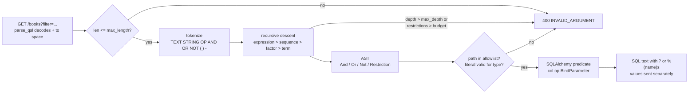

# Structured Filter Languages: Parsing Google AIP-160 Filter Expressions to Safe SQL ASTs

> [!summary] Claim
> An AIP-160 `filter` string is a small programming language, so treat it like one: lex it, parse it with a depth-bounded recursive descent that encodes AIP-160's inverted precedence (`OR` binds tighter than `AND`), type-check every field against an application-owned allowlist, and compile the AST to bound SQL parameters - never to SQL text.

Part of [Pagination Filtering and Query Patterns](README.md) in [API Engineering](../README.md).

## TL;DR

- Mechanism: `filter` -> tokens -> AST (`And`, `Or`, `Not`, `Restriction`) -> allowlist and type check -> SQLAlchemy `ColumnElement[bool]` whose literals are `BindParameter`s, so user text reaches the database only as parameter values.
- Contract rule: AIP-160 makes `a AND b OR c` mean `a AND (b OR c)`, makes whitespace an implicit `AND` that binds looser than `OR`, and says an invalid filter **should** fail with `INVALID_ARGUMENT` (`HTTP 400`).
- The trap: an unbounded recursive-descent parser in CPython dies with `RecursionError` at 248 nested parentheses (measured, all five interpreters), and a `*` wildcard compiled to `LIKE` without escaping turns `%` and `_` in user text into wildcards.
- Portability fact: the lab passes 28 of 28 tests on CPython 3.12.13, 3.13.18, 3.14.10, 3.15.2, and on SQLAlchemy 2.0.57 and 2.1.8, and the endpoint behaves identically on Uvicorn, Hypercorn, and Granian over HTTP/1.1 and (Hypercorn, Granian) h2c, but the SQLAlchemy 2.1.8 Cython wheel segfaults on free-threaded 3.15.0b3 (as of 2026-11); a pure-Python SQLAlchemy build passes there.
- When not to use it: if clients need only a few fixed predicates, use typed query parameters ([[Query-Parameter-Filtering-Brackets-RHS-Colon-and-Validation]]); if they need ranking or fuzzy matching, use a search endpoint ([[Search-Endpoints-vs-List-Endpoints-and-Full-Text-Ranking]]); if they need a full expression language with deterministic semantics, AIP-160 itself points at CEL.

## Mental model



The request arrives as a query parameter, and Starlette decodes it with `urllib.parse.parse_qsl` before the application sees it, so an unencoded `+` is already a space.
The length guard runs first because it is the only check that costs nothing.
The tokenizer turns the string into a flat token list, and the parser walks the AIP-160 EBNF from the loosest-binding rule (`expression`, joined by `AND`) to the tightest (`term`, an optional `NOT` or `-` before a restriction or a parenthesised group).
Every descent into a parenthesis or a negation increments a depth counter, and every restriction increments a budget counter, so a hostile filter is rejected before Python's own stack limit or the database's expression-depth limit is reached.
The AST carries only raw strings; the checker resolves each dotted path through an allowlist to an application-owned column, coerces the literal to that column's type, and the compiler emits a predicate in which every user value is a bind parameter.
Any failure on the left side of the diagram becomes one `400` with `status: INVALID_ARGUMENT`; nothing reaches the database until the whole filter has been checked.

## How it works

### The grammar and its inverted precedence

AIP-160 (`state: approved`, last changelog entry 2025-10-03) defines filtering for `List` and similar methods through a single `string filter` field and a formal EBNF grammar.
The grammar's top four rules are, verbatim from `ebnf-filtering.txt` except that each rule's name, body, and `;` are joined onto one line:

```text
expression : sequence {WS AND WS sequence} ;
sequence   : factor {WS factor} ;
factor     : term {WS OR WS term} ;
term       : [(NOT WS | MINUS)] simple ;
```

Reading the rules bottom-up gives the binding strength: `NOT` and `-` bind tightest, then `OR`, then the whitespace-separated sequence, and `AND` binds loosest.
AIP-160 states the consequence directly: "the `OR` operator has higher precedence than `AND`, unlike what is found in most programming languages. The expression `a AND b OR c` evaluates: `a AND (b OR c)`."
The grammar's own comment on `sequence` says that under exact-match semantics "a sequence is equivalent to AND", and its example `New York Giants OR Yankees` is equivalent to `New York (Giants OR Yankees)`.
So `a = 1 b = 2 OR c = 3` is `a = 1 AND (b = 2 OR c = 3)`, which the lab asserts through `canonical()`.
`AND`, `OR`, and `NOT` are case-sensitive keywords in the grammar; `and` is just text.
`NOT` and `-` are interchangeable, and AIP-160 says a service that supports negation **must** support both.

The comparison operators are `=`, `!=`, `<`, `>`, `<=`, `>=`, and `:` ("has"); AIP-160 says ordering comparisons **should not** be provided for booleans or enums.
Field names **must** appear on the left of a comparator; in AIP-160's words, the right-hand side "only accepts literals and logical operators", and the lab accepts only a single literal there.
Literals are typed by the field they meet: booleans are `true` and `false`, numbers allow exponents (`2.997e9`), durations end in `s`, timestamps are RFC 3339 strings, and enums use their case-sensitive string names.
A quoted string compared with `=` may start or end with `*` for a suffix or prefix match.
`.` traverses messages and maps (`a.b.c = "foo"`), and traversing to an undefined field **should** return `INVALID_ARGUMENT`.

### The reference implementation as a cross-check

`einride/aip-go` implements the grammar in Go, one method per rule: `ParseExpression`, `ParseSequence`, `ParseFactor`, `ParseTerm`, `ParseSimple`, `ParseRestriction`, `ParseComposite` `(aip-go v0.86.3 filtering/parser.go, Parser)`.
It keeps whitespace as a token type so that `ParseSequence` can stop when it sniffs `WS AND`, and it represents a sequence as a function named `FUZZY` (`FunctionFuzzyAnd`) rather than plain `AND` `(aip-go v0.86.3 filtering/parsedexpr.go, parsedSequence)` and `(aip-go v0.86.3 filtering/functions.go, FunctionFuzzyAnd)`.
Its `ParseTerm` folds `-` applied to a numeric constant into a negative literal and otherwise emits `NOT` `(aip-go v0.86.3 filtering/parser.go, ParseTerm)`; the lab's `restriction()` makes the same distinction for right-hand sides.
Its lexer emits `-`, `.`, `=`, `:`, and `,` as single-character tokens `(aip-go v0.86.3 filtering/lexer.go, Lexer.Lex)`, so an unquoted RFC 3339 timestamp such as `2012-04-21T11:30:00-04:00` cannot lex as one literal.
A case-insensitive search for `depth`, `limit`, and `max` in `parser.go`, `lexer.go`, and `checker.go` at `v0.86.3` returns no matches, so nesting and size budgets are left to the caller.

### The lab parser

The lab drops whitespace in the tokenizer and recognises `AND`, `OR`, and `NOT` only when they form a whole token, so `title = "a AND b"` stays a string and `ANDROID = 1` stays a field name.
That is slightly more permissive than the EBNF, which requires whitespace around `AND` and after `NOT`: the lab accepts `NOT(pages = 1)`.
Each grammar rule is one method, and the loops inside `expression`, `sequence`, and `factor` are iterative, so a long flat filter does not grow the Python stack; only `(` and `NOT`/`-` recurse, and both go through `enter()`, which enforces `max_depth`.
`_flatten` turns `a AND b AND c` into one `And` node with three children rather than a left-leaning binary tree, which keeps the compiled SQL shallow.

Verbatim excerpt, lines 125-216 of `labs/src/api_labs/f05_pagination_filtering_and_query_patterns/aip160_filter.py`:

```python
class _Parser:
    """Recursive descent over the AIP-160 EBNF: expression > sequence > factor > term."""

    def __init__(self, source: str, limits: Limits) -> None:
        self.tokens = tokenize(source)
        self.i = 0
        self.limits = limits
        self.depth = 0
        self.restrictions = 0

    def peek(self) -> Token:
        return self.tokens[self.i]

    def take(self, kind: str) -> Token:
        tok = self.tokens[self.i]
        if tok.kind != kind:
            raise FilterError(f"expected {kind}, found {tok.text or 'end of filter'!r}", tok.pos)
        self.i += 1
        return tok

    def enter(self, pos: int) -> None:
        self.depth += 1
        if self.depth > self.limits.max_depth:
            raise FilterError(f"nesting depth exceeds {self.limits.max_depth}", pos)

    def expression(self) -> Node:  # sequence {AND sequence}: loosest binding
        parts = [self.sequence()]
        while self.peek().kind == "AND":
            self.i += 1
            parts.append(self.sequence())
        return _flatten(And, parts)

    def sequence(self) -> Node:  # factor {WS factor}: implicit AND under exact matching
        parts = [self.factor()]
        while self.peek().kind in ("TEXT", "STRING", "NOT", "-", "("):
            parts.append(self.factor())
        return _flatten(And, parts)

    def factor(self) -> Node:  # term {OR term}: OR binds tighter than AND (AIP-160)
        parts = [self.term()]
        while self.peek().kind == "OR":
            self.i += 1
            parts.append(self.term())
        return _flatten(Or, parts)

    def term(self) -> Node:  # [NOT | -] simple
        tok = self.peek()
        if tok.kind in ("NOT", "-"):
            self.i += 1
            self.enter(tok.pos)
            child = self.term()
            self.depth -= 1
            return Not(child)
        if tok.kind == "(":
            self.i += 1
            self.enter(tok.pos)
            inner = self.expression()
            self.take(")")
            self.depth -= 1
            return inner
        return self.restriction()

    def restriction(self) -> Restriction:
        lhs = self.take("TEXT")
        nxt = self.peek()
        if nxt.kind == "(":
            raise FilterError(f"functions are not supported: {lhs.text!r}", lhs.pos)
        if nxt.kind != "OP":
            raise FilterError(f"global restriction {lhs.text!r} needs a comparator", lhs.pos)
        self.i += 1
        self.restrictions += 1
        if self.restrictions > self.limits.max_restrictions:
            raise FilterError(f"more than {self.limits.max_restrictions} restrictions", lhs.pos)
        sign = ""
        if self.peek().kind == "-":
            self.i += 1
            sign = "-"
        arg = self.peek()
        if arg.kind not in ("TEXT", "STRING") or (sign and arg.kind == "STRING"):
            raise FilterError("right-hand side must be a literal", arg.pos)
        self.i += 1
        return Restriction(lhs.text, nxt.text, sign + arg.text, arg.kind == "STRING", lhs.pos)


def _flatten(cls: type[And] | type[Or], parts: list[Node]) -> Node:
    if len(parts) == 1:
        return parts[0]
    flat: list[Node] = []
    for part in parts:
        flat.extend(part.children if isinstance(part, cls) else (part,))
    return cls(tuple(flat))

```

### Checking and compiling to bound SQL

`_compile_restriction` is where the security boundary lives.
The dotted path is looked up in `schema`, a `Mapping[str, FieldSpec]` built by the application; a miss raises `unknown field`, and there is no fallback to `getattr(model, path)` or `table.c[path]`.
The OWASP SQL Injection Prevention Cheat Sheet states the same rule for structural SQL: "map user choices to a **strict allow-list** of fixed, application-owned values."
The literal is coerced by `_coerce` with ASCII-only regular expressions before Python's converters run, because `int("1_000")` is `1000` and `int` also accepts non-ASCII decimal digits such as `\u0661\u0662`; the `INT` path then range-checks against int64, and the `FLOAT` path rejects values that overflow to `inf`.
Timestamps must match RFC 3339 with an explicit `Z` or offset, and are converted to naive UTC to match the column; dropping that conversion silently shifts every comparison by the client's offset, and a mutation that drops it fails `test_timestamp_offsets_are_normalised_to_utc`.
The comparison itself is plain operator overloading on a SQLAlchemy column (`col == value`), which wraps `value` in a `BindParameter`; the SQL string contains a placeholder and the value travels separately to the DBAPI.

Wildcards use `ColumnOperators.startswith`, `endswith`, and `contains` with `autoescape=True`.
In SQLAlchemy 2.1.8, `_escaped_like_impl` defaults the escape character to `/`, doubles any existing `/`, and prefixes every `%` and `_` in the value with it `(sqlalchemy 2.1.8 lib/sqlalchemy/sql/operators.py, _escaped_like_impl)`.
So `title = "100%*"` compiles to `books.title LIKE ? || '%' ESCAPE '/'` with the parameter `'100/%'`, and matches only titles that begin with a literal `100%`.

Verbatim excerpt, lines 304-361 of the same file:

```python
def _compile_restriction(r: Restriction, schema: Schema) -> ColumnElement[bool]:
    spec = schema.get(r.path)
    if spec is None:
        raise FilterError(f"unknown field {r.path!r}", r.pos)
    col = spec.column
    if r.op == ":":
        if r.raw != "*" or r.quoted:
            raise FilterError("only presence (field:*) is supported for ':'", r.pos)
        return col.is_not(None)
    if spec.type in (FieldType.BOOL, FieldType.ENUM) and r.op not in ("=", "!="):
        raise FilterError(f"{r.op!r} is not defined for {spec.type.value} fields", r.pos)
    value = _coerce(r, spec)
    if (
        spec.type is FieldType.STRING
        and r.quoted
        and r.op in ("=", "!=")
        and "*" in (r.raw[:1] + r.raw[-1:])
    ):
        lead, trail = r.raw.startswith("*"), r.raw.endswith("*") and len(r.raw) > 1
        core = r.raw[int(lead) : len(r.raw) - int(trail)]
        if lead and trail:
            like = col.contains(core, autoescape=True)
        elif lead:
            like = col.endswith(core, autoescape=True)
        else:
            like = col.startswith(core, autoescape=True)
        return like if r.op == "=" else not_(like)
    match r.op:
        case "=":
            return col == value
        case "!=":
            return col != value
        case "<":
            return col < value
        case "<=":
            return col <= value
        case ">":
            return col > value
        case _:
            return col >= value


def compile_filter(node: Node | None, schema: Schema) -> ColumnElement[bool] | None:
    """Type-check the AST against the allowlist and build a bound SQLAlchemy predicate."""
    return None if node is None else _compile_node(node, schema)


def _compile_node(node: Node, schema: Schema) -> ColumnElement[bool]:
    match node:
        case Restriction():
            return _compile_restriction(node, schema)
        case Not(child=child):
            return not_(_compile_node(child, schema))
        case And(children=kids):
            return and_(*(_compile_node(k, schema) for k in kids))
        case Or(children=kids):
            return or_(*(_compile_node(k, schema) for k in kids))

```

`not_()` applied to a `BinaryExpression` such as `col == 5` does not wrap it in `NOT (...)`; SQLAlchemy negates the operator and renders `col != ?`, as the captured SQL in the worked example shows.
Under SQL three-valued logic, `rating != 5` is `NULL` (not true) when `rating` is `NULL`, so `NOT rating = 5`, `-rating = 5`, and `rating != 5` all exclude rows with no rating.
AIP-160 asks for exactly this skip behaviour when a non-primitive field in a traversal chain is unset, "even when the comparison is a `!=`", but it does not spell out the rule for a top-level primitive field, so document what your backend does.

### The endpoint contract

`build_books_app` parses and compiles inside one `try`, maps `FilterError` to `400` with the core fields of the AIP-193 HTTP/1.1+JSON shape `{"error": {"code": 400, "message": ..., "status": "INVALID_ARGUMENT"}}`, and echoes the canonical filter on success.
AIP-193 also says "All error responses **must** include an `ErrorInfo` within `details`"; the lab omits `details` to keep the example small, so a production service adds an `ErrorInfo` with a stable, documented `reason`.
`google.rpc.Code` defines `INVALID_ARGUMENT = 3` with the comment `HTTP Mapping: 400 Bad Request` (`google/rpc/code.proto`).
Starlette builds `request.query_params` with `parse_qsl(..., keep_blank_values=True)` `(starlette 1.10.0 starlette/datastructures.py, QueryParams.__init__)`, so form-style decoding applies: `+` becomes a space before the parser runs.
Echoing `canonical(node)` makes that visible to the client and gives [[Opaque-Cursor-Encoding-HMAC-Integrity-and-Filter-Binding]] a stable string to bind page tokens to.

## Numbers and limits

Measured rows ran on an Apple M3 Pro, `Darwin 27.2.0 arm64` (macOS `27.2`), with a throwaway `timeit` script that is not part of the lab (best of 7 `timeit.repeat` runs, and a binary search over nesting depth calling `parse_filter` from module level with `Limits(max_length=10**7, max_depth=10**9)`), run as `UV_PROJECT_ENVIRONMENT=<env> uv run --frozen --python <interpreter> python <script>` from `labs/` (the free-threaded leg used the `--no-project` pure-Python SQLAlchemy command from Portability); the SQLite bundled with the workspace interpreter (CPython 3.14.6) is `3.53.1`.
The 5-restriction filter is `genre = SCIENCE AND (in_print = true OR price < 20) AND pages >= 300 AND title = "Rust*" rating:*` (97 characters), and the 32-restriction filter joins `pages >= <i>` for odd `i` and `price < <i>.5` for even `i`, `i` from 0 to 31, with `" AND "` (513 characters).

| Quantity | Value | Source or measurement | Consequence |
|---|---:|---|---|
| Nesting depth at which the unguarded parser raises `RecursionError` | `248` parentheses | Measured by binary search with `Limits(max_depth=10**9)` on CPython 3.12.13, 3.13.18, 3.14.10, 3.15.2, and 3.15.0b3 free-threaded; `sys.getrecursionlimit()` is `1000` on all five | Each level costs four Python frames (`expression`, `sequence`, `factor`, `term`); inside a deep server stack the threshold is lower |
| Lab default `max_depth` / `max_restrictions` / `max_length` | `24` / `32` / `1024` characters | Lab design choice in `Limits`, not taken from any specification | AIP-160 allows services to cap operator counts "to avoid queries of death" if they document it |
| Parse only, 97-character filter with 5 restrictions | `18.4 us` per call | Best of 7 repeats x 20,000 calls, CPython 3.14.10 (`15.9 us` on workspace 3.14.6) | Parsing is not the bottleneck |
| Parse and compile, same filter | `73.8 us` per call | Same run (`70.0 us` on 3.14.6) | Building SQLAlchemy expression objects costs about 4x parsing |
| Parse and compile, 32 restrictions (513 characters) | `318.0 us` per call | Best of 7 x 5,000 calls, CPython 3.14.10 (`297.7 us` on 3.14.6) | Budget the worst case allowed by `max_restrictions` |
| `SQLITE_MAX_EXPR_DEPTH` | `1000` | sqlite.org `limits.html` | SQLite rejects deeper expression trees; the lab's depth budget stays far below it |
| `SQLITE_MAX_VARIABLE_NUMBER` | `32766` (999 before 3.32.0) | sqlite.org `limits.html` | One bind parameter per restriction; 32 restrictions are far from the cap |
| CPython `int` string-conversion limit | `4300` digits default | docs.python.org `stdtypes.html`, `sys.int_info.default_max_str_digits` | The docs say the limit "offers a practical way to avoid CVE 2020-10735"; the lab's 19-digit regex rejects long input before `int()` runs |
| int64 range accepted for `INT` fields | `-2**63` to `2**63 - 1` | Lab `_coerce`; `pages > 9223372036854775808` is rejected by test | Prevents a Python big integer from reaching a 64-bit column |

## Portability

| Leg | Result | Evidence |
|---|---|---|
| CPython `3.12.13` | 28 passed | `UV_PROJECT_ENVIRONMENT=../tmp_env_3.12 uv run --frozen --python 3.12 pytest <test> -q`; the matrix pin `3.12.16` is released upstream (listed under python.org/ftp/python/) but no build is installed here and `uv 0.11.26 python list --only-downloads --all-versions` offers no 3.12 newer than `3.12.13`, so `3.12.13` stands in for it |
| CPython `3.13.18` | 28 passed | Same command with `--python /opt/homebrew/bin/python3.13` (a bare `3.13` can resolve to another installed 3.13 here) |
| CPython `3.14.10` | 28 passed | Same command with `--python /opt/homebrew/bin/python3.14` |
| CPython `3.14.6` (workspace `.venv`) | 28 passed | `uv run --frozen pytest <test> -q` |
| CPython `3.15.2` | 28 passed | Same command with `--python /opt/homebrew/bin/python3.15` |
| CPython `3.15.0b3` free-threaded, SQLAlchemy 2.1.8 Cython wheel | Interpreter segfault (exit `139`) in `sqlalchemy/sql/cache_key.py` `_generate_cache_key` during the fixture's first `INSERT`, before any filter code runs | `uv run --no-project --python 3.15t --with sqlalchemy==2.1.8 ...`; a five-line `create_all` + `insert` script reproduces it without the lab; the full lock cannot install on 3.15t because `psycopg-binary==3.3.8` has no wheel; no `3.15.2t` build is installed and `uv python list --only-downloads --all-versions` offers only `3.15.0b3+freethreaded` for 3.15 free-threaded, so the beta stands in for it |
| CPython `3.15.0b3` free-threaded, pure-Python SQLAlchemy 2.1.8 | 28 passed, `sys._is_gil_enabled()` is `False` | Same, plus `DISABLE_SQLALCHEMY_CEXT=1 --no-binary-package sqlalchemy` |
| SQLAlchemy `2.0.57` leg | 28 passed (CPython 3.14.6) | `UV_PROJECT_ENVIRONMENT=../tmp_env_sa20 uv run --frozen --no-group sqlalchemy21 --group sqlalchemy20 pytest <test> -q` |
| Debian Trixie (glibc 2.41, SQLite 3.46.1) and Alpine 3.24 (musl, SQLite 3.53.4) containers, CPython 3.14.10 | 28 passed on each (as of 2026-11) | `docker run --rm` of `python:3.14-slim-trixie` and `python:3.14-alpine` on arm64 with the lab copied in, `pip install` of the pinned `sqlalchemy`, `fastapi`, `starlette`, `httpx`, `pydantic`, `pydantic-core`, `anyio`, `pytest`, and `pytest-asyncio`, then `PYTHONPATH=src python -m pytest <test> -q` |
| SQLite `LIKE` | Case-insensitive for ASCII; `=` is case-sensitive | Test `test_sqlite_like_is_ascii_case_insensitive_but_equality_is_not`; sqlite.org `lang_expr.html` |
| PostgreSQL `LIKE` | Case-sensitive under the default deterministic collation (PostgreSQL 18 `LIKE` also supports nondeterministic, for example case-insensitive, collations); `ILIKE` is the case-insensitive extension; default escape is backslash | postgresql.org 18 `functions-matching.html`, re-read 2026-11 for the nondeterministic-collation, `ILIKE`, and default-escape sentences; not run here (no PostgreSQL server in the lab; the dialect SQL above is compiled, not executed) |
| Uvicorn `0.54.0`, Hypercorn `0.18.0`, Granian `2.8.7` over HTTP/1.1 (CPython 3.14.6, `Darwin 27.2.0 arm64`) | Identical results on all three: raw `?filter=title+=+%22C++*%22` is echoed as `title = "C  *"`, the `params=` form as `title = "C++*"`, `genre = HISTORY AND in_print = true OR price < 20` returns `[4, 5]` with the echo `genre = HISTORY AND (in_print = true OR price < 20)`, and `internal_cost > 0` returns `400` with `INVALID_ARGUMENT` | One-off script (not part of the lab) that starts each server as `python -m uvicorn srvapp:app`, `python -m hypercorn srvapp:app -b 127.0.0.1:<port>`, or `python -m granian --interface asgi srvapp:app --port <port>` on a free port with the lab app over in-memory SQLite, calls it with `httpx.Client`, and terminates it |
| Hypercorn `0.18.0` and Granian `2.8.7 --http 2` over cleartext HTTP/2 (h2c prior knowledge) | Same four results; the response reports `HTTP/2` | Same script with `httpx.Client(http1=False, http2=True)`; Uvicorn was not run over HTTP/2 |
| HTTP/3 over QUIC | Not exercised | No QUIC client or TLS certificate was set up; the parser sees the already-decoded `str`, and the server leg shows decoding is identical across the transports that were run, but no HTTP/3 claim is made |

## Worked example

The [implementation](../labs/src/api_labs/f05_pagination_filtering_and_query_patterns/aip160_filter.py) holds the tokenizer, parser, `canonical()`, checker, compiler, and a FastAPI `List` endpoint, and the [test](../labs/tests/f05_pagination_filtering_and_query_patterns/test_structured_filter_expressions_and_ast_compilation_aip_160.py) runs 28 cases against an in-memory SQLite table of six books, with rows chosen so each mechanism changes the result set.

Precedence, canonical form, injection, allowlist, and depth budget (verbatim excerpt, lines 110-168 of the test):

```python
@pytest.mark.unit
def test_or_binds_tighter_than_and(engine: Engine) -> None:
    text = "genre = HISTORY AND in_print = true OR price < 20"
    assert canon(text) == "genre = HISTORY AND (in_print = true OR price < 20)"
    # C-style precedence would give (HISTORY AND in_print) OR price < 20 -> [2, 4, 5].
    assert ids(engine, text) == [4, 5]


@pytest.mark.unit
def test_whitespace_sequence_is_an_implicit_and_looser_than_or(engine: Engine) -> None:
    assert canon("a = 1 b = 2 OR c = 3") == "a = 1 AND (b = 2 OR c = 3)"
    assert ids(engine, "genre = SCIENCE in_print = true price > 40") == [3, 6]


@pytest.mark.unit
def test_canonical_form_is_parenthesised_and_round_trips() -> None:
    text = 'title = "say \\"hi\\"*" price < 20 OR -rating = 5 AND rating:*'
    expected = 'title = "say \\"hi\\"*" AND (price < 20 OR NOT rating = 5) AND rating:*'
    assert canon(text) == expected
    assert canon(expected) == expected


@pytest.mark.unit
def test_injection_payload_is_a_bound_parameter(engine: Engine) -> None:
    payload = "x' OR '1'='1"
    predicate = compile_filter(parse_filter(f'title = "{payload}"'), SCHEMA)
    assert predicate is not None
    compiled = predicate.compile(engine)
    assert str(compiled) == "books.title = ?"
    assert list(compiled.params.values()) == [payload]
    assert ids(engine, f'title = "{payload}"') == []


@pytest.mark.unit
def test_fields_outside_the_allowlist_are_rejected(engine: Engine) -> None:
    for text in ("internal_cost > 0", "publisher.secret = 1", "books.id = 1"):
        with pytest.raises(FilterError, match="unknown field"):
            ids(engine, text)
    assert ids(engine, 'publisher.country = "IT"') == [4, 5]


@pytest.mark.unit
def test_depth_guard_rejects_deep_nesting_before_recursion_error() -> None:
    deep = "(" * 5000 + "pages = 1" + ")" * 5000
    with pytest.raises(FilterError, match="nesting depth exceeds 24"):
        parse_filter(deep, Limits(max_length=100_000))
    with pytest.raises(FilterError, match="nesting depth exceeds 24"):
        parse_filter("NOT " * 25 + "pages = 1")
    assert parse_filter("NOT " * 24 + "pages = 1") is not None
    # Depth is per nesting path, not cumulative: 30 sibling groups stay at depth 1.
    assert parse_filter(" ".join(["(pages = 1)"] * 30)) is not None
    assert parse_filter(" ".join(["NOT pages = 1"] * 30)) is not None


@pytest.mark.unit
def test_unbounded_recursive_descent_overflows_the_python_stack() -> None:
    deep = "(" * 5000 + "pages = 1" + ")" * 5000
    with pytest.raises(RecursionError):
        parse_filter(deep, Limits(max_length=100_000, max_depth=10**9))
```

Timestamps and `NULL` handling (verbatim excerpt, lines 248-267 of the test):

```python
@pytest.mark.unit
def test_timestamp_offsets_are_normalised_to_utc(engine: Engine) -> None:
    # -05:00 midnight is 05:00 UTC: row 1 (06:00 UTC) matches, row 2 (03:00 UTC) does not.
    assert ids(engine, 'published >= "2024-01-01T00:00:00-05:00"') == [1]
    assert ids(engine, 'published < "2020-01-01T00:00:00Z"') == [6]
    with pytest.raises(FilterError, match="not a valid timestamp"):
        ids(engine, 'published >= "2024-01-01T00:00:00"')
    with pytest.raises(FilterError):
        ids(engine, "published >= 2024-01-01T00:00:00Z")


@pytest.mark.unit
def test_negation_and_not_equals_drop_null_rows(engine: Engine) -> None:
    assert ids(engine, "-rating = 5") == [3, 4]
    assert ids(engine, "NOT rating = 5") == [3, 4]
    assert ids(engine, "rating != 5") == [3, 4]
    assert ids(engine, "rating:*") == [1, 3, 4, 6]
    assert ids(engine, "NOT rating:*") == [2, 5]
    with pytest.raises(FilterError, match="only presence"):
        ids(engine, "rating:5")
```

Query-string decoding at the HTTP edge (verbatim excerpt, lines 319-332 of the test):

```python
@pytest.mark.unit
@pytest.mark.asyncio
async def test_unencoded_plus_in_the_query_string_arrives_as_a_space(engine: Engine) -> None:
    app = build_books_app(engine, books, SCHEMA)
    async with httpx.AsyncClient(
        transport=httpx.ASGITransport(app=app), base_url="http://test"
    ) as client:
        raw = await client.get('/books?filter=title+=+"C++*"')
        encoded = await client.get("/books", params={"filter": 'title = "C++*"'})

    assert raw.request.url.query == b"filter=title+=+%22C++*%22"
    assert raw.json() == {"filter": 'title = "C  *"', "ids": []}
    assert encoded.request.url.query == b"filter=title+%3D+%22C%2B%2B%2A%22"
    assert encoded.json() == {"filter": 'title = "C++*"', "ids": []}
```

Compiling one filter for two dialects, captured from a one-off script (not part of the lab) that calls `select(books.c.id).where(compile_filter(parse_filter(text), schema)).compile(dialect=...)` for `sqlite.dialect()` and `postgresql.dialect()` under `uv run --frozen python` (CPython 3.14.6):

```text
canonical: title = "100%*" AND (price < 20 OR NOT rating = 5) AND rating:*
sqlite: SELECT books.id  FROM books  WHERE (books.title LIKE ? || '%' ESCAPE '/') AND (books.price < ? OR books.rating != ?) AND books.rating IS NOT NULL
sqlite params: {'title_1': '100/%', 'price_1': 20.0, 'rating_1': 5}
postgresql: SELECT books.id  FROM books  WHERE (books.title LIKE %(title_1)s::VARCHAR || '%%' ESCAPE '/') AND (books.price < %(price_1)s OR books.rating != %(rating_1)s::INTEGER) AND books.rating IS NOT NULL
postgresql params: {'title_1': '100/%', 'price_1': 20.0, 'rating_1': 5}
```

Captured with `UV_PROJECT_ENVIRONMENT=../tmp_env_python3.14 uv run --frozen --python /opt/homebrew/bin/python3.14 pytest tests/f05_pagination_filtering_and_query_patterns/test_structured_filter_expressions_and_ast_compilation_aip_160.py -v -p no:cacheprovider` from `labs/` on CPython 3.14.10, macOS 27.2 (`Darwin 27.2.0 arm64`); the job-directory prefix is trimmed from paths:

```text
============================= test session starts ==============================
platform darwin -- Python 3.14.10, pytest-9.2.0, pluggy-1.7.0 -- tmp_env_python3.14/bin/python
hypothesis profile 'default'
rootdir: labs
configfile: pyproject.toml
plugins: platformdirs-4.14.5, schemathesis-4.33.1, cov-7.1.0, hypothesis-6.170.14, inline-snapshot-0.36.1, Faker-40.44.0, locust-2.47.0, typeguard-4.6.0, anyio-4.16.0, asyncio-1.4.1.post1, respx-0.23.1
asyncio: mode=Mode.STRICT, debug=False, asyncio_default_fixture_loop_scope=function, asyncio_default_test_loop_scope=function
collecting ... collected 28 items

tests/f05_pagination_filtering_and_query_patterns/test_structured_filter_expressions_and_ast_compilation_aip_160.py::test_or_binds_tighter_than_and PASSED [  3%]
tests/f05_pagination_filtering_and_query_patterns/test_structured_filter_expressions_and_ast_compilation_aip_160.py::test_whitespace_sequence_is_an_implicit_and_looser_than_or PASSED [  7%]
tests/f05_pagination_filtering_and_query_patterns/test_structured_filter_expressions_and_ast_compilation_aip_160.py::test_canonical_form_is_parenthesised_and_round_trips PASSED [ 10%]
tests/f05_pagination_filtering_and_query_patterns/test_structured_filter_expressions_and_ast_compilation_aip_160.py::test_injection_payload_is_a_bound_parameter PASSED [ 14%]
tests/f05_pagination_filtering_and_query_patterns/test_structured_filter_expressions_and_ast_compilation_aip_160.py::test_fields_outside_the_allowlist_are_rejected PASSED [ 17%]
tests/f05_pagination_filtering_and_query_patterns/test_structured_filter_expressions_and_ast_compilation_aip_160.py::test_depth_guard_rejects_deep_nesting_before_recursion_error PASSED [ 21%]
tests/f05_pagination_filtering_and_query_patterns/test_structured_filter_expressions_and_ast_compilation_aip_160.py::test_unbounded_recursive_descent_overflows_the_python_stack PASSED [ 25%]
tests/f05_pagination_filtering_and_query_patterns/test_structured_filter_expressions_and_ast_compilation_aip_160.py::test_length_and_restriction_budgets PASSED [ 28%]
tests/f05_pagination_filtering_and_query_patterns/test_structured_filter_expressions_and_ast_compilation_aip_160.py::test_wildcards_map_to_like_with_escaped_metacharacters PASSED [ 32%]
tests/f05_pagination_filtering_and_query_patterns/test_structured_filter_expressions_and_ast_compilation_aip_160.py::test_sqlite_like_is_ascii_case_insensitive_but_equality_is_not PASSED [ 35%]
tests/f05_pagination_filtering_and_query_patterns/test_structured_filter_expressions_and_ast_compilation_aip_160.py::test_literals_are_validated_against_the_field_type[underscore] PASSED [ 39%]
tests/f05_pagination_filtering_and_query_patterns/test_structured_filter_expressions_and_ast_compilation_aip_160.py::test_literals_are_validated_against_the_field_type[arabic-indic-digits] PASSED [ 42%]
tests/f05_pagination_filtering_and_query_patterns/test_structured_filter_expressions_and_ast_compilation_aip_160.py::test_literals_are_validated_against_the_field_type[twenty-digits] PASSED [ 46%]
tests/f05_pagination_filtering_and_query_patterns/test_structured_filter_expressions_and_ast_compilation_aip_160.py::test_literals_are_validated_against_the_field_type[int64-max-plus-one] PASSED [ 50%]
tests/f05_pagination_filtering_and_query_patterns/test_structured_filter_expressions_and_ast_compilation_aip_160.py::test_literals_are_validated_against_the_field_type[quoted-int] PASSED [ 53%]
tests/f05_pagination_filtering_and_query_patterns/test_structured_filter_expressions_and_ast_compilation_aip_160.py::test_literals_are_validated_against_the_field_type[nan] PASSED [ 57%]
tests/f05_pagination_filtering_and_query_patterns/test_structured_filter_expressions_and_ast_compilation_aip_160.py::test_literals_are_validated_against_the_field_type[inf] PASSED [ 60%]
tests/f05_pagination_filtering_and_query_patterns/test_structured_filter_expressions_and_ast_compilation_aip_160.py::test_literals_are_validated_against_the_field_type[float-overflow] PASSED [ 64%]
tests/f05_pagination_filtering_and_query_patterns/test_structured_filter_expressions_and_ast_compilation_aip_160.py::test_literals_are_validated_against_the_field_type[bool-case] PASSED [ 67%]
tests/f05_pagination_filtering_and_query_patterns/test_structured_filter_expressions_and_ast_compilation_aip_160.py::test_literals_are_validated_against_the_field_type[enum-case] PASSED [ 71%]
tests/f05_pagination_filtering_and_query_patterns/test_structured_filter_expressions_and_ast_compilation_aip_160.py::test_literals_are_validated_against_the_field_type[bool-ordering] PASSED [ 75%]
tests/f05_pagination_filtering_and_query_patterns/test_structured_filter_expressions_and_ast_compilation_aip_160.py::test_literals_are_validated_against_the_field_type[enum-ordering] PASSED [ 78%]
tests/f05_pagination_filtering_and_query_patterns/test_structured_filter_expressions_and_ast_compilation_aip_160.py::test_valid_typed_literals PASSED [ 82%]
tests/f05_pagination_filtering_and_query_patterns/test_structured_filter_expressions_and_ast_compilation_aip_160.py::test_timestamp_offsets_are_normalised_to_utc PASSED [ 85%]
tests/f05_pagination_filtering_and_query_patterns/test_structured_filter_expressions_and_ast_compilation_aip_160.py::test_negation_and_not_equals_drop_null_rows PASSED [ 89%]
tests/f05_pagination_filtering_and_query_patterns/test_structured_filter_expressions_and_ast_compilation_aip_160.py::test_functions_globals_and_bad_syntax_are_rejected PASSED [ 92%]
tests/f05_pagination_filtering_and_query_patterns/test_structured_filter_expressions_and_ast_compilation_aip_160.py::test_list_endpoint_maps_filter_errors_to_400_invalid_argument PASSED [ 96%]
tests/f05_pagination_filtering_and_query_patterns/test_structured_filter_expressions_and_ast_compilation_aip_160.py::test_unencoded_plus_in_the_query_string_arrives_as_a_space PASSED [100%]

============================== 28 passed in 0.29s ==============================
```

## Pitfalls

> [!warning] Programming-language precedence
> Trigger: the parser or the documentation assumes `AND` binds tighter than `OR`.
> Symptom: `genre = HISTORY AND in_print = true OR price < 20` returns rows 2, 4, 5 instead of 4, 5; the extra row is a cheap fiction title that matched only the `OR` arm.
> Fix: encode the AIP-160 order (`AND` < sequence < `OR` < `NOT`) in the grammar, echo the canonical parenthesised form, and follow AIP-160's advice that documentation should encourage explicit parentheses.

> [!warning] Untrusted text reaches SQL structure
> Trigger: a filter path or value is spliced into SQL, or a request dictionary is expanded into an ORM call.
> Symptom: injection; CVE-2019-7164 ("SQLAlchemy through 1.2.17 and 1.3.x through 1.3.0b2 allows SQL Injection via the order_by parameter"), CVE-2019-7548 (`group_by`), CVE-2021-35042 (Django `QuerySet.order_by`), CVE-2022-28346 (Django `QuerySet.annotate()`, `aggregate()`, and `extra()` column aliases via a crafted dictionary expanded as `**kwargs`), and CVE-2025-64459 (Django `QuerySet.filter()`, `exclude()`, `get()`, and `Q()` via a crafted dictionary passed as `_connector`).
> Fix: values become bind parameters, and paths resolve only through an application-owned allowlist; never `filter(**request.query_params)` or `text(f"... {path} ...")`; see [[SQL-Injection-NoSQL-Injection-and-Order-By-Identifier-Escaping]].

> [!warning] Unbounded recursion
> Trigger: a recursive-descent parser without a depth counter.
> Symptom: 248 nested parentheses raise `RecursionError` in CPython (measured); in a web stack that is a `500` and a stack trace in the logs for a request of under 600 bytes.
> Fix: count depth in the parser and reject with `INVALID_ARGUMENT` at a documented budget well below both the interpreter and database limits, plus a length cap and a restriction-count cap.

> [!warning] `LIKE` metacharacters in user values
> Trigger: `title = "100%*"` compiled as `LIKE '100%' || '%'`.
> Symptom: `100%` matches `1000 Words`; `title = "*_*"` matches every row because `_` matches any one character.
> Fix: `startswith`/`endswith`/`contains` with `autoescape=True`, or escape `%`, `_`, and the escape character yourself; remember SQLite `LIKE` is ASCII case-insensitive while PostgreSQL `LIKE` is case-sensitive, so the same filter can return different rows after a database migration.

> [!warning] Lenient Python converters
> Trigger: `int(raw)` or `float(raw)` on filter text.
> Symptom: `pages = 1_000` and `pages = \u0661\u0662` succeed, `price > 1e999` becomes `inf`, and a 20-digit integer overflows a 64-bit column at the database rather than at the API.
> Fix: validate with ASCII-only patterns (`[0-9]`, not `\d`, which matches non-ASCII digits in Python `str` patterns) before converting, then range-check.

> [!warning] Timestamp offsets and the `:` token
> Trigger: an unquoted RFC 3339 timestamp, or an aware timestamp compared to a naive UTC column.
> Symptom: `published >= 2024-01-01T00:00:00Z` fails to parse because `:` is the has operator; an offset that is dropped shifts the comparison by hours (the lab's 03:00 UTC row leaks into a `>= 00:00-05:00` filter without UTC normalisation).
> Fix: require quoted timestamps, require an explicit offset, and normalise to the column's storage convention before binding.

> [!warning] `+` in an unencoded URL
> Trigger: a client builds `?filter=title="C++*"` by string concatenation.
> Symptom: Starlette's `parse_qsl` turns each `+` into a space and the server filters on `title = "C  *"`.
> Fix: clients must percent-encode the parameter (`httpx` `params=` does: `%2B`); the server should echo the canonical filter so the mismatch is visible.

## Security and robustness

Threat model: the filter string is attacker-controlled text that the service turns into a database query, so the parser is an interpreter exposed to the internet.
OWASP API4:2023 Unrestricted Resource Consumption calls an API vulnerable when limits such as execution timeouts, the number of operations in a single client request, or records per page are missing or set inappropriately; for a filter the levers are length, nesting depth, restriction count, page size, and a statement timeout on the database side.
OWASP API3:2023 Broken Object Property Level Authorization covers endpoints that expose sensitive object properties, and a filter is an indirect read: if `internal_cost` were filterable, a client could recover it by binary search on `internal_cost < x` even though the field is never returned, so the filter allowlist must be a subset of what the caller may read; see [[Defeating-BOPLA-and-Mass-Assignment-API3-2023-Strict-Input-Output-Schemas]].
Tenant scoping and authorization predicates are added by the server and combined with `AND` outside the user's AST, never parsed from the filter; see [[Defeating-BOLA-API1-2023-Tenant-Scoped-Queries-and-PostgreSQL-RLS]].
Index coverage is a denial-of-service concern too: an allowlisted but unindexed field, or a leading-wildcard `LIKE '%x'`, forces a full scan on every page, so the allowlist is also a performance contract with the database owner.
Error messages carry the offset and the reason but never echo SQL, column names that are not in the allowlist, or database errors.
Defense in depth: allowlist plus typed coercion plus bind parameters plus budgets plus a read-only database role for list queries.
See [[Unrestricted-Resource-Consumption-API4-2023-Payload-Depth-and-Limit-Guards]] for the general budget pattern.

## The principal's view

The decision is not "which parser library" but "who owns the query surface".
A structured filter language moves query design from the API team to every client, so each allowlisted field is a promise of index support, of authorization review, and of backward compatibility for as long as the API version lives.
Adopt AIP-160 when many clients need ad hoc predicates over a stable resource schema and the organisation already standardises on Google AIPs; the shared grammar lets one parser, one linter, and one set of documentation serve every `List` method.
Prefer typed query parameters when the predicate set is small and known, because they appear in OpenAPI, are validated by the framework, and cannot express a query of death.
Prefer a search engine when relevance, fuzzy matching, or facets matter; AIP-160's own note says list filters have "fuzzy matching characteristics" and points to CEL for deterministic evaluation, and a relational `LIKE` is neither.
Prefer GraphQL arguments or an RPC per query shape when the domain is a graph and the client is first-party.
Organisationally, ship the parser and checker as a shared library with per-service schemas, budgets, and a conformance test suite, rather than letting each team write its own grammar with its own precedence bugs.

## Interview questions

> [!question] L5: In AIP-160, what does `a AND b OR c` mean, and why did Google choose that?
>
> > [!success]- Answer
> > It means `a AND (b OR c)`, because `OR` binds tighter than `AND` in the AIP-160 grammar.
> > AIP-160 says this matches "common patterns of speech" for a possibly non-technical audience.
> > The guidance is to encourage explicit parentheses in documentation but not to require them.
> >
> > Follow-up: Where does a whitespace-separated sequence such as `a b OR c` sit in that order?

> [!question] L5: Why is binding the filter value as a parameter not enough to make a filter endpoint safe from injection?
>
> > [!success]- Answer
> > Bind parameters protect values only; field names, operators, and sort directions are SQL structure and cannot be parameters.
> > If the path `publisher.country` is turned into a column with `getattr` or string formatting, an attacker controls structure.
> > Paths must resolve through an application-owned allowlist, which is the OWASP cheat sheet's rule for identifiers.
> >
> > Follow-up: Which CVEs in SQLAlchemy and Django came from the structural side rather than the value side?

> [!question] L5: Predict the output: with the lab's six books, what do `ids(engine, "rating != 5")` and `ids(engine, "NOT rating:*")` return?
>
> > [!success]- Answer
> > `rating != 5` returns `[3, 4]`: rows 1 and 6 have rating 5, and rows 2 and 5 have `NULL`, which makes the comparison `NULL`, not true.
> > `NOT rating:*` compiles to `rating IS NULL` and returns `[2, 5]`.
> > The two results are disjoint, which surprises anyone expecting `!=` to include missing values.
> >
> > Follow-up: What does AIP-160 say about `!=` when a field earlier in a traversal chain is unset?

> [!question] L6: Your recursive-descent filter parser passes all functional tests; what input takes it down, and how do you bound it?
>
> > [!success]- Answer
> > Deep nesting: in the lab, 248 nested parentheses exhaust CPython's default recursion limit of 1000 because each level costs four frames.
> > The fix is a depth counter in the parser that rejects with `INVALID_ARGUMENT`, plus a length cap and a restriction budget checked before any SQL is built.
> > Raising `sys.setrecursionlimit` only moves the failure to the C stack or the database's expression-depth limit (`SQLITE_MAX_EXPR_DEPTH` is 1000).
> >
> > Follow-up: Which loops in the parser do not need the depth counter, and why?

> [!question] L6: Debug this API: a client reports that `?filter=title="C++*"` returns no books even though "C++ Primer" exists, while the same filter sent from your SDK works; what is happening?
>
> > [!success]- Answer
> > The client concatenated the URL without percent-encoding, and Starlette decodes the query with `parse_qsl`, which turns each `+` into a space.
> > The server therefore evaluated `title = "C  *"`.
> > The SDK passes the value through `params=`, which encodes `+` as `%2B`.
> > Echoing the canonical filter in the response makes the server's interpretation visible and turns this into a one-line diagnosis.
> >
> > Follow-up: Which other characters in AIP-160 syntax are special in `application/x-www-form-urlencoded` decoding?

> [!question] L6: A `title = "100%*"` filter returns "1000 Words"; explain the bug and the fix at the SQL level.
>
> > [!success]- Answer
> > The prefix was compiled to `LIKE '100%' || '%'`, where the user's `%` is a wildcard.
> > The fix is an `ESCAPE` clause and escaping `%`, `_`, and the escape character in the value; SQLAlchemy's `autoescape=True` uses `/` and binds `'100/%'`.
> > After escaping, also check case sensitivity, because SQLite `LIKE` folds ASCII case and PostgreSQL `LIKE` does not.
> >
> > Follow-up: Why is a leading `*` (suffix match) a performance risk even when it is correctly escaped?

> [!question] L7+: Your company runs 300 services, each with its own filter parser; design the platform answer.
>
> > [!success]- Answer
> > Ship one parser and checker library that produces a typed AST, and make each service supply only a schema: allowlisted paths, types, operators, index hints, and budgets.
> > Back it with a conformance suite that pins precedence, negation, wildcard escaping, error codes, and canonical form, and run it in every service's CI.
> > Make the schema the reviewed artifact: adding a filterable field requires an index plan and an authorization review.
> > Expose metrics per field and per budget rejection so the platform team sees queries of death before the database does.
> >
> > Follow-up: How do you evolve the grammar, for example adding functions, without breaking clients that cached canonical filters in page tokens?

> [!question] L7+: When would you refuse to offer AIP-160 filtering at all?
>
> > [!success]- Answer
> > When the backing store cannot serve arbitrary predicates within the latency objective, such as a sharded store without secondary indexes.
> > When the predicate set is small and stable, because typed parameters are simpler, self-documenting in OpenAPI, and cannot express expensive queries.
> > When clients need relevance ranking, where a search endpoint is the honest contract.
> > When fields carry authorization-sensitive values that would turn the filter into an oracle.
> >
> > Follow-up: How would you migrate clients off a filter language you regret shipping?

> [!question] L6: Why does the lab compile `NOT rating = 5` to `rating != ?` instead of `NOT (rating = ?)`, and does it matter?
>
> > [!success]- Answer
> > SQLAlchemy's `not_()` on a `BinaryExpression` negates the operator rather than wrapping the clause.
> > Under three-valued logic both forms are `NULL` for a `NULL` rating, so the result set is the same.
> > It matters for readability of logged SQL and for index use on some planners, not for correctness here.
> >
> > Follow-up: Which negation does change results when `NULL`s are present: `NOT (a = 1 OR b = 2)` or `a != 1 AND b != 2`?

## Related

Prerequisites: [[Query-Parameter-Filtering-Brackets-RHS-Colon-and-Validation]]

Next: [[Multi-Column-Sorting-Order-By-Whitelisting-and-Index-Coverage]]

See also: [[02-Programming-Languages/Python/Python-Backend-Interview-Prep/05-REST-API-Design]], [[02-Programming-Languages/Python/Python-Backend-Interview-Prep/06-SQL-and-SQLAlchemy]], [[Opaque-Cursor-Encoding-HMAC-Integrity-and-Filter-Binding]], [[Search-Endpoints-vs-List-Endpoints-and-Full-Text-Ranking]], [[SQL-Injection-NoSQL-Injection-and-Order-By-Identifier-Escaping]], [[Unrestricted-Resource-Consumption-API4-2023-Payload-Depth-and-Limit-Guards]], [[Defeating-BOPLA-and-Mass-Assignment-API3-2023-Strict-Input-Output-Schemas]], [[Defeating-BOLA-API1-2023-Tenant-Scoped-Queries-and-PostgreSQL-RLS]], [[Google-AIP-193-Error-Model-and-Rich-Error-Details]], [[Criteria-Based-Bulk-Delete-and-Purge-Operations-AIP-165]], [[SQLAlchemy-2-x-Architecture-Core-vs-ORM-Engine-and-Unified-Select]]

- Lab: `labs/tests/f05_pagination_filtering_and_query_patterns/test_structured_filter_expressions_and_ast_compilation_aip_160.py`

## Further reading

- AIP-160 Filtering (https://raw.githubusercontent.com/aip-dev/google.aip.dev/master/aip/general/0160.md): the normative guidance on operators, precedence, typed literals, traversal, has, and validation errors.
- AIP-160 EBNF grammar (https://google.aip.dev/assets/misc/ebnf-filtering.txt): the formal grammar; read the comments on `sequence` and `restriction`.
- AIP-193 Errors (https://raw.githubusercontent.com/aip-dev/google.aip.dev/master/aip/general/0193.md): the HTTP+JSON error envelope used for `INVALID_ARGUMENT`.
- `google/rpc/code.proto` (https://raw.githubusercontent.com/googleapis/googleapis/master/google/rpc/code.proto): the canonical code-to-HTTP mapping.
- einride/aip-go `filtering/parser.go` at v0.86.3 (https://raw.githubusercontent.com/einride/aip-go/v0.86.3/filtering/parser.go): a production Go implementation that emits CEL-style expressions; compare its parser rule by rule.
- SQLAlchemy 2.1.8 `sql/operators.py` (https://raw.githubusercontent.com/sqlalchemy/sqlalchemy/rel_2_1_8/lib/sqlalchemy/sql/operators.py): `_escaped_like_impl` and the `autoescape` contract.
- SQLite limits (https://www.sqlite.org/limits.html): expression depth and host-parameter caps.
- SQLite expression syntax (https://www.sqlite.org/lang_expr.html): `LIKE` case folding and `ESCAPE`.
- PostgreSQL pattern matching (https://www.postgresql.org/docs/current/functions-matching.html): `LIKE`, `ILIKE`, and escape defaults (PostgreSQL 18 at fetch time).
- Python built-in types, integer string conversion length limitation (https://docs.python.org/3/library/stdtypes.html): the 4300-digit default and its CVE.
- OWASP SQL Injection Prevention Cheat Sheet (https://raw.githubusercontent.com/OWASP/CheatSheetSeries/master/cheatsheets/SQL_Injection_Prevention_Cheat_Sheet.md): allowlists for identifiers.
- OWASP API4:2023 (https://raw.githubusercontent.com/OWASP/API-Security/master/editions/2023/en/0xa4-unrestricted-resource-consumption.md): the limits whose absence makes an API vulnerable.
- OWASP API3:2023 (https://raw.githubusercontent.com/OWASP/API-Security/master/editions/2023/en/0xa3-broken-object-property-level-authorization.md): property-level authorization, which a filter can bypass as an oracle.
- CVE-2025-64459 (https://services.nvd.nist.gov/rest/json/cves/2.0?cveId=CVE-2025-64459): the 2025 Django case of request dictionaries reaching the ORM filter API.
