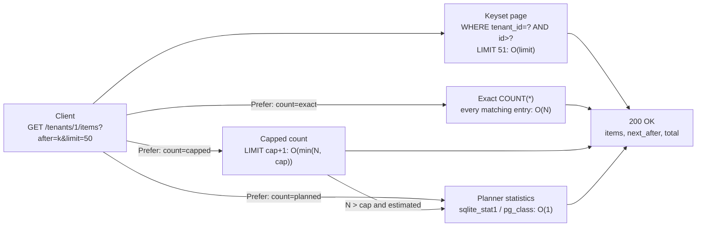

# Why Exact total_count Breaks Large Collection Pagination and How to Use Capped or Planner Estimates

> [!summary] Claim
> An exact `total_count` re-reads every index entry (or row) that matches the filter on every page request, so it turns an O(limit) keyset page back into an O(N) scan; return no count by default, a capped count (`LIMIT cap + 1`, reported as `eq` or `gte`) when the UI needs "more than N", and a planner estimate (labelled `approx`) only when a rough magnitude is enough.

Part of [Pagination Filtering and Query Patterns](README.md) in [API Engineering](../README.md).

## TL;DR

- Mechanism: `SELECT COUNT(*) ... WHERE <filter>` must visit every matching index entry (and, in PostgreSQL, check row visibility), so its cost is linear in matches while a keyset page costs O(limit); the lab measures 3 SQLite VM steps per matching row versus a flat 382 steps per 50-row page.
- Contract rule: make the total optional and typed by its precision, `{"value": 1000, "relation": "gte"}` or `"approx"`, and let clients ask for it explicitly (`Prefer: count=...`, RFC 7240 Section 2), with the server free to downgrade and say so in `Preference-Applied` (RFC 7240 Section 3).
- The trap: the count runs on every page, not once, under the same filter that the keyset index made cheap, so a 50-row page against a 10 million row tenant pays for 10 million rows each time.
- Portability fact: in PostgreSQL, `count(*)` over a table "will require effort proportional to the size of the table" (PostgreSQL 18 docs), its `pg_class.reltuples` estimate is `-1` until the first `VACUUM` or `ANALYZE`, and SQLite's `sqlite_stat1` is not updated as content changes.
- When not to use it: if a client truly needs an exact total over a large set (billing, reconciliation, exports), compute it asynchronously or from a maintained counter, not inline on a list page.

## Mental model



The page query always runs and costs O(limit) because the composite index `(tenant_id, id)` lets the engine seek to `after` and stop after `limit + 1` entries.
Each optional count arrow adds its own cost on top of that.
The exact arrow reads every index entry for the tenant, so it grows with the collection.
The capped arrow stops after `cap + 1` entries, so its worst case is fixed by configuration.
The statistics arrow reads one catalog row, so it is constant but approximate and stale between `ANALYZE` runs.
The `estimated` policy chains the last two: it trusts the capped scan when it finishes under the cap and switches to the statistics only when the cap is hit, the same split PostgREST documents for `Prefer: count=estimated`.

## How it works

### Why a page is cheap and a count is not

A keyset page over `WHERE tenant_id = ? AND id > ? ORDER BY id LIMIT 51` compiles in SQLite to `SEARCH items USING INDEX ix_items_tenant_id_id (tenant_id=? AND id>?)`: one b-tree descent to the seek key, then 51 next-entry steps.
Its cost is independent of how many rows the tenant owns; [[Keyset-Seek-Pagination-and-Composite-Tie-Breaker-Cursors]] covers the seek itself.
The filtered count `SELECT COUNT(*) FROM items WHERE tenant_id = ?` compiles to `SEARCH items USING COVERING INDEX ix_items_tenant_id_id (tenant_id=?)`, which is the same descent followed by a walk over every entry with that `tenant_id`.
The count must touch each matching entry because nothing in the b-tree stores "how many entries lie under this key".
The lab counts SQLite progress-handler callbacks with `set_progress_handler(handler, 1)`; SQLite documents `N` as "the approximate number of virtual machine instructions that are evaluated between successive invocations" (SQLite C API `sqlite3_progress_handler`), so the callback count is a deterministic cost proxy for one SQLite build.
Measured: the filtered count costs `3N + 14` callbacks on SQLite `3.46.1`, `3.53.1`, and `3.53.4` and `3N + 12` on `3.54.1`, while the 50-row page costs 382 on `3.53.x` and `3.54.1` and 378 on `3.46.1`.

PostgreSQL adds MVCC on top of the same structural cost.
"Visibility information is not stored in index entries, only in heap entries", so an index-only scan must consult the visibility map and visit the heap for any page whose all-visible bit is not set (PostgreSQL 18 docs, Index-Only Scans and Covering Indexes).
The aggregate documentation states the consequence directly: `SELECT count(*) FROM sometable` "will require effort proportional to the size of the table: PostgreSQL will need to scan either the entire table or the entirety of an index that includes all rows in the table" (PostgreSQL 18 docs, Aggregate Functions).

### The unfiltered `COUNT(*)` special case

SQLite compiles `SELECT COUNT(*) FROM items` with no `WHERE` into a single `Count` opcode (lab: `EXPLAIN` yields `Init, OpenRead, Count, Close, Copy, ResultRow, Halt, Transaction, Goto`).
The opcode documentation says that with `P3==0` "an exact count is obtained, which involves visiting every btree page of the table" (SQLite VDBE opcodes, `Count`).
The lab proves that this work happens inside one opcode: the progress-handler count stays at 9 for 5,000, 10,000, and 20,000 rows.
The lesson is about measurement, not speed: a cost meter that counts VM instructions is blind to work done inside a single opcode, so the filtered count is the one to measure, and it is also the one real list endpoints run.

### Capped counts

The capped count wraps the filter in a bounded subquery, `SELECT COUNT(*) FROM (SELECT 1 FROM items WHERE tenant_id = ? LIMIT cap + 1)`, which SQLite runs as a co-routine that stops after `cap + 1` index entries.
Reading one entry past the cap is what distinguishes "exactly `cap`" (`eq`) from "more than `cap`" (`gte`); with `LIMIT cap` the two cases are indistinguishable, and lab mutation M1 shows the boundary test failing.
The reported shape follows Elasticsearch, whose `hits.total` carries a `value` and a `relation` where `"eq"` means the value is the accurate count and `"gte"` means it is a lower bound, with exact tracking up to a default of 10,000 hits (Elasticsearch 8.19 reference, Track total hits).
In the lab the capped cost is 8,028 callbacks on SQLite `3.53.1` (8,024 on `3.54.1`) for cap 1,000, unchanged from 5,000 to 100,000 matching rows.

### Planner estimates

PostgreSQL stores `pg_class.reltuples` (`float4`), described as "Number of live rows in the table. This is only an estimate used by the planner", updated by `VACUUM`, `ANALYZE`, and some DDL, and `-1` if the table "has never yet been vacuumed or analyzed" (PostgreSQL 18 docs, `pg_class`).
The planner does not use `reltuples` raw: it computes the density `reltuples / relpages` from the last statistics run and multiplies it by the current block count, `*tuples = rint(density * (double) curpages)` (PostgreSQL REL_18_7 `src/backend/access/table/tableam.c`, `table_block_relation_estimate_size`).
So a table that grew by 20% in pages since the last `ANALYZE` gets a 20% larger estimate without new statistics, which `pg_estimate_tuples` in the lab models.
The model returns `None` where the source has no density and guesses from tuple width instead (`relpages = 0`, or `reltuples < 0`); a never-vacuumed table is first raised to at least 10 pages, so even an empty one never takes the `curpages == 0` exit (same function, the "HACK" block).
For a filtered query, the PostgreSQL wiki's `count_estimate` runs `EXPLAIN (FORMAT JSON)` and returns `plan->0->'Plan'->'Plan Rows'`, and warns that the function's argument is "subject to SQL injection" (PostgreSQL wiki, Count estimate).

SQLite's equivalent is `sqlite_stat1`, written by `ANALYZE`: for each index the `stat` column holds the approximate number of rows, then "the approximate number of rows in the index that have the same value in the first column of the index" (SQLite file format, Section 2.6.4).
For the index `(tenant_id, id)` that second integer is an average across all tenants, not the count of any particular tenant.
The lab shows the consequence: with tenants of 7,500 and 2,500 rows, `stat` is `10000 5000 1`, so the estimate for either tenant is 5,000.
"Statistics gathered by ANALYZE are not updated as the content of the database changes" (SQLite `ANALYZE` documentation), and the lab shows the estimate stuck at 5,000 after 10,000 inserts until the next `ANALYZE`.

PostgreSQL's filtered estimate was measured here against a real server (`postgres:18` container, PostgreSQL `18.6` Debian aarch64, same schema and tenants of 7,500, 2,500, and 120 rows; setup in the Portability table):

| State | `relpages` | `reltuples` | Planner `Plan Rows` for `tenant_id = 1` | Actual |
|---|---:|---:|---:|---:|
| Loaded, never analyzed | 0 | -1 | 39 | 7,500 |
| After `ANALYZE` | 65 | 10,120 | 7,500 (tenants 2 and 3: 2,500 and 120) | 7,500 |
| After 30,000 more tenant 1 rows, no `ANALYZE` (file grown to 256 pages) | 65 | 10,120 | 29,538 (table-wide: 39,857) | 37,500 (table-wide: 40,120) |

Three facts follow.
A never-analyzed table gets a width-based guess (39 rows) and `reltuples = -1`, so "unknown" must never be read as a count.
After `ANALYZE` the per-filter estimate is exact here, unlike SQLite's average of 5,000, because `pg_stats` for `tenant_id` holds `most_common_vals {1,2,3}` with `most_common_freqs {0.74110675,0.24703558,0.011857707}`; this holds for a low-cardinality column and degrades for high-cardinality or correlated filters, which this run does not measure.
Between `ANALYZE` runs the table-wide figure follows page growth, `rint(10120 / 65 * 256) = 39,857`, which matches the `table_block_relation_estimate_size` model above, while the filtered figure multiplies that by the stale selectivity (0.7411 x 39,857 = 29,538) and ends 21% below the true 37,500.

### The HTTP contract

HTTP defines no field for collection totals.
`Content-Range` uses `range-resp = incl-range "/" ( complete-length / "*" )`, where `*` means the length "was unknown when the header field was generated" (RFC 9110 Section 14.4); all range unit names "ought to be registered" in the HTTP Range Unit Registry (RFC 9110 Section 14.1).
PostgREST instead sends `Range-Unit: items` with `Content-Range: 0-14/*` (no range-unit token, so outside the RFC 9110 ABNF) when no count is requested, and accepts `Prefer: count=exact`, `count=planned`, and `count=estimated`, where `estimated` gets "the exact count up until a threshold and get[s] the planned count when that threshold is surpassed" (PostgREST docs, Pagination and Count).
Google AIP-158 makes `total_size` optional and says it "may be an estimate (but the API should explicitly document that)".
GitHub's search API returns `total_count` but serves "up to 1,000 results for each search", and a query that hits its time limit returns partial matches with `incomplete_results` set to `true` (GitHub REST docs, Search).

The lab uses `Prefer` because RFC 7240 already says what a server may do with a request it does not want to honour: "servers are allowed to ignore stated preferences", unrecognized preference tokens "MUST" be ignored without an error, and if a preference is repeated "only the first instance is to be considered" (RFC 7240 Section 2).
`Preference-Applied` "MAY be included" to say which preference was honoured (RFC 7240 Section 3), which is how the lab tells a client that `count=exact` was downgraded to `count=capped`.
For a parameter annotated `list[str]`, FastAPI reads every field line through `values.getlist(alias)` (fastapi 0.162.0 `fastapi/dependencies/utils.py`, `_get_multidict_value`), and Starlette's `Headers.getlist` lowercases the key before matching (starlette 1.10.0 `starlette/datastructures.py`, `Headers.getlist`), consistent with field names being case-insensitive (RFC 9110 Section 5.1).
The lab sends `Prefer: return=minimal` and `Prefer: count=capped` as two field lines and gets the capped count; annotating the parameter as `str` reads only the first line and loses the preference (mutation M15).

## Numbers and limits

Lab measurements: a throwaway script that calls `ItemStore` methods and prints `cost_log` (run with `uv run --frozen python`) on macOS `27.2` arm64 (Apple Silicon, Darwin `27.2.0`), CPython `3.14.6` and `3.12.13` with SQLite `3.53.1` and CPython `3.14.10` and `3.13.18` with SQLite `3.54.1`, re-measured by the fact-check on 2026-11-10; units are SQLite progress-handler callbacks with `N = 1`.

| Quantity | Value | Source | Implication |
|---|---:|---|---|
| Filtered exact count, 5,000 / 10,000 / 20,000 / 100,000 matching rows | 15,014 / 30,014 / 60,014 / 300,014 (SQLite 3.53.1); 15,012 / ... / 300,012 (3.54.1) | Lab | 3 callbacks per matching row: strictly linear |
| Keyset page, `limit=50` (fetches 51) | 382 at every size (SQLite 3.53.1 and 3.54.1; 378 on 3.46.1) | Lab | O(limit), independent of collection size |
| Capped count, cap 1,000 | 8,028 (3.53.1), 8,024 (3.54.1) at every size above the cap | Lab | Worst case fixed by configuration |
| Exact count / page ratio at 100,000 rows | about 785x | Lab (300,014 / 382) | The count, not the page, is the request's cost |
| Unfiltered `COUNT(*)` | 9 at every size | Lab; SQLite `Count` opcode docs | One opcode walks every b-tree page; invisible to the meter |
| `sqlite_stat1` for tenants of 7,500 / 2,500 / 120 rows | `10120 3374 1` | Lab | Per-tenant estimate is an average: 3,374 for all three |
| Elasticsearch default `track_total_hits` | 10,000 | Elasticsearch 8.19 reference | Above it, `relation` is `gte` |
| Elasticsearch `index.max_result_window` | 10,000 (`from` + `size`) | Elasticsearch docs, Paginate search results | Deep offset paging is refused, not slowed |
| GitHub search results per query | 1,000 | GitHub REST docs, Search (as of 2026-11) | `total_count` can exceed what is reachable |
| AIP-158 `total_size` | optional `int32`, may be an estimate | google.aip.dev/158 (as of 2026-11) | An API must document estimate semantics |
| PostgreSQL `pg_class.reltuples` | `float4`; `-1` before first `VACUUM` or `ANALYZE` | PostgreSQL 18 docs | Treat negative as "unknown", never as zero |
| PostgreSQL planner `Plan Rows` for `tenant_id = 1` (true count 7,500) | 39 before `ANALYZE`, 7,500 after, 29,538 vs 37,500 after 4x growth without `ANALYZE` | Lab, PostgreSQL 18.6 container | Accurate only for the statistics' snapshot; stale selectivity undercounts growth |
| GitLab REST API total-count cutoff | headers `x-total` and `x-total-pages` omitted above 10,000 records | GitLab REST docs (as of 2026-11) | A production API applying the capped-count rule |
| PostgreSQL `statement_timeout` default | `0` (disabled) | PostgreSQL 18 docs | An unbounded count has no time limit unless one is set |

## Portability

| Leg | Result | Evidence |
|---|---|---|
| CPython `3.12.13`, SQLite `3.53.1` | 23 passed | `UV_PROJECT_ENVIRONMENT=../_tmp/venv-3.12.13 uv run --frozen --python 3.12.13 pytest <test> -q`; the matrix pin `3.12.16` ran in the Debian leg below |
| CPython `3.13.18`, SQLite `3.54.1` | 23 passed | same command with `--python 3.13.18` |
| CPython `3.14.6` (workspace), SQLite `3.53.1` | 23 passed | `uv run --frozen pytest <test> -q` |
| CPython `3.14.10`, SQLite `3.54.1` | 23 passed | same command with `--python 3.14.10` |
| CPython `3.15.2` (Homebrew), SQLite `3.54.1` | 23 passed | locked project env: same command with `--python /opt/homebrew/bin/python3.15` |
| CPython `3.15.0b3` free-threaded, GIL disabled, SQLite `3.53.1` | 23 passed | `PYTHONPATH=src uv run --no-project --python 3.15t --with fastapi==0.162.0 ...` (the locked runtime pins); the matrix pin `3.15.2t` is not available, and the locked env cannot install `psycopg-binary==3.3.8` on 3.15t |
| Debian Trixie (`python:3.12.16-slim-trixie`, glibc 2.41, aarch64), CPython `3.12.16`, SQLite `3.46.1` | 23 passed | `docker run --rm -v "$PWD":/lab:ro <image> sh -c "cp -r /lab /work; cd /work; pip install <locked runtime pins>; PYTHONPATH=src python -m pytest <test> -q"` |
| Debian Trixie (`python:3.14-slim-trixie`, glibc 2.41, aarch64), CPython `3.14.10`, SQLite `3.46.1` | 23 passed | same container command |
| Alpine musl (`python:3.14-alpine`, aarch64), CPython `3.14.10`, SQLite `3.53.4` | 23 passed | same container command |
| Exact step counts across SQLite builds | count `3N + 14` on 3.46.1, 3.53.1, 3.53.4 and `3N + 12` on 3.54.1; page 382 on 3.53.x and 3.54.1, 378 on 3.46.1; slope 3 and flatness hold on every build | Lab; tests assert slopes and equalities within one build, never absolute counts |
| `set_progress_handler` signature | positional call works on 3.12 through 3.15; first parameter positional-only from 3.15 | Python `sqlite3` docs ("Changed in version 3.15") |
| PostgreSQL 18.6 (`postgres:18`, Debian aarch64) | Model value matches the server: `rint(10120 / 65 * 256) = 39,857` equals `Plan Rows`; filtered estimates in the table above | `docker run --rm -d -e POSTGRES_PASSWORD=x -e POSTGRES_HOST_AUTH_METHOD=trust postgres:18`, then `psql` with the lab schema, `ANALYZE items`, and `EXPLAIN (FORMAT JSON)` per tenant; server 18.6 versus source tag REL_18_7 is the same function, not diffed across the two tags |
| Uvicorn, Hypercorn, Granian | Not run; the count policy is application code behind ASGI and does not depend on the server | Lab uses `httpx.ASGITransport` only |
| HTTP/1.1, HTTP/2, HTTP/3 | `Prefer` and `Preference-Applied` are ordinary fields; "Unless specified otherwise, fields are defined for all versions of HTTP" | RFC 9110 Section 5.1 |

## Worked example

The [implementation](../labs/src/api_labs/f05_pagination_filtering_and_query_patterns/total_count.py) builds an in-memory SQLite collection with a `(tenant_id, id)` index, meters every statement with a progress handler, and serves `GET /tenants/{tenant_id}/items` with optional `Prefer: count=exact|capped|planned|estimated`.
The [test](../labs/tests/f05_pagination_filtering_and_query_patterns/test_total_count_antipattern_and_estimated_counts.py) proves the linear count cost, the flat page and capped costs, the `eq`/`gte` boundary, the `next_after` boundary on an exact full page, the step budget and its handler cleanup, statistics staleness, the RFC 7240 parsing rules (including a preference on a second `Prefer` field line), and the HTTP downgrade policy.

### Implementation (`labs/src/api_labs/f05_pagination_filtering_and_query_patterns/total_count.py`)

```python
"""Exact, capped, and planner-estimated total counts beside a keyset-paginated list endpoint."""

from __future__ import annotations

import sqlite3
import threading
from enum import StrEnum
from typing import TYPE_CHECKING, Annotated, Any

from fastapi import FastAPI, Header, Query, Response
from pydantic import BaseModel, ConfigDict

if TYPE_CHECKING:
    from collections.abc import Mapping

DEFAULT_COUNT_CAP = 10_000
TENANT_INDEX = "ix_items_tenant_id_id"

_SCHEMA = (
    "CREATE TABLE items (id INTEGER PRIMARY KEY, tenant_id INTEGER NOT NULL, name TEXT NOT NULL)",
    f"CREATE INDEX {TENANT_INDEX} ON items (tenant_id, id)",
)
_PAGE_SQL = "SELECT id, name FROM items WHERE tenant_id = ? AND id > ? ORDER BY id LIMIT ?"
_EXACT_SQL = "SELECT COUNT(*) FROM items WHERE tenant_id = ?"
_CAPPED_SQL = "SELECT COUNT(*) FROM (SELECT 1 FROM items WHERE tenant_id = ? LIMIT ?)"
_STAT_SQL = "SELECT stat FROM sqlite_stat1 WHERE tbl = 'items' AND idx = ?"


class CountRelation(StrEnum):
    """How `total.value` relates to the true count (Elasticsearch `hits.total.relation` style)."""

    EQ = "eq"
    GTE = "gte"
    APPROX = "approx"


class CountMode(StrEnum):
    """Values of the `Prefer: count=<mode>` preference (PostgREST vocabulary plus `capped`)."""

    EXACT = "exact"
    CAPPED = "capped"
    PLANNED = "planned"
    ESTIMATED = "estimated"


class TotalCount(BaseModel):
    model_config = ConfigDict(frozen=True)

    value: int
    relation: CountRelation


class Item(BaseModel):
    id: int
    name: str


class ItemPage(BaseModel):
    items: list[Item]
    next_after: int | None
    total: TotalCount | None


class CountBudgetExceededError(Exception):
    """An exact count was aborted because it exceeded its SQLite VM step budget."""


class ItemStore:
    """SQLite collection whose every statement is metered with a progress handler.

    `sqlite3.Connection.set_progress_handler(handler, 1)` calls `handler` roughly once per
    virtual machine instruction, so the callback count is a deterministic cost proxy for one
    SQLite build; a non-zero return value aborts the statement.
    """

    def __init__(self, conn: sqlite3.Connection) -> None:
        self._conn = conn
        self._lock = threading.Lock()
        self.cost_log: list[tuple[str, int]] = []

    @classmethod
    def create(cls, tenant_sizes: Mapping[int, int]) -> ItemStore:
        conn = sqlite3.connect(":memory:", check_same_thread=False)
        for statement in _SCHEMA:
            conn.execute(statement)
        store = cls(conn)
        for tenant_id, size in tenant_sizes.items():
            store.insert_items(tenant_id, size)
        return store

    def insert_items(self, tenant_id: int, count: int) -> None:
        with self._lock:
            row = self._conn.execute("SELECT COALESCE(MAX(id), 0) FROM items").fetchone()
            start = int(row[0]) + 1
            rows = ((i, tenant_id, f"item-{i}") for i in range(start, start + count))
            self._conn.executemany("INSERT INTO items (id, tenant_id, name) VALUES (?, ?, ?)", rows)
            self._conn.commit()

    def analyze(self) -> None:
        with self._lock:
            self._conn.execute("ANALYZE")
            self._conn.commit()

    def explain(self, sql: str, params: tuple[int, ...] = ()) -> list[str]:
        """Return the VDBE opcode names SQLite compiles `sql` into."""
        with self._lock:
            return [str(row[1]) for row in self._conn.execute(f"EXPLAIN {sql}", params)]

    def run(
        self, label: str, sql: str, params: tuple[int, ...], budget: int | None = None
    ) -> list[Any]:
        steps = 0

        def on_progress() -> int:
            nonlocal steps
            steps += 1
            return 1 if budget is not None and steps > budget else 0

        with self._lock:
            self._conn.set_progress_handler(on_progress, 1)
            try:
                rows = self._conn.execute(sql, params).fetchall()
            except sqlite3.OperationalError as exc:
                if budget is not None and steps > budget:
                    raise CountBudgetExceededError(f"{label}: over {budget} steps") from exc
                raise
            finally:
                self._conn.set_progress_handler(None, 1)
        self.cost_log.append((label, steps))
        return rows

    def page(self, tenant_id: int, after: int, limit: int) -> tuple[list[Item], int | None]:
        """Keyset page: fetch `limit + 1` rows so `next_after` is set only if more rows exist."""
        rows = self.run("page", _PAGE_SQL, (tenant_id, after, limit + 1))
        items = [Item(id=int(r[0]), name=str(r[1])) for r in rows[:limit]]
        next_after = items[-1].id if len(rows) > limit else None
        return items, next_after

    def exact_count(self, tenant_id: int, budget: int | None = None) -> TotalCount:
        rows = self.run("count:exact", _EXACT_SQL, (tenant_id,), budget)
        return TotalCount(value=int(rows[0][0]), relation=CountRelation.EQ)

    def capped_count(self, tenant_id: int, cap: int) -> TotalCount:
        """Count at most `cap + 1` index entries: `eq` when <= cap, else `gte` cap."""
        rows = self.run("count:capped", _CAPPED_SQL, (tenant_id, cap + 1))
        seen = int(rows[0][0])
        if seen > cap:
            return TotalCount(value=cap, relation=CountRelation.GTE)
        return TotalCount(value=seen, relation=CountRelation.EQ)

    def planner_estimate(self) -> TotalCount | None:
        """Average rows per `tenant_id` from `sqlite_stat1`; `None` before the first ANALYZE."""
        with self._lock:
            has_stats = self._conn.execute(
                "SELECT 1 FROM sqlite_schema WHERE name = 'sqlite_stat1'"
            ).fetchone()
            row = self._conn.execute(_STAT_SQL, (TENANT_INDEX,)).fetchone() if has_stats else None
        if row is None:
            return None
        # stat = "<rows in index> <avg rows per distinct tenant_id> <avg rows per (tenant_id, id)>"
        rows_per_tenant = int(str(row[0]).split()[1])
        return TotalCount(value=rows_per_tenant, relation=CountRelation.APPROX)


def pg_estimate_tuples(reltuples: float, relpages: int, curpages: int) -> float | None:
    """Model of PostgreSQL's density scaling in `table_block_relation_estimate_size`.

    The planner scales `pg_class.reltuples / relpages` (the density at the last VACUUM or
    ANALYZE) by the current block count. `None` marks the cases with no density, where
    PostgreSQL falls back to a width-based guess not modelled here: `relpages <= 0`, and the
    never-vacuumed case (`reltuples < 0`), which PostgreSQL first raises to at least 10 pages,
    so it never takes the empty-relation exit. Inheritance parents, exempt from that 10-page
    minimum, are not modelled.
    """
    if reltuples < 0:
        return None
    if curpages == 0:
        return 0.0
    if relpages <= 0:
        return None
    # C rint() rounds half to even under the default rounding mode, as round() does.
    return float(round(reltuples / relpages * curpages))


def parse_count_preference(prefer_values: list[str]) -> CountMode | None:
    """Return the first `count` preference across all `Prefer` field lines (RFC 7240 Section 2).

    Unrecognized tokens and values are ignored rather than rejected. Simplified parser: it does
    not handle commas inside quoted-string parameter values.
    """
    for field_value in prefer_values:
        for preference in field_value.split(","):
            token, _, value = preference.split(";", 1)[0].partition("=")
            if token.strip() != "count":
                continue
            try:
                return CountMode(value.strip().strip('"'))
            except ValueError:
                return None
    return None


def resolve_total(
    store: ItemStore, tenant_id: int, mode: CountMode, *, cap: int, allow_exact: bool
) -> tuple[TotalCount, CountMode]:
    """Apply the server's count policy; returns the total and the mode actually applied."""
    if mode is CountMode.EXACT and allow_exact:
        return store.exact_count(tenant_id), CountMode.EXACT
    if mode is CountMode.PLANNED:
        estimate = store.planner_estimate()
        if estimate is not None:
            return estimate, CountMode.PLANNED
    capped = store.capped_count(tenant_id, cap)
    if mode is CountMode.ESTIMATED and capped.relation is CountRelation.GTE:
        estimate = store.planner_estimate()
        if estimate is not None:
            # The capped scan proved at least `cap` rows, so never report fewer.
            value = max(estimate.value, cap)
            return TotalCount(value=value, relation=CountRelation.APPROX), CountMode.ESTIMATED
    if mode is CountMode.ESTIMATED:
        return capped, CountMode.ESTIMATED
    return capped, CountMode.CAPPED


def build_app(
    store: ItemStore, *, cap: int = DEFAULT_COUNT_CAP, allow_exact: bool = False
) -> FastAPI:
    app = FastAPI()

    @app.get("/tenants/{tenant_id}/items")
    def list_items(
        tenant_id: int,
        response: Response,
        after: Annotated[int, Query(ge=0)] = 0,
        limit: Annotated[int, Query(ge=1, le=100)] = 50,
        prefer: Annotated[list[str] | None, Header()] = None,
    ) -> ItemPage:
        items, next_after = store.page(tenant_id, after, limit)
        mode = parse_count_preference(prefer or [])
        total: TotalCount | None = None
        if mode is not None:
            total, applied = resolve_total(store, tenant_id, mode, cap=cap, allow_exact=allow_exact)
            response.headers["Preference-Applied"] = f"count={applied.value}"
        return ItemPage(items=items, next_after=next_after, total=total)

    return app
```

### Test (`labs/tests/f05_pagination_filtering_and_query_patterns/test_total_count_antipattern_and_estimated_counts.py`)

```python
"""Exact COUNT(*) scales with matching rows; capped and planner counts do not."""

import httpx
import pytest

from api_labs.f05_pagination_filtering_and_query_patterns.total_count import (
    CountBudgetExceededError,
    CountMode,
    CountRelation,
    ItemStore,
    TotalCount,
    build_app,
    parse_count_preference,
    pg_estimate_tuples,
    resolve_total,
)

SIZES = (5_000, 10_000, 20_000)


def _cost(store: ItemStore, label: str) -> int:
    return sum(steps for name, steps in store.cost_log if name == label)


@pytest.mark.unit
def test_exact_count_cost_is_linear_while_keyset_page_cost_is_flat() -> None:
    exact_costs: list[int] = []
    page_costs: list[int] = []
    for size in SIZES:
        store = ItemStore.create({1: size})
        assert store.exact_count(1) == TotalCount(value=size, relation=CountRelation.EQ)
        items, next_after = store.page(1, after=size // 2, limit=50)
        assert [item.id for item in items] == list(range(size // 2 + 1, size // 2 + 51))
        assert next_after == size // 2 + 50
        exact_costs.append(_cost(store, "count:exact"))
        page_costs.append(_cost(store, "page"))

    small, medium, large = exact_costs
    assert large - medium == 2 * (medium - small)  # strictly linear in matching rows
    assert large > 3 * small
    assert len(set(page_costs)) == 1  # O(limit), independent of collection size
    assert exact_costs[-1] > 100 * page_costs[-1]


@pytest.mark.unit
def test_capped_count_reads_at_most_cap_plus_one_rows_and_reports_gte() -> None:
    cap = 1_000
    costs: list[int] = []
    for size in SIZES:
        store = ItemStore.create({1: size})
        assert store.capped_count(1, cap) == TotalCount(value=cap, relation=CountRelation.GTE)
        costs.append(_cost(store, "count:capped"))
    assert len(set(costs)) == 1  # bounded by the cap, not by the collection

    boundary = ItemStore.create({1: cap, 2: cap + 1, 3: 7})
    assert boundary.capped_count(1, cap) == TotalCount(value=cap, relation=CountRelation.EQ)
    assert boundary.capped_count(2, cap) == TotalCount(value=cap, relation=CountRelation.GTE)
    assert boundary.capped_count(3, cap) == TotalCount(value=7, relation=CountRelation.EQ)


@pytest.mark.unit
def test_unfiltered_count_star_is_one_count_opcode_invisible_to_the_step_meter() -> None:
    costs: list[int] = []
    for size in SIZES:
        store = ItemStore.create({1: size})
        assert "Count" in store.explain("SELECT COUNT(*) FROM items")
        rows = store.run("count:table", "SELECT COUNT(*) FROM items", ())
        assert rows == [(size,)]
        costs.append(_cost(store, "count:table"))
    # OP_Count walks every b-tree page inside one opcode, so the step meter stays flat.
    assert len(set(costs)) == 1
    assert "Count" not in ItemStore.create({1: 1}).explain(
        "SELECT COUNT(*) FROM items WHERE tenant_id = ?", (1,)
    )


@pytest.mark.unit
def test_exact_count_budget_aborts_a_runaway_scan() -> None:
    store = ItemStore.create({1: 20_000})
    with pytest.raises(CountBudgetExceededError, match="count:exact: over 5000 steps"):
        store.exact_count(1, budget=5_000)
    assert store.exact_count(1, budget=100_000).value == 20_000


@pytest.mark.unit
def test_budget_abort_leaves_no_progress_handler_on_the_connection() -> None:
    store = ItemStore.create({1: 20_000})
    with pytest.raises(CountBudgetExceededError):
        store.exact_count(1, budget=5_000)
    # insert_items and analyze install no handler; a leaked budget handler would abort them.
    store.insert_items(1, 10)
    store.analyze()
    assert store.exact_count(1).value == 20_010


@pytest.mark.unit
def test_next_after_is_none_when_exactly_a_full_page_remains() -> None:
    store = ItemStore.create({1: 100})
    first, first_next = store.page(1, after=0, limit=50)
    assert [item.id for item in first] == list(range(1, 51))
    assert first_next == 50
    last, last_next = store.page(1, after=50, limit=50)
    assert [item.id for item in last] == list(range(51, 101))
    assert last_next is None  # exactly `limit` rows remain: no further page


@pytest.mark.unit
def test_planner_estimate_is_absent_before_analyze_skewed_after_and_stale_until_reanalyze() -> None:
    store = ItemStore.create({1: 7_500, 2: 2_500})
    assert store.planner_estimate() is None

    store.analyze()
    estimate = TotalCount(value=5_000, relation=CountRelation.APPROX)
    assert store.planner_estimate() == estimate  # tenant 1 has 7500, tenant 2 has 2500

    store.insert_items(1, 10_000)
    assert store.exact_count(1).value == 17_500
    assert store.planner_estimate() == estimate  # statistics do not follow writes

    store.analyze()
    assert store.planner_estimate() == TotalCount(value=10_000, relation=CountRelation.APPROX)


@pytest.mark.unit
@pytest.mark.parametrize(
    ("reltuples", "relpages", "curpages", "expected"),
    [
        (1_000_000.0, 10_000, 12_000, 1_200_000.0),  # table grew 20% since ANALYZE
        (1_000_000.0, 10_000, 10_000, 1_000_000.0),
        (5.0, 2, 1, 2.0),  # 2.5 rounds half to even, like C rint()
        (7.0, 2, 1, 4.0),  # 3.5 rounds up to the even 4, so truncation would give 3
        (7.0, 3, 1, 2.0),  # 2.33 rounds down
        (-1.0, 0, 50, None),  # never vacuumed or analyzed: reltuples = -1
        (-1.0, 0, 0, None),  # never vacuumed: 10-page minimum skips the empty exit
        (0.0, 0, 0, 0.0),  # vacuumed and empty: quick exit
        (0.0, 0, 5, None),  # relpages = 0: width-based guess, no density
    ],
)
def test_pg_density_scaling_model(
    reltuples: float, relpages: int, curpages: int, expected: float | None
) -> None:
    assert pg_estimate_tuples(reltuples, relpages, curpages) == expected


@pytest.mark.unit
def test_prefer_parsing_takes_first_count_and_ignores_unknown_values() -> None:
    assert parse_count_preference([]) is None
    assert parse_count_preference(["respond-async, wait=10"]) is None
    assert parse_count_preference(["count=exact"]) is CountMode.EXACT
    assert parse_count_preference(['wait=5, count="planned"; x=1']) is CountMode.PLANNED
    assert parse_count_preference(["count=capped, count=exact"]) is CountMode.CAPPED
    assert parse_count_preference(["return=minimal", "count=estimated"]) is CountMode.ESTIMATED
    assert parse_count_preference(["count=everything"]) is None


@pytest.mark.unit
def test_estimated_total_never_reports_less_than_the_capped_scan_proved() -> None:
    store = ItemStore.create({1: 1_500, 2: 100, 3: 100})
    store.analyze()
    assert store.planner_estimate() == TotalCount(value=567, relation=CountRelation.APPROX)
    total, applied = resolve_total(store, 1, CountMode.ESTIMATED, cap=1_000, allow_exact=False)
    assert applied is CountMode.ESTIMATED
    assert total == TotalCount(value=1_000, relation=CountRelation.APPROX)


async def _get(
    store: ItemStore, path: str, prefer: str | None = None, *, allow_exact: bool = False
) -> httpx.Response:
    app = build_app(store, cap=1_000, allow_exact=allow_exact)
    headers = {"Prefer": prefer} if prefer is not None else {}
    async with httpx.AsyncClient(
        transport=httpx.ASGITransport(app=app), base_url="http://test"
    ) as client:
        return await client.get(path, headers=headers)


@pytest.mark.unit
@pytest.mark.asyncio
async def test_list_without_prefer_runs_no_count_query_and_walks_keyset_pages() -> None:
    store = ItemStore.create({1: 7_500, 2: 120})
    seen: list[int] = []
    after = 0
    while True:
        response = await _get(store, f"/tenants/2/items?after={after}&limit=50")
        assert response.status_code == 200
        assert "preference-applied" not in response.headers
        body = response.json()
        assert body["total"] is None
        seen.extend(item["id"] for item in body["items"])
        if body["next_after"] is None:
            break
        after = body["next_after"]
    assert seen == list(range(7_501, 7_621))
    assert [name for name, _ in store.cost_log] == ["page", "page", "page"]


@pytest.mark.unit
@pytest.mark.asyncio
async def test_prefer_exact_is_downgraded_to_capped_unless_policy_allows_it() -> None:
    store = ItemStore.create({1: 7_500})
    downgraded = await _get(store, "/tenants/1/items?limit=2", "count=exact")
    assert downgraded.status_code == 200
    assert downgraded.headers["preference-applied"] == "count=capped"
    assert downgraded.json()["total"] == {"value": 1_000, "relation": "gte"}

    allowed = await _get(store, "/tenants/1/items?limit=2", "count=exact", allow_exact=True)
    assert allowed.headers["preference-applied"] == "count=exact"
    assert allowed.json()["total"] == {"value": 7_500, "relation": "eq"}
    assert [name for name, _ in store.cost_log] == ["page", "count:capped", "page", "count:exact"]


@pytest.mark.unit
@pytest.mark.asyncio
async def test_prefer_estimated_is_exact_below_cap_and_planner_estimate_above_it() -> None:
    store = ItemStore.create({1: 7_500, 2: 2_500, 3: 120})
    no_stats = await _get(store, "/tenants/1/items?limit=1", "count=estimated")
    assert no_stats.json()["total"] == {"value": 1_000, "relation": "gte"}

    store.analyze()
    small = await _get(store, "/tenants/3/items?limit=1", "count=estimated")
    assert small.headers["preference-applied"] == "count=estimated"
    assert small.json()["total"] == {"value": 120, "relation": "eq"}

    large = await _get(store, "/tenants/1/items?limit=1", "count=estimated")
    estimate = store.planner_estimate()
    assert estimate is not None
    assert large.json()["total"] == {"value": estimate.value, "relation": "approx"}
    assert estimate.value != 7_500  # an average over tenants, not this tenant's count

    planned = await _get(store, "/tenants/3/items?limit=1", "count=planned")
    assert planned.json()["total"] == {"value": estimate.value, "relation": "approx"}


@pytest.mark.unit
@pytest.mark.asyncio
async def test_count_preference_is_found_on_a_second_prefer_field_line() -> None:
    store = ItemStore.create({1: 30})
    app = build_app(store, cap=1_000)
    headers = [("Prefer", "return=minimal"), ("Prefer", "count=capped")]
    async with httpx.AsyncClient(
        transport=httpx.ASGITransport(app=app), base_url="http://test"
    ) as client:
        response = await client.get("/tenants/1/items?limit=5", headers=headers)
    assert response.headers["preference-applied"] == "count=capped"
    assert response.json()["total"] == {"value": 30, "relation": "eq"}


@pytest.mark.unit
@pytest.mark.asyncio
async def test_limit_above_maximum_is_rejected_before_any_query() -> None:
    store = ItemStore.create({1: 10})
    response = await _get(store, "/tenants/1/items?limit=101", "count=exact")
    assert response.status_code == 422
    assert response.json()["detail"][0]["loc"] == ["query", "limit"]
    assert store.cost_log == []
```

### Captured output

Run from `labs/` on macOS `27.2` arm64 (Darwin `27.2.0`), CPython `3.14.6`, SQLite `3.53.1`:

```text
$ uv run --frozen pytest tests/f05_pagination_filtering_and_query_patterns/test_total_count_antipattern_and_estimated_counts.py -q
...................                                                      [100%]
23 passed in 0.32s
```

## Pitfalls

> [!warning] Counting on every page
> - Trigger: the list handler runs `SELECT COUNT(*)` with the page's filter on every request so the response can include `total_count`.
> - Symptom: page latency grows with the tenant's size even though the page query is O(limit); the lab measures 60,014 callbacks for the count versus 382 for the page at 20,000 rows (SQLite 3.53.1).
> - Fix: omit the total by default, return `next_after` (or a cursor) for navigation, and make the count opt-in and capped.
> - Production record: GitLab issue 42194, "API pagination headers cause queries to slow or time out", reports that the API `paginate` helper counts every request and that one `COUNT(*)` on `ci_builds` for a single project took over 10 seconds; merge request 23931 (opened 2018-12-19) records that counting jobs for `gitlab-ce` on GitLab.com "takes 2 seconds ... with a 10,000 limit, and timeouts with a 100,000 limit", and omits `X-Total` and `X-Total-Pages` once the count passes 10,000, a change it calls breaking for clients that assumed those headers.
>   GitLab's REST docs state the shipped behaviour ("For performance reasons, if a query returns more than 10,000 records, GitLab doesn't return the following headers"), and its pagination guidelines say "Count queries can be quite expensive for a large table" and "Avoid presenting total counts, prefer limit counts" (GitLab docs, Pagination guidelines; as of 2026-11).

> [!warning] `LIMIT cap` instead of `LIMIT cap + 1`
> - Trigger: the capped subquery uses `LIMIT cap`.
> - Symptom: a collection of exactly `cap` rows and one of `cap + 1000` rows both return `cap`, so the server cannot tell `eq` from `gte`.
> - Fix: read `cap + 1` and report `{"value": cap, "relation": "gte"}` when the extra row exists (lab mutation M1 kills the boundary test).

> [!warning] Treating a table-wide estimate as a filtered count
> - Trigger: `count=planned` answers a tenant-filtered list from `pg_class.reltuples` or an index's average-rows statistic.
> - Symptom: every tenant sees the same number; in the lab tenants of 7,500, 2,500, and 120 rows all get 3,374.
> - Fix: use estimates only above a cap that an exact scan has proven, clamp the estimate to at least the cap, label it `approx`, and prefer per-filter planner estimates (`EXPLAIN` row counts) over table totals; on PostgreSQL 18.6 the lab measured an exact per-tenant `Plan Rows` after `ANALYZE` but 21% under the true count after growth without one.

> [!warning] `reltuples = -1` read as zero
> - Trigger: code casts `reltuples` to an integer on a table that has never been vacuumed or analyzed.
> - Symptom: a populated new table reports `-1` or, after clamping, `0` rows.
> - Fix: treat a negative `reltuples` as unknown and fall back to a capped count; run `ANALYZE` after bulk loads.

> [!warning] Stale statistics after bulk writes
> - Trigger: an import adds rows between `ANALYZE` runs.
> - Symptom: the estimate does not move; the lab shows 5,000 before and after 10,000 inserts until `ANALYZE` reruns.
> - Fix: schedule `ANALYZE` after bulk loads (SQLite recommends `PRAGMA optimize`; PostgreSQL relies on autovacuum's auto-analyze) and show the estimate as approximate in the UI.

## Security and robustness

- Resource consumption: OWASP API4:2023 lists missing "Execution timeouts" and the "Number of records per page to return in a single request-response" among the limits whose absence makes an API vulnerable.
  An exact count is a per-request scan whose size the caller controls through filters, so it needs its own bound even when `limit` is validated; see [[Unrestricted-Resource-Consumption-API4-2023-Payload-Depth-and-Limit-Guards]].
- Bound the work, not just the rows: the lab's `exact_count(..., budget=...)` aborts through the progress handler, whose non-zero return "the operation is interrupted" (SQLite C API), and maps the abort to `CountBudgetExceededError`; in PostgreSQL the equivalent is a `SET LOCAL statement_timeout` around the count, since the default `0` disables the timeout.
- Policy beats preference: the server, not the client, decides whether `count=exact` runs; the lab's `allow_exact=False` default downgrades it to `capped` and reports `Preference-Applied: count=capped`, which RFC 7240 allows because preferences are optional.
- Tenant scoping: the count must use the same authorization predicate as the page, or it leaks the size of rows the caller cannot read; a capped count of other tenants' rows is still a leak (see [[Defeating-BOLA-API1-2023-Tenant-Scoped-Queries-and-PostgreSQL-RLS]]).
- Estimate side channels: a table-wide estimate reveals the total row count of all tenants, which can be business-sensitive (customer counts, order volume); return estimates only for tables where that aggregate is public.
- Injection: never interpolate client filters into an `EXPLAIN` string to get a planner estimate, which is exactly what the wiki's `count_estimate(query text)` warns about; build the filtered SQL with bound parameters first (see [[Structured-Filter-Expressions-and-AST-Compilation-AIP-160]]).
- Validation before work: `limit` is bounded by `Query(ge=1, le=100)`, and the lab proves a `limit=101` request returns `422` with no SQL executed.

## The principal's view

The decision is not "count or no count", it is which questions the product actually asks of a total.
Most list UIs need "is there a next page" (answered by fetching `limit + 1`) and "roughly how many" (answered by a capped or estimated count); very few need an exact number of a live, filtered, multi-tenant collection on every page view.
A principal sets the API standard so that the cheap path is the default: totals are absent unless requested, typed by `relation`, and bounded by a server-side cap and timeout that clients cannot override.
The organizational trade-off is product friction: designers lose "page 7 of 12,431" and jump-to-page controls, and someone has to explain why the number says "1,000+".
That is cheaper than the alternative, where every growing tenant raises database cost and p99 latency for everyone sharing the cluster.
When an exact total is a real requirement, move it off the request path: maintain a counter (trigger, outbox-fed projection, or a per-tenant counter table) with known staleness, or run the count as a background job and serve a cached result with its timestamp.
For full extracts, the right tool is a stream, not a paginated list with a total (see [[Streaming-Exports-and-NDJSON-for-Unbounded-Collections]]); for ranked search, a search engine with `track_total_hits`-style lower bounds (see [[Search-Endpoints-vs-List-Endpoints-and-Full-Text-Ranking]]).
Choose a different store when the product's core interaction is exact aggregates over large filtered sets: that is an OLAP or materialized-view problem, not a list endpoint.

## Interview questions

> [!question] L5: Why does adding `total_count` to a keyset-paginated endpoint make it slow on large collections?
>
> > [!success]- Answer
> > The keyset page seeks into a composite index and reads `limit + 1` entries, so it is O(limit).
> > `COUNT(*)` with the same filter must visit every matching index entry, so it is O(N) in the matching rows.
> > It runs on every page request, so the request cost becomes O(N) again.
> > In PostgreSQL the scan may also read heap pages to check visibility, because index entries carry no visibility information.
> >
> > Follow-up: What does the client actually need to render a "Next" button, and how do you provide it without a count?

> [!question] L5: How do you tell a client that there are "at least 10,000" results without counting all of them?
>
> > [!success]- Answer
> > Count at most `cap + 1` matching rows with a bounded subquery.
> > If the count exceeds `cap`, return `{"value": cap, "relation": "gte"}`; otherwise return the exact value with `"relation": "eq"`.
> > The extra row is what separates "exactly `cap`" from "more than `cap`".
> >
> > Follow-up: Which widely used search engine uses this exact `value` and `relation` shape, and what is its default threshold?

> [!question] L6 (predict the output): A table has tenants with 7,500 and 2,500 rows and an index on `(tenant_id, id)`; after `ANALYZE`, what is the `stat` value in `sqlite_stat1`, and what estimate does `count=planned` return for each tenant?
>
> > [!success]- Answer
> > The `stat` string is `10000 5000 1`.
> > The first integer is the number of rows in the index, the second is the average number of rows per distinct `tenant_id`, and the third is 1 because `(tenant_id, id)` is unique.
> > Both tenants get an estimate of 5,000, which is 33% low for one and 100% high for the other.
> >
> > Follow-up: After inserting 10,000 more rows for the first tenant without rerunning `ANALYZE`, what does the estimate become?

> [!question] L6 (debug this API): A list endpoint is fast in staging and times out in production only for the largest customers, even though `EXPLAIN` of the page query shows an index seek with `LIMIT 51`. What do you check?
>
> > [!success]- Answer
> > Look for a second statement on the same request, typically a `COUNT(*)` with the same filter added for `total_count`.
> > Its plan scans every matching entry, so its cost tracks the customer's row count, which is small in staging and large for big customers in production.
> > Confirm with per-statement timing (or a query log) rather than the page plan alone.
> > Fix it by removing the default count, capping it, or moving it to an estimate or a maintained counter.
> >
> > Follow-up: How would you bound the damage immediately, before the product decision on removing the count is made?

> [!question] L6: Why is `pg_class.reltuples` a poor answer for `GET /tenants/42/orders?status=open`?
>
> > [!success]- Answer
> > `reltuples` estimates the live rows of the whole table, not the rows matching a tenant and status filter.
> > It is updated only by `VACUUM`, `ANALYZE`, and some DDL, and it is `-1` until the first one runs.
> > A filtered estimate needs the planner's row estimate for the filtered query, for example `EXPLAIN (FORMAT JSON)` and its `Plan Rows`, and even that is based on sampled statistics.
> > Returning the table total also leaks the size of other tenants' data.
> >
> > Follow-up: How does the planner turn `reltuples` into a current estimate when the table has grown since the last `ANALYZE`?

> [!question] L6: Why use `Prefer: count=exact` instead of a `?count=true` query parameter, and what must the server do when it refuses?
>
> > [!success]- Answer
> > RFC 7240 defines `Prefer` as a request for optional behavior that servers are allowed to ignore, which matches a count the server may decline for cost reasons.
> > Unrecognized preference tokens must be ignored rather than rejected, and only the first instance of a repeated preference counts.
> > When the server downgrades the request, it can send `Preference-Applied: count=capped` so the client knows what it got.
> > A query parameter has no such defined semantics, so a server that ignores it leaves the client unable to tell whether its request was honoured.
> >
> > Follow-up: Should a downgrade be `200 OK` or an error status, and why?

> [!question] L7+: An executive dashboard needs an exact count of open orders per tenant, refreshed within 60 seconds, for tenants of up to 500 million rows.
> Design it.
>
> > [!success]- Answer
> > Do not count on the read path.
> > Maintain a per-tenant, per-status counter updated in the same transaction as the order state change, or fed from a transactional outbox into a projection, so the read is O(1).
> > Shard hot counters (several rows per tenant summed on read) to avoid row-lock contention on one counter row.
> > Reconcile periodically with a background exact count and alert on drift, because counters drift after bugs and manual fixes.
> > Expose the value with an `as_of` timestamp so the 60-second freshness bound is visible.
> >
> > Follow-up: What happens to your counter's correctness under a transaction that rolls back after incrementing it?

> [!question] L7+: Your platform guideline must decide whether list endpoints may return totals at all.
> What standard do you write?
>
> > [!success]- Answer
> > Totals are optional and absent by default; navigation is by cursor and `next` presence, not by page numbers.
> > A total, when returned, is an object with `value` and `relation` (`eq`, `gte`, or `approx`), so precision is part of the contract and documented as AIP-158 requires for estimates.
> > The server enforces a cap and a statement timeout for every count, independent of client input, and may downgrade a requested exact count.
> > Exact totals over large sets are offered only through asynchronous jobs or maintained counters with stated staleness.
> > The cost is product friction (no "page N of M"); the benefit is that list latency stops scaling with tenant size.
> >
> > Follow-up: How do you migrate an existing public API that already returns an exact `total_count` without breaking clients?

## Related

Prerequisites: [[Snapshot-Consistent-Pagination-Across-Point-in-Time-Reads]]

Next: [[Query-Parameter-Filtering-Brackets-RHS-Colon-and-Validation]]

See also: [[Pagination-Strategies]], [[02-Programming-Languages/Python/Python-Backend-Interview-Prep/06-SQL-and-SQLAlchemy]], [[Keyset-Seek-Pagination-and-Composite-Tie-Breaker-Cursors]], [[Offset-Limit-Pagination-Mechanics-Cost-and-Window-Drift]], [[Search-Endpoints-vs-List-Endpoints-and-Full-Text-Ranking]], [[Streaming-Exports-and-NDJSON-for-Unbounded-Collections]], [[Structured-Filter-Expressions-and-AST-Compilation-AIP-160]], [[Unrestricted-Resource-Consumption-API4-2023-Payload-Depth-and-Limit-Guards]], [[Defeating-BOLA-API1-2023-Tenant-Scoped-Queries-and-PostgreSQL-RLS]], [[Timeout-Taxonomy-Connect-Read-Write-Pool-and-Deadline-Propagation]], [[Range-Requests-Partial-Content-and-206-Semantics]]

- Lab: `labs/tests/f05_pagination_filtering_and_query_patterns/test_total_count_antipattern_and_estimated_counts.py`

## Further reading

- [PostgreSQL 18: Aggregate Functions](https://www.postgresql.org/docs/current/functions-aggregate.html) - the maintainers' own statement that `count(*)` costs effort proportional to table size.
- [PostgreSQL 18: Index-Only Scans and Covering Indexes](https://www.postgresql.org/docs/current/indexes-index-only-scans.html) - why MVCC visibility forces heap visits even for index-only counts.
- [PostgreSQL 18: pg_class](https://www.postgresql.org/docs/current/catalog-pg-class.html) - definitions of `reltuples` and `relpages`, including the `-1` never-analyzed value.
- [PostgreSQL REL_18_7 tableam.c](https://raw.githubusercontent.com/postgres/postgres/REL_18_7/src/backend/access/table/tableam.c) - `table_block_relation_estimate_size`, the density-times-current-pages estimate.
- [PostgREST: Pagination and Count](https://raw.githubusercontent.com/PostgREST/postgrest-docs/main/docs/references/api/pagination_count.rst) - a production API exposing `exact`, `planned`, and `estimated` counts through `Prefer`.
- [RFC 7240: Prefer Header for HTTP](https://www.rfc-editor.org/rfc/rfc7240.html) - optional preferences, first-instance rule, and `Preference-Applied`.
- [RFC 9110 Section 14.4: Content-Range](https://www.rfc-editor.org/rfc/rfc9110.html#section-14.4) - the `*` unknown-length form and the range unit registry rules.
- [Google AIP-158: Pagination](https://google.aip.dev/158) - optional `total_size` that may be a documented estimate.
- [GitLab: Pagination guidelines](https://docs.gitlab.com/development/database/pagination_guidelines/) - maintainers' guidance to avoid total counts and prefer limited counts.
- [GitLab REST API: pagination response headers](https://docs.gitlab.com/api/rest/) - the shipped 10,000-record cutoff for `x-total` and `x-total-pages`.
- [GitLab issue 42194](https://gitlab.com/gitlab-org/gitlab-foss/-/issues/42194) and [merge request 23931](https://gitlab.com/gitlab-org/gitlab-foss/-/merge_requests/23931) - the production timeouts caused by per-request counts and the capped-count fix.
- [SQLite Database File Format Section 2.6.4](https://www.sqlite.org/fileformat2.html) - the `sqlite_stat1` integer list that the lab reads as an estimate.
- [SQLite VDBE opcodes](https://www.sqlite.org/opcode.html) - the `Count` opcode that visits every b-tree page.
