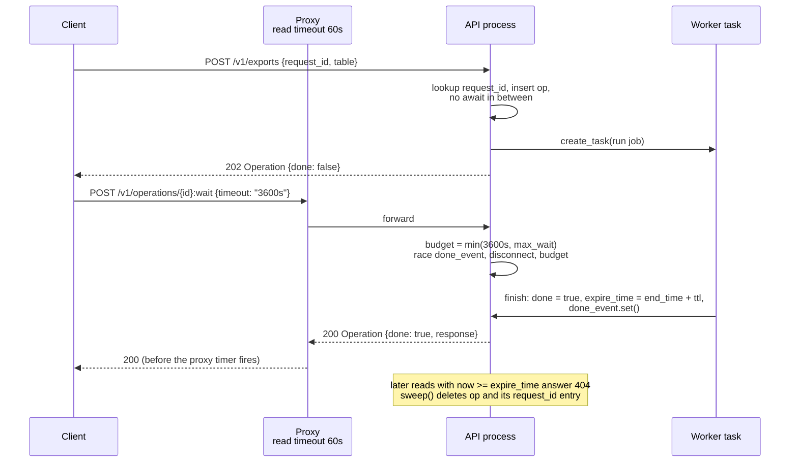

# LRO Engineering Details: Waiter Long-Polling (:wait), Operation TTL Garbage Collection, and Idempotent Replay

> [!summary] Claim
> A `:wait` endpoint is a bounded, disconnect-aware block on a level-triggered completion flag that always answers `200` with the latest Operation; an operation's TTL starts when it finishes and is enforced on every read, not by the sweeper; and a `request_id` replay is only as durable as the record behind it, so the dedupe index must live and die with the operation.

Part of [Bulk Long Running and Error Contracts](README.md) in [API Engineering](../README.md).

## TL;DR

- Mechanism: `:wait` blocks on an `asyncio.Event` that the worker sets once, racing it against a server-clamped budget and the client's `http.disconnect`; expiry is the predicate `now >= expire_time` checked on every read, with a sweeper that only reclaims memory; `request_id` maps to an operation name through an index the sweeper deletes together with the operation.
- Contract rule: `WaitOperation` returns "the latest state" and "is on a best-effort basis", so a wait that times out is a `200` with `"done": false`, never a `504`; `CancelOperation` only "starts asynchronous cancellation", and a cancelled operation becomes `done` with `error.code` `1` (`CANCELLED`).
- The trap: a wait budget above the smallest proxy read timeout (nginx `proxy_read_timeout` defaults to `60s`) turns a healthy wait into a proxy `504`, and Uvicorn does not cancel the handler when the client leaves, so a waiter that does not watch `receive()` holds its tasks for the whole budget.
- Portability fact: `WaitOperation` has no HTTP binding in `google/longrunning/operations.proto`, so `POST .../operations/{id}:wait` is a per-API custom method; the lab ran unchanged on CPython 3.12.13, 3.12.16, 3.13.18, 3.14.6, 3.14.10, 3.15.2, the free-threaded 3.14.6t and 3.15.0b3t builds, and the Debian Trixie and Alpine containers, and Uvicorn, Hypercorn, and Granian all release a waiter when the client closes an HTTP/1.1 connection.
- When not to use it: skip `:wait` when results arrive minutes to hours later (poll with `Retry-After` or push a webhook), when waits would land on a replica that cannot see the worker's completion signal, or when you cannot cap concurrent waiters per caller.

## Mental model



The create call does its idempotency lookup and its insert in one synchronous stretch, then starts the job as a task and returns the pending Operation.
A `:wait` call never trusts the client's timeout; it clamps it to the server maximum, which must sit below every intermediary's read timeout, and then waits for whichever comes first: the worker setting the completion flag, the client disconnecting, or the budget running out.
When the worker finishes it records the result, stamps `end_time` and `expire_time = end_time + ttl`, and sets the flag exactly once; every current waiter wakes, and every later waiter returns without blocking because the flag stays set.
After `expire_time` the operation is invisible to every method at once, even if the sweeper has not run, and the sweeper later frees the record and its `request_id` entry in the same step.

## How it works

### The contract: what `Operations` promises and what it does not

The `google.longrunning.Operations` service defines `GetOperation`, `DeleteOperation`, `CancelOperation`, and `WaitOperation` (googleapis master `google/longrunning/operations.proto`, service `Operations`, last changed in commit `1b141494` on 2025-10-06, fetched 2026-11).
`WaitOperation` "Waits until the specified long-running operation is done or reaches at most a specified timeout, returning the latest state", and "If the operation is already done, the latest state is immediately returned" (operations.proto, `rpc WaitOperation`).
It is explicitly weak: "this method is on a best-effort basis. It may return the latest state before the specified timeout (including immediately), meaning even an immediate response is no guarantee that the operation is done" (operations.proto, `rpc WaitOperation`).
The request carries `google.protobuf.Duration timeout`, documented as "The maximum duration to wait before timing out. If left blank, the wait will be at most the time permitted by the underlying HTTP/RPC protocol. If RPC context deadline is also specified, the shorter one will be used" (operations.proto, `WaitOperationRequest`).
`GetOperation`, `DeleteOperation`, and `CancelOperation` carry `google.api.http` bindings (`get: "/v1/{name=operations/**}"`, `delete: ...`, `post: "/v1/{name=operations/**}:cancel"`), but `rpc WaitOperation(WaitOperationRequest) returns (Operation) {}` has an empty option block, so there is no standard REST path for it (operations.proto, as of 2026-11).
The lab therefore defines `POST /v1/operations/{operation_id}:wait` as a custom method, with the body `{"timeout": "5s"}` in the protobuf JSON form of `Duration`, a string with the required suffix `s` and at most nanosecond precision (protobuf JSON mapping, `Duration`).

`DeleteOperation` "indicates that the client is no longer interested in the operation result. It does not cancel the operation" (operations.proto, `rpc DeleteOperation`).
`CancelOperation` "Starts asynchronous cancellation", "The server makes a best effort to cancel the operation, but success is not guaranteed", and "On successful cancellation, the operation is not deleted; instead, it becomes an operation with an Operation.error value with a google.rpc.Status.code of `1`, corresponding to `Code.CANCELLED`" (operations.proto, `rpc CancelOperation`).
The `Operation` message makes the result a `oneof`: "If `done` == `false`, neither `error` nor `response` is set. If `done` == `true`, exactly one of `error` or `response` can be set" (operations.proto, `Operation.result`).
`code.proto` lists `CANCELLED = 1` with "HTTP Mapping: 499 Client Closed Request" and `INTERNAL = 13` (googleapis master `google/rpc/code.proto`, `Code`); that mapping applies when a call itself fails with `CANCELLED`, whereas here the `GET` succeeds with `200` and carries the status inside `error`.

The sibling note [[Long-Running-Operations-202-Accepted-and-Operation-Resources-AIP-151]] covers the `202` handoff and the polling loop; this note covers the three mechanisms that loop leaves open: blocking waits, retention, and retries of the create call.

### Long-polling: the budget is set by the slowest-to-forgive hop

RFC 6202 describes long polling as a server that answers "only when a particular event, status, or timeout has occurred", with a `200 OK` whose body "contains the actual event, status, or timeout that occurred" `(RFC 6202 Section 5.4)`.
That is the reason a timed-out wait is a `200` with `"done": false` rather than an error.
On the budget, RFC 6202 warns that "problems can occur if this value is set too high (e.g., the client might receive a 408 Request Timeout answer from the server or a 504 Gateway Timeout answer from a proxy)", notes that "The default timeout value in a browser is 300 seconds", and reports that "Several experiments have shown success with timeouts as high as 120 seconds, but generally 30 seconds is a safer value" `(RFC 6202 Section 5.5)`.
nginx is a concrete example: `proxy_read_timeout` defaults to `60s` and "is set only between two successive read operations"; "If the proxied server does not transmit anything within this time, the connection is closed" (nginx `ngx_http_proxy_module`, `proxy_read_timeout`, as of 2026-11).
A wait sends nothing until it answers, so a budget of `>= 60s` behind a default nginx yields a gateway error instead of the latest state.
The lab clamps every request with `budget = self.max_wait if wanted is None else min(wanted, self.max_wait)`, so a client asking for `"3600s"` gets an answer after `max_wait`.
RFC 6202 also says "caching is always intentionally suppressed in a long poll request or response" `(RFC 6202 Section 5.6)`; the lab sends `Cache-Control: no-store` on every `:wait` answer.
Each pending wait holds a connection and a request, and RFC 6202 notes that "the resources allocated to HTTP requests can be significant, and scaling the total number of requests outstanding can be limited on some gateways, proxies, and servers" `(RFC 6202 Section 2.2)`.

### The completion flag must be level-triggered

`asyncio.Event.set` sets the flag and wakes every waiter, and its docstring says "Tasks that call wait() once the flag is true will not block at all"; `Event.wait` returns `True` at once if the flag is set, otherwise appends a future to `_waiters`, awaits it, and removes it in a `finally` block (CPython 3.14.6 `Lib/asyncio/locks.py`, `Event.set` and `Event.wait`).
Two consequences follow.
A waiter that arrives after completion returns without blocking, so there is no window between "read state" and "start waiting" in which a completion can be lost; one `Event` per operation, created with the record and set once in `_finish`, is the whole design.
A waiter that is cancelled, by the budget or by a disconnect, removes its own future, so cancelled waits leave nothing behind in the `Event`.
The anti-pattern is an edge-triggered signal such as a fresh `Event` per waiter or a `Condition.notify_all()` without a predicate check: mutation M1 in the lab (a new `Event` per waiter) makes the already-done wait, the fan-out wait, and the cancel wait all hang until the test guard fires.
`Event` binds to the running loop on its first blocking `wait()` and raises `RuntimeError` if used from another loop (CPython 3.14.6 `Lib/asyncio/mixins.py`, `_LoopBoundMixin._get_loop`), so the flag works within one process and one loop; across replicas it needs a separate notification channel (see The principal's view).

The race itself uses `asyncio.wait({done, gone}, timeout=budget, return_when=asyncio.FIRST_COMPLETED)`.
The Python docs warn: "Unlike wait_for(), wait() does not cancel the futures when a timeout occurs. If wait() is cancelled, the futures in aws are not cancelled and continue to run" (Python docs, `asyncio.wait`).
So `OperationStore.wait` cancels both helper tasks in `finally` and gathers them with `return_exceptions=True`, and it decrements `active_waiters` there too; the fan-out, timeout, clamp, disconnect, and malformed-duration tests assert `active_waiters == 0` afterwards, and mutation M18 (no `gone.cancel()`) deadlocks the `gather` and fails six tests at their guard.

### Disconnects: Uvicorn does not cancel your handler

When the TCP connection drops, Uvicorn's `H11Protocol.connection_lost` sets `self.cycle.disconnected = True` (if the response is not yet complete) and calls `self.cycle.message_event.set()`; it does not cancel the application task (uvicorn 0.54.0 `uvicorn/protocols/http/h11_impl.py`, `H11Protocol.connection_lost`).
`RequestResponseCycle.receive` then returns `{"type": "http.disconnect"}` once `self.disconnected or self.response_complete` is true; until then, after the body is read, it blocks on `message_event.wait()` (uvicorn 0.54.0 `uvicorn/protocols/http/h11_impl.py`, `RequestResponseCycle.receive`).
So a handler that only awaits the completion flag keeps waiting for its full budget after the client is gone, and a client that retries in a loop can stack one abandoned waiter per retry.
The lab's endpoint passes a `disconnected()` coroutine that loops on `await request.receive()` until it sees `http.disconnect`; Starlette exposes the raw callable as the `Request.receive` property (starlette 1.10.0 `starlette/requests.py`, `Request.receive`).
Starlette's `Request.is_disconnected` instead reads one message under an already-cancelled `anyio.CancelScope`, so it never blocks and suits polling loops, not a blocking wait (starlette 1.10.0 `starlette/requests.py`, `Request.is_disconnected`).
`httpx.ASGITransport` cannot simulate a disconnect: its `receive` returns `{"type": "http.disconnect"}` only after `response_complete` is set (httpx 0.28.1 `httpx/_transports/asgi.py`, `ASGITransport.handle_async_request`), so the disconnect test drives the ASGI app directly with a `receive` that blocks the way Uvicorn's does.

### Cancellation is a request, and the worker writes the outcome

`Task.cancel()` "arranges for a CancelledError exception to be thrown into the wrapped coroutine on the next cycle of the event loop", and "Task.cancel() does not guarantee that the Task will be cancelled" (Python docs, `asyncio.Task.cancel`).
That matches the `CancelOperation` contract, so the lab's `cancel` only calls `task.cancel()` and returns `{}`; the worker's `except asyncio.CancelledError` branch records `error = (1, ...)`, sets the flag, and re-raises so the task really ends cancelled.
If the job has already finished, its task has already left `self._tasks` (the `finally` in `_run`), so `cancel` finds no task and does nothing, and a late cancel never turns a delivered `response` into an `error`.
`_finish` also refuses to overwrite a done record (`if op.done: return`), but no path through the store reaches it a second time, so that guard is defense in depth: mutation M20 removes it and every test still passes.
The store keeps every running task in `self._tasks`, because "The event loop only keeps weak references to tasks. A task that isn't referenced elsewhere may get garbage collected at any time, even before it's done" (Python docs, `asyncio.create_task`).
Azure's guidelines model the same outcome as a terminal `status` of `"Canceled"` on the status monitor (Microsoft REST API Guidelines, Azure, "The Status Monitor Resource", as of 2026-11).

### Retention: the TTL starts at completion and is checked on read

AIP-151 says "APIs may allow their operation resources to expire after sufficient time has elapsed after the operation completed" and gives "A good rule of thumb for operation expiry is 30 days" (AIP-151, Expiration, as of 2026-11).
Azure says "DO retain the status monitor resource for some publicly documented period of time (at least 24 hours) after the operation completes" (Microsoft REST API Guidelines, Azure, `lro-status-monitor-retention`, as of 2026-11).
Kubernetes' TTL-after-finished controller uses the same anchor: "The timer starts once the status condition of the Job changes to show that the Job is either Complete or Failed", and it warns that the feature "is sensitive to time skew in your cluster" because it compares stored timestamps (Kubernetes docs, Automatic Cleanup for Finished Jobs, stable since v1.23, as of 2026-11).
Counting from creation instead expires a slow job's record before anyone can read its result: under mutation M7 the lab's `600`-second job is already `404` the moment it finishes, with a `60`-second TTL.
AIP-214 says "APIs wishing to convey an expiration must rely on a google.protobuf.Timestamp field called expire_time" and "APIs must always return the expiration time in the expire_time field and leave the ttl field blank when retrieving the resource" (AIP-214, Guidance).
`Operation` has no such field, so the lab publishes `create_time`, `end_time`, and `expire_time` inside `metadata`, as RFC 3339 strings.

Expiry in the lab is a predicate, not an event: `OperationStore.get` returns `None` when `self._clock.now() >= op.expire_time`, and `GET`, `:wait`, `:cancel`, and replay lookups all go through it.
`sweep()` is only garbage collection: it deletes expired records and their `request_id` entries in one pass.
That split makes visibility exact to the clock tick regardless of how often the sweeper runs (the test asserts `200` at `TTL - 0.001` and `404` at `TTL`, with nothing swept), and it lets the sweeper be slow, batched, or skipped under load without changing the API contract.
After expiry the lab answers `404`, not `410`: RFC 9110 says `410` is for a server that knows "that this condition is likely to be permanent", and "If the origin server does not know, or has no facility to determine, whether or not the condition is permanent, the status code 404 (Not Found) ought to be used instead" `(RFC 9110 Section 15.5.11)`; once the sweeper has deleted the record, the lab has no such facility.
A service that wants `410` must keep a tombstone per expired name, which is retention of a different kind.

### Idempotent replay of the create call

AIP-155 says "Providing a request ID must guarantee idempotency", "If a duplicate request is detected, the server should return the response for the previously successful request, because the client most likely did not receive the previous response", and "APIs may choose any reasonable timeframe for honoring request IDs" (AIP-155, Guidance).
Its example field is "Restricted to 36 ASCII characters. A random UUID is recommended" and annotated `UUID4` (AIP-155, Guidance).
It also permits stale replays: "the method may return the current state of the resource instead" (AIP-155, Stale success responses).
For an LRO create, the current state of the response is the Operation, so a replay returns the same `name`, with `done` and `response` as they are now; the lab's replay test asserts the second call returns the first name with `"done": true` and that the job ran once.

The HTTP `Idempotency-Key` draft adds two error cases: reuse "with a different request payload" gets `422`, and a retry "while the original request is still being processed" gets `409 Conflict` (draft-ietf-httpapi-idempotency-key-header-08 Section 2.7).
It suggests a fingerprint such as a "Checksum of the entire request payload" (draft-08 Section 2.4) and requires that "Resources MUST publish an idempotency-related specification. This specification MUST include expiration related policy if applicable" (draft-08 Section 2.5.2).
The lab fingerprints every field except `request_id` with SHA-256 over canonical JSON and answers `422` on a mismatch.
It never answers `409`, because the create call finishes as soon as the Operation is recorded; a replay during the job is a retry "after the original request completed", which the draft says gets "a response consistent with the request being completed" (draft-08 Section 2.6).
See [[Idempotency-Key-Header-Specification-and-State-Machine-Draft-08]] for the full key state machine.

Two implementation rules make the guarantee real.
First, lookup and insert must be atomic with respect to other requests: `OperationStore.start` is a plain function with no `await` between `self._by_request_id.get(...)` and the insert, so on one event loop no other request can interleave; mutation M11 inserts one `await asyncio.sleep(0)` there and five concurrent replays start more than one job.
The record is inserted before `asyncio.create_task`, so even an eager task factory that runs the job's first step inside `create_task` finds the record already present.
In a shared database the same rule is a uniqueness constraint on the scoped `request_id`, not a read followed by a write.
Second, the dedupe window is the operation's lifetime plus its TTL, because the index entry points at the operation and is deleted with it: a replay after the sweep starts a new job, which the lab asserts as documented behavior rather than hides.
If the index outlives its operation (mutation M9), memory grows without bound; if it is shorter than the operation, a slow job can be started twice.

## Numbers and limits

Lab measurements ran on an Apple M3 Pro, macOS `27.2` (`Darwin 27.2.0 arm64`), CPython `3.14.6`, at the store level without HTTP, two runs each.

| Quantity | Value | Source | Implication |
|---|---:|---|---|
| Long-poll timeout considered safe | `30` s | RFC 6202 Section 5.5 | Keep the server cap at or below it unless every hop is known |
| Long-poll timeouts seen working in experiments | up to `120` s | RFC 6202 Section 5.5 | Not a default; only for controlled paths |
| Browser default request timeout cited | `300` s | RFC 6202 Section 5.5 (2011 text) | Historical figure; do not rely on it |
| nginx `proxy_read_timeout` default | `60s`, between two reads | nginx docs `(as of 2026-11)` | A silent wait of `>= 60` s gets closed by a default nginx |
| Uvicorn per-request timeout | none in `Config.__init__` (`timeout_keep_alive=5` covers idle keep-alive) | uvicorn 0.54.0 `uvicorn/config.py`, `Config.__init__` | The server will hold a wait forever; the app must bound it |
| "Significant amount of time" for an LRO | `10` s rule of thumb | AIP-151 `(as of 2026-11)` | Below this, answer synchronously |
| Operation retention after completion | `30` days rule of thumb | AIP-151 Expiration `(as of 2026-11)` | Upper bound of the replay window if the index dies with the op |
| Status monitor retention after completion | `>= 24` hours, documented | Azure REST API Guidelines `(as of 2026-11)` | Publish the number |
| `request_id` length in AIP-155 example | `36` ASCII characters (UUID) | AIP-155 | The lab accepts lowercase UUIDv4 only |
| Duration JSON precision | nanoseconds, suffix `s` | protobuf JSON mapping | The lab also caps the integer part at `6` digits and rejects negatives (lab policy) |
| Memory per pending waiter | `4396` bytes (`n = 1000`) and `4386` bytes (`n = 10000`), identical in both runs | Measured, `tracemalloc` diff | Three tasks per wait; about `44` MB for `10000` waits before any HTTP or socket cost |
| Time to wake all waiters after completion | `7.2` and `6.9` ms (`n = 1000`); `87.3` and `84.3` ms (`n = 10000`) | Measured, `time.perf_counter` | About `7` to `9` us per waiter, serialized on one loop |
| Lab test suite | `20 passed in 0.27s` | Measured, Worked example | Real-time waits are at most `0.05` s; everything else is event-loop turns |

The measurement helper lived in the job's temporary folder and was run as `uv run --frozen python -I ../tmp_bench/bench.py` from `labs/`; it starts one operation, parks `n` tasks calling `OperationStore.wait` on it with a disconnect stand-in that awaits one shared, never-set `asyncio.Event`, measures `tracemalloc` growth after every waiter is parked, and times `gate.set()` to the end of `asyncio.gather`.
The per-waiter figure therefore counts the outer task, the two helper tasks, and their futures, but not a per-connection `receive` object.

## Portability

| Leg | Version | Result |
|---|---|---|
| CPython `3.12` | `3.12.13` (macOS) and `3.12.16` (containers) | Proven by lab: `20 passed in 0.59s` on `3.12.13` (`uv run --frozen --python 3.12`, separate `UV_PROJECT_ENVIRONMENT`); `3.12.16` passed in the Debian and Alpine container rows below |
| CPython `3.13` | `3.13.18` | Proven by lab: `20 passed in 0.64s` (`--python /opt/homebrew/bin/python3.13`) |
| CPython `3.14` | `3.14.6` (workspace venv) and `3.14.10` | Proven by lab: `20 passed in 0.27s` (Worked example) and `20 passed in 0.54s` (`--python /opt/homebrew/bin/python3.14`) |
| CPython `3.15` | `3.15.2` | Proven by lab: `20 passed in 0.73s` (`--python /opt/homebrew/bin/python3.15`) |
| CPython `3.15` beta | `3.15.0b3` (uv default for `--python 3.15`) | Not run: pytest aborts loading the pinned `hypothesis` plugin with `ModuleNotFoundError: No module named 'hypothesis._native'` |
| CPython `3.15t` free-threaded | `3.15.0b3+freethreaded`, `sys._is_gil_enabled()` is `False` after importing `pydantic_core` and `fastapi` | Proven by lab with `uv run --no-project` and `--with` pins of fastapi, starlette, pydantic, pydantic-core, httpx, httpcore, anyio, pytest, pytest-asyncio at their `uv.lock` versions, with `PYTHONPATH=src`: `20 passed in 0.33s`; `3.15.2t` from the STYLE matrix is not obtainable through uv here and was not run (Homebrew has `python-freethreading` `3.15.2` but installing it would modify the machine outside this job) |
| CPython `3.14t` free-threaded | `3.14.6+freethreaded`, GIL disabled | Proven by lab, same pins: `20 passed in 0.38s` |
| Debian Trixie container | `python:3.12.16-trixie`, `python:3.14.10-trixie`, `python:3.15.2-trixie` (Debian GNU/Linux 13, Linux `aarch64`, glibc) | Proven by lab: `20 passed in 0.30s`, `0.32s`, `0.32s` respectively, with the nine `uv.lock` pins installed by `pip` into a fresh venv and `PYTHONPATH=src` |
| Alpine container | `python:3.12.16-alpine`, `python:3.14.10-alpine`, `python:3.15.2-alpine` (Alpine Linux v3.24, Linux `aarch64`, musl libc) | Proven by lab: `20 passed in 0.39s`, `0.37s`, `0.35s` respectively, same method |
| `asyncio.timeout` and `asyncio.wait` | `asyncio.timeout` added in CPython `3.11` | Python docs; the lab uses `asyncio.wait(..., timeout=...)` in the store and `asyncio.timeout` only in tests, and every leg above passed |
| Uvicorn | `0.54.0` | Proven by run over a socket (HTTP/1.1, cleartext, `127.0.0.1`): a parked `:wait` is released after the client closes the TCP connection (`active_waiters` back to `0` in under `0.1` s, two runs); the same probe with the socket held open still shows `1` waiter after `0.5` s; mechanism read in source (`H11Protocol.connection_lost`, `RequestResponseCycle.receive`) |
| Hypercorn, Granian | `0.18.0`, `2.8.7` | Proven by the same socket probe: the waiter is released after the client closes the connection (under `0.1` s on both, two runs), and the held-open control stays parked; the ASGI `http.disconnect` event is the portable signal, and `:wait` never needed a server-specific hook |
| HTTP/1.1, HTTP/2, HTTP/3 | RFC 9112, RFC 9113, RFC 9114 | HTTP/1.1 proven by the socket probe above on all three servers; HTTP/2 and HTTP/3 not run (no TLS or QUIC leg), and the claim that a wait is an ordinary request and response on every version rests on RFC 9110 Section 1.2 ("All three major versions of HTTP rely on the semantics defined by this document"), not on a run |

The container rows ran under OrbStack on the same Mac as `docker run --rm --pull=never -v labs/src:/w/src:ro -v labs/tests:/w/tests:ro -v labs/pyproject.toml:/w/pyproject.toml:ro -w /w <image> sh -c '...'`, creating a venv, installing `fastapi==0.162.0 starlette==1.10.0 pydantic==2.14.3 pydantic-core==2.50.4 httpx==0.28.1 httpcore==1.0.9 anyio==4.16.0 pytest==9.2.0 pytest-asyncio==1.4.1.post1`, and running the lab test with `-p no:cacheprovider`.

The socket probe was a temporary script run as `labs/.venv/bin/python -I probe.py <server> <port>` on CPython `3.14.6`, macOS `27.2` (`Darwin 27.2.0 arm64`).
It started each server on a loopback port with an app that wraps `create_app` around a store whose job never finishes plus a `GET /debug/waiters` endpoint, sent a raw `POST /v1/operations/{id}:wait` with `{"timeout": "30s"}`, waited for `active_waiters == 1`, closed the socket, and polled until it returned to `0`.
Servers ran as `uvicorn srvapp:app`, `hypercorn srvapp:app --bind 127.0.0.1:PORT`, and `granian --interface asgi srvapp:app`, each with its default settings otherwise.
In the control run the socket stayed open and the waiter was still parked after `0.5` s on every server.

## Worked example

The [implementation](../labs/src/api_labs/f06_bulk_long_running_and_error_contracts/lro_waiter.py) exposes `POST /v1/exports` (create, with `request_id` replay), `GET /v1/operations/{operation_id}`, `POST /v1/operations/{operation_id}:wait`, and `POST /v1/operations/{operation_id}:cancel` over an in-memory `OperationStore` with a manual clock for TTL arithmetic.
The [test](../labs/tests/f06_bulk_long_running_and_error_contracts/test_asynchronous_job_result_expiration_cancellation_and_wait_semantics.py) gates the job on an `asyncio.Event`, so completion happens exactly when the test says, and waits on event-loop turns rather than wall time except in the two timeout tests.

### Implementation (`labs/src/api_labs/f06_bulk_long_running_and_error_contracts/lro_waiter.py`)

```python
"""LRO engineering details: bounded :wait long-polling, completion-relative TTL, cancel, replay."""

import asyncio
import hashlib
import json
import uuid
from collections.abc import Awaitable, Callable, Coroutine
from dataclasses import dataclass, field
from datetime import UTC, datetime
from decimal import Decimal
from typing import Annotated

from fastapi import FastAPI, Path, Request
from fastapi.responses import JSONResponse
from pydantic import BaseModel, ConfigDict, Field

CODE_CANCELLED = 1  # google.rpc.Code.CANCELLED
CODE_INTERNAL = 13  # google.rpc.Code.INTERNAL
OPERATION_ID = r"^[0-9a-f]{32}$"
UUID4 = r"^[0-9a-f]{8}-[0-9a-f]{4}-4[0-9a-f]{3}-[89ab][0-9a-f]{3}-[0-9a-f]{12}$"
DURATION = r"^[0-9]{1,6}(\.[0-9]{1,9})?s$"  # protobuf JSON mapping of google.protobuf.Duration
PROBLEM_JSON = "application/problem+json"

JobResult = dict[str, object]


class ExportRequest(BaseModel):
    """Start an export; `request_id` makes the create idempotent (AIP-155)."""

    model_config = ConfigDict(extra="forbid", strict=True)

    request_id: str = Field(pattern=UUID4)
    table: str = Field(pattern=r"^[a-z_]{1,64}$")

    def fingerprint(self) -> str:
        """Hash of everything except the request_id, to detect key reuse with a new payload."""
        payload = self.model_dump(exclude={"request_id"})
        canonical = json.dumps(payload, sort_keys=True, separators=(",", ":"))
        return hashlib.sha256(canonical.encode()).hexdigest()


Job = Callable[[ExportRequest], Awaitable[JobResult]]
Disconnected = Callable[[], Coroutine[None, None, None]]


class WaitRequest(BaseModel):
    """Body of `:wait`; `timeout` uses the protobuf JSON Duration form, for example `"5s"`."""

    model_config = ConfigDict(extra="forbid", strict=True)

    timeout: str | None = Field(default=None, pattern=DURATION)

    def seconds(self) -> float | None:
        return None if self.timeout is None else float(Decimal(self.timeout[:-1]))


class ManualClock:
    """Wall clock for TTL arithmetic that tests advance explicitly."""

    def __init__(self, start: float = 1_767_225_600.0) -> None:  # 2026-01-01T00:00:00Z
        self._now = start

    def now(self) -> float:
        return self._now

    def advance(self, seconds: float) -> None:
        self._now += seconds


def _rfc3339(epoch: float) -> str:
    return datetime.fromtimestamp(epoch, UTC).isoformat().replace("+00:00", "Z")


@dataclass(slots=True)
class Operation:
    """One google.longrunning.Operation-shaped record plus server-side bookkeeping."""

    name: str
    request_id: str
    fingerprint: str
    create_time: float
    done_event: asyncio.Event = field(default_factory=asyncio.Event)
    done: bool = False
    response: JobResult | None = None
    error: tuple[int, str] | None = None
    end_time: float | None = None
    expire_time: float | None = None

    def to_json(self) -> dict[str, object]:
        metadata: dict[str, object] = {"create_time": _rfc3339(self.create_time)}
        if self.end_time is not None and self.expire_time is not None:
            metadata["end_time"] = _rfc3339(self.end_time)
            metadata["expire_time"] = _rfc3339(self.expire_time)
        body: dict[str, object] = {"name": self.name, "done": self.done, "metadata": metadata}
        if self.error is not None:  # oneof result: set only when done
            body["error"] = {"code": self.error[0], "message": self.error[1]}
        elif self.done:
            body["response"] = self.response
        return body


class RequestIdReusedError(Exception):
    """The same request_id arrived with a different payload."""


class OperationStore:
    """In-memory operations collection: start, replay, wait, cancel, expire, sweep."""

    def __init__(self, job: Job, clock: ManualClock, *, ttl: float, max_wait: float) -> None:
        self._job = job
        self._clock = clock
        self._ttl = ttl
        self.max_wait = max_wait
        self._ops: dict[str, Operation] = {}
        self._by_request_id: dict[str, str] = {}
        self._tasks: dict[str, asyncio.Task[None]] = {}  # strong refs: the loop keeps weak ones
        self.active_waiters = 0
        self.job_starts = 0

    @property
    def operation_count(self) -> int:
        return len(self._ops)

    @property
    def request_id_count(self) -> int:
        return len(self._by_request_id)

    def get(self, name: str) -> Operation | None:
        """Lazy expiry: an expired record is invisible even before the sweeper deletes it."""
        op = self._ops.get(name)
        if op is None or (op.expire_time is not None and self._clock.now() >= op.expire_time):
            return None
        return op

    def start(self, request: ExportRequest) -> Operation:
        """Create or replay; no await between lookup and insert, so replays cannot race."""
        fingerprint = request.fingerprint()
        previous = self._by_request_id.get(request.request_id)
        if previous is not None and (op := self.get(previous)) is not None:
            if op.fingerprint != fingerprint:
                raise RequestIdReusedError(request.request_id)
            return op
        op = Operation(
            name=f"operations/{uuid.uuid4().hex}",
            request_id=request.request_id,
            fingerprint=fingerprint,
            create_time=self._clock.now(),
        )
        self._ops[op.name] = op
        self._by_request_id[request.request_id] = op.name
        self.job_starts += 1
        self._tasks[op.name] = asyncio.create_task(self._run(op, request))
        return op

    async def _run(self, op: Operation, request: ExportRequest) -> None:
        try:
            result = await self._job(request)
        except asyncio.CancelledError:
            self._finish(op, error=(CODE_CANCELLED, "Operation cancelled by CancelOperation."))
            raise
        except Exception:
            self._finish(op, error=(CODE_INTERNAL, "Export failed."))
        else:
            self._finish(op, response=result)
        finally:
            self._tasks.pop(op.name, None)

    def _finish(
        self,
        op: Operation,
        *,
        response: JobResult | None = None,
        error: tuple[int, str] | None = None,
    ) -> None:
        if op.done:
            return
        now = self._clock.now()
        op.done, op.response, op.error = True, response, error
        op.end_time, op.expire_time = now, now + self._ttl  # TTL counts from completion
        op.done_event.set()  # level-triggered: later waiters return at once

    def cancel(self, name: str) -> Operation | None:
        """Best effort: request cancellation and return; the worker records CANCELLED."""
        op = self.get(name)
        if op is None:
            return None
        task = self._tasks.get(name)
        if task is not None and not op.done:
            task.cancel()
        return op

    async def wait(self, op: Operation, wanted: float | None, disconnected: Disconnected) -> None:
        """Block until done, the clamped wait budget, or client disconnect, whichever is first."""
        budget = self.max_wait if wanted is None else min(wanted, self.max_wait)
        self.active_waiters += 1
        done = asyncio.create_task(op.done_event.wait())
        gone = asyncio.create_task(disconnected())
        try:
            await asyncio.wait({done, gone}, timeout=budget, return_when=asyncio.FIRST_COMPLETED)
        finally:
            self.active_waiters -= 1
            done.cancel()
            gone.cancel()
            await asyncio.gather(done, gone, return_exceptions=True)

    def sweep(self) -> int:
        """Delete expired operations and their request_id index entries together."""
        expired = [name for name in self._ops if self.get(name) is None]
        for name in expired:
            op = self._ops.pop(name)
            if self._by_request_id.get(op.request_id) == name:
                del self._by_request_id[op.request_id]
        return len(expired)


def _problem(status: int, title: str, detail: str) -> JSONResponse:
    body = {"type": "about:blank", "title": title, "status": status, "detail": detail}
    return JSONResponse(body, status_code=status, media_type=PROBLEM_JSON)


def _not_found(operation_id: str) -> JSONResponse:
    return _problem(404, "Not Found", f"operations/{operation_id} does not exist or has expired.")


OperationId = Annotated[str, Path(pattern=OPERATION_ID)]


def create_app(store: OperationStore) -> FastAPI:
    """Expose the store with AIP-style custom methods `:wait` and `:cancel`."""
    app = FastAPI()

    @app.post("/v1/exports")
    async def create_export(body: ExportRequest) -> JSONResponse:
        try:
            op = store.start(body)
        except RequestIdReusedError:
            return _problem(422, "Unprocessable Content", "request_id reused with a new payload.")
        return JSONResponse(op.to_json(), status_code=202)

    @app.get("/v1/operations/{operation_id}")
    async def get_operation(operation_id: OperationId) -> JSONResponse:
        op = store.get(f"operations/{operation_id}")
        return _not_found(operation_id) if op is None else JSONResponse(op.to_json())

    @app.post("/v1/operations/{operation_id}:wait")
    async def wait_operation(
        operation_id: OperationId, body: WaitRequest, request: Request
    ) -> JSONResponse:
        name = f"operations/{operation_id}"
        op = store.get(name)
        if op is None:
            return _not_found(operation_id)

        async def disconnected() -> None:
            while (await request.receive())["type"] != "http.disconnect":
                pass

        await store.wait(op, body.seconds(), disconnected)
        latest = store.get(name)  # the record may have expired while we waited
        if latest is None:
            return _not_found(operation_id)
        return JSONResponse(latest.to_json(), headers={"Cache-Control": "no-store"})

    @app.post("/v1/operations/{operation_id}:cancel")
    async def cancel_operation(operation_id: OperationId) -> JSONResponse:
        op = store.cancel(f"operations/{operation_id}")
        return _not_found(operation_id) if op is None else JSONResponse({})

    return app
```

### Test (`labs/tests/f06_bulk_long_running_and_error_contracts/test_asynchronous_job_result_expiration_cancellation_and_wait_semantics.py`)

```python
"""Unit tests for LRO :wait long-polling, completion-relative TTL, cancellation, and replay."""

import asyncio
import json
import time
import uuid
from collections.abc import Callable
from dataclasses import dataclass, field
from typing import Any

import httpx
import pytest

from api_labs.f06_bulk_long_running_and_error_contracts.lro_waiter import (
    CODE_CANCELLED,
    CODE_INTERNAL,
    ExportRequest,
    JobResult,
    ManualClock,
    OperationStore,
    create_app,
)

TTL = 60.0
GUARD = 2.0  # seconds; a test that needs longer than this has hung


@dataclass
class GatedJob:
    """Export job that blocks until the test opens its gate."""

    gate: asyncio.Event = field(default_factory=asyncio.Event)
    runs: list[str] = field(default_factory=list[str])

    async def __call__(self, request: ExportRequest) -> JobResult:
        self.runs.append(request.table)
        await self.gate.wait()
        return {"table": request.table, "rows": 3}


def make(max_wait: float = 30.0) -> tuple[GatedJob, ManualClock, OperationStore, httpx.AsyncClient]:
    job, clock = GatedJob(), ManualClock()
    store = OperationStore(job, clock, ttl=TTL, max_wait=max_wait)
    transport = httpx.ASGITransport(app=create_app(store))
    return job, clock, store, httpx.AsyncClient(transport=transport, base_url="http://test")


async def until(predicate: Callable[[], bool], max_turns: int = 10_000) -> None:
    """Yield to the event loop until predicate holds; counted turns keep it deterministic."""
    for _ in range(max_turns):
        if predicate():
            return
        await asyncio.sleep(0)
    raise AssertionError(f"condition not reached in {max_turns} event loop turns")


async def start(client: httpx.AsyncClient, request_id: str, table: str = "orders") -> str:
    response = await client.post("/v1/exports", json={"request_id": request_id, "table": table})
    assert response.status_code == 202
    name: str = response.json()["name"]
    return name


def new_id() -> str:
    return str(uuid.uuid4())


@pytest.mark.unit
@pytest.mark.asyncio
async def test_wait_on_finished_operation_returns_at_once_because_done_is_level_triggered() -> None:
    job, _, store, client = make()
    async with client:
        name = await start(client, new_id())
        job.gate.set()
        await until(lambda: (op := store.get(name)) is not None and op.done)
        async with asyncio.timeout(GUARD):
            response = await client.post(f"/v1/{name}:wait", json={"timeout": "30s"})
    assert response.status_code == 200
    assert response.json()["done"] is True
    assert response.json()["response"] == {"table": "orders", "rows": 3}
    assert response.headers["cache-control"] == "no-store"


@pytest.mark.unit
@pytest.mark.asyncio
async def test_completion_wakes_every_waiter_before_its_timeout() -> None:
    job, _, store, client = make()
    async with client:
        name = await start(client, new_id())
        waits = [
            asyncio.create_task(client.post(f"/v1/{name}:wait", json={"timeout": "30s"}))
            for _ in range(3)
        ]
        await until(lambda: store.active_waiters == 3)
        job.gate.set()
        async with asyncio.timeout(GUARD):
            responses = await asyncio.gather(*waits)
    assert [r.json()["done"] for r in responses] == [True, True, True]
    assert store.active_waiters == 0


@pytest.mark.unit
@pytest.mark.asyncio
async def test_wait_timeout_returns_latest_state_as_200_not_an_error() -> None:
    _, _, store, client = make()
    async with client:
        name = await start(client, new_id())
        async with asyncio.timeout(GUARD):
            response = await client.post(f"/v1/{name}:wait", json={"timeout": "0.05s"})
    assert response.status_code == 200
    body = response.json()
    assert body["done"] is False
    assert "response" not in body
    assert "error" not in body
    assert store.active_waiters == 0


@pytest.mark.unit
@pytest.mark.asyncio
async def test_wait_clamps_client_timeout_to_server_maximum() -> None:
    _, _, store, client = make(max_wait=0.05)
    async with client:
        name = await start(client, new_id())
        begin = time.perf_counter()
        async with asyncio.timeout(GUARD):
            response = await client.post(f"/v1/{name}:wait", json={"timeout": "3600s"})
        elapsed = time.perf_counter() - begin
    assert response.status_code == 200
    assert response.json()["done"] is False
    assert 0.05 <= elapsed < GUARD
    assert store.active_waiters == 0


@pytest.mark.unit
@pytest.mark.asyncio
async def test_wait_releases_its_waiter_when_the_client_disconnects() -> None:
    job, _, store, client = make(max_wait=30.0)
    async with client:
        name = await start(client, new_id())
    body = json.dumps({"timeout": "30s"}).encode()
    client_gone = asyncio.Event()
    delivered = False
    sent: list[dict[str, Any]] = []

    async def receive() -> dict[str, Any]:
        nonlocal delivered
        if not delivered:
            delivered = True
            return {"type": "http.request", "body": body, "more_body": False}
        await client_gone.wait()  # what Uvicorn does: block until connection_lost
        return {"type": "http.disconnect"}

    async def send(message: Any) -> None:
        sent.append(dict(message))

    scope: dict[str, Any] = {
        "type": "http",
        "asgi": {"version": "3.0"},
        "http_version": "1.1",
        "method": "POST",
        "scheme": "http",
        "path": f"/v1/{name}:wait",
        "raw_path": f"/v1/{name}:wait".encode(),
        "query_string": b"",
        "root_path": "",
        "headers": [(b"host", b"test"), (b"content-type", b"application/json")],
        "client": ("127.0.0.1", 50000),
        "server": ("test", 80),
    }
    task = asyncio.create_task(create_app(store)(scope, receive, send))
    await until(lambda: store.active_waiters == 1)
    client_gone.set()
    async with asyncio.timeout(GUARD):  # without the disconnect watcher this waits 30 s
        await task
    assert store.active_waiters == 0
    assert job.runs == ["orders"]
    op = store.get(name)
    assert op is not None
    assert op.done is False


@pytest.mark.unit
@pytest.mark.asyncio
async def test_cancel_finishes_operation_with_code_1_and_wakes_the_waiter() -> None:
    job, _, store, client = make()
    async with client:
        name = await start(client, new_id())
        waiter = asyncio.create_task(client.post(f"/v1/{name}:wait", json={"timeout": "30s"}))
        await until(lambda: store.active_waiters == 1)
        cancel = await client.post(f"/v1/{name}:cancel", json={})
        async with asyncio.timeout(GUARD):
            waited = await waiter
        polled = await client.get(f"/v1/{name}")
    assert cancel.status_code == 200
    assert cancel.json() == {}
    assert waited.json()["done"] is True
    assert waited.json()["error"]["code"] == CODE_CANCELLED
    assert "response" not in waited.json()
    assert polled.json() == waited.json()
    assert job.gate.is_set() is False


@pytest.mark.unit
@pytest.mark.asyncio
async def test_cancel_after_completion_keeps_the_response() -> None:
    job, _, store, client = make()
    async with client:
        name = await start(client, new_id())
        job.gate.set()
        await until(lambda: (op := store.get(name)) is not None and op.done)
        cancel = await client.post(f"/v1/{name}:cancel", json={})
        polled = await client.get(f"/v1/{name}")
    assert cancel.status_code == 200
    assert polled.json()["response"] == {"table": "orders", "rows": 3}
    assert "error" not in polled.json()


@pytest.mark.unit
@pytest.mark.asyncio
async def test_failed_job_finishes_with_code_13_and_hides_the_exception() -> None:
    async def failing(request: ExportRequest) -> JobResult:
        raise RuntimeError(f"disk full while writing {request.table}")

    store = OperationStore(failing, ManualClock(), ttl=TTL, max_wait=30.0)
    transport = httpx.ASGITransport(app=create_app(store))
    async with httpx.AsyncClient(transport=transport, base_url="http://test") as client:
        name = await start(client, new_id())
        async with asyncio.timeout(GUARD):
            waited = await client.post(f"/v1/{name}:wait", json={"timeout": "30s"})
    assert waited.json()["done"] is True
    assert waited.json()["error"] == {"code": CODE_INTERNAL, "message": "Export failed."}
    assert "response" not in waited.json()


@pytest.mark.unit
@pytest.mark.asyncio
async def test_ttl_counts_from_completion_not_from_creation() -> None:
    job, clock, store, client = make()
    async with client:
        name = await start(client, new_id())
        clock.advance(10 * TTL)  # a slow job outlives the TTL while it is still running
        running = await client.get(f"/v1/{name}")
        job.gate.set()
        await until(lambda: (op := store.get(name)) is not None and op.done)
        clock.advance(TTL - 0.001)
        last_moment = await client.get(f"/v1/{name}")
        clock.advance(0.001)
        expired = await client.get(f"/v1/{name}")
    assert running.status_code == 200
    assert running.json()["done"] is False
    assert last_moment.status_code == 200
    assert last_moment.json()["metadata"] == {
        "create_time": "2026-01-01T00:00:00Z",
        "end_time": "2026-01-01T00:10:00Z",
        "expire_time": "2026-01-01T00:11:00Z",
    }
    assert expired.status_code == 404


@pytest.mark.unit
@pytest.mark.asyncio
async def test_wait_answers_404_when_the_record_expires_while_the_waiter_is_parked() -> None:
    clock = ManualClock()
    gate = asyncio.Event()

    async def expiring_job(request: ExportRequest) -> JobResult:
        await gate.wait()
        # Runs before the waiter resumes: the record finishes, then its whole TTL elapses.
        asyncio.get_running_loop().call_soon(clock.advance, TTL)
        return {"table": request.table}

    store = OperationStore(expiring_job, clock, ttl=TTL, max_wait=30.0)
    transport = httpx.ASGITransport(app=create_app(store))
    async with httpx.AsyncClient(transport=transport, base_url="http://test") as client:
        name = await start(client, new_id())
        waiting = asyncio.create_task(client.post(f"/v1/{name}:wait", json={"timeout": "30s"}))
        await until(lambda: store.active_waiters == 1)
        gate.set()
        async with asyncio.timeout(GUARD):
            response = await waiting
    assert response.status_code == 404
    assert response.headers["content-type"] == "application/problem+json"
    assert store.active_waiters == 0


@pytest.mark.unit
@pytest.mark.asyncio
async def test_expired_operation_is_invisible_before_the_sweep_and_the_sweep_frees_both_maps() -> (
    None
):
    job, clock, store, client = make()
    async with client:
        name = await start(client, new_id())
        job.gate.set()
        await until(lambda: (op := store.get(name)) is not None and op.done)
        clock.advance(TTL)
        statuses = [
            (await client.get(f"/v1/{name}")).status_code,
            (await client.post(f"/v1/{name}:wait", json={"timeout": "1s"})).status_code,
            (await client.post(f"/v1/{name}:cancel", json={})).status_code,
        ]
    assert statuses == [404, 404, 404]
    assert (store.operation_count, store.request_id_count) == (1, 1)  # not swept yet
    assert store.sweep() == 1
    assert (store.operation_count, store.request_id_count) == (0, 0)


@pytest.mark.unit
@pytest.mark.asyncio
async def test_replay_with_same_request_id_returns_same_operation_and_runs_job_once() -> None:
    job, _, store, client = make()
    request_id = new_id()
    async with client:
        first = await start(client, request_id)
        job.gate.set()
        await until(lambda: (op := store.get(first)) is not None and op.done)
        replay = await client.post(
            "/v1/exports", json={"request_id": request_id, "table": "orders"}
        )
    assert replay.status_code == 202
    assert replay.json()["name"] == first
    assert replay.json()["done"] is True
    assert replay.json()["response"] == {"table": "orders", "rows": 3}
    assert job.runs == ["orders"]


@pytest.mark.unit
@pytest.mark.asyncio
async def test_concurrent_replays_start_exactly_one_job() -> None:
    job, _, store, client = make()
    request_id = new_id()
    async with client:
        names = await asyncio.gather(*(start(client, request_id) for _ in range(5)))
        await until(lambda: len(job.runs) >= 1)
        await asyncio.sleep(0)
    assert len(set(names)) == 1
    assert store.job_starts == 1
    assert job.runs == ["orders"]


@pytest.mark.unit
@pytest.mark.asyncio
async def test_request_id_reused_with_different_payload_is_422() -> None:
    _, _, store, client = make()
    request_id = new_id()
    async with client:
        await start(client, request_id, table="orders")
        reused = await client.post(
            "/v1/exports", json={"request_id": request_id, "table": "invoices"}
        )
    assert reused.status_code == 422
    assert reused.headers["content-type"] == "application/problem+json"
    assert store.job_starts == 1


@pytest.mark.unit
@pytest.mark.asyncio
async def test_replay_after_retention_window_runs_the_job_again() -> None:
    job, clock, store, client = make()
    request_id = new_id()
    async with client:
        first = await start(client, request_id)
        job.gate.set()
        await until(lambda: (op := store.get(first)) is not None and op.done)
        clock.advance(TTL)
        assert store.sweep() == 1
        second = await start(client, request_id)
        await until(lambda: len(job.runs) == 2)
    assert second != first
    assert job.runs == ["orders", "orders"]


@pytest.mark.unit
@pytest.mark.asyncio
@pytest.mark.parametrize("duration", ["5", "-1s", "1h", "1.0000000001s"])
async def test_wait_rejects_malformed_duration(duration: str) -> None:
    _, _, store, client = make()
    async with client:
        name = await start(client, new_id())
        response = await client.post(f"/v1/{name}:wait", json={"timeout": duration})
    assert response.status_code == 422
    assert store.active_waiters == 0


@pytest.mark.unit
@pytest.mark.asyncio
async def test_get_with_custom_method_suffix_is_rejected_not_looked_up() -> None:
    _, _, _, client = make()
    async with client:
        name = await start(client, new_id())
        response = await client.get(f"/v1/{name}:wait")
    assert response.status_code == 422
```

### Captured run

Run from `labs/` on CPython `3.14.6`, macOS `27.2` (`Darwin 27.2.0 arm64`, Apple M3 Pro):

```text
$ uv run --frozen pytest tests/f06_bulk_long_running_and_error_contracts/test_asynchronous_job_result_expiration_cancellation_and_wait_semantics.py -q
....................                                                     [100%]
20 passed in 0.27s
```

Every test was also run against a deliberately broken implementation, one mutation at a time, with the file restored and compared byte for byte afterwards; every mutation except M20 failed at least one test, and each of the 20 test cases fails under at least one mutation:

| Mutation | Tests that failed |
|---|---|
| M1 fresh `Event` per waiter (edge-triggered) | already-done wait, fan-out wake, cancel wakes waiter |
| M2 `_finish` never calls `set()` | the same three |
| M3 timed-out wait answered `504` | timeout returns `200`, clamp |
| M4 no clamp to `max_wait` | clamp |
| M5 no disconnect watcher | disconnect releases waiter |
| M6 worker swallows `CancelledError` without recording it | cancel wakes waiter with code `1` |
| M7 TTL counted from `create_time` | TTL from completion |
| M8 no expiry check on read | TTL from completion, invisible before sweep, replay after window |
| M8b expiry check `>` instead of `>=` | the same three |
| M9 sweep keeps the `request_id` entry | invisible before sweep (index count) |
| M10 no `request_id` lookup | replay, concurrent replays, `422` reuse |
| M11 `await` between lookup and insert | concurrent replays |
| M12 fingerprint not compared | `422` reuse |
| M13 `cancel` records `CANCELLED` itself | cancel after completion, cancel wakes waiter |
| M14 no `operation_id` pattern | `GET ...:wait` rejected |
| M15 duration pattern `^.*s$` | malformed duration (`-1s`, `1.0000000001s`) |
| M16 no `Cache-Control` | already-done wait |
| M17 no duration pattern | malformed duration (all four cases) |
| M18 no `gone.cancel()` in `finally` | six tests, each at its `2` s guard: already-done, fan-out, timeout, clamp, cancel, failed job |
| M19 job exception not recorded | failed job finishes with code `13` |
| M21 `:wait` answers from the pre-wait record instead of re-reading the store | wait answers `404` when the record expires while parked |
| M20 `_finish` without the `if op.done` guard | none: equivalent mutant, because no path calls `_finish` twice |

## Pitfalls

No public postmortem is cited for these failure modes; each trigger is reproduced by a mutation in the lab, and each limit comes from the cited specification or source.

> [!warning] Wait budget above the proxy read timeout
> Trigger: the server honors the client's `timeout` (or caps it at `120` s) behind nginx with the default `proxy_read_timeout 60s`.
> Symptom: waits that would have returned the latest state come back as a proxy `504`, and clients treat a healthy job as failed.
> Fix: clamp to a server `max_wait` below the smallest read timeout on the path (RFC 6202 Section 5.5 suggests `30` s) and document it; mutation M4 shows an unclamped wait running for the client's full `3600s`.

> [!warning] Edge-triggered completion signal
> Trigger: the waiter creates its own `Event` or calls `Condition.wait()` without rechecking `done`, after reading the state in a separate step.
> Symptom: a job that finishes between the read and the wait is never observed; the waiter sleeps until its budget and returns `"done": false` for a finished job.
> Fix: one level-triggered flag per operation, set once in the same step that records the result (mutations M1 and M2).

> [!warning] Abandoned waiters after client disconnect
> Trigger: the handler awaits only the completion flag; Uvicorn sets `disconnected` but does not cancel the handler.
> Symptom: waiter count and memory grow with client retries; in the lab one pending wait costs about `4.4` KB before any socket cost.
> Fix: race the flag against `receive()` returning `http.disconnect`, and cancel and gather helper tasks in `finally` (mutation M5).

> [!warning] TTL anchored at creation, or enforced only by the sweeper
> Trigger: `expire_time = create_time + ttl`, or reads that trust whatever the sweeper has not yet deleted.
> Symptom: long jobs lose their result as they finish, or results stay visible for an extra sweep interval that depends on load.
> Fix: `expire_time = end_time + ttl`, checked on every read; the sweeper only frees memory (mutations M7 and M8).

> [!warning] Check-then-insert across an `await`
> Trigger: the `request_id` lookup and the insert are separated by an `await`, for example a database read followed by a write.
> Symptom: concurrent retries from a client library each start a job; the lab's M11 mutation turns five concurrent replays into more than one job.
> Fix: no suspension point between lookup and insert in-process, and a uniqueness constraint on the scoped `request_id` in a shared store.

> [!warning] Dedupe index and operation with different lifetimes
> Trigger: `request_id` entries are kept in a separate cache with its own TTL, or never deleted.
> Symptom: a shorter index lets a retry start a second job; a longer one points at deleted operations and grows without bound (mutation M9).
> Fix: delete the index entry in the same sweep step as the operation, and publish the resulting replay window (draft-08 Section 2.5.2).

> [!warning] Cancellation that rewrites history or never lands
> Trigger: `cancel` marks the operation `CANCELLED` itself, or the worker catches `CancelledError` and returns.
> Symptom: a finished export flips from `response` to `error` (M13), or a cancelled job never becomes `done` and its waiters hang (M6).
> Fix: `cancel` only requests; the worker records code `1` and re-raises; `_finish` refuses to overwrite a done record.

> [!warning] Custom-method suffix captured by the resource path
> Trigger: Starlette's `str` convertor matches `[^/]+` (starlette 1.10.0 `starlette/convertors.py`, `StringConvertor.regex`), so `GET /v1/operations/{operation_id}` also matches `/v1/operations/abc:wait`.
> Symptom: a mistaken `GET .../abc:wait` looks up an operation literally named `abc:wait` and returns a misleading `404`.
> Fix: constrain `operation_id` with a pattern that excludes `:`, so the request fails validation with `422` (mutation M14).

## Security and robustness

- OWASP API4:2023 (Unrestricted Resource Consumption) lists missing "Execution timeouts" among the limits that make an API vulnerable; a `:wait` that holds a connection per call is that risk by design, so cap the per-call budget (done in the lab) and also cap concurrent waiters per caller and per operation (not implemented in the lab; reject the excess with `429` or answer immediately with the current state).
- OWASP API1:2023 (Broken Object Level Authorization) says every endpoint that receives an object ID "should implement object-level authorization checks"; `GET`, `:wait`, and `:cancel` all take an operation name, and a random 128-bit name is not authorization, so check the caller against the operation's owner on all three.
- Scope `request_id` per principal and per method: the lab keys it globally, which in a multi-tenant service would let one tenant's guessed or leaked `request_id` return another tenant's Operation; this is a lab simplification, not a recommendation.
- Do not leak worker exceptions into `error.message`: the lab records `"Export failed."` with code `13` and keeps details server-side (`test_failed_job_finishes_with_code_13_and_hides_the_exception`, killed by mutation M19).
- Validate the wait body strictly: the lab accepts only `^[0-9]{1,6}(\.[0-9]{1,9})?s$`, which rejects negatives (protobuf allows negative durations: `seconds` "Must be from -315,576,000,000 to +315,576,000,000 inclusive", protobuf `src/google/protobuf/duration.proto`, `Duration`), units other than `s`, and precision beyond nanoseconds, so no input reaches `Decimal` or `asyncio.wait` unchecked.
- Suppress caching of operation state: the lab sends `Cache-Control: no-store` on `:wait`; set it on `GET` of a pending operation too, since a cached `"done": false` is a stale lie (the lab's `GET` does not set it).
- Clock skew: expiry compares stored timestamps with the reader's clock, which Kubernetes calls out for its TTL controller; with several replicas, compute `expire_time` and compare it on the same clock source, for example the database server's.

## The principal's view

The decision is not whether to offer `:wait` but which latency budget it buys and who pays for it.
Polling with `Retry-After` costs one short request per interval and scales with clients; `:wait` cuts completion latency to one network transit but costs a held connection, about `4.4` KB of loop state, and a slot on every proxy per waiting client, so it is an optimization that must degrade to polling, never a replacement for it.
Organizationally, publish three numbers as a platform standard rather than per team: the maximum wait (below the edge's read timeout), the operation retention after completion (AIP-151 suggests `30` days; Azure requires at least `24` hours), and the replay window, which equals retention when the dedupe index dies with the operation.
The single-process `asyncio.Event` design stops working the moment the wait lands on a replica that is not running the job; at that point choose between a cross-process notification channel with a short re-check interval as a fallback, or routing waits to the owning worker, and accept that the fallback interval is the new worst-case latency.
When results take minutes to hours, or when clients are servers that can receive callbacks, prefer a webhook or a server-streaming RPC (a gRPC server stream or Server-Sent Events) over long polling; when results take under about `10` seconds, AIP-151's rule of thumb says skip the LRO entirely.

## Interview questions

> [!question] L5: Why does a timed-out `:wait` return `200` with `"done": false` instead of `504` or `408`?
>
> > [!success]- Answer
> > `WaitOperation` is defined to return the latest state, best effort, and RFC 6202 Section 5.4 says a long poll answers `200 OK` with whatever event or timeout occurred.
> > A `504` would tell the client a gateway failed, and many clients would retry the create or give up.
> > `408` means the server did not receive a complete request, which is false here.
> >
> > Follow-up: What should the client do next after a `"done": false` answer?

> [!question] L5: Predict the output: the job finishes, then a client calls `:wait` with `{"timeout": "30s"}`; what happens and how fast?
>
> > [!success]- Answer
> > It returns `200` with `"done": true` and the `response` almost immediately.
> > The completion flag is an `asyncio.Event` that stays set, and `Event.wait()` returns `True` at once when the flag is set.
> > The lab test `test_wait_on_finished_operation_returns_at_once_because_done_is_level_triggered` proves it under a `2` s guard; with a fresh `Event` per waiter (mutation M1) it would hang for the full budget.
> >
> > Follow-up: What changes if the flag were a `Condition` and the waiter called `wait()` without a predicate?

> [!question] L6: Your service sits behind nginx with default settings, and clients report that `:wait` with `{"timeout": "120s"}` fails with `504` after a minute. Debug it.
>
> > [!success]- Answer
> > nginx `proxy_read_timeout` defaults to `60s` between two reads from the upstream, and a wait sends nothing until it answers.
> > The server honored the `120s` request, so nginx closed the upstream connection at `60` s and answered `504` itself.
> > Fix by clamping server-side to a published maximum below the smallest read timeout on the path, for example `30` s as RFC 6202 Section 5.5 suggests, rather than raising the proxy timeout.
> > Then check the logs for abandoned handlers: Uvicorn does not cancel them on disconnect, so each `504` may have left a waiter running.
> >
> > Follow-up: Why is sending periodic whitespace in the body to keep nginx happy a bad fix for a JSON API?

> [!question] L6: Why must the TTL start at `end_time`, and why check it on read instead of trusting the sweeper?
>
> > [!success]- Answer
> > A TTL from `create_time` expires long jobs while they run or right after they finish, so the client that waited longest loses the result; AIP-151 and Kubernetes both anchor at completion.
> > A sweeper-only design makes visibility depend on sweep frequency and load, so the contract becomes "about TTL plus up to one sweep interval".
> > With a read-time predicate the cutoff is exact and the sweeper is pure garbage collection that can be slow or batched.
> >
> > Follow-up: When would you return `410` instead of `404` after expiry, and what does it cost?

> [!question] L6: A client cancels an export just as it completes. What should the Operation say, and how does the lab guarantee it?
>
> > [!success]- Answer
> > Whichever outcome the worker recorded first wins; if the export finished, the Operation keeps its `response` and the cancel is a no-op.
> > `CancelOperation` is best effort, and its contract tells clients to check whether "the operation completed despite cancellation".
> > The lab's `cancel` only calls `Task.cancel()` on a still-registered task, and a finished task has already removed itself from `_tasks`, so a late cancel changes nothing; `_finish` also returns early if `op.done` is already true, as defense in depth.
> > Mutation M13, a `cancel` that records `CANCELLED` itself, flips the finished export to an `error` and fails the test.
> >
> > Follow-up: What should `:cancel` return for an operation that has already expired?

> [!question] L6: Two retries of the same create with the same `request_id` arrive concurrently. How do you guarantee exactly one job?
>
> > [!success]- Answer
> > Make lookup and insert atomic with respect to other requests.
> > In one asyncio process, that means no `await` between them; the lab's `start` is synchronous and mutation M11 shows that one `await asyncio.sleep(0)` there starts more than one job.
> > In a shared database, use a uniqueness constraint on the scoped `request_id` and treat the constraint violation as "replay: load the existing operation".
> > Insert the record before starting the task, so the job can never run without a record that dedupes it.
> >
> > Follow-up: Why does the Idempotency-Key draft's `409` for in-flight retries not apply to an LRO create?

> [!question] L7+: Users report duplicate exports when a nightly retry job resubmits failures from two days ago. Operation retention is `24` hours. What is wrong, and what do you change?
>
> > [!success]- Answer
> > The replay window equals the operation's lifetime plus its retention, because the `request_id` entry dies with the operation; a retry after `24` hours is a new request by design.
> > The contract either did not publish that window, as draft-08 Section 2.5.2 requires, or the retry job ignored it.
> > Options: extend retention for this method, keep a smaller dedupe record (fingerprint plus final status) longer than the operation, or make the export itself idempotent on a business key such as table and snapshot time.
> > Pick the one whose storage and semantics you can sustain, and publish it.
> >
> > Follow-up: If you keep the dedupe record longer than the Operation, what does a replay return after the Operation is gone?

> [!question] L7+: The API runs on twenty replicas and the worker runs in a separate pool. How do you keep `:wait` correct and cheap?
>
> > [!success]- Answer
> > An in-process `Event` only works when the waiter and the worker share a loop, so completion must be published on a channel every replica can subscribe to.
> > Each waiter subscribes, then rechecks the stored state, then blocks, so a completion published before the subscription is still seen; that is the level-triggered rule rebuilt across processes.
> > Add a short re-read interval as a fallback for lost notifications, cap concurrent waiters per replica and per caller, and keep the server budget below the edge timeout.
> > If the fleet cannot afford held connections, drop `:wait` and offer webhooks or polling with `Retry-After`.
> >
> > Follow-up: What is the worst-case latency of this design when the notification is lost?

> [!question] L7+: Should `request_id` dedupe be keyed globally, per caller, or per method, and why?
>
> > [!success]- Answer
> > Per caller and per method.
> > A global key lets one tenant's guessed or leaked `request_id` return another tenant's Operation, which is an object-level authorization failure (OWASP API1:2023).
> > Per method keeps a UUID reused across two different methods from colliding, and the fingerprint then only has to compare payloads of one shape.
> > The lab keys globally for brevity and says so; a production store would key on `(principal, method, request_id)`.
> >
> > Follow-up: How does this interact with a service account shared by many workers?

## Related

Prerequisites: [[Long-Running-Operations-202-Accepted-and-Operation-Resources-AIP-151]]

Next: [[Dry-Run-and-Validate-Only-Requests-AIP-163]]

See also: [[02-Programming-Languages/Python/Python-Backend-Interview-Prep/16-Asyncio-Deep-Dive]], [[Idempotent-Request-Identification-and-Request-ID-Correlation-AIP-155]], [[Idempotency-Key-Header-Specification-and-State-Machine-Draft-08]], [[Error-Taxonomy-Retryability-and-Client-Contract-Design]], [[Google-AIP-193-Error-Model-and-Rich-Error-Details]], [[Problem-Details-for-HTTP-APIs-RFC-9457]], [[ASGI-HTTP-and-Disconnect-Event-Lifecycle]], [[Starlette-Request-Internals-Stream-Consumption-and-Body-Caching]], [[Cancellation-Semantics-CancelledError-Swallowing-and-Shielded-Cleanup]], [[Fire-and-Forget-Task-Hazards-GC-Disappearance-and-Managed-Task-Nurseries]], [[Uvicorn-Internals-Server-Lifecycle-Protocols-and-Flow-Control]], [[Proxy-and-Application-Timeout-and-Retry-Interaction-Hazards]], [[Timeout-Taxonomy-Connect-Read-Write-Pool-and-Deadline-Propagation]], [[gRPC-Deadlines-Timeout-Header-and-Context-Cancellation-Cascade]]

- Lab: `labs/tests/f06_bulk_long_running_and_error_contracts/test_asynchronous_job_result_expiration_cancellation_and_wait_semantics.py`

## Further reading

- [google/longrunning/operations.proto](https://github.com/googleapis/googleapis/blob/master/google/longrunning/operations.proto): the normative text of `WaitOperation`, `CancelOperation`, `DeleteOperation`, and the `Operation` result `oneof`.
- [AIP-151](https://google.aip.dev/151): the LRO pattern and its Expiration rule anchored at completion.
- [AIP-155](https://google.aip.dev/155): `request_id` idempotency, the replay rule, and stale success responses.
- [AIP-214](https://google.aip.dev/214): why expiration is published as `expire_time` even when the input is a `ttl`.
- [RFC 6202 Sections 2.2, 5.4 to 5.6](https://www.rfc-editor.org/rfc/rfc6202.html): long-polling costs, response codes, timeout ranges, and caching.
- [RFC 9110 Section 15.5.11](https://www.rfc-editor.org/rfc/rfc9110.html): when `410 Gone` is honest and when `404` is the right answer.
- [draft-ietf-httpapi-idempotency-key-header-08](https://www.ietf.org/archive/id/draft-ietf-httpapi-idempotency-key-header-08.txt): fingerprints, `422` on reuse, `409` on in-flight retries, and the duty to publish expiry.
- [Python asyncio tasks documentation](https://docs.python.org/3/library/asyncio-task.html): `Task.cancel`, `asyncio.wait` timeout semantics, and weak task references.
- [Kubernetes TTL-after-finished controller](https://kubernetes.io/docs/concepts/workloads/controllers/ttlafterfinished/): a production TTL anchored at completion, with its clock-skew caveat.
- [nginx `proxy_read_timeout`](https://nginx.org/en/docs/http/ngx_http_proxy_module.html): the default intermediary timeout every long-poll budget must fit under.
