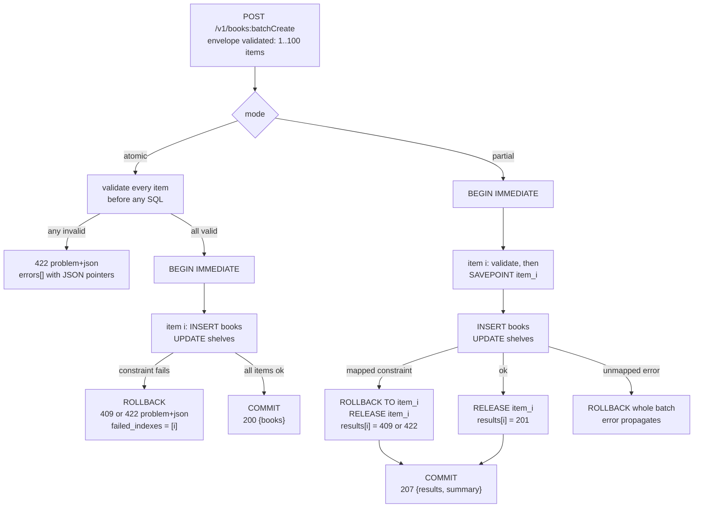

# Atomic All-or-Nothing Batch Transactions vs Partial Success with per-Item Status (207 Multi-Status)

> [!summary] Claim
> An atomic batch is one database transaction whose single status code is the truth for every item, while a partial-success batch is one transaction with a `SAVEPOINT` per item whose `207 Multi-Status` envelope says nothing about the items, so the client must read a per-index status array and the server must undo every statement of a failed item, not just the one that raised.

Part of [Bulk Long Running and Error Contracts](README.md) in [API Engineering](../README.md).

## TL;DR

- Mechanism: atomic mode wraps all items in `BEGIN IMMEDIATE ... COMMIT` and issues `ROLLBACK` on the first item failure; partial mode wraps each item in `SAVEPOINT item_N`, undoes a failed item with `ROLLBACK TO item_N` plus `RELEASE item_N`, and commits the survivors together.
- Contract rule: atomic mode answers with one status (`200`, or one RFC 9457 problem such as `409` or `422` naming the failed indexes), and partial mode answers `207` with a `results` array where entry `i` carries the status the singular Create method would have returned for request `i`.
- The trap: every `2xx` is success to generic clients (httpx `Response.raise_for_status()` returns normally on a `207` whose `summary.succeeded` is `0`), and without a per-item savepoint the first statement of a failed multi-statement item stays committed.
- Portability fact: `207` is registered by RFC 4918 for WebDAV with an XML `multistatus` body, so a JSON `207` is a convention, not a standard, and Google AIP-233 forbids synchronous partial success outright (`(as of 2026-11)`).
- When not to use it: do not offer partial mode when items depend on each other, when a passthrough database transaction is all the method does, or when you cannot give clients a per-item idempotency story; prefer atomic, or a long-running operation that reports `failed_requests`.

## Mental model



A batch request first passes an envelope check (between `1` and `MAX_BATCH_ITEMS` raw items, unknown envelope fields rejected), which is a request-level decision that never becomes a per-item status.
In atomic mode the server validates every item before touching the database, so a malformed batch costs zero SQL statements and the client learns about every bad index at once.
A valid atomic batch then runs inside one write transaction, and the first constraint failure turns into `ROLLBACK` plus one problem document, so either all rows exist or none do.
In partial mode the server opens one write transaction for the whole batch and brackets each item with a savepoint, so a failed item rewinds to the state just before it while earlier and later items keep their writes.
Only constraint failures the API owns (duplicate key, unknown shelf, shelf capacity) are item outcomes; any other database error rolls back the entire batch, because a per-item status for an infrastructure failure would claim knowledge the server does not have.

## How it works

### What `207` means on the wire, and what it does not

RFC 4918 defines `207 (Multi-Status)` as a status code that "provides status for multiple independent operations" `(RFC 4918 Section 11.1)`.
Its body format is WebDAV-specific: "The default Multi-Status response body is a text/xml or application/xml HTTP entity with a 'multistatus' root element", and each `response` element "MUST have an 'href' element to identify the resource" `(RFC 4918 Section 13)`.
The same section holds the key sentence for API designers: "Although '207' is used as the overall response status code, the recipient needs to consult the contents of the multistatus response body for further information about the success or failure of the method execution" `(RFC 4918 Section 13)`.
It continues: "The response MAY be used in success, partial success and also in failure situations" `(RFC 4918 Section 13)`.
RFC 4918 also leaves `Location` undefined on a `207`, because a single `Location` is ambiguous when the body names many resources `(RFC 4918 Section 13.1)`.
The IANA HTTP Status Code Registry lists `207 Multi-Status` and `424 Failed Dependency` with reference `[RFC 4918]` only, while `409` and `422` point at RFC 9110 `(as of 2026-11)`.
So a JSON body under `207` borrows the status code's semantics ("consult the body") but not its format; no RFC defines a JSON `multistatus` document.

The class digit is what generic software acts on.
RFC 9110 says a client "MUST understand the class of any status code ... and treat an unrecognized status code as being equivalent to the x00 status code of that class" `(RFC 9110 Section 15)`, and `2xx` means the request "was successfully received, understood, and accepted" `(RFC 9110 Section 15.3)`.
A client that does not know `207` therefore treats it as `200 OK`.
RFC 4918 anticipated exactly this misreading for `DELETE` on a collection and defended `207` by noting that "a 200-level response indicates that the server 'received, understood, and accepted' the request, not that the request resulted in complete success" `(RFC 4918 Appendix B)`.
That defense holds for the protocol, but not for the client library in front of you: httpx `Response.raise_for_status()` returns `self` whenever `self.is_success` is true `(httpx 0.28.1 httpx/_models.py, Response.raise_for_status)`, and `codes.is_success` is `200 <= value <= 299` `(httpx 0.28.1 httpx/_status_codes.py, codes.is_success)`, so a `207` that reports zero successes raises nothing (proven in the lab).
`207` is also not in the heuristically cacheable list (`200, 203, 204, 206, 300, 301, 308, 404, 405, 410, 414, and 501`) `(RFC 9110 Section 15.1)`, which matters little for `POST` but means a `207` is never reused by a cache without explicit freshness.

On HTTP/1.1 the status line carries a reason phrase; Uvicorn builds its table from `http.HTTPStatus(status_code).phrase` `(uvicorn 0.54.0 uvicorn/protocols/http/h11_impl.py, _get_status_phrase)`, which yields `Multi-Status` for `207` on CPython.
Hypercorn builds `h11.Response` without a `reason` `(hypercorn 0.18.0 hypercorn/protocol/h11.py, H11Protocol.stream_send)`, h11 defaults it to `b""` `(h11 0.16.0 h11/_events.py, _ResponseBase.__init__)`, so its status line is `HTTP/1.1 207 ` with an empty phrase (observed over a loopback socket, see Portability); no client may depend on the phrase.
HTTP/2 defines a single `:status` pseudo-header and no reason phrase `(RFC 9113 Section 8.3.2)`, and "HTTP/3 does not define a way to carry the version or reason phrase that is included in an HTTP/1.1 status line" `(RFC 9114 Section 4.3.2)`, so nothing but the three digits survives on those protocols.

### What the guidelines actually say

Google's AIPs are the strictest public position.
AIP-231 says Batch Get "must be atomic: it must fail for all resources or succeed for all resources (no partial success)" and that the response order "must be the same as the names in the request" `(AIP-231)`.
AIP-233 says "Synchronous batch create must be atomic", that "Asynchronous batch create may support atomic or partial success", and gives the reason: "There is no clear way to convey partial failure in a sync response status code because an OK implies it all worked" `(AIP-233)`.
For the asynchronous case AIP-233 requires a request field `bool return_partial_success`, an operation metadata field `map<int32, google.rpc.Status> failed_requests` keyed by "the index of the request in the requests field", and `Operation.error` with `code = google.rpc.Code.Aborted` "When all requests in the batch fail" `(AIP-233)`.
It also forbids retrofitting: an existing API version "must not adopt the partial success pattern"; a new version that returns an `Operation` must be created instead `(AIP-233)`.
See [[Long-Running-Operations-202-Accepted-and-Operation-Resources-AIP-151]] for that shape.

Other large APIs chose the opposite and put per-item status inside a `200`.
Microsoft Graph JSON batching returns `200` whenever the batch is parseable, states that "A `200` status code on the batch response headers doesn't indicate that the individual requests inside the batch succeeded", caps a batch at `20` requests, and fails dependents of a failed request with `424` when `dependsOn` is used `(as of 2026-11)`.
Elasticsearch `_bulk` returns `200` with a boolean `errors` ("If `true`, one or more of the operations in the bulk request did not complete successfully") and an `items` array "in the order they were submitted" `(as of 2026-11)`.
OData 4.01 makes atomicity a per-group choice: requests sharing an `atomicityGroup` value "MUST either all succeed, or all fail" `(OData JSON Format 4.01 Section 19.1)`, and the `continue-on-error` preference asks the service to keep going after an error `(OData Protocol 4.01 Section 8.2.8.3)`.
RFC 7240 offers a generic hint in the same spirit, `Prefer: handling=strict` versus `handling=lenient` `(RFC 7240 Section 4.4)`, but it governs tolerance of request errors, not transactional atomicity.

### Error documents: one problem, or one problem per item

RFC 9457 lets one problem type carry several occurrences of itself through an extension such as `errors`, each with a `detail` and a JSON Pointer `pointer` `(RFC 9457 Section 3)`.
It also warns against the obvious shortcut: "When an API encounters multiple problems that do not share the same type, it is RECOMMENDED that the most relevant or urgent problem be represented in the response" `(RFC 9457 Section 3)`.
The next sentence names the shortcut: "While it is possible to create generic 'batch' problem types that convey multiple, disparate types, they do not map well into HTTP semantics" `(RFC 9457 Section 3)`.
The lab follows both rules.
An atomic validation failure is one `invalid-batch` problem whose `errors` array holds every bad field as `#/requests/<i>/<field>`, and an atomic execution failure is the one problem that stopped the batch plus a `failed_indexes` extension (clients "MUST ignore any such extensions that they don't recognize" `(RFC 9457 Section 3.2)`).
A partial batch is not a problem at all; it is a `207` whose item entries each embed a complete per-item problem object, so no "batch problem type" exists.
See [[Problem-Details-for-HTTP-APIs-RFC-9457]] and [[Mapping-Pydantic-Validation-Errors-to-RFC-9457-Problem-Details]].

### The database mechanism: statement rollback is not item rollback

An item is rarely one statement.
In the lab each item runs `INSERT INTO books ...` and then `UPDATE shelves SET used = used + ? ...` under `CHECK (used <= capacity)`, which models any reservation, counter, or audit row that must move together with the resource.
SQLite's default conflict algorithm is `ABORT`, which "backs out any changes made by the current SQL statement; but changes caused by prior SQL statements within the same transaction are preserved and the transaction remains active" `(SQLite lang_conflict.html, ABORT)`.
So when the `UPDATE` fails, the `INSERT` before it survives, and a server that catches the error, reports `409` for the item, and commits has written a book with no shelf reservation; the lab proves this with `per_item_savepoint=False`.
A savepoint restores item granularity: `ROLLBACK TO` "reverts the state of the database back to what it was just after the corresponding SAVEPOINT" and "does not cancel the transaction", and `RELEASE` removes the savepoint so the item's writes "commit or rollback together" with the parent `(SQLite lang_savepoint.html, Savepoints)`.
`ROLLBACK TO` "restarts the transaction again at the beginning" instead of ending it, so the savepoint stays on the stack and the lab issues `RELEASE item_N` after it to keep the stack one level deep `(SQLite lang_savepoint.html, Savepoints)`.
`BEGIN IMMEDIATE` "causes the database connection to start a new write immediately, without waiting for a write statement" `(SQLite lang_transaction.html, DEFERRED, IMMEDIATE, and EXCLUSIVE transactions)`, so a busy database fails the batch at the first statement instead of halfway through.

PostgreSQL is stricter and makes the savepoint mandatory rather than merely correct.
After an error the transaction block is in an aborted state, and "ROLLBACK TO is the only way to regain control of a transaction block that was put in aborted state by the system due to an error, short of rolling it back completely and starting again" `(PostgreSQL 18 Section 3.4)`.
Appendix A names the matching condition SQLSTATE `25P02` `in_failed_sql_transaction` `(PostgreSQL 18 Appendix A)`, so a partial batch without per-item savepoints reports one real failure followed by a cascade of failures that describe the transaction, not the items.
Executed during fact-checking against a throwaway local PostgreSQL `18.6` cluster with psycopg `3.3.8` (not part of the hermetic lab): four inserts of ISBNs `1, 1, 2, 3` in one block returned `ok, 23505, 25P02, 25P02`, and the final `COMMIT` left the table empty, so even item `0` was lost; with `SAVEPOINT item_i`, `ROLLBACK TO` and `RELEASE` per item the same batch returned `ok, 23505, ok, ok` and committed `1, 2, 3`.

The lab drives SQLite through CPython's `sqlite3` with `autocommit=True` (added to `connect()` in 3.12), which selects SQLite's own autocommit mode, in which `commit()` and `rollback()` have no effect `(Python sqlite3 docs, Connection.autocommit)`; the lab traces confirm that every `BEGIN`, `SAVEPOINT`, `RELEASE`, `ROLLBACK`, and `COMMIT` SQLite executed is one the code issued.
Constraint failures are classified by `sqlite3.Error.sqlite_errorname` (added in 3.11), documented as "The symbolic name of the numeric error code from the SQLite API" `(Python sqlite3 docs, sqlite3.Error.sqlite_errorname)`; the lab observes the extended names `SQLITE_CONSTRAINT_UNIQUE`, `SQLITE_CONSTRAINT_FOREIGNKEY`, `SQLITE_CONSTRAINT_CHECK`, and `SQLITE_CONSTRAINT_TRIGGER`.
`Connection.set_trace_callback` reports "each SQL statement that is actually executed by the SQLite backend", including transaction management statements, which is what makes the transaction shape an assertion rather than a comment `(Python sqlite3 docs, Connection.set_trace_callback)`.

### The FastAPI trap: typed item lists reject the whole batch

If the endpoint declares `requests: list[BookCreate]`, FastAPI validates the whole body before the endpoint runs; `get_request_handler` collects the errors and raises `RequestValidationError` `(fastapi 0.162.0 fastapi/routing.py, get_request_handler)`, and the default handler answers `422` with `{"detail": exc.errors()}` `(fastapi 0.162.0 fastapi/exception_handlers.py, request_validation_exception_handler)`.
One bad item therefore rejects every good item, and partial mode silently becomes atomic-on-validation.
The lab's envelope declares `requests: list[object]` with `min_length=1` and `max_length=MAX_BATCH_ITEMS`, and validates each item with `BookCreate.model_validate` inside the loop, so a bad item becomes `results[i].status == 422` with pointer `#/requests/i/<field>`.
The envelope limit stays a request-level `422`, because a batch that is too large is the caller's request being wrong, not any one item.

## Numbers and limits

Lab measurements ran on an Apple M3 Pro, macOS `27.2` (`Darwin 27.2.0 arm64`), CPython `3.14.6`, SQLite `3.53.1`, in-memory database with the trace callback installed, `200` trials per mode, median reported, two runs.

| Quantity | Value | Source | Implication |
|---|---:|---|---|
| SQL statements, atomic batch of `N` valid items | `2N + 2` (`202` for `N = 100`) | Lab trace (`BEGIN IMMEDIATE`, 2 per item, `COMMIT`) | One round trip pair per item plus two |
| SQL statements, partial batch of `N` valid items | `4N + 2` (`402` for `N = 100`) | Lab trace (adds `SAVEPOINT` and `RELEASE` per item) | Savepoints double statement count; on a networked database that is `2N` extra round trips unless pipelined |
| Wall time, `100` valid items, atomic | `318` and `311` us median (about `3.1` us per item) | Measured, two runs | In-memory baseline including item validation, not a disk or network figure |
| Wall time, `100` valid items, partial | `715` and `744` us median (about `7.3` us per item) | Measured, two runs | About `2.3x` atomic on this setup, consistent with the doubled statement count; not profiled |
| Lab `MAX_BATCH_ITEMS` | `100` | Lab constant | Exceeding it is one request-level `422` (`too_long`), with zero SQL statements |
| AIP-231 and AIP-233 example limit | `1000` per batch | AIP-231, AIP-233 examples `(as of 2026-11)` | Guidance says document the maximum on the `requests` field |
| Microsoft Graph JSON batch limit | `20` requests | Microsoft Graph docs `(as of 2026-11)` | Each inner request is throttled individually and may fail with `429` |
| Statuses an atomic batch can return | `200`, `409`, `422` | Lab | One status for all items |
| Statuses inside a lab `207` | `201`, `409`, `422` | Lab | AIP-233 requires each `failed_requests` entry to "mirror the error(s) that would normally be returned by the singular Standard Create method" |

The benchmark helper is not part of the lab; it was a throwaway script run as `uv run --frozen python -I bench.py` from `labs/` that builds a fresh catalog per trial, times one `BatchExecutor.create_atomic` or `create_partial` call with `time.perf_counter_ns` directly, without HTTP, and counts `executor.statements`.

## Portability

| Leg | Version | Result |
|---|---|---|
| CPython `3.12` | macOS `3.12.13` (SQLite `3.53.1`); container `3.12.16` on Debian Trixie (glibc `2.41`, SQLite `3.46.1`) and Alpine (musl, SQLite `3.53.4`) | Proven by lab: `12 passed in 0.91s` on macOS (`uv run --frozen --python <interpreter>` with a separate `UV_PROJECT_ENVIRONMENT`); `12 passed in 0.81s` (Trixie) and `12 passed in 0.86s` (Alpine) |
| CPython `3.13` | macOS `3.13.18` (SQLite `3.54.1`); container `3.13.18` on Trixie and Alpine | Proven by lab: `12 passed in 0.89s` on macOS; `12 passed in 0.78s` (Trixie) and `12 passed in 0.88s` (Alpine) |
| CPython `3.14` | macOS `3.14.6` (SQLite `3.53.1`, workspace venv) and `3.14.10` (SQLite `3.54.1`); container `3.14.10` on Trixie and Alpine | Proven by lab: `12 passed in 0.71s` (the captured run in Worked example), `12 passed in 0.91s`; `12 passed in 0.84s` (Trixie) and `12 passed in 0.89s` (Alpine) |
| CPython `3.15` | macOS `3.15.2` (SQLite `3.54.1`, `--python /opt/homebrew/bin/python3.15`); container `3.15.2` on Trixie and Alpine | Proven by lab: `12 passed in 0.98s` on macOS; `12 passed in 0.79s` (Trixie) and `12 passed in 0.88s` (Alpine) |
| CPython `3.15` beta | `3.15.0b3` (uv default for `--python 3.15` on macOS) | Not run with this suite: pytest aborts loading the pinned `hypothesis` plugin with `ModuleNotFoundError: No module named 'hypothesis._native'`, before collection; superseded by the `3.15.2` rows |
| CPython `3.15t` free-threaded | `3.15.2+freethreaded` fetched by `uv python install` inside the `python:3.15.2-trixie` container (SQLite `3.53.1`, aarch64), `sys._is_gil_enabled()` is `False` after importing `pydantic_core` | Proven by lab: `12 passed in 0.82s`, including the two-thread lock test; the locked project cannot install (`psycopg-binary==3.3.8` has no wheel for this interpreter), so the venv was built from `uv export --frozen` without `psycopg*`, `aioquic`, `pylsqpack`, and the packages with no `3.15t` wheel (`brotli`, `gevent`, `geventhttpclient`, `grpcio`, `lupa`, `orjson`, `psutil`, `pywin32`, `pyyaml`), with `PYTHONPATH=src`; the Alpine free-threaded leg was not run |
| `sqlite3.connect(autocommit=...)` | CPython `>= 3.12` | Python docs: "Changed in version 3.12: Added the autocommit parameter"; the lab needs no change across the matrix |
| `sqlite3.Error.sqlite_errorname` | CPython `>= 3.11` | Python docs; observed values identical on SQLite `3.53.1` and `3.54.1` |
| SQLite statement-level `ABORT` | Default conflict algorithm per SQLite docs; observed on SQLite `3.53.1` and `3.54.1` | SQLite docs; PostgreSQL `18.6` instead aborts the whole transaction block (`25P02`) and needs a savepoint per item (executed once during fact-checking, see How it works; not in the hermetic lab) |
| Uvicorn, Hypercorn, Granian | `0.54.0`, `0.18.0`, `2.8.7` | `207` is an ordinary integer status in the ASGI `http.response.start` message; one partial batch posted over a loopback socket to each server (CPython `3.14.6`) returned status lines `HTTP/1.1 207 Multi-Status` (Uvicorn), `HTTP/1.1 207 ` with an empty reason phrase (Hypercorn), and `HTTP/1.1 207 Multi-Status` (Granian); not part of the lab test |
| HTTP/2 | Hypercorn `0.18.0` over TLS (self-signed certificate, loopback), httpx `0.28.1` with h2 `4.4.1`, CPython `3.14.6` | The same partial batch returned `Response.http_version == "HTTP/2"` and status `207` with `summary == {'succeeded': 2, 'failed': 1}`; httpx printed `reason_phrase == 'Multi-Status'` only because `Response.reason_phrase` falls back to `codes.get_reason_phrase` when the `reason_phrase` extension is absent `(httpx 0.28.1 httpx/_models.py, Response.reason_phrase)` and httpcore sets that extension only in `http11.py`; no reason phrase crosses the wire `(RFC 9113 Section 8.3.2)`; Uvicorn and Granian were not run over HTTP/2 |
| HTTP/3 over QUIC | Hypercorn `0.18.0` with `--quic-bind` and an aioquic `1.7.2` client, loopback, CPython `3.14.6` | The same batch returned a header block whose only pseudo-header was `:status` with value `207`, then the JSON body with the same `summary`; HTTP/3 carries no reason phrase `(RFC 9114 Section 4.3.2)`; other servers were not run over HTTP/3 |

## Worked example

The [implementation](../labs/src/api_labs/f06_bulk_long_running_and_error_contracts/batch_execution.py) exposes `POST /v1/books:batchCreate` with `"mode": "atomic"` (default) or `"mode": "partial"`, plus a deliberately typed `/v1/books:batchCreateTyped` route that shows the whole-batch `422` trap.
The [test](../labs/tests/f06_bulk_long_running_and_error_contracts/test_atomic_vs_partial_batch_execution_and_207_multi_status.py) asserts the exact SQL sequence SQLite executed, the rows left in the database, the HTTP contract, and that two batches started concurrently on one connection run as two separate transactions.

### Implementation (`labs/src/api_labs/f06_bulk_long_running_and_error_contracts/batch_execution.py`)

```python
"""Atomic all-or-nothing vs partial-success batch create over SQLite transactions and savepoints."""

import sqlite3
import threading
from dataclasses import dataclass, field
from typing import Literal

from fastapi import FastAPI
from fastapi.responses import JSONResponse
from pydantic import BaseModel, ConfigDict, Field, ValidationError

MAX_BATCH_ITEMS = 100
PROBLEM_JSON = "application/problem+json"
PROBLEM_BASE = "https://api.example.test/problems/"

SCHEMA = """
PRAGMA foreign_keys = ON;
CREATE TABLE shelves (
    shelf TEXT PRIMARY KEY,
    capacity INTEGER NOT NULL,
    used INTEGER NOT NULL DEFAULT 0,
    CHECK (used <= capacity)
);
CREATE TABLE books (
    id INTEGER PRIMARY KEY,
    isbn TEXT NOT NULL UNIQUE,
    title TEXT NOT NULL,
    shelf TEXT NOT NULL REFERENCES shelves (shelf),
    copies INTEGER NOT NULL
);
"""

INSERT_BOOK = "INSERT INTO books (isbn, title, shelf, copies) VALUES (?, ?, ?, ?)"
RESERVE_SHELF = "UPDATE shelves SET used = used + ? WHERE shelf = ?"


class BookCreate(BaseModel):
    """One item of a batch: the body a singular Create method would accept."""

    model_config = ConfigDict(extra="forbid", strict=True)

    isbn: str = Field(pattern=r"^[0-9]{13}$")
    title: str = Field(min_length=1, max_length=200)
    shelf: str = Field(min_length=1, max_length=32)
    copies: int = Field(ge=1, le=1000)


class BatchCreateRequest(BaseModel):
    """Envelope: items stay untyped so one bad item cannot reject the whole envelope."""

    model_config = ConfigDict(extra="forbid")

    mode: Literal["atomic", "partial"] = "atomic"
    requests: list[object] = Field(min_length=1, max_length=MAX_BATCH_ITEMS)


class TypedBatchCreateRequest(BaseModel):
    """Anti-pattern envelope: FastAPI validates every item before the endpoint runs."""

    requests: list[BookCreate] = Field(min_length=1, max_length=MAX_BATCH_ITEMS)


@dataclass(frozen=True, slots=True)
class Problem:
    """RFC 9457 problem details for one item (or for the whole atomic batch)."""

    status: int
    slug: str
    title: str
    detail: str
    errors: tuple[dict[str, str], ...] = ()

    def to_json(self, **extensions: object) -> dict[str, object]:
        body: dict[str, object] = {
            "type": PROBLEM_BASE + self.slug,
            "title": self.title,
            "status": self.status,
            "detail": self.detail,
        }
        if self.errors:
            body["errors"] = list(self.errors)
        body.update(extensions)
        return body


@dataclass(frozen=True, slots=True)
class ItemResult:
    """Outcome of one batch item, reported at the index the client sent it."""

    index: int
    status: int
    book: BookCreate | None = None
    problem: Problem | None = None

    def to_json(self) -> dict[str, object]:
        body: dict[str, object] = {"index": self.index, "status": self.status}
        if self.book is not None:
            body["book"] = self.book.model_dump()
        if self.problem is not None:
            body["problem"] = self.problem.to_json()
        return body


class AtomicBatchRejectedError(Exception):
    """An atomic batch failed; nothing it attempted is visible in the database."""

    def __init__(self, problem: Problem, failed_indexes: tuple[int, ...]) -> None:
        super().__init__(problem.detail)
        self.problem = problem
        self.failed_indexes = failed_indexes


def validation_problem(index: int, exc: ValidationError) -> Problem:
    """Map a pydantic ValidationError for item `index` to RFC 6901 pointers into the body."""
    errors = tuple(
        {
            "pointer": "#/requests/" + "/".join(str(part) for part in (index, *err["loc"])),
            "detail": err["msg"],
        }
        for err in exc.errors()
    )
    return Problem(
        422, "invalid-item", "Item is not valid.", f"requests[{index}] is invalid", errors
    )


def constraint_problem(item: BookCreate, exc: sqlite3.IntegrityError) -> Problem | None:
    """Map constraints this API owns to item problems; any other failure is not an item error."""
    match exc.sqlite_errorname:
        case "SQLITE_CONSTRAINT_UNIQUE":
            return Problem(409, "already-exists", "Book already exists.", f"isbn {item.isbn}")
        case "SQLITE_CONSTRAINT_FOREIGNKEY":
            return Problem(422, "unknown-shelf", "Shelf does not exist.", f"shelf {item.shelf}")
        case "SQLITE_CONSTRAINT_CHECK":
            return Problem(409, "shelf-full", "Shelf capacity exceeded.", f"shelf {item.shelf}")
        case _:
            return None


def open_catalog(shelves: dict[str, int]) -> sqlite3.Connection:
    """Open an in-memory catalog in SQLite autocommit mode so every transaction is explicit SQL."""
    conn = sqlite3.connect(":memory:", autocommit=True, check_same_thread=False)
    conn.executescript(SCHEMA)
    conn.executemany("INSERT INTO shelves (shelf, capacity) VALUES (?, ?)", shelves.items())
    return conn


@dataclass
class BatchExecutor:
    """Runs a batch as one transaction; partial mode isolates each item in a SAVEPOINT."""

    conn: sqlite3.Connection
    statements: list[str] = field(default_factory=list[str])
    _lock: threading.Lock = field(default_factory=threading.Lock)

    def __post_init__(self) -> None:
        self.conn.set_trace_callback(self.statements.append)

    def _apply(self, item: BookCreate) -> None:
        # Two statements per item: a failure in the second must also undo the first.
        self.conn.execute(INSERT_BOOK, (item.isbn, item.title, item.shelf, item.copies))
        self.conn.execute(RESERVE_SHELF, (item.copies, item.shelf))

    def create_atomic(self, raw_items: list[object]) -> list[BookCreate]:
        items: list[BookCreate] = []
        invalid: list[tuple[int, Problem]] = []
        for index, raw in enumerate(raw_items):
            try:
                items.append(BookCreate.model_validate(raw))
            except ValidationError as exc:
                invalid.append((index, validation_problem(index, exc)))
        if invalid:
            # Report every invalid item at once, before any SQL runs.
            errors = tuple(err for _, problem in invalid for err in problem.errors)
            detail = f"{len(invalid)} of {len(raw_items)} items are invalid"
            problem = Problem(422, "invalid-batch", "Batch is not valid.", detail, errors)
            raise AtomicBatchRejectedError(problem, tuple(index for index, _ in invalid))
        with self._lock:
            self.conn.execute("BEGIN IMMEDIATE")
            try:
                for index, item in enumerate(items):
                    try:
                        self._apply(item)
                    except sqlite3.IntegrityError as exc:
                        conflict = constraint_problem(item, exc)
                        if conflict is None:
                            raise
                        raise AtomicBatchRejectedError(conflict, (index,)) from exc
            except BaseException:
                self.conn.execute("ROLLBACK")
                raise
            self.conn.execute("COMMIT")
        return items

    def create_partial(
        self, raw_items: list[object], *, per_item_savepoint: bool = True
    ) -> list[ItemResult]:
        results: list[ItemResult] = []
        with self._lock:
            self.conn.execute("BEGIN IMMEDIATE")
            try:
                for index, raw in enumerate(raw_items):
                    results.append(self._partial_item(index, raw, per_item_savepoint))
            except BaseException:
                # Not an item error (I/O, auth, unknown constraint): the batch as a whole fails.
                self.conn.execute("ROLLBACK")
                raise
            self.conn.execute("COMMIT")
        return results

    def _partial_item(self, index: int, raw: object, per_item_savepoint: bool) -> ItemResult:
        try:
            item = BookCreate.model_validate(raw)
        except ValidationError as exc:
            problem = validation_problem(index, exc)
            return ItemResult(index, problem.status, problem=problem)
        savepoint = f"item_{index}"
        if per_item_savepoint:
            self.conn.execute(f"SAVEPOINT {savepoint}")
        try:
            self._apply(item)
        except sqlite3.IntegrityError as exc:
            conflict = constraint_problem(item, exc)
            if conflict is None:
                raise
            if per_item_savepoint:
                self.conn.execute(f"ROLLBACK TO {savepoint}")
                self.conn.execute(f"RELEASE {savepoint}")
            return ItemResult(index, conflict.status, problem=conflict)
        if per_item_savepoint:
            self.conn.execute(f"RELEASE {savepoint}")
        return ItemResult(index, 201, book=item)


def build_app(executor: BatchExecutor) -> FastAPI:
    """POST /v1/books:batchCreate in atomic (200 or one problem) or partial (207) mode."""
    app = FastAPI()

    @app.post("/v1/books:batchCreate")
    def batch_create(body: BatchCreateRequest) -> JSONResponse:
        if body.mode == "partial":
            results = executor.create_partial(body.requests)
            failed = sum(1 for result in results if result.problem is not None)
            content: dict[str, object] = {
                "results": [result.to_json() for result in results],
                "summary": {"succeeded": len(results) - failed, "failed": failed},
            }
            return JSONResponse(content, status_code=207)
        try:
            books = executor.create_atomic(body.requests)
        except AtomicBatchRejectedError as exc:
            content = exc.problem.to_json(failed_indexes=list(exc.failed_indexes))
            return JSONResponse(content, status_code=exc.problem.status, media_type=PROBLEM_JSON)
        return JSONResponse({"books": [book.model_dump() for book in books]}, status_code=200)

    @app.post("/v1/books:batchCreateTyped")
    def batch_create_typed(body: TypedBatchCreateRequest) -> JSONResponse:
        raw: list[object] = [book.model_dump() for book in body.requests]
        results = executor.create_partial(raw)
        return JSONResponse({"results": [result.to_json() for result in results]}, 207)

    return app
```

### Test (`labs/tests/f06_bulk_long_running_and_error_contracts/test_atomic_vs_partial_batch_execution_and_207_multi_status.py`)

```python
"""Atomic all-or-nothing vs partial-success batch create, proven by SQL traces and row state."""

import sqlite3
import threading

import httpx
import pytest

from api_labs.f06_bulk_long_running_and_error_contracts.batch_execution import (
    MAX_BATCH_ITEMS,
    PROBLEM_BASE,
    BatchExecutor,
    BookCreate,
    build_app,
    open_catalog,
)


def book(n: int, shelf: str = "fiction", copies: int = 1) -> dict[str, object]:
    return {"isbn": f"978{n:010d}", "title": f"Book {n}", "shelf": shelf, "copies": copies}


def make_executor() -> BatchExecutor:
    return BatchExecutor(open_catalog({"fiction": 10, "tiny": 2}))


def trace(executor: BatchExecutor) -> list[str]:
    """Statements SQLite actually ran, with bound values dropped from the two item statements."""
    tags = {"INSERT INTO books": "INSERT books", "UPDATE shelves": "UPDATE shelves"}
    return [
        next((tag for prefix, tag in tags.items() if sql.startswith(prefix)), sql)
        for sql in executor.statements
    ]


def isbns(executor: BatchExecutor) -> list[str]:
    rows = executor.conn.execute("SELECT isbn FROM books ORDER BY isbn").fetchall()
    return [str(row[0]) for row in rows]


def used(executor: BatchExecutor, shelf: str) -> int:
    row = executor.conn.execute("SELECT used FROM shelves WHERE shelf = ?", (shelf,)).fetchone()
    return int(row[0])


async def post(
    executor: BatchExecutor, body: dict[str, object], path: str = "/v1/books:batchCreate"
) -> httpx.Response:
    async with httpx.AsyncClient(
        transport=httpx.ASGITransport(app=build_app(executor)), base_url="http://test"
    ) as client:
        return await client.post(path, json=body)


@pytest.mark.unit
@pytest.mark.asyncio
async def test_atomic_batch_commits_every_item_in_one_transaction() -> None:
    executor = make_executor()

    response = await post(executor, {"mode": "atomic", "requests": [book(1), book(2)]})

    assert response.status_code == 200
    assert response.json() == {"books": [book(1), book(2)]}
    assert trace(executor) == [
        "BEGIN IMMEDIATE",
        "INSERT books",
        "UPDATE shelves",
        "INSERT books",
        "UPDATE shelves",
        "COMMIT",
    ]
    assert isbns(executor) == ["9780000000001", "9780000000002"]
    assert used(executor, "fiction") == 2


@pytest.mark.unit
@pytest.mark.asyncio
async def test_atomic_batch_rolls_back_earlier_items_when_a_later_item_fails() -> None:
    executor = make_executor()
    items = [book(1, "tiny"), book(2, "tiny"), book(3, "tiny")]

    response = await post(executor, {"mode": "atomic", "requests": items})

    assert response.status_code == 409
    assert response.headers["content-type"] == "application/problem+json"
    assert response.json() == {
        "type": PROBLEM_BASE + "shelf-full",
        "title": "Shelf capacity exceeded.",
        "status": 409,
        "detail": "shelf tiny",
        "failed_indexes": [2],
    }
    assert trace(executor)[-3:] == ["INSERT books", "UPDATE shelves", "ROLLBACK"]
    assert isbns(executor) == []
    assert used(executor, "tiny") == 0
    assert not executor.conn.in_transaction


@pytest.mark.unit
@pytest.mark.asyncio
async def test_atomic_batch_reports_every_invalid_item_before_any_sql_runs() -> None:
    executor = make_executor()
    items = [book(1), {**book(2), "isbn": "12"}, book(3), {**book(4), "price": 9}]

    response = await post(executor, {"requests": items})

    assert response.status_code == 422
    body = response.json()
    assert body["type"] == PROBLEM_BASE + "invalid-batch"
    assert body["failed_indexes"] == [1, 3]
    assert [err["pointer"] for err in body["errors"]] == ["#/requests/1/isbn", "#/requests/3/price"]
    assert trace(executor) == []


@pytest.mark.unit
@pytest.mark.asyncio
async def test_partial_batch_returns_207_with_status_at_each_request_index() -> None:
    executor = make_executor()
    items = [
        book(1),
        book(1),
        book(2, copies=0),
        book(3, "poetry"),
        book(4, "tiny", copies=3),
        book(5, "tiny", copies=2),
    ]

    response = await post(executor, {"mode": "partial", "requests": items})

    assert response.status_code == 207
    body = response.json()
    assert [r["index"] for r in body["results"]] == [0, 1, 2, 3, 4, 5]
    assert [r["status"] for r in body["results"]] == [201, 409, 422, 422, 409, 201]
    problems = [r.get("problem", {}).get("type", "") for r in body["results"]]
    assert [p.removeprefix(PROBLEM_BASE) for p in problems] == [
        "",
        "already-exists",
        "invalid-item",
        "unknown-shelf",
        "shelf-full",
        "",
    ]
    assert body["results"][2]["problem"]["errors"][0]["pointer"] == "#/requests/2/copies"
    assert body["summary"] == {"succeeded": 2, "failed": 4}
    assert isbns(executor) == ["9780000000001", "9780000000005"]
    assert (used(executor, "fiction"), used(executor, "tiny")) == (1, 2)


@pytest.mark.unit
def test_per_item_savepoint_undoes_the_first_statement_when_the_second_fails() -> None:
    guarded, unguarded = make_executor(), make_executor()
    item: list[object] = [book(1, "tiny", copies=3)]

    guarded_results = guarded.create_partial(item)
    unguarded_results = unguarded.create_partial(item, per_item_savepoint=False)

    assert [r.status for r in guarded_results] == [409]
    assert trace(guarded) == [
        "BEGIN IMMEDIATE",
        "SAVEPOINT item_0",
        "INSERT books",
        "UPDATE shelves",
        "ROLLBACK TO item_0",
        "RELEASE item_0",
        "COMMIT",
    ]
    assert isbns(guarded) == []
    # Same 409 to the client, but the committed book row has no shelf reservation behind it.
    assert [r.status for r in unguarded_results] == [409]
    assert trace(unguarded) == ["BEGIN IMMEDIATE", "INSERT books", "UPDATE shelves", "COMMIT"]
    assert isbns(unguarded) == ["9780000000001"]
    assert used(unguarded, "tiny") == 0


@pytest.mark.unit
def test_every_item_savepoint_is_released_whether_the_item_succeeds_or_fails() -> None:
    executor = make_executor()

    results = executor.create_partial([book(1), book(2, "tiny", copies=3)])

    assert [r.status for r in results] == [201, 409]
    assert trace(executor) == [
        "BEGIN IMMEDIATE",
        "SAVEPOINT item_0",
        "INSERT books",
        "UPDATE shelves",
        "RELEASE item_0",
        "SAVEPOINT item_1",
        "INSERT books",
        "UPDATE shelves",
        "ROLLBACK TO item_1",
        "RELEASE item_1",
        "COMMIT",
    ]
    assert isbns(executor) == ["9780000000001"]


@pytest.mark.unit
@pytest.mark.asyncio
async def test_207_with_zero_successes_still_passes_httpx_raise_for_status() -> None:
    executor = make_executor()
    items = [book(1, "poetry"), {"isbn": "x"}]

    response = await post(executor, {"mode": "partial", "requests": items})

    assert response.status_code == 207
    assert response.is_success
    assert response.raise_for_status() is response
    assert response.json()["summary"] == {"succeeded": 0, "failed": 2}


@pytest.mark.unit
@pytest.mark.asyncio
async def test_typed_item_list_turns_one_bad_item_into_a_whole_batch_422() -> None:
    typed, untyped = make_executor(), make_executor()
    items = [book(1), {**book(2), "isbn": "12"}]

    typed_response = await post(typed, {"requests": items}, "/v1/books:batchCreateTyped")
    untyped_response = await post(untyped, {"mode": "partial", "requests": items})

    assert typed_response.status_code == 422
    assert typed_response.json()["detail"][0]["loc"] == ["body", "requests", 1, "isbn"]
    assert trace(typed) == []
    assert untyped_response.status_code == 207
    assert isbns(untyped) == ["9780000000001"]


@pytest.mark.unit
@pytest.mark.asyncio
async def test_resubmitting_a_whole_partial_batch_turns_earlier_successes_into_409() -> None:
    executor = make_executor()

    first = await post(executor, {"mode": "partial", "requests": [book(1), book(2, "tiny", 3)]})
    retry = await post(executor, {"mode": "partial", "requests": [book(1), book(2, "tiny", 2)]})

    assert [r["status"] for r in first.json()["results"]] == [201, 409]
    assert [r["status"] for r in retry.json()["results"]] == [409, 201]
    assert isbns(executor) == ["9780000000001", "9780000000002"]


@pytest.mark.unit
def test_unmapped_database_error_aborts_the_whole_partial_batch() -> None:
    executor = make_executor()
    executor.conn.execute(
        "CREATE TRIGGER audit_down BEFORE INSERT ON books WHEN NEW.title = 'Book 2' "
        "BEGIN SELECT RAISE(ABORT, 'audit log unavailable'); END"
    )
    executor.statements.clear()

    with pytest.raises(sqlite3.IntegrityError, match="audit log unavailable") as excinfo:
        executor.create_partial([book(1), book(2), book(3)])

    assert excinfo.value.sqlite_errorname == "SQLITE_CONSTRAINT_TRIGGER"
    assert trace(executor)[-1] == "ROLLBACK"
    assert isbns(executor) == []
    assert not executor.conn.in_transaction


@pytest.mark.unit
def test_concurrent_batches_on_one_connection_never_share_a_transaction() -> None:
    first_inside, second_done = threading.Event(), threading.Event()
    errors: list[BaseException] = []

    class PausingExecutor(BatchExecutor):
        def _apply(self, item: BookCreate) -> None:
            if not first_inside.is_set():
                # Pause the first batch between statements (no SQLite call in flight) inside
                # its transaction; without the lock the second batch runs and fails meanwhile.
                first_inside.set()
                second_done.wait(timeout=0.5)
            super()._apply(item)

    executor = PausingExecutor(open_catalog({"fiction": 10}))

    def run(raw: list[object], done: threading.Event | None = None) -> None:
        try:
            executor.create_partial(raw)
        except BaseException as exc:
            errors.append(exc)
        finally:
            if done is not None:
                done.set()

    first = threading.Thread(target=run, args=([book(1)],), daemon=True)
    second = threading.Thread(target=run, args=([book(2)], second_done), daemon=True)
    first.start()
    assert first_inside.wait(timeout=5)
    second.start()
    first.join(timeout=5)
    second.join(timeout=5)

    assert not first.is_alive()
    assert not second.is_alive()
    assert errors == []
    one_batch = ["BEGIN IMMEDIATE", "SAVEPOINT item_0", "INSERT books", "UPDATE shelves"]
    assert trace(executor) == [*one_batch, "RELEASE item_0", "COMMIT"] * 2
    assert isbns(executor) == ["9780000000001", "9780000000002"]


@pytest.mark.unit
@pytest.mark.asyncio
async def test_batch_size_limit_is_a_request_level_error_not_an_item_status() -> None:
    executor = make_executor()
    items = [book(n) for n in range(MAX_BATCH_ITEMS + 1)]

    response = await post(executor, {"mode": "partial", "requests": items})

    assert response.status_code == 422
    assert response.json()["detail"][0]["type"] == "too_long"
    assert trace(executor) == []
```

### Captured run

From `labs/` on macOS `27.2` (`Darwin 27.2.0 arm64`, Apple M3 Pro), CPython `3.14.6`, with the absolute path shortened to `labs`:

```text
$ uv run --frozen pytest tests/f06_bulk_long_running_and_error_contracts/test_atomic_vs_partial_batch_execution_and_207_multi_status.py -v -p no:cacheprovider
============================= test session starts ==============================
platform darwin -- Python 3.14.6, pytest-9.2.0, pluggy-1.7.0 -- labs/.venv/bin/python
hypothesis profile 'default'
rootdir: labs
configfile: pyproject.toml
plugins: platformdirs-4.14.5, schemathesis-4.33.1, cov-7.1.0, hypothesis-6.170.14, inline-snapshot-0.36.1, Faker-40.44.0, locust-2.47.0, typeguard-4.6.0, anyio-4.16.0, asyncio-1.4.1.post1, respx-0.23.1
asyncio: mode=Mode.STRICT, debug=False, asyncio_default_fixture_loop_scope=function, asyncio_default_test_loop_scope=function
collecting ... collected 12 items

tests/f06_bulk_long_running_and_error_contracts/test_atomic_vs_partial_batch_execution_and_207_multi_status.py::test_atomic_batch_commits_every_item_in_one_transaction PASSED [  8%]
tests/f06_bulk_long_running_and_error_contracts/test_atomic_vs_partial_batch_execution_and_207_multi_status.py::test_atomic_batch_rolls_back_earlier_items_when_a_later_item_fails PASSED [ 16%]
tests/f06_bulk_long_running_and_error_contracts/test_atomic_vs_partial_batch_execution_and_207_multi_status.py::test_atomic_batch_reports_every_invalid_item_before_any_sql_runs PASSED [ 25%]
tests/f06_bulk_long_running_and_error_contracts/test_atomic_vs_partial_batch_execution_and_207_multi_status.py::test_partial_batch_returns_207_with_status_at_each_request_index PASSED [ 33%]
tests/f06_bulk_long_running_and_error_contracts/test_atomic_vs_partial_batch_execution_and_207_multi_status.py::test_per_item_savepoint_undoes_the_first_statement_when_the_second_fails PASSED [ 41%]
tests/f06_bulk_long_running_and_error_contracts/test_atomic_vs_partial_batch_execution_and_207_multi_status.py::test_every_item_savepoint_is_released_whether_the_item_succeeds_or_fails PASSED [ 50%]
tests/f06_bulk_long_running_and_error_contracts/test_atomic_vs_partial_batch_execution_and_207_multi_status.py::test_207_with_zero_successes_still_passes_httpx_raise_for_status PASSED [ 58%]
tests/f06_bulk_long_running_and_error_contracts/test_atomic_vs_partial_batch_execution_and_207_multi_status.py::test_typed_item_list_turns_one_bad_item_into_a_whole_batch_422 PASSED [ 66%]
tests/f06_bulk_long_running_and_error_contracts/test_atomic_vs_partial_batch_execution_and_207_multi_status.py::test_resubmitting_a_whole_partial_batch_turns_earlier_successes_into_409 PASSED [ 75%]
tests/f06_bulk_long_running_and_error_contracts/test_atomic_vs_partial_batch_execution_and_207_multi_status.py::test_unmapped_database_error_aborts_the_whole_partial_batch PASSED [ 83%]
tests/f06_bulk_long_running_and_error_contracts/test_atomic_vs_partial_batch_execution_and_207_multi_status.py::test_concurrent_batches_on_one_connection_never_share_a_transaction PASSED [ 91%]
tests/f06_bulk_long_running_and_error_contracts/test_atomic_vs_partial_batch_execution_and_207_multi_status.py::test_batch_size_limit_is_a_request_level_error_not_an_item_status PASSED [100%]

============================== 12 passed in 0.71s ==============================
```

### What the two modes look like to a client

Captured with a throwaway script that posts through the same `httpx.ASGITransport` as the tests and prints `http_version` (which `ASGITransport` reports as `HTTP/1.1`; no socket is involved), `status_code`, `reason_phrase`, `content-type`, the JSON body, and the traced statements cut before ` VALUES` and ` SET`.
A partial batch of `[book 1, book 1 again, book 4 on shelf "tiny" with 3 copies]`:

```text
HTTP/1.1 207 Multi-Status
content-type: application/json

{
  "results": [
    {
      "index": 0,
      "status": 201,
      "book": {
        "isbn": "9780000000001",
        "title": "Book 1",
        "shelf": "fiction",
        "copies": 1
      }
    },
    {
      "index": 1,
      "status": 409,
      "problem": {
        "type": "https://api.example.test/problems/already-exists",
        "title": "Book already exists.",
        "status": 409,
        "detail": "isbn 9780000000001"
      }
    },
    {
      "index": 2,
      "status": 409,
      "problem": {
        "type": "https://api.example.test/problems/shelf-full",
        "title": "Shelf capacity exceeded.",
        "status": 409,
        "detail": "shelf tiny"
      }
    }
  ],
  "summary": {
    "succeeded": 1,
    "failed": 2
  }
}
statements: ['BEGIN IMMEDIATE', 'SAVEPOINT item_0', 'INSERT INTO books (isbn, title, shelf, copies)', 'UPDATE shelves', 'RELEASE item_0', 'SAVEPOINT item_1', 'INSERT INTO books (isbn, title, shelf, copies)', 'ROLLBACK TO item_1', 'RELEASE item_1', 'SAVEPOINT item_2', 'INSERT INTO books (isbn, title, shelf, copies)', 'UPDATE shelves', 'ROLLBACK TO item_2', 'RELEASE item_2', 'COMMIT']
```

The same shelf overflow as an atomic batch of three one-copy books on the two-slot shelf `tiny`:

```text
HTTP/1.1 409 Conflict
content-type: application/problem+json

{
  "type": "https://api.example.test/problems/shelf-full",
  "title": "Shelf capacity exceeded.",
  "status": 409,
  "detail": "shelf tiny",
  "failed_indexes": [
    2
  ]
}
statements: ['BEGIN IMMEDIATE', 'INSERT INTO books (isbn, title, shelf, copies)', 'UPDATE shelves', 'INSERT INTO books (isbn, title, shelf, copies)', 'UPDATE shelves', 'INSERT INTO books (isbn, title, shelf, copies)', 'UPDATE shelves', 'ROLLBACK']
```

Read the partial trace closely: item `1` failed on its first statement (`UNIQUE`), so `ROLLBACK TO item_1` had nothing to undo, while item `2` failed on its second statement (`CHECK`), and `ROLLBACK TO item_2` removed its already-inserted book row.

## Pitfalls

> [!warning] Treating `207` as success
> Trigger: client code calls `raise_for_status()` or checks `response.is_success` and moves on.
> Symptom: a batch where every item failed is logged as delivered; nothing raises because `207` is in `200..299` `(httpx 0.28.1 httpx/_status_codes.py, codes.is_success)`.
> Fix: make the SDK, not the caller, parse `results` and raise or return a typed partial-failure object; publish a `summary` with `succeeded` and `failed` counts so the check is one field.
> Precedent: this misreading is as old as `207`.
> In the WebDAV mailing list, Joe Orton wrote on 1998-12-29 that a failed `DELETE` "could get a 207 response which would (should) be interpreted as success by the 1.1 client, being 2xx class" (`w3c-dist-auth`, message "Multi-status and 207").
> On 2002-07-24 Bill Brown reported "I can't find a Dav client that recognizes 207 multi-status as a 'failure'....everyone I've tried, treats it as a 'success'", and in the reply Orton noted that "cadaver (and any other client based on the neon library) treats a 207 response to MKCOL, DELETE, etc as an error" (`w3c-dist-auth`, message "Re: FW: 207 Multi-Status success").
> Two generic clients therefore disagreed on the same status, and a mailing list thread, not a postmortem, is the record; no published production postmortem specific to a `207` batch was found.

> [!warning] Statement rollback mistaken for item rollback
> Trigger: partial mode catches the constraint error of a multi-statement item and continues without a savepoint.
> Symptom: the client sees `409` for the item, but the committed database holds the item's first-statement writes (the lab's orphan book with `used == 0`); on PostgreSQL every later item fails with `25P02` instead, and the final `COMMIT` discards even the items reported as successful.
> Fix: `SAVEPOINT` before each item, `ROLLBACK TO` and `RELEASE` on an item failure, `RELEASE` on success; assert the transaction shape with a statement trace in tests.

> [!warning] Typed item list in the request model
> Trigger: `requests: list[ItemModel]` on a partial-success endpoint.
> Symptom: one malformed item produces a whole-request `422` from FastAPI and no item is created.
> Fix: type the envelope loosely (`list[object]` with length bounds) and validate items one by one inside the transaction loop.

> [!warning] Retrying the whole partial batch
> Trigger: a client or proxy replays the full batch after a timeout or after fixing one item.
> Symptom: items that succeeded the first time now come back `409 already-exists`, and with server-generated IDs they would be duplicated instead.
> Fix: resubmit only failed indexes, give each item a client-chosen ID or request ID so a replay can be recognized, and see [[Idempotent-Request-Identification-and-Request-ID-Correlation-AIP-155]] and [[Idempotency-Key-Header-Specification-and-State-Machine-Draft-08]].

> [!warning] Infrastructure errors reported as item failures
> Trigger: `except sqlite3.Error` (or `except Exception`) around each item.
> Symptom: an I/O, lock, or trigger failure becomes a per-item `4xx`, the loop continues on a connection in an unknown state, and the survivors commit.
> Fix: map only the constraint names the API owns and re-raise everything else so the whole batch rolls back; the lab proves this with a trigger that raises `SQLITE_CONSTRAINT_TRIGGER`.


## Security and robustness

- Unbounded batches are a resource-consumption attack; OWASP API4:2023 lists "Number of operations to perform in a single API client request" among the limits a vulnerable API fails to set and states "The same is valid for batched operations"; enforce `max_length` on the envelope before any work and also bound the request body size.
- Authorization is per item, not per batch; OWASP API1:2023 asks for an object-level check "in every function that uses an input from the client to access a record in the database", so a batch that names many parents must check each one, and a denied item is a per-item `403` or `404` in partial mode or a whole-batch failure in atomic mode.
- Per-item errors are an oracle: `already-exists` for an ISBN the caller may not read discloses existence, so return the same status for "exists but not yours" and "unknown" when existence is sensitive; RFC 9457 warns that problem details are "not a debugging tool for the underlying implementation" `(RFC 9457 Section 4)`.
- Do not echo raw database messages (constraint names, table names, SQL) into `detail`; the lab maps each owned constraint to a fixed `type` and `title`.
- Hold the write lock for the shortest time: validate before `BEGIN IMMEDIATE` in atomic mode, and keep `MAX_BATCH_ITEMS` small enough that one batch cannot starve other writers; the lab serializes batches on one connection with a `threading.Lock`, because two batches interleaved on one SQLite connection would share one transaction; with the lock removed, the lab's two-thread test fails with `OperationalError('cannot start a transaction within a transaction')`.
- A batch endpoint is a privilege boundary of its own: the Kargo advisory GHSA-7g9x-cp9g-92mr (CVE-2026-27112, affecting `>= v1.7.0, <= v1.9.2`, fixed in `v1.7.8`, `v1.8.11`, and `v1.9.3`) states that "Specially crafted payloads can manifest a bug present in the logic of both" batch resource creation endpoints and inject resources into an existing Project's namespace; test the batch path with the same authorization cases as the singular one.
- Savepoint names are generated from the integer index (`item_0`, `item_1`), never from client input, so the f-string SQL in the savepoint statements carries no injection surface.

## The principal's view

The decision is not "which status code" but "who owns the consistency boundary".
Atomic batches keep that boundary on the server: one status, one transaction, trivially safe to retry when combined with a request ID, and the client never has to reconcile.
Partial batches move reconciliation to every client, which is only worth it when items are genuinely independent and the cost of failing nine hundred and ninety-nine good items for one bad one is real, as in ingestion and bulk import.
Default to atomic for synchronous methods, which is also where Google AIP-233 lands, and make partial success an explicit opt-in field so the default can never change underneath existing clients.
When partial success is required at scale, prefer an asynchronous operation that reports `failed_requests` by index over a synchronous `207`: it survives client timeouts, it can report progress, and its status code is honestly noncommittal by design `(RFC 9110 Section 15.3.3)`.
If you do ship a synchronous partial mode, pick one envelope status and never vary it by outcome, either `207` (the IETF-registered "consult the body" signal) or `200` (the Microsoft Graph and Elasticsearch convention), and ship the SDK that parses it, because the status code alone will be misread.
Choose a different paradigm entirely when items depend on each other: a single resource that represents the whole change, an OData-style atomicity group, or a saga with compensations is more honest than a batch that pretends items are independent.

## Interview questions

> [!question] L5: What does `207 Multi-Status` tell a client, and where is it defined?
>
> > [!success]- Answer
> > It is defined in RFC 4918 Section 11.1 for WebDAV and registered in the IANA status code registry with reference RFC 4918.
> > It says the response covers multiple independent operations and that the client must read the body to learn what succeeded.
> > RFC 4918 Section 13 allows it in success, partial success, and failure situations, so the code alone says nothing about item outcomes.
> > Its standard body is XML `multistatus`; a JSON body is a convention.
> >
> > Follow-up: Why is a `Location` header unhelpful on a `207`?

> [!question] L5: Why does a partial-success batch need a savepoint per item when each item already fails atomically at the statement level?
>
> > [!success]- Answer
> > Statement-level rollback undoes only the statement that raised.
> > An item with two statements that fails on the second keeps the first statement's writes, so committing the batch commits half an item.
> > `SAVEPOINT` before the item and `ROLLBACK TO` plus `RELEASE` on failure restore the database to the state before the item while keeping the outer transaction alive.
> >
> > Follow-up: What changes on PostgreSQL, where an error aborts the whole transaction block?

> [!question] L5: Predict the output: the lab's partial endpoint receives two items, one with an unknown shelf and one with `isbn: "x"`; the client runs `r.raise_for_status(); print(r.status_code, r.json()["summary"])`.
>
> > [!success]- Answer
> > It prints `207 {'succeeded': 0, 'failed': 2}`.
> > `raise_for_status()` returns normally because httpx treats every status in `200..299` as success.
> > The unknown shelf becomes a per-item `422 unknown-shelf` and the bad ISBN a per-item `422 invalid-item`.
> >
> > Follow-up: Where should the check for `failed > 0` live so callers cannot forget it?

> [!question] L6: Debug this API: a partial-success bulk import on PostgreSQL reports item 3 as a unique violation and items 4 through 100 as failures with SQLSTATE `25P02`, even though items 4 through 100 are valid.
>
> > [!success]- Answer
> > The loop catches the item 3 error and keeps issuing statements in the same transaction block.
> > PostgreSQL puts the block into the aborted state after the error, so later statements fail with SQLSTATE `25P02` `in_failed_sql_transaction` until a rollback.
> > The fix is a `SAVEPOINT` before each item and `ROLLBACK TO SAVEPOINT` on failure, which per the PostgreSQL docs is the only way to regain control of the block without rolling everything back.
> > The secondary fix is to stop mapping `25P02` to a per-item status at all, because it describes the transaction, not the item.
> >
> > Follow-up: How would you test this without a PostgreSQL server in CI?

> [!question] L6: Why does declaring `requests: list[BookCreate]` break partial mode in FastAPI, and what do you declare instead?
>
> > [!success]- Answer
> > FastAPI validates the whole body before calling the endpoint and raises `RequestValidationError`, which becomes one `422` for the request.
> > A single bad item therefore prevents every good item from being processed.
> > Declare the items loosely, for example `list[object]` with `min_length` and `max_length`, and validate each item inside the loop so the error lands in `results[i]`.
> >
> > Follow-up: Which errors should still be request-level `422`s?

> [!question] L6: An atomic batch fails on item 7 of 50; what exactly does the response contain and why?
>
> > [!success]- Answer
> > One RFC 9457 problem with the status of the item failure, for example `409 shelf-full`, `Content-Type: application/problem+json`, and an extension such as `failed_indexes: [7]`.
> > It does not list items 0 through 6 as succeeded, because the `ROLLBACK` means none of them exist.
> > RFC 9457 Section 3 recommends reporting the most relevant problem rather than inventing a generic batch problem type.
> >
> > Follow-up: Should validation of all 50 items happen before or after `BEGIN`, and what does that buy?

> [!question] L7+: Your public API has a synchronous atomic `batchCreate` and a large customer wants partial success; how do you add it?
>
> > [!success]- Answer
> > Do not change the default, because existing clients rely on all-or-nothing and a new failure shape in the same response is a breaking change.
> > AIP-233 says an existing version must not adopt partial success and points to a new version returning a long-running operation with `return_partial_success` and `failed_requests` keyed by index.
> > Outside Google conventions, an explicit opt-in field and a distinct response shape (`207` with per-index results) can work, provided the SDK parses it and per-item idempotency exists.
> > I would also publish the maximum batch size and the per-item status set, which should match the singular Create method.
> >
> > Follow-up: How do you migrate clients and measure that nobody still treats the new `207` as blanket success?

> [!question] L7+: Microsoft Graph and Elasticsearch return `200` with per-item status, WebDAV uses `207`, and Google requires atomic or an LRO. Which do you standardize on across an organization?
>
> > [!success]- Answer
> > Standardize the item contract first: index-keyed results, per-item status equal to the singular method's, a pre-computed summary, and request IDs for retry.
> > Then pick one envelope and enforce it with linting: atomic by default, LRO for large or slow partial batches, and at most one synchronous partial envelope.
> > `207` has the advantage of being a registered "read the body" signal; `200` has the advantage that nobody special-cases it; both are misread without an SDK.
> > The cost is migration of existing batch endpoints, which is why the guideline must be versioned rather than retrofitted.
> >
> > Follow-up: How would you encode this rule in an OpenAPI lint so new batch endpoints cannot drift?

> [!question] L7+: When is a batch the wrong abstraction altogether?
>
> > [!success]- Answer
> > When items depend on each other, for example "create an order and its lines", because partial success creates states the domain forbids.
> > Model the whole change as one resource, use an atomicity group as in OData 4.01, or use a saga with compensations when the items span services.
> > A batch is right only when items are independent and the client can act on each outcome separately.
> >
> > Follow-up: How does Microsoft Graph signal that a dependent request was skipped?

## Related

Prerequisites: [[Batch-Get-and-Bulk-Mutation-Design-AIP-231-to-AIP-235]]

Next: [[Criteria-Based-Bulk-Delete-and-Purge-Operations-AIP-165]]

See also: [[02-Programming-Languages/Python/Python-Backend-Interview-Prep/05-REST-API-Design]], [[Problem-Details-for-HTTP-APIs-RFC-9457]], [[Mapping-Pydantic-Validation-Errors-to-RFC-9457-Problem-Details]], [[Google-AIP-193-Error-Model-and-Rich-Error-Details]], [[Error-Taxonomy-Retryability-and-Client-Contract-Design]], [[Long-Running-Operations-202-Accepted-and-Operation-Resources-AIP-151]], [[Dry-Run-and-Validate-Only-Requests-AIP-163]], [[Idempotent-Request-Identification-and-Request-ID-Correlation-AIP-155]], [[Idempotency-Key-Header-Specification-and-State-Machine-Draft-08]], [[Request-Scoped-Transaction-Patterns-Commit-As-You-Go-vs-Unit-of-Work]], [[High-Throughput-Bulk-Writes-Upserts-and-RETURNING-in-SQLAlchemy-2-x]]

- Lab: `labs/tests/f06_bulk_long_running_and_error_contracts/test_atomic_vs_partial_batch_execution_and_207_multi_status.py`

## Further reading

- [RFC 4918 Sections 11.1 and 13](https://www.rfc-editor.org/rfc/rfc4918.html): the only standard definition of `207 Multi-Status` and the "consult the body" rule.
- [RFC 4918 Appendix B](https://www.rfc-editor.org/rfc/rfc4918.html): the authors' own reasoning about HTTP-only clients reading `207` as success.
- [RFC 9110 Section 15](https://www.rfc-editor.org/rfc/rfc9110.html): why unknown status codes collapse to their class, which is how `207` reaches generic clients.
- [RFC 9457 Section 3](https://www.rfc-editor.org/rfc/rfc9457.html): multiple occurrences of one problem type, and the warning against generic batch problem types.
- [AIP-233](https://google.aip.dev/233): the case for synchronous atomicity and the `failed_requests` LRO pattern for partial success.
- [AIP-231](https://google.aip.dev/231): atomic Batch Get and response ordering.
- [OData JSON Format 4.01 Section 19](https://docs.oasis-open.org/odata/odata-json-format/v4.01/odata-json-format-v4.01.html): `atomicityGroup` as per-group atomicity inside one batch.
- [w3c-dist-auth, 1998-12-29](https://lists.w3.org/Archives/Public/w3c-dist-auth/1998OctDec/0314.html) and [2002-07-24](https://lists.w3.org/Archives/Public/w3c-dist-auth/2002JulSep/0099.html): the authors' community naming the `207`-as-success problem and clients that split on it.
- [Kargo advisory GHSA-7g9x-cp9g-92mr](https://github.com/akuity/kargo/security/advisories/GHSA-7g9x-cp9g-92mr): a batch creation endpoint authorization flaw, the reason to test batch paths like singular ones.
- [Microsoft Graph JSON batching](https://learn.microsoft.com/en-us/graph/json-batching): a production `200`-envelope design with `dependsOn` and `424`.
- [SQLite SAVEPOINT](https://www.sqlite.org/lang_savepoint.html) and [ON CONFLICT](https://www.sqlite.org/lang_conflict.html): the exact statement and savepoint rollback semantics the lab relies on.
- [PostgreSQL 18 Section 3.4](https://www.postgresql.org/docs/current/tutorial-transactions.html): savepoints as the only recovery from an aborted transaction block.
