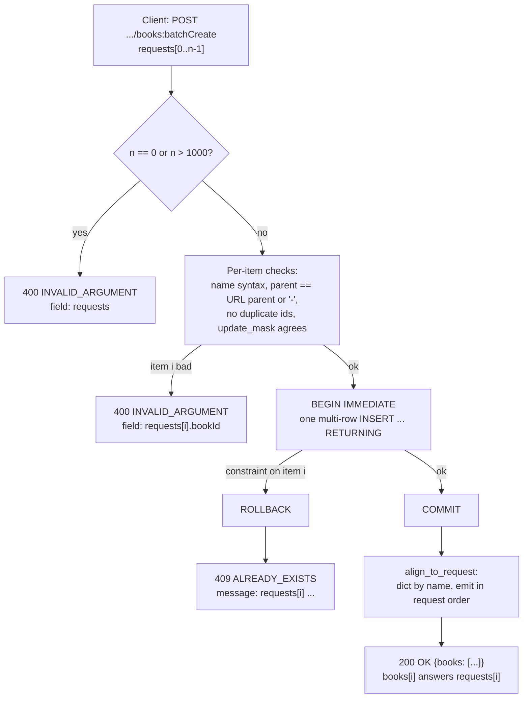

# Batch Methods: BatchGet, BatchCreate, BatchUpdate, and BatchDelete (Google AIP-231 through AIP-235)

> [!summary] Claim
> A synchronous AIP batch method is one bounded, atomic, order-preserving transaction behind a `:batchGet` (`GET`) or `:batchCreate`/`:batchUpdate`/`:batchDelete` (`POST`) custom method: reject the whole call on any bad item, name the failing index in the error, and never trust the database to return rows in request order.

Part of [Bulk Long Running and Error Contracts](README.md) in [API Engineering](../README.md).

## TL;DR

- Mechanism: one request carries up to a documented maximum of names or child requests (the AIP examples use 1000), the server validates every item, runs one transaction, and maps rows back to request positions by key.
- Contract rule: synchronous batch methods **must** be atomic (AIP-233, AIP-234, AIP-235 "Atomic vs. Partial Success"), BatchGet **must** be atomic and the order of books in its response "must be the same as the names in the request" (AIP-231 "Response message"), and partial success is only allowed through a `google.longrunning.Operation` with `map<int32, google.rpc.Status> failed_requests`.
- The trap: SQL gives no row order without `ORDER BY` and SQLite documents `RETURNING` order as arbitrary, so a server that returns rows as the database emits them breaks positional clients silently; and a 1000-name BatchGet URL is 44034 bytes in this lab, above h11's 16 KiB buffer and nginx's 8k request-line buffer.
- Portability fact: the lab passes on CPython 3.12.13, 3.13.18, 3.14.6, 3.14.10, and 3.15.2; over loopback, Uvicorn and Hypercorn on h11 reject the long URL only when it arrives in pieces (`400` and `431`), while Uvicorn on httptools 0.9.0 (its `auto` choice) and Granian 2.8.7 accepted all 44034 bytes.
- When not to use it: when items fail independently (third-party side effects, cross-region writes), when one item can legitimately fail while the rest must proceed, or when the batch outgrows one transaction; use an LRO with `failed_requests` ([[Atomic-vs-Partial-Batch-Execution-and-207-Multi-Status]], [[Long-Running-Operations-202-Accepted-and-Operation-Resources-AIP-151]]) or a filter-driven purge ([[Criteria-Based-Bulk-Delete-and-Purge-Operations-AIP-165]]).

## Mental model



Every item is validated before any SQL runs, so the cheapest failures (size, syntax, parent mismatch, duplicate ids) never open a transaction.
The size bound is the handler's first check because it is O(1) and it bounds the cost of everything after it; it runs after FastAPI and Pydantic have already parsed the whole body.
Storage-dependent failures (an existing id, a missing name) are discovered inside one `BEGIN IMMEDIATE` transaction and turn into a `ROLLBACK`, so the database never holds a partial batch.
On success the rows coming back from SQLite are keyed by resource name and re-emitted in request order, which is the only step that makes `books[i]` correspond to `requests[i]`.

## How it works

### The four method shapes

| AIP | Method | HTTP binding | Request field | Sync response |
| --- | --- | --- | --- | --- |
| 231 | `BatchGetBooks` | `GET /v1/{parent=publishers/*}/books:batchGet`, no body | `repeated string names` | `BatchGetBooksResponse{books}` |
| 233 | `BatchCreateBooks` | `POST .../books:batchCreate`, `body: "*"` | `repeated CreateBookRequest requests` | `BatchCreateBooksResponse{books}` |
| 234 | `BatchUpdateBooks` | `POST .../books:batchUpdate`, `body: "*"` | `repeated UpdateBookRequest requests` | `BatchUpdateBooksResponse{books}` |
| 235 | `BatchDeleteBooks` | `POST .../books:batchDelete` (not `DELETE`), `body: "*"` | `repeated string names` | `google.protobuf.Empty` (or the books when soft-deleted) |

There is no AIP-232: fetching `aip/general/0232.md` from the `aip-dev/google.aip.dev` repository returned 404 (as of 2026-11).
All four names end in a custom-method verb after `:` (see [[Custom-Methods-and-State-Machine-Transitions-AIP-136]]), and the URI path "should represent the collection for the resource".
BatchDelete uses `POST` because the request carries a body of names; RFC 9110 says content received in a `DELETE` request "has no generally defined semantics" (RFC 9110 Section 9.3.5), and it says the same of `GET` (RFC 9110 Section 9.3.1), which is also why BatchGet puts `names` in the query string.
AIP-127 transcoding sends any request field not bound to the path or body as URL query parameters, so `repeated string names` becomes `?names=a&names=b`.

### Validation rules every method shares

- The request field "should be required"; AIP-231 adds that if no resource names are provided "the API should error with `INVALID_ARGUMENT`" (AIP-231 "Request message").
- The comment above `names` or `requests` "should document the maximum number" allowed; the AIP examples all say "A maximum of 1000 books".
- If the caller sets `parent` and any child's parent does not match, "the request must fail"; a dash (`-`) "may be accepted as a wildcard" when the operation spans parents, and AIP-159 forbids hard-coding `-` into a URI pattern.
- Hoisted fields (for example `update_mask` on BatchUpdate) may be set at batch level or child level, and "if both ... are set for the same field, the values must match" (AIP-234 "Request message").
- Fields that must be unique cannot be hoisted: AIP-233 names customer-provided ids, AIP-235 names `etag`.
- BatchDelete: "Filter-based matching must not be supported"; the nested-request form relaxes this only "unless it is infeasible to support critical use cases without it" and then points to AIP-165, where criteria deletes belong.
- BatchGet "should not support pagination", because transactionality across calls "would be extremely difficult to implement or enforce" (AIP-231 "Request message").

### Atomicity and why sync partial success was rejected

AIP-233/234/235 "Rationale" states the argument directly: "There is no clear way to convey partial failure in a sync response status code because an OK implies it all worked", so adding a partial-failure field to an existing sync response would be a breaking change.
Partial success is therefore only legal on the LRO form: the `metadata_type` gets `map<int32, google.rpc.Status> failed_requests` keyed by the index in `requests`, transient errors that the server will retry **must not** appear there, and if every item fails `Operation.error` is `ABORTED` with a fixed message.
An existing API adopts partial success only behind a new `bool return_partial_success` request field (LRO form) or a new API version (sync form).
The `map<int32, ...>` key choice is argued in the rationale: a `repeated google.rpc.Status` cannot be correlated, a request-id key conflicts with AIP-155, and echoing the failed request back raises data-sensitivity issues.
The full treatment of partial results lives in [[Atomic-vs-Partial-Batch-Execution-and-207-Multi-Status]].

### Error shape

Each failure is one `google.rpc.Status` rendered in the AIP-193 HTTP/1.1+JSON form, where `code` is the HTTP status, not the `google.rpc.Code` number (AIP-193 "HTTP/1.1+JSON representation").
`INVALID_ARGUMENT` maps to `400`, `NOT_FOUND` to `404`, and `ALREADY_EXISTS` to `409` (googleapis `google/rpc/code.proto`, `HTTP Mapping` comments).
The lab attaches a `google.rpc.BadRequest` detail whose `fieldViolations[].field` is a path such as `requests[2].bookId`; `error_details.proto` documents exactly this indexed, lowerCamelCase JSON form (`emailAddresses[2].type[1]`).
FastAPI's default `RequestValidationError` handler answers `422` with `{"detail": [...]}` (fastapi 0.162.0 fastapi/exception_handlers.py, request_validation_exception_handler), so an AIP-style API must install its own handler; [[Mapping-Pydantic-Validation-Errors-to-RFC-9457-Problem-Details]] covers the RFC 9457 alternative.
AIP-193 also requires checking permission before existence (`PERMISSION_DENIED` before `NOT_FOUND`); the lab has no authentication, so it does not exercise that ordering.

### Storage: one statement, one transaction, explicit reordering

The lab uses stdlib `sqlite3` in `autocommit=True` mode (added in CPython 3.12) and drives transactions with explicit SQL, because in that mode `Connection.commit()` and `Connection.rollback()` do nothing (Python `sqlite3` docs, `Connection.commit`, `Connection.rollback`).
`BEGIN IMMEDIATE` "causes the database connection to start a new write immediately, without waiting for a write statement" (SQLite "BEGIN TRANSACTION"), so from `BEGIN` to `COMMIT` or `ROLLBACK` another connection's `BEGIN IMMEDIATE` fails with "database is locked" and no other writer can interleave with the batch.
The lab test `test_transaction_takes_the_write_lock_at_begin_immediate` proves the lock on a file database, and fails when `BEGIN IMMEDIATE` is weakened to a deferred `BEGIN`.
BatchCreate issues one multi-row `INSERT ... VALUES (?, ?, ?), ... RETURNING`; 1000 rows x 3 columns = 3000 host parameters, below SQLite's `SQLITE_MAX_VARIABLE_NUMBER` default of 32766 for versions after 3.32.0 (SQLite "Limits", Maximum Number Of Host Parameters In A Single SQL Statement).
SQLite has supported `RETURNING` "since version 3.35.0 (2021-03-12)" and states that "the rows emitted by the RETURNING clause appear in an arbitrary order" and "there is no way to cause the output rows to appear in a particular order" (SQLite "The RETURNING Clause", Limitations And Caveats).
That is why the response is built by `align_to_request`, which keys rows by name and emits them in request order.
Under the default `ABORT` conflict algorithm a constraint violation "backs out any changes made by the current SQL statement" but keeps the transaction open (SQLite "The ON CONFLICT Clause"), so a single-statement batch insert is atomic even without `ROLLBACK`; BatchUpdate and BatchDelete are multi-step and depend on the explicit `ROLLBACK`.
Mutation M7 in the lab demonstrates this: replacing `ROLLBACK` with `COMMIT` left the BatchCreate rows correct (only the statement-log assertion caught it) but corrupted BatchUpdate and BatchDelete.

### Routing and verbs in Starlette and FastAPI

Starlette compiles `{publisher}` to `(?P<publisher>[^/]+)` (starlette 1.10.0 starlette/routing.py, compile_path, using `StringConvertor.regex = "[^/]+"` from starlette/convertors.py), so `/v1/publishers/{publisher}/books:batchGet` matches `publisher="-"` with no special casing; the handler must decide that `-` is a wildcard.
When the path matches but the method does not, `Route.matches` returns `Match.PARTIAL` and `Route.handle` builds `headers = {"Allow": ", ".join(self.methods)}` and, when `"app" in scope`, raises `HTTPException(status_code=405, headers=headers)` (starlette 1.10.0 starlette/routing.py, Route.handle); FastAPI's `APIRoute` subclasses that `Route` and its own `handle` falls through to `super().handle` for a plain app route (fastapi 0.162.0 fastapi/routing.py, APIRoute.handle), and RFC 9110 Section 15.5.6 says the origin server "MUST generate an Allow header field in a 405 response".

### The URL budget for BatchGet

h11 keeps unparsed bytes in a receive buffer and raises `RemoteProtocolError("Receive buffer too long", error_status_hint=431)` only when `next_event()` returns `NEED_DATA` and the buffer exceeds `max_incomplete_event_size`, default `16 * 1024` (h11 0.16.0 h11/_connection.py, Connection.next_event and DEFAULT_MAX_INCOMPLETE_EVENT_SIZE).
The check runs only while the head is incomplete, so a request head that arrives in one large read parses regardless of size, while the same head delivered in 4096-byte pieces is rejected; the lab test proves both.
Uvicorn's h11 protocol passes `config.h11_max_incomplete_event_size`, or h11's `DEFAULT_MAX_INCOMPLETE_EVENT_SIZE` when that is `None` (the default), to h11 and answers any `h11.RemoteProtocolError` with a `text/plain` `400` whose body is `Invalid HTTP request received.`, not `431` (uvicorn 0.54.0 uvicorn/protocols/http/h11_impl.py, H11Protocol.__init__, H11Protocol.handle_events, and send_400_response).
Uvicorn's `http="auto"` selects `HttpToolsProtocol` whenever `httptools` imports (uvicorn 0.54.0 uvicorn/protocols/http/auto.py, AutoHTTPProtocol), and the pinned httptools 0.9.0 parser accepted the 44034-byte target in the lab.
Hypercorn passes `h11_max_incomplete_size = 16 * 1024 * BYTES` to h11 and replies with the error's `error_status_hint`, so it answers `431` (hypercorn 0.18.0 hypercorn/config.py, Config.h11_max_incomplete_size; hypercorn/protocol/h11.py, H11Protocol._handle_events).
Over a loopback socket (CPython 3.14.6, macOS 27.2 arm64), sending the 44034-byte target in 4096-byte pieces 20 ms apart got `400 Bad Request` from Uvicorn 0.54.0 `http="h11"` and `431` from Hypercorn 0.18.0, while one `sendall` got `200` from both; Uvicorn `http="httptools"` (on uvloop 0.23.0, the `loop="auto"` choice) and Granian 2.8.7 answered `200` both ways.
Over HTTP/2 the head is a HPACK field block, and servers bound its uncompressed size with `SETTINGS_MAX_HEADER_LIST_SIZE`, which counts each field's name and value plus 32 octets (RFC 9113 Section 6.5.2); the setting is advisory, so a hop may enforce less (RFC 9113 Section 10.5.1).
HTTP/3 has the same rule under `SETTINGS_MAX_FIELD_SECTION_SIZE`, and a server that refuses may answer `431` (RFC 9114 Section 4.2.2).
Over prior-knowledge h2c on loopback, Hypercorn 0.18.0 accepted a 65000-byte `:path` and refused 66000, matching its `h2_max_header_list_size` of 2**16, and Granian 2.8.7 accepted 44034 bytes and reset a 70000-byte stream with `PROTOCOL_ERROR`; so the chunking-dependent rejection above is specific to h11 and did not appear in these HTTP/2 runs, but the budget is still finite.
RFC 9110 recommends that senders and recipients support URIs of at least 8000 octets (RFC 9110 Section 4.1), `414 URI Too Long` is the status for a target the server will not interpret (RFC 9110 Section 15.5.15), and `431 Request Header Fields Too Large` is defined in RFC 6585 Section 5.
nginx's default `large_client_header_buffers 4 8k` means "a request line cannot exceed the size of one buffer, or the 414 (Request-URI Too Large) error is returned" (nginx `ngx_http_core_module`, large_client_header_buffers).
The AIP mandates `GET` for BatchGet, so a 1000-item BatchGet is only usable when names are short; if they are not, lower the documented maximum or offer a `POST` search-style method (see [[The-HTTP-QUERY-Method-Safe-Requests-with-Bodies-RFC-10008]]).

## Numbers and limits

| Quantity | Value | Source or measurement |
| --- | --- | --- |
| Documented batch maximum in AIP examples | 1000 | AIP-231/233/234/235 request message comments (as of 2026-11); an example, not a mandate |
| Lab batch maximum | 1000 accepted, 1001 rejected before any SQL | lab `test_batch_create_accepts_1000_and_rejects_1001_before_any_sql` |
| Request-target for 1000 names like `publishers/acme/books/book-0000` | 44034 bytes | lab, `batch_get_target`, CPython 3.14.6, macOS 27.2 arm64 |
| Encoded bytes per name in that target | 43 plus 1 for `&` | derived from the measured 44034 (`/` encodes as `%2F`) |
| h11 default `max_incomplete_event_size` | 16384 bytes | h11 0.16.0 h11/_connection.py |
| Names that fit a 16384-byte head (`GET`, target, `HTTP/1.1`, `Host`) | 370 | lab `test_names_that_fit_common_request_line_budgets` |
| nginx default request-line buffer | 8k (`large_client_header_buffers 4 8k`) | nginx docs (as of 2026-11) |
| Names that fit an 8192-byte request line | 185 | lab, counting `GET target HTTP/1.1\r\n`; nginx returns `414` when the buffer fills before the request line completes (nginx 1.31.8 src/http/ngx_http_request.c, ngx_http_alloc_large_header_buffer), read in source, nginx not run; the count is 185 with or without the CRLF |
| Hypercorn 0.18.0 HTTP/2 field-section budget | 65536 octets (name plus value plus 32 per field); a 65000-byte `:path` accepted, 66000 refused | `Config.h2_max_header_list_size`; scratch h2c client, CPython 3.14.6, macOS 27.2 arm64 |
| RFC 9110 recommended minimum URI support | 8000 octets | RFC 9110 Section 4.1 |
| Names that fit an 8000-byte target | 181 | lab |
| SQLite host parameter limit | 32766 (999 before 3.32.0) | SQLite "Limits" |
| Host parameters used by a 1000-row, 3-column INSERT | 3000 | lab schema |
| SQLite `RETURNING` available since | 3.35.0 (2021-03-12) | SQLite "The RETURNING Clause" |
| SQLite linked into the tested interpreters | 3.53.1 (uv builds 3.12.13, 3.14.6, 3.15.0b3, 3.15.0b3t), 3.54.1 (Homebrew 3.13.18, 3.14.10, 3.15.2) | `sqlite3.sqlite_version`, measured on this machine |
| Statements for a 3-item BatchCreate | `BEGIN`, `INSERT`, `COMMIT` | lab `test_batch_create_is_one_insert_statement_in_request_order` |
| asyncio socket read size without uvloop | 256 KiB per `recv` | CPython 3.14.6 Lib/asyncio/selector_events.py, `_SelectorTransport.max_size` |

## Portability

| Leg | Result | Evidence |
| --- | --- | --- |
| CPython 3.12.13 | 18 passed | `uv run --frozen --python 3.12.13` in an isolated `UV_PROJECT_ENVIRONMENT`, macOS 27.2 arm64; the matrix pin 3.12.16 is not installed here |
| CPython 3.13.18 | 18 passed | `uv run --frozen --python 3.13.18` |
| CPython 3.14.6 (workspace `.venv`) and 3.14.10 | 18 passed on each | `uv run --frozen` and `uv run --frozen --python 3.14.10` |
| CPython 3.15.2 | 18 passed | `uv run --frozen --python 3.15.2` |
| CPython 3.15.0b3 | collection error: `ModuleNotFoundError: No module named 'hypothesis._native'` from the hypothesis pytest plugin; not a lab failure | `uv run --frozen --python 3.15` resolved to the uv-managed 3.15.0b3 |
| CPython 3.15.2t free-threaded | not run: only 3.15.0b3t is installed here | `uv python list` |
| CPython 3.15.0b3t free-threaded (GIL disabled) | `uv sync --frozen` stops at `psycopg-binary==3.3.8`, which has no wheel or sdist for the platform; with the module's pinned dependencies installed by `uv pip install`, 15 passed with the httptools test deselected, and the full run dies with `Fatal Python error: Segmentation fault` in `HttpRequestParser.feed_data` | `sys._is_gil_enabled()` is `False`; a 3-line `feed_data` repro outside pytest exits 139 |
| `sqlite3.connect(..., autocommit=True)` | needs CPython >= 3.12; 3.15 makes every parameter except `database` keyword-only | Python `sqlite3` docs ("Changed in version 3.12", "Changed in version 3.15") |
| SQLite < 3.35.0 | `RETURNING` is a syntax error | SQLite "The RETURNING Clause" |
| Uvicorn 0.54.0 with h11 | long BatchGet head rejected with `400` when it arrives in pieces, accepted when it arrives in one read | h11 in the lab test; Uvicorn over a loopback socket, 4096-byte pieces vs one `sendall`, CPython 3.14.6 (supplementary script, not in the lab) |
| Uvicorn 0.54.0 with httptools 0.9.0 (the `auto` choice) | 44034-byte target accepted | lab, in-process parser; same over a loopback socket, both send patterns |
| Hypercorn 0.18.0 (h11) | `431` when the head arrives in 4096-byte pieces, `200` in one `sendall` | loopback socket, CPython 3.14.6; limit from `Config.h11_max_incomplete_size` |
| Granian 2.8.7 | `200` for the 44034-byte target with both send patterns | loopback socket, CPython 3.14.6; its configured limit not read (Rust source) |
| HTTP/2, Hypercorn 0.18.0 (h2 4.4.1) | cleartext prior-knowledge h2c over loopback: `:path` of 8192, 16384, 44034, and 65000 bytes all answered `200`; 66000 bytes was refused by the server (the client's next send hit a closed connection), so the limit sits just above the configured `h2_max_header_list_size = 2**16` (65536) | `hypercorn/config.py`, `Config.h2_max_header_list_size`, passed as `SETTINGS_MAX_HEADER_LIST_SIZE` by `hypercorn/protocol/h2.py`; RFC 9113 Section 6.5.2 counts name plus value plus 32 octets per field; scratch client built on the pinned `h2` library, CPython 3.14.6, macOS 27.2 arm64 |
| HTTP/2, Granian 2.8.7 (`--http 2`) | `:path` of 8192, 16384, and 44034 bytes answered `200`; 70000 bytes got `RST_STREAM` with error code 1 (`PROTOCOL_ERROR`) | same scratch client and machine; Granian's limit lives in Rust source and was not read |
| HTTP/2, Uvicorn 0.54.0 | not run: `--http2` requires `--http zttp` and the separate `zttp` package, which is not in `uv.lock` | `uvicorn/config.py`, `Config.load` (raises `ValueError` otherwise); `uvicorn/main.py` `--http2` help text |
| HTTP/2 and HTTP/3, specification | a peer may impose a field-section limit and advertise it; the size counts 32 octets of overhead per field; HTTP/3 servers may answer `431`; a hop with a lower limit is not discoverable in advance | RFC 9113 Sections 6.5.2 and 10.5.1 (`SETTINGS_MAX_HEADER_LIST_SIZE` is "advisory"); RFC 9114 Section 4.2.2 and Section 7.2.4.1 (`SETTINGS_MAX_FIELD_SECTION_SIZE`); nginx applies its buffer limits "similarly" to HTTP/2 and HTTP/3 (nginx docs) |
| HTTP/3 over QUIC in Python servers | not run: no leg was executed for Hypercorn (aioquic), Granian, or Uvicorn, so no Python-server limit is claimed | only the RFC 9114 rules above apply |
| CPython 3.15.2t free-threaded, Debian Trixie and Alpine (musl) containers, nginx binary | not run on this machine (see the 3.15.0b3t row for the only free-threaded build available) | `uv python list`; no container runtime was used |

## Worked example

The [implementation](../labs/src/api_labs/f06_bulk_long_running_and_error_contracts/batch_methods.py) is one FastAPI app over one in-memory SQLite table, and the [test](../labs/tests/f06_bulk_long_running_and_error_contracts/test_batch_get_and_bulk_mutation_design_aip_231_to_aip_235.py) drives it through `httpx.ASGITransport` plus two in-process HTTP/1.1 parsers.

The positional contract lives in one function:

```python
def align_to_request(names: Sequence[str], rows: Iterable[Book]) -> list[Book]:
    """Return one Book per requested name, in request order; fail if any name is absent."""
    by_name = {row.name: row for row in rows}
    for index, name in enumerate(names):
        if name not in by_name:
            raise ApiError("NOT_FOUND", f"names[{index}]: {name} not found")
    return [by_name[name] for name in names]
```

The transaction and the single batched insert:

```python
    @contextmanager
    def transaction(self) -> Generator[None]:
        self.conn.execute("BEGIN IMMEDIATE")
        try:
            yield
        except BaseException:
            self.conn.execute("ROLLBACK")
            raise
        self.conn.execute("COMMIT")
```

```python
    def insert_returning(self, books: Sequence[Book]) -> list[Book]:
        """One multi-row INSERT; RETURNING row order is arbitrary per the SQLite docs."""
        values = ", ".join("(?, ?, ?)" for _ in books)
        params = [value for book in books for value in (book.name, book.title, book.author)]
        sql = (
            f"INSERT INTO books (name, title, author) VALUES {values}"  # noqa: S608
            " RETURNING name, title, author"
        )
        cursor = self.conn.execute(sql, params)
        return [Book(name=n, title=t, author=a) for n, t, a in cursor.fetchall()]
```

BatchDelete shows the atomic pattern for a multi-step check: delete, compare against the request, and let an exception inside the `with` block roll everything back.

```python
    @app.post("/v1/publishers/{publisher}/books:batchDelete")
    async def batch_delete_books(publisher: str, body: BatchDeleteBooksRequest) -> Empty:
        check_url_parent(publisher)
        check_batch_size(len(body.names), "names")
        for index, name in enumerate(body.names):
            parse_book_name(name, f"names[{index}]", publisher)
        reject_duplicates(body.names, "names[{}]")
        with store.transaction():
            deleted = store.delete_returning(body.names)
            for index, name in enumerate(body.names):
                if name not in deleted:
                    raise ApiError("NOT_FOUND", f"names[{index}]: {name} not found")
        return Empty()
```

The URL-budget experiment feeds the same bytes to h11 in different chunk sizes:

```python
def h11_server_parse(request: bytes, chunk_size: int, max_incomplete_event_size: int) -> int:
    """Feed a request to an h11 server in chunks; return 0 on a parsed Request, else the hint."""
    conn = h11.Connection(h11.SERVER, max_incomplete_event_size=max_incomplete_event_size)
    for start in range(0, len(request), chunk_size):
        conn.receive_data(request[start : start + chunk_size])
        try:
            event = conn.next_event()
        except h11.RemoteProtocolError as exc:
            return exc.error_status_hint
        if isinstance(event, h11.Request):
            return 0
    raise AssertionError("request head never completed")
```

```python
@pytest.mark.unit
def test_1000_name_batch_get_url_fails_h11_only_when_fragmented_and_passes_httptools() -> None:
    names = [f"publishers/acme/books/book-{i:04d}" for i in range(MAX_BATCH_SIZE)]
    target = batch_get_target("acme", names)
    request = b"GET " + target + b" HTTP/1.1\r\nHost: test\r\n\r\n"
    h11_default = 16 * 1024

    assert len(target) == 44034
    assert h11_server_parse(request, chunk_size=4096, max_incomplete_event_size=h11_default) == 431
    assert h11_server_parse(request, chunk_size=65536, max_incomplete_event_size=h11_default) == 0
    assert h11_server_parse(request, chunk_size=4096, max_incomplete_event_size=65536) == 0
    assert _httptools_url_length(request) == len(target)
```

Captured run, from `labs/`, CPython 3.14.6 (the workspace `.venv`), macOS 27.2 arm64, `uv run --frozen pytest tests/f06_bulk_long_running_and_error_contracts/test_batch_get_and_bulk_mutation_design_aip_231_to_aip_235.py -v -p no:cacheprovider` (test path prefix shortened to `...` and the interpreter path to `.venv/bin/python` here):

```text
platform darwin -- Python 3.14.6, pytest-9.2.0, pluggy-1.7.0 -- .venv/bin/python
collecting ... collected 18 items
...::test_batch_get_returns_request_order_not_primary_key_order PASSED [  5%]
...::test_batch_get_is_atomic_one_missing_name_fails_the_whole_call PASSED [ 11%]
...::test_batch_get_parent_must_match_unless_dash_wildcard PASSED [ 16%]
...::test_batch_create_is_one_insert_statement_in_request_order PASSED [ 22%]
...::test_batch_create_accepts_1000_and_rejects_1001_before_any_sql PASSED [ 27%]
...::test_batch_create_conflict_rolls_back_every_row_and_names_the_index PASSED [ 33%]
...::test_batch_create_rejects_mismatched_child_parent_and_duplicate_ids PASSED [ 38%]
...::test_pydantic_validation_error_becomes_400_invalid_argument_not_422 PASSED [ 44%]
...::test_batch_update_is_atomic_a_missing_second_item_leaves_the_first_unchanged PASSED [ 50%]
...::test_batch_update_hoisted_mask_limits_columns_and_must_agree_with_child PASSED [ 55%]
...::test_batch_update_rejects_the_same_name_twice_and_changes_nothing PASSED [ 61%]
...::test_batch_delete_is_post_and_the_delete_verb_gets_405_allow_post PASSED [ 66%]
...::test_batch_delete_is_atomic_a_missing_name_restores_the_deleted_rows PASSED [ 72%]
...::test_batch_delete_rejects_a_duplicate_name_and_deletes_nothing PASSED [ 77%]
...::test_transaction_takes_the_write_lock_at_begin_immediate PASSED [ 83%]
...::test_align_to_request_reorders_arbitrary_returning_order PASSED [ 88%]
...::test_1000_name_batch_get_url_fails_h11_only_when_fragmented_and_passes_httptools PASSED [ 94%]
...::test_names_that_fit_common_request_line_budgets PASSED [100%]
============================== 18 passed in 1.93s ==============================
```

Every test was checked by mutation: the drafter's 14 mechanism breaks are listed in `report.md`, an independent rerun of 16 breaks killed all of them after two new assertions, and a final pass of 7 more breaks (size bound, reorder, `ROLLBACK` swapped for `COMMIT`, `BEGIN IMMEDIATE` weakened to `BEGIN`, BatchDelete missing-name check, BatchDelete duplicate check, BatchUpdate duplicate check) found two survivors, the duplicate checks of BatchDelete and BatchUpdate, which now have their own tests and are killed.
Line coverage of `batch_methods.py` from this module alone was 96% (6 lines missed, including the defensive re-raise for a non-duplicate `IntegrityError`), measured with `--cov=api_labs.f06_bulk_long_running_and_error_contracts.batch_methods`.

## Pitfalls

> [!warning] Returning rows in database order
> Trigger: the handler returns `cursor.fetchall()` from `SELECT ... WHERE name IN (...)` or from `INSERT ... RETURNING`.
> Symptom: `books[i]` no longer answers `names[i]`; clients that zip request and response attach data to the wrong resource, and no error is raised.
> Fix: key rows by name and emit in request order; AIP-231 requires request order, SQLite documents `RETURNING` order as arbitrary, and mutation M1 shows the lab test fails without the reorder.

> [!warning] Dropping missing items instead of failing
> Trigger: BatchGet returns only the rows it found, or BatchDelete deletes what exists and ignores the rest.
> Symptom: a `200 OK` with fewer entries than requested, which positional clients misread and AIP-231 forbids ("no partial success").
> Fix: compare the result against every requested name inside the transaction and raise `NOT_FOUND` with the index; mutations M2 and M13.

> [!warning] Adding partial success to an existing synchronous method
> Trigger: a team adds a `failed` list to a sync BatchCreate response to "be helpful".
> Symptom: existing clients treat `200` as all-created, exactly the breaking change the AIP-233 rationale describes.
> Fix: keep sync atomic; partial success needs an LRO with `failed_requests` and an opt-in `return_partial_success`, or a new API version.

> [!warning] A 1000-name BatchGet that works in tests and fails behind a proxy
> Trigger: names of about 31 characters and the documented maximum of 1000.
> Symptom: in-process tests pass, nginx returns `414` above an 8k request line, and Uvicorn with h11 returns `400` (Hypercorn `431`) or accepts depending on how the head is split across reads, which looks like a flaky client.
> Fix: compute the URL budget for the longest legal name and document a maximum that fits (the lab's 370 for a 16 KiB head, about 185 for nginx defaults), or raise the server and proxy limits deliberately.

> [!warning] Mapping validation errors to `422`
> Trigger: FastAPI's default `RequestValidationError` handler.
> Symptom: AIP clients expect `400 INVALID_ARGUMENT` with a field path and receive `422` with `{"detail": [...]}`.
> Fix: install a handler that converts Pydantic `loc` tuples such as `("body", "requests", 0, "bookId")` into `requests[0].bookId`; mutation M8.

No public incident report or CVE specific to AIP batch methods was found while researching this note; the pitfalls above are grounded in the specifications and in the lab mutations, not in a cited outage.

## Security and robustness

- Resource consumption: OWASP API4:2023 lists "Number of operations to perform in a single API client request (e.g. GraphQL batching)" and "maximum number of elements in arrays" among the limits to enforce; check the batch size before parsing items and keep a request-body limit in front of the JSON parser, because Pydantic has already allocated every child model by the time the handler runs.
- Object-level authorization: OWASP API1:2023 asks for an authorization check "in every function that uses an input from the client to access a record"; a batch carries up to 1000 such inputs, so check each name (or prove a single `parent` check covers all of them, which is why AIP-231 recommends `parent` "to permit a single permissions check").
- Existence oracles: AIP-193 requires `PERMISSION_DENIED` before `NOT_FOUND`; in a batch, an error that names the first missing index reveals which other names exist unless authorization runs first for every item.
- Parent spoofing: reject a child whose parent differs from the URL parent; otherwise a caller authorized on `publishers/acme` writes into `publishers/zeta` through the batch body.
- Duplicates: the lab rejects duplicate names in mutating batches as `INVALID_ARGUMENT`; the AIPs are silent on this, and last-writer-wins inside one batch hides client bugs.
- SQL construction: only `?` placeholders and whitelisted column names are interpolated; every value is a bound parameter.
- Echoing input: errors reference indexes and names, never request payloads, consistent with the AIP-233 rationale against echoing requests.
- Transaction scope: one 1000-row transaction holds the write lock for its whole duration; `BEGIN IMMEDIATE` "might fail with SQLITE_BUSY if another write transaction is already active on another database connection" (SQLite "BEGIN TRANSACTION"), after Python's busy `timeout` (default five seconds, Python `sqlite3` docs, `sqlite3.connect`), and the caller must turn that into a retryable error.

## The principal's view

The decision is not "batch or not" but which failure contract the client gets, and the AIPs make it a one-way door: a synchronous batch is atomic forever, and moving to partial success means an LRO or a new version.
Choose sync atomic when the items live in one database and one transaction can cover the maximum batch; it is the easiest contract to consume and to test.
Choose an LRO with `failed_requests` when items touch independent systems or the batch cannot finish inside a request deadline; the cost is a second resource type, polling, and clients that must handle per-index errors.
The documented maximum is an organizational commitment as much as a technical one: it couples the URL budget (BatchGet), proxy configuration, database parameter and lock limits, and the request deadline, so set it from measurement of the longest legal item, not from the AIP example value.
Standardize the four shapes in one shared library (size check, parent check, duplicate check, reorder, error rendering) so every team's batch methods fail the same way; otherwise each service invents its own order and partial-failure semantics and client libraries cannot be generated uniformly.
Pick another tool when the work is really a query (use List with a filter or a search method), a purge by criteria (AIP-165), or a stream of independent writes where per-item status is the product (a `207`-style or LRO contract).

## Interview questions

> [!question] L5: Why does AIP-235 put BatchDelete on `POST` with a `:batchDelete` suffix instead of `DELETE` on the collection?
>
> > [!success]- Answer
> > The request carries a list of names, which needs a body.
> > RFC 9110 Section 9.3.5 gives content in a `DELETE` request no generally defined semantics and warns that some implementations reject it, so the body-carrying verb is `POST`, and AIP-235 binds it with `body: "*"`.
> > A `DELETE` on the collection would also read as "delete the collection", while the custom verb names the batch operation explicitly.
> > AIP-235 states the verb "must be `POST` (not `DELETE`)".
> >
> > Follow-up: What does the lab return if a client sends `DELETE` to `:batchDelete`, and why must that response carry `Allow`?

> [!question] L5: When a BatchGet for three names finds only two of them, what must the server return?
>
> > [!success]- Answer
> > An error for the whole call, not a two-element list.
> > AIP-231 says the operation "must fail for all resources or succeed for all resources (no partial success)".
> > The lab returns `404` with `{"error": {"code": 404, "message": "names[1]: ... not found", "status": "NOT_FOUND"}}`.
> > Callers that tolerate missing items should use List with a filter instead.
> >
> > Follow-up: How do authorization checks change which error the caller sees for a name they cannot read?

> [!question] L6: Predict the output: the lab seeds books `a`, `b`, `c` and a client calls `GET /v1/publishers/acme/books:batchGet?names=.../c&names=.../a&names=.../b&names=.../a`; what are the response names and how many SQL parameters are bound?
>
> > [!success]- Answer
> > The response is `[c, a, b, a]`, four books, in request order with the duplicate repeated.
> > `select` deduplicates with `dict.fromkeys`, so the traced SQL is one `SELECT ... WHERE name IN ('.../c', '.../a', '.../b')` with three parameters.
> > `align_to_request` then emits one book per requested position.
> > Without the reorder step the order would be whatever SQLite produced, which the test shows differs from the request.
> >
> > Follow-up: Should a mutating batch accept the same duplicate, and what does AIP-233 say about hoisting unique fields?

> [!question] L6: Why does AIP-233 forbid partial success on a synchronous BatchCreate but allow it on the LRO form?
>
> > [!success]- Answer
> > A sync `200 OK` already means "everything succeeded" to existing clients, so adding a partial-failure field changes the meaning of success without changing the status.
> > An LRO's status only says the operation was accepted; clients must read `done`, `error`, and `metadata` to learn the outcome, so per-index `failed_requests` fits there.
> > Adoption on an existing LRO method requires an opt-in `return_partial_success` field so the default stays atomic.
> > When every item fails, `Operation.error` is `ABORTED` with a fixed message pointing at `failed_requests`.
> >
> > Follow-up: Why is `failed_requests` keyed by `int32` index rather than by a request id?

> [!question] L6: Debug this API: a team's BatchCreate passes all unit tests, but in production clients occasionally attach the wrong server-assigned ids to their local objects, and the handler runs `INSERT ... RETURNING id, client_ref` and returns the rows as fetched; what is wrong?
>
> > [!success]- Answer
> > The handler assumes `RETURNING` rows come back in `VALUES` order.
> > SQLite documents that `RETURNING` rows "appear in an arbitrary order" and that the order can change between releases or executions; SQL in general promises no order without `ORDER BY`.
> > In small tests the order usually matches, which is why the bug survives review.
> > Fix it by keying the returned rows by a unique request-side value (the resource name or a client-supplied id) and emitting them in request order, and test the reorder with a deliberately shuffled input.
> >
> > Follow-up: How would you write a test that fails on this bug even when the database happens to return rows in insertion order?

> [!question] L6: Why can a BatchCreate that uses one multi-row `INSERT` stay atomic even if the code forgets `ROLLBACK`, while BatchUpdate cannot?
>
> > [!success]- Answer
> > SQLite's default `ABORT` conflict algorithm backs out every change made by the failing statement, so a single multi-row `INSERT` that hits a duplicate key inserts nothing.
> > BatchUpdate issues one `UPDATE` per item; earlier statements already succeeded and are kept unless the transaction is rolled back.
> > Lab mutation M7 (commit instead of rollback) left BatchCreate rows correct but changed the first book in the failing BatchUpdate.
> > Relying on statement atomicity is fragile; keep the explicit transaction for every method.
> >
> > Follow-up: What changes if the store is PostgreSQL and the batch is split into chunks to stay under a parameter limit?

> [!question] L7+: Your platform documents a 1000-item BatchGet and name lengths vary up to 120 characters; how do you set and defend the real limit?
>
> > [!success]- Answer
> > Compute the encoded size of the longest legal name (the lab measured 43 bytes plus a separator for a 31-character name, because `/` encodes as `%2F`) and multiply by the maximum.
> > Compare that against every hop: RFC 9110 only recommends 8000 octets, nginx defaults to an 8k request line, h11 to a 16 KiB head (enforced only while the head is incomplete), and httptools 0.9.0 and Granian 2.8.7 accepted the 44034-byte target in the lab.
> > Either lower the documented maximum for BatchGet, raise and pin limits at every hop, or add a body-carrying read method for large sets.
> > Write the limit into the field comment as AIP-231 requires and test the boundary at maximum and maximum plus one.
> >
> > Follow-up: Why is the h11 failure especially hard to diagnose, and what in its source explains that?

> [!question] L7+: Two teams want batch methods, one wrapping a single Postgres table and one fanning out to three regional backends; what contracts do you approve?
>
> > [!success]- Answer
> > The single-table team gets a synchronous atomic batch: one transaction covers it and AIP-233 says simple passthrough transactions should be atomic.
> > The fan-out team should return an LRO; AIP-231 already requires BatchGet to fail if any location is down, and mutations across regions cannot be made atomic cheaply.
> > If the fan-out team needs partial success, it uses `failed_requests` keyed by index and excludes transient errors the server will retry.
> > Both share one library for size, parent, duplicate, and order checks so clients see identical failure semantics.
> >
> > Follow-up: How do you migrate the fan-out team later if they launched a synchronous method first?

> [!question] L7+: What security review would you require before raising a batch maximum from 100 to 1000?
>
> > [!success]- Answer
> > Per-item authorization cost and correctness, because OWASP API1 requires an object-level check for every client-supplied id and a batch multiplies them.
> > Resource consumption: OWASP API4 calls out operations per request and array sizes, so measure memory for parsing 1000 child models and transaction lock time.
> > Error disclosure: confirm `PERMISSION_DENIED` is decided before any `NOT_FOUND` that would reveal existence.
> > Rate limits should count items, not calls, so a batch does not bypass per-resource quotas.
> >
> > Follow-up: Where in the request pipeline should the size check live so that it runs before JSON parsing allocates the children?

## Related

Prerequisites: [[Mapping-Pydantic-Validation-Errors-to-RFC-9457-Problem-Details]]

Next: [[Atomic-vs-Partial-Batch-Execution-and-207-Multi-Status]]

See also: [[02-Programming-Languages/Python/Python-Backend-Interview-Prep/05-REST-API-Design]], [[02-Programming-Languages/Python/Python-Backend-Interview-Prep/06-SQL-and-SQLAlchemy]], [[Google-AIP-193-Error-Model-and-Rich-Error-Details]], [[Long-Running-Operations-202-Accepted-and-Operation-Resources-AIP-151]], [[Criteria-Based-Bulk-Delete-and-Purge-Operations-AIP-165]], [[Idempotent-Request-Identification-and-Request-ID-Correlation-AIP-155]], [[Field-Masks-and-Update-Masks-AIP-134-and-AIP-161]], [[Custom-Methods-and-State-Machine-Transitions-AIP-136]], [[Soft-Delete-Undelete-and-Expiration-Lifecycles-AIP-164]], [[The-HTTP-QUERY-Method-Safe-Requests-with-Bodies-RFC-10008]], [[HTTP-1-1-Framing-Keep-Alive-and-Chunked-Encoding]]

- Lab: `labs/tests/f06_bulk_long_running_and_error_contracts/test_batch_get_and_bulk_mutation_design_aip_231_to_aip_235.py`

## Further reading

- [AIP-231 Batch methods: Get](https://google.aip.dev/231) - the atomic BatchGet contract, request-order rule, and the `-` parent wildcard.
- [AIP-233 Batch methods: Create](https://google.aip.dev/233) - sync-atomic rule, LRO partial success, `failed_requests`, and the rationale for index keys.
- [AIP-234 Batch methods: Update](https://google.aip.dev/234) - hoisted `update_mask` and the same atomicity rules for updates.
- [AIP-235 Batch methods: Delete](https://google.aip.dev/235) - `POST` not `DELETE`, no filter matching, soft-delete responses.
- [AIP-193 Errors](https://google.aip.dev/193) - the HTTP/1.1+JSON error shape and the permission-before-existence rule.
- [google/rpc/error_details.proto](https://github.com/googleapis/googleapis/blob/master/google/rpc/error_details.proto) - `BadRequest.FieldViolation` and the indexed field-path syntax.
- [RFC 9113](https://www.rfc-editor.org/rfc/rfc9113.html) - Sections 6.5.2 and 10.5.1: how HTTP/2 counts and advises the field-block limit.
- [RFC 9114](https://www.rfc-editor.org/rfc/rfc9114.html) - Section 4.2.2: the HTTP/3 header size constraint and `431`.
- [RFC 9110](https://www.rfc-editor.org/rfc/rfc9110.html) - Section 4.1 URI length, Sections 9.3.1 and 9.3.5 `GET` and `DELETE` content, Sections 15.5.6 and 15.5.15 for `405` and `414`.
- [SQLite: The RETURNING Clause](https://www.sqlite.org/lang_returning.html) - the arbitrary-order caveat that makes explicit reordering mandatory.
- [SQLite: Limits](https://www.sqlite.org/limits.html) - the host-parameter ceiling that caps single-statement batches.
- [h11 0.16.0 source](https://github.com/python-hyper/h11/blob/v0.16.0/h11/_connection.py) - `max_incomplete_event_size` and why the check depends on chunking.
