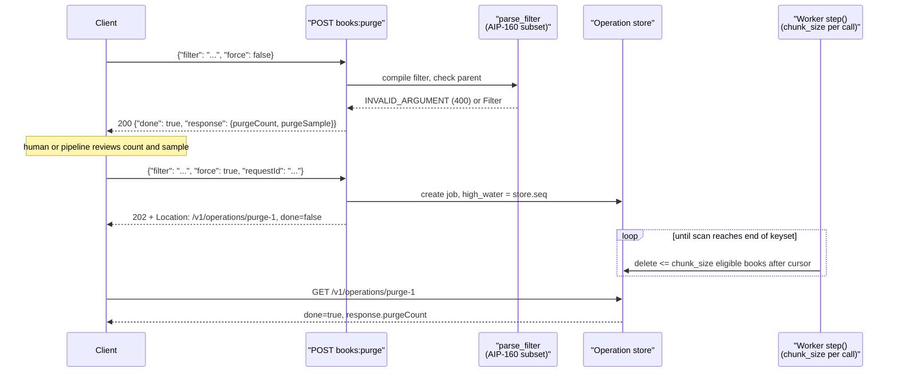

# Criteria-Based Purge Operations: Filter-Driven Bulk Deletion, force=False Dry Runs, and LRO Handoff (AIP-165)

> [!summary] Claim
> A Purge method deletes "everything matching this filter", so it is safe only when the default request (`force` unset) is a side-effect-free preview returning `purge_count` and `purge_sample`, every filter that is not fully understood is rejected with `INVALID_ARGUMENT` instead of being widened, and the destructive run is handed to a long-running operation that deletes in bounded chunks against a fixed eligibility boundary.

Part of [Bulk Long Running and Error Contracts](README.md) in [API Engineering](../README.md).

## TL;DR

- Mechanism: `POST /v1/{parent=publishers/*}/books:purge` with `body: "*"` carries `filter` (AIP-160 syntax) and `force`, and always returns a `google.longrunning.Operation` that resolves to `PurgeBooksResponse {purge_count, purge_sample}` (AIP-165).
- Contract rule: if `force` is not set, the API must return a count of the resources that would be deleted and a sample of them without deleting anything (AIP-165), so the zero value of a proto3 `bool` makes the safe path the default.
- The trap: anything that silently widens the filter (an ignored unknown field, a lax `"true"` -> `True` coercion, a parent prefix of `publishers/acme` that also matches `publishers/acme2`) turns a preview-reviewed request into a different, larger deletion.
- Portability fact: the lab passes all 36 tests on CPython 3.12 to 3.15 (3.12.13 to 3.15.2 on macOS; 3.12.16 to 3.15.2 in Debian Trixie and Alpine containers; 3.15.2t free-threaded), and the contract holds end to end through Uvicorn, Hypercorn, and Granian over HTTP/1.1, HTTP/2, and HTTP/3, because it lives in application code, not in the server or HTTP version.
- When not to use it: AIP-165 says most APIs should use only Delete (AIP-135) or Batch Delete (AIP-235); prefer those, soft delete (AIP-164), or retention policies unless users genuinely need to delete thousands of resources by predicate.

## Mental model



The client first sends the purge with `force` false or absent, and the server compiles the filter, scans the collection, and replies with an already-completed operation whose response holds the exact count and the first 100 matching names, deleting nothing and storing no operation.
After a human or a pipeline has reviewed that preview, the client repeats the request with `force: true` and a `requestId`, and the server validates the same filter again, records an eligibility boundary (`high_water`, the store's creation counter at acceptance), stores a job, and returns `202 Accepted` with a `Location` pointing at the operation.
A worker then repeatedly calls `step()`, each call walking the collection in name order after a keyset cursor and deleting at most `chunk_size` books that still match the predicate and existed at acceptance.
The operation flips to `done: true` only when a step reaches the end of the keyset, at which point `GET /v1/operations/{id}` returns `response.purgeCount`, the number actually deleted.

## How it works

### The method shape AIP-165 prescribes

AIP-165 (state `approved`, last changelog entry 2025-07-23, as of 2026-11) defines Purge as a rare pattern "reserved for situations where users need to delete thousands or more resources at once".
Its rules for the RPC are:

- the name must begin with `Purge` and should continue with the plural resource name, and the request message must be `<Rpc>Request`;
- the response type must be a `google.longrunning.Operation` resolving to `<Rpc>Response`;
- the HTTP verb must be `POST` with `body: "*"`, the URI path should be the collection, and cross-parent purge should use the `-` wildcard from AIP-159;
- `string filter` must be included with the same semantics as List filtering (AIP-160), should be required, and may accept `"*"` to mean everything;
- `bool force` must be included, even if the response omits `purge_count` and `purge_sample`.

`body: "*"` is defined in `google/api/http.proto` as mapping "every field not bound by the path template" into the request body, so `parent` travels in the URI and `filter`, `force`, and `requestId` travel as JSON.
Proto3 JSON maps field names to lowerCamelCase (protobuf JSON mapping guide), which is why the wire fields are `purgeCount` and `purgeSample`.

### Why `POST` with a body, not `DELETE` with a query

The filter is a request body, and RFC 9110 says "content received in a DELETE request has no generally defined semantics, cannot alter the meaning or target of the request, and might lead some implementations to reject the request and close the connection" (RFC 9110 Section 9.3.5).
`POST` asks the target resource to process the enclosed representation "according to the resource's own specific semantics" (RFC 9110 Section 9.3.3), which is exactly a custom `:purge` verb on a collection (see [[Custom-Methods-and-State-Machine-Transitions-AIP-136]]).
The price is idempotency: RFC 9110 lists only `PUT`, `DELETE`, and the safe methods as idempotent (RFC 9110 Section 9.2.2), so a retried `POST ... force=true` can start a second purge unless the request carries an AIP-155 `request_id`, for which AIP-155 says a duplicate "should return the response for the previously successful request".

### `force` is a fail-safe default, and the type system must keep it one

In proto3 a `bool` without presence defaults to `false`, and the protobuf JSON guide says serializers omit a field that "doesn't support field presence and has the default value".
A client that forgets the field therefore sends a dry run, and AIP-165 makes that the contract: "If it is not set, the API **must** return a count of the resources that would be deleted as well as a sample of those resources, without actually performing the deletion."

The same word means something different one AIP away.
In AIP-135, `force` on a standard Delete opts in to cascading deletion of child resources, and the API "must fail with a `FAILED_PRECONDITION` error if the `force` field is `false` (or unset) and child resources are present".
So `force=false` is "preview" on Purge and "refuse if children exist" on Delete; both are safe defaults, but documentation and client wrappers must not reuse one meaning for the other.

On the Python side, the hazard is lax coercion.
Pydantic's default `bool` validation accepts strings and integers; the Rust helper is (simplified excerpt from `(pydantic-core 2.50.4 src/input/shared.rs, str_as_bool)`, read in the pydantic `v2.14.3` monorepo whose `pydantic-core/Cargo.toml` declares `version = "2.50.4"`):

```rust
} else if str == "1"
    || str.eq_ignore_ascii_case("t")
    || str.eq_ignore_ascii_case("y")
    || str.eq_ignore_ascii_case("on")
    || str.eq_ignore_ascii_case("yes")
    || str.eq_ignore_ascii_case("true")
{
    Ok(true)
```

`int_as_bool` in the same file maps `1` to `true`.
The lab declares `force: StrictBool = False`, so `{"force": "true"}` and `{"force": 1}` are `400 INVALID_ARGUMENT`, and mutation M2 (plain `bool`) makes two tests fail because the server then starts a real purge.

### Filter compilation: reject, never widen

AIP-160 says a "non-compliant or schematically invalid `filter` string" should produce `INVALID_ARGUMENT`, and lists what schematic validation covers: fields "must exist on the filtered schema", values "must align to the type of the field", enum values must be in the set, and standardized types such as `Timestamp` must conform (AIP-160, Validation).
For List, a lenient filter returns too many rows; for Purge, it deletes too many rows, so the lab treats every rule as mandatory.
The lab parses a documented subset, `field op value (AND field op value)*` or the bare `"*"`, over three typed fields (`availability` enum, `create_time` timestamp with a required offset, `page_count` int32), and rejects `OR`, unknown fields, mistyped values, and dangling `AND` rather than guessing.
It also mirrors the published limits of a real Purge API, Google Cloud Retail `products:purge`, whose `filter` has "a length limit of 5,000 characters", "should not contain more than 6 conditions", and for which "Empty string filter is not allowed" while `"*"` deletes everything in a branch (as of 2026-11).

### The dry run: count, sample, and a completed operation

AIP-165's response has `int32 purge_count` (which "may be an estimate similar to `total_size` in AIP-158", documented if so) and `repeated string purge_sample`, populated only when `force` is false, with "A good rule of thumb is 100", documented as a maximum, and either random or deterministic.
The lab returns the exact count and the first 100 names in lexicographic order, so two previews of an unchanged collection are byte-identical and diffable.
AIP-151 tells a method with a validate-only mode how to answer without creating state: "A successful response with an `Operation` which is already complete, with the `done` field set to `true`", whose `name` "may be empty".
The lab follows that shape for `force=false`: `200 OK`, `{"done": true, "response": {...}}`, no `name`, and `service.jobs` stays empty (mutation M22, which stores a job for dry runs, fails a test).
Real services differ: Retail's `force` field says that with `force` false "the method will return the expected purge count without deleting any products", and its method description says "To get a sample of Products that would be deleted, set PurgeProductsRequest.force to false" (as of 2026-11).

### LRO handoff and chunked execution

`google.longrunning.Operation` has `name`, `metadata` (`Any`), `done`, and a `result` oneof of `error` (`google.rpc.Status`) or `response` (`Any`) (`googleapis google/longrunning/operations.proto, Operation`).
In proto3 JSON an `Any` becomes an object with an extra `"@type"` field holding the type URL (protobuf JSON mapping guide), which is the shape the lab emits.
AIP-165 does not say which HTTP status code a transcoded Purge returns; the lab returns `202 Accepted` with `Location` for the pending operation, matching RFC 9110's description of a response for a request "accepted for processing, but the processing has not been completed" whose representation ought to "point to (or embed) a status monitor" (RFC 9110 Section 15.3.3), and `200 OK` for the completed dry run.

Execution has three correctness rules the lab encodes in `_eligible` and `step`:

1. Eligibility boundary: only books whose `create_seq` is at or below the `high_water` recorded at acceptance can be deleted, so resources created while the purge runs survive (mutation M6 fails `test_books_created_after_acceptance_survive`).
2. Re-check at delete time: the predicate is evaluated against the current state of each book when its chunk runs, not against a name list captured at acceptance, so a book that stopped matching is kept (mutation M7, a frozen snapshot of names, fails `test_predicate_is_rechecked_at_delete_time`).
3. Bounded chunks with a keyset cursor: each step deletes at most `chunk_size` matches after the last examined name, and the operation is `done` only when a step exhausts the keyset (mutations M8 and M11 fail).

Rule 2 means `purgeCount` in the final response can differ from the preview, which is why the final count is the number actually deleted and why AIP-165 lets the preview count be an estimate.
Retail documents the user-visible consequence: the purge "could take hours to complete" and "Before the operation completes, some Products may still be returned by ProductService.GetProduct or ProductService.ListProducts" (as of 2026-11).
Errors that prevent the operation from starting must be ordinary error responses, while failures during execution go in `Operation.error` (AIP-151, Errors); a purge has no rollback, so a failed operation has deleted a prefix of the keyset, and the metadata's running `deletedCount` tells the caller how much.

### Routing a colon verb in Starlette

Starlette compiles `"/v1/publishers/{publisher}/books:purge"` by `re.escape`-ing the literal text between parameters and substituting each parameter's convertor regex `(starlette 1.10.0 starlette/routing.py, compile_path)`, and the default `str` convertor's regex is `[^/]+` `(starlette 1.10.0 starlette/convertors.py, StringConvertor)`.
The literal `/books:purge` therefore matches only that exact suffix, and a `{publisher}` value cannot contain `/`; the colon is only special inside braces, where `PARAM_REGEX` reads `{name:convertor}`.

## Numbers and limits

| Quantity | Value | Source |
| --- | --- | --- |
| `purge_sample` size | 100, a documented maximum | AIP-165 "rule of thumb" |
| Preview count accuracy | may be an estimate, must be documented | AIP-165 citing AIP-158 `total_size` |
| `purge_count` range | int32, at most 2147483647, JSON number | AIP-165 field type; protobuf JSON mapping (int32 -> number) |
| LRO threshold | about 10 seconds of expected work | AIP-151 note, "A good rule of thumb is 10 seconds" |
| Operation retention | about 30 days after completion | AIP-151 Expiration note |
| Batch Delete size in the AIP example | 1000 per request | AIP-235 example comment; the lab's default `CHUNK_SIZE` |
| Retail `filter` length | 5,000 characters | Retail `products:purge` reference (as of 2026-11) |
| Retail filter conditions and nesting | at most 6 conditions, depth 2 | Retail `products:purge` reference (as of 2026-11) |
| Atlassian 2022 deletion | 883 sites, 775 customers, 07:38 to 08:01 UTC on 2022-04-05; outage up to 14 days for a subset | Atlassian post-incident review |
| Lab dry run, 10,000 books, 8,000 match | median 2.8 ms over 7 runs | measured, see below |
| Lab dry run, 100,000 books, 80,000 match | median 29.5 ms over 7 runs | measured, see below |
| Lab full purge, 100,000 books, `chunk_size` 1000 | 80 steps, 0.21 s total (median of 6 runs, 0.20 to 0.22 s) | measured, see below |

Measured (2026-11) with a throwaway script calling `PurgeService` directly (no HTTP), run from `labs/` as `uv run --frozen python -I bench.py`, on CPython 3.14.6, macOS 27.2 (Darwin 27.2.0 arm64), Apple M3 Pro; one publisher, every fifth book `IN_STOCK`, filter `availability = "BACKORDER"`, timed with `time.perf_counter`.
The lab store sorts all names on every scan, so each step is `O(N log N)`; a database implementation would seek an index on `name > cursor` instead, and these numbers say nothing about that.

## Portability

Every leg ran the same 36-test module (as of 2026-11).
Local legs ran on macOS 27.2 (Darwin 27.2.0 arm64, Apple M3 Pro); container legs ran under OrbStack as `linux/arm64` (Linux 7.2.12) from the official `python` images, with the locked `fastapi`, `starlette`, `pydantic`, `pydantic-core`, `httpx`, `pytest`, and `pytest-asyncio` versions installed by `pip install -r` of the `uv export --frozen` pins.

| Leg | Result | Evidence |
| --- | --- | --- |
| CPython 3.12.13 (macOS) | 36 passed | `UV_PROJECT_ENVIRONMENT=<tmp venv> uv run --frozen --python 3.12.13` (full locked sync) |
| CPython 3.13.18 (macOS) | 36 passed | same method |
| CPython 3.14.6 (workspace `.venv`) | 36 passed | the five gate commands below |
| CPython 3.14.10 (macOS) | 36 passed | same method as 3.12.13 |
| CPython 3.15.2 (macOS) | 36 passed | same method as 3.12.13 |
| CPython 3.14.6t free-threaded (macOS) | 36 passed, `sys._is_gil_enabled()` is `False` after importing the stack | full `uv sync --frozen` fails (`psycopg-binary==3.3.8` has no free-threaded wheel), so the subset above was installed at the locked versions and run with `-X gil=0` |
| CPython 3.15.0b3t free-threaded (macOS) | 36 passed, GIL disabled | same method |
| CPython 3.15.2t free-threaded (Linux) | 36 passed, `sysconfig.get_config_var("Py_GIL_DISABLED")` is `1`, `sys._is_gil_enabled()` is `False` after importing the stack | no official `3.15.2t` image or `uv` build exists, so CPython 3.15.2 was built from `python.org/ftp/python/3.15.2/Python-3.15.2.tar.xz` with `./configure --disable-gil` inside `python:3.15.2-trixie`, then run with `-X gil=0` |
| Debian Trixie container | 36 passed on 3.12.16, 3.13.18, 3.14.10, 3.15.2 | `docker run` of `python:<version>-trixie` (`python:3.12.16-slim-trixie` for 3.12.16), glibc 2.41 |
| Alpine musl container | 36 passed on 3.12.16, 3.13.18, 3.14.10, 3.15.2 | `docker run` of `python:<version>-alpine`, musl libc, `ID=alpine` |
| pydantic-core 2.50.4 | lax `bool` accepts `"true"`, `"yes"`, `"on"`, `1` | `(pydantic-core 2.50.4 src/input/shared.rs, str_as_bool)`; lab `string-true` and `int-one` cases |
| FastAPI 0.162.0, Starlette 1.10.0 | colon verb routes, `RequestValidationError` remapped to `400` | lab tests through `httpx.ASGITransport` |
| Uvicorn 0.54.0 | HTTP/1.1: dry run `200`, `force: "true"` `400`, force run `202` with `Location`, `requestId` replay returns the same operation, job reaches `done` with `purgeCount` 20 | real socket run of a throwaway harness (the lab app plus a background task calling `step()`), `python -m uvicorn`, driven by `httpx` on CPython 3.14.6, macOS |
| Hypercorn 0.18.0 | the same six observations over HTTP/1.1 and over HTTP/2 cleartext (prior knowledge); over HTTP/3 on QUIC the first four (dry run, `force: "true"` rejection, force run with `Location`, job `done`) | `python -m hypercorn` with a throwaway self-signed certificate and `--quic-bind`; `httpx` for HTTP/1.1 and HTTP/2, an `aioquic` 1.7.2 `H3Connection` client for HTTP/3 |
| Granian 2.8.7 | the same six observations over HTTP/1.1 and over HTTP/2 cleartext | `python -m granian --interface asgi --http 1` and `--http 2`, same harness and driver |
| HTTP/1.1, HTTP/2, HTTP/3 | same semantics | the server runs above, plus RFC 9110 Section 6 (the message abstraction is "independent of the HTTP version"); the `DELETE` body caveat of Section 9.3.5 applies to every version |

The server runs prove the request and response contract end to end through real HTTP framing; they say nothing about the lab's store, which is in-process and single-threaded in every leg.
The Uvicorn run covers HTTP/1.1 only: `(uvicorn 0.54.0 uvicorn/config.py, Config.load)` raises `ValueError` for `http2` unless the optional external `zttp` package is selected, and `zttp` is not in the lab lock.
Granian 2.8.7 was not run over HTTP/3 because `python -m granian --help` offers `--http [auto|1|2]` and nothing for QUIC; Hypercorn carries the HTTP/3 leg.

## Worked example

The [implementation](../labs/src/api_labs/f06_bulk_long_running_and_error_contracts/criteria_purge.py) is a FastAPI app over an in-memory `BookStore`, and the [test](../labs/tests/f06_bulk_long_running_and_error_contracts/test_criteria_based_bulk_delete_and_purge_operations_aip_165.py) drives it through `httpx.AsyncClient(transport=httpx.ASGITransport(app=app), base_url="http://test")`.

The request model makes the dry run the default and refuses anything ambiguous (simplified excerpt, lines copied verbatim from `criteria_purge.py`):

```python
class PurgeBooksRequest(BaseModel):
    """The JSON body (`body: "*"`); `parent` comes from the URI path."""

    model_config = ConfigDict(extra="forbid", populate_by_name=True)

    filter: str
    force: StrictBool = False
    request_id: Annotated[str | None, Field(alias="requestId", max_length=64)] = None
```

The parser rejects instead of widening (simplified excerpt, lines copied verbatim):

```python
def parse_filter(text: str) -> Filter:
    """Parse the AIP-160 subset `field op value (AND field op value)*`, or the `"*"` wildcard.

    Unknown fields, mistyped values, and trailing garbage raise `INVALID_ARGUMENT`;
    nothing is ever silently ignored, because an ignored condition widens the match set.
    """
    if len(text) > MAX_FILTER_LENGTH:
        raise invalid(f"filter exceeds {MAX_FILTER_LENGTH} characters")
    stripped = text.strip()
    if not stripped:
        raise invalid('filter is required; use "*" to purge everything under parent')
    if stripped == "*":
        return Filter(conditions=(), match_all=True)
    conditions: list[Condition] = []
    pos = 0
    expect_condition = True
    while pos < len(stripped):
        token = TOKEN_RE.match(stripped, pos)
        if token is None:
            raise invalid(f"cannot parse filter at offset {pos}: {stripped[pos:]!r}")
        conjunction, field, op, raw = token.groups()
        if conjunction is not None:
            if expect_condition:
                raise invalid(f"unexpected AND at offset {pos}")
            expect_condition = True
        else:
            if not expect_condition:
                raise invalid(f"missing AND before offset {pos}")
            if field not in FIELD_TYPES:
                raise invalid(f"unknown field {field!r}; filterable: {sorted(FIELD_TYPES)}")
            conditions.append(Condition(field, op, _typed_value(field, op, raw)))
            expect_condition = False
        pos = token.end()
    if expect_condition:
        raise invalid("filter ends with AND")
    if len(conditions) > MAX_CONDITIONS:
        raise invalid(f"filter has {len(conditions)} conditions; maximum is {MAX_CONDITIONS}")
    return Filter(conditions=tuple(conditions))
```

Eligibility, the preview, the handoff, and the chunked step (simplified excerpt, lines copied verbatim from `PurgeService`):

```python
    def _eligible(self, book: Book, prefix: str, predicate: Filter, high_water: int) -> bool:
        return (
            book.name.startswith(prefix)
            and book.create_seq <= high_water
            and predicate.matches(book)
        )

    def purge(self, parent: str, request: PurgeBooksRequest) -> dict[str, Any]:
        prefix = _prefix(parent)
        predicate = parse_filter(request.filter)
        if not request.force:
            matched = [
                book.name
                for book in self.store.books()
                if self._eligible(book, prefix, predicate, self.store.seq)
            ]
            response = {
                "@type": TYPE_PREFIX + "PurgeBooksResponse",
                "purgeCount": len(matched),
                "purgeSample": matched[: self.sample_max],
            }
            return {"done": True, "response": response}
        if request.request_id is not None and request.request_id in self.by_request_id:
            return self.operation(self.by_request_id[request.request_id])
        self._next_id += 1
        job = PurgeJob(f"operations/purge-{self._next_id}", prefix, predicate, self.store.seq)
        self.jobs[job.name] = job
        if request.request_id is not None:
            self.by_request_id[request.request_id] = job.name
        return self.operation(job.name)

    def step(self, operation_name: str) -> int:
        """Delete up to `chunk_size` eligible books after the keyset cursor; return the count."""
        job = self.jobs[operation_name]
        deleted = 0
        for book in self.store.books():
            if book.name <= job.cursor:
                continue
            if deleted == self.chunk_size:
                break
            job.cursor = book.name
            if self._eligible(book, job.prefix, job.predicate, job.high_water):
                self.store.delete(book.name)
                deleted += 1
        else:
            job.done = True
        job.deleted += deleted
        return deleted
```

`_prefix("publishers/acme")` returns `"publishers/acme/books/"`, not `"publishers/acme"`, so a sibling `publishers/acme2` is never matched (mutation M9 fails `test_prefix_does_not_match_a_longer_publisher_id`).
With 25 books per publisher, 20 of them backordered, `chunk_size=8` deletes `[8, 8, 4, 0]` over four steps, and the third step already marks the operation done because it reached the end of the keyset.

Captured run, from `labs/`, CPython 3.14.6 on macOS 27.2 (Darwin 27.2.0 arm64):

```text
$ uv run --frozen pytest tests/f06_bulk_long_running_and_error_contracts/test_criteria_based_bulk_delete_and_purge_operations_aip_165.py -q
....................................                                     [100%]
36 passed in 0.59s
```

## Pitfalls

> [!warning] Purging with the wrong identifiers and no preview
> Trigger: a bulk deletion script receives identifiers of the wrong kind and runs directly in production.
> Symptom: in Atlassian's April 2022 outage, "The script for the subsequent Production run included site IDs in place of Insight app IDs", the API "accepts both site and app identifiers and assumes the input is correct", and "The result was an immediate deletion of 883 sites (representing 775 customers)", with the outage spanning "up to 14 days for a subset of these customers" (Atlassian post-incident review).
> Fix: make the default call a preview whose `purge_count` and `purge_sample` a human can sanity-check (an order-of-magnitude surprise is visible in the count, a wrong resource type in the sample names), and keep a soft-delete path; the review itself lists "There was no warning signal to confirm the type of deletion (site or app) being requested" among its causes.

> [!warning] An ignored filter clause widens the deletion
> Trigger: the filter parser drops conditions it does not recognize, such as a misspelled `availabilty`, or treats an unparseable tail as absent.
> Symptom: the remaining predicate matches a superset, and with an empty remainder it matches everything under `parent`.
> Fix: AIP-160 validation (unknown field, wrong type, invalid enum, malformed timestamp -> `INVALID_ARGUMENT`) is optional for List but mandatory for Purge; mutation M4, which skips unknown fields, fails `test_invalid_filters_are_rejected_before_any_deletion[unknown-field]` in the lab.

> [!warning] Lax boolean coercion flips `force`
> Trigger: a client or a form encoder sends `"force": "true"` or `"force": 1`, and the server model uses plain `bool`.
> Symptom: Pydantic's lax mode accepts `"true"`, `"yes"`, `"on"`, `"t"`, `"y"`, `"1"`, and `1` as `True` `(pydantic-core 2.50.4 src/input/shared.rs, str_as_bool)`, so the request runs a real purge.
> Fix: declare `force: StrictBool = False` and `extra="forbid"`, so the only way to delete is the JSON literal `true` on a correctly spelled field.

> [!warning] A retried `force=true` starts a second purge
> Trigger: a client times out waiting for the `202` and retries the `POST`.
> Symptom: two operations race over the same keyset; with a moving eligibility boundary the second one can also delete resources created after the first was accepted.
> Fix: accept an AIP-155 `request_id` and return the existing operation for a duplicate (the lab's `test_request_id_replays_the_same_operation`; mutation M13 fails it); see [[Idempotent-Request-Identification-and-Request-ID-Correlation-AIP-155]].

> [!warning] Preview and execution disagree
> Trigger: resources change between the dry run and `force=true`, or during the operation.
> Symptom: the final `purgeCount` differs from the preview, or rows created after the decision are deleted.
> Fix: fix an eligibility boundary at acceptance (a creation sequence or timestamp), re-check the predicate at delete time, and report the actual deleted count; documenting that the preview is advisory is cheaper than pretending it is a lock.

> [!warning] Reusing `force` with Delete semantics
> Trigger: a team copies AIP-135's cascading-delete `force` into a Purge, or the reverse.
> Symptom: client wrappers or docs that treat `force=false` as "fail if children exist" are surprised by a successful preview, and vice versa.
> Fix: document `force` per method; on Purge it means "actually perform the purge", on Delete it means "also delete children".

## Security and robustness

- Broken function level authorization (OWASP API5:2023): a Purge is an administrative function in all but name, and OWASP lists "Can a user perform sensitive actions (e.g. creation, modification, or deletion)" as the question to ask; authorize `:purge` with its own permission, separate from single-resource delete, and require it on the dry run too, because AIP-163 says validation "must perform permission checks" and the sample leaks resource names.
- Object level scoping: the `parent` prefix is the tenant boundary, so build it from validated path segments with a trailing separator (`publishers/acme/books/`), and for `publishers/-` authorize every parent the scan will touch, not just the caller's own.
- Unrestricted resource consumption (OWASP API4:2023, which names "Execution timeouts" and the "Number of operations to perform in a single API client request"): cap filter length and condition count before parsing, cap `purge_sample`, run the deletion in bounded chunks, and rate-limit concurrent purges per parent (AIP-151 says resources that refuse parallel operations "must return `ABORTED`").
- Input validation edge cases covered by the lab: empty and blank filters, `OR` outside the supported subset, naive timestamps (an ordering comparison against timezone-aware data raises `TypeError`, and `!=` silently evaluates true, so `create_time != "<naive>"` would match every book), quoted integers, enum ordering, unknown body fields, a `requestId` longer than 64 characters, and parents that fail `publishers/(-|[a-z0-9][a-z0-9-]{0,62})`.
- Defense in depth: route purge deletions through soft delete with expiry where the resource supports it ([[Soft-Delete-Undelete-and-Expiration-Lifecycles-AIP-164]]), write an audit record with the filter, the preview count, the actual count, and the caller, and keep backups whose restore has been tested, which is the Atlassian review's own remediation ("Any activity to soft-delete data must test restoration of the deleted data prior to running in production").

## The principal's view

The first decision is whether to ship Purge at all.
AIP-165's Guidance section opens with "Most APIs should use only Delete (AIP-135) or Batch Delete (AIP-235) for deleting resources, and should not implement deleting based on criteria", because a predicate is a far larger blast radius than a list of names.
Choose Purge only when the deletion set is defined by a predicate users cannot enumerate cheaply (millions of events older than a date, every product in a branch), and prefer a declarative retention policy when the predicate is really "older than N days", because a policy is reviewed once and runs continuously instead of being retyped under pressure.

If you do ship it, the organizational trade-off is friction versus safety.
The two-call protocol (preview, then `force`) costs one extra round trip and a review step; in exchange, the platform team can require that automation records the preview count and fails if the forced operation deletes more than, say, 110% of it, a guard that lives in the client pipeline because AIP-165 defines no server-side confirmation token.
Execution belongs in an LRO with metadata progress, an `Operation.error` for mid-run failure, and per-parent serialization, because a purge that dies halfway has no rollback and operators need to know exactly how far it got.
Finally, choose a different tool when the data model allows it: dropping a partition or a tenant database is cheaper and more auditable than row-wise predicate deletion, and an event-sourced store may prefer tombstones that compaction removes.

## Interview questions

> [!question] L5: What does a Purge request with no `force` field do under AIP-165, and why is that the right default?
>
> > [!success]- Answer
> > It deletes nothing and returns `purge_count` and a sample of resource names that would be deleted.
> > AIP-165 makes this a must when `force` is not set.
> > A proto3 `bool` defaults to `false` and is omitted from JSON when false, so a client that forgets the field gets the safe path.
> >
> > Follow-up: How does AIP-135 use a field with the same name, and what goes wrong if a client library conflates them?

> [!question] L5: Why is a Purge exposed as `POST .../books:purge` with `body: "*"` rather than `DELETE /books?filter=...`?
>
> > [!success]- Answer
> > AIP-165 requires `POST` with `body: "*"`.
> > RFC 9110 Section 9.3.5 says content in a `DELETE` has no generally defined semantics and "might lead some implementations to reject the request and close the connection", so a filter cannot reliably ride in a `DELETE` body.
> > A query string filter on `DELETE` lands in access logs, and RFC 9110 Section 4.1 only recommends that senders and recipients support URIs of at least 8000 octets, which a 5,000-character filter plus encoding can approach.
> > `POST` lets the collection apply its own processing semantics (RFC 9110 Section 9.3.3) to a structured body.
> >
> > Follow-up: What do you give up by using `POST`, and how do you get it back?

> [!question] L6: Predict the output: what status and body does the lab return for `POST /v1/publishers/acme/books:purge` with `{"filter": "availability = \"BACKORDER\"", "force": "true"}`, and what changes if `force` is declared as plain `bool`?
>
> > [!success]- Answer
> > `force` is `StrictBool`, so validation fails and the `RequestValidationError` handler returns `400` with `{"error": {"code": 400, "status": "INVALID_ARGUMENT", "message": "invalid request fields: ['force']"}}`.
> > Nothing is deleted and no operation is stored.
> > With plain `bool`, pydantic-core's `str_as_bool` maps `"true"` to `True`, so the server returns `202` with `operations/purge-1` and a worker deletes the 20 backordered books.
> > The lab's `string-true` case and mutation M2 prove both outcomes.
> >
> > Follow-up: Which other inputs does lax mode accept as true, and how would you find every boolean in an API that guards a destructive path?

> [!question] L6: Debug this API: a wildcard purge with `parent = publishers/acme` also deletes books under `publishers/acme-labs`, and the code matches with `book.name.startswith(parent)`; what is wrong and how do you prove the fix?
>
> > [!success]- Answer
> > `"publishers/acme-labs/books/x".startswith("publishers/acme")` is true, so the prefix crosses the tenant boundary.
> > Match on the full collection path with its trailing separator, `publishers/acme/books/`, or on the parsed parent segment, never on a raw string prefix.
> > Prove it with a regression test that seeds a sibling parent whose ID extends the target's ID and asserts it survives a wildcard purge; the lab's `test_prefix_does_not_match_a_longer_publisher_id` fails under mutation M9.
> > Treat this as an authorization bug (BOLA), not just a correctness bug, and audit other prefix scans.
> >
> > Follow-up: How does `publishers/-` change the authorization check?

> [!question] L6: The preview said 20 books and the finished operation reports 19; is that a bug?
>
> > [!success]- Answer
> > Not necessarily.
> > The lab re-checks the predicate at delete time, so a book whose `availability` changed to `IN_STOCK` after the preview is kept, and `purgeCount` reports what was actually deleted.
> > AIP-165 lets the preview count be an estimate if documented.
> > It would be a bug if the operation deleted books created after acceptance, which the `high_water` boundary prevents.
> >
> > Follow-up: When would you instead snapshot the matched names at acceptance, and what does that cost?

> [!question] L6: How do you make `force=true` safe to retry when the client times out before seeing the `202`?
>
> > [!success]- Answer
> > Add an AIP-155 `request_id` and persist the mapping from `request_id` to operation name in the same transaction that creates the operation.
> > A duplicate returns the existing operation instead of starting a second purge.
> > Bind the stored entry to a fingerprint of `parent` and `filter` so a reused ID with a different request is rejected rather than replayed.
> > Expire the mapping no sooner than the operation itself (AIP-151 suggests about 30 days).
> >
> > Follow-up: What happens if the duplicate arrives after the operation has expired?

> [!question] L7+: A product team wants Purge on a 2-billion-row event table so customers can delete by predicate; what do you require before approving it?
>
> > [!success]- Answer
> > First ask whether a retention policy, partition drop, or tenant-level delete covers the need, since AIP-165 discourages Purge.
> > If Purge stays, require a dedicated permission, a preview that is cheap enough to run on every request (an estimate from statistics if exact counts are too slow, documented as such), and the same validated filter AIP-160 grammar List uses.
> > Execution must be an LRO with keyset chunks, a fixed eligibility boundary, per-parent serialization, progress metadata, and audit records.
> > Deletions should land in a soft-delete or tombstone path with tested restore, and client tooling should refuse to force a purge whose preview it has not recorded.
> >
> > Follow-up: How do you bound the replication and vacuum load the chunked deletes create?

> [!question] L7+: Why does AIP-165 return a `google.longrunning.Operation` even for the dry run, and what does AIP-151 let the server do to avoid storing state for it?
>
> > [!success]- Answer
> > A single response type keeps client code uniform: every Purge call is "await an operation, read `response`".
> > AIP-151 allows a validate-style call to return an already completed operation with `done: true` and the response embedded, and its `name` may be empty, so no operation record is persisted.
> > The rationale section calls this a compromise between clients that want fully formed operations and servers that do not want state for trivial work.
> > The lab returns exactly that shape with `200 OK` and asserts `service.jobs` is empty after a dry run.
> >
> > Follow-up: When would a dry run itself need to be a pending operation?

> [!question] L5: What should the server do with `filter: ""`, and with `filter: "*"`?
>
> > [!success]- Answer
> > An empty filter is a missing required field and should be `INVALID_ARGUMENT`; Retail documents "Empty string filter is not allowed".
> > `"*"` is the explicit wildcard AIP-165 says may be supported for deleting everything under `parent`.
> > Making "everything" require a deliberate token prevents a blank form field from becoming a full wipe.
> >
> > Follow-up: Should `"*"` with `publishers/-` be allowed at all?

## Related

Prerequisites: [[Atomic-vs-Partial-Batch-Execution-and-207-Multi-Status]]

Next: [[Long-Running-Operations-202-Accepted-and-Operation-Resources-AIP-151]]

See also: [[02-Programming-Languages/Python/Python-Backend-Interview-Prep/05-REST-API-Design]], [[Batch-Get-and-Bulk-Mutation-Design-AIP-231-to-AIP-235]], [[Dry-Run-and-Validate-Only-Requests-AIP-163]], [[Idempotent-Request-Identification-and-Request-ID-Correlation-AIP-155]], [[Structured-Filter-Expressions-and-AST-Compilation-AIP-160]], [[Soft-Delete-Undelete-and-Expiration-Lifecycles-AIP-164]], [[Keyset-Seek-Pagination-and-Composite-Tie-Breaker-Cursors]], [[Total-Count-Antipattern-and-Estimated-Counts]], [[Custom-Methods-and-State-Machine-Transitions-AIP-136]], [[Defeating-BFLA-API5-2023-Function-Level-Guards-and-Deny-By-Default-Routers]], [[Google-AIP-193-Error-Model-and-Rich-Error-Details]]

- Lab: `labs/tests/f06_bulk_long_running_and_error_contracts/test_criteria_based_bulk_delete_and_purge_operations_aip_165.py`

## Further reading

- [AIP-165 Criteria-based delete](https://google.aip.dev/165): the normative Purge contract, including the `force` default and the sample guidance.
- [AIP-151 Long-running operations](https://google.aip.dev/151): validate-only operation shapes, error placement, parallel operations, and expiry.
- [AIP-160 Filtering](https://google.aip.dev/160): the filter grammar Purge must reuse and its schematic validation rules.
- [AIP-235 Batch methods: Delete](https://google.aip.dev/235): the name-list alternative AIP-165 tells you to prefer.
- [AIP-135 Standard methods: Delete](https://google.aip.dev/135): the cascading-delete meaning of `force`.
- [AIP-155 Request identification](https://google.aip.dev/155): making a non-idempotent `POST` safe to retry.
- [google/longrunning/operations.proto](https://github.com/googleapis/googleapis/blob/master/google/longrunning/operations.proto): the `Operation` message the response resolves through.
- [RFC 9110](https://www.rfc-editor.org/rfc/rfc9110.html) Sections 9.2.2, 9.3.3, 9.3.5, and 15.3.3: idempotency, `POST`, `DELETE` content, and `202 Accepted`.
- [ProtoJSON format](https://protobuf.dev/programming-guides/json/): lowerCamelCase names, default omission, and the `Any` `"@type"` mapping.
- [Atlassian post-incident review, April 2022](https://www.atlassian.com/engineering/post-incident-review-april-2022-outage): a primary postmortem of a bulk deletion with wrong identifiers and no confirmation signal.
