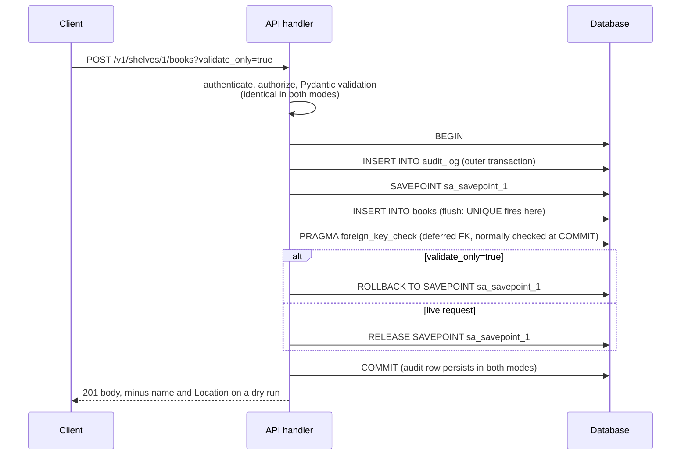

# Change Validation and Dry-Run Requests (validate_only, Google AIP-163) via Database Savepoints

> [!summary] Claim
> A `validate_only` request is trustworthy only if it runs the live code path - authorization, schema validation, immediate and deferred constraints, idempotency bookkeeping - and differs from the live request in exactly one place, `ROLLBACK TO SAVEPOINT` instead of `RELEASE SAVEPOINT`, so everything the savepoint cannot roll back (deferred constraints, sequences, locks, external side effects) has to be designed for explicitly.

Part of [Bulk Long Running and Error Contracts](README.md) in [API Engineering](../README.md).

## TL;DR

- Mechanism: open a `SAVEPOINT` (`AsyncSession.begin_nested()`), run the live handler, `flush()` so immediate constraints fire, check deferred constraints explicitly, build the response, then roll back to the savepoint; work done before the savepoint (an audit row) still commits.
- Contract (AIP-163): the dry run returns the same status code, headers, and body as the live request, must perform permission checks and all live validation, must fail if the live request would fail, and should omit server-generated fields such as the resource ID.
- Trap: a savepoint only undoes database writes inside it; a deferred foreign key, a PostgreSQL sequence, a row lock, an idempotency ledger written outside it, an email, or a webhook all escape, and the lab shows a dry run returning `201` for a request whose live twin returns `404`.
- Portability: the lab passes 20 of 20 tests on CPython 3.12.13, 3.13.18, 3.14.6, 3.14.10, and 3.15.2 and on free-threaded 3.14.6t and 3.15.2t on macOS, on 3.12.16, 3.13.18, 3.14.10, and 3.15.2 in Debian Trixie and 3.14.10 in Alpine musl containers, and with SQLAlchemy 2.0.57; the same app gives the same dry-run and live answers under Uvicorn, Hypercorn, and Granian over HTTP/1.1, HTTP/2, and HTTP/3; SQLite needs SQLAlchemy to emit `BEGIN` itself, and PostgreSQL does not return sequence values on rollback.
- When not to use it: when the mutation's real effects live outside one database transaction (a payment, a provisioned VM, a long-running operation), do a separate validation pass or a plan/apply split instead, because a savepoint gives no fidelity for effects it cannot contain.

## Mental model



The client sends the same request with one extra query parameter, and the handler authenticates, authorizes, and validates it exactly as it would a live request, so `401`, `403`, and `422` come back identically in both modes.
The handler then writes outer-transaction work (the audit row), opens a savepoint, and executes the real `INSERT`; the flush makes SQLite or PostgreSQL evaluate every immediate constraint, so a duplicate title becomes a real `409` from the database rather than from a hand-written pre-check.
Deferred constraints are invisible to a flush, so the handler asks the database for them (`PRAGMA foreign_key_check` in SQLite, `SET CONSTRAINTS ALL IMMEDIATE` in PostgreSQL) before deciding anything.
Only after the response body exists does the code branch: a dry run rolls back to the savepoint and a live request releases it, and both then commit the outer transaction so the audit row survives.

## How it works

### The contract: AIP-163 and its HTTP mapping

AIP-163 says an API "**may** provide an option to validate, but not actually execute, a request, and provide the same response (status code, headers, and response body) that it would have provided if the request was actually executed" (AIP-163, Guidance).
The method "**should** include a `bool validate_only` field in the request message", the API "**must** perform permission checks and any other validation that would be performed on a 'live' request", and a `validate_only` request "**must** fail if it determines that the actual request would fail" (AIP-163, Guidance).
Where a full response is infeasible, for example an auto-generated ID, "APIs **should** omit such fields on validation requests" (AIP-163, Guidance, Note).
A declarative-friendly resource (AIP-128) "**must** include a `validate_only` field on methods that mutate the resource" (AIP-163, Declarative-friendly resources, added 2020-10-06).
In HTTP/JSON transcoding, request fields not bound by the path template or the `body` mapping "are passed via the URL query parameters, and the parameter name is the field path in the request message" (googleapis `google/api/http.proto`, `HttpRule` comment, Rules for HTTP mapping, as of 2026-11), so `validate_only` travels as `?validate_only=true` next to a JSON body.
On Google's own REST surface the query key is the lowerCamelCase JSON name, `validateOnly`: AIP-127 notes that "clients use camelCase format to communicate the field names to the service" and shows `?bookId=foo` for a `book_id` field (AIP-127, Guidance, comment added 2022-08-18), and the Dataplex v1 discovery document declares `validateOnly` as a `boolean` `query` parameter on 33 methods and never `validate_only` (`dataplex.googleapis.com` discovery document, revision 20261106, as of 2026-11).
The open-source transcoder that Envoy embeds binds both spellings: each query key is resolved through a table from JSON name to proto field name, and a key missing from the table is looked up as given (proto-converter d77ff30 src/google/protobuf/util/converter/type_info.cc, TypeInfoForTypeResolver::FindField, reached from grpc-httpjson-transcoding src/type_helper.cc, TypeHelper::ResolveFieldPath, as of 2026-11), which matches the ProtoJSON rule for body keys, "Parsers accept both the lowerCamelCase name (or the one specified by the `json_name` option) and the original proto field name" (ProtoJSON guide, Field names as JSON keys).
A key that resolves to no field is an error there unless the operator opts out: Envoy returns the `ResolveFieldPath` failure unless `ignore_unknown_query_parameters` or `capture_unknown_query_parameters` is set (envoy main source/extensions/filters/http/grpc_json_transcoder/json_transcoder_filter.cc, JsonTranscoderConfig::createTranscoder, as of 2026-11).
Whether Google's production front end also binds `validate_only` could not be observed without credentials (an unauthenticated `POST` to Dataplex `lakes` answered `401` for `validateOnly`, `validate_only`, and a bogus key alike on 2026-11-11), so this note claims only the documented `validateOnly`.
The lab's API is snake_case only and rejects `validateOnly`; that is the fail-closed choice for a single-spelling API, and an API that follows AIP-127 has to bind both spellings to one field and still reject every other key.

Kubernetes is the largest deployed precedent: under `?dryRun=All` "Every stage runs as normal, except for the final storage stage where side effects are prevented" (admission, validation, defaulting, merge on `PATCH`), returns the would-be object "along with the normal status code", and is stable since Kubernetes 1.19 (Kubernetes API Concepts, Dry-run, as of 2026-11).
If a dry run would trigger an admission webhook that has side effects, "the request will be failed rather than risk an unwanted side effect"; webhooks opt in by declaring `sideEffects` as `None` or `NoneOnDryRun` (Kubernetes API Concepts, Dry-run).
Kubernetes also states the two rules this note builds on: "Authorization for dry-run and non-dry-run requests is identical", and generated fields such as `name` (when `generateName` is set), `uid`, `resourceVersion`, and `creationTimestamp` "will likely be different in dry-run mode" (Kubernetes API Concepts, Generated values and Dry-run authorization).

### Status codes and method semantics

AIP-163 asks for the live status code, so a dry-run create answers `201 Created`, yet RFC 9110 defines `201` as "the request has been fulfilled and has resulted in one or more new resources being created", identified by `Location` or else by the target URI (RFC 9110 Section 15.3.2).
The lab follows AIP-163 and Kubernetes (same status) and omits `Location`, because a `Location` would point at a resource that does not exist; the cost is that a generic HTTP client that trusts `201` alone will believe something was created, so clients must key off the request they sent, not the status.
A dry run does not make `POST` safe: safety is a property of the method's defined semantics (RFC 9110 Section 9.2.1), so intermediaries and retry layers keep treating the request as unsafe, which is the correct, conservative outcome.

### The savepoint, from SQL to SQLAlchemy

`SAVEPOINT name` "starts a new transaction with a name", `ROLLBACK TO` "reverts the state of the database back to what it was just after the corresponding SAVEPOINT" without cancelling the enclosing transaction, and `RELEASE` "is like a COMMIT for a SAVEPOINT" whose content "is not actually committed on the disk until the outermost transaction commits" (SQLite `lang_savepoint.html` Section 2).
PostgreSQL says the same and adds that "Savepoints can only be established when inside a transaction block" (PostgreSQL 18 `SAVEPOINT`, Notes).
`AsyncSession.begin_nested()` returns an `AsyncSessionTransaction(nested=True)` whose `start()` runs the sync `Session.begin_nested` in a greenlet (sqlalchemy 2.1.8 lib/sqlalchemy/ext/asyncio/session.py, AsyncSessionTransaction.start), and that returns `self.begin(nested=True)` (sqlalchemy 2.1.8 lib/sqlalchemy/orm/session.py, Session.begin_nested), which on the Core side creates a `NestedTransaction` whose constructor calls `Connection._savepoint_impl()`, naming the savepoint `sa_savepoint_<n>`; rollback and commit call `_rollback_to_savepoint_impl` and `_release_savepoint_impl` (sqlalchemy 2.1.8 lib/sqlalchemy/engine/base.py, NestedTransaction and Connection._savepoint_impl).
Two ORM details matter for a dry run.
First, starting a nested transaction flushes pending objects before the `SAVEPOINT`: `SessionTransaction._take_snapshot` calls `self.session.flush()` when the origin is not a plain `BEGIN` (sqlalchemy 2.1.8 lib/sqlalchemy/orm/session.py, SessionTransaction._take_snapshot), which is why the audit row lands in the outer transaction in the trace below.
Second, rolling back the nested transaction calls `_restore_snapshot(dirty_only=transaction.nested)` (sqlalchemy 2.1.8 lib/sqlalchemy/orm/session.py, SessionTransaction.rollback), which expunges objects added inside the savepoint back to transient state and, with `dirty_only=True`, expires only states that are modified or were dirtied there (sqlalchemy 2.1.8 lib/sqlalchemy/orm/session.py, SessionTransaction._restore_snapshot), so the lab builds the response body before the rollback rather than reading ORM attributes afterwards.

The lab's SQL trace for one dry run is six cursor statements (captured by a `before_cursor_execute` listener):

```text
BEGIN
INSERT INTO audit_log
SAVEPOINT sa_savepoint_1
INSERT INTO books
PRAGMA foreign_key_check
ROLLBACK TO SAVEPOINT sa_savepoint_1
```

The final `COMMIT` does not appear because SQLAlchemy ends the outer transaction with the DBAPI `connection.commit()` call, not a cursor `execute` (sqlalchemy 2.1.8 lib/sqlalchemy/engine/default.py, DefaultDialect.do_commit), whereas the savepoint commands go through `connection.execute` (same file, DefaultDialect.do_savepoint).

### Immediate versus deferred constraints

A flush fires immediate constraints only: a statement that violates an immediate foreign key fails at once, but "Deferred foreign key constraints are not checked until the transaction tries to COMMIT" (SQLite `foreignkeys.html` Section 4.2).
SQLite can also release a nested savepoint while a deferred constraint is violated; only the `COMMIT` (or the `RELEASE` of a transaction savepoint opened outside any transaction) enforces it (SQLite `foreignkeys.html` Section 4.2).
So a dry run that rolls back to a savepoint never reaches the check that would have failed the live request, which is exactly the AIP-163 "must fail if the actual request would fail" violation the lab reproduces.
PostgreSQL offers a direct fix: `SET CONSTRAINTS ALL IMMEDIATE` makes deferred checks run "retroactively" at that statement (PostgreSQL 18 `SET CONSTRAINTS`, Description), and the probe below saw it raise `ForeignKeyViolation` (`23503`) inside the savepoint.
SQLite has "No support for switching constraints between deferred and immediate mode" (SQLite `foreignkeys.html` Section 6), so the lab runs `PRAGMA foreign_key_check`, which "returns one row output for each foreign key violation" (SQLite `pragma.html`, foreign_key_check).

### sqlite3 transaction control: three modes, one correct

Python's `sqlite3` defaults to `autocommit=LEGACY_TRANSACTION_CONTROL`, "Pre-Python 3.12 (non-PEP 249-compliant) transaction control" (Python `sqlite3` docs, `Connection.autocommit`, added in 3.12).
In that mode the driver emits `BEGIN` only before DML, so "a new SAVEPOINT emitted before a BEGIN will function on its own but fails to participate in the enclosing transaction, meaning a ROLLBACK of the transaction will not rollback elements that were part of a released savepoint" (sqlalchemy 2.1.8 lib/sqlalchemy/dialects/sqlite/base.py, module docstring, Transactions with SQLite and the sqlite3 driver).
The same docstring says legacy mode stays the default "through Python 3.15 before being removed in Python 3.16"; the release number is SQLAlchemy's, because CPython's own documentation commits to no release and says only that the default "will change to `False` in a future Python release" (Python `sqlite3` docs, `connect`, `autocommit` parameter, as of 2026-11).
On CPython 3.14.6 and 3.15.2 here, `sqlite3.connect(":memory:").autocommit == sqlite3.LEGACY_TRANSACTION_CONTROL` is `True`, so legacy is still the default through 3.15.
Setting `autocommit=False` is the PEP 249 fix, but the driver then opens a transaction at connect time, and `PRAGMA foreign_keys` "is a no-op within a transaction" (SQLite `pragma.html`, foreign_keys), so the usual connect-event `PRAGMA foreign_keys=ON` silently does nothing.
The lab therefore uses SQLAlchemy's second documented recipe: set `isolation_level = None` on connect and emit `BEGIN` from the `begin` event, which keeps both savepoint containment and foreign-key enforcement; the parametrized mode test proves the three outcomes.
The `begin` listener is the load-bearing half: removing it fails three lab tests, while removing only the `isolation_level = None` assignment changes no test result on CPython 3.14.6, because SQLAlchemy's `BEGIN` already precedes every statement and the driver's implicit `BEGIN` never fires; the assignment stays because the recipe specifies it.

### Rejecting a misspelled flag

The most dangerous dry-run bug is the one where the server never sees the flag: an ignored `?validateOnly=true` executes a live write.
FastAPI 0.162.0 passes every query key that no field claimed into a query-parameter model, so a model with `extra="forbid"` rejects it with `extra_forbidden` (fastapi 0.162.0 fastapi/dependencies/utils.py, _request_param_model_to_args).
The lab declares `CreateBookParams` with `model_config = ConfigDict(extra="forbid")`, and the test shows a `422` with zero rows written.

## Numbers and limits

| Quantity | Value | Source or measurement |
|---|---|---|
| Cursor statements in one dry-run create | 6 (`BEGIN` ... `ROLLBACK TO SAVEPOINT`) | Lab `test_dry_run_sql_trace_ends_in_rollback_to_savepoint`, CPython 3.14.6, macOS 27.2 arm64 |
| Dry-run latency, in-process | p50 1264 / 1354 / 1399 us, p99 1808 / 1713 / 3795 us, mean 1312 / 1356 / 1671 us (n=4000 per run, 3 runs) | One-off script (`uv run --frozen python bench.py` from `labs/`, 400 warm-up requests discarded) calling the lab app through `httpx.ASGITransport`, unique titles, in-memory SQLite 3.53.1, CPython 3.14.6, Apple M3 Pro, macOS 27.2 arm64, 2026-11-10 |
| Live latency, same runs | p50 1286 / 1364 / 1529 us, p99 1842 / 1885 / 4580 us, mean 1323 / 1405 / 2086 us (n=4000 per run) | Same script, alternating 2000-request dry and live blocks; p50 differs by under 10% in every run, so a dry run costs about as much as a live write; p99 is noisy run to run |
| SQLite `AUTOINCREMENT` values consumed by 3 dry runs | 0 (`sqlite_sequence` holds no row for `books` after the dry runs, and the next live create gets ID 1) | Lab `test_sqlite_autoincrement_value_is_not_consumed_by_dry_run`, CPython 3.14.6, SQLite 3.53.1, macOS 27.2 arm64; SQLite: "ROWID values that were rolled back are ignored and can be reused" (`autoinc.html` Section 3) |
| PostgreSQL identity values consumed by 3 dry runs | 3 (dry runs saw 1, 2, 3; the next live insert got 4) | One-off probe (`GENERATED BY DEFAULT AS IDENTITY` column, `SAVEPOINT` / `INSERT ... RETURNING id` / `ROLLBACK TO SAVEPOINT` three times), PostgreSQL 18.6 (Homebrew) on 127.0.0.1, psycopg 3.3.8, CPython 3.14.6, macOS 27.2 arm64, 2026-11-10; documented: `nextval` "is not reclaimed for re-use if the calling transaction later aborts" (PostgreSQL 18 Section 9.17) |
| Concurrent live insert of the same unique key while a dry run is open | Blocked; `LockNotAvailable` (`55P03`) after 0.20 s with `lock_timeout = '200ms'`; succeeded after the dry run rolled back | Same PostgreSQL 18.6 probe |
| PostgreSQL state after an error with no savepoint | `25P02` "current transaction is aborted, commands ignored until end of transaction block" | Same probe; with a savepoint, `SELECT 1` succeeded after `ROLLBACK TO SAVEPOINT` |
| Largest SQLite rowid | 9223372036854775807 | SQLite `autoinc.html` Section 2 |
| PostgreSQL `pg_subtrans` cache at the time of the GitLab incident | 32 pages of 2048 parent XIDs, about 65K entries; a transaction with more than 64 active subtransactions overflows its per-backend cache | GitLab postmortem, 2021-09-29 |
| PostgreSQL `subtransaction_buffers` default | `0`, meaning `shared_buffers`/512, at most 1024 blocks and at least 16; configurable since PostgreSQL 17 | PostgreSQL 18 Section 19.4 and PostgreSQL 17 release notes (as of 2026-11) |
| CVEs matching `validate_only`, `validateOnly`, or `dry-run mode` | 0, 0, 0 | NVD CVE API 2.0 `keywordSearch`, queried 2026-11-11 |
| Kubernetes server-side dry run | Stable since 1.19 | Kubernetes API Concepts, Dry-run (as of 2026-11) |
| AIP-163 | Created 2019-12-16; declarative-friendly requirement added 2020-10-06 | AIP-163 front matter and changelog |

## Portability

| Runtime or component | Version | Behavior and verification |
|---|---|---|
| CPython 3.12 | 3.12.13 (macOS) and 3.12.16 (Debian Trixie container) | Lab: `20 passed` on macOS (`UV_PROJECT_ENVIRONMENT=<tmp> uv run --frozen --python <3.12.13> pytest <test path> -q`, bundled SQLite 3.53.1) and on 3.12.16 in `ghcr.io/astral-sh/uv:python3.12-trixie` (glibc 2.41, aarch64, SQLite 3.46.1); `sqlite3` `autocommit` exists from 3.12 (Python docs) |
| CPython 3.13 | 3.13.18 | Lab: `20 passed` on macOS (SQLite 3.54.1) and in `python:3.13.18-trixie` with uv 0.11.26 installed by `pip` (SQLite 3.46.1) |
| CPython 3.14 | 3.14.6 (workspace) and 3.14.10 | Lab: `20 passed` on macOS on both (SQLite 3.53.1 and 3.54.1) and on 3.14.10 in the Trixie and Alpine containers |
| CPython 3.15 | 3.15.2 | Lab: `20 passed` on macOS (SQLite 3.54.1) and in `ghcr.io/astral-sh/uv:python3.15-trixie` (SQLite 3.46.1) |
| CPython 3.15t free-threaded | 3.15.2t (python-build-standalone 20261110), GIL disabled before and after the run | The locked environment cannot install (`psycopg-binary==3.3.8` has no wheel for it); with only the lab's pinned dependencies (`uv run --no-project --with ...`, greenlet 3.5.6, SQLite 3.53.1): `20 passed`; the pre-release 3.15.0b3t still segfaults (exit 139) at `import sqlalchemy.ext.asyncio` with the same greenlet release, so do not generalize from a beta |
| CPython 3.14t free-threaded | 3.14.6t, GIL disabled before and after the run | The locked environment fails the same way (`psycopg-binary==3.3.8` has no wheel); with only the lab's pinned dependencies: `20 passed` |
| Containers | Debian Trixie (glibc 2.41) and Alpine (musl), aarch64 | Lab, locked environment: `20 passed` on 3.12.16, 3.13.18, 3.14.10, and 3.15.2 in Trixie (SQLite 3.46.1) and on 3.14.10 in `ghcr.io/astral-sh/uv:python3.14-alpine` (SQLite 3.53.4) |
| SQLAlchemy | 2.1.8 (default) and 2.0.57 (`sqlalchemy20` group) | Lab: `20 passed` on both, CPython 3.14.6 |
| sqlite3 transaction control | `explicit-begin`, `autocommit=False`, legacy | Lab parametrized test: foreign keys on and no leak only with `explicit-begin`; `autocommit=False` leaves `PRAGMA foreign_keys` at 0; legacy leaks a released savepoint past an outer rollback |
| PostgreSQL | 18.6 | One-off probe, not part of the lab: sequence gaps, `25P02` without a savepoint, `SET CONSTRAINTS ALL IMMEDIATE` raising `23503`, and unique-key lock blocking (see Numbers) |
| Uvicorn | 0.54.0, `--http h11` and `--http httptools` with uvloop 0.23.0 | One-off probe, not part of the lab: the lab app over a file-backed SQLite database on loopback answered 8 requests over HTTP/1.1 exactly as the in-process lab does (dry `201` without `name` or `Location`, live `201` with both, dry and live `409`, dry and live `404`, misspelled flag `422`, unauthenticated `401`), with equal dry and live error bodies and 1 book and 6 audit rows afterwards; HTTP/2 was not run because it needs `--http zttp` and `zttp` is not in the locked environment, and `uvicorn --help` offers no HTTP/3 option |
| Hypercorn | 0.18.0 (h11 0.16.0, h2 4.4.1, aioquic 1.7.2) | Same probe over TLS: HTTP/1.1, HTTP/2 (ALPN), and HTTP/3 over QUIC (ALPN `h3`), with the same 8 answers and database counts on each |
| Granian | 2.8.7 | Same probe over TLS: HTTP/1.1 and HTTP/2, same answers and counts; `granian --help` offers `--http [auto\|1\|2]`, so there is no HTTP/3 leg |
| HTTP versions | HTTP/1.1, HTTP/2, HTTP/3 | The mechanism lives in the ASGI app and the database session, and the probe found no difference in status, body, `Location`, or database state across the three versions; clients were httpx 0.28.1 (HTTP/1.1 and HTTP/2) and an aioquic 1.7.2 HTTP/3 client, CPython 3.14.6, macOS 27.2 arm64, 2026-11-10 |

## Worked example

The [implementation](../labs/src/api_labs/f06_bulk_long_running_and_error_contracts/validate_only_savepoint.py) is a FastAPI app over `aiosqlite` whose create handler is the same code for both modes, and the [test](../labs/tests/f06_bulk_long_running_and_error_contracts/test_dry_run_and_validate_only_requests_aip_163.py) asserts that every failure class (`401`, `403`, `422`, `409`, deferred `404`) is identical in both modes and that each savepoint escape route is closed.

```python
"""AIP-163 `validate_only` that runs the live create path inside a SQL SAVEPOINT.

A dry run executes authorization, schema validation, immediate constraints (`flush`),
deferred constraints (`PRAGMA foreign_key_check`), and idempotency bookkeeping exactly as
the live request does.  The only branch on `validate_only` is the last database command:
`ROLLBACK TO SAVEPOINT` for a dry run, `RELEASE SAVEPOINT` for a live request.  Work done
before the savepoint (the audit row) commits in both modes.
"""

# No `from __future__ import annotations`: FastAPI must evaluate the endpoint annotations,
# and `get_session` is local to `create_app`, so a string annotation would not resolve.
import json
from collections.abc import AsyncIterator
from dataclasses import dataclass
from typing import Annotated, Any, Literal

from fastapi import Depends, FastAPI, Header, HTTPException, Path, Query, Response, status
from pydantic import BaseModel, ConfigDict, Field
from sqlalchemy import ForeignKey, String, UniqueConstraint, event, text
from sqlalchemy.engine import Connection
from sqlalchemy.exc import IntegrityError
from sqlalchemy.ext.asyncio import AsyncEngine, AsyncSession, async_sessionmaker
from sqlalchemy.ext.asyncio import create_async_engine as _create_async_engine
from sqlalchemy.orm import DeclarativeBase, Mapped, mapped_column

CREATE_PERMISSION = "library.books.create"

# How the sqlite3 driver and SQLAlchemy share transaction control:
# - "explicit-begin": driver implicit BEGIN disabled, SQLAlchemy emits BEGIN (the lab default);
# - "autocommit-false": PEP 249 mode, the driver opens a transaction at connect time;
# - "legacy": sqlite3 default, BEGIN only before DML, so a leading SAVEPOINT is a transaction.
TransactionControl = Literal["explicit-begin", "autocommit-false", "legacy"]


class Base(DeclarativeBase):
    pass


class Shelf(Base):
    __tablename__ = "shelves"

    id: Mapped[int] = mapped_column(primary_key=True)
    theme: Mapped[str] = mapped_column(String(64))


class Book(Base):
    __tablename__ = "books"
    __table_args__ = (
        UniqueConstraint("shelf_id", "title", name="uq_books_shelf_title"),
        {"sqlite_autoincrement": True},
    )

    id: Mapped[int] = mapped_column(primary_key=True, autoincrement=True)
    # Deferred: SQLite checks it only at COMMIT, so a flush inside a savepoint never sees it.
    shelf_id: Mapped[int] = mapped_column(
        ForeignKey("shelves.id", deferrable=True, initially="DEFERRED")
    )
    title: Mapped[str] = mapped_column(String(200))


class AuditEntry(Base):
    __tablename__ = "audit_log"

    id: Mapped[int] = mapped_column(primary_key=True)
    principal: Mapped[str] = mapped_column(String(64))
    action: Mapped[str] = mapped_column(String(64))
    validate_only: Mapped[bool]


class RequestRecord(Base):
    """AIP-155 deduplication record: the response first returned for a `request_id`."""

    __tablename__ = "request_ids"

    request_id: Mapped[str] = mapped_column(String(64), primary_key=True)
    response_json: Mapped[str]


class CreateBookParams(BaseModel):
    # `extra="forbid"` turns a misspelled `?validateOnly=true` into a 422, not a live write.
    model_config = ConfigDict(extra="forbid")

    validate_only: bool = False
    request_id: str | None = Field(default=None, min_length=1, max_length=64)


class CreateBookBody(BaseModel):
    model_config = ConfigDict(extra="forbid")

    title: str = Field(min_length=1, max_length=200)


class BookOut(BaseModel):
    # Server-generated resource name; AIP-163 says to omit such fields on validation.
    name: str | None
    shelf: str
    title: str


@dataclass(frozen=True, slots=True)
class Principal:
    subject: str
    permissions: frozenset[str]


TOKENS: dict[str, Principal] = {
    "writer-token": Principal("alice", frozenset({CREATE_PERMISSION})),
    "reader-token": Principal("bob", frozenset()),
}


class DeferredConstraintViolation(Exception):
    """A deferred constraint that the eventual COMMIT would reject."""


def make_engine(
    url: str = "sqlite+aiosqlite:///:memory:",
    *,
    transaction_control: TransactionControl = "explicit-begin",
) -> AsyncEngine:
    connect_args: dict[str, object] = {}
    if transaction_control == "autocommit-false":
        connect_args["autocommit"] = False
    engine = _create_async_engine(url, connect_args=connect_args)

    def on_connect(dbapi_connection: Any, _record: object) -> None:
        if transaction_control == "explicit-begin":
            dbapi_connection.isolation_level = None
        cursor = dbapi_connection.cursor()
        # A no-op inside an open transaction, which "autocommit-false" always has here.
        cursor.execute("PRAGMA foreign_keys=ON")
        cursor.close()

    def on_begin(connection: Connection) -> None:
        connection.exec_driver_sql("BEGIN")

    event.listen(engine.sync_engine, "connect", on_connect)
    if transaction_control == "explicit-begin":
        event.listen(engine.sync_engine, "begin", on_begin)
    return engine


async def authenticate(authorization: Annotated[str | None, Header()] = None) -> Principal:
    token = (authorization or "").removeprefix("Bearer ")
    principal = TOKENS.get(token)
    if principal is None:
        raise HTTPException(
            status.HTTP_401_UNAUTHORIZED, "invalid credentials", {"WWW-Authenticate": "Bearer"}
        )
    return principal


async def assert_deferred_constraints(session: AsyncSession) -> None:
    violations = (await session.execute(text("PRAGMA foreign_key_check"))).all()
    if violations:
        raise DeferredConstraintViolation(f"{len(violations)} foreign key violation(s)")


def to_http_error(exc: Exception) -> HTTPException:
    message = str(exc)
    if isinstance(exc, DeferredConstraintViolation) or "FOREIGN KEY" in message:
        return HTTPException(status.HTTP_404_NOT_FOUND, "parent shelf does not exist")
    if "UNIQUE" in message:
        return HTTPException(status.HTTP_409_CONFLICT, "a book with this title is on the shelf")
    raise exc


def create_app(engine: AsyncEngine, *, check_deferred_constraints: bool = True) -> FastAPI:
    sessions = async_sessionmaker(engine, expire_on_commit=False)
    app = FastAPI()

    async def get_session() -> AsyncIterator[AsyncSession]:
        async with sessions() as session:
            yield session

    @app.post("/v1/shelves/{shelf_id}/books", status_code=status.HTTP_201_CREATED)
    async def create_book(
        shelf_id: Annotated[int, Path(ge=1)],
        body: CreateBookBody,
        params: Annotated[CreateBookParams, Query()],
        principal: Annotated[Principal, Depends(authenticate)],
        session: Annotated[AsyncSession, Depends(get_session)],
        response: Response,
    ) -> dict[str, Any]:
        # 1. Authorization runs before any branch on validate_only (AIP-163: "must").
        if CREATE_PERMISSION not in principal.permissions:
            raise HTTPException(status.HTTP_403_FORBIDDEN, f"missing {CREATE_PERMISSION}")
        # 2. Outer-transaction work that must survive a dry run.
        session.add(
            AuditEntry(
                principal=principal.subject,
                action=CREATE_PERMISSION,
                validate_only=params.validate_only,
            )
        )
        if params.request_id is not None:
            prior = await session.get(RequestRecord, params.request_id)
            if prior is not None:
                await session.commit()
                replay: dict[str, Any] = json.loads(prior.response_json)
                return replay
        # 3. The live code path, inside a SAVEPOINT (begin_nested flushes the audit row first).
        savepoint = await session.begin_nested()
        try:
            book = Book(shelf_id=shelf_id, title=body.title)
            session.add(book)
            await session.flush()  # immediate constraints: UNIQUE, NOT NULL, CHECK
            if check_deferred_constraints:
                await assert_deferred_constraints(session)  # what COMMIT would check
            name = None if params.validate_only else f"shelves/{shelf_id}/books/{book.id}"
            payload = BookOut(name=name, shelf=f"shelves/{shelf_id}", title=book.title)
            out = payload.model_dump(exclude_none=True)
            if params.request_id is not None:
                record = RequestRecord(request_id=params.request_id, response_json=json.dumps(out))
                session.add(record)
                await session.flush()
        except (IntegrityError, DeferredConstraintViolation) as exc:
            await savepoint.rollback()
            await session.commit()  # the audit row records the failed attempt
            raise to_http_error(exc) from exc
        # 4. The only branch on validate_only.
        if params.validate_only:
            await savepoint.rollback()  # ROLLBACK TO SAVEPOINT
        else:
            await savepoint.commit()  # RELEASE SAVEPOINT
            response.headers["Location"] = f"/v1/{name}"
        try:
            await session.commit()
        except IntegrityError as exc:  # reachable only when the deferred check is skipped
            await session.rollback()
            raise to_http_error(exc) from exc
        return out

    return app
```

Excerpt from the test file (verbatim lines 186-211): the deferred foreign key, with and without the explicit check.

```python
@pytest.mark.unit
@pytest.mark.asyncio
async def test_validate_only_reports_deferred_foreign_key_violation_like_live_commit() -> None:
    async with lab() as (client, engine):
        missing = "/v1/shelves/99/books"
        dry = await client.post(
            missing, params={"validate_only": "true"}, json={"title": "SICP"}, headers=WRITER
        )
        live = await client.post(missing, json={"title": "SICP"}, headers=WRITER)
        assert dry.status_code == live.status_code == 404
        assert dry.json() == live.json()
        assert await count(engine, Book) == 0


@pytest.mark.unit
@pytest.mark.asyncio
async def test_skipping_deferred_check_makes_dry_run_approve_a_failing_live_request() -> None:
    async with lab(check_deferred_constraints=False) as (client, engine):
        missing = "/v1/shelves/99/books"
        dry = await client.post(
            missing, params={"validate_only": "true"}, json={"title": "SICP"}, headers=WRITER
        )
        live = await client.post(missing, json={"title": "SICP"}, headers=WRITER)
        assert dry.status_code == 201  # the dry run lies: flush never checks a deferred FK
        assert live.status_code == 404  # COMMIT does
        assert await count(engine, Book) == 0
```

Excerpt from the test file (verbatim lines 299-324): the three `sqlite3` transaction-control modes.

```python
@pytest.mark.unit
@pytest.mark.asyncio
@pytest.mark.parametrize(
    ("mode", "foreign_keys", "rows_after_outer_rollback"),
    [("explicit-begin", 1, 0), ("autocommit-false", 0, 0), ("legacy", 1, 1)],
    ids=["explicit-begin", "autocommit-false", "legacy"],
)
async def test_sqlite3_transaction_control_modes(
    mode: TransactionControl, foreign_keys: int, rows_after_outer_rollback: int
) -> None:
    engine = make_engine(transaction_control=mode)
    try:
        async with engine.begin() as conn:
            await conn.exec_driver_sql("CREATE TABLE t (x INTEGER)")
        async with engine.connect() as conn:
            pragma = (await conn.execute(text("PRAGMA foreign_keys"))).scalar_one()
            await conn.rollback()  # end the autobegun transaction before an explicit begin()
            outer = await conn.begin()
            inner = await conn.begin_nested()  # the first statement of the transaction
            await conn.exec_driver_sql("INSERT INTO t VALUES (1)")
            await inner.commit()  # RELEASE SAVEPOINT
            await outer.rollback()  # must undo the released savepoint
            rows = (await conn.exec_driver_sql("SELECT count(*) FROM t")).scalar_one()
        assert (pragma, rows) == (foreign_keys, rows_after_outer_rollback)
    finally:
        await engine.dispose()
```

Output captured on CPython 3.14.6, macOS 27.2 arm64, from `labs/` with `uv run --frozen pytest tests/f06_bulk_long_running_and_error_contracts/test_dry_run_and_validate_only_requests_aip_163.py -v --no-header -p no:cacheprovider`:

```text
============================= test session starts ==============================
collecting ... collected 20 items

tests/f06_bulk_long_running_and_error_contracts/test_dry_run_and_validate_only_requests_aip_163.py::test_live_create_persists_and_returns_generated_name PASSED [  5%]
tests/f06_bulk_long_running_and_error_contracts/test_dry_run_and_validate_only_requests_aip_163.py::test_validate_only_returns_live_response_minus_generated_name_and_writes_nothing PASSED [ 10%]
tests/f06_bulk_long_running_and_error_contracts/test_dry_run_and_validate_only_requests_aip_163.py::test_validate_only_evaluates_unique_constraint_like_live_request PASSED [ 15%]
tests/f06_bulk_long_running_and_error_contracts/test_dry_run_and_validate_only_requests_aip_163.py::test_validate_only_enforces_authorization_like_live_request PASSED [ 20%]
tests/f06_bulk_long_running_and_error_contracts/test_dry_run_and_validate_only_requests_aip_163.py::test_validate_only_requires_authentication_like_live_request PASSED [ 25%]
tests/f06_bulk_long_running_and_error_contracts/test_dry_run_and_validate_only_requests_aip_163.py::test_unclassified_database_error_is_reraised_not_mapped PASSED [ 30%]
tests/f06_bulk_long_running_and_error_contracts/test_dry_run_and_validate_only_requests_aip_163.py::test_validate_only_runs_schema_validation_like_live_request PASSED [ 35%]
tests/f06_bulk_long_running_and_error_contracts/test_dry_run_and_validate_only_requests_aip_163.py::test_validate_only_rejects_out_of_contract_input_like_live_request[unknown-body-field] PASSED [ 40%]
tests/f06_bulk_long_running_and_error_contracts/test_dry_run_and_validate_only_requests_aip_163.py::test_validate_only_rejects_out_of_contract_input_like_live_request[shelf-id-below-one] PASSED [ 45%]
tests/f06_bulk_long_running_and_error_contracts/test_dry_run_and_validate_only_requests_aip_163.py::test_unparseable_validate_only_is_rejected_instead_of_defaulting_to_live PASSED [ 50%]
tests/f06_bulk_long_running_and_error_contracts/test_dry_run_and_validate_only_requests_aip_163.py::test_validate_only_reports_deferred_foreign_key_violation_like_live_commit PASSED [ 55%]
tests/f06_bulk_long_running_and_error_contracts/test_dry_run_and_validate_only_requests_aip_163.py::test_skipping_deferred_check_makes_dry_run_approve_a_failing_live_request PASSED [ 60%]
tests/f06_bulk_long_running_and_error_contracts/test_dry_run_and_validate_only_requests_aip_163.py::test_outer_transaction_work_survives_savepoint_rollback PASSED [ 65%]
tests/f06_bulk_long_running_and_error_contracts/test_dry_run_and_validate_only_requests_aip_163.py::test_dry_run_does_not_consume_the_request_id PASSED [ 70%]
tests/f06_bulk_long_running_and_error_contracts/test_dry_run_and_validate_only_requests_aip_163.py::test_dry_run_sql_trace_ends_in_rollback_to_savepoint PASSED [ 75%]
tests/f06_bulk_long_running_and_error_contracts/test_dry_run_and_validate_only_requests_aip_163.py::test_sqlite_autoincrement_value_is_not_consumed_by_dry_run PASSED [ 80%]
tests/f06_bulk_long_running_and_error_contracts/test_dry_run_and_validate_only_requests_aip_163.py::test_misspelled_validate_only_is_rejected_instead_of_executed PASSED [ 85%]
tests/f06_bulk_long_running_and_error_contracts/test_dry_run_and_validate_only_requests_aip_163.py::test_sqlite3_transaction_control_modes[explicit-begin] PASSED [ 90%]
tests/f06_bulk_long_running_and_error_contracts/test_dry_run_and_validate_only_requests_aip_163.py::test_sqlite3_transaction_control_modes[autocommit-false] PASSED [ 95%]
tests/f06_bulk_long_running_and_error_contracts/test_dry_run_and_validate_only_requests_aip_163.py::test_sqlite3_transaction_control_modes[legacy] PASSED [100%]

============================== 20 passed in 1.10s ==============================
```

## Pitfalls

No CVE names a `validate_only` flag (three NVD keyword searches returned nothing, see Numbers), so the production evidence below is a primary postmortem (GitLab.com, 2021) and an upstream client guard (kubectl); every other pitfall is reproduced in the lab or the PostgreSQL probe.

> [!warning] Deferred constraints pass the dry run
> Trigger: a `DEFERRABLE INITIALLY DEFERRED` foreign key, and a dry run that only flushes before rolling back.
> Symptom: `validate_only=true` returns `201` for a book on shelf 99 while the live request returns `404` at `COMMIT` (`test_skipping_deferred_check_makes_dry_run_approve_a_failing_live_request`).
> Fix: check deferred constraints inside the savepoint before deciding, with `SET CONSTRAINTS ALL IMMEDIATE` on PostgreSQL or `PRAGMA foreign_key_check` on SQLite, in both modes so the live path never meets a surprise at commit.

> [!warning] sqlite3 legacy transaction control leaks a released savepoint
> Trigger: SQLAlchemy over `sqlite3` with default settings, where the `SAVEPOINT` is the first statement of the transaction.
> Symptom: the savepoint becomes its own transaction; after `RELEASE` the outer `rollback()` undoes nothing (legacy row of the mode test: 1 row survives).
> Fix: set `isolation_level = None` on connect and emit `BEGIN` from the engine `begin` event, as the lab's `make_engine` does.

> [!warning] autocommit=False silently disables foreign keys
> Trigger: `connect_args={"autocommit": False}` plus `PRAGMA foreign_keys=ON` in a connect hook.
> Symptom: `PRAGMA foreign_keys` reads `0`, because the driver already opened a transaction and the pragma is a no-op inside one; every foreign key, immediate or deferred, stops being enforced in both modes.
> Fix: use the explicit-`BEGIN` recipe, or enable the pragma before the driver opens its transaction, and assert `PRAGMA foreign_keys` in a test.

> [!warning] A misspelled or unsupported flag executes the write
> Trigger: a client sends `?validateOnly=true`, or calls an older server version that predates the field.
> Symptom: the server ignores the unknown key and creates the resource for real.
> Fix: reject unknown query keys (`extra="forbid"` on the query model), and publish `validate_only` support per method so clients can refuse to send a dry run to a server that would ignore it.
> Precedent: kubectl's `cli-runtime` library shipped exactly that client-side guard, reading the server's OpenAPI document before sending `dryRun`, because "Sending dryRun requests to apiserver that don't support it will result in objects being unwillingly persisted" (kubernetes/cli-runtime v0.20.0 pkg/resource/dry_run_verifier.go, DryRunVerifier).

> [!warning] The dry run consumes the idempotency key
> Trigger: the AIP-155 `request_id` ledger is written outside the savepoint, or by middleware that does not know about `validate_only`.
> Symptom: the later live request with the same `request_id` replays the dry-run response, without a `name`, and nothing is ever created (the lab's `test_dry_run_does_not_consume_the_request_id` fails when the ledger write moves out of the savepoint).
> Fix: write the ledger row inside the savepoint so it rolls back with the mutation; see [[Idempotent-Request-Identification-and-Request-ID-Correlation-AIP-155]].

> [!warning] Sequences, locks, and the outside world are not transactional
> Trigger: PostgreSQL `SERIAL` or identity columns, a unique index under concurrent load, or a handler that sends an email, publishes an event, or calls a payment API.
> Symptom: dry runs burn identity values (three dry runs moved the next ID from 1 to 4), hold unique-index locks that block live writers until the rollback (`55P03` under `lock_timeout`), and fire side effects for requests that never happened.
> Fix: never expose sequence values in dry-run responses, keep the savepoint short and run it under `lock_timeout`, and route external effects through a transactional outbox so the savepoint discards them; refuse `validate_only` for methods whose effects cannot be staged.

> [!warning] A savepoint per request is a subtransaction per request on PostgreSQL
> Trigger: savepoint-wrapped writes (this pattern opens one for every create, dry or live) on a PostgreSQL primary with read replicas while a long-running transaction is open.
> Symptom: GitLab.com in June 2021: "the database on GitLab.com would mysteriously stall for minutes, which would lead to users seeing 500 errors", with replica queries waiting on `SubtransControlLock` (`SubtransSLRU` from PostgreSQL 13); the cause was that "a single SAVEPOINT during a long-transaction could initiate this problem if many writes also occurred simultaneously" (GitLab, "Why we spent the last month eliminating PostgreSQL subtransactions", 2021-09-29).
> Fix: GitLab removed every `SAVEPOINT`; if the savepoint stays, keep long transactions off the primary, alert on `SubtransSLRU` waits on replicas, raise `subtransaction_buffers` (PostgreSQL 17 and later), or run the dry run as its own top-level transaction that rolls back and write the audit row in a second transaction, at the cost of the two modes no longer sharing one transaction shape.

> [!warning] An error without a savepoint poisons the PostgreSQL transaction
> Trigger: running dry-run validation in the request's outer transaction and catching the `IntegrityError` to keep going.
> Symptom: every later statement fails with `25P02`, so the audit row and the error response cannot be written.
> Fix: put the speculative statements inside a savepoint and `ROLLBACK TO SAVEPOINT` on error, as the lab's `except` branch does.

> [!warning] A string annotation hides a closure-local dependency from FastAPI
> Trigger: `from __future__ import annotations` in a module whose endpoint uses `Depends(get_session)` where `get_session` is defined inside the app factory.
> Symptom: reproduced against the lab module with the future import added (FastAPI 0.162.0, CPython 3.14.6): a valid create returned `422` `{"type": "missing", "loc": ["query", "session"]}`, because the annotation could not be resolved and `session` became a query parameter.
> Fix: do not use the future import in such modules, or define dependencies at module level.

## Security and robustness

- Broken Function Level Authorization (OWASP API5:2023): the dry run must call the same authorization as the live request before any branch; otherwise `validate_only` becomes an unauthenticated probe of a privileged function, which the lab's `401` and `403` tests guard.
- Broken Object Level Authorization (OWASP API1:2023): object-level checks on the parent (may this principal write to shelf 1?) belong before the savepoint too, because a dry run that answers `404` versus `409` reveals whether objects exist.
- Unrestricted Resource Consumption (OWASP API4:2023): a dry run costs about as much as a live write (p50 1264 us versus 1286 us in the first measured run above) and takes the same locks, so it must draw from the same rate limit and quota bucket, not a free one.
- Unrestricted Access to Sensitive Business Flows (OWASP API6:2023): a side-effect-free oracle invites automated probing (is this username, coupon, or seat taken?), so audit dry runs (the lab commits an audit row in both modes) and alert on dry-run-heavy clients.
- Input edges: the flag is a `bool` in a closed query model, so `?validate_only=maybe` is a `422` `bool_parsing` instead of a silent live write, an unknown body field is a `422` `extra_forbidden`, a `shelf_id` below 1 is a `422` `greater_than_equal`, and unknown query keys fail closed; each is a lab test, and a request that cannot be parsed is rejected in both modes with the same `422` and leaves no book and no audit row.
- Defense in depth: log `validate_only` as a field on every request log line so dry-run traffic is distinguishable, give the savepoint a `lock_timeout` and statement timeout, and test the property "dry run response equals live response minus generated fields" for every mutating method, not just the one you remembered.

## The principal's view

The architectural decision is where change validation lives, and the savepoint pattern is the right default when the mutation's effects are confined to one relational transaction, because the database, not a duplicated rules engine, decides constraint outcomes and the two modes cannot drift.
Its cost is that a dry run is a real write: it consumes the same CPU, holds the same locks, burns PostgreSQL sequence values, turns every request into a PostgreSQL subtransaction, and inherits every side effect the handler performs outside the database.
The organizational move that makes the pattern safe is to make side effects transactional by policy: every external effect goes through an outbox table in the same transaction, so a savepoint rollback discards it, and a platform test asserts the dry-run equality property for every mutating method.
Choose a separate pure validation layer instead when writes are expensive or lock-heavy and the rules are mostly syntactic, accepting that it will miss database-level conflicts unless you also keep the savepoint path for the final answer.
Choose a plan/apply split when the client wants to see a diff and the change spans many resources or systems; there the "dry run" is a first-class plan resource, not a flag.
Choose a long-running operation (AIP-151) with an explicit validation phase when the work cannot finish within one request, because a savepoint cannot span requests.

## Interview questions

> [!question] L5: What does AIP-163 require a `validate_only` request to do, and what may it leave out?
>
> > [!success]- Answer
> > It must perform the permission checks and every other validation a live request performs, and it must fail if the live request would fail.
> > It should return the same status code, headers, and body as the live request.
> > It should omit fields it cannot produce without executing, such as an auto-generated resource ID.
> >
> > Follow-up: Why does Kubernetes warn clients not to rely on `uid` or `resourceVersion` from a dry run?

> [!question] L5: Why run the dry run inside a `SAVEPOINT` instead of writing a separate validation function?
>
> > [!success]- Answer
> > The savepoint executes the real `INSERT`, so the database evaluates unique, check, and foreign key constraints exactly as it would for the live request.
> > A separate validation function duplicates those rules and drifts from them over time.
> > The savepoint also lets outer-transaction work, such as an audit row, commit while the mutation is rolled back.
> >
> > Follow-up: When would a plain full-transaction rollback be equivalent and simpler?

> [!question] L5: What happens when a client sends `?validateOnly=true` to a FastAPI endpoint that declares `validate_only: bool = False` as a plain query parameter?
>
> > [!success]- Answer
> > FastAPI reads a plain query parameter only under its own name, alias, or `validation_alias` choices (fastapi 0.162.0 fastapi/dependencies/utils.py, request_params_to_args and _get_param_aliases), and leaves every other key unread, so `validateOnly` binds to nothing, `validate_only` stays `False`, and the resource is created for real.
> > Declaring the query parameters as a Pydantic model with `extra="forbid"` turns the typo into a `422` with type `extra_forbidden`.
> >
> > Follow-up: How would you protect clients talking to an older server version that has no `validate_only` field at all?

> [!question] L6: Predict the output: with SQLAlchemy over Python's `sqlite3` at default settings, if a connection runs `begin()`, then `begin_nested()` as its first statement, inserts one row, commits the nested transaction, and rolls back the outer one, how many rows does `SELECT count(*)` return, and what changes with the explicit-`BEGIN` recipe?
>
> > [!success]- Answer
> > It returns 1 at default settings.
> > Legacy transaction control does not emit `BEGIN` before a `SAVEPOINT`, so the savepoint is the outermost transaction and `RELEASE` commits it.
> > With `isolation_level = None` and `BEGIN` emitted from the `begin` event it returns 0, because the savepoint is nested inside a real transaction.
> > The lab's parametrized mode test asserts exactly these values.
> >
> > Follow-up: Why does `connect_args={"autocommit": False}` fix the leak but break foreign key enforcement?

> [!question] L6: Debug this API: why would dry runs of "create book on shelf 99" return `201` while the live request returns `404`, even though unique-title conflicts are reported correctly in both modes?
>
> > [!success]- Answer
> > The shelf foreign key is deferred, so the flush inside the savepoint does not check it, and the dry run rolls back before the `COMMIT` that would.
> > Unique conflicts work because unique constraints are immediate and fire during the flush.
> > Check deferred constraints inside the savepoint before deciding: `SET CONSTRAINTS ALL IMMEDIATE` on PostgreSQL, `PRAGMA foreign_key_check` on SQLite.
> >
> > Follow-up: Why run the same check on the live path instead of only on the dry-run path?

> [!question] L6: After a dry run with `request_id=r-1`, why does the live call with the same `request_id` return a body without `name` and create nothing, and how do you fix it?
>
> > [!success]- Answer
> > The idempotency ledger recorded the dry-run response under `r-1` outside the savepoint, so the live call was treated as a replay.
> > Write the ledger row inside the savepoint so it rolls back with the mutation, which the lab's request-id test proves.
> >
> > Follow-up: Should a dry run with an already-used `request_id` return the stored live response or validate again?

> [!question] L7+: On PostgreSQL, what does a savepoint-based dry run cost that a reader of AIP-163 might not expect, and how do you contain it?
>
> > [!success]- Answer
> > It consumes sequence or identity values that are never returned, so IDs develop gaps.
> > It holds row and unique-index locks until the rollback, so a concurrent live writer of the same key blocks.
> > It costs about as much as a live write, so it is a resource-consumption vector.
> > Every savepoint that writes is a subtransaction, and GitLab.com stalled its replicas in 2021 with single savepoints running next to a long transaction.
> > Contain it with a short savepoint under `lock_timeout`, the same rate limit and quota as live writes, no sequence values in the response, and an alert on `SubtransSLRU` waits.
> >
> > Follow-up: Would `SERIALIZABLE` isolation change whether a dry run's answer stays true until the live request?

> [!question] L7+: What platform design and guardrails do you propose when your organization wants `validate_only` on every mutating method within a quarter?
>
> > [!success]- Answer
> > Make the handler the single code path and the savepoint a framework concern, so teams only implement "build the response before the final command".
> > Route every external side effect through a transactional outbox so the savepoint discards it, and reject `validate_only` on methods with unstageable effects.
> > Add a generated contract test per method asserting the dry-run response equals the live response minus generated fields, and that the database is unchanged.
> > Reject unknown query parameters globally so a misspelled flag cannot become a live write.
> >
> > Follow-up: Which methods would you exempt, and how would clients discover that?

> [!question] L7+: When is a plan/apply resource better than a `validate_only` flag?
>
> > [!success]- Answer
> > When the change spans several resources or systems, when the client needs a diff rather than a yes or no, or when the gap between validation and execution is long enough that the answer goes stale.
> > A plan resource can be reviewed, stored, and applied conditionally on the state it was computed from, which a flag cannot do.
> > The cost is a larger API surface and a staleness protocol, such as an `etag` on the plan.
> >
> > Follow-up: How would AIP-128 declarative-friendly resources and AIP-151 operations combine with a plan resource?

## Related

Prerequisites: [[Asynchronous-Job-Result-Expiration-Cancellation-and-Wait-Semantics]]

Next: [[Multipart-Form-Streaming-and-Upload-Memory-Bounds]]

See also: [[02-Programming-Languages/Python/Python-Backend-Interview-Prep/06-SQL-and-SQLAlchemy]], [[Declarative-Friendly-APIs-and-Reconciliation-Loops-AIP-128]], [[Idempotent-Request-Identification-and-Request-ID-Correlation-AIP-155]], [[Criteria-Based-Bulk-Delete-and-Purge-Operations-AIP-165]], [[Atomic-vs-Partial-Batch-Execution-and-207-Multi-Status]], [[Long-Running-Operations-202-Accepted-and-Operation-Resources-AIP-151]], [[Mapping-Pydantic-Validation-Errors-to-RFC-9457-Problem-Details]], [[HTTP-Method-Semantics-Safety-and-Idempotency-Invariants]], [[Request-Scoped-Transaction-Patterns-Commit-As-You-Go-vs-Unit-of-Work]], [[Session-Internals-Identity-Map-Unit-of-Work-Flush-and-Expire-On-Commit]], [[Async-SQLAlchemy-Under-the-Hood-Greenlet-Bridge-and-MissingGreenlet]], [[Transactional-Outbox-Pattern-Solving-Dual-Writes-Between-DB-and-Events]], [[Yield-Dependencies-AsyncExitStack-Cleanup-Timing-and-Scope]]

- Lab: `labs/tests/f06_bulk_long_running_and_error_contracts/test_dry_run_and_validate_only_requests_aip_163.py`

## Further reading

- [AIP-163: Change validation](https://google.aip.dev/163) - The normative `validate_only` contract: same response, same permission checks, must fail when live would fail, omit generated fields.
- [AIP-128: Declarative-friendly interfaces](https://google.aip.dev/128) - Defines the declarative-friendly resources that AIP-163 requires to offer `validate_only` on every mutating method.
- [AIP-127: HTTP and gRPC transcoding](https://google.aip.dev/127) - States that unbound request fields become query parameters and that clients send them in camelCase, hence `validateOnly`.
- [google/api/http.proto](https://github.com/googleapis/googleapis/blob/master/google/api/http.proto) - The HTTP/JSON transcoding rules that put `validate_only` in the query string.
- [Kubernetes API Concepts: Dry-run](https://kubernetes.io/docs/reference/using-api/api-concepts/#dry-run) - The largest deployed dry-run design, including side-effect declarations for admission webhooks and generated-field caveats.
- [RFC 9110 Section 15.3.2 and Section 9.2.1](https://www.rfc-editor.org/rfc/rfc9110.html#section-15.3.2) - What `201 Created` promises and why a dry run does not make `POST` safe.
- [SQLite: Savepoints](https://www.sqlite.org/lang_savepoint.html) - `SAVEPOINT`, `ROLLBACK TO`, and `RELEASE` semantics, including when a savepoint is the outermost transaction.
- [SQLite: Foreign Key Support](https://www.sqlite.org/foreignkeys.html) - Deferred constraints checked only at `COMMIT`, and the lack of `SET CONSTRAINTS`.
- [PostgreSQL: SET CONSTRAINTS](https://www.postgresql.org/docs/current/sql-set-constraints.html) - Forcing deferred checks inside a savepoint.
- [PostgreSQL: Sequence Manipulation Functions](https://www.postgresql.org/docs/current/functions-sequence.html) - Why rolled-back dry runs still consume sequence values.
- [GitLab: Why we spent the last month eliminating PostgreSQL subtransactions](https://about.gitlab.com/blog/why-we-spent-the-last-month-eliminating-postgresql-subtransactions/) - The primary postmortem for savepoints stalling replicas, with the `pg_subtrans` cache arithmetic.
- [kubernetes/cli-runtime v0.20.0 dry_run_verifier.go](https://github.com/kubernetes/cli-runtime/blob/v0.20.0/pkg/resource/dry_run_verifier.go) - The client-side guard kubectl needed because a server that ignores `dryRun` persists the object.
- [SQLAlchemy 2.1.8 SQLite dialect source](https://github.com/sqlalchemy/sqlalchemy/blob/rel_2_1_8/lib/sqlalchemy/dialects/sqlite/base.py) - The maintainers' account of `sqlite3` legacy transaction control and the explicit-`BEGIN` recipe.
- [Python sqlite3: Connection.autocommit](https://docs.python.org/3/library/sqlite3.html) - The three transaction-control modes of the standard driver.
- [OWASP API Security Top 10 2023](https://owasp.org/API-Security/editions/2023/en/0x11-t10/) - The function-level authorization, resource-consumption, and business-flow risks a dry-run endpoint inherits.
