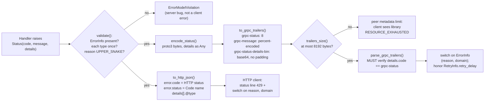

# The Google AIP-193 Error Model: google.rpc.Status, ErrorInfo, RetryInfo, QuotaFailure, and BadRequest

> [!summary] Claim
> AIP-193 makes one `google.rpc.Status` value the error contract for both gRPC and HTTP/JSON: a coarse `google.rpc.Code` for generic handling, a mandatory `ErrorInfo` (`reason`, `domain`) pair as the stable machine identity, and typed `Any` details (`RetryInfo`, `QuotaFailure`, `BadRequest`) that must carry the same information whether they travel as ProtoJSON in a body or as base64 protobuf in the `grpc-status-details-bin` trailer.

Part of [Bulk Long Running and Error Contracts](README.md) in [API Engineering](../README.md).

## TL;DR

`google.rpc.Status` is three fields, `int32 code = 1`, `string message = 2`, and `repeated google.protobuf.Any details = 3` (googleapis `google/rpc/status.proto`), and each detail is a standard message such as `ErrorInfo`, `RetryInfo`, `QuotaFailure`, or `BadRequest` packed into an `Any` with a `type.googleapis.com/google.rpc.<Name>` type URL.
The contract rule: every error response must include an `ErrorInfo`, each detail type appears at most once, the `(reason, domain)` pair identifies one logical error forever, and any dynamic value in `message` must also appear in `ErrorInfo.metadata` (AIP-193, Guidance).
The trap is that the transports disagree on `code`: the HTTP/1.1+JSON body carries the HTTP status in `error.code` (`429`) and the enum name in `error.status` (`RESOURCE_EXHAUSTED`), while gRPC carries the enum number (`8`) in `grpc-status`, and an oversized `grpc-status-details-bin` trailer makes grpcio 1.85.1 replace the server's code with a library-generated `RESOURCE_EXHAUSTED` (measured in the lab).
The model is language- and runtime-neutral: the lab's hand-rolled encoder is byte-identical to protobuf 7.36.2 (upb) deterministic serialization and passes on CPython 3.12.13, 3.12.16 (Alpine), 3.13.18 (Debian Trixie and macOS), 3.14.6, 3.14.10, and 3.15.2 (macOS and Alpine).
Do not adopt it for a public HTTP-only API whose consumers expect `application/problem+json` (RFC 9457 Section 3), or where errors are needed by generic HTTP intermediaries that only understand the status line and `Retry-After`.

## Mental model



A handler produces one `Status` value and the rest of the pipeline only renders it.
Validation runs first because the AIP-193 rules (a mandatory `ErrorInfo`, one detail per type, the `reason` and metadata-key grammars) are not expressible in the proto schema, so a violation is a server bug and must never reach the wire.
The binary branch packs each detail into `Any` and serializes `google.rpc.Status`; gRPC then sends those bytes base64-encoded in the `grpc-status-details-bin` trailer next to `grpc-status` and `grpc-message`, and the receiving client must check that the embedded `code` agrees with `grpc-status` (PROTOCOL-HTTP2, Responses).
The JSON branch writes the same details as ProtoJSON objects with an `@type` member, but swaps the numeric code for the HTTP status and adds the enum name in `status` (AIP-193, HTTP/1.1+JSON representation).
Both branches end at the same decision point on the client: switch on the `(reason, domain)` pair, never on `message` text.

## How it works

### The three messages on the wire

The status message is defined in googleapis `google/rpc/status.proto` (commit `547f8fdb`, fetched 2026-11-10; abbreviated, comments shortened):

```text
message Status {
  int32 code = 1;                          // a google.rpc.Code value
  string message = 2;                      // developer-facing, English
  repeated google.protobuf.Any details = 3;
}
```

Each `Any` is itself `{string type_url = 1; bytes value = 2;}`, and `value` is the serialized detail message.
The lab encodes this `UNAVAILABLE` status with an `ErrorInfo` and a 2.5 second `RetryInfo` (captured with `uv run --frozen python`, CPython 3.14.6, macOS 27.2 arm64):

```text
176 bytes
0000  08 0e 12 16 53 68 61 72 64 20 69 73 20 66 61 69  ....Shard is fai
0010  6c 69 6e 67 20 6f 76 65 72 2e 1a 5c 0a 28 74 79  ling over..\.(ty
0020  70 65 2e 67 6f 6f 67 6c 65 61 70 69 73 2e 63 6f  pe.googleapis.co
0030  6d 2f 67 6f 6f 67 6c 65 2e 72 70 63 2e 45 72 72  m/google.rpc.Err
0040  6f 72 49 6e 66 6f 12 30 0a 0e 53 48 41 52 44 5f  orInfo.0..SHARD_
0050  46 41 49 4c 4f 56 45 52 12 12 6f 72 64 65 72 73  FAILOVER..orders
0060  2e 65 78 61 6d 70 6c 65 2e 63 6f 6d 1a 0a 0a 05  .example.com....
0070  73 68 61 72 64 12 01 37 1a 36 0a 28 74 79 70 65  shard..7.6.(type
0080  2e 67 6f 6f 67 6c 65 61 70 69 73 2e 63 6f 6d 2f  .googleapis.com/
0090  67 6f 6f 67 6c 65 2e 72 70 63 2e 52 65 74 72 79  google.rpc.Retry
00a0  49 6e 66 6f 12 0a 0a 08 08 02 10 80 ca b5 ee 01  Info............
```

Reading it as tag-length-value: `08 0e` is field 1 varint `14` (`UNAVAILABLE`); `12 16` is field 2, 22 bytes of `message`; `1a 5c` opens the first `details` entry (92 bytes), whose `0a 28` is a 40-byte `type_url` and whose `12 30` is the 48-byte `ErrorInfo`.
Inside `ErrorInfo`, `0a 0e` is `reason` (field 1), `12 12` is `domain` (field 2), and `1a 0a` is one `map<string, string>` entry, which protobuf encodes as a nested message `{key = 1; value = 2}` (`0a 05 "shard" 12 01 "7"`).
The second detail ends with `RetryInfo.retry_delay` (field 1, `0a 08`), a `google.protobuf.Duration` whose `08 02` is `seconds = 2` and whose `10 80 ca b5 ee 01` is `nanos = 500000000` as a five-byte varint.
80 of these 176 bytes are type URLs: each standard detail costs a fixed 40-byte `type_url` before any payload, which matters once the trailer budget below is in play.
The field numbers of every detail come from googleapis `google/rpc/error_details.proto`: `ErrorInfo {reason = 1; domain = 2; metadata = 3}`, `RetryInfo {retry_delay = 1}`, `QuotaFailure.Violation {subject = 1 ... quota_value = 7; optional future_quota_value = 8}`, `BadRequest.FieldViolation {field = 1; description = 2; reason = 3; localized_message = 4}`, and `LocalizedMessage {locale = 1; message = 2}`.

### What each standard detail is for

`ErrorInfo` is the machine identity: `reason` is a constant of at most 63 characters matching `[A-Z][A-Z0-9_]+[A-Z0-9]`, `domain` is globally unique (typically the service name, for example `pubsub.googleapis.com`), and `metadata` keys match `[a-z][a-zA-Z0-9-_]+` and are at most 64 characters (AIP-193, ErrorInfo; `error_details.proto`, `ErrorInfo`).
Once a client has seen a metadata key for a `(reason, domain)` pair, the service must keep sending it, possibly with an empty value (AIP-193, ErrorInfo).
`RetryInfo.retry_delay` says how long to wait before retrying the same request, and the proto comment asks clients to apply exponential backoff from that floor if retries keep failing (`error_details.proto`, `RetryInfo`).
`QuotaFailure` lists `Violation` entries naming the `subject`, the `quota_metric`, `quota_id`, `quota_dimensions`, the enforced `quota_value`, and an explicit-presence `future_quota_value` during a quota rollout (`error_details.proto`, `QuotaFailure.Violation`).
`BadRequest` lists `FieldViolation` entries whose `field` is a path such as `email_addresses[0].email` in proto naming or `emailAddresses[0].email` in JSON naming, with an optional per-field `reason` and `LocalizedMessage` (`error_details.proto`, `BadRequest.FieldViolation`).
`LocalizedMessage` carries a BCP 47 `locale` and a user-safe `message`, and AIP-193 says to use it rather than change a `Status.message` that clients may already be parsing (AIP-193, Changing error messages).
The same file also defines `DebugInfo`, `PreconditionFailure`, `RequestInfo`, `ResourceInfo`, and `Help`; the lab implements only the four in this note's title plus `LocalizedMessage`.

### The canonical codes and their HTTP mapping

`google.rpc.Code` has 17 values, `OK = 0` through `UNAUTHENTICATED = 16`, and each value's comment in `google/rpc/code.proto` gives its HTTP mapping.
Three codes share `400 Bad Request` (`INVALID_ARGUMENT`, `FAILED_PRECONDITION`, `OUT_OF_RANGE`), two share `409 Conflict` (`ALREADY_EXISTS`, `ABORTED`), and three share `500` (`UNKNOWN`, `INTERNAL`, `DATA_LOSS`), so the HTTP status alone is lossy and the JSON body adds the enum name in `error.status`.
`CANCELLED` maps to `499 Client Closed Request`, which appears verbatim in `code.proto` but is not defined by RFC 9110 Section 15.
The gRPC libraries themselves never generate `INVALID_ARGUMENT`, `NOT_FOUND`, `ALREADY_EXISTS`, `FAILED_PRECONDITION`, `ABORTED`, `OUT_OF_RANGE`, or `DATA_LOSS` (grpc 1.85.1 `doc/statuscodes.md`), so a client that sees one of those knows the application chose it, while `CANCELLED`, `DEADLINE_EXCEEDED`, `UNIMPLEMENTED`, `UNAVAILABLE`, `UNKNOWN`, `INTERNAL`, `RESOURCE_EXHAUSTED`, and `UNAUTHENTICATED` may have been synthesized by a library, which is exactly what the lab's oversize-trailer test shows.
AIP-194 lists only `UNAVAILABLE` as automatically retryable for unary, non-transactional calls whose repetition causes no unintended state change (AIP-194, Guidance and Retryable codes), and marks `RESOURCE_EXHAUSTED` as generally non-retryable because quota may not recover for several hours (AIP-194, Generally non-retryable codes); the retry policy itself belongs to [[Error-Taxonomy-Retryability-and-Client-Contract-Design]].

### The HTTP/1.1+JSON rendering

AIP-193 defines the JSON body through a separate proto, `Error { Status error = 1; }`, whose inner `Status` has `int32 code = 1` (the HTTP status), `string message = 2`, `google.rpc.Code status = 4`, and `repeated Any details = 5` (AIP-193, HTTP/1.1+JSON representation).
Each detail is rendered by the ProtoJSON rules: field names become lowerCamelCase, an `Any` becomes the inner object plus an `@type` member holding the type URL, a `Duration` becomes a decimal string with 0, 3, 6, or 9 fractional digits and the suffix `s`, and every `int64` is written as a JSON string so that values above 2^53 survive JavaScript parsers (protobuf.dev ProtoJSON Format, Well-Known Types, Any, and Strings for int64).
So `RetryInfo(seconds=2, nanos=500000000)` and the `ErrorInfo` above render as (captured output of `to_http_json`):

```json
{
  "error": {
    "code": 503,
    "message": "Shard is failing over.",
    "status": "UNAVAILABLE",
    "details": [
      {
        "@type": "type.googleapis.com/google.rpc.ErrorInfo",
        "reason": "SHARD_FAILOVER",
        "domain": "orders.example.com",
        "metadata": {
          "shard": "7"
        }
      },
      {
        "@type": "type.googleapis.com/google.rpc.RetryInfo",
        "retryDelay": "2.500s"
      }
    ]
  }
}
```

Unlike RFC 9457, where the `status` member is an advisory copy of the HTTP status (RFC 9457 Section 3.1.2) and machine identity lives in the `type` URI (RFC 9457 Section 3.1.1), AIP-193 puts the HTTP status in `code`, the enum name in `status`, and machine identity in `ErrorInfo`; the comparison with Problem Details is in [[Problem-Details-for-HTTP-APIs-RFC-9457]].

### The gRPC rendering: three trailers

The gRPC HTTP/2 protocol ends every response with `Trailers -> Status [Status-Message] [Status-Details] *Custom-Metadata`, where `grpc-status` is the decimal code without leading zeros, `grpc-message` is UTF-8 then percent-encoded with only `%x20-%x24 / %x26-%x7E` left literal, and `grpc-status-details-bin` holds the serialized `google.rpc.Status` (grpc 1.85.1 `doc/PROTOCOL-HTTP2.md`, Responses and Appendix A).
Any header whose name ends in `-bin` is base64 on the wire; implementations must accept padded and unpadded values and should emit unpadded ones (PROTOCOL-HTTP2, Requests, Custom-Metadata).
`Status-Details` is allowed only when the status is not `OK`, must not contradict `grpc-status`, and the consumer must verify that (PROTOCOL-HTTP2, Responses).
The lab's raw h2 4.4.1 client against a grpcio 1.85.1 server saw the error arrive as Trailers-Only: one `HEADERS` block with `:status`, `content-type`, `grpc-status`, `grpc-message`, and `grpc-status-details-bin`, then `END_STREAM`, with no `DATA` frame and no separate trailers block, and every value equal to the lab's `to_grpc_trailers` output, including `%25` for `%` and unpadded base64.
On the server, grpcio's `abort_with_status` only sets the trailing metadata and calls `abort` (grpcio 1.85.1 `grpc/_server.py`, `_Context.abort_with_status`), and `abort` with `StatusCode.OK` logs an error and sends `UNKNOWN` with an empty message instead (grpcio 1.85.1 `grpc/_server.py`, `_Context.abort`).
The optional `grpcio-status` package converts in both directions: `to_status` puts `status.SerializeToString()` under `grpc-status-details-bin`, and `from_call` raises `ValueError` when the embedded code or message disagrees with the call's code or details (grpc 1.85.1 `src/python/grpcio_status/grpc_status/rpc_status.py`, `to_status` and `from_call`).
That message check is stricter than the protocol, which only requires the code to agree.

### The size limit that rewrites your error code

grpc core caps received metadata with two channel arguments: `grpc.max_metadata_size`, a soft limit defaulting to the larger of 8 KB and 0.8 times the hard limit (if set), above which a random sample of calls is rejected, and `grpc.absolute_max_metadata_size`, a hard limit defaulting to the larger of 16 KB and 1.25 times the soft limit (if set), above which all are rejected (grpc 1.85.1 `include/grpc/impl/channel_arg_names.h`, `GRPC_ARG_MAX_METADATA_SIZE` and `GRPC_ARG_ABSOLUTE_MAX_METADATA_SIZE`).
When a client rejects the trailers, the application never sees its own status: in the lab's size probe, a server that aborted with `FAILED_PRECONDITION` and a 20,114-byte details value produced a client error of `RESOURCE_EXHAUSTED` with details `Stream removed (received metadata size exceeds hard limit (value length 20115 vs. 16384))` and no `grpc-status-details-bin` key.
The rejection message itemizes `grpc-status-details-bin:12165B` for a 12,110-byte details value, so grpc core counts the decoded value length plus the 23-byte name plus 32 here.
The source confirms it: the HPACK parser computes `transport_size = key_string.size() + value.wire_size + hpack_constants::kEntryOverhead` per field, with `kEntryOverhead = 32` (grpc 1.85.1 `src/core/ext/transport/chttp2/transport/hpack_parser.cc`, `HPackParser::Parser::ParseValueBody`, and `hpack_constants.h`, `kEntryOverhead`).
`wire_size` is the length after Huffman decoding for a true-binary value (`HPackParser::String::ParseBinary`) but the length of the base64 text for a base64-encoded one (`HPackParser::String::Unbase64`), so the counted size depends on how the sender encodes a `-bin` value, and grpc senders use the true-binary form (consistent with the 12,165 bytes measured here).
That differs from the post-base64 length that PROTOCOL-HTTP2 suggests for header sizing (PROTOCOL-HTTP2, Requests); the lab's `trailers_size` uses the stricter post-base64 rule and refuses anything over 8192 bytes at the server.

## Numbers and limits

| Quantity | Value | Source |
|---|---|---|
| `google.rpc.Code` values | 17 (`0` through `16`) | `google/rpc/code.proto` |
| `ErrorInfo.reason` length and grammar | at most 63 characters, `[A-Z][A-Z0-9_]+[A-Z0-9]` (so at least 3) | AIP-193, ErrorInfo; `error_details.proto` |
| `ErrorInfo.metadata` key length and grammar | at most 64 characters, `[a-z][a-zA-Z0-9-_]+` (so at least 2) | AIP-193, ErrorInfo |
| Detail payloads per type | at most 1, and exactly one `ErrorInfo` required | AIP-193, Status.details (changelog 2023-05-04 and 2023-05-10) |
| Suggested limit for `Trailers` and `Trailers-Only` | 8 KiB each | PROTOCOL-HTTP2, Responses |
| grpc core soft and hard received-metadata limits | 8 KB and 16 KB defaults | grpc 1.85.1 `channel_arg_names.h` |
| Fixed cost of one standard detail | 40-byte `type_url` plus 6 bytes of tags and lengths for a detail payload of at most 83 bytes (so the whole `Any` stays under 128 bytes and its length is one varint byte) | measured: lab hex dump above |
| Base64 expansion of `grpc-status-details-bin` | 176 bytes -> 235 characters unpadded; `trailers_size` 401 bytes | measured: `to_grpc_trailers`, CPython 3.14.6, macOS 27.2 arm64 |
| Soft-band rejection, grpcio 1.85.1 client and server | details of 8,010 bytes: 0 of 40 calls rewritten; 8,210 bytes: 1 of 40; 10,110 bytes: 14 of 40; 12,110 bytes: 23 of 40; 14,110 bytes: 32 of 40; 16,310 bytes: 40 of 40 (message says `hard limit (16572 vs. 16384)`, yet the details key is still delivered) | measured (as of 2026-11): standalone probe outside the suite, one fresh channel per call, server aborts with `FAILED_PRECONDITION`, CPython 3.14.6, macOS 27.2 arm64 |
| Hard-limit rejection | details of 16,411 bytes (40 of 40 calls) and 20,114 bytes (10 of 10 calls): every call rewritten to `RESOURCE_EXHAUSTED` with `value length 16412 vs. 16384` and `20115 vs. 16384`, and details dropped | measured: same probe |
| `int64` in ProtoJSON | always a JSON string, for example `"quotaValue": "600"` | protobuf.dev ProtoJSON, Strings for int64; lab test |
| `Retry-After` precision | `delay-seconds = 1*DIGIT`, whole seconds only | RFC 9110 Section 10.2.3 |

The soft-band fractions are a single 40-call sample per size on one machine; they show the shape (probabilistic between 8 KB and 16 KB), not a stable rate, and an earlier run of the same sizes gave 0, 22, and 29 of 40 at 8,210, 12,110, and 14,110 bytes.

## Portability

| Dimension | Result | Proof |
|---|---|---|
| CPython 3.12.13 | 64 passed | lab, `UV_PROJECT_ENVIRONMENT=<tmp venv> uv run --frozen --python 3.12.13 pytest <module>`, macOS 27.2 arm64 |
| CPython 3.13.18 | 64 passed | lab, same command with `--python 3.13.18` |
| CPython 3.14.6 (workspace) | 64 passed | lab, `uv run --frozen pytest <module>` |
| CPython 3.14.10 | 64 passed | lab, same command with `--python 3.14.10` |
| CPython 3.15.2 | 64 passed | lab, same command with `--python 3.15.2` |
| CPython 3.15.2t free-threaded | not run | only 3.15.0b3t is installable here; `uv run` fails because `psycopg-binary==3.3.8` has no wheel for it, `uv.lock` has no `cp315t` `grpcio` 1.85.1 wheel, and `aioquic` 1.7.2 ships only `abi3` wheels, which free-threaded builds cannot load |
| CPython 3.12.16 (matrix pin), Alpine 3.24 musl | 64 passed | lab, `docker run python:3.12.16-alpine`, then `pip install uv` and `uv run --frozen pytest <module>` on a copy of `labs/`; Linux 7.2.12 aarch64 (OrbStack) |
| CPython 3.13.18, Debian 13 (trixie) glibc | 64 passed | same procedure with `python:3.13.18-trixie` |
| CPython 3.15.2, Alpine musl | 64 passed | same procedure with `python:3.15.2-alpine` |
| protobuf 7.36.2, upb backend | lab bytes equal `SerializeToString(deterministic=True)` | lab, `test_status_bytes_equal_protobuf_runtime_deterministic_bytes` |
| grpcio 1.85.1 server and client | details bytes delivered unchanged; Trailers-Only on the wire | lab, socket tests |
| HTTP/2 | gRPC trailers carry the error; `-bin` values base64, unpadded | lab raw h2 4.4.1 client; PROTOCOL-HTTP2 |
| HTTP/1.1 | JSON body with `error.code` equal to the status line | lab, Starlette 1.10.0 via `httpx.ASGITransport`; AIP-193 |
| HTTP/3 | not run | PROTOCOL-HTTP2 specifies gRPC over HTTP/2 only; no HTTP/3 gRPC leg in this lab |
| Uvicorn 0.54.0, Hypercorn 0.18.0, Granian 2.8.7 | each served the lab's Starlette handler as `429`, `content-type: application/json`, body equal to `to_http_json` over HTTP/1.1 | ad hoc probe outside the suite (one server process per port on 127.0.0.1, httpx 0.28.1 client), CPython 3.14.6, macOS 27.2 arm64; the gRPC leg does not use an ASGI server |
| googleapis-common-protos, grpcio-status | not installed | not pinned in `labs/pyproject.toml`; the lab rebuilds the descriptors from the `.proto` field numbers instead |

## Worked example

The [implementation](../labs/src/api_labs/f06_bulk_long_running_and_error_contracts/google_rpc_status.py) is one module with no protobuf code generation: a proto3 encoder, ProtoJSON rendering, the gRPC trailer codec, and a Starlette exception handler.
The [test](../labs/tests/f06_bulk_long_running_and_error_contracts/test_google_aip_193_error_model_and_rich_error_details.py) rebuilds `google/rpc/status.proto` and `error_details.proto` as descriptors in a private protobuf `DescriptorPool` and uses the real runtime as the oracle.

The core of the encoder and the JSON rendering, simplified excerpt (contiguous lines copied verbatim from `google_rpc_status.py`):

```python
def encode_status(status: Status) -> bytes:
    """Serialize google.rpc.Status, packing each detail into google.protobuf.Any."""
    status.validate()
    details = b"".join(
        _len_field(
            3,
            _str_field(1, TYPE_URL_PREFIX + detail.TYPE_NAME) + _len_field(2, detail.to_proto()),
        )
        for detail in status.details
    )
    return _int_field(1, status.code) + _str_field(2, status.message) + details


def to_http_json(status: Status) -> dict[str, JsonValue]:
    """The AIP-193 HTTP/1.1+JSON body: `code` is the HTTP status, `status` the Code name."""
    status.validate()
    details: list[JsonValue] = [
        {"@type": TYPE_URL_PREFIX + detail.TYPE_NAME, **detail.to_json()}
        for detail in status.details
    ]
    return {
        "error": {
            "code": HTTP_STATUS[status.code],
            "message": status.message,
            "status": status.code.name,
            "details": details,
        }
    }
```

The trailer side, simplified excerpt (contiguous lines copied verbatim from `google_rpc_status.py`):

```python
def trailers_size(trailers: Sequence[tuple[str, str]]) -> int:
    """HTTP/2 header-list size: name + value + 32 per field, binary values post-base64."""
    return sum(len(name) + len(value) + 32 for name, value in trailers)


def to_grpc_trailers(status: Status, *, budget: int = TRAILERS_BUDGET) -> list[tuple[str, str]]:
    """The Trailers a gRPC server sends for this Status, as HTTP/2 field values."""
    details = base64.b64encode(encode_status(status)).decode("ascii").rstrip("=")
    trailers = [
        ("grpc-status", str(int(status.code))),
        ("grpc-message", percent_encode(status.message)),
        (DETAILS_TRAILER, details),  # SHOULD emit un-padded base64
    ]
    size = trailers_size(trailers)
    if size > budget:
        # Past a peer's metadata limit the client sees a library-made RESOURCE_EXHAUSTED.
        raise ErrorModelViolation(f"trailers are {size} bytes, over the {budget}-byte budget")
    return trailers
```

```python
def parse_grpc_trailers(trailers: Sequence[tuple[str, str]]) -> DecodedStatus:
    """Client side: rebuild the Status and enforce that details never contradict grpc-status."""
    fields = {name.lower(): value for name, value in trailers}
    code = int(fields["grpc-status"])
    message = percent_decode(fields.get("grpc-message", ""))
    encoded = fields.get(DETAILS_TRAILER)
    if encoded is None:
        return DecodedStatus(code, message, ())
    raw = base64.b64decode(encoded + "=" * (-len(encoded) % 4))  # MUST accept both paddings
    decoded = decode_status(raw)
    if decoded.code != code:
        raise ErrorModelViolation(
            f"{DETAILS_TRAILER} code {decoded.code} contradicts grpc-status {code}"
        )
    return decoded
```

The oracle proves the 1:1 mapping: it starts from the lab's ProtoJSON, parses each detail with `json_format.ParseDict` into the runtime's message class, packs it deterministically, and the resulting bytes must equal the lab's binary encoding; a second test parses the lab's bytes and requires `json_format.MessageToDict` to equal the lab's JSON details.
`test_http_json_reproduces_the_aip_193_published_example` reproduces the published AIP-193 body minus its third detail, a `google.rpc.Help`, which the lab does not implement.
The oracle packs each detail itself because `json_format.ParseDict` fills `Any.value` with a plain, non-deterministic `SerializeToString()` (protobuf 7.36.2 `google/protobuf/json_format.py`, `_Parser._ConvertAnyMessage`).
Simplified excerpt (contiguous lines copied verbatim from the test module):

```python
def _oracle_bytes(status: Status) -> bytes:
    """Serialize the same Status with the protobuf runtime, starting from our ProtoJSON."""
    error = cast("dict[str, Any]", to_http_json(status)["error"])
    out = _message("google.rpc.Status")
    out.code = int(status.code)
    out.message = status.message
    for detail_json in error["details"]:
        body = dict(detail_json)
        type_url: str = body.pop("@type")
        inner = _message(type_url.removeprefix("type.googleapis.com/"))
        json_format.ParseDict(body, inner, descriptor_pool=POOL)
        out.details.add().Pack(inner, deterministic=True)
    return cast("bytes", out.SerializeToString(deterministic=True))
```

The oversize case runs against a real grpcio server bound to `127.0.0.1:0`, simplified excerpt (contiguous lines copied verbatim from the test module):

```python
@pytest.mark.socket
def test_grpcio_replaces_the_code_when_trailers_pass_the_hard_limit(grpc_port: int) -> None:
    err = _rpc_error(grpc_port, "/lab.Errors/FailHuge")
    assert err.code() == grpc.StatusCode.RESOURCE_EXHAUSTED  # not the server's FAILED_PRECONDITION
    assert "exceeds hard limit" in err.details()
    assert DETAILS_TRAILER not in dict(err.trailing_metadata() or ())
```

Captured run, from `labs/`, CPython 3.14.6 on macOS 27.2 arm64 (output trimmed: the module path prefix on each test id, the interpreter path on the platform line, the session banner, blank lines, and the hypothesis, rootdir, configfile, plugins, and asyncio lines are removed):

```text
$ uv run --frozen pytest tests/f06_bulk_long_running_and_error_contracts/test_google_aip_193_error_model_and_rich_error_details.py -v -p no:cacheprovider -k "bytes_equal or runtime_decodes or published_example or hard_limit or wire_trailers or contradict"
platform darwin -- Python 3.14.6, pytest-9.2.0, pluggy-1.7.0
collecting ... collected 64 items / 54 deselected / 10 selected
test_status_bytes_equal_protobuf_runtime_deterministic_bytes[quota] PASSED [ 10%]
test_status_bytes_equal_protobuf_runtime_deterministic_bytes[bad] PASSED [ 20%]
test_status_bytes_equal_protobuf_runtime_deterministic_bytes[retry-now] PASSED [ 30%]
test_runtime_decodes_status_bytes_to_the_http_json_details[quota] PASSED [ 40%]
test_runtime_decodes_status_bytes_to_the_http_json_details[bad] PASSED [ 50%]
test_runtime_decodes_status_bytes_to_the_http_json_details[retry-now] PASSED [ 60%]
test_http_json_reproduces_the_aip_193_published_example PASSED [ 70%]
test_details_that_contradict_grpc_status_are_rejected PASSED [ 80%]
test_grpcio_wire_trailers_equal_the_lab_encoding PASSED [ 90%]
test_grpcio_replaces_the_code_when_trailers_pass_the_hard_limit PASSED [100%]
====================== 10 passed, 54 deselected in 0.13s =======================
```

The full module (`uv run --frozen pytest <module> -q`) reported `64 passed in 0.10s` on the same machine.
Twenty-eight mutations of the implementation across two reviews (unsorted map keys, padded base64, missing `ErrorInfo` check, no code-consistency check, zero `RetryInfo` omitted, optional `future_quota_value` dropped when zero, `%` left unencoded, no trailer budget, a broken escape that raises, Duration always nine digits, no length-overrun, truncated-varint, or fixed-width-overrun checks, and others) each make at least one test fail.
Six mutations first survived and each now has a test: length-overrun and truncated-varint (`test_malformed_details_bytes_are_rejected`), the `+ 32` per-field overhead and the exact budget boundary (`test_trailers_size_counts_name_value_and_32_bytes_per_field`), the three-digit versus six-digit `Duration` rule (the `(0, 1_000, "0.000001s")` case), unknown fixed32 fields being skipped (`test_unknown_fixed_width_fields_are_skipped`), and strict versus replacing UTF-8 decoding of `grpc-message` (the `%FF` assertion).

## Pitfalls

> [!warning] Oversized details silently become `RESOURCE_EXHAUSTED`
> Trigger: a server stuffs a large `BadRequest` (hundreds of field violations) or a `DebugInfo` stack into `grpc-status-details-bin`.
> Symptom: some clients see `RESOURCE_EXHAUSTED` with `Stream removed (received metadata size exceeds soft limit ...)` instead of the real code; above 16 KB every call does, and the details are gone (lab, grpcio 1.85.1).
> Retry logic keyed on `RESOURCE_EXHAUSTED` now treats a permanent validation error as a quota problem.
> Fix: budget trailers at the server (the lab refuses anything over 8192 bytes), cap the number of violations, and keep large diagnostics in logs keyed by `RequestInfo.request_id`.
> Header-size error paths are also a security surface: CVE-2023-32731 was gRPC skipping the rest of an HPACK frame after a header-size-exceeded error, desynchronizing HPACK tables between sender and receiver (NVD CVE-2023-32731, CVSS 3.1 7.4 from the Google CNA and 7.5 from NVD).

> [!warning] Switching on `message` text
> Trigger: a client parses `Status.message` because early responses had no `ErrorInfo`.
> Symptom: a wording change breaks production clients, which is why AIP-193 freezes `message` for RPCs that never returned `ErrorInfo` (AIP-193, Changing error messages and Rationale).
> Fix: return `ErrorInfo` from the first release, put every dynamic value of the message in `metadata`, and add `LocalizedMessage` instead of editing `message`.

> [!warning] Reading `error.code` as a gRPC code
> Trigger: one client library handles both transports and compares `error.code` with `google.rpc.Code` numbers.
> Symptom: an HTTP `404` body is read as code 404 (out of range) and a gRPC `5` as HTTP 5; mapping back is also ambiguous because `400` covers three codes.
> Fix: on HTTP, use `error.status` (the enum name) as the code; `error.code` is the HTTP status (AIP-193, HTTP/1.1+JSON representation).

> [!warning] `int64` and `Duration` JSON surprises
> Trigger: a JavaScript or `jq` consumer expects `quotaValue` to be a number or `retryDelay` to be a number of seconds.
> Symptom: `"quotaValue": "600"` is a string and `"retryDelay": "1.500s"` needs parsing; a numeric comparison silently fails.
> Fix: document the ProtoJSON types in the API reference and parse `Duration` strings explicitly (protobuf.dev ProtoJSON, Well-Known Types and Strings for int64).

> [!warning] Omitting a zero or optional field
> Trigger: a hand-written serializer drops "empty" values.
> Symptom: `RetryInfo` with a zero delay loses its `retry_delay` field entirely, and a `QuotaFailure` rollout to `future_quota_value = 0` disappears, although both are presence-tracked (a message field and a proto3 `optional` field).
> Fix: encode presence, not truthiness; mutating the lab to drop either field makes the protobuf-oracle tests `test_status_bytes_equal_protobuf_runtime_deterministic_bytes` and `test_runtime_decodes_status_bytes_to_the_http_json_details` fail (`retry-now` and `quota` cases).

> [!warning] Trusting `grpc-status-details-bin` without checking the code
> Trigger: a client or a proxy that rewrites `grpc-status` (for example after a deadline) but forwards the original details trailer.
> Symptom: the client acts on details that describe a different outcome.
> Fix: verify that the embedded `code` equals `grpc-status`, as PROTOCOL-HTTP2 requires; `grpcio-status` `from_call` also checks `message` and raises `ValueError` on a mismatch.

## Security and robustness

Error details are an information-disclosure channel: OWASP API Security 2023 lists "Error messages include stack traces, or expose other sensitive information" under API8:2023 Security Misconfiguration, so `DebugInfo` must never leave the trust boundary and `ErrorInfo.metadata` must hold only values the caller is allowed to see.
AIP-193 closes an existence oracle by ordering checks: a caller without permission gets `PERMISSION_DENIED` whether or not the resource exists, and only an authorized caller can get `NOT_FOUND` (AIP-193, Permission Denied).
Treat the details trailer as hostile input on the client: bound its size before decoding, reject truncated or over-long varints and overrunning lengths (the lab's `_fields` and `_read_varint` raise `ErrorModelViolation`, proven by `test_malformed_details_bytes_are_rejected`), skip unknown `Any` type URLs, and never let a detail override the transport code.
Percent-decoding of `grpc-message` must not fail on a broken escape (PROTOCOL-HTTP2, Responses); the lab keeps the raw characters, so a malicious message cannot crash the error path.
Unbounded header parsing has been a gRPC denial-of-service vector: CVE-2023-33953 covered unbounded memory buffering and an O(n^2) CPU loop in the HPACK parser (NVD CVE-2023-33953, CVSS 3.1 7.5), and its description adds that the header-size check ran only after buffering up to a 4 GB string, so a limit protects nothing unless it is enforced before the value is read.
`Help.description` must be plain text and `Help.url` an absolute URL (AIP-193, Help), and because clients render these and `LocalizedMessage.message` to users, clients should escape them before display.

## The principal's view

The decision is not "AIP-193 or RFC 9457" but which representation is canonical inside the organization.
Choose `google.rpc.Status` as the canonical internal error value when the platform runs gRPC between services, exposes HTTP/JSON through transcoding (see [[HTTP-JSON-to-gRPC-Transcoding-and-Google-API-HTTP-Annotations-AIP-127]]), and wants one error catalogue: the `(reason, domain)` registry becomes a governed API surface reviewed like any other field, and client libraries in every language decode the same typed details.
The organizational cost is a registry: someone owns the `domain` namespace, reviews new reasons, and enforces that metadata keys only grow, which is the same discipline as protobuf field numbers.
Choose RFC 9457 as canonical for a public HTTP-first API whose consumers use generic HTTP tooling, because `application/problem+json` is a registered media type (RFC 9457 Section 6) and its `type` URI documents itself, whereas `type.googleapis.com/google.rpc.ErrorInfo` only names a schema.
When both audiences exist, render both from one internal `Status`: the lab's single value already produces the JSON body and the trailers, and a third renderer can emit Problem Details with `reason` and `domain` as extension members (RFC 9457 Section 3.2).
Whatever the choice, also send transport-native signals that generic software understands: the HTTP status line, and `Retry-After` alongside `RetryInfo`, rounded up because `delay-seconds` is an integer (RFC 9110 Section 10.2.3) and because a `429` may carry it (RFC 6585 Section 4).
Size discipline is an architectural constraint, not a tuning detail: rich details live in an 8 KiB trailer budget, so bulk failures belong in an LRO's metadata as AIP-193 recommends for partial errors (AIP-193, Partial errors), not in one giant `BadRequest`.

## Interview questions

> [!question] L5: What are the three fields of `google.rpc.Status`, and which detail does AIP-193 make mandatory?
>
> > [!success]- Answer
> > `int32 code = 1`, `string message = 2`, and `repeated google.protobuf.Any details = 3`.
> > AIP-193 requires an `ErrorInfo` in every error response, and allows each detail type at most once.
> > `ErrorInfo` carries the `(reason, domain)` pair that clients switch on, plus `metadata` for dynamic values.
> >
> > Follow-up: Why is the `message` field a poor thing to switch on even if it is in English?

> [!question] L5: Predict the output: what does `to_http_json` produce for `QuotaViolation(quota_value=600, future_quota_value=0)` and `RetryInfo(seconds=1, nanos=500_000_000)`?
>
> > [!success]- Answer
> > `"quotaValue": "600"` and `"futureQuotaValue": "0"`, both strings, because ProtoJSON writes every `int64` as a string.
> > `futureQuotaValue` is present even though it is zero, because it is a proto3 `optional` field with explicit presence.
> > `"retryDelay": "1.500s"`, because a `Duration` uses 0, 3, 6, or 9 fractional digits and the suffix `s`.
> > The lab tests `test_quota_int64_fields_are_json_strings_and_optional_zero_is_present` and `test_retry_delay_duration_json_matches_runtime` assert exactly these values.
> >
> > Follow-up: What would a JavaScript client get if the server wrote `quotaValue` as a bare number above 2^53?

> [!question] L5: For a `NOT_FOUND` status, what are `error.code` and `error.status` in the HTTP/1.1 body, and what is `grpc-status` over gRPC?
>
> > [!success]- Answer
> > `error.code` is `404`, the HTTP status, and `error.status` is `"NOT_FOUND"`, the enum name.
> > Over gRPC, `grpc-status` is `5`, the enum number.
> > The body uses a separate `Error` proto for backward compatibility, so it does not map field-for-field onto `google.rpc.Status`.
> >
> > Follow-up: Which three codes all map to `400`, and how does a client tell them apart?

> [!question] L6: How is a `google.rpc.Status` carried in gRPC, and what must the client verify?
>
> > [!success]- Answer
> > The serialized message goes in the `grpc-status-details-bin` trailer, base64-encoded because the name ends in `-bin`, unpadded when emitted and accepted either way.
> > `grpc-status` and the percent-encoded `grpc-message` travel next to it in the same trailers, or in a single Trailers-Only `HEADERS` block for an immediate error, which is what grpcio 1.85.1 sent in the lab.
> > The client must verify that the `code` inside the details does not contradict `grpc-status`, and `grpcio-status` additionally checks that the message matches.
> >
> > Follow-up: Why does the protocol allow `Status-Details` only when the status is not `OK`?

> [!question] L6: Debug this API: a service that never returns quota errors shows a spike of `RESOURCE_EXHAUSTED` in client dashboards, with details `Stream removed (received metadata size exceeds soft limit (12372 vs. 8192); ...)`, and retries make it worse, so what happened?
>
> > [!success]- Answer
> > The server's error trailers exceed the client's received-metadata soft limit, 8 KB by default in grpc core, so the client library rejects a random sample of responses and synthesizes `RESOURCE_EXHAUSTED`.
> > The real code, probably `INVALID_ARGUMENT` or `FAILED_PRECONDITION` with a large `BadRequest`, never reaches the application, and above the 16 KB hard limit no call gets through.
> > Retries amplify it because the request is deterministic, so every retry produces the same oversized error.
> > Fix it at the server by budgeting `grpc-status-details-bin` (cap violations, drop `DebugInfo`), and only then consider raising `grpc.max_metadata_size` on clients you control.
> >
> > Follow-up: Which status codes can a client trust were chosen by the application rather than generated by the gRPC library?

> [!question] L6: Why does AIP-193 require that every dynamic value in `Status.message` also appear in `ErrorInfo.metadata`, and what may change over time?
>
> > [!success]- Answer
> > So that machine clients never need to parse prose to get a zone, a resource name, or a limit.
> > For a `(reason, domain)` pair, metadata keys may be added but never removed, though a value may become empty.
> > `message` may change only if the RPC has always returned `ErrorInfo`; otherwise it is frozen and improvements go into `LocalizedMessage`.
> >
> > Follow-up: How would you enforce key monotonicity in CI?

> [!question] L7+: Design the error architecture for a company that runs gRPC internally and publishes an HTTP/JSON API to partners who expect RFC 9457.
>
> > [!success]- Answer
> > Make `google.rpc.Status` with a mandatory `ErrorInfo` the single internal error value, and render it at the edge into AIP-193 JSON, gRPC trailers, or `application/problem+json`.
> > For Problem Details, map `(reason, domain)` to a documented `type` URI and carry `reason`, `domain`, and the details as extension members.
> > Run a governed registry of domains and reasons with review, and a CI gate that metadata keys only grow.
> > Emit transport-native signals too: the right status line and `Retry-After` derived from `RetryInfo`, rounded up to whole seconds.
> > Budget detail size against the 8 KiB trailer limit and move bulk failures into LRO metadata.
> >
> > Follow-up: What breaks if two teams reuse the same `(reason, domain)` pair for different errors?

> [!question] L7+: Should `RESOURCE_EXHAUSTED` with a `RetryInfo` be retried automatically by a generic client library?
>
> > [!success]- Answer
> > AIP-194 says `RESOURCE_EXHAUSTED` should generally not be retried automatically, because quota may not recover for hours and retries can have billing implications.
> > A `RetryInfo` is the server's explicit hint that this occurrence is short-lived, so a library may honor it for idempotent calls with a retry budget, starting from `retry_delay` and backing off exponentially as `error_details.proto` recommends.
> > It must not retry when the code was synthesized by the library, for example by a metadata size limit, because there is no `RetryInfo` and the request will fail the same way.
> >
> > Follow-up: How do you keep thousands of clients that all received the same `retry_delay` from retrying in lockstep?

> [!question] L7+: Why does the lab test its hand-written encoder against `SerializeToString(deterministic=True)` instead of the default serialization?
>
> > [!success]- Answer
> > Map fields such as `ErrorInfo.metadata` have no defined order on the wire, so two correct serializers can produce different bytes.
> > Deterministic mode fixes map entries in key order, which gives a byte-exact oracle; the lab sorts keys the same way.
> > Even deterministic bytes are not canonical across languages or versions (protobuf.dev, Proto Serialization Is Not Canonical), so production code must compare parsed messages, never bytes, for example for caching or signatures.
> >
> > Follow-up: Why does `json_format.ParseDict` alone not give a deterministic `Any.value` in protobuf 7.36.2?

## Related

Prerequisites: [[Problem-Details-for-HTTP-APIs-RFC-9457]]

Next: [[Error-Taxonomy-Retryability-and-Client-Contract-Design]]

See also: [[gRPC-and-Protocol-Buffers]], [[02-Programming-Languages/Python/Python-Backend-Interview-Prep/05-REST-API-Design]], [[gRPC-Status-Codes-and-Google-RPC-Status-Rich-Error-Payloads]], [[gRPC-Over-HTTP-2-Framing-Length-Prefixed-Messages-and-Trailers]], [[HTTP-Trailers-Streaming-Checksums-and-gRPC-Status]], [[Protobuf-Wire-Format-TLV-Tags-Varints-and-ZigZag-Encoding]], [[HTTP-JSON-to-gRPC-Transcoding-and-Google-API-HTTP-Annotations-AIP-127]], [[HPACK-Header-Compression-and-Dynamic-Table-Security]], [[Standard-RateLimit-Headers-IETF-Draft-and-429-Retry-After-Semantics]], [[Mapping-Pydantic-Validation-Errors-to-RFC-9457-Problem-Details]], [[Long-Running-Operations-202-Accepted-and-Operation-Resources-AIP-151]], [[HTTP-Status-Code-Taxonomy-and-Selection-Decision-Trees]]

- Lab: `labs/tests/f06_bulk_long_running_and_error_contracts/test_google_aip_193_error_model_and_rich_error_details.py`

## Further reading

- [AIP-193 Errors](https://google.aip.dev/193): the normative rules for `Status`, `ErrorInfo`, `LocalizedMessage`, `Help`, and the HTTP/1.1+JSON shape.
- [AIP-194 Automatic retry configuration](https://google.aip.dev/194): which codes a client may retry automatically.
- [googleapis google/rpc/error_details.proto](https://github.com/googleapis/googleapis/blob/547f8fdb4b91dbac70d540b3757520f0608ae356/google/rpc/error_details.proto): the field numbers and the field-level comments for every standard detail.
- [googleapis google/rpc/code.proto](https://github.com/googleapis/googleapis/blob/547f8fdb4b91dbac70d540b3757520f0608ae356/google/rpc/code.proto): the 17 canonical codes, the choice rules between `FAILED_PRECONDITION`, `ABORTED`, and `UNAVAILABLE`, and the HTTP mapping.
- [gRPC over HTTP/2 (PROTOCOL-HTTP2.md, v1.85.1)](https://github.com/grpc/grpc/blob/v1.85.1/doc/PROTOCOL-HTTP2.md): the trailer grammar, percent-encoding, `-bin` base64, and the code-consistency requirement.
- [gRPC status codes (statuscodes.md, v1.85.1)](https://github.com/grpc/grpc/blob/v1.85.1/doc/statuscodes.md): which codes the libraries generate themselves.
- [grpc channel_arg_names.h (v1.85.1)](https://github.com/grpc/grpc/blob/v1.85.1/include/grpc/impl/channel_arg_names.h): the soft and hard metadata size limits.
- [ProtoJSON Format](https://protobuf.dev/programming-guides/json/): how `Any`, `Duration`, `int64`, and field names render in the JSON body.
- [RFC 9457](https://www.rfc-editor.org/rfc/rfc9457.html): the IETF alternative, for the comparison in the principal's view.
