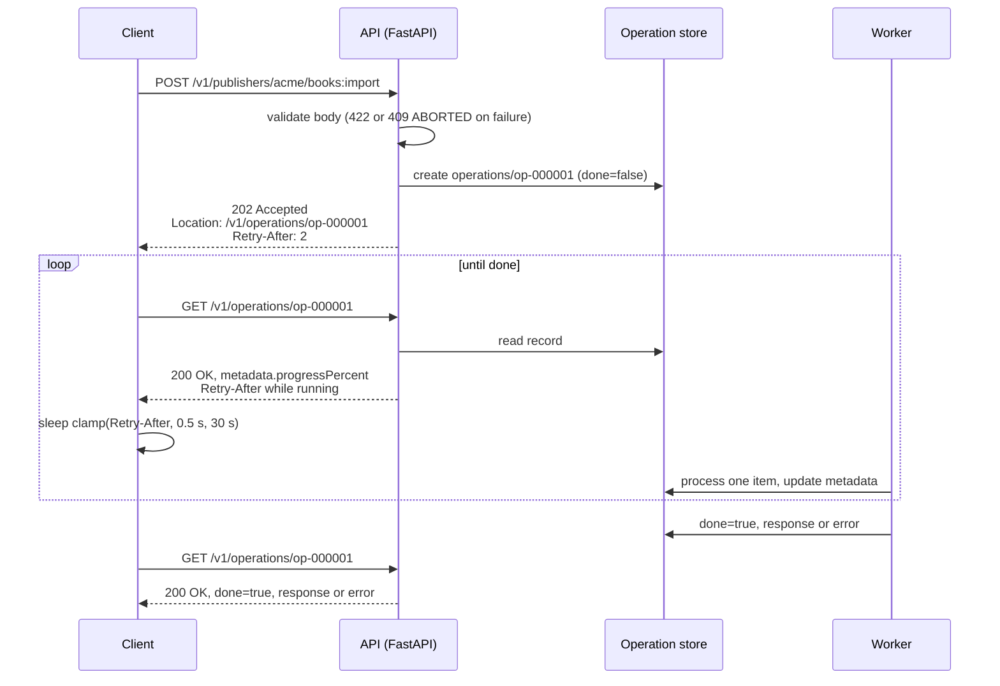

# Long-Running Operations (LROs): 202 Accepted, Operation Resources, done/metadata/result, and Polling (AIP-151)

> [!summary] Claim
> A long-running operation turns one slow request into a durable `Operation` resource with a `name`, progress `metadata`, a `done` flag, and a oneof `error` or `response`; the start call answers `202 Accepted` with the operation's URL, every later `GET` of that URL answers `200 OK` even when the job failed, and the client must poll with a bounded `Retry-After`, treat an absent `done` as `false`, and know that cancel is best effort and never a rollback.

Part of [Bulk Long Running and Error Contracts](README.md) in [API Engineering](../README.md).

## TL;DR

- Mechanism: `POST /v1/publishers/acme/books:import` validates synchronously, stores an operation record, and returns `202` with `Location: /v1/operations/op-000001`, `Retry-After`, and the `Operation` body; a worker advances the record, and `GET /v1/operations/{id}` returns its current state until `done` is `true` with exactly one of `error` or `response`.
- Contract rule: errors that prevent the start are ordinary error responses, errors during execution go in `Operation.error` as a `google.rpc.Status` (AIP-151), and a successful cancel ends the operation with `error.code = 1` (`CANCELLED`) without deleting it (`google/longrunning/operations.proto`, `CancelOperation`).
- The trap: ProtoJSON omits a `false` `done`, so `body["done"]` raises `KeyError` on a running Google-style operation, and the HTTP status of a poll describes the `GET`, not the job, so `raise_for_status()` passes on a failed operation.
- Portability fact: RFC 9110 defines `Location` semantics only for `201` and `3xx` and `Retry-After` semantics only for `503` and `3xx`, so both on a `202` are conventions (AIP, Azure), and the lab's 26 tests pass unchanged on CPython 3.12.13, 3.13.18, 3.14.6, 3.14.10, 3.15.2, and 3.15.0b3 free-threaded.
- When not to use it: if the p99 fits inside your client and proxy timeouts, stay synchronous; if the result is a stream, use streaming; if many clients need push, use webhooks or a message bus and keep the operation resource as the source of truth.

## Mental model



The client's `POST` returns as soon as the request is validated and an operation record exists, so the connection is never held for the duration of the work.
The `202` names the operation twice, as the `Location` header and as `name` in the body, and carries a `Retry-After` hint for the first poll.
Each poll is a cheap read of the record, which a separate worker advances; the poll answer is always `200 OK` because the operation resource exists, and its body says whether the work is running, succeeded, or failed.
The client sleeps for the server's hint, clamped to a floor and a ceiling, and stops at its own deadline; stopping waiting does not stop the work, which only `:cancel` requests.
The last poll carries `done: true` and exactly one of `response` (the import result) or `error` (a `google.rpc.Status`).

## How it works

### The start request: what `202` does and does not promise

RFC 9110 defines `202 (Accepted)` as "the request has been accepted for processing, but the processing has not been completed", and adds that "There is no facility in HTTP for re-sending a status code from an asynchronous operation" `(RFC 9110 Section 15.3.3)`.
The same section says the `202` representation "ought to describe the request's current status and point to (or embed) a status monitor" `(RFC 9110 Section 15.3.3)`.
That last sentence is the whole LRO pattern in one line: the status monitor is the `Operation` resource, and because HTTP cannot deliver a second status code, the final outcome must live in a representation the client fetches.
`Location` is defined generically ("refer to a specific resource in relation to the response"), and its meaning is spelled out only for `201` and `3xx`: "The type of relationship is defined by the combination of request method and status code semantics" `(RFC 9110 Section 10.2.2)`.
So `Location` on a `202` meaning "the status monitor" is an API convention, which is why Azure defines its own `operation-location` header ("DO include an `operation-location` response header with the absolute URL of the status monitor") `(Azure REST API Guidelines, Long-Running Operations & Jobs, as of 2026-11)`.
A relative `Location` is resolved against the target URI `(RFC 9110 Section 10.2.2)`; the lab's `operation_url` does that with `httpx.URL.join`, which calls `urllib.parse.urljoin` `(httpx 0.28.1 httpx/_urls.py, URL.join)`.

`Retry-After` is "how long the user agent ought to wait before making a follow-up request", with defined meaning for `503` and `3xx` only, and a value that is either an `HTTP-date` or `delay-seconds = 1*DIGIT` `(RFC 9110 Section 10.2.3)`.
The grammar has no upper bound and no fraction, so `Retry-After: 86400` is valid and `Retry-After: 1.5` is not.
Azure makes the header mandatory on a non-terminal status monitor ("DO include a `retry-after` header in the response if the operation is not complete") `(Azure REST API Guidelines, Obtaining status and results of long-running operations)`; AIP-151 does not mention it.

AIP-151 draws the synchronous-asynchronous line on errors: errors that prevent an operation from starting "must return an error response" in the AIP-193 model, "similar to any other method", while operations that fail during execution must return the AIP-193 error "placed in the `Operation.error`" `google.rpc.Status` field `(AIP-151, Errors)`.
Azure says the same thing as a design rule: "DO perform as much validation as practical when initiating an LRO operation to alert clients of errors early" `(Azure REST API Guidelines, Patterns to Initiate a Long-Running Operation)`.
In the lab, an empty `titles` list fails Pydantic validation and returns FastAPI's `422` before any record exists, while a duplicate title is only discovered by the worker and becomes `error.code = 6` (`ALREADY_EXISTS`) inside a `200` poll.

### The `Operation` resource on the wire

`google.longrunning.Operation` has five fields: `string name = 1`, `google.protobuf.Any metadata = 2`, `bool done = 3`, and `oneof result { google.rpc.Status error = 4; google.protobuf.Any response = 5; }` `(googleapis 1b14149 google/longrunning/operations.proto, Operation)`.
The proto comments define the state machine: "If the value is `false`, it means the operation is still in progress", "If `done` == `false`, neither `error` nor `response` is set", "If `done` == `true`, exactly one of `error` or `response` can be set", and "Some services might not provide the result" `(googleapis 1b14149 google/longrunning/operations.proto, Operation)`.
The last sentence means `done: true` with neither member is legal, so a client must not treat "no `response`" as failure.
`name` "should be a resource name ending with `operations/{unique_id}`" under the default HTTP mapping, and `GetOperation` maps to `get: "/v1/{name=operations/**}"` `(googleapis 1b14149 google/longrunning/operations.proto, Operation.name and Operations.GetOperation)`.
`google.rpc.Status` is `int32 code = 1`, `string message = 2`, and `repeated google.protobuf.Any details = 3` `(googleapis google/rpc/status.proto, Status)`.

ProtoJSON is where the wire shape surprises people.
Field names become lowerCamelCase keys, an `Any` becomes a JSON object "with an additional `"@type"` field inserted that contains the `type_url`", and "If the field doesn't support field presence and has the default value ... serializers should omit it from the output" `(protobuf.dev ProtoJSON Format, Field names, Any, Presence and default-values)`.
`bool done = 3` is a proto3 scalar without `optional`, so it has no presence, and a running operation serializes with no `done` key at all.
The lab proves it with the pinned `protobuf 7.36.2` (`upb` backend): `MessageToDict` of a dynamically built `Operation` returns `{"name": "operations/a"}` for `done=False` and `{"name": "operations/a", "done": True}` for `done=True`.
The lab server reproduces that rule with Pydantic's `model_dump(mode="json", exclude_defaults=True)`, which also drops an empty `details` list from a `Status`, matching the "empty repeated field" example in the same section.

The lab's `metadata` is the AIP-151 progress channel ("The metadata type is used to provide information such as progress, partial failures, and similar information on each `GetOperation` call") `(AIP-151, Guidance)`: `@type`, `createTime`, `processedCount`, `totalCount`, `progressPercent`, and `cancelRequested`.
Changing the metadata or response type later "is a breaking change" `(AIP-151, Backwards compatibility)`, and `OperationInfo` repeats it: "Note: Altering this value constitutes a breaking change" `(googleapis 1b14149 google/longrunning/operations.proto, OperationInfo)`.

### Polling, cancel, delete, wait

The `Operations` service is the uniform client interface: `ListOperations` (`get: "/v1/{name=operations}"`), `GetOperation`, `DeleteOperation` (`delete: "/v1/{name=operations/**}"`), `CancelOperation` (`post: "/v1/{name=operations/**}:cancel"` with `body: "*"`), and `WaitOperation`, which has no HTTP annotation in the file `(googleapis 1b14149 google/longrunning/operations.proto, Operations)`.
AIP-151 forbids per-API variants: "Individual APIs **must not** define their own interfaces for long-running operations to avoid non-uniformity" `(AIP-151, Guidance)`.
`DeleteOperation` "indicates that the client is no longer interested in the operation result" and "does not cancel the operation" `(googleapis 1b14149 google/longrunning/operations.proto, Operations.DeleteOperation)`.
`CancelOperation` is explicitly best effort: "The server makes a best effort to cancel the operation, but success is not guaranteed", clients should check "whether the cancellation succeeded or whether the operation completed despite cancellation", and "On successful cancellation, the operation is not deleted; instead, it becomes an operation with an [Operation.error] value with a [google.rpc.Status.code] of `1`, corresponding to `Code.CANCELLED`" `(googleapis 1b14149 google/longrunning/operations.proto, Operations.CancelOperation)`.
`code.proto` maps `CANCELLED = 1` to "HTTP Mapping: 499 Client Closed Request", `ALREADY_EXISTS = 6` and `ABORTED = 10` to `409 Conflict` `(googleapis google/rpc/code.proto, Code)`.
`WaitOperation` and `:wait` long-polling, operation expiry, and garbage collection are covered in [[Asynchronous-Job-Result-Expiration-Cancellation-and-Wait-Semantics]].

The lab worker checks the cancel flag between items, so a cancel issued after item 1 of 3 leaves item 1 imported, `processedCount: 1`, and `error.code: 1`; cancel is not undo.
A cancel on a finished operation returns `200 {}` and leaves the `response` in place, which is the "completed despite cancellation" case.

`:cancel` is an AIP-136 custom method: "The HTTP URI **must** use a `:` character followed by the custom verb", and "`POST` **must** be used if the method has side effects or mutates resources" `(AIP-136, Guidance)`.
Starlette's default `str` path convertor is `regex = "[^/]+"` `(starlette 1.10.0 starlette/convertors.py, StringConvertor)`, so the `GET /v1/operations/{operation_id}` route also matches the path `/v1/operations/op-000001:cancel`, capturing `op-000001:cancel` as the id.
`Route.matches` returns `Match.PARTIAL` when the path matches but the method does not, and `Router.app` dispatches to the first `Match.FULL` route, falling back to the first partial one only if no full match exists `(starlette 1.10.0 starlette/routing.py, Route.matches and Router.app)`.
So a `POST` to the cancel URL skips past the `GET` route to the cancel route, and a `GET` to the cancel URL becomes a lookup of a nonexistent operation (`404`), which the lab asserts; registering the cancel route first with `methods=["GET", "POST"]` would make that `GET` cancel the operation (mutation M17b).

### Parallel operations

"Resources that do not permit multiple operations in parallel ... **must** return `ABORTED` if a user attempts a parallel operation, and include an error message explaining the situation" `(AIP-151, Parallel operations)`.
The lab refuses a second import into `publishers/acme` while one is running with `409` and `"status": "ABORTED"` and no `Location`, accepts an import into `publishers/globex` at the same moment, and accepts a new import into `acme` once the first is done.
AIP-151 also lets declarative-friendly resources preempt older operations, marking them `ABORTED` `(AIP-151, Parallel operations)`; see [[Declarative-Friendly-APIs-and-Reconciliation-Loops-AIP-128]].

### Where the work runs: FastAPI `BackgroundTasks` is not a job system

Starlette's `Response.__call__` sends `http.response.start` and `http.response.body` and then runs `await self.background()` in the same task `(starlette 1.10.0 starlette/responses.py, Response.__call__)`, and `BackgroundTasks.__call__` awaits each task in order `(starlette 1.10.0 starlette/background.py, BackgroundTasks.__call__)`.
The work therefore lives in the ASGI request task of one worker process; no record survives a crash, a deploy, or a `SIGKILL`, so an operation that the client was told exists can silently never finish.
It also distorts tests: `httpx.ASGITransport.handle_async_request` runs `await self.app(scope, receive, send)` to completion before building the `Response` `(httpx 0.28.1 httpx/_transports/asgi.py, ASGITransport.handle_async_request)`, so with `BackgroundTasks` the client's `await client.post(...)` returns only after all the work is done.
The lab measures this: with `run_in_background_tasks=True`, `processed == 2` of 2 when `post` returns and the first poll is already `done: true`, while the durable variant shows `processed == 0`.
A scratch run on real servers (not part of the lab, removed afterwards) confirms the send order: `build_app(SlowService(), run_in_background_tasks=True)`, where `SlowService.step` sleeps `0.4` s, was served by Uvicorn 0.54.0, Hypercorn 0.18.0, and Granian 2.8.7 on `127.0.0.1`, and a blocking `httpx` client posted a 3-title import.
On all three the `202` arrived in under `0.01` s with `processedCount: 0` and no `done` key, the first `GET` still showed `processedCount: 0`, and `done: true` with `importedCount: 3` appeared after about `1.25` s (CPython 3.14.6, macOS 27.2 arm64).
The background task here is a synchronous function, which Starlette runs in a worker thread `(starlette 1.10.0 starlette/background.py, BackgroundTask.__call__)`, so the event loop stayed free to answer the poll; an `async def` task that blocks the loop would stall polls on the same worker.

### Caching the poll

A `200` is heuristically cacheable (`200, 203, 204, 206, 300, 301, 308, 404, 405, 410, 414, and 501`) `(RFC 9110 Section 15.1)`, and a cache may assign heuristic freshness to a response without explicit freshness `(RFC 9111 Section 4.2.2)`, so an unmarked poll answer can be replayed by a cache and freeze progress.
The lab sends `Cache-Control: no-store` on the `202`, every poll, and the cancel reply; `no-store` means a cache "MUST NOT store any part of either the immediate request or the response" `(RFC 9111 Section 5.2.2.5)`.

## Numbers and limits

| Quantity | Value | Source |
|---|---|---|
| "Significant amount of time" threshold | `10` seconds, rule of thumb | AIP-151 Guidance note (as of 2026-11; AIP-151 last changed 2025-02-04) |
| Operation expiry after completion | `30` days, rule of thumb, `may` | AIP-151 Expiration (as of 2026-11) |
| Azure LRO threshold | p99 response time `> 1` second | Azure REST API Guidelines (as of 2026-11) |
| Azure status monitor retention | at least `24` hours after completion | Azure REST API Guidelines (as of 2026-11) |
| `Retry-After` grammar | `HTTP-date / delay-seconds`, `delay-seconds = 1*DIGIT`, no upper bound | RFC 9110 Section 10.2.3 |
| `Operation` field numbers | `name=1`, `metadata=2`, `done=3`, `error=4`, `response=5` | operations.proto at googleapis `1b14149` |
| `operation_info` extension number | `1049` on `google.protobuf.MethodOptions` | operations.proto at googleapis `1b14149` |
| `google.rpc.Code` values used | `CANCELLED=1` (499), `ALREADY_EXISTS=6` (409), `ABORTED=10` (409) | code.proto |
| Lab: polls for a 3-item import, `Retry-After: 2` | 4 `GET`s, sleeps `[2.0, 2.0, 2.0]` virtual seconds, progress `[0, 33, 66, 100]` | measured, `test_poller_sleeps_for_retry_after_until_done` |
| Lab: clamp of hostile hints | `86400 -> 30.0`, `0 -> 0.5` seconds | measured, `test_poller_clamps_retry_after` |
| Lab: client deadline `2.5` s, hint `1` | sleeps `[1.0, 1.0, 0.5]`, then `OperationTimeoutError`, server op still running | measured, `test_client_timeout_does_not_cancel_the_server_operation` |
| Lab suite runtime | `26 passed` in `0.14s` to `0.18s` across 7 warm runs | measured, `uv run --frozen pytest <this test module> -q -p no:cacheprovider` from `labs/`, CPython 3.14.6, macOS 27.2 arm64 (Darwin 27.2.0) |

Polling cost is arithmetic, not a measurement: a client that polls at `t = 0` and every `I` seconds sends `ceil(D / I) + 1` `GET`s for an operation of true duration `D` and learns of completion between `0` and `I` seconds late.
For example, `D = 600` seconds at `I = 1` is `601` `GET`s per operation, and `1000` concurrent operations polled that way are about `1000` requests per second of pure status traffic; raising `I` to `10` cuts that tenfold and adds up to `10` seconds of completion latency.
That trade-off is why the server, which knows the expected duration, should own the hint, and the client should own the bounds.

## Portability

| Dimension | Behavior | Evidence |
|---|---|---|
| CPython 3.12.13 | 26 passed | lab, separate `UV_PROJECT_ENVIRONMENT`, `uv run --frozen --python 3.12.13` |
| CPython 3.13.18 | 26 passed | lab, same method |
| CPython 3.14.6 (workspace) and 3.14.10 | 26 passed on each | lab, workspace `.venv` and separate env |
| CPython 3.15.2 | 26 passed | lab, separate env |
| CPython 3.15t free-threaded | 26 passed on `3.15.0b3` free-threading build, `sys._is_gil_enabled()` `False` after the run | lab via `uv run --no-project --with` pins; the locked project cannot install there (`uv sync --frozen` fails: `psycopg-binary==3.3.8` has no wheel or sdist for that platform); `3.15.2t` and `3.12.16` are not installed here |
| `email.utils.parsedate_to_datetime` errors | invalid `Retry-After` strings (`soon`, `-5`, `1.5`) make it raise `ValueError`, so `parse_retry_after` returns `None` and the poller uses its default delay; an HTTP-date with zone `-0000` parses to a naive `datetime`, which the poller treats as UTC | lab `test_parse_retry_after` passes on all versions above; the `ValueError` type and the `tzinfo is None` result were printed directly on 3.14.6 only |
| protobuf 7.36.2 ProtoJSON | `done=false` omitted, `done=true` emitted | lab, all versions above |
| Starlette 1.10.0 routing | `[^/]+` captures `:cancel`; first `FULL` match wins | lab and `starlette/convertors.py`, `starlette/routing.py` at 1.10.0 |
| HTTP/1.1, HTTP/2, HTTP/3 | `202`, `200`, `Location`, `Retry-After`, `Cache-Control` mean the same on every version | "Unless specified otherwise, fields are defined for all versions of HTTP" `(RFC 9110 Section 5.1)`; `:status` carries the code `(RFC 9113 Section 8.3.2)` `(RFC 9114 Section 4.3.2)`; the same scratch run over cleartext HTTP/2 (prior knowledge, `httpx` `http2=True, http1=False`) against Hypercorn and Granian returned `202` with `http_version` `HTTP/2` and the same body; HTTP/3 over QUIC not run, cited only |
| Uvicorn 0.54.0, Hypercorn 0.18.0, Granian 2.8.7 | `202` delivered before a slow `BackgroundTasks` job finished; first poll running, final poll `done` | scratch run described under Where the work runs, HTTP/1.1, CPython 3.14.6, macOS 27.2 arm64; not run on other CPython versions |
| Debian Trixie and Alpine musl containers | not run | no container runtime was used for this note |
| gRPC transport | `Operation` is the same message; the HTTP status rules above do not apply | operations.proto; not run |

## Worked example

The [implementation](../labs/src/api_labs/f06_bulk_long_running_and_error_contracts/long_running_operations.py) is a FastAPI app over an in-memory store whose worker advances one item per `LroService.step`, so every intermediate state is observable, plus a client poller.
The [test](../labs/tests/f06_bulk_long_running_and_error_contracts/test_long_running_operations_202_accepted_and_operation_resources_aip_151.py) drives it in-process with `httpx.ASGITransport` and a virtual clock whose `sleep` runs one worker step.

The `Operation` model enforces the oneof and the `done` rule and serializes like ProtoJSON (verbatim excerpt, lines 47-69 of the implementation):

```python
class Operation(BaseModel):
    """ProtoJSON view of google.longrunning.Operation; an absent `done` means `false`."""

    model_config = ConfigDict(extra="forbid")

    name: str
    metadata: dict[str, Any] | None = None
    done: bool = False
    error: Status | None = None
    response: dict[str, Any] | None = None

    @model_validator(mode="after")
    def _result_matches_done(self) -> Operation:
        results = int(self.error is not None) + int(self.response is not None)
        if results > 1:
            raise ValueError("error and response are a oneof: at most one may be set")
        if not self.done and results:
            raise ValueError("an operation with done=false must not carry error or response")
        return self

    def to_proto_json(self) -> dict[str, Any]:
        """Serialize like ProtoJSON: default-valued fields, including `done=false`, are omitted."""
        return self.model_dump(mode="json", exclude_defaults=True)
```

The three routes (verbatim excerpt, lines 191-213):

```python
    @app.post("/v1/publishers/{publisher}/books:import", status_code=202)
    async def import_books(
        publisher: str, body: ImportBooksRequest, background_tasks: BackgroundTasks
    ) -> JSONResponse:
        try:
            record = service.start_import(f"publishers/{publisher}", body.titles)
        except ParallelOperationError as exc:
            error = {"error": {"code": 409, "message": str(exc), "status": "ABORTED"}}
            return JSONResponse(error, 409)
        if run_in_background_tasks:
            background_tasks.add_task(service.run_to_completion, record.op_id)
        response = _operation_response(record, 202, service.retry_after_seconds)
        response.headers["Location"] = f"/v1/operations/{record.op_id}"
        return response

    @app.get("/v1/operations/{operation_id}")
    async def get_operation(operation_id: str) -> JSONResponse:
        return _operation_response(lookup(operation_id), 200, service.retry_after_seconds)

    @app.post("/v1/operations/{operation_id}:cancel")
    async def cancel_operation(operation_id: str) -> JSONResponse:
        service.cancel(lookup(operation_id).op_id)
        return JSONResponse({}, 200, NO_STORE)
```

The poller (verbatim excerpt, lines 263-290):

```python
async def wait_for_operation(
    client: httpx.AsyncClient,
    url: str,
    *,
    policy: PollPolicy | None = None,
    sleep: Callable[[float], Awaitable[None]] = asyncio.sleep,
    monotonic: Callable[[], float] = time.monotonic,
    now: Callable[[], datetime] = lambda: datetime.now(UTC),
) -> PollResult:
    """Poll `GET url` until `done`, sleeping for the server's clamped `Retry-After` hint."""
    policy = policy or PollPolicy()
    deadline = monotonic() + policy.timeout
    delays: list[float] = []
    while True:
        reply = await client.get(url)
        reply.raise_for_status()
        operation = Operation.model_validate(reply.json())
        if operation.done:
            return PollResult(operation, delays)
        hint = parse_retry_after(reply.headers.get("Retry-After"), now())
        delay = policy.default_delay if hint is None else hint
        delay = min(max(delay, policy.min_delay), policy.max_delay)
        remaining = deadline - monotonic()
        if remaining <= 0:
            raise OperationTimeoutError(operation)
        delay = min(delay, remaining)
        delays.append(delay)
        await sleep(delay)
```

The end-to-end polling test (verbatim excerpt of the test module):

```python
@pytest.mark.unit
@pytest.mark.asyncio
async def test_poller_sleeps_for_retry_after_until_done() -> None:
    service = new_service(retry_after=2)
    progress: list[int] = []

    async def record_progress(response: httpx.Response) -> None:
        if response.request.method == "GET":
            await response.aread()
            progress.append(response.json()["metadata"]["progressPercent"])

    app = build_app(service)
    transport = httpx.ASGITransport(app=app)
    hooks = {"response": [record_progress]}
    async with httpx.AsyncClient(
        transport=transport, base_url="http://test", event_hooks=hooks
    ) as client:
        start = await client.post(IMPORT, json={"titles": ["Emma", "Dune", "Ulysses"]})
        fake = FakeTime(service, "op-000001")
        result = await fake.poll(client, start)

    assert result.delays == [2.0, 2.0, 2.0]
    assert progress == [0, 33, 66, 100]
    assert result.operation.done is True
    assert result.operation.error is None
    assert result.operation.response == {
        "@type": "type.googleapis.com/lab.library.v1.ImportBooksResponse",
        "importedCount": 3,
    }
```

The `202` body the start test asserts is exactly this, with no `done` key:

```json
{
  "name": "operations/op-000001",
  "metadata": {
    "@type": "type.googleapis.com/lab.library.v1.ImportBooksMetadata",
    "createTime": "2026-11-11T12:00:00Z",
    "processedCount": 0,
    "totalCount": 2,
    "progressPercent": 0,
    "cancelRequested": false
  }
}
```

Run from `labs/` on CPython 3.14.6, macOS 27.2 arm64 (`uv run --frozen pytest tests/f06_bulk_long_running_and_error_contracts/test_long_running_operations_202_accepted_and_operation_resources_aip_151.py -q -p no:cacheprovider`), captured output:

```text
..........................                                               [100%]
26 passed in 0.14s
```

Every test case was shown to fail under at least one deliberate mutation of the implementation: 22 mutations in the drafting and fact-check passes plus 12 more in the finishing pass (no `Cache-Control`, rounded progress, cancel honored late, parallel check ignoring the parent, dropped `max_length`, dropped poll floor, non-ASCII digits accepted, cancel flagging finished operations, deadline ignored, dropped `Location`, `200` instead of `202`, wrong cancel code), and all 34 were killed; the list is in the job's reports.

## Pitfalls

> [!warning] `KeyError: 'done'` on a running operation
> Trigger: a client written against `{"done": false}` examples reads `body["done"]` from a Google-style API.
> Symptom: the first poll of every operation crashes, or `if body.get("done") is False` never matches because the key is absent.
> Fix: default it, `body.get("done", False)`, or a model field `done: bool = False`; ProtoJSON omits default-valued fields without presence `(protobuf.dev ProtoJSON Format, Presence and default-values)`, which the lab reproduces with protobuf 7.36.2 (mutation M4 makes `done` required and breaks 4 tests).

> [!warning] Treating the poll's `200` as job success
> Trigger: the client checks `response.is_success` or `raise_for_status()` and then reads `response`.
> Symptom: a failed import looks successful; `result` is missing and the code path that expected it crashes later, far from the cause.
> Fix: branch on `done`, then on `error` versus `response`; the `HTTP` status describes the `GET` of the operation resource, and AIP-151 puts execution failures in `Operation.error` `(AIP-151, Errors)`.
> Mutation M15 (answer `500` for a failed operation) is caught by `test_execution_failure_is_a_200_get_carrying_operation_error`.

> [!warning] Unbounded `Retry-After`
> Trigger: the client sleeps for whatever the header says.
> Symptom: `Retry-After: 86400` (valid per the `1*DIGIT` grammar) parks a client for a day; `Retry-After: 0` turns a fleet into a tight polling loop against the status endpoint.
> Fix: clamp to a floor and ceiling and cap by the remaining deadline, as `wait_for_operation` does; mutation M2 (no clamp) fails both clamp cases.

> [!warning] A client timeout that is mistaken for a cancel
> Trigger: the caller wraps polling in a timeout and moves on.
> Symptom: the operation keeps running and completes, possibly writing data the caller has given up on; a retry starts a second operation, or gets `ABORTED`.
> Fix: on deadline, call `:cancel` explicitly if the work must stop, poll until `done`, and use AIP-155 `request_id` for safe retries of the start call ([[Idempotent-Request-Identification-and-Request-ID-Correlation-AIP-155]]).

> [!warning] Assuming cancel rolls back
> Trigger: a UI shows "Cancelled" and the user assumes nothing happened.
> Symptom: items imported before the cancel took effect remain; the lab leaves `Emma` imported with `processedCount: 1`.
> Fix: document cancellation granularity and side effects in the metadata type, and offer a compensating operation if undo matters.

> [!warning] LRO work in `BackgroundTasks`
> Trigger: `background_tasks.add_task(do_import, op_id)` in the start handler.
> Symptom: in production, a deploy or worker crash leaves operations at `done` absent forever; in `ASGITransport` tests, the work finishes before `post` returns, so the in-progress path is never exercised.
> Fix: persist the operation record and enqueue the work to a durable queue (the pinned workspace includes Celery and Dramatiq), and keep a reaper that fails operations whose worker lease expired.

No public postmortem that pins one of these failures to a named service was verified for this note, so none is cited.

## Security and robustness

- Object-level authorization: an operation id is an object id, and OWASP API1:2023 says "Every API endpoint that receives an ID of an object, and performs any action on the object, should implement object-level authorization checks"; `GetOperation`, `CancelOperation`, and `DeleteOperation` must check that the caller may see the parent resource, not just that the id exists.
  The lab's sequential `op-000001` ids are for determinism only; production ids should be unguessable (UUIDv4 or similar), which reduces enumeration but does not replace the authorization check.
- Information disclosure: `Operation.error.message` and `metadata` are served to every authorized poller for the retention period, so they must not carry stack traces, internal hostnames, or another tenant's data; see [[Error-Taxonomy-Retryability-and-Client-Contract-Design]].
- Resource consumption (OWASP API4:2023): each start call creates state and queued work, so rate-limit and quota the start method separately from cheap reads, cap batch size at the edge (the lab caps `titles` at `100` items with `max_length`, and a `101`-title start gets `422`), and cap concurrent operations per parent, which AIP-151's `ABORTED` rule already gives you for one resource.
- Polling amplification: the poll endpoint must be cheap (a keyed read of the record), return `Retry-After`, and be rate-limited per client; a status monitor that recomputes progress by scanning job output turns polling into a self-inflicted load test.
- Caches: send `Cache-Control: no-store` (or at least `no-cache`) on operation responses, so a compliant shared cache cannot replay stale progress or keep a tenant-private body `(RFC 9111 Section 5.2.2.5)`.
  The same section warns that `no-store` "is not a reliable or sufficient mechanism for ensuring privacy", so it complements authorization and TLS, never replaces them.
- Location trust on the client: resolve `Location` against the request URL and refuse a cross-origin status monitor unless the API documents one, or a compromised or misconfigured server can steer your credentials to another host; httpx `follow_redirects` defaults to `False` `(httpx 0.28.1 httpx/_client.py, AsyncClient.__init__)`, but a manual poller follows whatever URL it is handed.
- Retention and garbage collection: completed operations hold results and errors; expire them on a documented schedule (AIP-151 suggests `30` days, Azure requires at least `24` hours) and answer a reaped id with `404`, as [[Asynchronous-Job-Result-Expiration-Cancellation-and-Wait-Semantics]] details.

## The principal's view

The architectural decision is not "should this endpoint return `202`" but "is there one operations service and one client library for the whole organization".
AIP-151 makes the uniform `Operations` interface a `must` precisely because every team that invents its own `/jobs/{id}` shape forces every client, SDK generator, CLI, and console to learn another state machine.
The trade-off is coupling: a shared operations store and schema become a platform dependency with its own availability budget, and a team with a genuinely different lifecycle (a long-lived stream, a human approval step) will chafe against `done`, `error`, and `response`.

Choose the LRO pattern when the work exceeds what clients and proxies will hold open, when it must survive a client disconnect, and when the outcome needs to be fetched later or by someone else.
Choose a synchronous call when the p99 fits comfortably inside every hop's timeout; an LRO adds a durable record, a worker, a reaper, a poll endpoint, and a client loop, all of which can fail.
Choose server-sent events or a stream when the client wants incremental results rather than a final one, and webhooks or a message bus when there are many consumers or polling cost dominates, but keep the operation resource as the queryable truth so a missed callback is recoverable.
Choose gRPC with the same `google.longrunning.Operation` message when both ends are internal; the semantics carry over, and only the HTTP-specific details (`202`, `Location`, `Retry-After`) disappear.

Two policies deserve an explicit organizational owner: the default polling hint and bounds that every SDK uses, and the retention period for completed operations, because both are invisible in any single API review and expensive to change once clients depend on them.

## Interview questions

> [!question] L5: What does `202 Accepted` promise the client, and what does it not promise?
>
> > [!success]- Answer
> > It promises that the request was accepted for processing and that processing has not completed.
> > It does not promise that the work will succeed or even run: RFC 9110 Section 15.3.3 says the request "might or might not eventually be acted upon".
> > HTTP cannot send a second status code later, so the final outcome must be fetched from a status monitor resource.
> >
> > Follow-up: Why is `Location` on a `202` a convention rather than a standard meaning?

> [!question] L5: For a running operation, what does its ProtoJSON body contain and which fields are absent?
>
> > [!success]- Answer
> > It contains `name` and usually `metadata` with an `@type` key.
> > `done` is absent because a proto3 `bool` without presence is omitted at its default `false`.
> > `error` and `response` are absent because the oneof is unset until `done` is `true`.
> >
> > Follow-up: How would you write the client field so this parses?

> [!question] L5: Predict the output: with one title per worker step, `Retry-After: 2`, and a client that polls immediately and after each sleep, what sleep durations and `progressPercent` values does a 3-title import produce?
>
> > [!success]- Answer
> > Sleeps are `[2.0, 2.0, 2.0]` and the four polls see `[0, 33, 66, 100]`.
> > `progressPercent` is integer `processed * 100 // total`, so one third is `33` and two thirds is `66`, not `67`.
> > The fourth poll sees `done: true` and the loop returns without sleeping again.
> >
> > Follow-up: What changes if the server sends `Retry-After: 86400`?

> [!question] L6: Debug this API: clients report that failed imports show as successful and that progress freezes at 40% for minutes on some networks, while the status endpoint returns `500` for failed operations and sends no `Cache-Control`, so what is wrong?
>
> > [!success]- Answer
> > A failed operation is still a successfully read resource, so its `GET` must be `200` with `done: true` and `error` set; returning `500` makes clients retry, alerts fire, and SDKs treat a business failure as a server fault.
> > The "successful" reports suggest the client checks only `done` and reads `response` without checking `error`.
> > The frozen progress is consistent with a shared cache storing a heuristically cacheable `200` without explicit freshness (RFC 9110 Section 15.1, RFC 9111 Section 4.2.2); send `Cache-Control: no-store`.
> >
> > Follow-up: How would you prove the cache theory from logs?

> [!question] L6: Your client times out after five minutes of polling, so what happened to the server-side work and what should the client do?
>
> > [!success]- Answer
> > Nothing happened to it; the client deadline is local, and the operation keeps running until done or cancelled.
> > If the result is no longer wanted, call `:cancel`, then poll to `done`, because cancel is best effort and the operation may complete anyway.
> > Retrying the start call without a `request_id` can create a duplicate operation or hit `ABORTED` for parallel work.
> >
> > Follow-up: What does a `DeleteOperation` call do to the running work?

> [!question] L6: Why is FastAPI `BackgroundTasks` the wrong place to run LRO work, and why might your tests not notice?
>
> > [!success]- Answer
> > Starlette runs background tasks in the same request task after sending the response, so the work dies with the worker process and there is no durable record of progress.
> > `httpx.ASGITransport` awaits the whole ASGI app, including background tasks, before returning the response.
> > So in-process tests see the operation already `done` on the first poll and never exercise the running state.
> >
> > Follow-up: What would you put in the operation record so a reaper can detect abandoned work?

> [!question] L6: When a cancel request returns `200 {}`, is the operation cancelled?
>
> > [!success]- Answer
> > Not necessarily: `CancelOperation` starts asynchronous, best-effort cancellation.
> > The client must poll until `done` and then check for `error.code == 1` (`CANCELLED`) versus a `response` from an operation that finished first.
> > Side effects applied before cancellation took effect remain unless the API defines compensation.
> >
> > Follow-up: How should the metadata expose that a cancel is pending?

> [!question] L7+: As owner of the API platform for 200 services, what do you standardize about long-running operations and what do you leave to teams?
>
> > [!success]- Answer
> > Standardize one operations collection and interface (get, list, cancel, delete, wait), the `Operation` envelope, the error model, polling hints and client bounds in the SDKs, retention, and authorization on operation ids.
> > Leave the metadata and response types to teams, but require them to be declared and treat changes as breaking.
> > Provide shared infrastructure for durable records, leases, and reaping so teams do not rebuild a job system on `BackgroundTasks`.
> > Accept that the shared store becomes a tier-zero dependency and budget its availability accordingly.
> >
> > Follow-up: When would you let a team use webhooks instead of polling?

> [!question] L7+: Polling traffic is now 30% of your API gateway's request rate; what are your options and their costs?
>
> > [!success]- Answer
> > Raise the server-sent `Retry-After` based on expected remaining time, which costs completion latency of up to one interval.
> > Offer a long-poll `wait` method, which trades request count for held connections and timeout tuning.
> > Push completion via webhooks or a bus, which adds delivery, retry, and authentication machinery, while keeping the operation resource as the source of truth.
> > Make the status read cheaper (a keyed cache of the record), which does not reduce request count but reduces cost per request.
> >
> > Follow-up: How do you roll out a larger default interval without breaking clients that hard-coded one second?

## Related

Prerequisites: [[Criteria-Based-Bulk-Delete-and-Purge-Operations-AIP-165]]

Next: [[Asynchronous-Job-Result-Expiration-Cancellation-and-Wait-Semantics]]

See also: [[02-Programming-Languages/Python/Python-Backend-Interview-Prep/05-REST-API-Design]], [[Google-AIP-193-Error-Model-and-Rich-Error-Details]], [[Error-Taxonomy-Retryability-and-Client-Contract-Design]], [[Idempotent-Request-Identification-and-Request-ID-Correlation-AIP-155]], [[Dry-Run-and-Validate-Only-Requests-AIP-163]], [[Atomic-vs-Partial-Batch-Execution-and-207-Multi-Status]], [[Batch-Get-and-Bulk-Mutation-Design-AIP-231-to-AIP-235]], [[Custom-Methods-and-State-Machine-Transitions-AIP-136]], [[Declarative-Friendly-APIs-and-Reconciliation-Loops-AIP-128]], [[HTTP-Status-Code-Taxonomy-and-Selection-Decision-Trees]], [[Cache-Control-Directives-and-Freshness-Lifetime-Calculation]], [[Yield-Dependencies-AsyncExitStack-Cleanup-Timing-and-Scope]]

- Lab: `labs/tests/f06_bulk_long_running_and_error_contracts/test_long_running_operations_202_accepted_and_operation_resources_aip_151.py`

## Further reading

- [AIP-151 Long-running operations](https://google.aip.dev/151): the normative rules for `Operation` returns, errors, parallel operations, expiry, and validate-only.
- [google/longrunning/operations.proto](https://github.com/googleapis/googleapis/blob/1b141494162fee2993345d056cf709ebf1d0402c/google/longrunning/operations.proto): the message, the `Operations` service, its HTTP bindings, and the cancel and delete semantics in the comments.
- [google/rpc/code.proto](https://github.com/googleapis/googleapis/blob/master/google/rpc/code.proto): canonical codes and their HTTP mappings, including `CANCELLED` and `ABORTED`.
- [ProtoJSON Format](https://protobuf.dev/programming-guides/json/): why `done=false` disappears and how `Any` becomes `@type`.
- [RFC 9110 Sections 10.2.2, 10.2.3, 15.3.3](https://www.rfc-editor.org/rfc/rfc9110.html): `Location`, `Retry-After`, and `202 Accepted`.
- [RFC 9111 Sections 4.2.2 and 5.2.2.5](https://www.rfc-editor.org/rfc/rfc9111.html): heuristic freshness and `no-store`, the reason poll answers need explicit cache control.
- [Azure REST API Guidelines, Long-Running Operations & Jobs](https://github.com/microsoft/api-guidelines/blob/15c12663c363250bea4d60aa054e81466a1f0106/azure/Guidelines.md): the main alternative design, with `operation-location`, `status` enums, mandatory `retry-after`, and retention.
- [AIP-136 Custom methods](https://google.aip.dev/136): the `:verb` URI rule behind `:cancel`.
- [starlette 1.10.0 routing.py](https://github.com/encode/starlette/blob/1.10.0/starlette/routing.py): `Route.matches` and `Router.app`, the partial-match dispatch that makes colon routes work.
