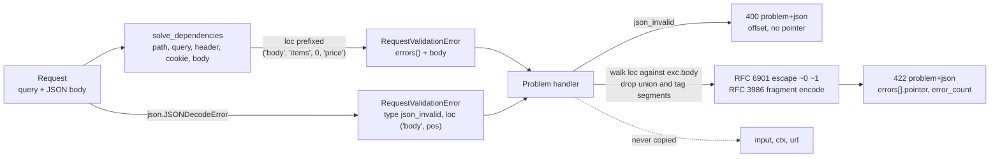

# Transforming FastAPI and Pydantic v2 ValidationError Lists into RFC 9457 Problem Details

> [!summary] Claim
> A pydantic-core `loc` tuple is a path through the validation schema, not through the request document, so a correct RFC 9457 validation problem must strip FastAPI's source prefix, drop schema-only segments (union member names, discriminator tags, `[key]`), escape and percent-encode the rest as an RFC 6901 URI-fragment pointer, and never copy `input` or `ctx` to the wire.

Part of [Bulk Long Running and Error Contracts](README.md) in [API Engineering](../README.md).

## TL;DR

- Mechanism: FastAPI `0.162.0` collects `exc.errors(include_url=False)` dicts from pydantic-core, prefixes each `loc` with `"body"`, `"query"`, `"path"`, `"header"`, or `"cookie"`, raises one `RequestValidationError`, and its default handler returns `422` `application/json` `{"detail": [...]}` with every `input` echoed.
- Contract rule: emit `application/problem+json` with `type`, `title`, `status` equal to the HTTP status (RFC 9457 Section 3.1.2), and an `errors` extension whose items carry `detail` and a `pointer` into the request content, exactly the shape of the RFC 9457 Section 3 example.
- The trap: joining `loc` with `/` yields pointers such as `#/quantity/int`, `#/pet/cat/meows`, and `#/11` (a JSON decode character offset) that do not resolve in the client's document, and `ConfigDict(hide_input_in_errors=True)` does not stop FastAPI's 422 from echoing passwords.
- Portability fact: the lab's 14 tests pass unchanged on CPython 3.12.13, 3.13.18, 3.14.6, 3.14.10, 3.15.2, and 3.15.0b3 free-threaded (GIL stayed off), and on Debian Trixie and Alpine containers for 3.12.16, 3.13.18, 3.14.10, and 3.15.2; Uvicorn, Hypercorn, and Granian returned one byte-identical problem body over HTTP/1.1, HTTP/2, and HTTP/3 where each supports them.
- When not to use it: if every consumer already parses FastAPI's `{"detail": [...]}` shape or you publish a gRPC-first API with `google.rpc.BadRequest`, changing the error format is a breaking contract change; version it rather than swapping it in place.

## Mental model



The request enters FastAPI's request handler, which first parses the body and turns a `json.JSONDecodeError` into a one-item `RequestValidationError` whose `loc` is `("body", e.pos)`.
If parsing succeeds, `solve_dependencies` validates path, query, header, cookie, and body parameters in that order and concatenates every error list, so one exception carries failures from several sources.
The problem handler splits the two cases: a syntax error becomes a `400` problem with a character `offset`, because a document that does not parse has no JSON Pointer space.
For semantic errors the handler walks each `loc` against the parsed body that FastAPI stored on `exc.body`, keeps only segments that exist in that document (plus the final name of a `missing` member), escapes them per RFC 6901, and percent-encodes them into a URI fragment.
The dotted arrow is the security boundary: `input`, `ctx`, and `url` stay on the server.

## How it works

### Where the error list comes from

pydantic-core describes each failure as an `ErrorDetails` `TypedDict` with `type`, `loc`, `msg`, `input`, and the optional `ctx` and `url` keys, and documents `type` as an identifier "designed for programmatic use that will change rarely or never" `(pydantic-core 2.50.4 python/pydantic_core/__init__.py, ErrorDetails)`.
`ValidationError.errors()` takes `include_url`, `include_context`, and `include_input`, all defaulting to `True` `(pydantic-core 2.50.4 python/pydantic_core/_pydantic_core/__init__.pyi, ValidationError.errors)`.
FastAPI validates every parameter through a `TypeAdapter` and, on failure, calls `exc.errors(include_url=False)` and prepends the parameter's location with `_regenerate_error_with_loc`, which builds `{**err, "loc": loc_prefix + err.get("loc", ())}` `(fastapi 0.162.0 fastapi/_compat/v2.py, ModelField.validate)` and `(fastapi 0.162.0 fastapi/_compat/v2.py, _regenerate_error_with_loc)`.
So `ctx` and `input` survive into the handler; only `url` is removed.

The prefix depends on where the value came from.
`request_params_to_args` uses `loc = (field_info.in_.value, alias)`, giving `("query", "limit")` or `("header", "x-tenant")` `(fastapi 0.162.0 fastapi/dependencies/utils.py, request_params_to_args)`.
`request_body_to_args` uses `("body",)` for a single non-embedded body model and `("body", alias)` for embedded or multiple body parameters `(fastapi 0.162.0 fastapi/dependencies/utils.py, request_body_to_args)`.
In both body cases the tail of `loc` is relative to the whole request document, which is why one walk against `exc.body` handles both.
`solve_dependencies` runs `errors += path_errors + query_errors + header_errors + cookie_errors` and then extends with body errors, which fixes the order a client sees `(fastapi 0.162.0 fastapi/dependencies/utils.py, solve_dependencies)`.
`get_request_handler` then raises `RequestValidationError(errors, body=..., endpoint_ctx=...)` `(fastapi 0.162.0 fastapi/routing.py, get_request_handler)`.

JSON syntax errors take a different path.
The same `get_request_handler` catches `json.JSONDecodeError` and synthesizes `{"type": "json_invalid", "loc": ("body", e.pos), "msg": "JSON decode error", "input": {}, "ctx": {"error": e.msg}}` with `body=e.doc` `(fastapi 0.162.0 fastapi/routing.py, get_request_handler)`.
The integer `e.pos` is a character offset into the text, not an array index, so a naive mapper turns it into `#/11`.

### The default handler and how lookup reaches yours

`FastAPI.__init__` registers defaults with `self.exception_handlers.setdefault(RequestValidationError, request_validation_exception_handler)`, so a handler passed in `exception_handlers=` wins `(fastapi 0.162.0 fastapi/applications.py, FastAPI.__init__)`.
The default returns `JSONResponse(status_code=422, content={"detail": jsonable_encoder(exc.errors())})` `(fastapi 0.162.0 fastapi/exception_handlers.py, request_validation_exception_handler)`.
Starlette resolves a handler by walking `type(exc).__mro__` and taking the first class present in the handler map `(starlette 1.10.0 starlette/_exception_handler.py, _lookup_exception_handler)`.
`RequestValidationError` derives from FastAPI's `ValidationException(Exception)`, not from `HTTPException` `(fastapi 0.162.0 fastapi/exceptions.py, RequestValidationError)`, so a catch-all `HTTPException` handler never sees validation failures.

### What RFC 9457 asks for

RFC 9457 identifies the JSON form by `application/problem+json` (RFC 9457 Section 3) and defines `type`, `status`, `title`, `detail`, and `instance` (RFC 9457 Section 3.1).
`type` defaults to `about:blank` (RFC 9457 Section 3.1.1); when it is `about:blank`, `title` SHOULD be the HTTP status phrase (RFC 9457 Section 4.2.1).
`status` is advisory, but "Generators MUST use the same status code in the actual HTTP response" (RFC 9457 Section 3.1.2).
`detail` "ought to focus on helping the client correct the problem, rather than giving debugging information" (RFC 9457 Section 3.1.4).
Extension members are allowed, clients "MUST ignore any such extensions that they don't recognize" (RFC 9457 Section 3.2), and their names SHOULD start with a letter, use `ALPHA`, `DIGIT`, and `_`, and be three characters or longer (RFC 9457 Section 4).
The RFC's own validation example returns `422 Unprocessable Content` with an `errors` array whose members hold `detail` and `pointer`, where `pointer` locates "the problem within the request's content using a JSON Pointer", for example `"#/profile/color"` (RFC 9457 Section 3).
That example is the contract this note implements; the per-item `code`, `source`, and `parameter` members and the top-level `error_count` are this lab's documented extensions.

### From `loc` to an RFC 6901 fragment

A JSON Pointer is a sequence of `/`-prefixed reference tokens, with `~` written as `~0` and `/` as `~1` (RFC 6901 Section 3).
Evaluation decodes `~1` before `~0`, so `~01` becomes `~1` and not `/` (RFC 6901 Section 4); the encoder must therefore escape `~` before `/`.
An array token is ASCII digits without a leading zero, and `-` names a nonexistent element (RFC 6901 Section 4).
The `#/...` form is the URI fragment representation: UTF-8 encode, then percent-encode characters the RFC 3986 `fragment` rule disallows (RFC 6901 Section 6).
`fragment = *( pchar / "/" / "?" )` (RFC 3986 Section 3.5), and `pchar = unreserved / pct-encoded / sub-delims / ":" / "@"` (RFC 3986 Section 3.3), so `!$&'()*+,;=:@` stay literal while space, `%`, `^`, `|`, `\`, and `"` are encoded, and those encoded forms match the RFC 6901 Section 6 table.

The lab's `body_tokens` walks the parsed body in step with `loc`.
A segment is kept only if the current node is an object containing that member name or an array with that index; otherwise it is a schema-only segment and is dropped.
The measured `loc` values in the lab show three such segment kinds on pydantic 2.14.3: smart-mode union member names (`["body", "quantity", "int"]` and `["body", "quantity", "bool"]`), discriminator tags (`["body", "pet", "cat", "meows"]`), and model-level errors with no field segment at all (`["body"]`).
The one exception is the last segment of a `missing` error, which names a member that by definition is absent; RFC 6901 Section 7 lists "A pointer that references a nonexistent value" as an error condition and leaves handling to the application, so the problem type must document that `missing` pointers do not resolve.
The root pointer `#` (whole document) is the honest location for model-level validators and for a body of the wrong JSON type.

### Status code and media type

`422` means the server understood the content type and "the syntax of the request content is correct" but could not process it (RFC 9110 Section 15.5.21), so it fits schema violations and does not fit a document that fails to parse.
`400` covers "malformed request syntax" (RFC 9110 Section 15.5.1), which is why the lab maps `json_invalid` to `400`, while FastAPI's default keeps `422` for both.
RFC 9457 also recommends returning the most relevant problem when problems do not share a type rather than inventing batch types (RFC 9457 Section 3); because FastAPI raises `json_invalid` alone before any field validation runs, the split never has to merge the two.
Starlette's `JSONResponse` hard-codes the class attribute `media_type = "application/json"` `(starlette 1.10.0 starlette/responses.py, JSONResponse)` and renders with `ensure_ascii=False`, `allow_nan=False`, and `separators=(",", ":")` `(starlette 1.10.0 starlette/responses.py, JSONResponse.render)`, and `fastapi.responses.JSONResponse` is a re-export of it `(fastapi 0.162.0 fastapi/responses.py, JSONResponse)`, so the lab subclasses it only to change `media_type`.

### OpenAPI drift

`get_openapi_path` adds a `422` response referencing `HTTPValidationError` under `application/json` whenever the route has parameters or a body and none of `"422"`, `"4XX"`, or `"default"` is already declared `(fastapi 0.162.0 fastapi/openapi/utils.py, get_openapi_path)`.
Registering an exception handler does not touch that logic, so the published schema keeps describing the old shape until the route or app declares its own `422` response.
A `responses={422: {"model": ...}}` entry would put the schema under the route's response media type (`application/json` by default) rather than `application/problem+json` `(fastapi 0.162.0 fastapi/openapi/utils.py, get_openapi_path)`, so the lab declares an explicit `content` map instead.

## Numbers and limits

Measured on an Apple M3 Pro, macOS 27.2 (`Darwin 27.2.0 arm64`), CPython 3.14.6, `fastapi 0.162.0`, `pydantic 2.14.3`, `pydantic-core 2.50.4`, `httpx 0.28.1`, with a throwaway `uv run --frozen python` script run from `labs/` that sends the lab tests' requests through `build_app` over `httpx.ASGITransport` and times `build_validation_problem` with `timeit.repeat`.
Request sizes are the bytes `httpx` put on the wire (`len(response.request.content)`), which uses compact JSON separators, so they are smaller than `len(json.dumps(body))`.
The size inequalities are also asserted by `test_missing_field_input_echo_amplifies_and_problem_handler_does_not` and `test_error_list_is_capped_but_true_count_reported`.

| Quantity | Value | Source or measurement | Implication |
|---|---:|---|---|
| Default 422 size, body with one 64 KiB unknown member and 3 missing required fields | `196,884 B` for a `65,550 B` request (`3.00x`) | Measured; each `missing` error's `input` is the whole body object | Error responses amplify attacker-controlled bytes by the count of missing fields |
| Same request through the problem handler | `432 B` | Measured | Dropping `input` removes the amplification |
| Default 422 size, 1000 invalid `price` items | `123,902 B` for a `25,901 B` request, `1000` errors | Measured | FastAPI applies no cap on the number of errors returned |
| Problem handler, same request, `max_errors=50` | `5,735 B`, `error_count` `1000` | Measured | The cap bounds bytes; the count preserves the truth |
| `build_validation_problem` on 1000 errors | `101-105 us` (cap 50), `1,975-2,052 us` (cap 1000) per call | Measured, best of 7 runs x 200 calls with `timeit.repeat`; range over two script runs | Mapping cost is linear in mapped items; the cap also bounds CPU |
| `json_invalid` offset for `{"items": [` | `11` | Measured in `test_malformed_json_is_400_without_pointer` | `loc[1]` is a character offset, not a token |
| `ErrorDetails` keys reaching the handler | `type`, `loc`, `msg`, `input`, optional `ctx` | `(fastapi 0.162.0 fastapi/_compat/v2.py, ModelField.validate)` calls `errors(include_url=False)` | `ctx` may hold live exception objects; the default handler renders a `ValueError` as `{}` |
| Extension member name length | SHOULD be `>= 3` characters | (RFC 9457 Section 4) | Rules out names like `in` or `at` for portable members |
| `status` member | MUST equal the HTTP status | (RFC 9457 Section 3.1.2) | Tested by `test_problem_handler_emits_problem_json_with_resolvable_pointers` |

## Portability

| Leg | Version | Result and evidence |
|---|---|---|
| CPython 3.12 | `3.12.13` (macOS) and `3.12.16` (containers below) | `14 passed in 0.52s` with `UV_PROJECT_ENVIRONMENT=<throwaway venv> uv run --frozen --python 3.12.13 pytest <test>`; `3.12.16` passed in the Debian and Alpine containers below |
| CPython 3.13 | `3.13.18` | `14 passed in 0.38s`, same command with `--python 3.13.18` |
| CPython 3.14 | `3.14.6` (workspace `.venv`) and `3.14.10` | `14 passed in 0.14s` (`uv run --frozen pytest`) and `14 passed in 0.38s` (`--python 3.14.10`) |
| CPython 3.15 | `3.15.2` | `14 passed in 0.45s` with `--python 3.15.2`; `--python 3.15.0b3` fails before collection because pytest cannot load the `hypothesis` plugin (`ModuleNotFoundError: No module named 'hypothesis._native'`), a toolchain fault outside this lab |
| CPython 3.15t free-threaded | `3.15.0b3+freethreaded` (`3.15.2t` could not be run: `uv python list --all-versions` lists no `3.15.2+freethreaded`, Homebrew `python@3.15` `3.15.2` ships no `python3.15t`, and the Docker Hub tags `python:3.15.2t-trixie` and `python:3.15t-trixie` do not exist) | `14 passed in 0.21s` with `PYTHONPATH=src uv run --no-project --python 3.15t` and only the pinned `fastapi`, `pydantic`, `pydantic-core`, `starlette`, `httpx`, `httpcore`, `anyio`, `pytest`, `pytest-asyncio` (the full lock has no `psycopg-binary 3.3.8` wheel for it); `sys._is_gil_enabled()` stayed `False` after importing `pydantic_core` and `fastapi` |
| FastAPI `RequestValidationError.body` | `>= 0.47.0` | Release notes for `0.47.0` ("Add request `body` to `RequestValidationError`") |
| FastAPI pydantic v2 support | `>= 0.100.0` | Release notes for `0.100.0` (2023-07-07) |
| FastAPI OpenAPI `ValidationError` schema lists `input` and `ctx` | `>= 0.128.1` | Release notes for `0.128.1` (PR `#14791`) |
| FastAPI `strict_content_type` default on | `>= 0.132.0` | Release notes for `0.132.0` (PR `#14978`); a JSON route given `text/plain` returned `422` `model_attributes_type` with the raw text as `input` in the lab probe |
| Uvicorn `0.54.0`, HTTP/1.1 over TLS | `422`, `application/problem+json`, body sha256 `0511e95024d3ff6d9cf07d38066c754eb23a95e925d8379e3d97dd7ab2b2c62c` | `curl 8.22.0 --http1.1 -k` against `uvicorn srvapp:app --ssl-keyfile --ssl-certfile`; CPython 3.14.6, macOS 27.2 arm64; the app is a throwaway FastAPI app (not in the lab) installing the lab's `make_validation_handler` on `POST /orders` with body `{"items":[{"sku":"a","price":0},{"price":3}]}`; reason phrase `Unprocessable Content` |
| Hypercorn `0.18.0`, HTTP/1.1 and HTTP/2 over TLS | `422`, `application/problem+json`, same sha256 | `curl --http1.1 -k` printed `http_version=1.1`, `curl --http2 -k` printed `http_version=2` (ALPN `h2`); `hypercorn srvapp:app --certfile --keyfile`; empty reason phrase on both |
| Hypercorn `0.18.0`, HTTP/3 over QUIC | `422`, `application/problem+json`, same sha256 | `curl --http3-only -k` printed `http_version=3`; `hypercorn srvapp:app --quic-bind 127.0.0.1:8806` with `aioquic 1.7.2` |
| Granian `2.8.7`, HTTP/1.1 and HTTP/2 over TLS | `422`, `application/problem+json`, same sha256 | `granian --interface asgi --http 1` then `--http 2` with `--ssl-certificate --ssl-keyfile`; `curl` printed `http_version=1.1` and `2`; reason phrase `Unprocessable Entity` on HTTP/1.1 |
| Uvicorn over HTTP/2, Uvicorn and Granian over HTTP/3 | not run | `uvicorn --help` (0.54.0) offers `--http2`, documented as "Requires --http zttp", and the `zttp` module is not importable in the lab environment nor in `uv.lock`, so the leg could not run; neither `uvicorn --help` nor `granian --help` (2.8.7) lists an HTTP/3 or QUIC option, so no leg was attempted |
| Byte identity across servers | one body for all legs | The same request through `httpx.ASGITransport` in process and through the six socket legs above produced seven byte-identical bodies (`shasum -a 256` gave one distinct hash for seven files); only the HTTP/1.1 reason phrase differed, and a client SHOULD ignore the reason phrase `(RFC 9112 Section 4)` |
| Debian Trixie containers | CPython `3.12.16`, `3.13.18`, `3.14.10`, `3.15.2` on glibc `2.41` | `14 passed` in `0.17s`, `0.15s`, `0.15s`, `0.15s`; OrbStack with Docker 29.8.2 on macOS 27.2 arm64, Linux 7.2.12 aarch64 container, `docker run --rm -v <copy of labs>:/src:ro python:<tag> sh inner.sh`: `pip install` of the pinned `fastapi`, `starlette`, `pydantic`, `pydantic-core`, `httpx`, `httpcore`, `h11`, `anyio`, `pytest`, `pytest-asyncio` set (the full lock was not installed), then `PYTHONPATH=src python -m pytest <test> -q` |
| Alpine containers (musl libc) | CPython `3.12.16`, `3.13.18`, `3.14.10`, `3.15.2` | `14 passed` in `0.21s`, `0.21s`, `0.18s`, `0.20s`; same command on the `-alpine` tags |

## Worked example

The [implementation](../labs/src/api_labs/f06_bulk_long_running_and_error_contracts/validation_problem_details.py) is a pure mapper plus a handler factory, and the [test](../labs/tests/f06_bulk_long_running_and_error_contracts/test_mapping_pydantic_validation_errors_to_rfc_9457_problem_details.py) drives a FastAPI app in process through `httpx.ASGITransport`, contrasting the default handler with the problem handler on the same requests.

### Implementation (`labs/src/api_labs/f06_bulk_long_running_and_error_contracts/validation_problem_details.py`)

```python
"""Map FastAPI RequestValidationError lists to RFC 9457 problem details with RFC 6901 pointers."""

from collections.abc import Callable, Coroutine, Mapping, Sequence
from typing import Any, Final, NotRequired, TypedDict, cast
from urllib.parse import quote, unquote

from fastapi.exceptions import RequestValidationError
from fastapi.responses import JSONResponse, Response
from starlette.requests import Request

PROBLEM_JSON: Final = "application/problem+json"
VALIDATION_TYPE: Final = "https://errors.example.com/problems/request-validation"
MALFORMED_JSON_TYPE: Final = "https://errors.example.com/problems/malformed-json"
PARAMETER_SOURCES: Final = frozenset({"path", "query", "header", "cookie"})
# RFC 3986 Section 3.5: fragment = *( pchar / "/" / "?" ); pchar adds sub-delims, ":" and "@"
# to the unreserved set that urllib.parse.quote never escapes.
FRAGMENT_SAFE: Final = "!$&'()*+,;=:@/?"


class ProblemError(TypedDict):
    """One validation failure inside the `errors` extension member."""

    detail: str
    code: str
    source: str
    pointer: NotRequired[str]
    parameter: NotRequired[str]


class ValidationProblem(TypedDict):
    """RFC 9457 problem details object for request validation failures."""

    type: str
    title: str
    status: int
    detail: str
    errors: list[ProblemError]
    error_count: int


class ProblemJSONResponse(JSONResponse):
    """JSONResponse with the RFC 9457 Section 3 media type."""

    media_type = PROBLEM_JSON


def encode_token(token: str | int) -> str:
    """Escape one reference token (RFC 6901 Section 3): '~' -> '~0' first, then '/' -> '~1'."""
    return str(token).replace("~", "~0").replace("/", "~1")


def to_fragment(tokens: Sequence[str | int]) -> str:
    """Render tokens as a URI fragment JSON Pointer (RFC 6901 Section 6), UTF-8 percent-encoded."""
    return "#" + "".join("/" + quote(encode_token(t), safe=FRAGMENT_SAFE) for t in tokens)


def evaluate_fragment(document: object, fragment: str) -> object:
    """Resolve a URI fragment JSON Pointer against a document (RFC 6901 Sections 4 and 6)."""
    if not fragment.startswith("#"):
        raise ValueError(f"not a URI fragment pointer: {fragment!r}")
    pointer = unquote(fragment[1:], encoding="utf-8", errors="strict")
    if pointer == "":
        return document
    if not pointer.startswith("/"):
        raise ValueError(f"pointer must start with '/': {pointer!r}")
    node = document
    for raw in pointer[1:].split("/"):
        token = raw.replace("~1", "/").replace("~0", "~")
        found, node = _child(node, _reference_key(node, token))
        if not found:
            raise KeyError(token)
    return node


def _reference_key(node: object, token: str) -> str | int:
    """Object member name, or an RFC 6901 Section 4 array-index (ASCII digits, no leading 0)."""
    if not isinstance(node, list):
        return token
    if not (token.isascii() and token.isdigit()) or (len(token) > 1 and token[0] == "0"):
        raise KeyError(token)
    return int(token)


def _child(node: object, segment: str | int) -> tuple[bool, object]:
    """Step one level into a JSON object or array; report whether the member exists."""
    if isinstance(node, Mapping) and isinstance(segment, str):
        mapping = cast("Mapping[str, object]", node)
        if segment in mapping:
            return True, mapping[segment]
    elif isinstance(node, list) and type(segment) is int:
        items = cast("list[object]", node)
        if 0 <= segment < len(items):
            return True, items[segment]
    return False, None


def body_tokens(loc_tail: Sequence[str | int], body: object, error_type: str) -> list[str | int]:
    """Keep only loc segments that address the request document.

    pydantic-core inserts schema-only segments into `loc`: union member names (`int`, `bool`),
    discriminator tags (`cat`), and `[key]` for dict-key errors. Those never exist in the body,
    so the segment is kept only if it resolves; the last segment of a `missing` error is kept
    because it names the absent member the client must add.
    """
    tokens: list[str | int] = []
    node = body
    last = len(loc_tail) - 1
    for index, segment in enumerate(loc_tail):
        found, child = _child(node, segment)
        if found:
            tokens.append(segment)
            node = child
        elif index == last and error_type == "missing" and isinstance(segment, str):
            tokens.append(segment)
    return tokens


def map_error(error: Mapping[str, Any], body: object) -> ProblemError:
    """Translate one pydantic-core ErrorDetails dict; drop `input`, `ctx`, and `url`."""
    loc: tuple[str | int, ...] = tuple(error["loc"])
    source = str(loc[0]) if loc else "body"
    mapped: ProblemError = {
        "detail": str(error["msg"]),
        "code": str(error["type"]),
        "source": source,
    }
    if source in PARAMETER_SOURCES:
        if len(loc) > 1:
            mapped["parameter"] = str(loc[1])
    else:
        mapped["pointer"] = to_fragment(body_tokens(loc[1:], body, str(error["type"])))
    return mapped


def build_validation_problem(
    errors: Sequence[Mapping[str, Any]], body: object, *, max_errors: int = 50
) -> ValidationProblem:
    """Build the 422 problem; keep at most `max_errors` items and report the true count."""
    mapped = [map_error(error, body) for error in errors[:max_errors]]
    count = len(errors)
    noun = "error" if count == 1 else "errors"
    return {
        "type": VALIDATION_TYPE,
        "title": "Request validation failed",
        "status": 422,
        "detail": f"The request has {count} validation {noun}.",
        "errors": mapped,
        "error_count": count,
    }


def build_malformed_json_problem(error: Mapping[str, Any]) -> dict[str, object]:
    """Build the 400 problem for a JSON syntax error; the loc offset is not a pointer."""
    loc: tuple[str | int, ...] = tuple(error["loc"])
    offset = loc[1] if len(loc) > 1 and type(loc[1]) is int else None
    reason = str(error.get("ctx", {}).get("error", "invalid JSON"))
    problem: dict[str, object] = {
        "type": MALFORMED_JSON_TYPE,
        "title": "Malformed JSON request body",
        "status": 400,
        "detail": f"The request body is not valid JSON: {reason}.",
    }
    if offset is not None:
        problem["offset"] = offset
    return problem


# FastAPI types `exception_handlers` values as Callable[[Request, Any], Coroutine[..., Response]].
ValidationHandler = Callable[[Request, Any], Coroutine[Any, Any, Response]]


def make_validation_handler(max_errors: int = 50) -> ValidationHandler:
    """Return an exception handler for `FastAPI(exception_handlers={RequestValidationError: h})`."""

    async def handler(request: Request, exc: Any) -> Response:
        if not isinstance(exc, RequestValidationError):
            raise TypeError(f"expected RequestValidationError, got {type(exc).__name__}")
        errors = exc.errors()
        if len(errors) == 1 and errors[0].get("type") == "json_invalid":
            return ProblemJSONResponse(build_malformed_json_problem(errors[0]), status_code=400)
        problem = build_validation_problem(errors, exc.body, max_errors=max_errors)
        return ProblemJSONResponse(problem, status_code=problem["status"])

    return handler


_ERROR_ITEM_SCHEMA: Final[dict[str, object]] = {
    "type": "object",
    "required": ["detail", "code", "source"],
    "properties": {
        "detail": {"type": "string"},
        "code": {"type": "string"},
        "source": {"type": "string", "enum": ["body", "path", "query", "header", "cookie"]},
        "pointer": {"type": "string"},
        "parameter": {"type": "string"},
    },
}

PROBLEM_RESPONSES: Final[dict[int | str, dict[str, Any]]] = {
    400: {
        "description": "Malformed JSON request body",
        "content": {PROBLEM_JSON: {"schema": {"type": "object"}}},
    },
    422: {
        "description": "Request validation failed",
        "content": {
            PROBLEM_JSON: {
                "schema": {
                    "type": "object",
                    "required": ["type", "title", "status", "errors", "error_count"],
                    "properties": {
                        "type": {"type": "string", "format": "uri-reference"},
                        "title": {"type": "string"},
                        "status": {"type": "integer"},
                        "detail": {"type": "string"},
                        "errors": {"type": "array", "items": _ERROR_ITEM_SCHEMA},
                        "error_count": {"type": "integer"},
                    },
                }
            }
        },
    },
}
```

Wiring it into an application takes two arguments, one for runtime behavior and one for the published contract (simplified excerpt):

```python
app = FastAPI(
    exception_handlers={RequestValidationError: make_validation_handler(max_errors=50)},
    responses=PROBLEM_RESPONSES,
)
```

### Test (`labs/tests/f06_bulk_long_running_and_error_contracts/test_mapping_pydantic_validation_errors_to_rfc_9457_problem_details.py`)

```python
"""Unit tests mapping FastAPI RequestValidationError lists to RFC 9457 problem details."""

import json
from typing import Annotated, Any, Literal

import httpx
import pytest
from fastapi import FastAPI, Query
from fastapi.exceptions import RequestValidationError
from pydantic import BaseModel, ConfigDict, Field
from starlette.requests import Request

from api_labs.f06_bulk_long_running_and_error_contracts.validation_problem_details import (
    MALFORMED_JSON_TYPE,
    PROBLEM_RESPONSES,
    VALIDATION_TYPE,
    build_validation_problem,
    evaluate_fragment,
    make_validation_handler,
    to_fragment,
)


class Cat(BaseModel):
    kind: Literal["cat"]
    meows: int


class Dog(BaseModel):
    kind: Literal["dog"]
    barks: int


class Item(BaseModel):
    sku: str
    price: Annotated[int, Field(gt=0)]


class Order(BaseModel):
    model_config = ConfigDict(hide_input_in_errors=True)

    items: list[Item]
    pet: Annotated[Cat | Dog, Field(discriminator="kind")] | None = None
    quantity: int | bool | None = None
    password: str = Field(default="", min_length=12)
    labels: dict[str, int] = Field(default_factory=dict[str, int])


class Account(BaseModel):
    email: str
    name: str
    region: str


def build_app(*, problem_handler: bool, max_errors: int = 50) -> FastAPI:
    handlers: dict[Any, Any] = {}
    responses: dict[int | str, dict[str, Any]] = {}
    if problem_handler:
        handlers[RequestValidationError] = make_validation_handler(max_errors=max_errors)
        responses = dict(PROBLEM_RESPONSES)
    app = FastAPI(exception_handlers=handlers, responses=responses)

    @app.post("/orders")
    async def create_order(order: Order, limit: Annotated[int, Query(le=10)] = 1) -> dict[str, int]:
        return {"items": len(order.items), "limit": limit}

    @app.post("/accounts")
    async def create_account(account: Account) -> dict[str, str]:
        return {"email": account.email}

    return app


async def post(app: FastAPI, path: str, **kwargs: Any) -> httpx.Response:
    async with httpx.AsyncClient(
        transport=httpx.ASGITransport(app=app), base_url="http://test"
    ) as client:
        return await client.post(path, **kwargs)


BAD_ORDER: dict[str, Any] = {
    "items": [{"sku": "a-1", "price": 0}, {"price": 3}],
    "pet": {"kind": "cat", "meows": "loud"},
    "quantity": "many",
    "password": "hunter2",
    "labels": {"unit/price~eur": "x"},
}


@pytest.mark.unit
@pytest.mark.asyncio
async def test_default_handler_echoes_input_and_ignores_hide_input_in_errors() -> None:
    response = await post(build_app(problem_handler=False), "/orders", json=BAD_ORDER)

    assert response.status_code == 422
    assert response.headers["content-type"] == "application/json"
    detail = response.json()["detail"]
    password_error = next(e for e in detail if e["loc"] == ["body", "password"])
    assert password_error["input"] == "hunter2"
    assert [e["loc"] for e in detail if e["loc"][1] == "quantity"] == [
        ["body", "quantity", "int"],
        ["body", "quantity", "bool"],
    ]
    assert ["body", "pet", "cat", "meows"] in [e["loc"] for e in detail]


@pytest.mark.unit
@pytest.mark.asyncio
async def test_problem_handler_emits_problem_json_with_resolvable_pointers() -> None:
    response = await post(build_app(problem_handler=True), "/orders?limit=99", json=BAD_ORDER)

    assert response.status_code == 422
    assert response.headers["content-type"] == "application/problem+json"
    problem = response.json()
    assert problem["type"] == VALIDATION_TYPE
    assert problem["status"] == response.status_code
    assert problem["error_count"] == 8
    located = [
        (e["source"], e.get("pointer", e.get("parameter")), e["code"]) for e in problem["errors"]
    ]
    assert located == [
        ("query", "limit", "less_than_equal"),
        ("body", "#/items/0/price", "greater_than"),
        ("body", "#/items/1/sku", "missing"),
        ("body", "#/pet/meows", "int_parsing"),
        ("body", "#/quantity", "int_parsing"),
        ("body", "#/quantity", "bool_parsing"),
        ("body", "#/password", "string_too_short"),
        ("body", "#/labels/unit~1price~0eur", "int_parsing"),
    ]
    assert "hunter2" not in response.text
    for error in problem["errors"]:
        assert set(error) <= {"detail", "code", "source", "pointer", "parameter"}
        if error["source"] == "body" and error["code"] != "missing":
            evaluate_fragment(BAD_ORDER, error["pointer"])


@pytest.mark.unit
@pytest.mark.asyncio
async def test_missing_member_pointer_names_absent_member_and_does_not_resolve() -> None:
    response = await post(build_app(problem_handler=True), "/orders", json=BAD_ORDER)

    missing = [e for e in response.json()["errors"] if e["code"] == "missing"]
    assert missing == [
        {
            "detail": "Field required",
            "code": "missing",
            "source": "body",
            "pointer": "#/items/1/sku",
        }
    ]
    assert evaluate_fragment(BAD_ORDER, "#/items/1") == {"price": 3}
    with pytest.raises(KeyError):
        evaluate_fragment(BAD_ORDER, missing[0]["pointer"])


@pytest.mark.unit
def test_rfc_6901_section_6_fragment_examples_round_trip() -> None:
    document: dict[str, Any] = {
        "foo": ["bar", "baz"],
        "": 0,
        "a/b": 1,
        "c%d": 2,
        "e^f": 3,
        "g|h": 4,
        "i\\j": 5,
        'k"l': 6,
        " ": 7,
        "m~n": 8,
    }
    expected = {
        "": "#/",
        "a/b": "#/a~1b",
        "c%d": "#/c%25d",
        "e^f": "#/e%5Ef",
        "g|h": "#/g%7Ch",
        "i\\j": "#/i%5Cj",
        'k"l': "#/k%22l",
        " ": "#/%20",
        "m~n": "#/m~0n",
    }
    for key, fragment in expected.items():
        assert to_fragment([key]) == fragment
        assert evaluate_fragment(document, fragment) == document[key]
    assert to_fragment([]) == "#"
    assert evaluate_fragment(document, "#") is document
    assert to_fragment(["foo", 0]) == "#/foo/0"
    assert evaluate_fragment(document, "#/foo/0") == "bar"
    assert to_fragment(["prix\u00e9"]) == "#/prix%C3%A9"
    assert to_fragment(["a:b@c=d,e"]) == "#/a:b@c=d,e"


@pytest.mark.unit
def test_escape_order_tilde_before_slash() -> None:
    assert to_fragment(["~1"]) == "#/~01"
    assert evaluate_fragment({"~1": "tilde-one", "/": "slash"}, "#/~01") == "tilde-one"


@pytest.mark.unit
def test_array_index_rejects_leading_zero_and_non_ascii_digits() -> None:
    document = {"items": ["a", "b"]}
    assert evaluate_fragment(document, "#/items/1") == "b"
    for bad in ("#/items/01", "#/items/-", "#/items/%C2%B2"):
        with pytest.raises(KeyError):
            evaluate_fragment(document, bad)


@pytest.mark.unit
@pytest.mark.asyncio
async def test_malformed_json_is_400_without_pointer() -> None:
    raw = b'{"items": ['
    default = await post(
        build_app(problem_handler=False),
        "/orders",
        content=raw,
        headers={"content-type": "application/json"},
    )
    problem = await post(
        build_app(problem_handler=True),
        "/orders",
        content=raw,
        headers={"content-type": "application/json"},
    )

    assert default.status_code == 422
    assert default.json()["detail"][0]["loc"] == ["body", 11]
    assert problem.status_code == 400
    assert problem.headers["content-type"] == "application/problem+json"
    assert problem.json() == {
        "type": MALFORMED_JSON_TYPE,
        "title": "Malformed JSON request body",
        "status": 400,
        "detail": "The request body is not valid JSON: Expecting value.",
        "offset": 11,
    }


@pytest.mark.unit
@pytest.mark.asyncio
async def test_model_level_error_points_at_document_root() -> None:
    response = await post(build_app(problem_handler=True), "/accounts", json=[1, 2])

    assert response.status_code == 422
    assert response.json()["errors"] == [
        {
            "detail": "Input should be a valid dictionary or object to extract fields from",
            "code": "model_attributes_type",
            "source": "body",
            "pointer": "#",
        }
    ]


@pytest.mark.unit
@pytest.mark.asyncio
async def test_missing_field_input_echo_amplifies_and_problem_handler_does_not() -> None:
    blob = {"padding": "x" * 65_536}
    request_bytes = len(json.dumps(blob).encode())
    default = await post(build_app(problem_handler=False), "/accounts", json=blob)
    problem = await post(build_app(problem_handler=True), "/accounts", json=blob)

    assert [e["type"] for e in default.json()["detail"]] == ["missing"] * 3
    assert len(default.content) > 3 * request_bytes
    assert len(problem.content) < 1024
    assert problem.json()["error_count"] == 3


@pytest.mark.unit
@pytest.mark.asyncio
async def test_error_list_is_capped_but_true_count_reported() -> None:
    body = {"items": [{"sku": f"s{i}", "price": -1} for i in range(1000)]}
    default = await post(build_app(problem_handler=False), "/orders", json=body)
    problem = await post(build_app(problem_handler=True, max_errors=50), "/orders", json=body)

    assert len(default.json()["detail"]) == 1000
    assert problem.json()["error_count"] == 1000
    assert len(problem.json()["errors"]) == 50
    assert problem.json()["errors"][-1]["pointer"] == "#/items/49/price"
    assert len(problem.content) * 5 < len(default.content)


@pytest.mark.unit
def test_build_validation_problem_drops_ctx_input_and_url() -> None:
    errors = [
        {
            "type": "value_error",
            "loc": ("body", "code"),
            "msg": "Value error, code is bad",
            "input": "secret-input",
            "ctx": {"error": ValueError("code is bad")},
            "url": "https://errors.pydantic.dev/2.14/v/value_error",
        }
    ]
    problem = build_validation_problem(errors, {"code": "secret-input"})

    assert problem["errors"] == [
        {
            "detail": "Value error, code is bad",
            "code": "value_error",
            "source": "body",
            "pointer": "#/code",
        }
    ]
    assert problem["detail"] == "The request has 1 validation error."
    json.dumps(problem)


@pytest.mark.unit
def test_custom_handler_leaves_openapi_422_stale_unless_responses_declared() -> None:
    stale = FastAPI(exception_handlers={RequestValidationError: make_validation_handler()})

    @stale.post("/accounts")
    async def create(account: Account) -> dict[str, str]:
        return {"email": account.email}

    stale_422 = stale.openapi()["paths"]["/accounts"]["post"]["responses"]["422"]
    fixed = build_app(problem_handler=True).openapi()
    fixed_422 = fixed["paths"]["/accounts"]["post"]["responses"]["422"]

    assert list(stale_422["content"]) == ["application/json"]
    assert "HTTPValidationError" in stale.openapi()["components"]["schemas"]
    assert list(fixed_422["content"]) == ["application/problem+json"]
    assert "HTTPValidationError" not in fixed.get("components", {}).get("schemas", {})


@pytest.mark.unit
def test_evaluate_fragment_rejects_non_fragment_and_relative_syntax() -> None:
    cases = {"/items": "not a URI fragment pointer", "#items": "pointer must start with '/'"}
    for bad, message in cases.items():
        with pytest.raises(ValueError, match=message):
            evaluate_fragment({"items": []}, bad)


@pytest.mark.unit
@pytest.mark.asyncio
async def test_handler_refuses_foreign_exception_types() -> None:
    handler = make_validation_handler()
    request = Request({"type": "http", "method": "POST", "path": "/", "headers": []})
    with pytest.raises(TypeError, match="expected RequestValidationError, got ValueError"):
        await handler(request, ValueError("not a validation error"))
```

### Captured response

`POST /orders?limit=99` with the test's `BAD_ORDER` body, captured from the problem handler with `uv run --frozen python` on CPython 3.14.6:

```json
{
  "type": "https://errors.example.com/problems/request-validation",
  "title": "Request validation failed",
  "status": 422,
  "detail": "The request has 8 validation errors.",
  "errors": [
    {
      "detail": "Input should be less than or equal to 10",
      "code": "less_than_equal",
      "source": "query",
      "parameter": "limit"
    },
    {
      "detail": "Input should be greater than 0",
      "code": "greater_than",
      "source": "body",
      "pointer": "#/items/0/price"
    },
    {
      "detail": "Field required",
      "code": "missing",
      "source": "body",
      "pointer": "#/items/1/sku"
    },
    {
      "detail": "Input should be a valid integer, unable to parse string as an integer",
      "code": "int_parsing",
      "source": "body",
      "pointer": "#/pet/meows"
    },
    {
      "detail": "Input should be a valid integer, unable to parse string as an integer",
      "code": "int_parsing",
      "source": "body",
      "pointer": "#/quantity"
    },
    {
      "detail": "Input should be a valid boolean, unable to interpret input",
      "code": "bool_parsing",
      "source": "body",
      "pointer": "#/quantity"
    },
    {
      "detail": "String should have at least 12 characters",
      "code": "string_too_short",
      "source": "body",
      "pointer": "#/password"
    },
    {
      "detail": "Input should be a valid integer, unable to parse string as an integer",
      "code": "int_parsing",
      "source": "body",
      "pointer": "#/labels/unit~1price~0eur"
    }
  ],
  "error_count": 8
}
```

Every body `pointer` except the `missing` one resolves against `BAD_ORDER` with `evaluate_fragment`, and `#/labels/unit~1price~0eur` shows both escapes in the RFC-mandated order.

### Captured test run

```text
$ cd labs && uv run --frozen pytest tests/f06_bulk_long_running_and_error_contracts/test_mapping_pydantic_validation_errors_to_rfc_9457_problem_details.py -q
..............                                                           [100%]
14 passed in 0.14s
```

CPython 3.14.6 on macOS 27.2 arm64 (Apple M3 Pro); `ruff format --check`, `ruff check`, `mypy`, and `pyright` also pass on `src tests`.

## Pitfalls

> [!warning] Joining `loc` with `/`
> Trigger: `"#/" + "/".join(map(str, loc[1:]))` in a custom handler.
> Symptom: pointers such as `#/quantity/int`, `#/pet/cat/meows`, and `#/11` that no JSON Pointer library can resolve against the client's document; clients that highlight form fields silently highlight nothing.
> Fix: walk `loc` against `exc.body` and keep only segments that exist, as `body_tokens` does, and route `json_invalid` to a separate problem type.

> [!warning] Putting the FastAPI source in the pointer
> Trigger: emitting `#/body/items/0/price` because `loc[0]` is `"body"`.
> Symptom: the pointer addresses a `body` member that does not exist in the request content, contradicting the RFC 9457 Section 3 definition of `pointer`.
> Fix: carry the source in a separate member (`source`) and point from the document root; query, path, header, and cookie failures get a `parameter` name instead of a pointer.

> [!warning] Trusting `hide_input_in_errors`
> Trigger: `model_config = ConfigDict(hide_input_in_errors=True)` on a model holding secrets.
> Symptom: the setting is documented as hiding inputs "when printing errors" `(pydantic 2.14.3 pydantic/config.py, ConfigDict.hide_input_in_errors)`, and the lab shows FastAPI's default 422 still returns `"input": "hunter2"` for that model.
> Fix: drop `input` in the handler; this is CWE-209 (Generation of Error Message Containing Sensitive Information) and the OWASP API8:2023 misconfiguration case "Error messages include stack traces, or expose other sensitive information".

> [!warning] Serializing `ctx` blindly
> Trigger: copying `ctx` because it holds useful bounds such as `{"gt": 0}`.
> Symptom: for a `ValueError` raised in a validator, `ctx` is `{"error": ValueError(...)}`, which `jsonable_encoder` rendered as `{"error": {}}` in the lab probe, and a raw `json.dumps` raises `TypeError`.
> Fix: whitelist the `ctx` keys you document per error `code`, or omit `ctx` entirely as the lab does.

> [!warning] Leaving the OpenAPI document stale
> Trigger: replacing the handler without declaring `422`.
> Symptom: generated SDKs keep decoding `HTTPValidationError` from `application/json`, so typed clients fail on the new `application/problem+json` body; `test_custom_handler_leaves_openapi_422_stale_unless_responses_declared` proves the stale schema survives.
> Fix: pass an explicit `responses={422: {"content": {"application/problem+json": {...}}}}` at app or router level.

> [!warning] Unbounded error arrays
> Trigger: a list body with thousands of invalid items.
> Symptom: the default response grew to `123,902 B` for `1000` errors in the lab, with no cap.
> Fix: cap `errors` and report `error_count`; pair it with request body size limits, since the cap bounds output but not validation work.

No public incident or CVE that names FastAPI's 422 echo exists in the sources checked (as of 2026-11): the GitHub advisory database queried for the `fastapi` and `pydantic` pip packages lists only GHSA-8h2j-cgx8-6xv7 (CVE-2021-32677, CSRF), GHSA-qf9m-vfgh-m389 (Content-Type ReDoS), GHSA-mr82-8j83-vxmv (CVE-2024-3772, ReDoS) and GHSA-5jqp-qgf6-3pvh (CVE-2021-29510, `infinity` loop), and an NVD keyword search for `fastapi validation error` returned 0 results.
The CWE and OWASP entries above are therefore the primary sources for the class.

## Security and robustness

- Information disclosure: RFC 9457 Section 5 warns that problem details risk "leaking information that can be exploited to compromise the system", and `RequestValidationError.__str__` includes the endpoint's source file and line `(fastapi 0.162.0 fastapi/exceptions.py, ValidationException._format_endpoint_context)`, so never put `str(exc)` in `detail`; log it server-side through [[Structured-Log-Redaction-and-Preventing-PII-and-Token-Leaks]].
- Reflection and amplification: echoing `input` returns attacker-chosen bytes, measured above at `3.00x` for three missing fields; this is an OWASP API4:2023 Unrestricted Resource Consumption vector when combined with large bodies, see [[Unrestricted-Resource-Consumption-API4-2023-Payload-Depth-and-Limit-Guards]].
- Schema disclosure: `msg` texts reveal constraints such as `String should have at least 12 characters` and regex patterns; that is usually desired for public contracts, but for internal-only constraints replace `detail` from a per-`code` message table.
- Pointer injection: member names come from the client, so percent-encoding is also an output-encoding control; a key containing `"`, `\`, or control characters stays inside the fragment as `%22`, `%5C`, or `%0A` rather than reaching a UI that splices pointers into HTML or selectors.
- Ambiguity: a client may send a member literally named `int` or `cat`, in which case `body_tokens` keeps a segment that pydantic meant as a union tag; the resulting pointer still resolves to a real value but may point one level too deep, which is a documented limitation, not a crash.
- Defense in depth: keep body size limits at the server or gateway, keep the handler free of I/O so it cannot fail while handling a failure, and return `500` for `ResponseValidationError`, which is a server bug and must not be reported as client error.

## The principal's view

The decision is not "which JSON shape", it is who owns the error contract: the framework's default, or the organization's API guidelines.
FastAPI's default couples clients to pydantic's internal `loc` grammar, including union member names that change when a type annotation is reordered, so a refactor of `int | bool` to `bool | int` silently changes the public error format.
Mapping to RFC 9457 with document pointers moves the contract onto two IETF standards whose semantics do not move with library releases, at the cost of owning a small mapper and its tests.
The `code` member is the deliberate exception: it exposes pydantic's error `type` because pydantic-core documents it as stable, but an organization that wants full independence should translate `code` through its own table and treat new pydantic types as unmapped.
Make the handler a shared library with one problem type registry, as described in [[Error-Taxonomy-Retryability-and-Client-Contract-Design]], rather than per-service copies, and gate drift with the OpenAPI test in this lab.
For gRPC or multi-protocol platforms, the richer `google.rpc.BadRequest` field violations in [[Google-AIP-193-Error-Model-and-Rich-Error-Details]] are the better primary model, with RFC 9457 as the HTTP projection.
This lab maps only FastAPI `0.162.0` and pydantic-core `2.50.4` `loc` tuples; another framework needs its own mapper, because the segment-dropping rules in `body_tokens` depend on pydantic-core's `loc` grammar and nothing here shows another framework reuses it.

## Interview questions

> [!question] L5: Why does FastAPI put `"body"` or `"query"` at the start of every `loc`, and what should a problem details response do with it?
>
> > [!success]- Answer
> > FastAPI validates each parameter separately and prefixes the pydantic `loc` with the parameter's source through `_regenerate_error_with_loc`.
> > The prefix tells you which part of the HTTP message failed, but it is not part of the JSON document the client sent.
> > A problem response should move it into a separate member such as `source` and build `pointer` from the remaining segments, giving `#/items/0/price` rather than `#/body/items/0/price`.
> >
> > Follow-up: How would you report a failing `X-Tenant` header, which has no JSON document at all?

> [!question] L5: Which HTTP status and media type should a validation problem use, and why is a JSON syntax error different?
>
> > [!success]- Answer
> > Schema violations fit `422 Unprocessable Content`, which RFC 9110 Section 15.5.21 reserves for content whose syntax is correct but whose instructions cannot be processed.
> > A body that does not parse is malformed syntax, which RFC 9110 Section 15.5.1 assigns to `400 Bad Request`.
> > Both use `Content-Type: application/problem+json`, and the `status` member must equal the HTTP status per RFC 9457 Section 3.1.2.
> >
> > Follow-up: FastAPI's default returns `422` for `json_invalid`; how would you roll out the change to `400` without breaking clients?

> [!question] L5: How do you encode a body member named `unit/price~eur` in a JSON Pointer fragment?
>
> > [!success]- Answer
> > Escape `~` to `~0` first and `/` to `~1` second, per RFC 6901 Section 3, giving `unit~1price~0eur`.
> > Escaping in the other order would turn the `~1` produced for `/` into `~01`, which decodes back to `~1` instead of `/`.
> > In fragment form the token needs no percent-encoding because `~` is unreserved, so the pointer is `#/labels/unit~1price~0eur`.
> >
> > Follow-up: What does `#/%20` refer to, and why is the `%20` required?

> [!question] L6 (Predict-the-output): A model has `quantity: int | bool | None = None`, and a client sends `{"quantity": "many"}` to a FastAPI `0.162.0` endpoint with the default handler; what `loc` values appear, and what does a naive `"/".join` mapper emit?
>
> > [!success]- Answer
> > pydantic 2.14.3 in smart union mode reports one error per failed member, so the response holds `["body", "quantity", "int"]` with `int_parsing` and `["body", "quantity", "bool"]` with `bool_parsing`, as the lab's default-handler test asserts.
> > A naive mapper emits `#/quantity/int` and `#/quantity/bool`, neither of which exists in the document.
> > The document-guided walk emits `#/quantity` twice, once per `code`.
> >
> > Follow-up: Would you collapse the two errors into one, and what information would you lose?

> [!question] L6 (Debug-this-API): A mobile team reports that form-field highlighting works for most errors but never for discriminated-union fields or for "invalid JSON", and your logs show pointers like `#/pet/cat/meows` and `#/11`; what is wrong and how do you fix it?
>
> > [!success]- Answer
> > The handler is translating `loc` positionally, and `loc` includes the discriminator tag `cat`, which is a schema branch name and not a member of the `pet` object.
> > The `#/11` comes from FastAPI's synthetic `json_invalid` error, whose `loc` is `("body", e.pos)` with `e.pos` a character offset.
> > Fix the first by resolving each segment against `exc.body` and dropping segments that do not exist, which yields `#/pet/meows`.
> > Fix the second by routing `json_invalid` to a separate `400` problem type with an `offset` member and no pointer.
> >
> > Follow-up: Which test would you add so that a future pydantic release that changes `loc` grammar fails CI instead of production?

> [!question] L6: Why is copying `input` into the response a security problem even when the client sent it?
>
> > [!success]- Answer
> > The response can be logged, cached, or shown by intermediaries and support tools that should never see secrets, which is CWE-209.
> > For a `missing` error the `input` is the entire enclosing object, so a large body is echoed once per missing field, measured here at `196,884 B` for a `65,550 B` request.
> > `hide_input_in_errors` does not help, because it only affects how pydantic prints errors and FastAPI builds its body from `errors()`.
> >
> > Follow-up: Which members of `ctx` would you allow through, and how would you enforce that list?

> [!question] L7+: Your organization has 40 FastAPI services, each with its own 422 format; how do you migrate them to one RFC 9457 contract?
>
> > [!success]- Answer
> > Publish one problem type registry with stable `type` URIs, titles, and status codes, as RFC 9457 Section 4 requires each new type to document.
> > Ship the mapper as a shared library with its contract tests, including the OpenAPI drift test, and make the API linter reject routes whose `422` is not `application/problem+json`.
> > Use content negotiation or a versioned rollout, because RFC 9457 Section 4 notes that problem details can be added to existing APIs through `Accept`, and clients parsing `{"detail": [...]}` will break on a silent swap.
> > Measure the migration by the share of 4xx responses with `application/problem+json` at the gateway.
> >
> > Follow-up: Who owns adding a new error `code` when a pydantic upgrade introduces one?

> [!question] L7+: Should the public contract expose pydantic's error `type` strings as `code`?
>
> > [!success]- Answer
> > pydantic-core documents `type` as changing rarely or never, so it is a reasonable default that saves a translation table.
> > It still couples clients to one library, so a move to msgspec, Litestar, or a hand-written validator changes the vocabulary.
> > The principal answer is to treat `code` as your own enum, seeded from pydantic's names, with unmapped types collapsed to a generic code and alerted on.
> >
> > Follow-up: How would you version the `code` enum without changing the problem `type` URI?

> [!question] L7+: Where should the cap on the number of reported errors live, and is it enough to protect the service?
>
> > [!success]- Answer
> > The cap belongs in the mapper so every service shares it, and `error_count` keeps the response truthful.
> > It bounds response bytes and mapping CPU, which the lab measured at about `0.1 ms` versus `2 ms` per call for 1000 errors (CPython 3.14.6, Apple M3 Pro, macOS 27.2).
> > It does not bound validation work, which pydantic already did for every item, so body size limits at the server or gateway are still required.
> >
> > Follow-up: Would you prefer pydantic to stop validating after the first N errors, and what would clients lose?

## Related

Prerequisites: [[Error-Taxonomy-Retryability-and-Client-Contract-Design]]

Next: [[Batch-Get-and-Bulk-Mutation-Design-AIP-231-to-AIP-235]]

See also: [[02-Programming-Languages/Python/Python-Backend-Interview-Prep/04-FastAPI]], [[02-Programming-Languages/Python/Python-Backend-Interview-Prep/05-REST-API-Design]], [[Problem-Details-for-HTTP-APIs-RFC-9457]], [[Google-AIP-193-Error-Model-and-Rich-Error-Details]], [[Atomic-vs-Partial-Batch-Execution-and-207-Multi-Status]], [[Dry-Run-and-Validate-Only-Requests-AIP-163]], [[Exception-Handling-in-FastAPI-HTTPException-vs-RequestValidationError]], [[Request-Parameter-Validation-Path-Query-Header-Cookie-and-Body-Models]], [[Discriminated-Unions-Tag-and-Callable-Discriminator-Dispatch]], [[OpenAPI-Generation-Internals-in-FastAPI-Get-OpenAPI-and-Separate-Schemas]], [[Structured-Log-Redaction-and-Preventing-PII-and-Token-Leaks]], [[Unrestricted-Resource-Consumption-API4-2023-Payload-Depth-and-Limit-Guards]]

- Lab: `labs/tests/f06_bulk_long_running_and_error_contracts/test_mapping_pydantic_validation_errors_to_rfc_9457_problem_details.py`

## Further reading

- [RFC 9457: Problem Details for HTTP APIs](https://www.rfc-editor.org/rfc/rfc9457.html) - Section 3 has the `errors` and `pointer` validation example this note implements, and Section 5 the disclosure warning.
- [RFC 6901: JavaScript Object Notation (JSON) Pointer](https://www.rfc-editor.org/rfc/rfc6901.html) - Sections 3, 4, and 6 fix escape order, array-index syntax, and the URI fragment form with its test table.
- [RFC 3986: URI Generic Syntax](https://www.rfc-editor.org/rfc/rfc3986.html) - Sections 3.3 and 3.5 define which characters a fragment may carry unencoded.
- [RFC 9110: HTTP Semantics](https://www.rfc-editor.org/rfc/rfc9110.html) - Sections 15.5.1 and 15.5.21 separate malformed syntax (`400`) from unprocessable content (`422`).
- [FastAPI 0.162.0 `fastapi/routing.py`](https://github.com/fastapi/fastapi/blob/0.162.0/fastapi/routing.py) - `get_request_handler` builds the synthetic `json_invalid` error and raises `RequestValidationError`.
- [FastAPI 0.162.0 `fastapi/dependencies/utils.py`](https://github.com/fastapi/fastapi/blob/0.162.0/fastapi/dependencies/utils.py) - `request_params_to_args`, `request_body_to_args`, and `solve_dependencies` define `loc` prefixes and error order.
- [FastAPI 0.162.0 `fastapi/openapi/utils.py`](https://github.com/fastapi/fastapi/blob/0.162.0/fastapi/openapi/utils.py) - `get_openapi_path` shows when the default `422` schema is injected.
- [pydantic-core 2.50.4 `ErrorDetails`](https://github.com/pydantic/pydantic/blob/v2.14.3/pydantic-core/python/pydantic_core/__init__.py) - the error dict contract and the stability promise for `type`.
- [CWE-209: Generation of Error Message Containing Sensitive Information](https://cwe.mitre.org/data/definitions/209.html) - the weakness class behind echoing `input`.
