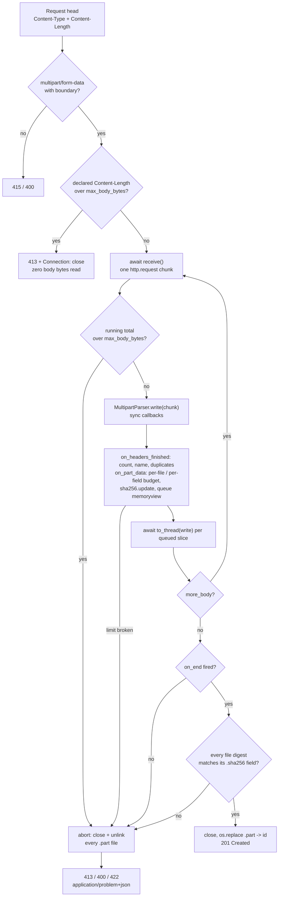

# Streaming Multipart File Uploads (python-multipart) with Strict Size, Part-Count, and Memory Limits

> [!summary] Claim
> FastAPI's `UploadFile` path (`fastapi 0.162.0`, `starlette 1.10.0`, `python-multipart 0.0.33`) caps text parts at 1 MiB and files and fields at 1000 each, but puts no cap on file bytes and accepts a body whose closing delimiter never arrives; a receiver that feeds `request.stream()` straight into `MultipartParser`, counts every byte against body, file, and field budgets, hashes and spills to disk as it parses, and deletes partial files on any exit holds under 200 KB of Python heap for an 8 MiB upload on CPython 3.14 and 3.15 (about 45 KB on 3.12 and 3.13), against 8.4 MB for `request.body()`.

Part of [Bulk Long Running and Error Contracts](README.md) in [API Engineering](../README.md).

## TL;DR

- Mechanism: `python_multipart.MultipartParser` is a push parser: each `write(chunk)` fires synchronous callbacks with `(data, start, end)` slices of that chunk, so a receiver can validate, hash, and queue each slice and then `await` the disk write before it pulls the next ASGI `http.request` message.
- Contract rule: enforce every budget on the bytes as they arrive (body total, per-file, per-field, file count, field count), answer `413 Content Too Large` (RFC 9110 Section 15.5.14) the moment one breaks, add `Connection: close` when the body was left unread, and treat a missing close delimiter as `400 Bad Request`, never as success.
- The trap: Starlette's `max_part_size` (default 1 MiB) guards only parts without a `filename`; file parts spool to a `SpooledTemporaryFile` with no size limit, `MultipartParser(max_size=...)` silently truncates instead of raising, and `MultipartParser.finalize()` never checks that the closing boundary arrived.
- Portability fact: the receiver passed the same 55 tests on CPython `3.12.16`, `3.13.18`, `3.14.10`, `3.15.2`, and free-threaded `3.15.2t` in Debian Trixie and Alpine containers and on seven macOS interpreters; none of Uvicorn `0.54.0`, Hypercorn `0.18.0`, or Granian `2.8.7` caps an ASGI request body (a 128 MiB body reached the app on each), so the application is the last line of defense (as of 2026-11).
- When not to use it: for files in the hundreds of megabytes or more, or on flaky mobile links, do not proxy bytes through the API process at all; issue a presigned URL ([[Presigned-Object-Storage-URLs-and-Direct-to-Storage-Uploads]]) or use resumable uploads ([[Resumable-HTTP-Uploads-IETF-Draft-and-Tus-Protocol]]).

## Mental model



The request head arrives first, so the cheapest checks run before any body byte is read: the media type and boundary, then the declared `Content-Length` against the body budget.
Each `await receive()` then hands the receiver one chunk whose size the server chose; the running byte total is checked before the chunk reaches the parser, because neither a chunked HTTP/1.1 body nor an HTTP/2 or HTTP/3 stream has to declare its length up front.
`MultipartParser.write` turns the chunk into callbacks; the callbacks only validate, hash, and append a `memoryview` slice to a pending list, because they are synchronous and must not block the event loop.
After `write` returns, the receiver awaits one worker-thread write per pending slice, so at most one chunk of file data is in Python memory at a time.
When the stream ends, the receiver demands that the parser reached its end state, verifies each file's SHA-256 against the client's declared digest, and only then renames each `.part` file to its final server-chosen name; every failure path, including a client disconnect, closes and unlinks every file it created.

## How it works

### The wire format the parser has to find

A `multipart/form-data` body is a sequence of parts separated by a boundary delimiter built from CRLF, `--`, and the `boundary` parameter of `Content-Type` (RFC 7578 Section 4.1).
RFC 2046 Section 5.1.1 gives the grammar: `delimiter := CRLF dash-boundary`, `close-delimiter := delimiter "--"`, a boundary of 1 to 70 characters, and a discardable preamble and epilogue.
Each part must carry `Content-Disposition: form-data; name="..."`, and a file part should add a `filename` parameter (RFC 7578 Section 4.2); the RFC 5987 `filename*` form must not be used.
Only `Content-Type`, `Content-Disposition`, and in limited cases `Content-Transfer-Encoding` are defined for parts; other part headers "MUST NOT be included and MUST be ignored" (RFC 7578 Section 4.8).
Parts with identical names must not be coalesced, form processors should send results in order, and intermediaries must not reorder them (RFC 7578 Section 5.2).
The bytes for one text field and one file, as the lab encodes them with boundary `lab-boundary-7f3a`:

```text
--lab-boundary-7f3a\r\n
Content-Disposition: form-data; name="file.sha256"\r\n
\r\n
<64 hex digits>\r\n
--lab-boundary-7f3a\r\n
Content-Disposition: form-data; name="file"; filename="big.bin"\r\n
Content-Type: application/octet-stream\r\n
\r\n
<8 MiB of file bytes>\r\n
--lab-boundary-7f3a--\r\n
```

The CRLF before each `--lab-boundary-7f3a` belongs to the delimiter, not to the part data, which is why a parser cannot emit the last bytes of a chunk until it knows they are not the start of a delimiter.
Nothing in the format states a part's length: the only way to find where a file ends is to scan every byte for the delimiter, so the parser's cost is linear in the body and its memory need is one chunk plus a boundary-length look-behind.

### How the body reaches the application

The HTTP layer decides the body length before multipart parsing starts.
In HTTP/1.1 a valid `Content-Length` without `Transfer-Encoding` defines it, and with chunked transfer coding the length is known only when the last chunk arrives (RFC 9112 Section 6.3); a request with an invalid `Content-Length` must get `400` and a closed connection (RFC 9112 Section 6.3, rule 5).
In HTTP/2 and HTTP/3, `content-length` is optional, and a value that differs from the sum of `DATA` frame payloads makes the request malformed (RFC 9113 Section 8.1.1, RFC 9114 Section 4.1.2).
So a declared length is an admission hint, not an enforcement point: the receiver rejects an honest oversized `Content-Length` before reading, then counts real bytes anyway.

Uvicorn's h11 path appends each `h11.Data` event to `cycle.body` and calls `pause_reading()` once the buffer exceeds `HIGH_WATER_LIMIT` (`65536` bytes, defined in `uvicorn/protocols/http/flow_control.py`) `(uvicorn 0.54.0 uvicorn/protocols/http/h11_impl.py, H11Protocol.handle_events)`, and each ASGI `receive()` returns the whole buffer as one `bytes` object and resumes reading `(uvicorn 0.54.0 uvicorn/protocols/http/h11_impl.py, RequestResponseCycle.receive)`.
Starlette's `Request.stream()` yields each non-empty `http.request` body and raises `ClientDisconnect` on `http.disconnect` `(starlette 1.10.0 starlette/requests.py, Request.stream)`.
The chunk size the application sees is therefore a property of the server and its event loop, not of the client: Uvicorn hands over whatever accumulated since the last `receive()`.
On a loopback socket here (the probe under Portability) the largest `http.request` body was `256000` bytes on Uvicorn, which is one read of uvloop's receive buffer `(uvloop 0.23.0 uvloop/includes/consts.pxi, UV_STREAM_RECV_BUF_SIZE)`, the loop Uvicorn picks when `uvloop` is importable `(uvicorn 0.54.0 uvicorn/loops/auto.py, auto_loop_factory)`; it was `65536` bytes on Hypercorn and `417792` bytes on Granian.
A streaming receiver's working set scales with that chunk, not with the upload.

### python-multipart 0.0.33: what the parser does and does not enforce

`MultipartParser.__init__` rejects a boundary longer than `MAX_BOUNDARY_LENGTH = 256` bytes with `FormParserError` and stores the delimiter as `b"\r\n--" + boundary` `(python-multipart 0.0.33 python_multipart/multipart.py, MultipartParser.__init__)`.
Per part it allows at most `DEFAULT_MAX_HEADER_COUNT = 8` headers and `DEFAULT_MAX_HEADER_SIZE = 4096 + 128` bytes per header line, raising `MultipartParseError` past either `(python-multipart 0.0.33 python_multipart/multipart.py, MultipartParser._internal_write)`; these limits arrived in `0.0.27` as the fix for CVE-2026-42561.
In the `PART_DATA` state the parser calls `data.find(boundary, i, length)` to jump to a whole delimiter, and when none is present it checks only the chunk tail for a partial delimiter, carrying it in `index` and replaying it from the boundary constant if it turns out to be data `(python-multipart 0.0.33 python_multipart/multipart.py, MultipartParser._internal_write)`.
After the close delimiter it enters `END` and discards the epilogue without scanning it, the fix for CVE-2026-40347.

Three behaviors matter for limits:

1. `max_size` truncates instead of rejecting: `write()` logs `"Current size is %d (max %d), so truncating data length from %d to %d"` and parses only the first `max_size` bytes, returning a short count `(python-multipart 0.0.33 python_multipart/multipart.py, MultipartParser.write)`; the lab test `test_python_multipart_max_size_truncates_instead_of_raising` shows `write()` returning `10` for a 190-byte body.
2. `finalize()` does nothing: its body is a `TODO` comment and `pass`, so the parser never reports that it stopped mid-part `(python-multipart 0.0.33 python_multipart/multipart.py, MultipartParser.finalize)`.
3. `parse_options_header` drops any parameter whose key contains `*`, keeping plain `filename` authoritative per RFC 7578 Section 4.2 `(python-multipart 0.0.33 python_multipart/multipart.py, parse_options_header)`; GHSA-vffw-93wf-4j4q (CVE-2026-53537, patched in `0.0.30`) is the advisory for smuggling through those extended parameters.

### Starlette 1.10.0 and FastAPI 0.162.0 defaults

FastAPI's route handler calls `await request.form()` with no arguments for any endpoint that declares `Form` or `File` parameters `(fastapi 0.162.0 fastapi/routing.py, get_request_handler)`, so the limits are Starlette's defaults: `max_files=1000`, `max_fields=1000`, `max_part_size=1024 * 1024` `(starlette 1.10.0 starlette/requests.py, Request.form)`.
Inside `MultiPartParser.on_part_data`, the size check runs only when `self._current_part.file is None`; file data is appended to `_file_parts_to_write` with no check `(starlette 1.10.0 starlette/formparsers.py, MultiPartParser.on_part_data)`.
Each file part gets `SpooledTemporaryFile(max_size=self.spool_max_size)` with `spool_max_size = 1024 * 1024`, so the first 1 MiB of each file sits in memory before it rolls to disk `(starlette 1.10.0 starlette/formparsers.py, MultiPartParser.on_headers_finished)`.
Parts are appended to `items` in `on_part_end`, and `parse()` returns `FormData(self.items)` after `parser.finalize()`, so an unterminated last part is silently absent and its spooled file is not closed by the parser `(starlette 1.10.0 starlette/formparsers.py, MultiPartParser.parse)`.
`parse()` closes the spooled files only in its `except BaseException` branch, and maps `FormParserError` to `MultiPartException("Invalid multipart data.")`, which `_get_form` turns into `HTTPException(400)` when the scope carries an `app`, as it does under FastAPI `(starlette 1.10.0 starlette/requests.py, Request._get_form)`.

### The bounded receiver

The lab's `BoundedMultipartReceiver` replaces `request.form()` for one endpoint; FastAPI never parses the form because the endpoint takes `Request` and declares no `Form` or `File` parameter.
Its rules, each pinned by a test and a mutation:

- Check `Content-Type` (`415`), the boundary (`400`), and a declared `Content-Length` (`400` if not `[0-9]+`, `413` if over budget) before the first `receive()`.
- Count `len(chunk)` against `max_body_bytes` before `parser.write(chunk)`.
- In `on_headers_finished`, require `form-data` with a `name`, reject duplicate part headers and duplicate file field names, and enforce `max_files` and `max_fields` before any data for the new part is accepted.
- Keep a file part's `Content-Type` as metadata, defaulting to `text/plain` (RFC 7578 Section 4.4), and ignore every other part header (RFC 7578 Section 4.8).
- In `on_part_data`, check the per-file or per-field budget before keeping the slice, then `hasher.update(view)` and queue the `memoryview`; no bytes are copied for file data.
- After each `write`, await `anyio.to_thread.run_sync(handle.write, view)` per queued slice, so disk I/O never runs on the event loop thread (the lesson of CVE-2025-54121).
- Spill to `<upload_dir>/<32 hex>.part` opened with mode `"xb"`; the client `filename` is stored as metadata only (the lesson of CVE-2026-24486).
- After the stream ends, require that `on_end` fired; reject a `<field>.sha256` form field that is not 64 lowercase hex digits or appears twice (`400`), verify each file against its digest (`422 Unprocessable Content`, RFC 9110 Section 15.5.21), then close each `.part` file and `os.replace` it to its final name.
- On any exception, including `ClientDisconnect`, cancellation, and a failure midway through the renames, close and unlink every temporary and final path inside a shielded `anyio.CancelScope`, one best-effort step at a time, so a failing `close()` (for example `ENOSPC` on flush) neither skips the remaining unlinks nor replaces the original exception.

The per-file digest travels as a form field because RFC 7578 Section 4.8 forbids extra part headers, and `Content-Digest` (RFC 9530 Section 2) covers the whole message content rather than one part.

## Numbers and limits

Measured 2026-11-11 on an Apple M3 Pro, macOS `27.2` arm64 (`uname -r` `27.2.0`), `uv 0.11.26`, with `tracemalloc` peak heap growth over a warmed-up baseline while serving one 8 MiB file sent as 128 x 64 KiB chunks through `httpx.ASGITransport`.
Method: a script that imports the lab test module and calls its `traced_peak` and `big_upload` against `build_upload_app`, a bare `request.body()` route, and a bare `request.form()` route, three times per process (`uv run --frozen python measure.py <test module>` from `labs/`, with `UV_PROJECT_ENVIRONMENT=<tmp venv> --python <v>` for the other interpreters); the first run in each process is the highest.

| Item | Value | Source or measurement |
|---|---:|---|
| Bounded receiver peak heap, 8 MiB file | `171016` to `187683` B (four processes, ten runs across the verify and finish passes) | CPython `3.14.6`, workspace venv |
| Bounded receiver peak heap, 8 MiB file | `170807` to `186271` B on `3.14.10`; `169827` to `183552` B on `3.15.2` | three runs each |
| Bounded receiver peak heap, 8 MiB file | `171903` to `189821` B on `3.14.6t` (five runs); `169500` to `184988` B on `3.15.0b3t` (three runs) | GIL disabled |
| Bounded receiver peak heap, 8 MiB file | `40930` to `44420` B | CPython `3.12.13` and `3.13.18`, three runs each |
| `await request.body()` peak heap, same body | `8422424` to `8424840` B | CPython `3.14.6`, ten runs; `8419306` to `8425925` B across all eight interpreters above |
| Starlette `request.form()` peak heap, same body | `1413147` to `1415795` B | CPython `3.14.6`; `1412253` to `1415483` B on `3.14.10` and `3.15.2`; `1283652` to `1286987` B on `3.12.13` and `3.13.18`; `2519014` to `2522493` B on free-threaded `3.14.6t` and `3.15.0b3t` (it follows the free-threaded build, not the 3.15 release; cause below) |
| `BytesIO.getvalue()` on a 1 MiB buffer, called from another thread | `4244` B extra peak on `3.14.6`, `4492` B on `3.15.2`; `1105111` B on `3.14.6t`, `1105263` B on `3.15.0b3t` | `tracemalloc` peak over the filled buffer, one run each, same machine; the same call from the filling thread adds `0` B on all four |
| Largest `http.request` body on a loopback socket, 128 MiB upload | `256000` B on Uvicorn `0.54.0` (h11 and httptools), `65536` B on Hypercorn `0.18.0`, `417792` B on Granian `2.8.7`; `16384` B over HTTP/2 on Hypercorn and Granian | socket probe under Portability, CPython `3.14.6`, one run |
| Lab assertion bounds | bounded `< 1 MiB`; `request.body()` `>= 8 MiB`; `request.form()` `>= 1 MiB` and `< 4 MiB` | `test_bounded_receiver_peak_heap_is_far_below_payload` and the two control tests |
| Starlette `max_part_size` default | `1048576` B, text parts only | `(starlette 1.10.0 starlette/formparsers.py, MultiPartParser.on_part_data)` |
| Starlette `spool_max_size` | `1048576` B in memory per file before rollover | `(starlette 1.10.0 starlette/formparsers.py, MultiPartParser)` |
| Starlette `max_files`, `max_fields` defaults | `1000` each | `(starlette 1.10.0 starlette/requests.py, Request.form)` |
| python-multipart header limits | `8` headers per part, `4224` B per header line | `(python-multipart 0.0.33 python_multipart/multipart.py, DEFAULT_MAX_HEADER_COUNT, DEFAULT_MAX_HEADER_SIZE)` |
| python-multipart boundary limit | `256` B (RFC 2046 allows `70`) | `(python-multipart 0.0.33 python_multipart/multipart.py, MAX_BOUNDARY_LENGTH)` |
| Uvicorn read pause threshold | `65536` B buffered per request | `(uvicorn 0.54.0 uvicorn/protocols/http/flow_control.py, HIGH_WATER_LIMIT)` |
| Hypercorn ASGI receive queue | `10` events (`max_app_queue_size`) | `(hypercorn 0.18.0 hypercorn/config.py, Config)`, used as `asyncio.Queue(config.max_app_queue_size)` in `hypercorn/asyncio/task_group.py` |
| Hypercorn `wsgi_max_body_size` | `16 MiB`, WSGI apps only | `(hypercorn 0.18.0 hypercorn/config.py, Config)`, passed only to `WSGIWrapper` in `hypercorn/utils.py` |
| Lab default budgets | `64 MiB` body, `32 MiB` per file, `4` files, `16` fields, `4 KiB` per field | `UploadLimits` in the lab module; policy choices, not standards |

The working set of the bounded receiver is the server's chunk, the parser's look-behind (at most the delimiter length), one SHA-256 state, and the field values; it does not grow with file size, which the 8 MiB result against the `< 1 MiB` bound shows.
Disk is the resource that does grow: the worst case per request is `max_body_bytes` of `.part` files, multiplied by concurrent uploads.
The free-threaded `request.form()` peak is one extra copy of the spool: Starlette runs the write that rolls a file over in a worker thread `(starlette 1.10.0 starlette/datastructures.py, UploadFile.write)`, `SpooledTemporaryFile.rollover` then calls `getvalue()` on the 1 MiB `BytesIO` (CPython `3.14.6` `Lib/tempfile.py`), and on a free-threaded build that call copies the buffer when it comes from a thread other than the one that filled it, which is the `1105111` B in the table and the gap between `1.41` MB and `2.52` MB.

## Portability

| Runtime, library, server, or protocol | Behavior | Evidence |
|---|---|---|
| CPython `3.12.16`, `3.13.18`, `3.14.10`, `3.15.2` on Debian 13 Trixie (glibc 2.41) and Alpine 3.24 (musl), linux/arm64 containers | All 55 lab tests pass, including the peak-heap bounds | `docker run python:<v>-trixie` and `python:<v>-alpine` with the lab mounted read-only: `pip install -c <uv export --frozen --no-hashes>` of the lock-pinned packages this module imports, then `PYTHONPATH=src python -m pytest <module> -q -p no:cacheprovider` |
| CPython `3.15.2t` free-threaded, GIL disabled, on Debian 13 Trixie and Alpine 3.23 (musl), linux/arm64 containers | 55 passed | Same method in `ghcr.io/astral-sh/uv:python3.15-trixie` and `ghcr.io/astral-sh/uv:python3.14-alpine` with `uv venv --python 3.15.2+freethreaded`; `sys._is_gil_enabled()` printed `False` |
| CPython `3.12.13`, `3.13.18`, `3.14.10`, `3.15.2` on macOS 27.2 arm64 | 55 passed, full lock installed | `UV_PROJECT_ENVIRONMENT=<tmp venv> uv run --frozen --python <v> pytest <module> -q` |
| CPython `3.14.6` (workspace venv), macOS 27.2 arm64 | 55 passed | `uv run --frozen pytest <module> -q` |
| CPython `3.14.6t`, `3.15.0b3t` free-threaded, GIL disabled, macOS 27.2 arm64 | 55 passed | Venv with the lock-pinned subset this module imports (`uv pip install -c <uv export --frozen --no-hashes>`, then the project `--no-deps`), because the full lock does not install on free-threaded builds: `uv sync --frozen --python 3.14.6+freethreaded` fails on `psycopg-binary==3.3.8`, which has no wheel for that platform |
| `python-multipart` `< 0.0.27` | No part-header count or size limit (CPU DoS) | GHSA-pp6c-gr5w-3c5g (CVE-2026-42561) |
| `python-multipart` `< 0.0.26` | Slow preamble and epilogue handling (CPU DoS) | GHSA-mj87-hwqh-73pj (CVE-2026-40347) |
| `python-multipart` `< 0.0.18` | One log event per skipped CR or LF around boundaries | GHSA-59g5-xgcq-4qw3 (CVE-2024-53981) |
| Starlette `< 0.40.0` (advisory range `< 0.39.2`) | Text parts without `filename` buffered with no size limit | GHSA-f96h-pmfr-66vw (CVE-2024-47874); NVD text says "Prior to version 0.40.0" |
| Starlette `< 0.25.0` | No `max_files` or `max_fields` | GHSA-74m5-2c7w-9w3x |
| Starlette `< 1.3.1` | `max_fields` and `max_part_size` ignored for `application/x-www-form-urlencoded` | GHSA-82w8-qh3p-5jfq (CVE-2026-54283) |
| Starlette `1.10.0`, FastAPI `0.162.0` | File parts unbounded; truncated last part dropped with `200` | Lab `test_fastapi_uploadfile_default_has_no_file_size_cap`, `test_fastapi_default_silently_drops_a_truncated_last_file` |
| Uvicorn `0.54.0` (`--http h11` and `--http httptools`) | No request-body size option; a 128 MiB body reached the app in full with `Content-Length` and with chunked coding; after `413` with `Connection: close` it closes the socket, and a client that keeps sending gets `BrokenPipeError` then `ConnectionResetError`; after a `413` without `Connection: close` it read and discarded the unread 8 MiB body and answered the next request on the same connection | Socket probe below; `(uvicorn 0.54.0 uvicorn/protocols/http/h11_impl.py, H11Protocol.handle_events)`, `(uvicorn 0.54.0 uvicorn/protocols/http/h11_impl.py, RequestResponseCycle.send)` |
| Hypercorn `0.18.0` | No ASGI body size option (`wsgi_max_body_size` applies to WSGI only); a 128 MiB body reached the app in full with `Content-Length` and with chunked coding; after `413` with `Connection: close` on a `Content-Length` request it closes the socket; on a chunked request it sent the `413` and then neither read nor closed while the client kept sending, until the client's 10 s send timeout; after a `413` without `Connection: close` and an unread body it closes the connection instead of draining it | Socket probe below; `(hypercorn 0.18.0 hypercorn/config.py, Config)` |
| Granian `2.8.7` (`--interface asgi`) | No request-body size option: `receive()` forwards each hyper body frame with no byte accounting, `--http1-buffer-size` sets only hyper's HTTP/1 connection buffer (`max_buf_size`), and the other size options are the HTTP/2 window, frame, header, and send-buffer sizes and `--workers-max-rss`; a 128 MiB body reached the app in full with `Content-Length` and with chunked coding; it closes the socket after `413` with `Connection: close`, and also when the app answers without reading the body | `(granian 2.8.7 src/asgi/io.rs, ASGIHTTPProtocol::receive)`, `(granian 2.8.7 src/workers.rs, conn_builder_h1)`, `granian/cli.py`; socket probe below |
| HTTP/1.1 | Length from `Content-Length` or chunked coding; invalid length is a `400` and close | (RFC 9112 Section 6.3); lab exercises both via `httpx.ASGITransport` (bytes body vs async-iterator body); both framings also ran on real sockets in the probe below |
| HTTP/2 | `content-length` optional; mismatch with `DATA` sum is malformed; a 32 MiB upload with no `content-length` reached the app in full, and an over-budget upload got the receiver's `413` as a complete response while the client was still sending, followed by `RST_STREAM` with `NO_ERROR` on Granian and by no reset on Hypercorn in the 2 s the probe waited | (RFC 9113 Section 8.1.1), (RFC 9113 Section 8.1); cleartext prior-knowledge HTTP/2 against Hypercorn `0.18.0` and Granian `2.8.7` in the probe below; not part of the lab suite |
| HTTP/3 | Same rule over QUIC streams | (RFC 9114 Section 4.1.2); specification only, not run here |

The matrix and container runs are from 2026-11-11 on the Apple M3 Pro above; the containers ran under Docker `29.8.2`, and the peak-heap numbers under Numbers and limits were measured on macOS only, so the Linux legs prove the test bounds, not those exact values.
Socket probe (2026-11-11, CPython 3.14.6, macOS 27.2 arm64, loopback `127.0.0.1`, not part of the lab suite): each server ran `build_upload_app` with `max_body_bytes` of 1 MiB plus a byte-counting route and a route that answers `413` without reading the body, started with `python -m uvicorn <app> --http h11` (and `--http httptools`), `python -m hypercorn <app>`, and `python -m granian --interface asgi <app>`.
`httpx 0.28.1` sent the 128 MiB HTTP/1.1 bodies and the 32 MiB HTTP/2 body, a raw `socket` client sent the over-budget HTTP/1.1 requests and kept sending after the response arrived, and a raw `h2 4.4.1` client sent the over-budget HTTP/2 uploads; every over-budget HTTP/1.1 run got the receiver's `413`, and the upload directory was empty after each chunked one.

## Worked example

The [implementation](../labs/src/api_labs/f06_bulk_long_running_and_error_contracts/bounded_multipart.py) and the [test](../labs/tests/f06_bulk_long_running_and_error_contracts/test_multipart_form_streaming_and_upload_memory_bounds.py) are the lab.
The core loop and the data callback (simplified excerpt; the callback registration dictionary and the `415` and boundary checks are elided):

```python
async def receive(self, request: Request) -> UploadResult:
    ...
    declared = request.headers.get("content-length")
    if declared is not None:
        if _DIGITS.fullmatch(declared) is None:
            raise _bad_request("invalid Content-Length")
        if int(declared) > self.limits.max_body_bytes:
            raise _too_large(f"body exceeds {self.limits.max_body_bytes} bytes")
    try:
        parser = MultipartParser(boundary, {...})
        async for chunk in request.stream():
            self.body_bytes += len(chunk)
            if self.body_bytes > self.limits.max_body_bytes:
                raise _too_large(f"body exceeds {self.limits.max_body_bytes} bytes")
            parser.write(chunk)
            await self._flush()
        self.stream_complete = True
        parser.finalize()  # a no-op in python-multipart 0.0.33: it never checks the end state
        if not self._ended:
            raise _bad_request("closing boundary delimiter missing: body truncated")
        files = await self._commit()
    except FormParserError as exc:
        await self._abort()
        raise _bad_request("malformed multipart body") from exc
    except BaseException:
        await self._abort()
        raise
    return UploadResult(fields=list(self._fields), files=files, body_bytes=self.body_bytes)

def _on_part_data(self, data: bytes, start: int, end: int) -> None:
    view = memoryview(data)[start:end]
    part = self._current_file
    if part is None:
        if len(self._field_value) + len(view) > self.limits.max_field_bytes:
            raise _too_large(f"field exceeds {self.limits.max_field_bytes} bytes")
        self._field_value += view
        return
    if part.size + len(view) > self.limits.max_file_bytes:
        raise _too_large(f"file exceeds {self.limits.max_file_bytes} bytes")
    part.size += len(view)
    part.hasher.update(view)
    self._pending.append((part, view))
```

The peak-heap measurement and the bounded-receiver assertion (simplified excerpt of the test module):

```python
async def traced_peak(app: ASGIApp, path: str, make_body: Callable[[], CountingBody]) -> int:
    """Peak Python heap growth while serving one 8 MiB upload, after a warm-up request."""
    tracemalloc.start()
    try:
        warm = await post(app, path, make_body())
        assert warm.status_code < 300
        baseline = tracemalloc.get_traced_memory()[0]
        tracemalloc.reset_peak()
        response = await post(app, path, make_body())
        peak = tracemalloc.get_traced_memory()[1] - baseline
    finally:
        tracemalloc.stop()
    assert response.status_code < 300
    return peak


@pytest.mark.unit
@pytest.mark.asyncio
async def test_bounded_receiver_peak_heap_is_far_below_payload(tmp_path: Path) -> None:
    app = build_upload_app(tmp_path, UploadLimits(max_body_bytes=16 * MIB))

    peak = await traced_peak(app, "/uploads", big_upload)

    assert peak < 1 * MIB  # payload is 8 MiB; the receiver holds about one chunk at a time
```

The default-path pitfall the receiver exists to replace (simplified excerpt):

```python
async def test_fastapi_default_silently_drops_a_truncated_last_file() -> None:
    body = (
        file_part_head(BOUNDARY, "uploads", "a.bin")
        + b"aaa\r\n"
        + file_part_head(BOUNDARY, "uploads", "b.bin")
        + b"bbbb"  # no CRLF--boundary--: the client stopped mid-file
    )

    response = await post(default_fastapi_app(), "/files", body)

    assert response.status_code == 200
    assert response.json() == {"sizes": [3]}
```

Captured on CPython 3.14.6, macOS 27.2 arm64, from `labs/`:

```text
$ uv run --frozen pytest tests/f06_bulk_long_running_and_error_contracts/test_multipart_form_streaming_and_upload_memory_bounds.py -q
.......................................................                  [100%]
55 passed in 0.59s
```

Every receiver rule was checked by mutation: 61 deliberate breaks of `bounded_multipart.py`, applied one at a time with the module rerun after each, and 7 input changes to the tests that characterize the pinned libraries (a terminated body for the truncation test, a streamed read for the `request.body()` control, a file below the spool size for the `request.form()` control) each made at least one test fail, and the restored files are byte-identical and pass.
The breaks cover every budget comparison (off, `>=` for `>`, off by one in both directions), the `Content-Length` precheck and its digit check, counting the body after parsing instead of before, every structural check, the digest format, duplicate, and compare steps, the end-state check, each status code and the `Connection: close` decision, hashing, spilling, the close and rename order, each half of the cleanup, the cancellation shield, and disk writes on the event loop thread.
Eight of them survived the first run (counting after `parser.write`, `match` for `fullmatch` on `Content-Length` and on the digest, rejecting exactly `max_fields` fields, a part with no `name`, no `close()` before the rename, and two that ignored the part `Content-Type`); the tests added for them, among them `test_chunk_that_breaks_the_body_budget_is_never_parsed_or_written`, `test_exactly_max_files_and_max_fields_are_accepted`, `test_spill_file_is_closed_before_it_is_renamed`, and `test_file_part_content_type_is_kept_and_defaults_to_text_plain`, now kill all eight.
A fresh-context review then showed that the body-budget test proved only that the over-budget chunk was never written, so it now also records every `MultipartParser.write` call, and the break that parses before checking the budget is the 61st.

## Pitfalls

> [!warning] `UploadFile` has no file size limit
> Trigger: a FastAPI endpoint with `file: UploadFile` or `Annotated[list[UploadFile], File()]` behind a proxy with no body limit.
> Symptom: a 3 MiB file is accepted with `200` although `max_part_size` is 1 MiB (lab `test_fastapi_uploadfile_default_has_no_file_size_cap`); a multi-gigabyte file fills the temp directory.
> Fix: count file bytes yourself while streaming, or cap the body at the proxy and in the app; `max_part_size` was added for text parts only, as the fix for CVE-2024-47874 (GHSA-f96h-pmfr-66vw).

> [!warning] A truncated body is a successful request
> Trigger: the body ends before the close delimiter, for example a client that sends the terminal chunk of a chunked body early, or a buggy client that never writes `--boundary--`.
> Symptom: `200` with the last file missing (lab `test_fastapi_default_silently_drops_a_truncated_last_file` returns `{"sizes": [3]}` for two uploaded files) because `MultipartParser.finalize()` is a no-op and Starlette appends a part only in `on_part_end`.
> Fix: register `on_end` and reject with `400` unless it fired, as the lab receiver does.

> [!warning] `max_size` truncates, it does not reject
> Trigger: passing `max_size` to `MultipartParser` and expecting an exception.
> Symptom: `write()` logs a warning and returns a short count; the rest of the body is dropped silently and a later part may vanish (lab `test_python_multipart_max_size_truncates_instead_of_raising`).
> Fix: compare the running byte count with your budget before `write()` and raise your own `413`.

> [!warning] Checking `Content-Length` alone
> Trigger: rejecting oversized uploads only by the declared header.
> Symptom: a chunked HTTP/1.1 body or an HTTP/2 stream without `content-length` streams past the limit.
> Fix: use the header for early admission, then count real bytes (lab `test_chunked_body_over_budget_stops_reading_mid_stream_and_cleans_up` stops after pulling at most one chunk past a 256 KiB budget).

> [!warning] Disk I/O on the event loop
> Trigger: writing spilled data synchronously from a parser callback or during `SpooledTemporaryFile` rollover.
> Symptom: every request on the worker stalls while one upload rolls to disk; Starlette shipped this as CVE-2025-54121 (GHSA-2c2j-9gv5-cj73, patched in `0.47.2`), and `UploadFile.write` now asks `_will_roll` before choosing the thread pool `(starlette 1.10.0 starlette/datastructures.py, UploadFile.write)`.
> Fix: queue slices in callbacks and `await anyio.to_thread.run_sync(write, ...)` after each `parser.write` (lab `test_file_writes_run_in_worker_threads_not_on_the_event_loop`).

> [!warning] Client filename as a filesystem path
> Trigger: `upload_dir / filename` or python-multipart's non-default `UPLOAD_KEEP_FILENAME=True` with `UPLOAD_DIR`.
> Symptom: `os.path.join("/upload/dir", "/etc/malicious")` writes outside the directory; python-multipart `<= 0.0.21` had this as CVE-2026-24486 (GHSA-wp53-j4wj-2cfg).
> Fix: store under a server-generated name and keep the filename as metadata (lab `test_client_filename_is_metadata_and_never_a_path`), as RFC 7578 Section 4.2 (do not use the file name blindly or its directory path) and Section 7 (do not overwrite files) direct.

> [!warning] Old parser pins
> Trigger: a lock file holding `python-multipart < 0.0.27` or Starlette `< 1.3.1`.
> Symptom: CPU exhaustion from unbounded part headers (CVE-2026-42561), large preambles (CVE-2026-40347, CVE-2024-53981), or url-encoded forms that ignore `max_fields` (CVE-2026-54283).
> Fix: pin at or above the patched releases and keep the application-level budgets regardless; GHSA-pp6c-gr5w-3c5g itself calls server, proxy, or framework body limits "only a mitigation", not a fix.

## Security and robustness

Threat model: an unauthenticated or low-privilege client controls every byte after the request line, including the boundary, part headers, part count, part sizes, the filename, and the pacing of the stream.
OWASP API4:2023 "Unrestricted Resource Consumption" calls an API vulnerable if any of a list of limits is missing or set inappropriately, including execution timeouts, maximum allocable memory, maximum number of file descriptors, and maximum upload file size.
Multipart parsing spends every resource that page names, network bandwidth, CPU, memory, and storage: CPU on header and boundary scanning, memory on buffered fields, storage on spilled files, and a file descriptor per open spill file.

Defense in depth, outermost first:

1. Proxy or gateway body limit, so most oversized requests never reach Python.
2. Admission on the head: media type, boundary, authentication, and declared `Content-Length`, before any `receive()`; see [[100-Continue-Expect-Header-and-Large-Upload-Admission]] for answering before the client sends the body.
3. Streaming budgets in the application: body, per-file, per-field, file count, field count, part-header count and size (from python-multipart), all checked before the offending bytes are kept.
4. Structural strictness: `form-data` disposition required, duplicate part headers rejected (they make `name` and `filename` ambiguous between parsers), duplicate file field names and duplicate digest fields rejected (otherwise the last `file.sha256` silently wins), non-UTF-8 part names and field values rejected.
5. Integrity: a per-file SHA-256 declared by the client and verified before commit detects truncation and corruption, but not tampering by the client itself; it is integrity, not authenticity.
6. Atomic commit: files become visible only through `os.replace` after every check passes, so readers never see a half-written upload.
7. Cleanup on every exit, shielded from cancellation and best effort per step (lab `test_client_disconnect_mid_upload_deletes_partial_file`, `test_cancelled_request_still_deletes_partial_file`, `test_failing_close_does_not_skip_cleanup_or_mask_the_error`, `test_failure_midway_through_commit_deletes_already_renamed_files`).
8. Connection hygiene: when the app answers before reading the whole body, it sends `Connection: close`, which h11 turns into `MUST_CLOSE` (`(h11 0.16.0 h11/_connection.py, _keep_alive)`) so the leftover bytes are not parsed as a next request; RFC 9110 Section 15.5.14 allows closing after a `413`.

Not covered here and still required: a slow-body timeout (a client can trickle bytes under every byte budget), a per-tenant concurrency cap (disk budget is per request times concurrent uploads), content scanning of the stored file (RFC 7578 Section 7 warns that files may carry executable content), and authorization before accepting bytes.
Error bodies use RFC 9457 problem details; see [[Problem-Details-for-HTTP-APIs-RFC-9457]] and [[Error-Taxonomy-Retryability-and-Client-Contract-Design]] for which of `400`, `413`, `415`, and `422` a client may retry.

## The principal's view

The decision is where upload bytes are allowed to land, not which parser to use.
Proxying bytes through the API process buys one authorization point, synchronous validation, and a simple client, and costs a worker's event loop time, temp disk, and bandwidth for every byte; above tens of megabytes, or for unreliable clients, presigned direct-to-storage uploads or resumable uploads move that cost to infrastructure built for it.
When bytes do flow through the API, make the budgets a published contract: document `max_body_bytes`, `max_file_bytes`, part counts, and the digest field in the API reference, return them in problem details, and keep one shared receiver library so every team gets the same strictness instead of each endpoint inheriting framework defaults that changed with each of the 2023 to 2026 advisories listed under Portability.
The organizational trade-off is that a strict receiver rejects some clients the default path accepted (duplicate file names under one field, missing close delimiters, non-UTF-8 fields); roll it out with metrics on each rejection reason before enforcing.
Choose a different shape when the payload is not form-shaped: a raw `PUT` with `Content-Type: application/octet-stream` and `Content-Digest` (RFC 9530 Section 2) has no boundary scanning and a single size to check, and gRPC client streaming carries the file as a sequence of typed messages.

## Interview questions

> [!question] L5: Why can't a multipart parser tell you how big a file part is before it has read the whole part?
>
> > [!success]- Answer
> > A part has no length field; it ends where the next delimiter, CRLF plus `--` plus the boundary, appears (RFC 2046 Section 5.1.1).
> > The parser must scan every byte for that delimiter, so size is only known at the end.
> > Even `Content-Length` covers the whole body, not a part, and may be absent with chunked coding or HTTP/2.
> > So per-file limits have to be enforced incrementally on each data slice.
> >
> > Follow-up: Why does the parser have to hold back the last few bytes of a chunk?

> [!question] L5: FastAPI's form parsing has `max_part_size = 1 MiB`; does that stop a 2 GiB file upload?
>
> > [!success]- Answer
> > No.
> > Starlette 1.10.0 applies `max_part_size` only to parts without a `filename`.
> > File parts go to a `SpooledTemporaryFile` that holds 1 MiB in memory and then spills to disk with no size cap.
> > A 2 GiB file is accepted and fills the temp directory unless a proxy or the application enforces a byte budget.
> >
> > Follow-up: Which CVE introduced `max_part_size`, and why did it target text parts?

> [!question] L5 (predict the output): A FastAPI endpoint takes `uploads: Annotated[list[UploadFile], File()]` and returns `{"sizes": [u.size for u in uploads]}`. The body is a complete file part `a.bin` with data `aaa`, then a second part `b.bin` whose data is `bbbb` and no close delimiter. What does the client get?
>
> > [!success]- Answer
> > `200` with `{"sizes": [3]}`.
> > `MultipartParser.finalize()` does nothing in python-multipart 0.0.33, so the missing close delimiter is not an error.
> > Starlette appends a part to the form only in `on_part_end`, which never fires for `b.bin`.
> > The lab test `test_fastapi_default_silently_drops_a_truncated_last_file` asserts exactly this.
> >
> > Follow-up: How would you detect truncation using only python-multipart callbacks?

> [!question] L6: You stream uploads with python-multipart and pass `max_size=50_000_000` to `MultipartParser`. Is your 50 MB limit enforced?
>
> > [!success]- Answer
> > Not as a rejection.
> > `MultipartParser.write` truncates the data it parses to the remaining budget, logs a warning, and returns a short count.
> > The request continues and can succeed with the tail silently dropped.
> > Count bytes before `write()` and raise your own `413`, or check the return value of every `write()`.
> >
> > Follow-up: What status and headers do you send when you stop reading mid-body on HTTP/1.1?

> [!question] L6: Why does the lab receiver queue file slices in the callback and write them after `parser.write` returns, instead of writing inside the callback?
>
> > [!success]- Answer
> > python-multipart callbacks are synchronous, so a file write inside one runs on the event loop thread and blocks every other request on the worker.
> > Queuing a `memoryview` costs no copy, and the coroutine can then `await anyio.to_thread.run_sync(write, view)`.
> > Starlette uses the same split and shipped CVE-2025-54121 when the rollover path still wrote on the loop.
> > The lab test `test_file_writes_run_in_worker_threads_not_on_the_event_loop` records the writing thread to pin this.
> >
> > Follow-up: What bounds the size of the pending queue between two awaits?

> [!question] L6 (debug this API): After a deploy, upload workers get OOM-killed under load, although the proxy allows only 100 MB bodies and each pod has 2 GiB. The endpoint is `async def upload(request: Request)` and does `data = await request.body()` then `hashlib.sha256(data)` and writes `data` to object storage. What is wrong and how do you fix it?
>
> > [!success]- Answer
> > `request.body()` joins the whole body into one `bytes`, so each in-flight upload holds up to 100 MB, and 22 concurrent uploads exceed 2 GiB in body buffers alone.
> > The lab measured about 8.4 MB of peak heap for one 8 MiB body this way, against under 200 KB for a streaming receiver on CPython 3.14.
> > Fix: iterate `request.stream()`, feed a multipart parser or a raw-body hasher per chunk, spill or upload per chunk, and enforce a byte budget while streaming.
> > Also cap concurrent uploads per worker, because disk or upstream bandwidth becomes the next bottleneck.
> >
> > Follow-up: How would you prove the fix with a test rather than a load test?

> [!question] L6: Where should a per-file SHA-256 travel in a `multipart/form-data` upload, and what does verifying it prove?
>
> > [!success]- Answer
> > Not as a part header: RFC 7578 Section 4.8 says other part headers must not be sent and must be ignored.
> > `Content-Digest` (RFC 9530 Section 2) covers the whole message content, not one file.
> > A form field such as `file.sha256` works and may come before or after the file, since the receiver verifies after the stream ends.
> > It proves the server stored the bytes the client hashed, catching truncation and corruption, but not that the client is honest.
> >
> > Follow-up: Why must a mismatched file be deleted before the response, not after?

> [!question] L7+: Your platform has 40 teams with FastAPI upload endpoints. What do you standardize, and when do you forbid proxying uploads through the API at all?
>
> > [!success]- Answer
> > Standardize one receiver library with published budgets, problem-details errors, server-chosen storage names, atomic commit, and cleanup on every exit, plus proxy body limits and slow-body timeouts at the edge.
> > Pin python-multipart and Starlette above the 2024 to 2026 advisories and treat the framework defaults as unsafe for files.
> > Forbid proxying when files are large or clients unreliable: issue presigned URLs or resumable uploads, and keep the API on the control plane.
> > The trade-off is client complexity and a second authorization surface at the storage layer.
> >
> > Follow-up: What metrics tell you a team's budgets are wrong?

> [!question] L7+: An upload endpoint answers `413` after reading 300 KB of a 1 GB HTTP/1.1 body. What happens to the remaining bytes, and what should the response carry?
>
> > [!success]- Answer
> > The bytes still arrive on the connection; the server must discard them or close.
> > Uvicorn 0.54.0 skips `h11.Data` events after the response completes, so without `Connection: close` it keeps reading and discarding the rest of the body before the connection can serve another request; on a loopback socket here it drained an unread 8 MiB body and then answered the next request, while Hypercorn 0.18.0 and Granian 2.8.7 closed the connection instead.
> > Sending `Connection: close` makes h11 enter `MUST_CLOSE` and Uvicorn closes the transport, which RFC 9110 Section 15.5.14 allows; a client that keeps sending then gets `BrokenPipeError` and `ConnectionResetError`.
> > On HTTP/2 the server can send the complete response and then `RST_STREAM` with `NO_ERROR` for just that stream (RFC 9113 Section 8.1), which Granian 2.8.7 did in the same probe.
> >
> > Follow-up: Why does a client that does not read the response until it finishes sending make this worse?

## Related

Prerequisites: [[Dry-Run-and-Validate-Only-Requests-AIP-163]]

Next: [[Presigned-Object-Storage-URLs-and-Direct-to-Storage-Uploads]]

See also: [[02-Programming-Languages/Python/Python-Backend-Interview-Prep/04-FastAPI]], [[100-Continue-Expect-Header-and-Large-Upload-Admission]], [[Resumable-HTTP-Uploads-IETF-Draft-and-Tus-Protocol]], [[Problem-Details-for-HTTP-APIs-RFC-9457]], [[Error-Taxonomy-Retryability-and-Client-Contract-Design]], [[HTTP-1-1-Framing-Keep-Alive-and-Chunked-Encoding]], [[HTTP-Request-Smuggling-CL-TE-and-Desync-Mechanics]], [[HTTP-2-Flow-Control-and-Window-Update-Mechanics]], [[Starlette-Request-Internals-Stream-Consumption-and-Body-Caching]], [[Uvicorn-Internals-Server-Lifecycle-Protocols-and-Flow-Control]], [[End-to-End-Backpressure-TCP-Windows-ASGI-Send-Await-and-Bounded-Queues]], [[Async-Def-vs-Def-Endpoints-and-AnyIO-Threadpool-Limiter-Semantics]], [[Detecting-Event-Loop-Blocking-Loop-Lag-Monitors-and-Debug-Callbacks]], [[In-Process-Testing-of-ASGI-Apps-with-HTTPX-ASGITransport]], [[Unrestricted-Resource-Consumption-API4-2023-Payload-Depth-and-Limit-Guards]], [[OWASP-API-Security-Top-10-2023-Complete-Threat-Model]]

- Lab: `labs/tests/f06_bulk_long_running_and_error_contracts/test_multipart_form_streaming_and_upload_memory_bounds.py`

## Further reading

- [RFC 7578](https://www.rfc-editor.org/rfc/rfc7578.html): the `multipart/form-data` definition, including the boundary, `Content-Disposition`, allowed part headers, ordering, and filename security rules.
- [RFC 2046 Section 5.1.1](https://www.rfc-editor.org/rfc/rfc2046.html#section-5.1.1): the multipart grammar, the 70-character boundary limit, and the preamble and epilogue that parsers must skip.
- [RFC 9112 Section 6.3](https://www.rfc-editor.org/rfc/rfc9112.html#name-message-body-length): how HTTP/1.1 determines body length, and why an invalid `Content-Length` is a `400` and a closed connection.
- [RFC 9110 Section 15.5.14](https://www.rfc-editor.org/rfc/rfc9110.html#name-413-content-too-large): `413 Content Too Large` and the permission to close the connection.
- [RFC 9113 Section 8.1.1](https://www.rfc-editor.org/rfc/rfc9113.html#name-malformed-messages): the HTTP/2 rule that `content-length` must equal the sum of `DATA` payloads.
- [python-multipart 0.0.33 multipart.py](https://raw.githubusercontent.com/Kludex/python-multipart/0.0.33/python_multipart/multipart.py): `MultipartParser.write`, `_internal_write`, `finalize`, and the header and boundary limits.
- [Starlette 1.10.0 formparsers.py](https://raw.githubusercontent.com/Kludex/starlette/1.10.0/starlette/formparsers.py): `MultiPartParser` and where `max_part_size`, `max_files`, and spooling apply.
- [GHSA-f96h-pmfr-66vw](https://github.com/Kludex/starlette/security/advisories/GHSA-f96h-pmfr-66vw): CVE-2024-47874, the unbounded text-part DoS that produced `max_part_size`.
- [GHSA-pp6c-gr5w-3c5g](https://github.com/Kludex/python-multipart/security/advisories/GHSA-pp6c-gr5w-3c5g): CVE-2026-42561, the unbounded part-header DoS that produced the header count and size limits.
- [GHSA-2c2j-9gv5-cj73](https://github.com/Kludex/starlette/security/advisories/GHSA-2c2j-9gv5-cj73): CVE-2025-54121, blocking the event loop during spool rollover.
- [OWASP API4:2023 Unrestricted Resource Consumption](https://owasp.org/API-Security/editions/2023/en/0xa4-unrestricted-resource-consumption/): the threat class these budgets defend against.
