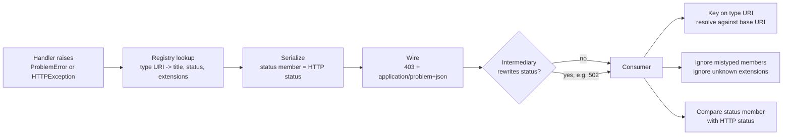

# Standardized Error Responses with Problem Details for HTTP APIs (RFC 9457 vs Obsoleted RFC 7807)

> [!summary] Claim
> A problem details object is a JSON object whose `type` URI, not its `title`, `detail`, or `status`, is the machine contract; the generator must make the `status` member equal the real HTTP status, and the consumer must ignore any member of the wrong JSON type instead of rejecting the document, which is exactly where JSON Schema validators, Python's `bool`-is-`int`, and framework plugins go wrong.

Part of [Bulk Long Running and Error Contracts](README.md) in [API Engineering](../README.md).

## TL;DR

- Mechanism: an error response carries `Content-Type: application/problem+json` and a JSON object with five optional standard members (`type`, `title`, `status`, `detail`, `instance`) plus extension members the problem type defines (RFC 9457 Sections 3.1 and 3.2).
- Contract: consumers key on `type` (absent means `about:blank`), must ignore unrecognized extensions and wrongly typed members, and generators must send the same status code in the HTTP response as in `status` (RFC 9457 Sections 3.1, 3.1.1, 3.1.2, 3.2).
- Trap: putting occurrence text in `title`, letting an extension overwrite `status`, echoing exception text or raw input into `detail`, and deriving the `about:blank` title from `http.HTTPStatus`, whose 422 phrase changed between CPython 3.12 and 3.13.
- Portability: RFC 9457 changed no wire byte relative to RFC 7807 (same media types, same members, XML namespace still `urn:ietf:rfc:7807`); the lab passes 65 of 65 tests on CPython 3.12.13, 3.13.18, 3.14.6, 3.14.10, 3.15.2, and free-threaded 3.14.6t and 3.15.0b3t.
- When not to use it: when the response is still a representation of the resource, when a plain status code already says everything, or when the API already has an error format such as `google.rpc.Status` (RFC 9457 Sections 1 and 4).

## Mental model



The handler never builds JSON by hand; it names a registered problem type, and the registry supplies the `title`, the status code, and the only extension names that occurrence may carry.
Serialization takes the HTTP status and the `status` member from the same field, so they cannot disagree when they leave the origin.
On the wire, generic HTTP software (caches, proxies, load balancers) acts on the HTTP status code and is unlikely to know of or respect the body's `status` member (RFC 9457 Sections 3.1.2 and 5).
An intermediary may still replace the status, so the consumer treats the body's `status` as advisory evidence of what the origin sent, keys behavior on the resolved `type` URI, and drops any member whose JSON type is wrong instead of failing the whole document (RFC 9457 Sections 3.1 and 5).

## How it works

### Wire layout

This is the exact response the lab's `POST /purchase` emits, captured from `httpx` `Response.headers.raw` and `Response.content` (CPython 3.14.6, macOS 27.2 arm64):

```text
POST /purchase -> 403
content-language: en
cache-control: no-store
content-length: 259
content-type: application/problem+json
{"type":"https://example.com/probs/out-of-credit","title":"You do not have enough credit.","status":403,"detail":"Your current balance is 30, but that costs 50.","instance":"/account/12345/msgs/abc","balance":30,"accounts":["/account/12345","/account/67890"]}
259 bytes
```

The body is the RFC 9457 Section 3 example plus an explicit `status`.
Starlette appends `; charset=utf-8` only to `text/` media types (starlette 1.10.0 starlette/responses.py, Response.init_headers), so `application/problem+json` goes out without a charset, which is correct because JSON text exchanged between systems that are not part of a closed ecosystem MUST be UTF-8 (RFC 8259 Section 8.1).
`application/problem+json` and `application/problem+xml` are registered to RFC 9457 in the IANA application media types registry (fetched 2026-11-10), and the `+json` structured syntax suffix lets generic code treat any `*/*+json` type as JSON (RFC 6839 Sections 2 and 3.1).

### The five standard members

| Member | JSON type | Rule | Section |
| --- | --- | --- | --- |
| `type` | string, URI reference | Primary identifier; absent means `about:blank`; resolve relative values against the document base URI; consumers SHOULD NOT dereference it automatically | RFC 9457 Section 3.1.1 |
| `status` | number | Advisory copy of the status; generators MUST use the same code in the HTTP response | RFC 9457 Section 3.1.2 |
| `title` | string | Short summary of the type; SHOULD NOT change between occurrences except for localization | RFC 9457 Section 3.1.3 |
| `detail` | string | Occurrence-specific, aimed at helping the client fix the problem; consumers SHOULD NOT parse it | RFC 9457 Section 3.1.4 |
| `instance` | string, URI reference | Identifies this occurrence; may be dereferenceable or an opaque identifier | RFC 9457 Section 3.1.5 |

RFC 9457 Section 3.1 adds a rule RFC 7807 did not have: "If a member's value type does not match the specified type, the member MUST be ignored -- i.e., processing will continue as if the member had not been present."
A consumer that rejects `{"type": 123, "title": "You do not have enough credit."}` is non-conformant; one that keeps the title and treats the type as `about:blank` is correct.

### What RFC 9457 changed relative to RFC 7807

RFC 9457 Appendix D lists exactly three changes:

1. a registry of common problem type URIs (Section 4.2), which IANA created with `about:blank` as its first entry;
2. guidance for multiple problems: when they do not share a type, "it is RECOMMENDED that the most relevant or urgent problem be represented in the response", and generic "batch" types "do not map well into HTTP semantics" (Section 3), replacing RFC 7807 Section 3's suggestion that `207 (Multi-Status)` could encapsulate disparate statuses;
3. guidance for type URIs that cannot be dereferenced, such as `tag:` URIs, plus the warning that switching from a non-resolvable to a resolvable URI later creates a new identity and is a breaking change (Section 3.1.1).

The rest of the diff, read side by side, is editorial but matters in practice:

- the "member of the wrong type MUST be ignored" sentence in Section 3.1 is new;
- the relative-URI paragraphs now show that `example-problem` resolves to different URIs under `/foo/bar/123` and `/widget/456`, and recommend absolute URIs or full paths such as `/types/123` (Sections 3.1.1 and 3.1.5);
- RFC 7807 Section 3.2's sentence that new "standard" members require a new media type is gone, and Section 3.2 now says extension names must fit the XML `Name` rule to survive the XML format;
- the validation example changed from `400 Bad Request` with an `invalid-params` extension of `name`/`reason` pairs to `422 Unprocessable Content` with an `errors` extension of `detail`/`pointer` pairs, where `pointer` is a JSON Pointer in URI fragment form such as `#/profile/color` (RFC 9457 Section 3, RFC 6901 Section 6);
- `invalid-params` itself breaks the extension naming SHOULD in both RFCs (ALPHA first, then ALPHA, DIGIT, or `_`, at least three characters), because it contains `-` (RFC 7807 Section 4, RFC 9457 Section 4).

Nothing changed on the wire: the media type names, the member names, and the XML namespace `urn:ietf:rfc:7807` are the same (RFC 9457 Appendix B), and the non-normative JSON Schema in Appendix A is still titled "An RFC 7807 problem object".
A 7807 producer is a valid 9457 producer; the lab parses the RFC 7807 Section 3 validation example under 9457 consumer rules unchanged.

### The registry and `about:blank`

The "HTTP Problem Types" registry policy is Specification Required, vendor-specific types cannot be registered, and registrations MAY use the prefix `https://iana.org/assignments/http-problem-types#` (RFC 9457 Section 4.2).
`about:blank` means "no semantics beyond the status code", and its `title` SHOULD be the recommended reason phrase, for example `Not Found` for `404` (RFC 9457 Section 4.2.1).
A new problem type MUST document a type URI, a title, and the status code it is used with (RFC 9457 Section 4).
The lab's `ProblemType` makes those three fields mandatory and turns the extension naming SHOULD into a construction error:

```python
@dataclass(frozen=True, slots=True)
class ProblemType:
    """What RFC 9457 Section 4 says a new problem type MUST document, plus its extensions."""

    uri: str
    title: str
    status: int
    extensions: frozenset[str] = frozenset()

    def __post_init__(self) -> None:
        if not urlsplit(self.uri).scheme:
            raise ValueError(f"problem type URI must be absolute: {self.uri!r}")
        if not self.title:
            raise ValueError("problem type needs a title")
        if not 100 <= self.status <= 599:
            raise ValueError(f"status out of range: {self.status}")
        for name in self.extensions:
            if name in STANDARD_MEMBERS:
                raise ValueError(f"extension shadows a standard member: {name!r}")
            if _EXTENSION_NAME.fullmatch(name) is None:
                raise ValueError(f"extension name is not ALPHA *(ALPHA / DIGIT / _): {name!r}")
```

### Generating: one source for the status

`render` takes the HTTP status and the `status` member from `problem.type.status`, so the RFC 9457 Section 3.1.2 MUST holds by construction; `Problem.__post_init__` rejects any extension the type did not declare, so no extension can shadow `status`:

```python
def render(problem: Problem, headers: Mapping[str, str] | None = None) -> Response:
    """HTTP status and the status member come from one field (RFC 9457 Section 3.1.2)."""
    body = json.dumps(problem.to_document(), separators=(",", ":"), ensure_ascii=True)
    merged = {"Content-Language": "en", "Cache-Control": "no-store", **(headers or {})}
    return Response(
        content=body.encode("ascii"),
        status_code=problem.type.status,
        media_type=PROBLEM_JSON,
        headers=merged,
    )
```

The FastAPI integration maps Starlette's `HTTPException` to `about:blank` and keeps its `headers`, which is what carries the `Allow` field that a `405` response MUST include (RFC 9110 Section 15.5.6); Starlette's router raises `HTTPException(status_code=405, headers={"Allow": ...})` inside an application (starlette 1.10.0 starlette/routing.py, Route.handle), which FastAPI reaches through `super().handle` (fastapi 0.162.0 fastapi/routing.py, APIRoute.handle); the lab's `DELETE /items/7` gets `Allow: GET`.
Starlette fills a missing `detail` from `http.client.responses` (starlette 1.10.0 starlette/exceptions.py, HTTPException.__init__), so the handler drops a `detail` that equals that default, because a reason phrase is not occurrence data:

```python
    @app.exception_handler(StarletteHTTPException)
    async def on_http_exception(request: Request, exc: StarletteHTTPException) -> Response:
        # Starlette fills a missing detail from http.client.responses; that is not occurrence data.
        auto_detail = http.client.responses.get(exc.status_code, "")
        detail = None if exc.detail == auto_detail else exc.detail
        return render(Problem(about_blank(exc.status_code), detail=detail), exc.headers)
```

An `Exception` handler is installed into `ServerErrorMiddleware`, not `ExceptionMiddleware` (fastapi 0.162.0 fastapi/applications.py, FastAPI.build_middleware_stack, which duplicates starlette 1.10.0 starlette/applications.py, Starlette.build_middleware_stack), and that middleware sends the handler's response and then re-raises, with the comment "This allows servers to log the error" (starlette 1.10.0 starlette/middleware/errors.py, ServerErrorMiddleware.__call__).
The lab's `500` problem therefore contains no exception text, and the exception still reaches the server log; a test with `httpx.ASGITransport(raise_app_exceptions=True)` sees the `RuntimeError` re-raised:

```python
    @app.exception_handler(Exception)
    async def on_unhandled(request: Request, exc: Exception) -> Response:
        # RFC 9457 Section 5: never put the exception text or a stack dump in the body.
        return render(Problem(about_blank(500)))
```

### Typed extension members and JSON Pointer

The `errors` extension follows the RFC 9457 Section 3 example: one problem type, many occurrences, each with `detail` and `pointer`.
JSON Pointer escapes `~` as `~0` and `/` as `~1` (RFC 6901 Section 3), and the URI fragment form then percent-encodes anything the RFC 3986 `fragment` rule does not allow (RFC 6901 Section 6):

```python
def json_pointer_fragment(path: Sequence[str | int]) -> str:
    """RFC 6901 Section 3 escaping, then Section 6 URI fragment percent-encoding."""
    tokens = (str(part).replace("~", "~0").replace("/", "~1") for part in path)
    return "#" + "".join("/" + quote(token, safe=_FRAGMENT_SAFE) for token in tokens)
```

The order of the two `replace` calls is the mechanism: escaping `/` first turns `a/b` into `a~1b` and then the `~` pass rewrites it to `a~01b`, which decodes to the key `a~1b`; the lab's mutation that flips the calls fails the `("a/b", "#/a~1b")` case.

### Consuming: lenient on members, strict on structure

```python
def _as_status(value: object) -> int | None:
    # JSON true decodes to a bool, which is an int equal to 1; the range check rejects it.
    if isinstance(value, int):
        return value if 100 <= value <= 599 else None
    if isinstance(value, float) and value.is_integer():
        return _as_status(int(value))
    return None


def _member(document: object, name: str) -> object:
    """Read one member of a decoded JSON object, or None when the value is not an object."""
    if isinstance(document, dict):
        return cast("dict[str, object]", document).get(name)
    return None


def parse_problem(body: bytes, *, base_uri: str, http_status: int) -> ParsedProblem:
    """Consumer rules: ignore mistyped members (RFC 9457 Section 3.1), default and resolve type."""
    loaded: object = json.loads(body, object_pairs_hook=_reject_duplicate_names)
    if not isinstance(loaded, dict):
        raise ProblemParseError("problem details must be a JSON object")
    # object_pairs_hook built every object, so keys are str.
    members = cast("dict[str, object]", loaded)
    ignored: list[str] = []

    def string_member(name: str) -> str | None:
        value = members.get(name)
        if value is None and name not in members:
            return None
        if isinstance(value, str):
            return value
        ignored.append(name)
        return None

    raw_type = string_member("type")
    raw_instance = string_member("instance")
    status: int | None = None
    if "status" in members:
        status = _as_status(members["status"])
        if status is None:
            ignored.append("status")
    return ParsedProblem(
        http_status=http_status,
        type=urljoin(base_uri, raw_type) if raw_type is not None else ABOUT_BLANK,
        title=string_member("title"),
        status=status,
        detail=string_member("detail"),
        instance=urljoin(base_uri, raw_instance) if raw_instance is not None else None,
        extensions={k: v for k, v in members.items() if k not in STANDARD_MEMBERS},
        ignored=tuple(ignored),
    )
```

Three decisions in that consumer are deliberate.
`status` accepts any JSON number that is an integral status code, so `404.0` is `404`, because RFC 9457 Section 3.1.2 says "JSON number" while the Appendix A schema says `integer`; JSON `true` decodes to Python `True`, which `isinstance(True, int)` accepts and which equals `1`, so only the 100 to 599 range check rejects it.
Duplicate member names raise, because RFC 8259 Section 4 says behavior with duplicate names is unpredictable and Python's `json.loads` silently keeps the last value, so `{"type": "https://example.com/probs/out-of-credit", "type": "about:blank"}` would otherwise change the problem type a log pipeline and a client see.
`type` and `instance` go through `urllib.parse.urljoin`, which implements RFC 3986 Section 5 resolution, and the lab reproduces both resolved URIs from RFC 9457 Section 3.1.1.

### What the frameworks do (as of 2026-11)

- FastAPI 0.162.0 has no problem details support (no `problem+json` string anywhere in the `fastapi` or `starlette` packages): `http_exception_handler` returns `{"detail": exc.detail}` as `application/json` for any status that allows a body, and `request_validation_exception_handler` returns `422` with `{"detail": exc.errors()}`, which includes each error's raw `input` (fastapi 0.162.0 fastapi/exception_handlers.py, http_exception_handler and request_validation_exception_handler); the lab asserts that `GET /items/not-an-int` echoes `"input": "not-an-int"`.
- Litestar 2.25.0 ships `ProblemDetailsPlugin` and `ProblemDetailsException`, which emit `application/problem+json` (litestar 2.25.0 litestar/plugins/problem_details.py, ProblemDetailsException.to_response).
  `to_response` builds the standard members first and then calls `problem_details.update(extra)`, so an `extra` key named `status` or `type` overwrites the standard member.
  With `enable_for_all_http_exceptions=True`, `_http_exception_to_problem_detail_exception` maps the exception's `detail` to `title` and leaves `detail` empty, and `HTTPException.__init__` then fills the empty `detail` with `HTTPStatus(status_code).phrase` (litestar 2.25.0 litestar/exceptions/http_exceptions.py, HTTPException.__init__).
  The lab captures `{"status":404,"title":"Item 7 does not exist","detail":"Not Found"}`: the per-occurrence text sits in the member that SHOULD NOT vary, and the generic phrase sits in the occurrence member.

## Numbers and limits

| Quantity | Value | Source |
| --- | --- | --- |
| Standard members | 5 (`type`, `status`, `title`, `detail`, `instance`) | RFC 9457 Section 3.1 |
| Fields a new problem type MUST document | 3 (type URI, title, status code) | RFC 9457 Section 4 |
| Extension member name | ALPHA first, then ALPHA, DIGIT, `_`; >= 3 characters (SHOULD) | RFC 9457 Section 4 |
| `status` range in the Appendix A schema | 100 to 599, `integer` (non-normative) | RFC 9457 Appendix A |
| Changes listed from RFC 7807 | 3 | RFC 9457 Appendix D |
| Publication | RFC 7807 March 2016; RFC 9457 July 2023 | RFC headers |
| IANA HTTP Problem Types entries | 6: `about:blank`, `#date` and `#ohttp-key` (both RFC 9458), three `#digest-*` types (IANA reference `RFC-ietf-httpapi-digest-fields-problem-types-06`, Sections 3.1 to 3.3); registry `updated` 2026-06-26 | IANA registry XML, fetched 2026-11-10 |
| Heuristically cacheable error codes in RFC 9110 | `404`, `405`, `410`, `414`, `501` | RFC 9110 Section 15.1 |
| Out-of-credit body | 259 bytes | lab capture, CPython 3.14.6, macOS 27.2 arm64 |
| `about:blank` `405` body | 64 bytes | same capture |
| Lab module | 65 tests, `65 passed in 0.36s` (warm runs ranged 0.24s to 0.36s; the first, cold run took 0.98s) | `uv run --frozen pytest ... -q`, CPython 3.14.6, macOS 27.2 arm64 (Darwin 27.2.0), fact-check run 2026-11-10 |
| Lab mutations | 22 applied, 22 killed (16 by the fact-check, 6 more by the finishing pass; HTTP status source, pointer escape order, fragment encoding, duplicate names, status range, mistyped members, `Allow` header, 500 leak, stdlib title, media type case, `Cache-Control`, absent-status mismatch, extension name length, Starlette auto detail, integral float, relative type resolution) | independent fact-check, each mutation applied alone and the source restored by checksum |

The suite duration is a smoke number for the test module, not a benchmark.
The heuristically cacheable list matters because `404` and `405` problem documents are reusable by a cache unless explicit cache controls say otherwise (RFC 9110 Section 15.1), which is why the lab sends `Cache-Control: no-store` on every problem response; the trade-off is that legitimate negative caching of `404` is lost, so an API with hot `404` paths should instead omit `instance` from those responses and allow caching.

## Portability

| Dimension | Result | Evidence |
| --- | --- | --- |
| CPython 3.12.13 | 65 passed; the phrase test takes its `< 3.13` branch | lab run, full `uv.lock` env, macOS 27.2 arm64 |
| CPython 3.13.18 | 65 passed | lab run, full `uv.lock` env |
| CPython 3.14.6 (workspace) and 3.14.10 | 65 passed on each | lab runs, full `uv.lock` env |
| CPython 3.15.2 | 65 passed | lab run, full `uv.lock` env |
| CPython 3.14.6t and 3.15.0b3t free-threaded, `sys._is_gil_enabled()` is `False` | 65 passed on each | venvs built from `uv export --frozen` with `--no-deps --only-binary :all:`, minus the locked packages that have no free-threaded wheel (`psycopg-binary`, `aioquic`, `pylsqpack`, `brotli`, `gevent`, `geventhttpclient`, `grpcio`, `orjson`; on 3.15.0b3t also `lupa`, `psutil`, and `pyyaml`, with `pyyaml==6.0.3` then built from its sdist and pytest run with `-p no:hypothesispytest`, because `hypothesis` has no native module there); none of those is imported by this lab |
| CPython 3.12.16 and 3.15.2t named in the matrix | not run | `uv python list --all-versions` here offers at most 3.12.13 and 3.15.0b3t |
| `http.HTTPStatus` phrases for 413, 414, 416, 422 | `Request Entity Too Large`, `Request-URI Too Long`, `Requested Range Not Satisfiable`, `Unprocessable Entity` on 3.12.13; `Content Too Large`, `URI Too Long`, `Range Not Satisfiable`, `Unprocessable Content` on 3.13.18, 3.14.6, 3.14.10, 3.15.0b3, 3.15.2, 3.14.6t, 3.15.0b3t; no other code differs between 3.12.13 and 3.13.18 | interpreter runs; Python docs: "Changed in version 3.13: Implemented RFC9110 naming for status constants" |
| `httpx` 0.28.1 reason phrase for 422 | `Unprocessable Entity` from its own table on every CPython, used only when the transport supplies no `reason_phrase` extension (for example `ASGITransport`); over HTTP/1.1 the server's phrase wins | httpx 0.28.1 httpx/_status_codes.py, codes.UNPROCESSABLE_ENTITY; httpx 0.28.1 httpx/_models.py, Response.reason_phrase |
| FastAPI 0.162.0, Starlette 1.10.0, Litestar 2.25.0 | behavior above pinned by tests | `test_fastapi_default_validation_error_is_not_problem_json`, `test_litestar_plugin_puts_occurrence_detail_in_title`, `test_litestar_extra_overwrites_status_member` |
| Uvicorn 0.54.0, Hypercorn 0.18.0, Granian 2.8.7 | identical bytes: `403`, `application/problem+json`, `Cache-Control: no-store`, the same 259-byte body; `405` with `Allow: GET` and the same 64-byte body | fact-check run over `127.0.0.1` sockets with `httpx.Client`, HTTP/1.1, CPython 3.14.6, macOS 27.2 arm64; not in the lab module, which uses `ASGITransport` only |
| Debian Trixie and Alpine musl containers | not run | no container leg was run for this note |
| HTTP/1.1 | status line carries a reason phrase that a client SHOULD ignore; in the run above Uvicorn and Granian sent `Forbidden` and Hypercorn sent an empty phrase | RFC 9112 Section 4; hypercorn 0.18.0 hypercorn/protocol/h11.py, H11Protocol.stream_send builds `h11.Response` without `reason`, whose default is `b""` (h11 0.16.0 h11/_events.py, _ResponseBase.__init__) |
| HTTP/2 | `:status` carries only the status code; RFC 9113 defines no reason phrase field | RFC 9113 Section 8.3.2 |
| HTTP/3 over QUIC | `:status` only; "HTTP/3 does not define a way to carry the version or reason phrase" | RFC 9114 Section 4.3.2 |
| RFC 7807 -> RFC 9457 | same media types, members, and XML namespace | RFC 9457 Appendices B and D |

The HTTP/2 and HTTP/3 rows are why the `about:blank` `title` is not redundant: above HTTP/1.1 it is the only place a human-readable phrase survives, so it must not depend on the interpreter that rendered it.

## Worked example

[implementation](../labs/src/api_labs/f06_bulk_long_running_and_error_contracts/problem_details.py) and [test](../labs/tests/f06_bulk_long_running_and_error_contracts/test_problem_details_for_http_apis_rfc_9457.py).

The out-of-credit test reproduces RFC 9457 Section 3 end to end; it sends only `Accept: application/json` (the RFC's out-of-credit request also lists `application/problem+json`) and receives `application/problem+json`, which RFC 9457 Section 3 notes, for its validation example, is allowed by RFC 9110 Section 12.5.1:

```python
@pytest.mark.unit
@pytest.mark.asyncio
async def test_out_of_credit_matches_rfc_9457_section_3_example() -> None:
    async with lab_client() as client:
        response = await client.post(
            "/purchase",
            json={"item": 123456, "quantity": 2},
            headers={"Accept": "application/json"},
        )

    assert response.status_code == 403
    assert response.headers["content-type"] == PROBLEM_JSON
    assert response.headers["content-language"] == "en"
    body = response.json()
    assert body == {**RFC_OUT_OF_CREDIT, "status": 403}
    assert body["status"] == response.status_code
    assert list(body)[:3] == ["type", "title", "status"]
```

The Litestar test shows the overwrite and how the consumer detects it:

```python
@pytest.mark.unit
@pytest.mark.asyncio
async def test_litestar_extra_overwrites_status_member() -> None:
    async with litestar_client() as client:
        response = await client.get("/credit")

    assert response.status_code == 403
    assert response.json()["status"] == 200
    parsed = parse_problem(response.content, base_uri="http://test/", http_status=403)
    assert parsed.status_mismatch is True
```

Run from `labs/` on CPython 3.14.6, macOS 27.2 arm64:

```text
$ uv run --frozen pytest tests/f06_bulk_long_running_and_error_contracts/test_problem_details_for_http_apis_rfc_9457.py -q
.................................................................        [100%]
65 passed in 0.36s
```

## Pitfalls

> [!warning] Occurrence text in `title`
> Trigger: an adapter maps an exception message to `title`, as Litestar 2.25.0's `_http_exception_to_problem_detail_exception` does with `enable_for_all_http_exceptions=True`.
> Symptom: `title` is `Item 7 does not exist` and `detail` is `Not Found`; dashboards and alerts grouped by `title` grow one series per item ID.
> Fix: put the message in `detail`, keep `title` fixed per `type` (RFC 9457 Section 3.1.3), or pass a custom `exception_to_problem_detail_map`.

> [!warning] An extension overwrites `status` or `type`
> Trigger: merging a caller-supplied mapping after the standard members, as `ProblemDetailsException.to_response` does with `extra`.
> Symptom: HTTP `403` with body `"status": 200`; a consumer that trusts the body retries or caches a failure as success.
> Fix: reject extension names that collide with standard members at type-definition time, as `ProblemType.__post_init__` and `Problem.__post_init__` do.

> [!warning] The `about:blank` title depends on the interpreter
> Trigger: `title = http.HTTPStatus(code).phrase` or Starlette's default `detail`, which reads `http.client.responses`.
> Symptom: the same `422` has `title` `Unprocessable Entity` on CPython 3.12 and `Unprocessable Content` on 3.13 and later; snapshot tests and log queries break during an interpreter upgrade.
> Fix: pin the RFC 9110 Section 15 phrases in a table, as `RFC9110_PHRASES` does; the lab's monkeypatch test proves the title never reads the stdlib table for a code the pinned table covers, while codes outside it, such as `429`, still fall back to `http.client.responses`.

> [!warning] Clients that match `application/json` exactly
> Trigger: `if response.headers["content-type"] == "application/json"` in an SDK.
> Symptom: every problem response is treated as an opaque failure and its `type` is never read.
> Fix: parse the media type, lowercase it, and accept the `+json` suffix (RFC 6839 Section 3.1), as `is_json_media_type` does.

> [!warning] JSON Schema as the consumer
> Trigger: validating every error body against the RFC 9457 Appendix A schema and discarding failures.
> Symptom: a body with `"status": 600` or `"type": 123` is dropped entirely, losing a valid `title` and extensions.
> Fix: the schema is non-normative and "the latter prevails" (RFC 9457 Appendix A); apply Section 3.1 member-by-member ignoring instead, as the lab's Appendix A test shows.

> [!warning] Adopting the problem format can turn exception messages into response bodies
> Trigger: API Platform Core 3.2.0 to 3.2.4 handled more exception types itself so that its errors would follow the RFC 7807 format, and its normalizers then serialized exceptions that Symfony had previously hidden (GitHub advisory GHSA-rfw5-cqjj-7v9r, CVE-2023-47639, published 2025-04-03).
> Symptom: the advisory says the exception message of a non-HTTP exception appears in the JSON error response while the stack trace stays hidden in production; its proof of concept makes an LDAP server unreachable and reads the resulting authentication error message from the response; NVD classifies it as CWE-209 and the advisory scores it CVSS 3.1 5.3 (Moderate).
> Fix: upgrade to 3.2.5; in any framework, emit the generic `about:blank` phrase for `5xx` and log the exception server-side, as the lab's `500` handler does.
> The advisory does not name the media type; API Platform's error documentation says its default JSON errors are `application/problem+json` when `rfc_7807_compliant_errors` is enabled, and that for `5xx` the message is shown only in debug mode (https://api-platform.com/docs/core/errors/, fetched 2026-11-10).
> The bug is in what the implementation put into the body, not in the RFC 7807 or RFC 9457 format.

## Security and robustness

- Information disclosure: RFC 9457 Section 5 warns against exposing stack dumps or implementation internals; OWASP API Security 2023 API8 (Security Misconfiguration) lists "Error messages include stack traces, or expose other sensitive information", and CWE-209 names the weakness.
  The lab's `500` handler emits only `about:blank` and the phrase, and a test asserts the connection string in the exception never reaches the body.
- Input reflection: FastAPI's default `422` body includes each validation error's raw `input`; a password or token that fails validation is echoed back and lands in client logs and proxies.
  The mapping in [[Mapping-Pydantic-Validation-Errors-to-RFC-9457-Problem-Details]] has to drop `input`, not just rename fields.
- Status disagreement: RFC 9457 Section 5 says the relative precedence of `status` and the HTTP status "is not clear"; generic software (proxies, load balancers, firewalls) uses only the HTTP status, so retry and circuit-breaker logic must key on the HTTP status and treat a mismatch as a signal, which `ParsedProblem.status_mismatch` exposes.
- Type URI dereferencing: consumers SHOULD NOT dereference `type` automatically (RFC 9457 Section 3.1.1); a client that fetches it turns every error into an outbound request to an attacker-chosen URL when the response came from a malicious or compromised server.
- Duplicate names: reject them before trusting any member (RFC 8259 Section 4), because two parsers in one path (a gateway and a client) may pick different values.
- Caching: `404`, `405`, and `410` are heuristically cacheable (RFC 9110 Section 15.1), and OWASP API8 also lists missing cache control directives; an `instance` or request ID inside a cached problem leaks one user's occurrence identifier to the next.
- Resource bounds: the `errors` array is attacker-sized when every invalid field produces an entry; cap the number of entries and say so in an extension, since an unbounded list is an amplification of request size into response size.

## The principal's view

The decision is not "RFC 9457 or not"; it is who owns the problem type namespace.
A `type` URI is a public API identifier with the same compatibility weight as a resource path: renaming one, or moving from a `tag:` URI to a resolvable one, is a breaking change (RFC 9457 Section 3.1.1).
At organizational scale that means a registry with one owner per URI, required documentation at the URI (RFC 9457 Section 4 says it SHOULD resolve to HTML), a review step for new extension members, and a ban on per-team ad hoc URIs; the lab's `ProblemRegistry` refusing a second owner is the code-level form of that policy.
The organizational trade-off is speed: teams can no longer invent an error shape in an afternoon, and in exchange every client gets one parser, one retry classifier, and one dashboard dimension (`type`).
Choose `about:blank` for anything a status code already explains, since truly generic problems "are usually better expressed as plain status codes" (RFC 9457 Section 4), and mint a type only when a client can act differently on it.
Choose a different format when the platform is gRPC-first: `google.rpc.Status` with typed details is the native model there, covered in [[Google-AIP-193-Error-Model-and-Rich-Error-Details]], and an HTTP gateway should translate one into the other rather than nest both.
For a batch where items fail for different reasons, RFC 9457 now says to report the most relevant problem rather than invent a batch problem type; per-item results belong to the batch response contract in [[Atomic-vs-Partial-Batch-Execution-and-207-Multi-Status]].

## Interview questions

> [!question] L5: When a response has no `type` member, what problem type is it and what should its `title` be?
>
> > [!success]- Answer
> > It is `about:blank`, because an absent `type` is assumed to be `about:blank` (RFC 9457 Section 3.1.1).
> > `about:blank` means the problem has no semantics beyond the status code, and the `title` SHOULD be the status code's recommended reason phrase, such as `Not Found` (RFC 9457 Section 4.2.1).
> >
> > Follow-up: Why would deriving that title from `http.HTTPStatus` give different answers on CPython 3.12 and 3.13 for a `422`?

> [!question] L5: What did RFC 9457 change on the wire compared with RFC 7807?
>
> > [!success]- Answer
> > Nothing on the wire: the media types, member names, and the XML namespace `urn:ietf:rfc:7807` are unchanged.
> > Appendix D lists a problem type registry, guidance to report the most relevant problem when several types occur, and guidance on non-dereferenceable type URIs.
> > Section 3.1 also adds that a member of the wrong JSON type MUST be ignored.
> >
> > Follow-up: Which example extension in RFC 7807 breaks RFC 7807's own naming SHOULD, and why?

> [!question] L5: Predict the output: what `type`, `title`, `status`, and `ignored` does `parse_problem(b'{"status": true, "title": 5, "type": "/types/gone"}', base_uri="https://api.example.org/v1/items/7", http_status=410)` return?
>
> > [!success]- Answer
> > `type` is `https://api.example.org/types/gone`, because a full-path relative reference replaces the whole path of the base URI (RFC 3986 Section 5).
> > `title` is `None` and `status` is `None`, and `ignored` is `('status', 'title')`, in the order the consumer checks them.
> > `true` decodes to Python `True`, which passes `isinstance(value, int)` but equals `1`, so the range check rejects it.
> > `status_mismatch` is `False` because there is no valid `status` to compare.
> >
> > Follow-up: What would a JSON Schema validator using Appendix A do with the same body, and which behavior does RFC 9457 require?

> [!question] L6: The HTTP status is `502` but the body says `"status": 403`. Which do you trust, and what do you do?
>
> > [!success]- Answer
> > Generic HTTP behavior (retries, caching, circuit breakers) keys on the HTTP status, because that is what every intermediary acted on (RFC 9457 Section 3.1.2).
> > The mismatch is evidence that something between the origin and the client replaced the status, such as a gateway or cache (RFC 9457 Section 5).
> > Log the mismatch as a signal, keep the `type` for application handling, and do not let the body status downgrade a `5xx` into a non-retryable `4xx` without policy.
> >
> > Follow-up: How would you make it impossible for your own origin to emit a mismatch?

> [!question] L6: Debug this API: a Litestar service with `ProblemDetailsPlugin(ProblemDetailsConfig(enable_for_all_http_exceptions=True))` raises `NotFoundException(detail="Item 7 does not exist")`, and the alerting team's "errors by title" panel has 40,000 series, so what is wrong?
>
> > [!success]- Answer
> > Litestar 2.25.0's adapter maps the exception `detail` to `title`, and `HTTPException.__init__` fills the now empty `detail` with the status phrase.
> > The body is `{"status":404,"title":"Item 7 does not exist","detail":"Not Found"}`, so `title` carries per-occurrence text, which RFC 9457 Section 3.1.3 says SHOULD NOT change between occurrences.
> > Fix it by supplying an `exception_to_problem_detail_map` that puts the message in `detail` and a fixed `title`, and group dashboards by `type` rather than `title`.
> >
> > Follow-up: The same plugin merges `extra` after the standard members; what can a caller break with `extra={"status": 200}`?

> [!question] L6: Two endpoints return `"type": "example-problem"`. Are they the same problem type?
>
> > [!success]- Answer
> > Not necessarily: relative references resolve against each document's base URI, so `/foo/bar/123` yields `https://api.example.org/foo/bar/example-problem` and `/widget/456` yields `https://api.example.org/widget/example-problem` (RFC 9457 Section 3.1.1).
> > RFC 9457 recommends absolute type URIs, or relative ones that include the full path such as `/types/123`.
> >
> > Follow-up: Why is changing a `tag:` type URI to an `https:` one a breaking change even if the meaning is the same?

> [!question] L6: Why does an `errors[]` entry use `"pointer": "#/profile/color"` rather than `"field": "profile.color"`, and how is a key containing `/` encoded?
>
> > [!success]- Answer
> > The RFC 9457 Section 3 example uses a JSON Pointer in URI fragment form (RFC 6901 Section 6), which addresses any position in the request document unambiguously, including array indexes.
> > Inside a reference token, `~` becomes `~0` and `/` becomes `~1`, in that order (RFC 6901 Section 3), and then characters outside the URI fragment rule are percent-encoded, so `a/b` is `#/a~1b` and `c%d` is `#/c%25d`.
> > A dotted path is ambiguous for keys containing `.` and has no standard escaping.
> >
> > Follow-up: What breaks if you escape `/` before `~`?

> [!question] L7+: How do you govern problem types when you own the error contracts for 200 services?
>
> > [!success]- Answer
> > Treat `type` URIs as public identifiers with one owner each, documented at a resolvable URL, with the type URI, title, and status that RFC 9457 Section 4 requires.
> > Run a registry that refuses a second owner, reviews extension names against the Section 4 naming rule, and rejects names that shadow standard members.
> > Mint a type only when a client can act differently on it, and use `about:blank` otherwise, since generic conditions are better expressed as plain status codes (RFC 9457 Section 4).
> > The cost is slower error design per team; the return is one client parser, one retry classifier, and a stable dashboard key.
> >
> > Follow-up: When would you register a type with IANA instead of under your own domain?

> [!question] L7+: For a platform that serves both gRPC and HTTP JSON clients, do you use RFC 9457, `google.rpc.Status`, or both?
>
> > [!success]- Answer
> > Use the native model on each surface: `google.rpc.Status` with typed details on gRPC, and problem details on HTTP, with a gateway that maps one to the other in a single documented table.
> > RFC 9457 Section 4 itself says problem details are not meant to replace an existing domain-specific error format.
> > Nesting a serialized `Status` inside a problem object gives clients two contracts to parse and two places for the status to disagree.
> >
> > Follow-up: Which RFC 9457 member carries the information of `ErrorInfo.reason`, and what is lost in translation?

> [!question] L7+: When a batch request fails with a quota error on item 3 and a validation error on item 7, what does RFC 9457 recommend, and what changed from RFC 7807?
>
> > [!success]- Answer
> > RFC 9457 Section 3 recommends representing the most relevant or urgent problem, and says generic batch problem types do not map well into HTTP semantics.
> > RFC 7807 Section 3 had suggested `207 (Multi-Status)` to encapsulate disparate statuses; RFC 9457 removed that suggestion.
> > If clients need per-item outcomes, that is the batch response contract, not the problem details object.
> >
> > Follow-up: Which status would you choose for the whole response if you report only the quota problem, and what header might the type definition require?

## Related

Prerequisites: [[Streaming-Exports-and-NDJSON-for-Unbounded-Collections]]

Next: [[Google-AIP-193-Error-Model-and-Rich-Error-Details]]

See also: [[API-Fundamentals]], [[02-Programming-Languages/Python/Python-Backend-Interview-Prep/04-FastAPI]], [[02-Programming-Languages/Python/Python-Backend-Interview-Prep/05-REST-API-Design]], [[HTTP-Status-Code-Taxonomy-and-Selection-Decision-Trees]], [[Content-Negotiation-Media-Types-and-Charsets]], [[Mapping-Pydantic-Validation-Errors-to-RFC-9457-Problem-Details]], [[Error-Taxonomy-Retryability-and-Client-Contract-Design]], [[Atomic-vs-Partial-Batch-Execution-and-207-Multi-Status]], [[Partial-Updates-JSON-Merge-Patch-RFC-7396-vs-JSON-Patch-RFC-6902]], [[HTTP-Caching-Architecture-Private-Shared-and-Gateway-Caches]], [[Protocol-Design-Over-HTTP-BCP-56-RFC-9205]]

- Lab: `labs/tests/f06_bulk_long_running_and_error_contracts/test_problem_details_for_http_apis_rfc_9457.py`

## Further reading

- [RFC 9457](https://www.rfc-editor.org/rfc/rfc9457.html): the current specification; Section 3.1 for member rules, Section 4 for defining types, Appendix D for the diff from RFC 7807.
- [RFC 7807](https://www.rfc-editor.org/rfc/rfc7807.html): the obsoleted original, worth reading side by side to see the `207` advice and the `invalid-params` example that 9457 replaced.
- [IANA HTTP Problem Types registry](https://www.iana.org/assignments/http-problem-types/http-problem-types.xml): the registered types and the request process.
- [RFC 9110 Section 15](https://www.rfc-editor.org/rfc/rfc9110.html): status code semantics, reason phrases, and the heuristically cacheable list.
- [RFC 6901](https://www.rfc-editor.org/rfc/rfc6901.html): JSON Pointer syntax and its URI fragment representation used by `pointer`.
- [RFC 8259 Section 4](https://www.rfc-editor.org/rfc/rfc8259.html): why duplicate member names make JSON objects non-interoperable.
- [RFC 6839 Section 3.1](https://www.rfc-editor.org/rfc/rfc6839.html): the `+json` suffix that lets generic code recognize `application/problem+json`.
- [Python `http` module documentation](https://docs.python.org/3/library/http.html): the 3.13 change to RFC 9110 status names and phrases.
- [GHSA-rfw5-cqjj-7v9r (CVE-2023-47639)](https://github.com/api-platform/core/security/advisories/GHSA-rfw5-cqjj-7v9r): the advisory for exception messages leaking into an RFC 7807 style error body.
- [OWASP API Security 2023 API8](https://owasp.org/API-Security/editions/2023/en/0xa8-security-misconfiguration/): error messages and cache directives as misconfiguration risks.
