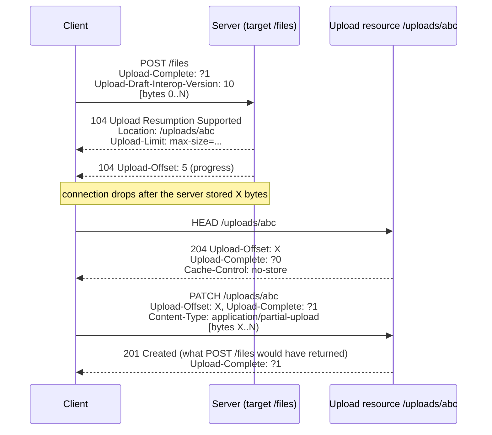

# Resumable Uploads for HTTP: Upload Creation, Offset Recovery, and Appending Chunks (draft-ietf-httpbis-resumable-upload-15)

> [!summary] Claim
> A resumable upload turns one fragile request into a temporary upload resource whose `Upload-Offset` only grows, so a client that loses its connection asks `HEAD` how many bytes the server kept and sends the rest with `PATCH`; it works only if the server persists bytes as they arrive, preempts the stale request before answering, and enforces the declared length, and the `104` interim response that makes it transparent has no ASGI message, so no app behind Uvicorn, Hypercorn, or Granian can send a `104` and then a final response.

Part of [Bulk Long Running and Error Contracts](README.md) in [API Engineering](../README.md).

## TL;DR

Mechanism: any request with content plus `Upload-Complete` may create an upload resource, announced by a `104 (Upload Resumption Supported)` interim response with `Location`; after an interruption the client sends `HEAD` to read `Upload-Offset` and appends the remainder with `PATCH` and `Content-Type: application/partial-upload` (draft-15 Sections 6, 7, 8).
Contract rule: the offset seen by the client MUST NOT decrease, a mismatched `Upload-Offset` MUST get `409` with the correct offset, and a server that knows the length MUST reject and deactivate an append that would pass it (draft-15 Sections 4.1, 8.2).
Trap: a handler that calls `await request.body()` stores nothing until the whole body arrives, so an interruption leaves offset `0` and resumption buys nothing; and a server that only locks the resource leaves the client waiting on the hung request it gave up on (draft-15 Section 10).
Portability: ASGI has no extension for arbitrary 1xx responses, CPython `http.client` returns a `104` as if it were the final response, and `httpcore 1.0.9` silently discards it, so in Python the safe default is "careful" creation with an empty `POST` (draft-15 Section 17.2).
When not to use it: skip it for bodies a single request reliably carries, for uploads you can send straight to object storage with a presigned multipart API, and anywhere you cannot afford per-upload server state; and remember draft-15 is still an Internet-Draft (as of 2026-11), with interop version `10`.

## Mental model



The client starts an ordinary `POST` and adds `Upload-Complete: ?1`, which invites the server to make it resumable without changing anything else about the request (draft-15 Section 17.1.1).
The server answers with a `104` that names the upload resource before it has read the body, then optionally sends more `104` responses carrying the offset it has processed so far.
When the connection drops, the only thing the client must remember is the `Location`; it asks the upload resource for the offset with `HEAD`, which may be lower than what it sent because transport delivery is not application processing (draft-15 Section 4.1).
The final `PATCH` carries the tail and `Upload-Complete: ?1`, and its response is the one the original `POST` would have produced, marked `Upload-Complete: ?1` so the client can tell a processing error from a protocol error (draft-15 Section 8.2).

## How it works

### The upload resource and its three properties

An upload resource is a temporary resource "specific to the upload of one representation", and the server persists its state: offset, completeness, and length (draft-15 Section 4).
The offset is "the number of bytes from the representation data that have been processed", it "MUST NOT decrease", and a server that loses any part of the state "MUST deactivate the upload resource" (draft-15 Section 4.1).
Completeness is explicit: an upload is incomplete until a request with `Upload-Complete: ?1` is fully processed or a response sets it, and offset equal to length does not by itself complete anything (draft-15 Sections 4.2 and 4.3).
The length is optional at the start; it comes from `Upload-Length` or from `Upload-Complete: ?1` plus the content length, the two MUST match, the length MUST stay consistent across requests, and a server SHOULD answer inconsistency with `400` and can use problem type `https://iana.org/assignments/http-problem-types#inconsistent-upload-length` (draft-15 Sections 4.3 and 14.2).
The URI SHOULD be unique and not reused for a different upload, and a client is not expected to follow a `3xx` from the upload resource because the protocol does not define continuing at another URI (draft-15 Section 4).

### Wire format: four Structured Fields

| Field | Structured type | Rule |
|---|---|---|
| `Upload-Offset` | Item, Integer, non-negative | other values make the whole field ignored; unknown parameters ignored (draft-15 Section 4.1.1) |
| `Upload-Complete` | Item, Boolean | `?1` or `?0`; anything else is ignored (draft-15 Section 4.2.1) |
| `Upload-Length` | Item, Integer, non-negative | same as `Upload-Offset` (draft-15 Section 4.3.1) |
| `Upload-Limit` | Dictionary | unknown keys ignored; an invalid known member voids the field or the message (draft-15 Section 5.1) |
| `Upload-Draft-Interop-Version` | Integer | `10` for draft-15; draft-only, removed at RFC (draft-15 Appendix B) |

An sf-integer has at most fifteen digits, range `-999,999,999,999,999` to `999,999,999,999,999` `(RFC 9651 Section 3.3.1)`, and the parser fails on a sixteenth digit `(RFC 9651 Section 4.2.4)`.
A Boolean is `?` followed by `1` or `0` `(RFC 9651 Section 4.2.8)`; in a Dictionary a bare key means `true` `(RFC 9651 Section 3.3.6)`.
Before parsing, all field lines with the same name are joined with commas, so two `Upload-Offset` lines become `5, 7`, which is not an Item and fails; on failure the field "MUST be ignored" or the message treated as malformed `(RFC 9651 Section 4.2)`.
A Dictionary keeps the last value of a duplicated key `(RFC 9651 Section 4.2.2)`, and keys must start with a lowercase letter or `*` `(RFC 9651 Section 4.2.3.3)`, so `Max-Size=10` is a parse failure, not an unknown key.
In Python, `bool` is a subclass of `int`, so a parser that checks `isinstance(item, int)` accepts `Upload-Offset: ?1` as offset `1`; the lab checks `type(item) is int`, and three lab tests fail when that check is replaced with `isinstance`.
A Byte Sequence such as `:a:` uses only base64 characters and still cannot be decoded, and a decoding failure is a parse failure `(RFC 9651 Section 4.2.7)`, so the lab turns `binascii.Error` into its parse error instead of letting `Upload-Offset: :a:` surface as a `500`.
It decodes with `base64.b64decode(..., validate=True)` after adding missing padding, because the lenient mode accepts `aGk=aGk=` on CPython `3.12.13` and `3.12.16` and rejects it on `3.13.18`, `3.14.10`, and `3.15.2`, while strict mode gave the same answers on all of them.

`Upload-Limit` defines `max-size` (> 0), `min-size` (>= 0, <= `max-size`), `max-append-size` (> 0), `min-append-size` (>= 0, <= `max-append-size` and `max-size`), and `max-age` (remaining lifetime in seconds) (draft-15 Sections 5.1.1 to 5.1.5).
In an `OPTIONS` response the field's presence signals support, an empty Dictionary is the same as no field, so a server with no limits "MUST send min-size=0" (draft-15 Section 5.2).
Limits SHOULD NOT tighten during an upload: `max-size` and `max-append-size` SHOULD NOT decrease, the minimums SHOULD NOT increase, and the end of life implied by `max-age` SHOULD NOT move earlier (draft-15 Section 5.3).

### Upload creation (Section 6)

Any method that allows content can create an upload, such as `POST`, `PUT`, or `PATCH`, by adding `Upload-Complete` (draft-15 Section 6.1).
When the server chooses to offer resumption it SHOULD send a `104` unless it cannot send interim responses, that `104` MUST carry `Location` and, if it has limits, `Upload-Limit`, and while processing it SHOULD send further `104` responses with `Upload-Offset` (draft-15 Section 6.2).
With `Upload-Complete: ?0` and fully processed content the server MUST return `Location` and `Upload-Limit`, RECOMMENDED with `201`; with `?1`, any `2xx` MUST mark the upload complete (draft-15 Section 6.2).
Every response to the same request that names the upload resource MUST use the same URI, and the client SHOULD stop and cancel if it changes (draft-15 Section 6.2).
An interrupted creation SHOULD keep as much content as possible, and the resource MUST NOT be considered complete (draft-15 Section 6.2).
Example D in Section 6.3 is the instructive one: a `400` with `Upload-Complete: ?1` after a gzip decoding failure means the server "considers the upload complete" and the client "cannot continue the upload" (draft-15 Section 6.3).

The draft defines two client strategies (draft-15 Section 17).
Optimistic creation sends the whole body in the first request and relies on the `104` to learn the URI; if the interruption comes before the `104`, or an intermediary drops it, the client cannot resume (draft-15 Section 17.1).
Careful creation sends an empty `POST` with `Upload-Complete: ?0`, gets `201` with `Location`, and then appends; it costs a round trip and is the recommended choice when the client "cannot receive interim responses" (draft-15 Section 17.2).

### Offset retrieval (Section 7)

The client sends `HEAD` (RECOMMENDED) or `GET`; a successful response MUST include `Upload-Offset`, MUST include `Upload-Limit` if there are limits, and SHOULD include `Cache-Control: no-store` (draft-15 Sections 7.1 and 7.2).
The offset may be lower than what the client sent, and the client is "expected to handle backtracking of a reasonable length"; if it cannot supply bytes from that offset, the upload "MUST be considered a failure" and the client SHOULD cancel (draft-15 Section 7.1).
The client MUST NOT retrieve the offset while it is still creating or appending to the same upload resource, "because the server might terminate the in-progress request" (draft-15 Section 7.1).

### Upload append (Section 8)

`PATCH` with `Content-Type: application/partial-upload` appends the patch document; the request MUST carry `Upload-Offset` and `Upload-Complete` and MUST NOT carry `Content-Encoding`, because codings are fixed at creation and offsets count the coded bytes (draft-15 Sections 8.1 and 15).
A server answers a missing or invalid `Upload-Offset` or `Upload-Complete` with `400` (SHOULD), a `Content-Encoding` with `415` and `Upload-Complete: ?0` (SHOULD), and a mismatched offset with `409`, `Upload-Complete: ?0`, and the correct `Upload-Offset` (MUST), optionally as problem type `#mismatching-upload-offset` with `expected-offset` and `provided-offset` members (draft-15 Sections 8.2 and 14.1).
The lab answers a wrong media type with `415` and `Accept-Patch: application/partial-upload`, which is the generic `PATCH` rule for an unsupported patch document `(RFC 5789 Section 2.2)`, not a draft-15 requirement.
"If the representation's length is known, the server MUST NOT let the offset exceed it", MUST reject the request, deactivate the resource, and refuse further interaction, and relying on `Content-Length` alone "is not sufficient" because the field "might not be present", as in a chunked request (draft-15 Section 8.2).
An interrupted append SHOULD keep a contiguous prefix "starting at its beginning and without discontinuities" (draft-15 Section 8.2).
A completed upload can still receive an append after a lost final response; the server "can choose to replay the final response" (draft-15 Section 8.2).
The `104` responses during an append carry `Upload-Offset` and MUST NOT include `Location` (draft-15 Section 8.2).

### Cancellation, concurrency, and retry (Sections 9 to 11)

`DELETE` on the upload resource SHOULD deactivate it and SHOULD first terminate in-flight requests to it (draft-15 Section 9.2).
The protocol has no parallel appends: the client MUST NOT send an append while another creation or append for the same resource is in progress (draft-15 Section 10).
Because a client may see a request as failed while the server still reads it, the server "MUST take measures to prevent race conditions, data loss, and corruption" and "MUST NOT send outdated information" (draft-15 Section 10).
The RECOMMENDED approach is to terminate the previous request before processing a new `HEAD`, `PATCH`, or `DELETE`; an access lock alone is allowed but can block the client for as long as the server takes to time out the hung request (draft-15 Section 10).
Cancellation of an in-flight transfer is version-specific: close the connection on HTTP/1.1, `RST_STREAM` on HTTP/2, abruptly terminate the request stream on HTTP/3 (draft-15 Section 19, citing `(RFC 9112 Section 9.5)`, `(RFC 9113 Section 6.4)`, and `(RFC 9114 Section 4.1.1)`).
Retry heuristics for a final response without `Upload-Complete: ?1`: `409` resumes at the given offset, `413` resumes after applying limits, `429` retries after a delay, `5xx` retries, and no response at all triggers an offset retrieval; retries SHOULD be bounded and followed by a `DELETE` (draft-15 Section 11).

### The 104 status and the interop version

`104` is a suggested value, not yet registered (draft-15 Section 21.2).
A client MAY treat a `104` as satisfying `Expect: 100-continue`, but the server MUST NOT skip the `100 (Continue)` because it sent a `104` (draft-15 Section 12); see [[100-Continue-Expect-Header-and-Large-Upload-Admission]].
Like every 1xx, a `104` MUST NOT go to an HTTP/1.0 client, and every client MUST be able to parse unexpected 1xx responses `(RFC 9110 Section 15.2)`.
While the document is a draft, clients MUST send `Upload-Draft-Interop-Version: 10`, servers MUST NOT send a `104` when it is missing or different and MUST echo it in the `104`, and clients MUST ignore a `104` with a missing or different version, so that final-RFC implementations never accidentally interoperate with drafts (draft-15 Appendix B).

### tus 1.0.0 versus draft-15

The draft's acknowledgments say tus v1 "inspired the early design of this protocol" (draft-15 Acknowledgments), and its change log starts from `draft-tus-httpbis-resumable-uploads-protocol-00` (draft-15 Appendix A).

| Aspect | tus 1.0.0 (2016-03-25) | draft-15 (2026-11-02) |
|---|---|---|
| Version negotiation | `Tus-Resumable: 1.0.0` on every request and response except `OPTIONS`; mismatch -> `412` with `Tus-Version` | `Upload-Draft-Interop-Version: 10` while a draft; nothing after RFC |
| Creation | Creation extension: `POST` with `Upload-Length` or `Upload-Defer-Length: 1` -> `201` + `Location` | Any content-bearing method with `Upload-Complete`; `104` announces `Location` early |
| Append media type | `application/offset+octet-stream`, else `415` (SHOULD) | `application/partial-upload` |
| Append success | `204` + new `Upload-Offset` (MUST) | `2xx` + `Upload-Complete: ?0`, or the target resource's own response when `?1` |
| Offset mismatch | `409`, resource unmodified | `409` + correct `Upload-Offset` + optional problem details |
| Completion signal | no completion field; the size comes from `Upload-Length` or is deferred | explicit `Upload-Complete: ?1` |
| Size limit | `Tus-Max-Size`; `413` on creation | `Upload-Limit` dictionary with five members |
| Parallelism | Concatenation extension | none (draft-15 Section 10) |
| Integrity | Checksum extension, `Upload-Checksum`, `460` on mismatch | integrity-digest section removed in draft-12 (draft-15 Appendix A) |

The tus column is from the tus 1.0.0 specification page (as of 2026-11).
`tusd v2.10.1` (released 2026-09-16) recognizes interop versions `3` to `6` only, which its comments map to drafts `-01` to `-05`, and only when `EnableExperimentalProtocol` is set `(tusd v2.10.1 pkg/handler/unrouted_handler.go, getIETFDraftInteropVersion and usesIETFDraft)`; a draft-15 client that sends `10` is treated as tus v1 `(tusd v2.10.1 pkg/handler/unrouted_handler.go, Middleware)`.

### The Python stack: who can speak 104

The HTTP response extensions on the ASGI extensions page are `http.response.debug`, `early_hint`, `pathsend`, `push`, `trailers`, and `zerocopysend`; the only 1xx an app can request is `103` through `http.response.early_hint`, which carries only `links` (ASGI Extensions, as of 2026-11), so ASGI defines no way to send a `104` before a final response.
Sending `http.response.start` with `status: 104` and then a second one with `201` does not work either, and each server fails differently.
Uvicorn's `h11` protocol marks the response as started and then builds an `h11.Response` from that message `(uvicorn 0.54.0 uvicorn/protocols/http/h11_impl.py, RequestResponseCycle.send)`, `h11` rejects a final response outside `[200, 1000)` `(h11 0.16.0 h11/_events.py, Response.__post_init__)`, and because the response already counts as started Uvicorn closes the transport instead of writing a `500` `(uvicorn 0.54.0 uvicorn/protocols/http/h11_impl.py, RequestResponseCycle.run_asgi)`, so the client reads zero bytes.
Uvicorn's `httptools` protocol writes `STATUS_LINE[status_code]`, so `HTTP/1.1 104` goes out as the final status line with `transfer-encoding: chunked`, and a second `http.response.start` raises `RuntimeError` `(uvicorn 0.54.0 uvicorn/protocols/http/httptools_impl.py, RequestResponseCycle.send)`; the connection closes with only that head on the wire.
Hypercorn turns any `http.response.start` into a `Response` event and moves to its `RESPONSE` state `(hypercorn 0.18.0 hypercorn/protocol/http_stream.py, HTTPStream.app_send)`, its HTTP/1.1 layer writes a status below `200` as an `h11.InformationalResponse` `(hypercorn 0.18.0 hypercorn/protocol/h11.py, H11Protocol.stream_send)`, and the second `http.response.start` raises `UnexpectedMessageError`, so the client gets one interim `104` and never a final response.
Granian maps only `http.response.start`, `http.response.body`, and `http.response.pathsend` for HTTP, and a second start fails with `Response already started` `(granian 2.8.7 src/asgi/io.rs, adapt_message_type and ASGIHTTPProtocol.send)`; the client receives `500`.
The lab's `socket` test `test_no_asgi_server_lets_an_app_send_104_and_then_a_final_response` runs that app behind all four server paths on a loopback socket and asserts the status lines each client reads (none, `104`, `104`, `500`), the exception each app sees (`LocalProtocolError`, `RuntimeError`, `UnexpectedMessageError`, `RuntimeError`), and that `201` never reaches the wire.
The only `h11.InformationalResponse` in Uvicorn's `h11_impl.py` is the `100 Continue` it writes when the app first reads the body `(uvicorn 0.54.0 uvicorn/protocols/http/h11_impl.py, RequestResponseCycle.receive)`.
`h11` itself can send and parse a `104` (`InformationalResponse` accepts `[100, 200)` `(h11 0.16.0 h11/_events.py, InformationalResponse.__post_init__)`), which is how the lab writes the wire bytes.
The protocol libraries for the newer HTTP versions carry it too: `h2` sends a field section whose `:status` starts with `1` as informational `HEADERS` and refuses `END_STREAM` on it `(h2 4.4.1 h2/stream.py, H2Stream.send_headers)`, and `aioquic` leaves the stream waiting for a final response after an interim one `(aioquic 1.7.2 aioquic/h3/connection.py, H3Connection.send_headers)`; the lab drives both state machines in memory and its client tracker reads `Location` and the offset from the `104` frames.
On the client side, `httpcore 1.0.9` loops until a final `Response` or a `101` and drops every other 1xx `(httpcore 1.0.9 httpcore/_sync/http11.py, HTTP11Connection._receive_response_headers)`, so `httpx` never shows the `104` or its `Location`.
CPython `http.client` skips only status `100` ("read until we get a non-100 response") and returns any other 1xx as the response with an empty body (CPython `Lib/http/client.py`, `HTTPResponse.begin`, read on 3.14.6), which leaves the real final response unread on the connection; see [[103-Early-Hints-and-Informational-Responses]] for the same hazard with `103`.

### How the lab server keeps its promises

Starlette's `Request.stream()` yields each `http.request` body chunk as it arrives and raises `ClientDisconnect` on `http.disconnect` `(starlette 1.10.0 starlette/requests.py, Request.stream)`, while `Request.body()` collects every chunk before returning `(starlette 1.10.0 starlette/requests.py, Request.body)`.
The lab appends each chunk to the upload before awaiting the next one, catches `ClientDisconnect`, and keeps the prefix, so an interrupted `PATCH` leaves the offset at the bytes actually received.
Each creation or append registers its task as the resource's writer; `HEAD`, `PATCH`, and `DELETE` first cancel that task and wait for its `finally` block, which is the lab's stand-in for resetting the old stream (draft-15 Section 10).
They look again after every wait, because several requests can queue behind one stale writer and the first to resume may start writing or delete the upload; a request that finds the upload deactivated after its wait answers `404`.
`max-age` is computed from an injected clock at response time, and the completion step calls a `may_complete` hook to re-check authorization (draft-15 Section 20.4).

## Numbers and limits

| Parameter | Value | Source or measurement context |
|---|---|---|
| Draft revision and date | `-15`, 2026-11-02, expires 2027-05-06 | draft-15 front matter |
| Datatracker state | WG Document, IESG state "I-D Exists", intended Proposed Standard | IETF Datatracker (as of 2026-11) |
| Interop version | `10` | draft-15 Appendix B |
| `104` | suggested value, unregistered | draft-15 Section 21.2 |
| Largest `Upload-Offset` or `Upload-Length` | `999,999,999,999,999` bytes (about `909` TiB) | `(RFC 9651 Section 3.3.1)`; TiB computed as value / 2^40 |
| Recommended status for problem types | `409` (`mismatching-upload-offset`), `400` (`inconsistent-upload-length`) | draft-15 Section 21.4 |
| tus protocol version | `1.0.0`, dated 2016-03-25 | tus specification page (as of 2026-11) |
| tus checksum mismatch status | `460` | tus 1.0.0 Checksum extension |
| tusd draft support | interop versions `3`-`6` only, opt-in | `(tusd v2.10.1 pkg/handler/unrouted_handler.go, getIETFDraftInteropVersion)` |
| First `104` in the lab (`Location` + `Upload-Limit: max-size=1000`) | `131` bytes | `h11_creation_exchange`, `uv run --frozen python -c ...`, CPython `3.14.6`, macOS `27.2` arm64 |
| Progress `104` (`Upload-Offset: 5`) | `96` bytes | same run |
| Lab module | `126 passed in 0.95s` | `uv run --frozen pytest <module> -q`, CPython `3.14.6`, macOS `27.2` arm64 |

The byte counts are deterministic for these headers and are not a performance claim.

## Portability

| Runtime, library, server, or protocol | Behavior | Evidence |
|---|---|---|
| CPython `3.12.16`, `3.13.18`, `3.14.10`, `3.15.2` on Debian Trixie (glibc `2.41`) and Alpine `3.24` (musl), linux/arm64 | All 126 tests pass in each of the eight containers | `docker run --rm python:<v>-trixie` and `python:<v>-alpine` (Docker `29.8.2` under OrbStack `2.2.5`); a venv with the lock-pinned packages this module imports (`pip install --only-binary :all: -c <uv.lock pins>`), then `python -m pytest <module> -q -p no:cacheprovider` with `PYTHONPATH=src` |
| CPython `3.15.2t` free-threaded on Debian Trixie and Alpine `3.23`, linux/arm64 | 125 pass and the HTTP/3 test is skipped, because `aioquic 1.7.2` has no free-threaded wheel; `sys._is_gil_enabled()` was `False` before and after | `ghcr.io/astral-sh/uv:python3.15-trixie` and `ghcr.io/astral-sh/uv:python3.14-alpine` (uv `0.13.7`), `uv venv --python 3.15.2+freethreaded`, then the same packages and command |
| CPython `3.12.13`, `3.13.18`, `3.14.6`, `3.14.10`, `3.15.2` on macOS `27.2` arm64 | All 126 pass | `UV_PROJECT_ENVIRONMENT=<tmp> uv run --frozen --python <v> pytest <module> -q -p no:cacheprovider`; `3.14.6` is the workspace environment |
| CPython `3.14.6t` free-threaded on macOS `27.2` arm64 | 125 pass and the HTTP/3 test is skipped (no `aioquic` wheel); GIL off before and after | `uv run` cannot sync a free-threaded build (`psycopg-binary 3.3.8` has no wheel), so a venv with the same lock-pinned packages and `python -m pytest <module> -q` with `PYTHONPATH=src` |
| CPython `3.15.0b3t` on macOS `27.2` arm64 (a pre-release, not a matrix interpreter) | The Uvicorn `httptools` case segfaults inside `httptools 0.9.0` (`parser.feed_data`); with `httptools` uninstalled 124 pass and 2 are skipped | Same venv method; the same case passes on `3.15.2t` in both containers |
| CPython `3.12.16` and `3.15.2t` on macOS | Not run | uv `0.11.26` offers neither build for macOS here; both ran in the containers above |
| CPython `base64` | Strict decoding (`validate=True`) rejects `aGk==` and `aGk=aGk=` on every interpreter above; lenient decoding accepts `aGk=aGk=` on `3.12.13` and `3.12.16` only | Lab tests for the strict mode in every leg; a one-off `base64.b64decode` call on `3.12.13`, `3.12.16`, `3.13.18`, `3.14.6`, `3.14.10`, and `3.15.2` for the lenient mode |
| CPython `http.client` | Returns `104` as the final response in every interpreter above | Lab test `test_stdlib_http_client_returns_104_as_the_final_response` |
| `httpcore 1.0.9` / `httpx 0.28.1` | Discards `104`; the client sees only the final `201` | Lab test with `httpcore.MockBackend`; HTTP/1.1 only |
| `h11 0.16.0` | Writes and parses `104`; refuses `104` as a final `Response` | Lab tests |
| `starlette 1.10.0` | `Request.stream()` delivers chunks incrementally and raises `ClientDisconnect` | Lab tests |
| ASGI servers (Uvicorn `0.54.0` with `h11 0.16.0` and with `httptools 0.9.0`, Hypercorn `0.18.0`, Granian `2.8.7`) | None can send a `104` and then a final response: Uvicorn `h11` closes the connection without writing a byte, Uvicorn `httptools` writes `HTTP/1.1 104` as the final status line, Hypercorn writes one interim `104` and rejects the next `http.response.start`, Granian answers `500` | Lab `socket` test `test_no_asgi_server_lets_an_app_send_104_and_then_a_final_response` over HTTP/1.1 on loopback, in every leg above; ASGI Extensions (as of 2026-11); source citations in How it works |
| HTTP/1.1 | `104` is a status line plus fields; cancellation closes the connection | Lab wire test; draft-15 Section 19 |
| HTTP/2 (`h2 4.4.1`) | Each `104` is a `HEADERS` frame without `END_STREAM` before the final `HEADERS`; `h2` refuses `END_STREAM` on a `104` and a `104` after the final response; cancellation is `RST_STREAM` with `CANCEL` (`0x8`) | Lab tests `test_h2_*` on in-memory connections; `(RFC 9113 Section 8.1)`; `(RFC 9113 Section 7)`; draft-15 Section 19 |
| HTTP/3 (`aioquic 1.7.2`) | Each `104` is a `HEADERS` frame on the request stream before the final `HEADERS` and `DATA`; cancellation terminates the request stream | Lab test `test_h3_carries_each_104_as_a_headers_frame_before_the_final_response` on in-memory stream bytes, with no QUIC handshake; `(RFC 9114 Section 4.1)`; cancellation is cited from draft-15 Section 19 and `(RFC 9114 Section 4.1.1)` and not exercised |
| `tusd v2.10.1` | Speaks tus 1.0.0 and drafts `-01` to `-05`, not draft-15 | Source read at tag |

Every leg ran the same module; the container legs copy the lab into the container and install only the packages this module imports, at the versions pinned in `uv.lock`.

## Worked example

The [implementation](../labs/src/api_labs/f06_bulk_long_running_and_error_contracts/resumable_upload.py) has three layers: a Structured Fields parser for the four fields, a Starlette upload server with creation, `HEAD`, `PATCH`, `DELETE`, and writer preemption, and `h11` helpers that put `104` responses on the wire and track them on the client.
The [test](../labs/tests/f06_bulk_long_running_and_error_contracts/test_resumable_http_uploads_ietf_draft_and_tus_protocol.py) runs every server path through `httpx.ASGITransport`, drives interruption and concurrency through a raw ASGI `receive` the test controls, and pins the `104` bytes and what `http.client` and `httpcore` do with them.
It also feeds the `104` field sections through in-memory `h2` and `aioquic` connections, and its one `socket` test sends a `104` and then a `201` from an ASGI app behind Uvicorn (`h11` and `httptools`), Hypercorn, and Granian on a loopback port.

Simplified excerpt of `resumable_upload.py` (verbatim functions, other members omitted):

```python
def sf_non_negative_integer(value: str | None) -> int | None:
    """Upload-Offset and Upload-Length: an Integer Item >= 0, else the field is ignored."""
    if value is None:
        return None
    try:
        item, _params = parse_item(value)
    except SFParseError:
        return None
    # bool is a subclass of int in Python, so `?1` must not pass as the integer 1.
    return item if type(item) is int and item >= 0 else None

    async def _preempt(self, upload: Upload) -> bool:
        """Terminate in-flight writers before serving a newer request (Section 10).

        Several requests can wait for the same stale writer, and the first one to resume may
        become a writer or delete the upload, so look again after every wait.
        Returns False when the upload was deactivated while this request waited.
        """
        while (writer := upload.writer) is not None and writer is not asyncio.current_task():
            writer.cancel()
            await upload.writer_done.wait()
        return upload.active

    def _accept(self, upload: Upload, chunk: bytes, received: int) -> _Absorb:
        new_offset = len(upload.data) + len(chunk)
        if upload.length is not None and new_offset > upload.length:
            self._deactivate(upload)  # Section 8.2: reject, deactivate, refuse further interaction
            return _Absorb.PAST_LENGTH
        if self.limits.max_size is not None and new_offset > self.limits.max_size:
            self._deactivate(upload)
            return _Absorb.TOO_LARGE
        max_append = self.limits.max_append_size
        if max_append is not None and received > max_append:
            return _Absorb.TOO_LARGE
        upload.data += chunk
        return _Absorb.OK

    async def _absorb(self, request: Request, upload: Upload) -> _Absorb:
        """Append request content as it arrives, so an interruption keeps the received prefix."""
        upload.writer = asyncio.current_task()
        upload.writer_done = asyncio.Event()
        received = 0
        try:
            if self.buffer_body:  # the anti-pattern: nothing is stored until the body is whole
                body = await request.body()
                return self._accept(upload, body, len(body))
            async with aclosing(request.stream()) as stream:
                async for chunk in stream:
                    received += len(chunk)
                    verdict = self._accept(upload, chunk, received)
                    if verdict is not _Absorb.OK:
                        return verdict
        except ClientDisconnect:
            return _Absorb.DISCONNECTED
        finally:
            upload.writer = None
            upload.writer_done.set()
        return _Absorb.OK

    async def append(self, request: Request) -> Response:
        """`PATCH` with `application/partial-upload` appends at Upload-Offset (Section 8.2)."""
        upload = self._live(request)
        if upload is None or not await self._preempt(upload):
            return Response(status_code=404)
        media_type = request.headers.get("content-type", "").split(";")[0].strip().lower()
        if media_type != PARTIAL_UPLOAD:  # RFC 5789 Section 2.2: unsupported patch document
            return Response(status_code=415, headers={"Accept-Patch": PARTIAL_UPLOAD})
        if "content-encoding" in request.headers:
            return Response(status_code=415, headers={"Upload-Complete": "?0"})
        offset = sf_non_negative_integer(combined_field(request.headers.items(), "upload-offset"))
        complete = sf_boolean(combined_field(request.headers.items(), "upload-complete"))
        if offset is None or complete is None:
            return Response(status_code=400)
        if offset != len(upload.data):
            return self._mismatch(upload, offset)
        if upload.complete:  # the final response was lost; replay it (Section 8.2)
            if complete and _content_length(request) == 0:
                return self._final(upload)
            return Response(status_code=400, headers={"Upload-Complete": "?0"})
        length, consistent = self._declared_length(request, offset, complete, upload.length)
        if not consistent:
            return self._inconsistent_length()
        upload.length = length
        problem = await self._ingest(request, upload, complete)
        if problem is not None:
            return problem
        headers = {"Upload-Complete": "?0", "Upload-Offset": str(len(upload.data))}
        return Response(status_code=204, headers=headers)
```

Two of the tests, verbatim from the test module:

```python
async def test_interrupted_append_keeps_received_prefix_and_resume_completes(
    service: ResumableUploadService,
) -> None:
    data = b"resumable-" * 9
    async with client_for(service) as client:
        url = await create_empty(client)
        receive = ScriptedReceive()
        receive.chunk(data[:37])
        receive.disconnect()
        sent = await run_asgi(service, "PATCH", url, append_headers(0, complete=True), receive)
        head = await client.head(url)
        plan = plan_resume(head.headers, data)
        done = await client.patch(url, content=plan.content, headers=plan.headers)
    assert sent == []
    assert head.headers["upload-offset"] == "37"
    assert plan.offset == 37
    assert done.status_code == 201
    assert done.json()["sha256"] == hashlib.sha256(data).hexdigest()
```

```python
async def test_new_request_preempts_stale_append_and_sees_current_offset(
    service: ResumableUploadService,
) -> None:
    async with client_for(service) as client:
        url = await create_empty(client)
        receive = ScriptedReceive()
        stale = asyncio.create_task(
            run_asgi(service, "PATCH", url, append_headers(0, complete=False), receive)
        )
        receive.chunk(b"a" * 30)
        await asyncio.wait_for(receive.waiting.wait(), timeout=2)
        head = await asyncio.wait_for(client.head(url), timeout=2)  # a lock alone would hang here
        receive.chunk(b"b" * 30)  # late bytes from the attempt the client gave up on
        with pytest.raises(asyncio.CancelledError):
            await asyncio.wait_for(stale, timeout=2)
        again = await client.head(url)
        resumed = await client.patch(
            url, content=b"c" * 10, headers=append_headers(30, complete=False)
        )
    assert head.headers["upload-offset"] == "30"
    assert again.headers["upload-offset"] == "30"
    assert resumed.status_code == 204
    assert resumed.headers["upload-offset"] == "40"
    assert bytes(service.uploads["u1"].data) == b"a" * 30 + b"c" * 10
```

The `104` bytes the lab's `h11` server writes for a 10-byte creation that arrives in two TCP segments, captured from `labs/` with `uv run --frozen python -c` calling `h11_creation_exchange([head + b"01234", b"56789"], upload_id="abc", limits=UploadLimits(max_size=1000))` on CPython `3.14.6`, macOS `27.2` arm64, and printed with each CRLF shown as `\r\n`:

```text
HTTP/1.1 104 Upload Resumption Supported\r\n
Upload-Draft-Interop-Version: 10\r\n
Location: /uploads/abc\r\n
Upload-Limit: max-size=1000\r\n
\r\n
HTTP/1.1 104 Upload Resumption Supported\r\n
Upload-Draft-Interop-Version: 10\r\n
Upload-Offset: 5\r\n
\r\n
HTTP/1.1 201 Created\r\n
Upload-Complete: ?1\r\n
Location: /files/abc\r\n
Content-Type: application/json\r\n
Content-Length: 37\r\n
\r\n
{"attachmentId": "abc", "length": 10}
```

Run from `labs/` on CPython `3.14.6`, macOS `27.2` arm64:

```text
$ uv run --frozen pytest tests/f06_bulk_long_running_and_error_contracts/test_resumable_http_uploads_ietf_draft_and_tus_protocol.py -q
........................................................................ [ 57%]
......................................................                   [100%]
126 passed in 0.95s
```

The mechanism was checked by mutation on CPython `3.14.6`, macOS `27.2` arm64: 102 single-edit breaks of the lab (for example dropping the writer cancel, looking at the writer only once, buffering the body, skipping the offset check, or not enforcing `max-size` on the accumulated offset) and 8 changed inputs in the tests whose mechanism lives in a pinned library, each followed by `uv run --frozen pytest <module> -q -p no:cacheprovider`, and every one of them makes at least one test fail.
Dropping only `writer.cancel()` turns preemption into a pure lock, and the `HEAD` then hangs until the test's 2-second bound, which is the friction draft-15 Section 10 warns about.

## Pitfalls

> [!warning] Trusting the declared length without enforcing it
> Trigger: the server records `Upload-Length` but checks only `Content-Length`, or nothing, on `PATCH`.
> Symptom: FileBrowser before `2.63.19` let authenticated users send bodies past the declared `Upload-Length` and fill the disk (CVE-2026-72838, NVD record, CVSS 3.1 `6.5` assigned by the CNA VulnCheck).
> Fix: count bytes as they are appended, reject and deactivate on the first byte past the length (draft-15 Section 8.2); the lab test `test_append_past_known_length_deactivates_upload` sends a chunked body with no `Content-Length` to prove it.

> [!warning] Parsing integer fields as signed integers
> Trigger: `Upload-Length` parsed with a plain signed integer parse.
> Symptom: File Browser before `2.33.8` accepted a negative `Upload-Length` that "instantly satisfies the upload completion condition", firing post-upload hooks on empty files (CVE-2026-32759, NVD, CVSS 3.1 `8.1`).
> Fix: parse as an RFC 9651 Item and require a non-negative Integer, ignoring the field otherwise (draft-15 Section 4.3.1); in Python also reject `bool`, which `isinstance(x, int)` accepts.

> [!warning] Authorizing the creation but not the upload resource
> Trigger: access checks run on `POST` and are skipped on `HEAD`, `PATCH`, `DELETE` by upload id.
> Symptom: SeaweedFS `4.39` checked JWT path prefixes only at session creation, so a tenant holding another session id could append to it, delete it, or read its progress (CVE-2026-77368, NVD, fixed in `4.40`); Directus before `11.16.1` checked only collection-level permission on its TUS endpoint and let users overwrite other users' files (CVE-2026-35412, NVD).
> Fix: authorize every request against the upload's stored owner and target, keep URIs unguessable (draft-15 Section 20.1), and re-check the policy before finalizing (draft-15 Section 20.4).

> [!warning] Buffering the whole body before storing it
> Trigger: the handler calls `await request.body()` or a framework parses the full body first.
> Symptom: after a drop, `HEAD` reports `Upload-Offset: 0` and the client re-sends everything; the lab's `buffer_body=True` mode shows it.
> Fix: append each chunk as it arrives and keep the prefix on disconnect (draft-15 Sections 6.2 and 18); keep proxies from buffering the request with the `Incremental` field `(RFC 10036 Section 3)` or proxy configuration.

> [!warning] Locking instead of preempting
> Trigger: a per-upload mutex serializes requests, and the old request is still blocked reading a dead connection.
> Symptom: the client's `HEAD` or `PATCH` waits until the server's read timeout, then may get a stale offset; deleting `writer.cancel()` from the lab reproduces the hang.
> Fix: terminate the previous request first, then answer (draft-15 Section 10); across processes this needs a distributed lock with a way to signal the holder, which tusd models with its locker interface `(tusd v2.10.1 pkg/handler/unrouted_handler.go, lockUpload)`.

> [!warning] Assuming the 104 reached the client
> Trigger: optimistic creation through an HTTP client or proxy that drops or mis-parses 1xx responses.
> Symptom: `httpx` never sees the `Location`; `http.client` returns the `104` as the response and leaves the `201` unread on the connection.
> Fix: use careful creation (empty `POST`, then `PATCH`) unless you control the client stack end to end (draft-15 Section 17.2).

## Security and robustness

Treat the upload URI as a capability: anyone holding it can read progress, append, or cancel, and each of those can terminate the legitimate client's in-flight request, so the server SHOULD authorize every request and the URI SHOULD be hard to guess (draft-15 Section 20.1); the lab mints ids with `secrets.token_urlsafe(16)`.
The URI is visible to clients and logged by proxies, so it MUST NOT embed routing or storage details meant to be private (draft-15 Section 20.1), and leaking it to another origin leaks the capability (draft-15 Section 20.7).
This is `API1:2023 Broken Object Level Authorization` in the OWASP API Security Top 10 applied to a resource that exists only for minutes; CVE-2026-77368 and CVE-2026-35412 are exactly that failure.
Content scanning that expects a whole body in one message is defeated by appends; scan after completion or disable resumption for those routes (draft-15 Section 20.3).
Authorization and quota can change between creation and completion, so re-check them before finalizing (draft-15 Section 20.4); the lab's `may_complete` hook returns `403` with `Upload-Complete: ?1`, which tells the client not to resume.
Resumable uploads are a Slowloris amplifier, since a client can keep many resources alive with tiny appends; cap uploads per client, enforce a minimum transfer rate and `max-age`, and garbage-collect expired resources (draft-15 Section 20.5).
Per-message size limits no longer bound total size, because appends reach `max-size` in steps, so enforce `max-size` on the accumulated offset, not on `Content-Length` (draft-15 Section 20.6); the lab test `test_appends_cannot_accumulate_past_max_size` sends two appends that each fit `max-append-size` and gets `413` on the second.
Parse every field strictly: an invalid Structured Field is ignored, not coerced `(RFC 9651 Section 4.2)`, which turns hostile values such as `-1`, `?1`, `0x10`, `:a:`, or two conflicting lines into "missing", then `400`.
Never decode or transcode the representation on append: offsets count the content-coded bytes, and a `Content-Encoding` on `PATCH` is refused (draft-15 Sections 8.1 and 15).

## The principal's view

The decision is where upload state lives, and it is an architecture decision, not a header choice.
A resumable upload is a small stateful service: every append must reach the node that holds the bytes and the writer, so you need sticky routing or shared storage plus a distributed lock that can preempt, and garbage collection for abandoned resources.
If your files go to object storage anyway, the cheapest robust design is often [[Presigned-Object-Storage-URLs-and-Direct-to-Storage-Uploads]] with the store's own multipart protocol, which keeps bytes off your API tier; the trade-off is a store-specific client and no uniform HTTP semantics.
Choose draft-15 when you need one protocol across browsers, mobile, and CLI clients, intermediaries you do not control, and uploads of unknown length from streaming sources; choose tus 1.0.0 today when you need a mature server and client ecosystem, accepting that it is not the IETF track and that tusd does not speak the current draft (as of 2026-11).
Pin the interop version in one place, ship careful creation as the default for clients you do not control, and put optimistic creation behind a capability check for clients that provably parse 1xx.
Organizationally, the upload resource is a public contract with a lifetime: document `max-age`, the retry table of draft-15 Section 11, and the problem types, and make the error taxonomy in [[Error-Taxonomy-Retryability-and-Client-Contract-Design]] say which statuses resume and which do not.
Choose a different paradigm when uploads are small and frequent (a plain `POST` with an idempotency key, see [[Idempotent-Request-Identification-and-Request-ID-Correlation-AIP-155]]), when processing dominates transfer (create a long-running operation instead, see [[Long-Running-Operations-202-Accepted-and-Operation-Resources-AIP-151]]), or when both ends are services on one network (gRPC client streaming with application-level checkpoints).

## Interview questions

> [!question] L5: Why does a resumable upload need a separate upload resource instead of just retrying the original `POST`?
>
> > [!success]- Answer
> > The original `POST` targets a resource whose semantics are "process this representation", and retrying it re-sends every byte and may create a duplicate.
> > The upload resource holds the partially received bytes and an offset that only grows, so the client can ask how much was kept and send only the remainder (draft-15 Sections 4 and 4.1).
> > It also separates protocol errors from processing errors: `Upload-Complete: ?1` on a response means the target resource produced it.
> >
> > Follow-up: What does a `400` with `Upload-Complete: ?1` tell the client to do?

> [!question] L5: If `HEAD` returns `Upload-Offset: 37` after the client sent 60 bytes before the drop, is the server broken?
>
> > [!success]- Answer
> > No.
> > The offset is application-level processing, and bytes can be acknowledged by TCP without being stored yet (draft-15 Section 4.1).
> > The client must backtrack and resend from byte 37, and it fails the upload only if it can no longer produce those bytes (draft-15 Section 7.1).
> >
> > Follow-up: When may a client free its buffered copy of the first 37 bytes?

> [!question] L6: Predict the output: given that `parse_item("?1")` returns `(True, {})`, what does `isinstance(True, int) and True >= 0` evaluate to, and what offset would a naive server use for `Upload-Offset: ?1`?
>
> > [!success]- Answer
> > It evaluates to `True`, because `bool` is a subclass of `int`.
> > A naive server would treat the field as offset `1` instead of ignoring it as draft-15 Section 4.1.1 requires, and then answer `409` or accept an append at the wrong place.
> > The lab uses `type(item) is int`, and three lab tests fail when it is replaced with `isinstance`.
> >
> > Follow-up: What should the server return when the only `Upload-Offset` field is invalid?

> [!question] L6: Debug this API: mobile clients that switch from Wi-Fi to cellular hang for a long time on resume and then get `409 Conflict`, and the server takes a per-upload mutex in every handler; what is happening?
>
> > [!success]- Answer
> > The old `PATCH` is still blocked reading the dead Wi-Fi connection while holding the mutex, so the new `HEAD` waits until the server's read timeout.
> > When the old request finally times out or late packets arrive, it may append more bytes, so the offset the client learned is stale and the next `PATCH` gets `409`.
> > The fix is the draft's recommended approach: a new `HEAD`, `PATCH`, or `DELETE` terminates the previous request first, then answers with the current offset (draft-15 Section 10).
> >
> > Follow-up: How do you implement "terminate the previous request" when the old request is on another node?

> [!question] L6: Why does draft-15 forbid `Content-Encoding` on an append, and how is a gzip upload resumed?
>
> > [!success]- Answer
> > Offsets and lengths count the representation data, which is the content-coded bytes, so an append with its own coding would make request bytes differ from the bytes being counted (draft-15 Sections 8.1 and 15).
> > The coding is declared once on the creation request, and the client resumes by sending the next raw slice of the gzip stream as `application/partial-upload`.
> > The server answers a `PATCH` with `Content-Encoding` with `415` and `Upload-Complete: ?0` (draft-15 Section 8.2).
> >
> > Follow-up: Why is a transfer coding such as `chunked` not a problem?

> [!question] L6: What happens when a Python service behind Uvicorn tries to send `104` during upload creation, and what do you ship instead?
>
> > [!success]- Answer
> > ASGI defines no message for arbitrary 1xx responses; only `103` exists through the `http.response.early_hint` extension.
> > Sending `http.response.start` with `status: 104` makes Uvicorn's `h11` path build an `h11.Response`, which raises because final statuses must be in `[200, 1000)`, and Uvicorn closes the connection without writing a response.
> > With `--http httptools` Uvicorn instead writes `HTTP/1.1 104` as the final status line and rejects the next `http.response.start`, so the client never gets the `201`.
> > Ship careful creation: an empty `POST` with `Upload-Complete: ?0` returns `201` with `Location`, which the draft permits when the server cannot send interim responses (draft-15 Sections 6.2 and 17.2).
> >
> > Follow-up: What would it take to add a generic interim-response extension to ASGI?

> [!question] L7+: How do you run draft-15 uploads across a fleet of stateless API pods behind a load balancer?
>
> > [!success]- Answer
> > Store the bytes in shared storage keyed by upload id, and the offset, length, completeness, owner, and expiry in a strongly consistent store.
> > Put a lease-based lock per upload with a fencing token, so a new request can take over and the old writer's late appends are rejected by token, which implements preemption across nodes (draft-15 Section 10).
> > Encode a routing hint in the URI only in a form the server alone can read (draft-15 Section 20.1), expire resources by `max-age`, and garbage-collect orphans.
> >
> > Follow-up: What goes wrong if offset is updated before the bytes are durable?

> [!question] L7+: Your company runs tus 1.0.0 in production; do you migrate to draft-15 now?
>
> > [!success]- Answer
> > Not wholesale: draft-15 is a WG Document with interop version `10`, and `tusd v2.10.1` supports only interop versions `3` to `6` (as of 2026-11).
> > Interop versions exist so draft and RFC implementations do not talk to each other by accident, so a migration now means another one at RFC (draft-15 Appendix B).
> > Run both on the same storage by dispatching on `Tus-Resumable` versus `Upload-Draft-Interop-Version`, measure client success rates, and move clients after publication.
> >
> > Follow-up: Which tus features have no draft-15 equivalent, and how would you replace them?

> [!question] L7+: Where do security controls for resumable uploads differ from a single-request upload?
>
> > [!success]- Answer
> > The upload id is a bearer capability, so object-level authorization must run on every `HEAD`, `PATCH`, and `DELETE`, not just creation; SeaweedFS CVE-2026-77368 is the failure mode.
> > Size limits must apply to the accumulated offset, because per-message limits no longer bound the total (draft-15 Section 20.6), and the declared length must be enforced byte by byte (CVE-2026-72838).
> > Scanning and policy checks move to completion time (draft-15 Sections 20.3 and 20.4), and slow-append abuse needs rate floors and lifetimes (draft-15 Section 20.5).
> >
> > Follow-up: How would you rate-limit an attacker who opens thousands of uploads and appends one byte a minute?

## Related

Prerequisites: [[Presigned-Object-Storage-URLs-and-Direct-to-Storage-Uploads]]

Next: [[Idempotent-Request-Identification-and-Request-ID-Correlation-AIP-155]]

See also: [[Multipart-Form-Streaming-and-Upload-Memory-Bounds]], [[Problem-Details-for-HTTP-APIs-RFC-9457]], [[Error-Taxonomy-Retryability-and-Client-Contract-Design]], [[Long-Running-Operations-202-Accepted-and-Operation-Resources-AIP-151]], [[Structured-Field-Values-for-HTTP-RFC-9651]], [[103-Early-Hints-and-Informational-Responses]], [[100-Continue-Expect-Header-and-Large-Upload-Admission]], [[Range-Requests-Partial-Content-and-206-Semantics]], [[Partial-Updates-JSON-Merge-Patch-RFC-7396-vs-JSON-Patch-RFC-6902]], [[HTTP-Method-Semantics-Safety-and-Idempotency-Invariants]]

- Lab: `labs/tests/f06_bulk_long_running_and_error_contracts/test_resumable_http_uploads_ietf_draft_and_tus_protocol.py`

## Further reading

- draft-ietf-httpbis-resumable-upload-15, https://www.ietf.org/archive/id/draft-ietf-httpbis-resumable-upload-15.txt - the protocol this note implements, including Appendix B on interop versions.
- IETF Datatracker, https://datatracker.ietf.org/doc/draft-ietf-httpbis-resumable-upload/ - current revision and working-group state.
- RFC 9651, Structured Field Values for HTTP - the parsing rules that decide when the four upload fields are ignored.
- RFC 9110, HTTP Semantics - Section 15.2 on 1xx responses and Section 14.5 on why partial `PUT` did not solve this.
- RFC 5789, `PATCH` Method for HTTP - the method appends use and the `415` rule for unsupported patch documents.
- RFC 9457, Problem Details for HTTP APIs - the format of the two problem types the draft registers.
- RFC 10036, Incremental Forwarding of HTTP Messages - the `Incremental` field that asks proxies not to buffer uploads.
- tus resumable upload protocol 1.0.0, https://tus.io/protocols/resumable-upload - the predecessor protocol and its extensions.
- tusd v2.10.1 `pkg/handler/unrouted_handler.go` - a production server that implements tus v1 and early drafts side by side.
- ASGI Extensions, https://asgi.readthedocs.io/en/latest/extensions.html - the list that shows why an ASGI app cannot send `104`.
